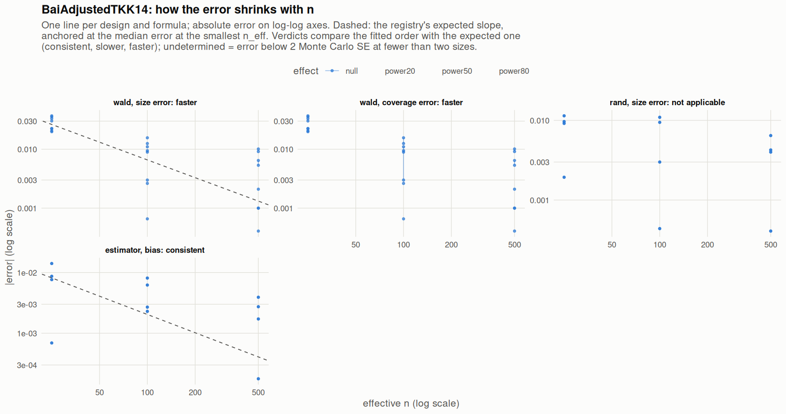

[← Campaign 2026-11-11-9d2edc5c summary](README.md)

# Class BaiAdjustedTKK14

Part of the [Classes index](classes.md). Response type: continuous. Status: null effect complete, power effects not started. Verdict: **pass so far**.

<picture><source media="(prefers-color-scheme: dark)" srcset="figures/class-BaiAdjustedTKK14-dark.png"></picture>

Convergence verdicts (worst over designs, formulas and effects; provisional until the class is complete):

| procedure | metric | verdict |
|---|---|---|
| estimator (bias) | bias | consistent |
| wald | coverage | faster |
| rand | size | not applicable |
| wald | size | faster |

Null effect: 48 cells (0 failing). Size, coverage and bias / SD against the level each is held to.

| design | n | formula | procedure | size | coverage | bias / SD | size level | coverage level | verdict |
|---|---|---|---|---|---|---|---|---|---|
| Fixed:BinaryMatch | 50 | `~.` | rand | 0.0592 |  | 0.043 | 0.05 | 0.95 | ok |
| Fixed:BinaryMatch | 200 | `~.` | rand | 0.0609 |  | -0.017 | 0.05 | 0.95 | ok |
| Fixed:BinaryMatch | 1000 | `~.` | rand | 0.054 |  | -0.0028 | 0.05 | 0.95 | ok |
| Fixed:BinaryMatch | 50 | `~.` | wald | 0.0723 | 0.928 | 0.043 | 0.1 | 0.9 | ok |
| Fixed:BinaryMatch | 200 | `~.` | wald | 0.0625 | 0.938 | -0.017 | 0.075 | 0.925 | ok |
| Fixed:BinaryMatch | 1000 | `~.` | wald | 0.049 | 0.951 | -0.0028 | 0.055 | 0.945 | ok |
| Fixed:BinaryMatch | 50 | `~1` | rand | 0.0592 |  | 0.043 | 0.05 | 0.95 | ok |
| Fixed:BinaryMatch | 200 | `~1` | rand | 0.0609 |  | -0.017 | 0.05 | 0.95 | ok |
| Fixed:BinaryMatch | 1000 | `~1` | rand | 0.054 |  | -0.0028 | 0.05 | 0.95 | ok |
| Fixed:BinaryMatch | 50 | `~1` | wald | 0.0705 | 0.93 | 0.043 | 0.1 | 0.9 | ok |
| Fixed:BinaryMatch | 200 | `~1` | wald | 0.0656 | 0.934 | -0.017 | 0.075 | 0.925 | ok |
| Fixed:BinaryMatch | 1000 | `~1` | wald | 0.049 | 0.951 | -0.0028 | 0.055 | 0.945 | ok |
| SeqOneByOne:KK14 | 50 | `~.` | rand | 0.0481 |  | 0.0017 | 0.05 | 0.95 | ok |
| SeqOneByOne:KK14 | 200 | `~.` | rand | 0.053 |  | -0.037 | 0.05 | 0.95 | ok |
| SeqOneByOne:KK14 | 1000 | `~.` | rand | 0.0504 |  | 0.041 | 0.05 | 0.95 | ok |
| SeqOneByOne:KK14 | 50 | `~.` | wald | 0.0725 | 0.927 | 0.0017 | 0.1 | 0.9 | ok |
| SeqOneByOne:KK14 | 200 | `~.` | wald | 0.053 | 0.947 | -0.037 | 0.075 | 0.925 | ok |
| SeqOneByOne:KK14 | 1000 | `~.` | wald | 0.0504 | 0.95 | 0.041 | 0.055 | 0.945 | ok |
| SeqOneByOne:KK14 | 50 | `~1` | rand | 0.0481 |  | 0.0017 | 0.05 | 0.95 | ok |
| SeqOneByOne:KK14 | 200 | `~1` | rand | 0.053 |  | -0.037 | 0.05 | 0.95 | ok |
| SeqOneByOne:KK14 | 1000 | `~1` | rand | 0.0504 |  | 0.041 | 0.05 | 0.95 | ok |
| SeqOneByOne:KK14 | 50 | `~1` | wald | 0.0698 | 0.93 | 0.0017 | 0.1 | 0.9 | ok |
| SeqOneByOne:KK14 | 200 | `~1` | wald | 0.061 | 0.939 | -0.037 | 0.075 | 0.925 | ok |
| SeqOneByOne:KK14 | 1000 | `~1` | wald | 0.0521 | 0.948 | 0.041 | 0.055 | 0.945 | ok |
| SeqOneByOne:KK21 | 50 | `~.` | rand | 0.0597 |  | -0.021 | 0.05 | 0.95 | ok |
| SeqOneByOne:KK21 | 200 | `~.` | rand | 0.0406 |  | -0.053 | 0.05 | 0.95 | ok |
| SeqOneByOne:KK21 | 1000 | `~.` | rand | 0.0543 |  | 0.057 | 0.05 | 0.95 | ok |
| SeqOneByOne:KK21 | 50 | `~.` | wald | 0.0832 | 0.917 | -0.021 | 0.1 | 0.9 | ok |
| SeqOneByOne:KK21 | 200 | `~.` | wald | 0.0406 | 0.959 | -0.053 | 0.075 | 0.925 | ok |
| SeqOneByOne:KK21 | 1000 | `~.` | wald | 0.0591 | 0.941 | 0.057 | 0.055 | 0.945 | ok |
| SeqOneByOne:KK21 | 50 | `~1` | rand | 0.0597 |  | -0.021 | 0.05 | 0.95 | ok |
| SeqOneByOne:KK21 | 200 | `~1` | rand | 0.0406 |  | -0.053 | 0.05 | 0.95 | ok |
| SeqOneByOne:KK21 | 1000 | `~1` | rand | 0.0543 |  | 0.057 | 0.05 | 0.95 | ok |
| SeqOneByOne:KK21 | 50 | `~1` | wald | 0.0802 | 0.92 | -0.021 | 0.1 | 0.9 | ok |
| SeqOneByOne:KK21 | 200 | `~1` | wald | 0.0411 | 0.959 | -0.053 | 0.075 | 0.925 | ok |
| SeqOneByOne:KK21 | 1000 | `~1` | wald | 0.0601 | 0.94 | 0.057 | 0.055 | 0.945 | ok |
| SeqOneByOne:KK21stepwise | 50 | `~.` | rand | 0.0614 |  | 0.024 | 0.05 | 0.95 | ok |
| SeqOneByOne:KK21stepwise | 200 | `~.` | rand | 0.0504 |  | 0.015 | 0.05 | 0.95 | ok |
| SeqOneByOne:KK21stepwise | 1000 | `~.` | rand | 0.0564 |  | 0.026 | 0.05 | 0.95 | ok |
| SeqOneByOne:KK21stepwise | 50 | `~.` | wald | 0.0855 | 0.914 | 0.024 | 0.1 | 0.9 | ok |
| SeqOneByOne:KK21stepwise | 200 | `~.` | wald | 0.0526 | 0.947 | 0.015 | 0.075 | 0.925 | ok |
| SeqOneByOne:KK21stepwise | 1000 | `~.` | wald | 0.0553 | 0.945 | 0.026 | 0.055 | 0.945 | ok |
| SeqOneByOne:KK21stepwise | 50 | `~1` | rand | 0.0614 |  | 0.024 | 0.05 | 0.95 | ok |
| SeqOneByOne:KK21stepwise | 200 | `~1` | rand | 0.0504 |  | 0.015 | 0.05 | 0.95 | ok |
| SeqOneByOne:KK21stepwise | 1000 | `~1` | rand | 0.0564 |  | 0.026 | 0.05 | 0.95 | ok |
| SeqOneByOne:KK21stepwise | 50 | `~1` | wald | 0.0869 | 0.913 | 0.024 | 0.1 | 0.9 | ok |
| SeqOneByOne:KK21stepwise | 200 | `~1` | wald | 0.0493 | 0.951 | 0.015 | 0.075 | 0.925 | ok |
| SeqOneByOne:KK21stepwise | 1000 | `~1` | wald | 0.0564 | 0.944 | 0.026 | 0.055 | 0.945 | ok |

[← Campaign 2026-11-11-9d2edc5c summary](README.md)
