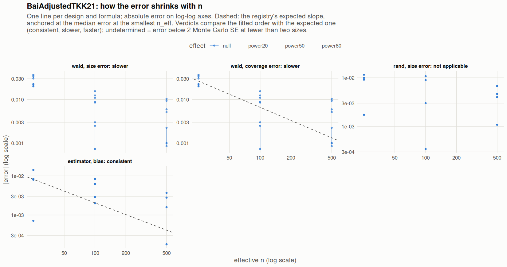

[← Campaign 2026-11-11-9d2edc5c summary](README.md)

# Class BaiAdjustedTKK21

Part of the [Classes index](classes.md). Response type: continuous. Status: null effect complete, power effects not started. Verdict: **pass so far**.

<picture><source media="(prefers-color-scheme: dark)" srcset="figures/class-BaiAdjustedTKK21-dark.png"></picture>

Convergence verdicts (worst over designs, formulas and effects; provisional until the class is complete):

| procedure | metric | verdict |
|---|---|---|
| estimator (bias) | bias | consistent |
| wald | coverage | slower |
| rand | size | not applicable |
| wald | size | slower |

Null effect: 48 cells (0 failing). Size, coverage and bias / SD against the level each is held to.

| design | n | formula | procedure | size | coverage | bias / SD | size level | coverage level | verdict |
|---|---|---|---|---|---|---|---|---|---|
| Fixed:BinaryMatch | 50 | `~.` | rand | 0.0591 |  | 0.044 | 0.05 | 0.95 | ok |
| Fixed:BinaryMatch | 200 | `~.` | rand | 0.0607 |  | -0.019 | 0.05 | 0.95 | ok |
| Fixed:BinaryMatch | 1000 | `~.` | rand | 0.054 |  | -0.0028 | 0.05 | 0.95 | ok |
| Fixed:BinaryMatch | 50 | `~.` | wald | 0.0725 | 0.928 | 0.044 | 0.1 | 0.9 | ok |
| Fixed:BinaryMatch | 200 | `~.` | wald | 0.0624 | 0.938 | -0.019 | 0.075 | 0.925 | ok |
| Fixed:BinaryMatch | 1000 | `~.` | wald | 0.049 | 0.951 | -0.0028 | 0.055 | 0.945 | ok |
| Fixed:BinaryMatch | 50 | `~1` | rand | 0.0591 |  | 0.044 | 0.05 | 0.95 | ok |
| Fixed:BinaryMatch | 200 | `~1` | rand | 0.0607 |  | -0.019 | 0.05 | 0.95 | ok |
| Fixed:BinaryMatch | 1000 | `~1` | rand | 0.054 |  | -0.0028 | 0.05 | 0.95 | ok |
| Fixed:BinaryMatch | 50 | `~1` | wald | 0.0704 | 0.93 | 0.044 | 0.1 | 0.9 | ok |
| Fixed:BinaryMatch | 200 | `~1` | wald | 0.0655 | 0.934 | -0.019 | 0.075 | 0.925 | ok |
| Fixed:BinaryMatch | 1000 | `~1` | wald | 0.049 | 0.951 | -0.0028 | 0.055 | 0.945 | ok |
| SeqOneByOne:KK14 | 50 | `~.` | rand | 0.0483 |  | 0.0018 | 0.05 | 0.95 | ok |
| SeqOneByOne:KK14 | 200 | `~.` | rand | 0.053 |  | -0.037 | 0.05 | 0.95 | ok |
| SeqOneByOne:KK14 | 1000 | `~.` | rand | 0.0511 |  | 0.042 | 0.05 | 0.95 | ok |
| SeqOneByOne:KK14 | 50 | `~.` | wald | 0.0726 | 0.927 | 0.0018 | 0.1 | 0.9 | ok |
| SeqOneByOne:KK14 | 200 | `~.` | wald | 0.053 | 0.947 | -0.037 | 0.075 | 0.925 | ok |
| SeqOneByOne:KK14 | 1000 | `~.` | wald | 0.0509 | 0.949 | 0.042 | 0.055 | 0.945 | ok |
| SeqOneByOne:KK14 | 50 | `~1` | rand | 0.0483 |  | 0.0018 | 0.05 | 0.95 | ok |
| SeqOneByOne:KK14 | 200 | `~1` | rand | 0.053 |  | -0.037 | 0.05 | 0.95 | ok |
| SeqOneByOne:KK14 | 1000 | `~1` | rand | 0.0511 |  | 0.042 | 0.05 | 0.95 | ok |
| SeqOneByOne:KK14 | 50 | `~1` | wald | 0.0701 | 0.93 | 0.0018 | 0.1 | 0.9 | ok |
| SeqOneByOne:KK14 | 200 | `~1` | wald | 0.061 | 0.939 | -0.037 | 0.075 | 0.925 | ok |
| SeqOneByOne:KK14 | 1000 | `~1` | wald | 0.0523 | 0.948 | 0.042 | 0.055 | 0.945 | ok |
| SeqOneByOne:KK21 | 50 | `~.` | rand | 0.0599 |  | -0.022 | 0.05 | 0.95 | ok |
| SeqOneByOne:KK21 | 200 | `~.` | rand | 0.0411 |  | -0.055 | 0.05 | 0.95 | ok |
| SeqOneByOne:KK21 | 1000 | `~.` | rand | 0.0546 |  | 0.054 | 0.05 | 0.95 | ok |
| SeqOneByOne:KK21 | 50 | `~.` | wald | 0.0833 | 0.917 | -0.022 | 0.1 | 0.9 | ok |
| SeqOneByOne:KK21 | 200 | `~.` | wald | 0.0411 | 0.959 | -0.055 | 0.075 | 0.925 | ok |
| SeqOneByOne:KK21 | 1000 | `~.` | wald | 0.0594 | 0.941 | 0.054 | 0.055 | 0.945 | ok |
| SeqOneByOne:KK21 | 50 | `~1` | rand | 0.0599 |  | -0.022 | 0.05 | 0.95 | ok |
| SeqOneByOne:KK21 | 200 | `~1` | rand | 0.0411 |  | -0.055 | 0.05 | 0.95 | ok |
| SeqOneByOne:KK21 | 1000 | `~1` | rand | 0.0546 |  | 0.054 | 0.05 | 0.95 | ok |
| SeqOneByOne:KK21 | 50 | `~1` | wald | 0.0804 | 0.92 | -0.022 | 0.1 | 0.9 | ok |
| SeqOneByOne:KK21 | 200 | `~1` | wald | 0.0415 | 0.959 | -0.055 | 0.075 | 0.925 | ok |
| SeqOneByOne:KK21 | 1000 | `~1` | wald | 0.0604 | 0.94 | 0.054 | 0.055 | 0.945 | ok |
| SeqOneByOne:KK21stepwise | 50 | `~.` | rand | 0.0615 |  | 0.023 | 0.05 | 0.95 | ok |
| SeqOneByOne:KK21stepwise | 200 | `~.` | rand | 0.0503 |  | 0.013 | 0.05 | 0.95 | ok |
| SeqOneByOne:KK21stepwise | 1000 | `~.` | rand | 0.0567 |  | 0.024 | 0.05 | 0.95 | ok |
| SeqOneByOne:KK21stepwise | 50 | `~.` | wald | 0.0856 | 0.914 | 0.023 | 0.1 | 0.9 | ok |
| SeqOneByOne:KK21stepwise | 200 | `~.` | wald | 0.0525 | 0.948 | 0.013 | 0.075 | 0.925 | ok |
| SeqOneByOne:KK21stepwise | 1000 | `~.` | wald | 0.0552 | 0.945 | 0.024 | 0.055 | 0.945 | ok |
| SeqOneByOne:KK21stepwise | 50 | `~1` | rand | 0.0615 |  | 0.023 | 0.05 | 0.95 | ok |
| SeqOneByOne:KK21stepwise | 200 | `~1` | rand | 0.0503 |  | 0.013 | 0.05 | 0.95 | ok |
| SeqOneByOne:KK21stepwise | 1000 | `~1` | rand | 0.0567 |  | 0.024 | 0.05 | 0.95 | ok |
| SeqOneByOne:KK21stepwise | 50 | `~1` | wald | 0.0872 | 0.913 | 0.023 | 0.1 | 0.9 | ok |
| SeqOneByOne:KK21stepwise | 200 | `~1` | wald | 0.0493 | 0.951 | 0.013 | 0.075 | 0.925 | ok |
| SeqOneByOne:KK21stepwise | 1000 | `~1` | wald | 0.056 | 0.944 | 0.024 | 0.055 | 0.945 | ok |

[← Campaign 2026-11-11-9d2edc5c summary](README.md)
