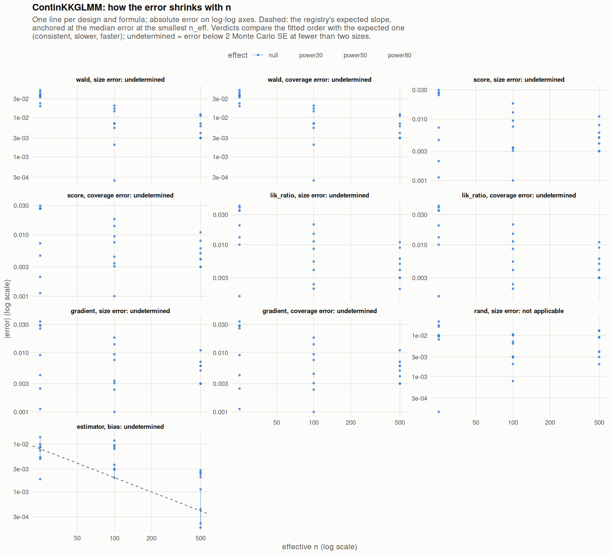

[← Campaign 2026-11-11-9d2edc5c summary](README.md)

# Class ContinKKGLMM

Part of the [Classes index](classes.md). Response type: continuous. Status: null effect complete, power effects not started. Verdict: **pass so far** (3 flagged test(s): 0 failing, 0 pending, 3 cleared).

<picture><source media="(prefers-color-scheme: dark)" srcset="figures/class-ContinKKGLMM-dark.png"></picture>

Convergence verdicts (worst over designs, formulas and effects; provisional until the class is complete):

| procedure | metric | verdict |
|---|---|---|
| estimator (bias) | bias | undetermined |
| gradient | coverage | undetermined |
| lik_ratio | coverage | undetermined |
| score | coverage | undetermined |
| wald | coverage | undetermined |
| gradient | size | undetermined |
| lik_ratio | size | undetermined |
| rand | size | not applicable |
| score | size | undetermined |
| wald | size | undetermined |

Null effect: 120 cells (0 failing). Size, coverage and bias / SD against the level each is held to.

| design | n | formula | procedure | size | coverage | bias / SD | size level | coverage level | verdict |
|---|---|---|---|---|---|---|---|---|---|
| Fixed:BinaryMatch | 50 | `~.` | gradient | 0.0756 | 0.924 | 0.034 | 0.1 | 0.9 | ok |
| Fixed:BinaryMatch | 200 | `~.` | gradient | 0.0639 | 0.936 | -0.025 | 0.1 | 0.9 | ok |
| Fixed:BinaryMatch | 1000 | `~.` | gradient | 0.047 | 0.954 | 0.0068 | 0.055 | 0.945 | ok |
| Fixed:BinaryMatch | 50 | `~.` | lik_ratio | 0.0849 | 0.915 | 0.034 | 0.1 | 0.9 | ok |
| Fixed:BinaryMatch | 200 | `~.` | lik_ratio | 0.0649 | 0.935 | -0.025 | 0.1 | 0.9 | ok |
| Fixed:BinaryMatch | 1000 | `~.` | lik_ratio | 0.048 | 0.953 | 0.0068 | 0.055 | 0.945 | ok |
| Fixed:BinaryMatch | 50 | `~.` | rand | 0.0579 |  | 0.034 | 0.05 | 0.95 | ok |
| Fixed:BinaryMatch | 200 | `~.` | rand | 0.0563 |  | -0.025 | 0.05 | 0.95 | ok |
| Fixed:BinaryMatch | 1000 | `~.` | rand | 0.048 |  | 0.0068 | 0.05 | 0.95 | ok |
| Fixed:BinaryMatch | 50 | `~.` | score | 0.0746 | 0.923 | 0.034 | 0.1 | 0.9 | ok |
| Fixed:BinaryMatch | 200 | `~.` | score | 0.0628 | 0.936 | -0.025 | 0.1 | 0.9 | ok |
| Fixed:BinaryMatch | 1000 | `~.` | score | 0.046 | 0.954 | 0.0068 | 0.055 | 0.945 | ok |
| Fixed:BinaryMatch | 50 | `~.` | wald | 0.0888 | 0.911 | 0.034 | 0.1 | 0.9 | ok |
| Fixed:BinaryMatch | 200 | `~.` | wald | 0.067 | 0.933 | -0.025 | 0.1 | 0.9 | ok |
| Fixed:BinaryMatch | 1000 | `~.` | wald | 0.047 | 0.953 | 0.0068 | 0.055 | 0.945 | ok |
| Fixed:BinaryMatch | 50 | `~1` | gradient | 0.0511 | 0.949 | 0.043 | 0.1 | 0.9 | ok |
| Fixed:BinaryMatch | 200 | `~1` | gradient | 0.0594 | 0.941 | -0.019 | 0.1 | 0.9 | ok |
| Fixed:BinaryMatch | 1000 | `~1` | gradient | 0.047 | 0.953 | -0.0028 | 0.055 | 0.945 | ok |
| Fixed:BinaryMatch | 50 | `~1` | lik_ratio | 0.06 | 0.94 | 0.043 | 0.1 | 0.9 | ok |
| Fixed:BinaryMatch | 200 | `~1` | lik_ratio | 0.0613 | 0.939 | -0.019 | 0.1 | 0.9 | ok |
| Fixed:BinaryMatch | 1000 | `~1` | lik_ratio | 0.047 | 0.953 | -0.0028 | 0.055 | 0.945 | ok |
| Fixed:BinaryMatch | 50 | `~1` | rand | 0.0593 |  | 0.043 | 0.05 | 0.95 | ok |
| Fixed:BinaryMatch | 200 | `~1` | rand | 0.0606 |  | -0.019 | 0.05 | 0.95 | ok |
| Fixed:BinaryMatch | 1000 | `~1` | rand | 0.054 |  | -0.0028 | 0.05 | 0.95 | ok |
| Fixed:BinaryMatch | 50 | `~1` | score | 0.0511 | 0.949 | 0.043 | 0.1 | 0.9 | ok |
| Fixed:BinaryMatch | 200 | `~1` | score | 0.0594 | 0.941 | -0.019 | 0.1 | 0.9 | ok |
| Fixed:BinaryMatch | 1000 | `~1` | score | 0.047 | 0.953 | -0.0028 | 0.055 | 0.945 | ok |
| Fixed:BinaryMatch | 50 | `~1` | wald | 0.0728 | 0.927 | 0.043 | 0.1 | 0.9 | ok |
| Fixed:BinaryMatch | 200 | `~1` | wald | 0.0644 | 0.936 | -0.019 | 0.1 | 0.9 | ok |
| Fixed:BinaryMatch | 1000 | `~1` | wald | 0.047 | 0.953 | -0.0028 | 0.055 | 0.945 | ok |
| SeqOneByOne:KK14 | 50 | `~.` | gradient | 0.0837 | 0.916 | -0.0061 | 0.1 | 0.9 | ok |
| SeqOneByOne:KK14 | 200 | `~.` | gradient | 0.068 | 0.932 | -0.061 | 0.1 | 0.9 | ok |
| SeqOneByOne:KK14 | 1000 | `~.` | gradient | 0.044 | 0.956 | 0.032 | 0.055 | 0.945 | ok |
| SeqOneByOne:KK14 | 50 | `~.` | lik_ratio | 0.0914 | 0.909 | -0.0061 | 0.1 | 0.9 | ok |
| SeqOneByOne:KK14 | 200 | `~.` | lik_ratio | 0.071 | 0.929 | -0.061 | 0.1 | 0.9 | ok |
| SeqOneByOne:KK14 | 1000 | `~.` | lik_ratio | 0.046 | 0.954 | 0.032 | 0.055 | 0.945 | ok |
| SeqOneByOne:KK14 | 50 | `~.` | rand | 0.0676 |  | -0.0061 | 0.05 | 0.95 | ok |
| SeqOneByOne:KK14 | 200 | `~.` | rand | 0.06 |  | -0.061 | 0.05 | 0.95 | ok |
| SeqOneByOne:KK14 | 1000 | `~.` | rand | 0.047 |  | 0.032 | 0.05 | 0.95 | ok |
| SeqOneByOne:KK14 | 50 | `~.` | score | 0.0797 | 0.92 | -0.0061 | 0.1 | 0.9 | ok |
| SeqOneByOne:KK14 | 200 | `~.` | score | 0.068 | 0.932 | -0.061 | 0.1 | 0.9 | ok |
| SeqOneByOne:KK14 | 1000 | `~.` | score | 0.045 | 0.954 | 0.032 | 0.055 | 0.945 | ok |
| SeqOneByOne:KK14 | 50 | `~.` | wald | 0.0938 | 0.906 | -0.0061 | 0.1 | 0.9 | ok |
| SeqOneByOne:KK14 | 200 | `~.` | wald | 0.07 | 0.93 | -0.061 | 0.1 | 0.9 | ok |
| SeqOneByOne:KK14 | 1000 | `~.` | wald | 0.047 | 0.953 | 0.032 | 0.055 | 0.945 | ok |
| SeqOneByOne:KK14 | 50 | `~1` | gradient | 0.0475 | 0.952 | -0.025 | 0.1 | 0.9 | ok |
| SeqOneByOne:KK14 | 200 | `~1` | gradient | 0.051 | 0.949 | -0.05 | 0.1 | 0.9 | ok |
| SeqOneByOne:KK14 | 1000 | `~1` | gradient | 0.057 | 0.943 | 0.038 | 0.055 | 0.945 | ok |
| SeqOneByOne:KK14 | 50 | `~1` | lik_ratio | 0.0515 | 0.948 | -0.025 | 0.1 | 0.9 | ok |
| SeqOneByOne:KK14 | 200 | `~1` | lik_ratio | 0.054 | 0.946 | -0.05 | 0.1 | 0.9 | ok |
| SeqOneByOne:KK14 | 1000 | `~1` | lik_ratio | 0.059 | 0.941 | 0.038 | 0.055 | 0.945 | ok |
| SeqOneByOne:KK14 | 50 | `~1` | rand | 0.0501 |  | -0.025 | 0.05 | 0.95 | ok |
| SeqOneByOne:KK14 | 200 | `~1` | rand | 0.057 |  | -0.05 | 0.05 | 0.95 | ok |
| SeqOneByOne:KK14 | 1000 | `~1` | rand | 0.059 |  | 0.038 | 0.05 | 0.95 | ok |
| SeqOneByOne:KK14 | 50 | `~1` | score | 0.0454 | 0.955 | -0.025 | 0.1 | 0.9 | ok |
| SeqOneByOne:KK14 | 200 | `~1` | score | 0.051 | 0.949 | -0.05 | 0.1 | 0.9 | ok |
| SeqOneByOne:KK14 | 1000 | `~1` | score | 0.058 | 0.942 | 0.038 | 0.055 | 0.945 | ok |
| SeqOneByOne:KK14 | 50 | `~1` | wald | 0.0694 | 0.931 | -0.025 | 0.1 | 0.9 | ok |
| SeqOneByOne:KK14 | 200 | `~1` | wald | 0.057 | 0.943 | -0.05 | 0.1 | 0.9 | ok |
| SeqOneByOne:KK14 | 1000 | `~1` | wald | 0.061 | 0.939 | 0.038 | 0.055 | 0.945 | ok |
| SeqOneByOne:KK21 | 50 | `~.` | gradient | 0.0787 | 0.921 | -0.016 | 0.1 | 0.9 | ok |
| SeqOneByOne:KK21 | 200 | `~.` | gradient | 0.0534 | 0.946 | -0.086 | 0.1 | 0.9 | ok |
| SeqOneByOne:KK21 | 1000 | `~.` | gradient | 0.056 | 0.944 | 0.044 | 0.055 | 0.945 | ok |
| SeqOneByOne:KK21 | 50 | `~.` | lik_ratio | 0.0847 | 0.915 | -0.016 | 0.1 | 0.9 | ok |
| SeqOneByOne:KK21 | 200 | `~.` | lik_ratio | 0.0554 | 0.945 | -0.086 | 0.1 | 0.9 | ok |
| SeqOneByOne:KK21 | 1000 | `~.` | lik_ratio | 0.056 | 0.944 | 0.044 | 0.055 | 0.945 | ok |
| SeqOneByOne:KK21 | 50 | `~.` | rand | 0.0717 |  | -0.016 | 0.05 | 0.95 | ok |
| SeqOneByOne:KK21 | 200 | `~.` | rand | 0.048 |  | -0.086 | 0.05 | 0.95 | ok |
| SeqOneByOne:KK21 | 1000 | `~.` | rand | 0.063 |  | 0.044 | 0.05 | 0.95 | ok |
| SeqOneByOne:KK21 | 50 | `~.` | score | 0.0766 | 0.923 | -0.016 | 0.1 | 0.9 | ok |
| SeqOneByOne:KK21 | 200 | `~.` | score | 0.0534 | 0.946 | -0.086 | 0.1 | 0.9 | ok |
| SeqOneByOne:KK21 | 1000 | `~.` | score | 0.056 | 0.944 | 0.044 | 0.055 | 0.945 | ok |
| SeqOneByOne:KK21 | 50 | `~.` | wald | 0.0861 | 0.914 | -0.016 | 0.1 | 0.9 | ok |
| SeqOneByOne:KK21 | 200 | `~.` | wald | 0.0554 | 0.945 | -0.086 | 0.1 | 0.9 | ok |
| SeqOneByOne:KK21 | 1000 | `~.` | wald | 0.054 | 0.946 | 0.044 | 0.055 | 0.945 | ok |
| SeqOneByOne:KK21 | 50 | `~1` | gradient | 0.0542 | 0.946 | -0.021 | 0.1 | 0.9 | ok |
| SeqOneByOne:KK21 | 200 | `~1` | gradient | 0.0469 | 0.953 | -0.063 | 0.1 | 0.9 | ok |
| SeqOneByOne:KK21 | 1000 | `~1` | gradient | 0.061 | 0.939 | 0.034 | 0.055 | 0.945 | ok |
| SeqOneByOne:KK21 | 50 | `~1` | lik_ratio | 0.0631 | 0.937 | -0.021 | 0.1 | 0.9 | ok |
| SeqOneByOne:KK21 | 200 | `~1` | lik_ratio | 0.048 | 0.952 | -0.063 | 0.1 | 0.9 | ok |
| SeqOneByOne:KK21 | 1000 | `~1` | lik_ratio | 0.061 | 0.939 | 0.034 | 0.055 | 0.945 | ok |
| SeqOneByOne:KK21 | 50 | `~1` | rand | 0.0598 |  | -0.021 | 0.05 | 0.95 | ok |
| SeqOneByOne:KK21 | 200 | `~1` | rand | 0.0469 |  | -0.063 | 0.05 | 0.95 | ok |
| SeqOneByOne:KK21 | 1000 | `~1` | rand | 0.063 |  | 0.034 | 0.05 | 0.95 | ok |
| SeqOneByOne:KK21 | 50 | `~1` | score | 0.0521 | 0.948 | -0.021 | 0.1 | 0.9 | ok |
| SeqOneByOne:KK21 | 200 | `~1` | score | 0.0469 | 0.953 | -0.063 | 0.1 | 0.9 | ok |
| SeqOneByOne:KK21 | 1000 | `~1` | score | 0.061 | 0.939 | 0.034 | 0.055 | 0.945 | ok |
| SeqOneByOne:KK21 | 50 | `~1` | wald | 0.0826 | 0.917 | -0.021 | 0.1 | 0.9 | ok |
| SeqOneByOne:KK21 | 200 | `~1` | wald | 0.048 | 0.952 | -0.063 | 0.1 | 0.9 | ok |
| SeqOneByOne:KK21 | 1000 | `~1` | wald | 0.062 | 0.938 | 0.034 | 0.055 | 0.945 | ok |
| SeqOneByOne:KK21stepwise | 50 | `~.` | gradient | 0.079 | 0.922 | 0.029 | 0.1 | 0.9 | ok |
| SeqOneByOne:KK21stepwise | 200 | `~.` | gradient | 0.0575 | 0.942 | -0.021 | 0.1 | 0.9 | ok |
| SeqOneByOne:KK21stepwise | 1000 | `~.` | gradient | 0.053 | 0.947 | 0.0035 | 0.055 | 0.945 | ok |
| SeqOneByOne:KK21stepwise | 50 | `~.` | lik_ratio | 0.0889 | 0.911 | 0.029 | 0.1 | 0.9 | ok |
| SeqOneByOne:KK21stepwise | 200 | `~.` | lik_ratio | 0.0586 | 0.941 | -0.021 | 0.1 | 0.9 | ok |
| SeqOneByOne:KK21stepwise | 1000 | `~.` | lik_ratio | 0.053 | 0.947 | 0.0035 | 0.055 | 0.945 | ok |
| SeqOneByOne:KK21stepwise | 50 | `~.` | rand | 0.0602 |  | 0.029 | 0.05 | 0.95 | ok |
| SeqOneByOne:KK21stepwise | 200 | `~.` | rand | 0.0492 |  | -0.021 | 0.05 | 0.95 | ok |
| SeqOneByOne:KK21stepwise | 1000 | `~.` | rand | 0.054 |  | 0.0035 | 0.05 | 0.95 | ok |
| SeqOneByOne:KK21stepwise | 50 | `~.` | score | 0.0771 | 0.923 | 0.029 | 0.1 | 0.9 | ok |
| SeqOneByOne:KK21stepwise | 200 | `~.` | score | 0.0575 | 0.942 | -0.021 | 0.1 | 0.9 | ok |
| SeqOneByOne:KK21stepwise | 1000 | `~.` | score | 0.053 | 0.947 | 0.0035 | 0.055 | 0.945 | ok |
| SeqOneByOne:KK21stepwise | 50 | `~.` | wald | 0.0998 | 0.9 | 0.029 | 0.1 | 0.9 | ok |
| SeqOneByOne:KK21stepwise | 200 | `~.` | wald | 0.057 | 0.943 | -0.021 | 0.1 | 0.9 | ok |
| SeqOneByOne:KK21stepwise | 1000 | `~.` | wald | 0.057 | 0.943 | 0.0035 | 0.055 | 0.945 | ok |
| SeqOneByOne:KK21stepwise | 50 | `~1` | gradient | 0.0591 | 0.941 | 0.015 | 0.1 | 0.9 | ok |
| SeqOneByOne:KK21stepwise | 200 | `~1` | gradient | 0.0476 | 0.952 | 0.013 | 0.1 | 0.9 | ok |
| SeqOneByOne:KK21stepwise | 1000 | `~1` | gradient | 0.055 | 0.945 | 0.017 | 0.055 | 0.945 | ok |
| SeqOneByOne:KK21stepwise | 50 | `~1` | lik_ratio | 0.0702 | 0.93 | 0.015 | 0.1 | 0.9 | ok |
| SeqOneByOne:KK21stepwise | 200 | `~1` | lik_ratio | 0.0476 | 0.952 | 0.013 | 0.1 | 0.9 | ok |
| SeqOneByOne:KK21stepwise | 1000 | `~1` | lik_ratio | 0.055 | 0.945 | 0.017 | 0.055 | 0.945 | ok |
| SeqOneByOne:KK21stepwise | 50 | `~1` | rand | 0.0663 |  | 0.015 | 0.05 | 0.95 | ok |
| SeqOneByOne:KK21stepwise | 200 | `~1` | rand | 0.0471 |  | 0.013 | 0.05 | 0.95 | ok |
| SeqOneByOne:KK21stepwise | 1000 | `~1` | rand | 0.059 |  | 0.017 | 0.05 | 0.95 | ok |
| SeqOneByOne:KK21stepwise | 50 | `~1` | score | 0.0573 | 0.943 | 0.015 | 0.1 | 0.9 | ok |
| SeqOneByOne:KK21stepwise | 200 | `~1` | score | 0.0466 | 0.953 | 0.013 | 0.1 | 0.9 | ok |
| SeqOneByOne:KK21stepwise | 1000 | `~1` | score | 0.055 | 0.945 | 0.017 | 0.055 | 0.945 | ok |
| SeqOneByOne:KK21stepwise | 50 | `~1` | wald | 0.0853 | 0.915 | 0.015 | 0.1 | 0.9 | ok |
| SeqOneByOne:KK21stepwise | 200 | `~1` | wald | 0.0498 | 0.95 | 0.013 | 0.1 | 0.9 | ok |
| SeqOneByOne:KK21stepwise | 1000 | `~1` | wald | 0.056 | 0.944 | 0.017 | 0.055 | 0.945 | ok |

[← Campaign 2026-11-11-9d2edc5c summary](README.md)
