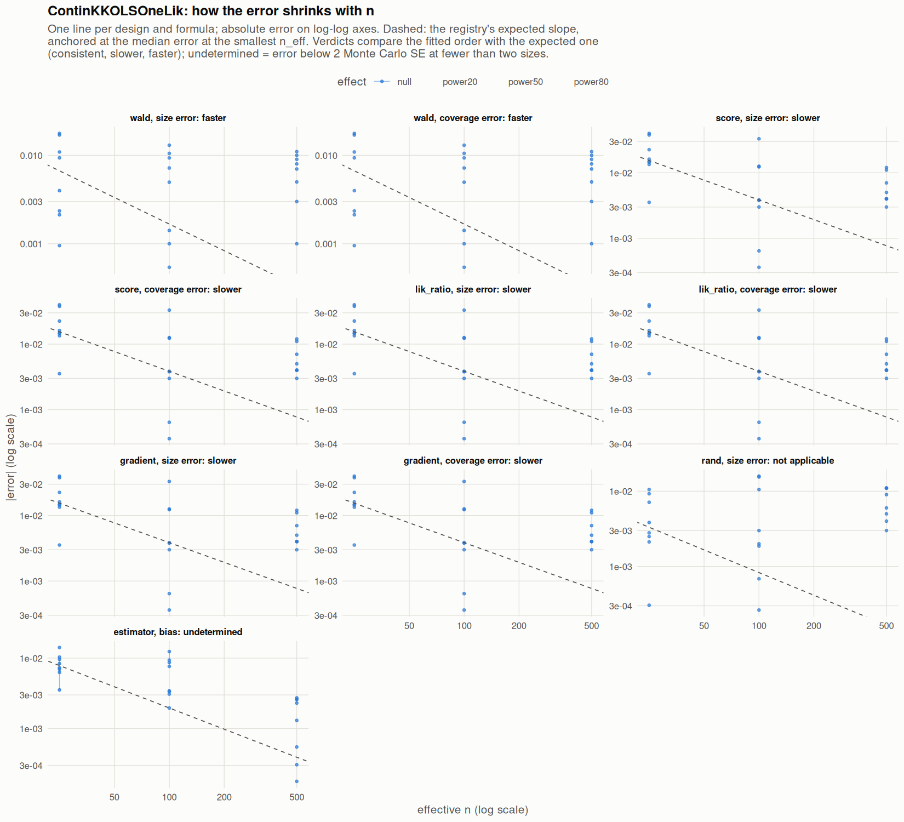

[← Campaign 2026-11-11-9d2edc5c summary](README.md)

# Class ContinKKOLSOneLik

Part of the [Classes index](classes.md). Response type: continuous. Status: null effect complete, power effects not started. Verdict: **pending confirmation** (1 flagged test(s): 0 failing, 1 pending, 0 cleared).

<picture><source media="(prefers-color-scheme: dark)" srcset="figures/class-ContinKKOLSOneLik-dark.png"></picture>

Convergence verdicts (worst over designs, formulas and effects; provisional until the class is complete):

| procedure | metric | verdict |
|---|---|---|
| estimator (bias) | bias | undetermined |
| gradient | coverage | slower |
| lik_ratio | coverage | slower |
| score | coverage | slower |
| wald | coverage | faster |
| gradient | size | slower |
| lik_ratio | size | slower |
| rand | size | not applicable |
| score | size | slower |
| wald | size | faster |

Null effect: 120 cells (1 failing). Size, coverage and bias / SD against the level each is held to.

| design | n | formula | procedure | size | coverage | bias / SD | size level | coverage level | verdict |
|---|---|---|---|---|---|---|---|---|---|
| Fixed:BinaryMatch | 50 | `~.` | gradient | 0.0725 | 0.928 | 0.031 | 0.1 | 0.9 | ok |
| Fixed:BinaryMatch | 200 | `~.` | gradient | 0.0626 | 0.937 | -0.023 | 0.075 | 0.925 | ok |
| Fixed:BinaryMatch | 1000 | `~.` | gradient | 0.045 | 0.955 | 0.0087 | 0.055 | 0.945 | ok |
| Fixed:BinaryMatch | 50 | `~.` | lik_ratio | 0.0725 | 0.928 | 0.031 | 0.1 | 0.9 | ok |
| Fixed:BinaryMatch | 200 | `~.` | lik_ratio | 0.0626 | 0.937 | -0.023 | 0.075 | 0.925 | ok |
| Fixed:BinaryMatch | 1000 | `~.` | lik_ratio | 0.045 | 0.955 | 0.0087 | 0.055 | 0.945 | ok |
| Fixed:BinaryMatch | 50 | `~.` | rand | 0.0462 |  | 0.031 | 0.05 | 0.95 | ok |
| Fixed:BinaryMatch | 200 | `~.` | rand | 0.0503 |  | -0.023 | 0.05 | 0.95 | ok |
| Fixed:BinaryMatch | 1000 | `~.` | rand | 0.045 |  | 0.0087 | 0.05 | 0.95 | ok |
| Fixed:BinaryMatch | 50 | `~.` | score | 0.0725 | 0.928 | 0.031 | 0.1 | 0.9 | ok |
| Fixed:BinaryMatch | 200 | `~.` | score | 0.0626 | 0.937 | -0.023 | 0.075 | 0.925 | ok |
| Fixed:BinaryMatch | 1000 | `~.` | score | 0.045 | 0.955 | 0.0087 | 0.055 | 0.945 | ok |
| Fixed:BinaryMatch | 50 | `~.` | wald | 0.0677 | 0.932 | 0.031 | 0.1 | 0.9 | ok |
| Fixed:BinaryMatch | 200 | `~.` | wald | 0.0605 | 0.939 | -0.023 | 0.075 | 0.925 | ok |
| Fixed:BinaryMatch | 1000 | `~.` | wald | 0.043 | 0.957 | 0.0087 | 0.055 | 0.945 | ok |
| Fixed:BinaryMatch | 50 | `~1` | gradient | 0.0647 | 0.935 | 0.044 | 0.1 | 0.9 | ok |
| Fixed:BinaryMatch | 200 | `~1` | gradient | 0.0623 | 0.938 | -0.02 | 0.075 | 0.925 | ok |
| Fixed:BinaryMatch | 1000 | `~1` | gradient | 0.047 | 0.953 | -0.0028 | 0.055 | 0.945 | ok |
| Fixed:BinaryMatch | 50 | `~1` | lik_ratio | 0.0647 | 0.935 | 0.044 | 0.1 | 0.9 | ok |
| Fixed:BinaryMatch | 200 | `~1` | lik_ratio | 0.0623 | 0.938 | -0.02 | 0.075 | 0.925 | ok |
| Fixed:BinaryMatch | 1000 | `~1` | lik_ratio | 0.047 | 0.953 | -0.0028 | 0.055 | 0.945 | ok |
| Fixed:BinaryMatch | 50 | `~1` | rand | 0.0593 |  | 0.044 | 0.05 | 0.95 | ok |
| Fixed:BinaryMatch | 200 | `~1` | rand | 0.0605 |  | -0.02 | 0.05 | 0.95 | **FAIL** |
| Fixed:BinaryMatch | 1000 | `~1` | rand | 0.054 |  | -0.0028 | 0.05 | 0.95 | ok |
| Fixed:BinaryMatch | 50 | `~1` | score | 0.0647 | 0.935 | 0.044 | 0.1 | 0.9 | ok |
| Fixed:BinaryMatch | 200 | `~1` | score | 0.0623 | 0.938 | -0.02 | 0.075 | 0.925 | ok |
| Fixed:BinaryMatch | 1000 | `~1` | score | 0.047 | 0.953 | -0.0028 | 0.055 | 0.945 | ok |
| Fixed:BinaryMatch | 50 | `~1` | wald | 0.0521 | 0.948 | 0.044 | 0.1 | 0.9 | ok |
| Fixed:BinaryMatch | 200 | `~1` | wald | 0.0593 | 0.941 | -0.02 | 0.075 | 0.925 | ok |
| Fixed:BinaryMatch | 1000 | `~1` | wald | 0.047 | 0.953 | -0.0028 | 0.055 | 0.945 | ok |
| SeqOneByOne:KK14 | 50 | `~.` | gradient | 0.0898 | 0.91 | -0.011 | 0.1 | 0.9 | ok |
| SeqOneByOne:KK14 | 200 | `~.` | gradient | 0.083 | 0.917 | -0.058 | 0.075 | 0.925 | ok |
| SeqOneByOne:KK14 | 1000 | `~.` | gradient | 0.043 | 0.957 | 0.037 | 0.055 | 0.945 | ok |
| SeqOneByOne:KK14 | 50 | `~.` | lik_ratio | 0.0898 | 0.91 | -0.011 | 0.1 | 0.9 | ok |
| SeqOneByOne:KK14 | 200 | `~.` | lik_ratio | 0.083 | 0.917 | -0.058 | 0.075 | 0.925 | ok |
| SeqOneByOne:KK14 | 1000 | `~.` | lik_ratio | 0.043 | 0.957 | 0.037 | 0.055 | 0.945 | ok |
| SeqOneByOne:KK14 | 50 | `~.` | rand | 0.0528 |  | -0.011 | 0.05 | 0.95 | ok |
| SeqOneByOne:KK14 | 200 | `~.` | rand | 0.052 |  | -0.058 | 0.05 | 0.95 | ok |
| SeqOneByOne:KK14 | 1000 | `~.` | rand | 0.044 |  | 0.037 | 0.05 | 0.95 | ok |
| SeqOneByOne:KK14 | 50 | `~.` | score | 0.0898 | 0.91 | -0.011 | 0.1 | 0.9 | ok |
| SeqOneByOne:KK14 | 200 | `~.` | score | 0.083 | 0.917 | -0.058 | 0.075 | 0.925 | ok |
| SeqOneByOne:KK14 | 1000 | `~.` | score | 0.043 | 0.957 | 0.037 | 0.055 | 0.945 | ok |
| SeqOneByOne:KK14 | 50 | `~.` | wald | 0.054 | 0.946 | -0.011 | 0.1 | 0.9 | ok |
| SeqOneByOne:KK14 | 200 | `~.` | wald | 0.063 | 0.937 | -0.058 | 0.075 | 0.925 | ok |
| SeqOneByOne:KK14 | 1000 | `~.` | wald | 0.041 | 0.959 | 0.037 | 0.055 | 0.945 | ok |
| SeqOneByOne:KK14 | 50 | `~1` | gradient | 0.0535 | 0.946 | -0.02 | 0.1 | 0.9 | ok |
| SeqOneByOne:KK14 | 200 | `~1` | gradient | 0.047 | 0.953 | -0.048 | 0.075 | 0.925 | ok |
| SeqOneByOne:KK14 | 1000 | `~1` | gradient | 0.054 | 0.946 | 0.039 | 0.055 | 0.945 | ok |
| SeqOneByOne:KK14 | 50 | `~1` | lik_ratio | 0.0535 | 0.946 | -0.02 | 0.1 | 0.9 | ok |
| SeqOneByOne:KK14 | 200 | `~1` | lik_ratio | 0.047 | 0.953 | -0.048 | 0.075 | 0.925 | ok |
| SeqOneByOne:KK14 | 1000 | `~1` | lik_ratio | 0.054 | 0.946 | 0.039 | 0.055 | 0.945 | ok |
| SeqOneByOne:KK14 | 50 | `~1` | rand | 0.0525 |  | -0.02 | 0.05 | 0.95 | ok |
| SeqOneByOne:KK14 | 200 | `~1` | rand | 0.053 |  | -0.048 | 0.05 | 0.95 | ok |
| SeqOneByOne:KK14 | 1000 | `~1` | rand | 0.061 |  | 0.039 | 0.05 | 0.95 | ok |
| SeqOneByOne:KK14 | 50 | `~1` | score | 0.0535 | 0.946 | -0.02 | 0.1 | 0.9 | ok |
| SeqOneByOne:KK14 | 200 | `~1` | score | 0.047 | 0.953 | -0.048 | 0.075 | 0.925 | ok |
| SeqOneByOne:KK14 | 1000 | `~1` | score | 0.054 | 0.946 | 0.039 | 0.055 | 0.945 | ok |
| SeqOneByOne:KK14 | 50 | `~1` | wald | 0.0523 | 0.948 | -0.02 | 0.1 | 0.9 | ok |
| SeqOneByOne:KK14 | 200 | `~1` | wald | 0.051 | 0.949 | -0.048 | 0.075 | 0.925 | ok |
| SeqOneByOne:KK14 | 1000 | `~1` | wald | 0.058 | 0.942 | 0.039 | 0.055 | 0.945 | ok |
| SeqOneByOne:KK21 | 50 | `~.` | gradient | 0.0877 | 0.912 | -0.022 | 0.1 | 0.9 | ok |
| SeqOneByOne:KK21 | 200 | `~.` | gradient | 0.0506 | 0.949 | -0.088 | 0.075 | 0.925 | ok |
| SeqOneByOne:KK21 | 1000 | `~.` | gradient | 0.062 | 0.938 | 0.042 | 0.055 | 0.945 | ok |
| SeqOneByOne:KK21 | 50 | `~.` | lik_ratio | 0.0877 | 0.912 | -0.022 | 0.1 | 0.9 | ok |
| SeqOneByOne:KK21 | 200 | `~.` | lik_ratio | 0.0506 | 0.949 | -0.088 | 0.075 | 0.925 | ok |
| SeqOneByOne:KK21 | 1000 | `~.` | lik_ratio | 0.062 | 0.938 | 0.042 | 0.055 | 0.945 | ok |
| SeqOneByOne:KK21 | 50 | `~.` | rand | 0.0479 |  | -0.022 | 0.05 | 0.95 | ok |
| SeqOneByOne:KK21 | 200 | `~.` | rand | 0.0345 |  | -0.088 | 0.05 | 0.95 | ok |
| SeqOneByOne:KK21 | 1000 | `~.` | rand | 0.047 |  | 0.042 | 0.05 | 0.95 | ok |
| SeqOneByOne:KK21 | 50 | `~.` | score | 0.0877 | 0.912 | -0.022 | 0.1 | 0.9 | ok |
| SeqOneByOne:KK21 | 200 | `~.` | score | 0.0506 | 0.949 | -0.088 | 0.075 | 0.925 | ok |
| SeqOneByOne:KK21 | 1000 | `~.` | score | 0.062 | 0.938 | 0.042 | 0.055 | 0.945 | ok |
| SeqOneByOne:KK21 | 50 | `~.` | wald | 0.067 | 0.933 | -0.022 | 0.1 | 0.9 | ok |
| SeqOneByOne:KK21 | 200 | `~.` | wald | 0.0428 | 0.957 | -0.088 | 0.075 | 0.925 | ok |
| SeqOneByOne:KK21 | 1000 | `~.` | wald | 0.06 | 0.94 | 0.042 | 0.055 | 0.945 | ok |
| SeqOneByOne:KK21 | 50 | `~1` | gradient | 0.0634 | 0.937 | -0.024 | 0.1 | 0.9 | ok |
| SeqOneByOne:KK21 | 200 | `~1` | gradient | 0.0462 | 0.954 | -0.062 | 0.075 | 0.925 | ok |
| SeqOneByOne:KK21 | 1000 | `~1` | gradient | 0.061 | 0.939 | 0.038 | 0.055 | 0.945 | ok |
| SeqOneByOne:KK21 | 50 | `~1` | lik_ratio | 0.0634 | 0.937 | -0.024 | 0.1 | 0.9 | ok |
| SeqOneByOne:KK21 | 200 | `~1` | lik_ratio | 0.0462 | 0.954 | -0.062 | 0.075 | 0.925 | ok |
| SeqOneByOne:KK21 | 1000 | `~1` | lik_ratio | 0.061 | 0.939 | 0.038 | 0.055 | 0.945 | ok |
| SeqOneByOne:KK21 | 50 | `~1` | rand | 0.0571 |  | -0.024 | 0.05 | 0.95 | ok |
| SeqOneByOne:KK21 | 200 | `~1` | rand | 0.0493 |  | -0.062 | 0.05 | 0.95 | ok |
| SeqOneByOne:KK21 | 1000 | `~1` | rand | 0.061 |  | 0.038 | 0.05 | 0.95 | ok |
| SeqOneByOne:KK21 | 50 | `~1` | score | 0.0634 | 0.937 | -0.024 | 0.1 | 0.9 | ok |
| SeqOneByOne:KK21 | 200 | `~1` | score | 0.0462 | 0.954 | -0.062 | 0.075 | 0.925 | ok |
| SeqOneByOne:KK21 | 1000 | `~1` | score | 0.061 | 0.939 | 0.038 | 0.055 | 0.945 | ok |
| SeqOneByOne:KK21 | 50 | `~1` | wald | 0.0594 | 0.941 | -0.024 | 0.1 | 0.9 | ok |
| SeqOneByOne:KK21 | 200 | `~1` | wald | 0.045 | 0.955 | -0.062 | 0.075 | 0.925 | ok |
| SeqOneByOne:KK21 | 1000 | `~1` | wald | 0.061 | 0.939 | 0.038 | 0.055 | 0.945 | ok |
| SeqOneByOne:KK21stepwise | 50 | `~.` | gradient | 0.0661 | 0.934 | 0.03 | 0.1 | 0.9 | ok |
| SeqOneByOne:KK21stepwise | 200 | `~.` | gradient | 0.0539 | 0.946 | -0.023 | 0.075 | 0.925 | ok |
| SeqOneByOne:KK21stepwise | 1000 | `~.` | gradient | 0.054 | 0.946 | 0.0049 | 0.055 | 0.945 | ok |
| SeqOneByOne:KK21stepwise | 50 | `~.` | lik_ratio | 0.0661 | 0.934 | 0.03 | 0.1 | 0.9 | ok |
| SeqOneByOne:KK21stepwise | 200 | `~.` | lik_ratio | 0.0539 | 0.946 | -0.023 | 0.075 | 0.925 | ok |
| SeqOneByOne:KK21stepwise | 1000 | `~.` | lik_ratio | 0.054 | 0.946 | 0.0049 | 0.055 | 0.945 | ok |
| SeqOneByOne:KK21stepwise | 50 | `~.` | rand | 0.0503 |  | 0.03 | 0.05 | 0.95 | ok |
| SeqOneByOne:KK21stepwise | 200 | `~.` | rand | 0.0341 |  | -0.023 | 0.05 | 0.95 | ok |
| SeqOneByOne:KK21stepwise | 1000 | `~.` | rand | 0.041 |  | 0.0049 | 0.05 | 0.95 | ok |
| SeqOneByOne:KK21stepwise | 50 | `~.` | score | 0.0661 | 0.934 | 0.03 | 0.1 | 0.9 | ok |
| SeqOneByOne:KK21stepwise | 200 | `~.` | score | 0.0539 | 0.946 | -0.023 | 0.075 | 0.925 | ok |
| SeqOneByOne:KK21stepwise | 1000 | `~.` | score | 0.054 | 0.946 | 0.0049 | 0.055 | 0.945 | ok |
| SeqOneByOne:KK21stepwise | 50 | `~.` | wald | 0.049 | 0.951 | 0.03 | 0.1 | 0.9 | ok |
| SeqOneByOne:KK21stepwise | 200 | `~.` | wald | 0.0505 | 0.949 | -0.023 | 0.075 | 0.925 | ok |
| SeqOneByOne:KK21stepwise | 1000 | `~.` | wald | 0.051 | 0.949 | 0.0049 | 0.055 | 0.945 | ok |
| SeqOneByOne:KK21stepwise | 50 | `~1` | gradient | 0.0645 | 0.936 | 0.018 | 0.1 | 0.9 | ok |
| SeqOneByOne:KK21stepwise | 200 | `~1` | gradient | 0.0496 | 0.95 | 0.013 | 0.075 | 0.925 | ok |
| SeqOneByOne:KK21stepwise | 1000 | `~1` | gradient | 0.054 | 0.946 | 0.019 | 0.055 | 0.945 | ok |
| SeqOneByOne:KK21stepwise | 50 | `~1` | lik_ratio | 0.0645 | 0.936 | 0.018 | 0.1 | 0.9 | ok |
| SeqOneByOne:KK21stepwise | 200 | `~1` | lik_ratio | 0.0496 | 0.95 | 0.013 | 0.075 | 0.925 | ok |
| SeqOneByOne:KK21stepwise | 1000 | `~1` | lik_ratio | 0.054 | 0.946 | 0.019 | 0.055 | 0.945 | ok |
| SeqOneByOne:KK21stepwise | 50 | `~1` | rand | 0.0605 |  | 0.018 | 0.05 | 0.95 | ok |
| SeqOneByOne:KK21stepwise | 200 | `~1` | rand | 0.0481 |  | 0.013 | 0.05 | 0.95 | ok |
| SeqOneByOne:KK21stepwise | 1000 | `~1` | rand | 0.061 |  | 0.019 | 0.05 | 0.95 | ok |
| SeqOneByOne:KK21stepwise | 50 | `~1` | score | 0.0645 | 0.936 | 0.018 | 0.1 | 0.9 | ok |
| SeqOneByOne:KK21stepwise | 200 | `~1` | score | 0.0496 | 0.95 | 0.013 | 0.075 | 0.925 | ok |
| SeqOneByOne:KK21stepwise | 1000 | `~1` | score | 0.054 | 0.946 | 0.019 | 0.055 | 0.945 | ok |
| SeqOneByOne:KK21stepwise | 50 | `~1` | wald | 0.0609 | 0.939 | 0.018 | 0.1 | 0.9 | ok |
| SeqOneByOne:KK21stepwise | 200 | `~1` | wald | 0.0486 | 0.951 | 0.013 | 0.075 | 0.925 | ok |
| SeqOneByOne:KK21stepwise | 1000 | `~1` | wald | 0.055 | 0.945 | 0.019 | 0.055 | 0.945 | ok |

[← Campaign 2026-11-11-9d2edc5c summary](README.md)
