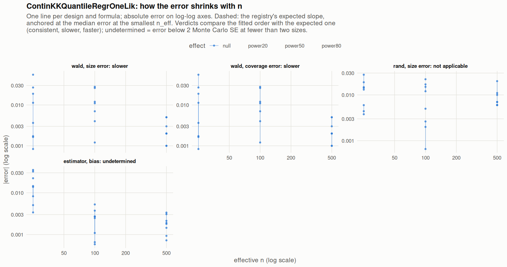

[← Campaign 2026-11-11-9d2edc5c summary](README.md)

# Class ContinKKQuantileRegrOneLik

Part of the [Classes index](classes.md). Response type: continuous. Status: null effect complete, power effects not started. Verdict: **pass so far**.

<picture><source media="(prefers-color-scheme: dark)" srcset="figures/class-ContinKKQuantileRegrOneLik-dark.png"></picture>

Convergence verdicts (worst over designs, formulas and effects; provisional until the class is complete):

| procedure | metric | verdict |
|---|---|---|
| estimator (bias) | bias | undetermined |
| wald | coverage | slower |
| rand | size | not applicable |
| wald | size | slower |

Null effect: 48 cells (0 failing). Size, coverage and bias / SD against the level each is held to.

| design | n | formula | procedure | size | coverage | bias / SD | size level | coverage level | verdict |
|---|---|---|---|---|---|---|---|---|---|
| Fixed:BinaryMatch | 50 | `~.` | rand | 0.0369 |  | 0.021 | 0.05 | 0.95 | ok |
| Fixed:BinaryMatch | 200 | `~.` | rand | 0.0493 |  | -0.02 | 0.05 | 0.95 | ok |
| Fixed:BinaryMatch | 1000 | `~.` | rand | 0.057 |  | 0.022 | 0.05 | 0.95 | ok |
| Fixed:BinaryMatch | 50 | `~.` | wald | 0.0688 | 0.931 | 0.021 | 0.1 | 0.9 | ok |
| Fixed:BinaryMatch | 200 | `~.` | wald | 0.0779 | 0.922 | -0.02 | 0.0815 | 0.919 | ok |
| Fixed:BinaryMatch | 1000 | `~.` | wald | 0.055 | 0.945 | 0.022 | 0.05 | 0.95 | ok |
| Fixed:BinaryMatch | 50 | `~1` | rand | 0.0456 |  | 0.037 | 0.05 | 0.95 | ok |
| Fixed:BinaryMatch | 200 | `~1` | rand | 0.0526 |  | -0.0036 | 0.05 | 0.95 | ok |
| Fixed:BinaryMatch | 1000 | `~1` | rand | 0.056 |  | 0.043 | 0.05 | 0.95 | ok |
| Fixed:BinaryMatch | 50 | `~1` | wald | 0.0492 | 0.951 | 0.037 | 0.1 | 0.9 | ok |
| Fixed:BinaryMatch | 200 | `~1` | wald | 0.0488 | 0.951 | -0.0036 | 0.0815 | 0.919 | ok |
| Fixed:BinaryMatch | 1000 | `~1` | wald | 0.053 | 0.947 | 0.043 | 0.0608 | 0.939 | ok |
| SeqOneByOne:KK14 | 50 | `~.` | rand | 0.0462 |  | 0.0089 | 0.05 | 0.95 | ok |
| SeqOneByOne:KK14 | 200 | `~.` | rand | 0.035 |  | -0.015 | 0.05 | 0.95 | ok |
| SeqOneByOne:KK14 | 1000 | `~.` | rand | 0.03 |  | 0.04 | 0.05 | 0.95 | ok |
| SeqOneByOne:KK14 | 50 | `~.` | wald | 0.105 | 0.895 | 0.0089 | 0.1 | 0.9 | ok |
| SeqOneByOne:KK14 | 200 | `~.` | wald | 0.076 | 0.924 | -0.015 | 0.0815 | 0.919 | ok |
| SeqOneByOne:KK14 | 1000 | `~.` | wald | 0.048 | 0.952 | 0.04 | 0.0608 | 0.939 | ok |
| SeqOneByOne:KK14 | 50 | `~1` | rand | 0.044 |  | 0.035 | 0.05 | 0.95 | ok |
| SeqOneByOne:KK14 | 200 | `~1` | rand | 0.045 |  | 0.0031 | 0.05 | 0.95 | ok |
| SeqOneByOne:KK14 | 1000 | `~1` | rand | 0.044 |  | 0.011 | 0.05 | 0.95 | ok |
| SeqOneByOne:KK14 | 50 | `~1` | wald | 0.0768 | 0.923 | 0.035 | 0.1 | 0.9 | ok |
| SeqOneByOne:KK14 | 200 | `~1` | wald | 0.061 | 0.939 | 0.0031 | 0.0815 | 0.919 | ok |
| SeqOneByOne:KK14 | 1000 | `~1` | wald | 0.052 | 0.948 | 0.011 | 0.0608 | 0.939 | ok |
| SeqOneByOne:KK21 | 50 | `~.` | rand | 0.0311 |  | 0.013 | 0.05 | 0.95 | ok |
| SeqOneByOne:KK21 | 200 | `~.` | rand | 0.033 |  | -0.029 | 0.05 | 0.95 | ok |
| SeqOneByOne:KK21 | 1000 | `~.` | rand | 0.044 |  | 0.026 | 0.05 | 0.95 | ok |
| SeqOneByOne:KK21 | 50 | `~.` | wald | 0.0516 | 0.948 | 0.013 | 0.1 | 0.9 | ok |
| SeqOneByOne:KK21 | 200 | `~.` | wald | 0.043 | 0.957 | -0.029 | 0.0815 | 0.919 | ok |
| SeqOneByOne:KK21 | 1000 | `~.` | wald | 0.051 | 0.949 | 0.026 | 0.0608 | 0.939 | ok |
| SeqOneByOne:KK21 | 50 | `~1` | rand | 0.0352 |  | 0.055 | 0.05 | 0.95 | ok |
| SeqOneByOne:KK21 | 200 | `~1` | rand | 0.038 |  | 0.013 | 0.05 | 0.95 | ok |
| SeqOneByOne:KK21 | 1000 | `~1` | rand | 0.057 |  | 0.023 | 0.05 | 0.95 | ok |
| SeqOneByOne:KK21 | 50 | `~1` | wald | 0.0464 | 0.954 | 0.055 | 0.1 | 0.9 | ok |
| SeqOneByOne:KK21 | 200 | `~1` | wald | 0.054 | 0.946 | 0.013 | 0.0815 | 0.919 | ok |
| SeqOneByOne:KK21 | 1000 | `~1` | wald | 0.052 | 0.948 | 0.023 | 0.0608 | 0.939 | ok |
| SeqOneByOne:KK21stepwise | 50 | `~.` | rand | 0.0223 |  | 0.084 | 0.05 | 0.95 | ok |
| SeqOneByOne:KK21stepwise | 200 | `~.` | rand | 0.028 |  | -0.015 | 0.05 | 0.95 | ok |
| SeqOneByOne:KK21stepwise | 1000 | `~.` | rand | 0.039 |  | -0.018 | 0.05 | 0.95 | ok |
| SeqOneByOne:KK21stepwise | 50 | `~.` | wald | 0.0517 | 0.948 | 0.084 | 0.1 | 0.9 | ok |
| SeqOneByOne:KK21stepwise | 200 | `~.` | wald | 0.062 | 0.938 | -0.015 | 0.0815 | 0.919 | ok |
| SeqOneByOne:KK21stepwise | 1000 | `~.` | wald | 0.051 | 0.949 | -0.018 | 0.0608 | 0.939 | ok |
| SeqOneByOne:KK21stepwise | 50 | `~1` | rand | 0.0358 |  | 0.086 | 0.05 | 0.95 | ok |
| SeqOneByOne:KK21stepwise | 200 | `~1` | rand | 0.052 |  | 0.0056 | 0.05 | 0.95 | ok |
| SeqOneByOne:KK21stepwise | 1000 | `~1` | rand | 0.04 |  | 0.0086 | 0.05 | 0.95 | ok |
| SeqOneByOne:KK21stepwise | 50 | `~1` | wald | 0.0613 | 0.939 | 0.086 | 0.1 | 0.9 | ok |
| SeqOneByOne:KK21stepwise | 200 | `~1` | wald | 0.05 | 0.95 | 0.0056 | 0.0815 | 0.919 | ok |
| SeqOneByOne:KK21stepwise | 1000 | `~1` | wald | 0.055 | 0.945 | 0.0086 | 0.0608 | 0.939 | ok |

[← Campaign 2026-11-11-9d2edc5c summary](README.md)
