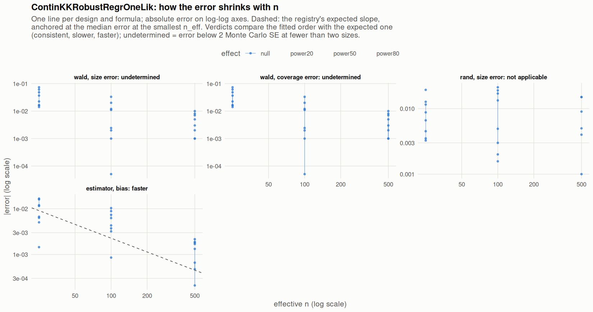

[← Campaign 2026-11-11-9d2edc5c summary](README.md)

# Class ContinKKRobustRegrOneLik

Part of the [Classes index](classes.md). Response type: continuous. Status: null effect complete, power effects not started. Verdict: **pending confirmation** (3 flagged test(s): 0 failing, 3 pending, 0 cleared).

<picture><source media="(prefers-color-scheme: dark)" srcset="figures/class-ContinKKRobustRegrOneLik-dark.png"></picture>

Convergence verdicts (worst over designs, formulas and effects; provisional until the class is complete):

| procedure | metric | verdict |
|---|---|---|
| estimator (bias) | bias | faster |
| wald | coverage | undetermined |
| rand | size | not applicable |
| wald | size | undetermined |

Null effect: 48 cells (2 failing). Size, coverage and bias / SD against the level each is held to.

| design | n | formula | procedure | size | coverage | bias / SD | size level | coverage level | verdict |
|---|---|---|---|---|---|---|---|---|---|
| Fixed:BinaryMatch | 50 | `~.` | rand | 0.0385 |  | 0.035 | 0.05 | 0.95 | ok |
| Fixed:BinaryMatch | 200 | `~.` | rand | 0.048 |  | -0.024 | 0.05 | 0.95 | ok |
| Fixed:BinaryMatch | 1000 | `~.` | rand | 0.051 |  | 0.02 | 0.05 | 0.95 | ok |
| Fixed:BinaryMatch | 50 | `~.` | wald | 0.0867 | 0.913 | 0.035 | 0.1 | 0.9 | ok |
| Fixed:BinaryMatch | 200 | `~.` | wald | 0.061 | 0.939 | -0.024 | 0.1 | 0.9 | ok |
| Fixed:BinaryMatch | 1000 | `~.` | wald | 0.058 | 0.942 | 0.02 | 0.055 | 0.945 | ok |
| Fixed:BinaryMatch | 50 | `~1` | rand | 0.0533 |  | 0.05 | 0.05 | 0.95 | ok |
| Fixed:BinaryMatch | 200 | `~1` | rand | 0.067 |  | -0.02 | 0.05 | 0.95 | **FAIL** |
| Fixed:BinaryMatch | 1000 | `~1` | rand | 0.054 |  | 0.0032 | 0.05 | 0.95 | ok |
| Fixed:BinaryMatch | 50 | `~1` | wald | 0.064 | 0.936 | 0.05 | 0.1 | 0.9 | ok |
| Fixed:BinaryMatch | 200 | `~1` | wald | 0.062 | 0.938 | -0.02 | 0.1 | 0.9 | ok |
| Fixed:BinaryMatch | 1000 | `~1` | wald | 0.052 | 0.948 | 0.0032 | 0.055 | 0.945 | ok |
| SeqOneByOne:KK14 | 50 | `~.` | rand | 0.0455 |  | 0.0043 | 0.05 | 0.95 | ok |
| SeqOneByOne:KK14 | 200 | `~.` | rand | 0.0367 |  | -0.047 | 0.05 | 0.95 | ok |
| SeqOneByOne:KK14 | 1000 | `~.` | rand | 0.035 |  | 0.026 | 0.05 | 0.95 | ok |
| SeqOneByOne:KK14 | 50 | `~.` | wald | 0.124 | 0.876 | 0.0043 | 0.1 | 0.9 | **FAIL** |
| SeqOneByOne:KK14 | 200 | `~.` | wald | 0.083 | 0.917 | -0.047 | 0.1 | 0.9 | ok |
| SeqOneByOne:KK14 | 1000 | `~.` | wald | 0.049 | 0.951 | 0.026 | 0.055 | 0.945 | ok |
| SeqOneByOne:KK14 | 50 | `~1` | rand | 0.0566 |  | -0.014 | 0.05 | 0.95 | ok |
| SeqOneByOne:KK14 | 200 | `~1` | rand | 0.0484 |  | -0.039 | 0.05 | 0.95 | ok |
| SeqOneByOne:KK14 | 1000 | `~1` | rand | 0.05 |  | 0.028 | 0.05 | 0.95 | ok |
| SeqOneByOne:KK14 | 50 | `~1` | wald | 0.0665 | 0.933 | -0.014 | 0.1 | 0.9 | ok |
| SeqOneByOne:KK14 | 200 | `~1` | wald | 0.0476 | 0.952 | -0.039 | 0.1 | 0.9 | ok |
| SeqOneByOne:KK14 | 1000 | `~1` | wald | 0.047 | 0.953 | 0.028 | 0.055 | 0.945 | ok |
| SeqOneByOne:KK21 | 50 | `~.` | rand | 0.0373 |  | -0.02 | 0.05 | 0.95 | ok |
| SeqOneByOne:KK21 | 200 | `~.` | rand | 0.0288 |  | -0.07 | 0.05 | 0.95 | ok |
| SeqOneByOne:KK21 | 1000 | `~.` | rand | 0.045 |  | 0.033 | 0.05 | 0.95 | ok |
| SeqOneByOne:KK21 | 50 | `~.` | wald | 0.111 | 0.889 | -0.02 | 0.1 | 0.9 | ok |
| SeqOneByOne:KK21 | 200 | `~.` | wald | 0.052 | 0.948 | -0.07 | 0.1 | 0.9 | ok |
| SeqOneByOne:KK21 | 1000 | `~.` | wald | 0.057 | 0.943 | 0.033 | 0.055 | 0.945 | ok |
| SeqOneByOne:KK21 | 50 | `~1` | rand | 0.0588 |  | -0.018 | 0.05 | 0.95 | ok |
| SeqOneByOne:KK21 | 200 | `~1` | rand | 0.0451 |  | -0.057 | 0.05 | 0.95 | ok |
| SeqOneByOne:KK21 | 1000 | `~1` | rand | 0.059 |  | 0.026 | 0.05 | 0.95 | ok |
| SeqOneByOne:KK21 | 50 | `~1` | wald | 0.0661 | 0.934 | -0.018 | 0.1 | 0.9 | ok |
| SeqOneByOne:KK21 | 200 | `~1` | wald | 0.0499 | 0.95 | -0.057 | 0.1 | 0.9 | ok |
| SeqOneByOne:KK21 | 1000 | `~1` | wald | 0.06 | 0.94 | 0.026 | 0.055 | 0.945 | ok |
| SeqOneByOne:KK21stepwise | 50 | `~.` | rand | 0.0307 |  | 0.048 | 0.05 | 0.95 | ok |
| SeqOneByOne:KK21stepwise | 200 | `~.` | rand | 0.031 |  | -0.029 | 0.05 | 0.95 | ok |
| SeqOneByOne:KK21stepwise | 1000 | `~.` | rand | 0.035 |  | -0.01 | 0.05 | 0.95 | ok |
| SeqOneByOne:KK21stepwise | 50 | `~.` | wald | 0.0982 | 0.902 | 0.048 | 0.1 | 0.9 | ok |
| SeqOneByOne:KK21stepwise | 200 | `~.` | wald | 0.07 | 0.93 | -0.029 | 0.1 | 0.9 | ok |
| SeqOneByOne:KK21stepwise | 1000 | `~.` | wald | 0.055 | 0.945 | -0.01 | 0.055 | 0.945 | ok |
| SeqOneByOne:KK21stepwise | 50 | `~1` | rand | 0.0535 |  | 0.032 | 0.05 | 0.95 | ok |
| SeqOneByOne:KK21stepwise | 200 | `~1` | rand | 0.047 |  | -0.0054 | 0.05 | 0.95 | ok |
| SeqOneByOne:KK21stepwise | 1000 | `~1` | rand | 0.05 |  | 0.007 | 0.05 | 0.95 | ok |
| SeqOneByOne:KK21stepwise | 50 | `~1` | wald | 0.0724 | 0.928 | 0.032 | 0.1 | 0.9 | ok |
| SeqOneByOne:KK21stepwise | 200 | `~1` | wald | 0.049 | 0.951 | -0.0054 | 0.1 | 0.9 | ok |
| SeqOneByOne:KK21stepwise | 1000 | `~1` | wald | 0.049 | 0.951 | 0.007 | 0.055 | 0.945 | ok |

[← Campaign 2026-11-11-9d2edc5c summary](README.md)
