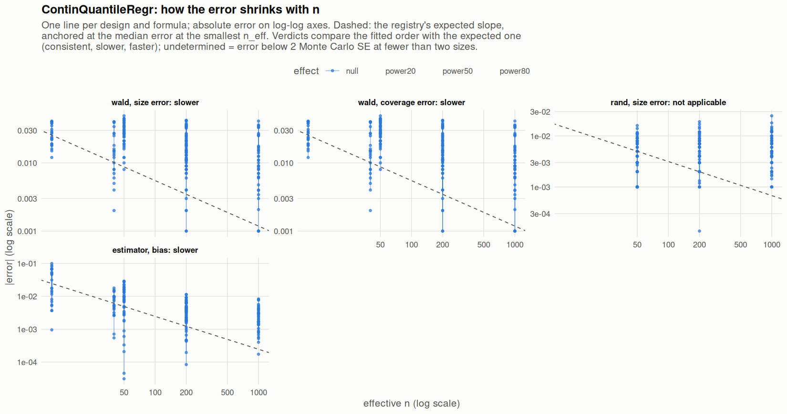

[← Campaign 2026-11-11-9d2edc5c summary](README.md)

# Class ContinQuantileRegr

Part of the [Classes index](classes.md). Response type: continuous. Status: null effect complete, power effects not started. Verdict: **pending confirmation** (19 flagged test(s): 0 failing, 19 pending, 0 cleared).

<picture><source media="(prefers-color-scheme: dark)" srcset="figures/class-ContinQuantileRegr-dark.png"></picture>

Convergence verdicts (worst over designs, formulas and effects; provisional until the class is complete):

| procedure | metric | verdict |
|---|---|---|
| estimator (bias) | bias | slower |
| wald | coverage | slower |
| rand | size | not applicable |
| wald | size | slower |

Null effect: 384 cells (15 failing). Size, coverage and bias / SD against the level each is held to.

| design | n | formula | procedure | size | coverage | bias / SD | size level | coverage level | verdict |
|---|---|---|---|---|---|---|---|---|---|
| Fixed:Bernoulli | 50 | `~.` | rand | 0.045 |  | -0.025 | 0.05 | 0.95 | ok |
| Fixed:Bernoulli | 200 | `~.` | rand | 0.038 |  | -0.0048 | 0.05 | 0.95 | ok |
| Fixed:Bernoulli | 1000 | `~.` | rand | 0.0514 |  | 0.048 | 0.05 | 0.95 | ok |
| Fixed:Bernoulli | 50 | `~.` | wald | 0.062 | 0.938 | -0.025 | 0.1 | 0.9 | ok |
| Fixed:Bernoulli | 200 | `~.` | wald | 0.046 | 0.954 | -0.0048 | 0.0698 | 0.93 | ok |
| Fixed:Bernoulli | 1000 | `~.` | wald | 0.0521 | 0.948 | 0.048 | 0.0568 | 0.943 | ok |
| Fixed:Bernoulli | 50 | `~1` | rand | 0.052 |  | -0.015 | 0.05 | 0.95 | ok |
| Fixed:Bernoulli | 200 | `~1` | rand | 0.054 |  | -0.048 | 0.05 | 0.95 | ok |
| Fixed:Bernoulli | 1000 | `~1` | rand | 0.0483 |  | 0.038 | 0.05 | 0.95 | ok |
| Fixed:Bernoulli | 50 | `~1` | wald | 0.02 | 0.98 | -0.015 | 0.1 | 0.9 | ok |
| Fixed:Bernoulli | 200 | `~1` | wald | 0.042 | 0.958 | -0.048 | 0.0698 | 0.93 | ok |
| Fixed:Bernoulli | 1000 | `~1` | wald | 0.0438 | 0.956 | 0.038 | 0.0568 | 0.943 | ok |
| Fixed:Bernoulli@0.2 | 50 | `~.` | rand | 0.049 |  | -0.025 | 0.05 | 0.95 | ok |
| Fixed:Bernoulli@0.2 | 200 | `~.` | rand | 0.05 |  | -0.064 | 0.05 | 0.95 | ok |
| Fixed:Bernoulli@0.2 | 1000 | `~.` | rand | 0.0462 |  | 0.03 | 0.05 | 0.95 | ok |
| Fixed:Bernoulli@0.2 | 50 | `~.` | wald | 0.068 | 0.932 | -0.025 | 0.1 | 0.9 | ok |
| Fixed:Bernoulli@0.2 | 200 | `~.` | wald | 0.065 | 0.935 | -0.064 | 0.1 | 0.9 | ok |
| Fixed:Bernoulli@0.2 | 1000 | `~.` | wald | 0.0613 | 0.939 | 0.03 | 0.05 | 0.95 | ok |
| Fixed:Bernoulli@0.2 | 50 | `~1` | rand | 0.034 |  | -0.0017 | 0.05 | 0.95 | ok |
| Fixed:Bernoulli@0.2 | 200 | `~1` | rand | 0.053 |  | -0.033 | 0.05 | 0.95 | ok |
| Fixed:Bernoulli@0.2 | 1000 | `~1` | rand | 0.0622 |  | 0.03 | 0.05 | 0.95 | ok |
| Fixed:Bernoulli@0.2 | 50 | `~1` | wald | 0.031 | 0.969 | -0.0017 | 0.1 | 0.9 | ok |
| Fixed:Bernoulli@0.2 | 200 | `~1` | wald | 0.046 | 0.954 | -0.033 | 0.1 | 0.9 | ok |
| Fixed:Bernoulli@0.2 | 1000 | `~1` | wald | 0.059 | 0.941 | 0.03 | 0.0698 | 0.93 | ok |
| Fixed:BinaryMatch | 50 | `~.` | rand | 0.044 |  | 0.009 | 0.05 | 0.95 | ok |
| Fixed:BinaryMatch | 200 | `~.` | rand | 0.0545 |  | -0.025 | 0.05 | 0.95 | ok |
| Fixed:BinaryMatch | 1000 | `~.` | rand | 0.043 |  | 0.02 | 0.05 | 0.95 | ok |
| Fixed:BinaryMatch | 50 | `~.` | wald | 0.068 | 0.932 | 0.009 | 0.1 | 0.9 | ok |
| Fixed:BinaryMatch | 200 | `~.` | wald | 0.0645 | 0.935 | -0.025 | 0.0698 | 0.93 | ok |
| Fixed:BinaryMatch | 1000 | `~.` | wald | 0.046 | 0.954 | 0.02 | 0.0568 | 0.943 | ok |
| Fixed:BinaryMatch | 50 | `~1` | rand | 0.058 |  | 0.045 | 0.05 | 0.95 | ok |
| Fixed:BinaryMatch | 200 | `~1` | rand | 0.0587 |  | -0.006 | 0.05 | 0.95 | ok |
| Fixed:BinaryMatch | 1000 | `~1` | rand | 0.045 |  | -0.02 | 0.05 | 0.95 | ok |
| Fixed:BinaryMatch | 50 | `~1` | wald | 0.014 | 0.986 | 0.045 | 0.1 | 0.9 | ok |
| Fixed:BinaryMatch | 200 | `~1` | wald | 0.0134 | 0.987 | -0.006 | 0.0698 | 0.93 | ok |
| Fixed:BinaryMatch | 1000 | `~1` | wald | 0.015 | 0.985 | -0.02 | 0.0568 | 0.943 | ok |
| Fixed:Blocking | 50 | `~.` | rand | 0.055 |  | 0.0078 | 0.05 | 0.95 | ok |
| Fixed:Blocking | 200 | `~.` | rand | 0.061 |  | -0.036 | 0.05 | 0.95 | **FAIL** |
| Fixed:Blocking | 1000 | `~.` | rand | 0.0477 |  | 0.0065 | 0.05 | 0.95 | ok |
| Fixed:Blocking | 50 | `~.` | wald | 0.06 | 0.94 | 0.0078 | 0.1 | 0.9 | ok |
| Fixed:Blocking | 200 | `~.` | wald | 0.075 | 0.925 | -0.036 | 0.0698 | 0.93 | ok |
| Fixed:Blocking | 1000 | `~.` | wald | 0.0584 | 0.942 | 0.0065 | 0.05 | 0.95 | ok |
| Fixed:Blocking | 50 | `~1` | rand | 0.047 |  | 0.066 | 0.05 | 0.95 | ok |
| Fixed:Blocking | 200 | `~1` | rand | 0.056 |  | -0.032 | 0.05 | 0.95 | ok |
| Fixed:Blocking | 1000 | `~1` | rand | 0.0419 |  | 0.077 | 0.05 | 0.95 | ok |
| Fixed:Blocking | 50 | `~1` | wald | 0.009 | 0.991 | 0.066 | 0.1 | 0.9 | ok |
| Fixed:Blocking | 200 | `~1` | wald | 0.048 | 0.952 | -0.032 | 0.0698 | 0.93 | ok |
| Fixed:Blocking | 1000 | `~1` | wald | 0.0337 | 0.966 | 0.077 | 0.0568 | 0.943 | ok |
| Fixed:Blocking@0.2 | 50 | `~.` | rand | 0.045 |  | 0.07 | 0.05 | 0.95 | ok |
| Fixed:Blocking@0.2 | 200 | `~.` | rand | 0.055 |  | -0.022 | 0.05 | 0.95 | ok |
| Fixed:Blocking@0.2 | 1000 | `~.` | rand | 0.06 |  | -0.09 | 0.05 | 0.95 | ok |
| Fixed:Blocking@0.2 | 50 | `~.` | wald | 0.077 | 0.923 | 0.07 | 0.1 | 0.9 | ok |
| Fixed:Blocking@0.2 | 200 | `~.` | wald | 0.065 | 0.935 | -0.022 | 0.1 | 0.9 | ok |
| Fixed:Blocking@0.2 | 1000 | `~.` | wald | 0.073 | 0.927 | -0.09 | 0.05 | 0.95 | **FAIL** |
| Fixed:Blocking@0.2 | 50 | `~1` | rand | 0.05 |  | 0.089 | 0.05 | 0.95 | ok |
| Fixed:Blocking@0.2 | 200 | `~1` | rand | 0.046 |  | 0.027 | 0.05 | 0.95 | ok |
| Fixed:Blocking@0.2 | 1000 | `~1` | rand | 0.05 |  | -0.05 | 0.05 | 0.95 | ok |
| Fixed:Blocking@0.2 | 50 | `~1` | wald | 0.038 | 0.962 | 0.089 | 0.1 | 0.9 | ok |
| Fixed:Blocking@0.2 | 200 | `~1` | wald | 0.044 | 0.956 | 0.027 | 0.1 | 0.9 | ok |
| Fixed:Blocking@0.2 | 1000 | `~1` | wald | 0.032 | 0.968 | -0.05 | 0.0698 | 0.93 | ok |
| Fixed:Greedy | 50 | `~.` | rand | 0.052 |  | 0.021 | 0.05 | 0.95 | ok |
| Fixed:Greedy | 200 | `~.` | rand | 0.057 |  | 0.037 | 0.05 | 0.95 | ok |
| Fixed:Greedy | 1000 | `~.` | rand | 0.0621 |  | -0.021 | 0.05 | 0.95 | ok |
| Fixed:Greedy | 50 | `~.` | wald | 0.069 | 0.931 | 0.021 | 0.1 | 0.9 | ok |
| Fixed:Greedy | 200 | `~.` | wald | 0.071 | 0.929 | 0.037 | 0.0698 | 0.93 | ok |
| Fixed:Greedy | 1000 | `~.` | wald | 0.0654 | 0.935 | -0.021 | 0.05 | 0.95 | ok |
| Fixed:Greedy | 50 | `~1` | rand | 0.051 |  | -0.024 | 0.05 | 0.95 | ok |
| Fixed:Greedy | 200 | `~1` | rand | 0.059 |  | 0.033 | 0.05 | 0.95 | ok |
| Fixed:Greedy | 1000 | `~1` | rand | 0.0517 |  | -0.027 | 0.05 | 0.95 | ok |
| Fixed:Greedy | 50 | `~1` | wald | 0.006 | 0.994 | -0.024 | 0.1 | 0.9 | ok |
| Fixed:Greedy | 200 | `~1` | wald | 0.008 | 0.992 | 0.033 | 0.0698 | 0.93 | ok |
| Fixed:Greedy | 1000 | `~1` | wald | 0.0154 | 0.985 | -0.027 | 0.0568 | 0.943 | ok |
| Fixed:Greedy@0.2 | 50 | `~.` | rand | 0.047 |  | -0.0084 | 0.05 | 0.95 | ok |
| Fixed:Greedy@0.2 | 200 | `~.` | rand | 0.048 |  | 0.012 | 0.05 | 0.95 | ok |
| Fixed:Greedy@0.2 | 1000 | `~.` | rand | 0.0548 |  | 0.017 | 0.05 | 0.95 | ok |
| Fixed:Greedy@0.2 | 50 | `~.` | wald | 0.088 | 0.912 | -0.0084 | 0.1 | 0.9 | ok |
| Fixed:Greedy@0.2 | 200 | `~.` | wald | 0.077 | 0.923 | 0.012 | 0.1 | 0.9 | ok |
| Fixed:Greedy@0.2 | 1000 | `~.` | wald | 0.063 | 0.937 | 0.017 | 0.05 | 0.95 | ok |
| Fixed:Greedy@0.2 | 50 | `~1` | rand | 0.047 |  | 0.17 | 0.05 | 0.95 | ok |
| Fixed:Greedy@0.2 | 200 | `~1` | rand | 0.043 |  | 0.047 | 0.05 | 0.95 | ok |
| Fixed:Greedy@0.2 | 1000 | `~1` | rand | 0.0542 |  | 0.036 | 0.05 | 0.95 | ok |
| Fixed:Greedy@0.2 | 50 | `~1` | wald | 0.01 | 0.99 | 0.17 | 0.1 | 0.9 | ok |
| Fixed:Greedy@0.2 | 200 | `~1` | wald | 0.01 | 0.99 | 0.047 | 0.1 | 0.9 | ok |
| Fixed:Greedy@0.2 | 1000 | `~1` | wald | 0.017 | 0.983 | 0.036 | 0.0698 | 0.93 | ok |
| Fixed:GreedyDOptimal | 50 | `~.` | rand | 0.052 |  | 0.021 | 0.05 | 0.95 | ok |
| Fixed:GreedyDOptimal | 200 | `~.` | rand | 0.057 |  | 0.037 | 0.05 | 0.95 | ok |
| Fixed:GreedyDOptimal | 1000 | `~.` | rand | 0.0625 |  | -0.0084 | 0.05 | 0.95 | ok |
| Fixed:GreedyDOptimal | 50 | `~.` | wald | 0.069 | 0.931 | 0.021 | 0.1 | 0.9 | ok |
| Fixed:GreedyDOptimal | 200 | `~.` | wald | 0.071 | 0.929 | 0.037 | 0.0698 | 0.93 | ok |
| Fixed:GreedyDOptimal | 1000 | `~.` | wald | 0.0625 | 0.937 | -0.0084 | 0.05 | 0.95 | ok |
| Fixed:GreedyDOptimal | 50 | `~1` | rand | 0.051 |  | -0.024 | 0.05 | 0.95 | ok |
| Fixed:GreedyDOptimal | 200 | `~1` | rand | 0.059 |  | 0.033 | 0.05 | 0.95 | ok |
| Fixed:GreedyDOptimal | 1000 | `~1` | rand | 0.0546 |  | -0.032 | 0.05 | 0.95 | ok |
| Fixed:GreedyDOptimal | 50 | `~1` | wald | 0.006 | 0.994 | -0.024 | 0.1 | 0.9 | ok |
| Fixed:GreedyDOptimal | 200 | `~1` | wald | 0.008 | 0.992 | 0.033 | 0.0698 | 0.93 | ok |
| Fixed:GreedyDOptimal | 1000 | `~1` | wald | 0.0169 | 0.983 | -0.032 | 0.0568 | 0.943 | ok |
| Fixed:GreedyDOptimal@0.2 | 50 | `~.` | rand | 0.047 |  | -0.0084 | 0.05 | 0.95 | ok |
| Fixed:GreedyDOptimal@0.2 | 200 | `~.` | rand | 0.048 |  | 0.012 | 0.05 | 0.95 | ok |
| Fixed:GreedyDOptimal@0.2 | 1000 | `~.` | rand | 0.055 |  | 0.024 | 0.05 | 0.95 | ok |
| Fixed:GreedyDOptimal@0.2 | 50 | `~.` | wald | 0.088 | 0.912 | -0.0084 | 0.1 | 0.9 | ok |
| Fixed:GreedyDOptimal@0.2 | 200 | `~.` | wald | 0.077 | 0.923 | 0.012 | 0.1 | 0.9 | ok |
| Fixed:GreedyDOptimal@0.2 | 1000 | `~.` | wald | 0.061 | 0.939 | 0.024 | 0.05 | 0.95 | ok |
| Fixed:GreedyDOptimal@0.2 | 50 | `~1` | rand | 0.047 |  | 0.17 | 0.05 | 0.95 | ok |
| Fixed:GreedyDOptimal@0.2 | 200 | `~1` | rand | 0.043 |  | 0.047 | 0.05 | 0.95 | ok |
| Fixed:GreedyDOptimal@0.2 | 1000 | `~1` | rand | 0.051 |  | 0.036 | 0.05 | 0.95 | ok |
| Fixed:GreedyDOptimal@0.2 | 50 | `~1` | wald | 0.01 | 0.99 | 0.17 | 0.1 | 0.9 | ok |
| Fixed:GreedyDOptimal@0.2 | 200 | `~1` | wald | 0.01 | 0.99 | 0.047 | 0.1 | 0.9 | ok |
| Fixed:GreedyDOptimal@0.2 | 1000 | `~1` | wald | 0.016 | 0.984 | 0.036 | 0.0698 | 0.93 | ok |
| Fixed:iBCRD | 50 | `~.` | rand | 0.057 |  | -0.038 | 0.05 | 0.95 | ok |
| Fixed:iBCRD | 200 | `~.` | rand | 0.058 |  | -0.018 | 0.05 | 0.95 | ok |
| Fixed:iBCRD | 1000 | `~.` | rand | 0.0589 |  | -0.01 | 0.05 | 0.95 | ok |
| Fixed:iBCRD | 50 | `~.` | wald | 0.075 | 0.925 | -0.038 | 0.1 | 0.9 | ok |
| Fixed:iBCRD | 200 | `~.` | wald | 0.065 | 0.935 | -0.018 | 0.0698 | 0.93 | ok |
| Fixed:iBCRD | 1000 | `~.` | wald | 0.0749 | 0.925 | -0.01 | 0.05 | 0.95 | **FAIL** |
| Fixed:iBCRD | 50 | `~1` | rand | 0.056 |  | -0.019 | 0.05 | 0.95 | ok |
| Fixed:iBCRD | 200 | `~1` | rand | 0.064 |  | -0.011 | 0.05 | 0.95 | **FAIL** |
| Fixed:iBCRD | 1000 | `~1` | rand | 0.0418 |  | 0.025 | 0.05 | 0.95 | ok |
| Fixed:iBCRD | 50 | `~1` | wald | 0.023 | 0.977 | -0.019 | 0.1 | 0.9 | ok |
| Fixed:iBCRD | 200 | `~1` | wald | 0.044 | 0.956 | -0.011 | 0.0698 | 0.93 | ok |
| Fixed:iBCRD | 1000 | `~1` | wald | 0.035 | 0.965 | 0.025 | 0.0568 | 0.943 | ok |
| Fixed:iBCRD@0.2 | 50 | `~.` | rand | 0.054 |  | -0.015 | 0.05 | 0.95 | ok |
| Fixed:iBCRD@0.2 | 200 | `~.` | rand | 0.067 |  | -0.011 | 0.05 | 0.95 | ok |
| Fixed:iBCRD@0.2 | 1000 | `~.` | rand | 0.046 |  | -0.0098 | 0.05 | 0.95 | ok |
| Fixed:iBCRD@0.2 | 50 | `~.` | wald | 0.09 | 0.91 | -0.015 | 0.1 | 0.9 | ok |
| Fixed:iBCRD@0.2 | 200 | `~.` | wald | 0.089 | 0.911 | -0.011 | 0.1 | 0.9 | ok |
| Fixed:iBCRD@0.2 | 1000 | `~.` | wald | 0.057 | 0.943 | -0.0098 | 0.05 | 0.95 | ok |
| Fixed:iBCRD@0.2 | 50 | `~1` | rand | 0.047 |  | 0.14 | 0.05 | 0.95 | ok |
| Fixed:iBCRD@0.2 | 200 | `~1` | rand | 0.069 |  | 0.018 | 0.05 | 0.95 | ok |
| Fixed:iBCRD@0.2 | 1000 | `~1` | rand | 0.051 |  | 0.037 | 0.05 | 0.95 | ok |
| Fixed:iBCRD@0.2 | 50 | `~1` | wald | 0.027 | 0.973 | 0.14 | 0.1 | 0.9 | ok |
| Fixed:iBCRD@0.2 | 200 | `~1` | wald | 0.052 | 0.948 | 0.018 | 0.1 | 0.9 | ok |
| Fixed:iBCRD@0.2 | 1000 | `~1` | wald | 0.042 | 0.958 | 0.037 | 0.0698 | 0.93 | ok |
| Fixed:MatchingGreedyPairSwitching | 50 | `~.` | rand | 0.042 |  | -0.082 | 0.05 | 0.95 | ok |
| Fixed:MatchingGreedyPairSwitching | 200 | `~.` | rand | 0.048 |  | 0.012 | 0.05 | 0.95 | ok |
| Fixed:MatchingGreedyPairSwitching | 1000 | `~.` | rand | 0.047 |  | 0.021 | 0.05 | 0.95 | ok |
| Fixed:MatchingGreedyPairSwitching | 50 | `~.` | wald | 0.058 | 0.942 | -0.082 | 0.1 | 0.9 | ok |
| Fixed:MatchingGreedyPairSwitching | 200 | `~.` | wald | 0.069 | 0.931 | 0.012 | 0.0698 | 0.93 | ok |
| Fixed:MatchingGreedyPairSwitching | 1000 | `~.` | wald | 0.047 | 0.953 | 0.021 | 0.0568 | 0.943 | ok |
| Fixed:MatchingGreedyPairSwitching | 50 | `~1` | rand | 0.041 |  | 0.05 | 0.05 | 0.95 | ok |
| Fixed:MatchingGreedyPairSwitching | 200 | `~1` | rand | 0.053 |  | 0.024 | 0.05 | 0.95 | ok |
| Fixed:MatchingGreedyPairSwitching | 1000 | `~1` | rand | 0.051 |  | 0.023 | 0.05 | 0.95 | ok |
| Fixed:MatchingGreedyPairSwitching | 50 | `~1` | wald | 0.005 | 0.995 | 0.05 | 0.1 | 0.9 | ok |
| Fixed:MatchingGreedyPairSwitching | 200 | `~1` | wald | 0.012 | 0.988 | 0.024 | 0.0698 | 0.93 | ok |
| Fixed:MatchingGreedyPairSwitching | 1000 | `~1` | wald | 0.014 | 0.986 | 0.023 | 0.0568 | 0.943 | ok |
| Fixed:Optimal | 50 | `~.` | wald | 0.067 | 0.933 | 0.0076 | 0.1 | 0.9 | ok |
| Fixed:Optimal | 200 | `~.` | wald | 0.068 | 0.932 | 0.043 | 0.0698 | 0.93 | ok |
| Fixed:Optimal | 1000 | `~.` | wald | 0.051 | 0.949 | 0.039 | 0.0568 | 0.943 | ok |
| Fixed:Optimal | 50 | `~1` | wald | 0.008 | 0.992 | 0.011 | 0.1 | 0.9 | ok |
| Fixed:Optimal | 200 | `~1` | wald | 0.009 | 0.991 | -0.00047 | 0.0698 | 0.93 | ok |
| Fixed:Optimal | 1000 | `~1` | wald | 0.009 | 0.991 | 0.02 | 0.0568 | 0.943 | ok |
| Fixed:Optimal@0.2 | 50 | `~.` | wald | 0.085 | 0.915 | -0.013 | 0.1 | 0.9 | ok |
| Fixed:Optimal@0.2 | 200 | `~.` | wald | 0.068 | 0.932 | 0.0024 | 0.1 | 0.9 | ok |
| Fixed:Optimal@0.2 | 1000 | `~.` | wald | 0.049 | 0.951 | -0.002 | 0.0698 | 0.93 | ok |
| Fixed:Optimal@0.2 | 50 | `~1` | wald | 0.009 | 0.991 | 0.25 | 0.1 | 0.9 | ok |
| Fixed:Optimal@0.2 | 200 | `~1` | wald | 0.01 | 0.99 | 0.078 | 0.1 | 0.9 | ok |
| Fixed:Optimal@0.2 | 1000 | `~1` | wald | 0.016 | 0.984 | 0.014 | 0.0698 | 0.93 | ok |
| Fixed:OptimalBlocks | 50 | `~.` | rand | 0.061 |  | -0.00013 | 0.05 | 0.95 | **FAIL** |
| Fixed:OptimalBlocks | 200 | `~.` | rand | 0.052 |  | -0.019 | 0.05 | 0.95 | ok |
| Fixed:OptimalBlocks | 1000 | `~.` | rand | 0.0619 |  | 0.017 | 0.05 | 0.95 | **FAIL** |
| Fixed:OptimalBlocks | 50 | `~.` | wald | 0.071 | 0.929 | -0.00013 | 0.1 | 0.9 | ok |
| Fixed:OptimalBlocks | 200 | `~.` | wald | 0.069 | 0.931 | -0.019 | 0.0698 | 0.93 | ok |
| Fixed:OptimalBlocks | 1000 | `~.` | wald | 0.0624 | 0.938 | 0.017 | 0.05 | 0.95 | **FAIL** |
| Fixed:OptimalBlocks | 50 | `~1` | rand | 0.051 |  | 0.07 | 0.05 | 0.95 | ok |
| Fixed:OptimalBlocks | 200 | `~1` | rand | 0.06 |  | 0.0093 | 0.05 | 0.95 | ok |
| Fixed:OptimalBlocks | 1000 | `~1` | rand | 0.0545 |  | -0.034 | 0.05 | 0.95 | ok |
| Fixed:OptimalBlocks | 50 | `~1` | wald | 0.011 | 0.989 | 0.07 | 0.1 | 0.9 | ok |
| Fixed:OptimalBlocks | 200 | `~1` | wald | 0.026 | 0.974 | 0.0093 | 0.0698 | 0.93 | ok |
| Fixed:OptimalBlocks | 1000 | `~1` | wald | 0.0245 | 0.976 | -0.034 | 0.0568 | 0.943 | ok |
| Fixed:OptimalBlocks@0.2 | 50 | `~.` | rand | 0.055 |  | 0.033 | 0.05 | 0.95 | ok |
| Fixed:OptimalBlocks@0.2 | 200 | `~.` | rand | 0.043 |  | -0.046 | 0.05 | 0.95 | ok |
| Fixed:OptimalBlocks@0.2 | 1000 | `~.` | rand | 0.06 |  | -0.018 | 0.05 | 0.95 | ok |
| Fixed:OptimalBlocks@0.2 | 50 | `~.` | wald | 0.078 | 0.922 | 0.033 | 0.1 | 0.9 | ok |
| Fixed:OptimalBlocks@0.2 | 200 | `~.` | wald | 0.057 | 0.943 | -0.046 | 0.1 | 0.9 | ok |
| Fixed:OptimalBlocks@0.2 | 1000 | `~.` | wald | 0.063 | 0.937 | -0.018 | 0.0698 | 0.93 | ok |
| Fixed:OptimalBlocks@0.2 | 50 | `~1` | rand | 0.057 |  | 0.089 | 0.05 | 0.95 | ok |
| Fixed:OptimalBlocks@0.2 | 200 | `~1` | rand | 0.057 |  | -0.019 | 0.05 | 0.95 | ok |
| Fixed:OptimalBlocks@0.2 | 1000 | `~1` | rand | 0.052 |  | 0.036 | 0.05 | 0.95 | ok |
| Fixed:OptimalBlocks@0.2 | 50 | `~1` | wald | 0.028 | 0.972 | 0.089 | 0.1 | 0.9 | ok |
| Fixed:OptimalBlocks@0.2 | 200 | `~1` | wald | 0.036 | 0.964 | -0.019 | 0.1 | 0.9 | ok |
| Fixed:OptimalBlocks@0.2 | 1000 | `~1` | wald | 0.025 | 0.975 | 0.036 | 0.0698 | 0.93 | ok |
| Fixed:Rerandomization | 50 | `~.` | rand | 0.046 |  | 0.043 | 0.05 | 0.95 | ok |
| Fixed:Rerandomization | 200 | `~.` | rand | 0.062 |  | 0.034 | 0.05 | 0.95 | **FAIL** |
| Fixed:Rerandomization | 1000 | `~.` | rand | 0.0518 |  | -0.018 | 0.05 | 0.95 | ok |
| Fixed:Rerandomization | 50 | `~.` | wald | 0.071 | 0.929 | 0.043 | 0.1 | 0.9 | ok |
| Fixed:Rerandomization | 200 | `~.` | wald | 0.065 | 0.935 | 0.034 | 0.0698 | 0.93 | ok |
| Fixed:Rerandomization | 1000 | `~.` | wald | 0.0539 | 0.946 | -0.018 | 0.0568 | 0.943 | ok |
| Fixed:Rerandomization | 50 | `~1` | rand | 0.051 |  | -0.027 | 0.05 | 0.95 | ok |
| Fixed:Rerandomization | 200 | `~1` | rand | 0.039 |  | 0.0082 | 0.05 | 0.95 | ok |
| Fixed:Rerandomization | 1000 | `~1` | rand | 0.0574 |  | -0.039 | 0.05 | 0.95 | ok |
| Fixed:Rerandomization | 50 | `~1` | wald | 0.029 | 0.971 | -0.027 | 0.1 | 0.9 | ok |
| Fixed:Rerandomization | 200 | `~1` | wald | 0.028 | 0.972 | 0.0082 | 0.0698 | 0.93 | ok |
| Fixed:Rerandomization | 1000 | `~1` | wald | 0.0466 | 0.953 | -0.039 | 0.0568 | 0.943 | ok |
| Fixed:Rerandomization@0.2 | 50 | `~.` | rand | 0.048 |  | -0.038 | 0.05 | 0.95 | ok |
| Fixed:Rerandomization@0.2 | 200 | `~.` | rand | 0.058 |  | -0.04 | 0.05 | 0.95 | ok |
| Fixed:Rerandomization@0.2 | 1000 | `~.` | rand | 0.068 |  | -0.074 | 0.05 | 0.95 | ok |
| Fixed:Rerandomization@0.2 | 50 | `~.` | wald | 0.081 | 0.919 | -0.038 | 0.1 | 0.9 | ok |
| Fixed:Rerandomization@0.2 | 200 | `~.` | wald | 0.065 | 0.935 | -0.04 | 0.1 | 0.9 | ok |
| Fixed:Rerandomization@0.2 | 1000 | `~.` | wald | 0.071 | 0.929 | -0.074 | 0.05 | 0.95 | **FAIL** |
| Fixed:Rerandomization@0.2 | 50 | `~1` | rand | 0.059 |  | 0.16 | 0.05 | 0.95 | ok |
| Fixed:Rerandomization@0.2 | 200 | `~1` | rand | 0.049 |  | -0.0026 | 0.05 | 0.95 | ok |
| Fixed:Rerandomization@0.2 | 1000 | `~1` | rand | 0.057 |  | -0.035 | 0.05 | 0.95 | ok |
| Fixed:Rerandomization@0.2 | 50 | `~1` | wald | 0.028 | 0.972 | 0.16 | 0.1 | 0.9 | ok |
| Fixed:Rerandomization@0.2 | 200 | `~1` | wald | 0.037 | 0.963 | -0.0026 | 0.1 | 0.9 | ok |
| Fixed:Rerandomization@0.2 | 1000 | `~1` | wald | 0.053 | 0.947 | -0.035 | 0.0698 | 0.93 | ok |
| SeqOneByOne:Atkinson | 50 | `~.` | rand | 0.052 |  | 0.014 | 0.05 | 0.95 | ok |
| SeqOneByOne:Atkinson | 200 | `~.` | rand | 0.0535 |  | -0.0096 | 0.05 | 0.95 | ok |
| SeqOneByOne:Atkinson | 1000 | `~.` | rand | 0.036 |  | 0.018 | 0.05 | 0.95 | ok |
| SeqOneByOne:Atkinson | 50 | `~.` | wald | 0.071 | 0.929 | 0.014 | 0.1 | 0.9 | ok |
| SeqOneByOne:Atkinson | 200 | `~.` | wald | 0.0653 | 0.935 | -0.0096 | 0.0698 | 0.93 | ok |
| SeqOneByOne:Atkinson | 1000 | `~.` | wald | 0.044 | 0.956 | 0.018 | 0.0568 | 0.943 | ok |
| SeqOneByOne:Atkinson | 50 | `~1` | rand | 0.036 |  | 0.0092 | 0.05 | 0.95 | ok |
| SeqOneByOne:Atkinson | 200 | `~1` | rand | 0.0561 |  | 0.022 | 0.05 | 0.95 | ok |
| SeqOneByOne:Atkinson | 1000 | `~1` | rand | 0.045 |  | 0.0082 | 0.05 | 0.95 | ok |
| SeqOneByOne:Atkinson | 50 | `~1` | wald | 0.008 | 0.992 | 0.0092 | 0.1 | 0.9 | ok |
| SeqOneByOne:Atkinson | 200 | `~1` | wald | 0.0238 | 0.976 | 0.022 | 0.0698 | 0.93 | ok |
| SeqOneByOne:Atkinson | 1000 | `~1` | wald | 0.023 | 0.977 | 0.0082 | 0.0568 | 0.943 | ok |
| SeqOneByOne:Bernoulli | 50 | `~.` | rand | 0.061 |  | 0.035 | 0.05 | 0.95 | **FAIL** |
| SeqOneByOne:Bernoulli | 200 | `~.` | rand | 0.057 |  | -0.016 | 0.05 | 0.95 | ok |
| SeqOneByOne:Bernoulli | 1000 | `~.` | rand | 0.052 |  | 0.021 | 0.05 | 0.95 | ok |
| SeqOneByOne:Bernoulli | 50 | `~.` | wald | 0.074 | 0.926 | 0.035 | 0.1 | 0.9 | ok |
| SeqOneByOne:Bernoulli | 200 | `~.` | wald | 0.07 | 0.93 | -0.016 | 0.0698 | 0.93 | ok |
| SeqOneByOne:Bernoulli | 1000 | `~.` | wald | 0.061 | 0.939 | 0.021 | 0.05 | 0.95 | ok |
| SeqOneByOne:Bernoulli | 50 | `~1` | rand | 0.047 |  | 0.053 | 0.05 | 0.95 | ok |
| SeqOneByOne:Bernoulli | 200 | `~1` | rand | 0.04 |  | 0.014 | 0.05 | 0.95 | ok |
| SeqOneByOne:Bernoulli | 1000 | `~1` | rand | 0.054 |  | 0.0051 | 0.05 | 0.95 | ok |
| SeqOneByOne:Bernoulli | 50 | `~1` | wald | 0.016 | 0.984 | 0.053 | 0.1 | 0.9 | ok |
| SeqOneByOne:Bernoulli | 200 | `~1` | wald | 0.035 | 0.965 | 0.014 | 0.0698 | 0.93 | ok |
| SeqOneByOne:Bernoulli | 1000 | `~1` | wald | 0.043 | 0.957 | 0.0051 | 0.0568 | 0.943 | ok |
| SeqOneByOne:Bernoulli@0.2 | 50 | `~.` | rand | 0.051 |  | 0.011 | 0.05 | 0.95 | ok |
| SeqOneByOne:Bernoulli@0.2 | 200 | `~.` | rand | 0.042 |  | 0.018 | 0.05 | 0.95 | ok |
| SeqOneByOne:Bernoulli@0.2 | 1000 | `~.` | rand | 0.062 |  | 0.0065 | 0.05 | 0.95 | ok |
| SeqOneByOne:Bernoulli@0.2 | 50 | `~.` | wald | 0.069 | 0.931 | 0.011 | 0.1 | 0.9 | ok |
| SeqOneByOne:Bernoulli@0.2 | 200 | `~.` | wald | 0.066 | 0.934 | 0.018 | 0.1 | 0.9 | ok |
| SeqOneByOne:Bernoulli@0.2 | 1000 | `~.` | wald | 0.059 | 0.941 | 0.0065 | 0.05 | 0.95 | ok |
| SeqOneByOne:Bernoulli@0.2 | 50 | `~1` | rand | 0.039 |  | 0.096 | 0.05 | 0.95 | ok |
| SeqOneByOne:Bernoulli@0.2 | 200 | `~1` | rand | 0.046 |  | 0.053 | 0.05 | 0.95 | ok |
| SeqOneByOne:Bernoulli@0.2 | 1000 | `~1` | rand | 0.044 |  | 0.014 | 0.05 | 0.95 | ok |
| SeqOneByOne:Bernoulli@0.2 | 50 | `~1` | wald | 0.035 | 0.965 | 0.096 | 0.1 | 0.9 | ok |
| SeqOneByOne:Bernoulli@0.2 | 200 | `~1` | wald | 0.042 | 0.958 | 0.053 | 0.1 | 0.9 | ok |
| SeqOneByOne:Bernoulli@0.2 | 1000 | `~1` | wald | 0.039 | 0.961 | 0.014 | 0.0698 | 0.93 | ok |
| SeqOneByOne:Efron | 50 | `~.` | rand | 0.054 |  | 0.00056 | 0.05 | 0.95 | ok |
| SeqOneByOne:Efron | 200 | `~.` | rand | 0.046 |  | 0.049 | 0.05 | 0.95 | ok |
| SeqOneByOne:Efron | 1000 | `~.` | rand | 0.052 |  | 0.1 | 0.05 | 0.95 | ok |
| SeqOneByOne:Efron | 50 | `~.` | wald | 0.062 | 0.938 | 0.00056 | 0.1 | 0.9 | ok |
| SeqOneByOne:Efron | 200 | `~.` | wald | 0.054 | 0.946 | 0.049 | 0.0698 | 0.93 | ok |
| SeqOneByOne:Efron | 1000 | `~.` | wald | 0.061 | 0.939 | 0.1 | 0.0568 | 0.943 | ok |
| SeqOneByOne:Efron | 50 | `~1` | rand | 0.045 |  | 0.0013 | 0.05 | 0.95 | ok |
| SeqOneByOne:Efron | 200 | `~1` | rand | 0.046 |  | 0.022 | 0.05 | 0.95 | ok |
| SeqOneByOne:Efron | 1000 | `~1` | rand | 0.047 |  | 0.071 | 0.05 | 0.95 | ok |
| SeqOneByOne:Efron | 50 | `~1` | wald | 0.026 | 0.974 | 0.0013 | 0.1 | 0.9 | ok |
| SeqOneByOne:Efron | 200 | `~1` | wald | 0.033 | 0.967 | 0.022 | 0.0698 | 0.93 | ok |
| SeqOneByOne:Efron | 1000 | `~1` | wald | 0.043 | 0.957 | 0.071 | 0.0568 | 0.943 | ok |
| SeqOneByOne:iBCRD | 50 | `~.` | rand | 0.057 |  | -0.022 | 0.05 | 0.95 | ok |
| SeqOneByOne:iBCRD | 200 | `~.` | rand | 0.051 |  | 0.011 | 0.05 | 0.95 | ok |
| SeqOneByOne:iBCRD | 1000 | `~.` | rand | 0.05 |  | 0.051 | 0.05 | 0.95 | ok |
| SeqOneByOne:iBCRD | 50 | `~.` | wald | 0.079 | 0.921 | -0.022 | 0.1 | 0.9 | ok |
| SeqOneByOne:iBCRD | 200 | `~.` | wald | 0.051 | 0.949 | 0.011 | 0.0698 | 0.93 | ok |
| SeqOneByOne:iBCRD | 1000 | `~.` | wald | 0.059 | 0.941 | 0.051 | 0.0568 | 0.943 | ok |
| SeqOneByOne:iBCRD | 50 | `~1` | rand | 0.053 |  | -0.057 | 0.05 | 0.95 | ok |
| SeqOneByOne:iBCRD | 200 | `~1` | rand | 0.065 |  | 0.016 | 0.05 | 0.95 | **FAIL** |
| SeqOneByOne:iBCRD | 1000 | `~1` | rand | 0.056 |  | 0.035 | 0.05 | 0.95 | ok |
| SeqOneByOne:iBCRD | 50 | `~1` | wald | 0.019 | 0.981 | -0.057 | 0.1 | 0.9 | ok |
| SeqOneByOne:iBCRD | 200 | `~1` | wald | 0.038 | 0.962 | 0.016 | 0.0698 | 0.93 | ok |
| SeqOneByOne:iBCRD | 1000 | `~1` | wald | 0.051 | 0.949 | 0.035 | 0.0568 | 0.943 | ok |
| SeqOneByOne:iBCRD@0.2 | 50 | `~.` | rand | 0.047 |  | 0.018 | 0.05 | 0.95 | ok |
| SeqOneByOne:iBCRD@0.2 | 200 | `~.` | rand | 0.053 |  | 0.019 | 0.05 | 0.95 | ok |
| SeqOneByOne:iBCRD@0.2 | 1000 | `~.` | rand | 0.06 |  | 0.0045 | 0.05 | 0.95 | ok |
| SeqOneByOne:iBCRD@0.2 | 50 | `~.` | wald | 0.068 | 0.932 | 0.018 | 0.1 | 0.9 | ok |
| SeqOneByOne:iBCRD@0.2 | 200 | `~.` | wald | 0.075 | 0.925 | 0.019 | 0.1 | 0.9 | ok |
| SeqOneByOne:iBCRD@0.2 | 1000 | `~.` | wald | 0.068 | 0.932 | 0.0045 | 0.05 | 0.95 | ok |
| SeqOneByOne:iBCRD@0.2 | 50 | `~1` | rand | 0.04 |  | 0.18 | 0.05 | 0.95 | ok |
| SeqOneByOne:iBCRD@0.2 | 200 | `~1` | rand | 0.043 |  | 0.053 | 0.05 | 0.95 | ok |
| SeqOneByOne:iBCRD@0.2 | 1000 | `~1` | rand | 0.05 |  | 0.018 | 0.05 | 0.95 | ok |
| SeqOneByOne:iBCRD@0.2 | 50 | `~1` | wald | 0.026 | 0.974 | 0.18 | 0.1 | 0.9 | ok |
| SeqOneByOne:iBCRD@0.2 | 200 | `~1` | wald | 0.038 | 0.962 | 0.053 | 0.1 | 0.9 | ok |
| SeqOneByOne:iBCRD@0.2 | 1000 | `~1` | wald | 0.034 | 0.966 | 0.018 | 0.0698 | 0.93 | ok |
| SeqOneByOne:KK14 | 50 | `~.` | rand | 0.0592 |  | -0.005 | 0.05 | 0.95 | ok |
| SeqOneByOne:KK14 | 200 | `~.` | rand | 0.0499 |  | -0.023 | 0.05 | 0.95 | ok |
| SeqOneByOne:KK14 | 1000 | `~.` | rand | 0.044 |  | 0.037 | 0.05 | 0.95 | ok |
| SeqOneByOne:KK14 | 50 | `~.` | wald | 0.078 | 0.922 | -0.005 | 0.1 | 0.9 | ok |
| SeqOneByOne:KK14 | 200 | `~.` | wald | 0.0616 | 0.938 | -0.023 | 0.0698 | 0.93 | ok |
| SeqOneByOne:KK14 | 1000 | `~.` | wald | 0.042 | 0.958 | 0.037 | 0.0568 | 0.943 | ok |
| SeqOneByOne:KK14 | 50 | `~1` | rand | 0.0527 |  | 0.041 | 0.05 | 0.95 | ok |
| SeqOneByOne:KK14 | 200 | `~1` | rand | 0.0488 |  | -0.03 | 0.05 | 0.95 | ok |
| SeqOneByOne:KK14 | 1000 | `~1` | rand | 0.059 |  | -0.011 | 0.05 | 0.95 | ok |
| SeqOneByOne:KK14 | 50 | `~1` | wald | 0.0205 | 0.98 | 0.041 | 0.1 | 0.9 | ok |
| SeqOneByOne:KK14 | 200 | `~1` | wald | 0.0179 | 0.982 | -0.03 | 0.0698 | 0.93 | ok |
| SeqOneByOne:KK14 | 1000 | `~1` | wald | 0.017 | 0.983 | -0.011 | 0.0568 | 0.943 | ok |
| SeqOneByOne:KK21 | 50 | `~.` | rand | 0.0617 |  | -0.000083 | 0.05 | 0.95 | **FAIL** |
| SeqOneByOne:KK21 | 200 | `~.` | rand | 0.048 |  | -0.028 | 0.05 | 0.95 | ok |
| SeqOneByOne:KK21 | 1000 | `~.` | rand | 0.0571 |  | -0.029 | 0.05 | 0.95 | ok |
| SeqOneByOne:KK21 | 50 | `~.` | wald | 0.099 | 0.901 | -0.000083 | 0.1 | 0.9 | ok |
| SeqOneByOne:KK21 | 200 | `~.` | wald | 0.061 | 0.939 | -0.028 | 0.0698 | 0.93 | ok |
| SeqOneByOne:KK21 | 1000 | `~.` | wald | 0.0671 | 0.933 | -0.029 | 0.0568 | 0.943 | ok |
| SeqOneByOne:KK21 | 50 | `~1` | rand | 0.0574 |  | -0.0043 | 0.05 | 0.95 | ok |
| SeqOneByOne:KK21 | 200 | `~1` | rand | 0.056 |  | -0.019 | 0.05 | 0.95 | ok |
| SeqOneByOne:KK21 | 1000 | `~1` | rand | 0.0748 |  | -0.045 | 0.05 | 0.95 | **FAIL** |
| SeqOneByOne:KK21 | 50 | `~1` | wald | 0.0105 | 0.989 | -0.0043 | 0.1 | 0.9 | ok |
| SeqOneByOne:KK21 | 200 | `~1` | wald | 0.015 | 0.985 | -0.019 | 0.0698 | 0.93 | ok |
| SeqOneByOne:KK21 | 1000 | `~1` | wald | 0.0324 | 0.968 | -0.045 | 0.0568 | 0.943 | ok |
| SeqOneByOne:KK21stepwise | 50 | `~.` | rand | 0.0613 |  | 0.059 | 0.05 | 0.95 | **FAIL** |
| SeqOneByOne:KK21stepwise | 200 | `~.` | rand | 0.056 |  | -0.0025 | 0.05 | 0.95 | ok |
| SeqOneByOne:KK21stepwise | 1000 | `~.` | rand | 0.042 |  | -0.0053 | 0.05 | 0.95 | ok |
| SeqOneByOne:KK21stepwise | 50 | `~.` | wald | 0.0778 | 0.922 | 0.059 | 0.1 | 0.9 | ok |
| SeqOneByOne:KK21stepwise | 200 | `~.` | wald | 0.077 | 0.923 | -0.0025 | 0.0698 | 0.93 | ok |
| SeqOneByOne:KK21stepwise | 1000 | `~.` | wald | 0.049 | 0.951 | -0.0053 | 0.0568 | 0.943 | ok |
| SeqOneByOne:KK21stepwise | 50 | `~1` | rand | 0.0425 |  | 0.046 | 0.05 | 0.95 | ok |
| SeqOneByOne:KK21stepwise | 200 | `~1` | rand | 0.048 |  | -0.013 | 0.05 | 0.95 | ok |
| SeqOneByOne:KK21stepwise | 1000 | `~1` | rand | 0.063 |  | -0.022 | 0.05 | 0.95 | ok |
| SeqOneByOne:KK21stepwise | 50 | `~1` | wald | 0.0121 | 0.988 | 0.046 | 0.1 | 0.9 | ok |
| SeqOneByOne:KK21stepwise | 200 | `~1` | wald | 0.014 | 0.986 | -0.013 | 0.0698 | 0.93 | ok |
| SeqOneByOne:KK21stepwise | 1000 | `~1` | wald | 0.024 | 0.976 | -0.022 | 0.0568 | 0.943 | ok |
| SeqOneByOne:PocockSimon | 50 | `~.` | rand | 0.054 |  | -0.0009 | 0.05 | 0.95 | ok |
| SeqOneByOne:PocockSimon | 200 | `~.` | rand | 0.047 |  | -0.01 | 0.05 | 0.95 | ok |
| SeqOneByOne:PocockSimon | 1000 | `~.` | rand | 0.057 |  | -0.07 | 0.05 | 0.95 | ok |
| SeqOneByOne:PocockSimon | 50 | `~.` | wald | 0.076 | 0.924 | -0.0009 | 0.1 | 0.9 | ok |
| SeqOneByOne:PocockSimon | 200 | `~.` | wald | 0.052 | 0.948 | -0.01 | 0.0698 | 0.93 | ok |
| SeqOneByOne:PocockSimon | 1000 | `~.` | wald | 0.059 | 0.941 | -0.07 | 0.0568 | 0.943 | ok |
| SeqOneByOne:PocockSimon | 50 | `~1` | rand | 0.061 |  | 0.015 | 0.05 | 0.95 | ok |
| SeqOneByOne:PocockSimon | 200 | `~1` | rand | 0.055 |  | 0.0018 | 0.05 | 0.95 | ok |
| SeqOneByOne:PocockSimon | 1000 | `~1` | rand | 0.054 |  | 0.0016 | 0.05 | 0.95 | ok |
| SeqOneByOne:PocockSimon | 50 | `~1` | wald | 0.023 | 0.977 | 0.015 | 0.1 | 0.9 | ok |
| SeqOneByOne:PocockSimon | 200 | `~1` | wald | 0.039 | 0.961 | 0.0018 | 0.0698 | 0.93 | ok |
| SeqOneByOne:PocockSimon | 1000 | `~1` | wald | 0.036 | 0.964 | 0.0016 | 0.0568 | 0.943 | ok |
| SeqOneByOne:RandomBlockSize | 50 | `~.` | rand | 0.048 |  | 0.041 | 0.05 | 0.95 | ok |
| SeqOneByOne:RandomBlockSize | 200 | `~.` | rand | 0.053 |  | 0.019 | 0.05 | 0.95 | ok |
| SeqOneByOne:RandomBlockSize | 1000 | `~.` | rand | 0.054 |  | 0.011 | 0.05 | 0.95 | ok |
| SeqOneByOne:RandomBlockSize | 50 | `~.` | wald | 0.066 | 0.934 | 0.041 | 0.1 | 0.9 | ok |
| SeqOneByOne:RandomBlockSize | 200 | `~.` | wald | 0.064 | 0.936 | 0.019 | 0.0698 | 0.93 | ok |
| SeqOneByOne:RandomBlockSize | 1000 | `~.` | wald | 0.06 | 0.94 | 0.011 | 0.05 | 0.95 | ok |
| SeqOneByOne:RandomBlockSize | 50 | `~1` | rand | 0.05 |  | 0.042 | 0.05 | 0.95 | ok |
| SeqOneByOne:RandomBlockSize | 200 | `~1` | rand | 0.046 |  | 0.016 | 0.05 | 0.95 | ok |
| SeqOneByOne:RandomBlockSize | 1000 | `~1` | rand | 0.059 |  | 0.048 | 0.05 | 0.95 | ok |
| SeqOneByOne:RandomBlockSize | 50 | `~1` | wald | 0.017 | 0.983 | 0.042 | 0.1 | 0.9 | ok |
| SeqOneByOne:RandomBlockSize | 200 | `~1` | wald | 0.039 | 0.961 | 0.016 | 0.0698 | 0.93 | ok |
| SeqOneByOne:RandomBlockSize | 1000 | `~1` | wald | 0.041 | 0.959 | 0.048 | 0.0568 | 0.943 | ok |
| SeqOneByOne:RandomBlockSize@0.2 | 50 | `~.` | rand | 0.056 |  | 0.039 | 0.05 | 0.95 | ok |
| SeqOneByOne:RandomBlockSize@0.2 | 200 | `~.` | rand | 0.054 |  | 0.014 | 0.05 | 0.95 | ok |
| SeqOneByOne:RandomBlockSize@0.2 | 1000 | `~.` | rand | 0.049 |  | 0.017 | 0.05 | 0.95 | ok |
| SeqOneByOne:RandomBlockSize@0.2 | 50 | `~.` | wald | 0.09 | 0.91 | 0.039 | 0.1 | 0.9 | ok |
| SeqOneByOne:RandomBlockSize@0.2 | 200 | `~.` | wald | 0.084 | 0.916 | 0.014 | 0.1 | 0.9 | ok |
| SeqOneByOne:RandomBlockSize@0.2 | 1000 | `~.` | wald | 0.063 | 0.937 | 0.017 | 0.05 | 0.95 | ok |
| SeqOneByOne:RandomBlockSize@0.2 | 50 | `~1` | rand | 0.046 |  | 0.12 | 0.05 | 0.95 | ok |
| SeqOneByOne:RandomBlockSize@0.2 | 200 | `~1` | rand | 0.051 |  | 0.019 | 0.05 | 0.95 | ok |
| SeqOneByOne:RandomBlockSize@0.2 | 1000 | `~1` | rand | 0.053 |  | 0.013 | 0.05 | 0.95 | ok |
| SeqOneByOne:RandomBlockSize@0.2 | 50 | `~1` | wald | 0.034 | 0.966 | 0.12 | 0.1 | 0.9 | ok |
| SeqOneByOne:RandomBlockSize@0.2 | 200 | `~1` | wald | 0.042 | 0.958 | 0.019 | 0.1 | 0.9 | ok |
| SeqOneByOne:RandomBlockSize@0.2 | 1000 | `~1` | wald | 0.041 | 0.959 | 0.013 | 0.0698 | 0.93 | ok |
| SeqOneByOne:SPBR | 50 | `~.` | rand | 0.051 |  | 0.0024 | 0.05 | 0.95 | ok |
| SeqOneByOne:SPBR | 200 | `~.` | rand | 0.058 |  | 0.036 | 0.05 | 0.95 | ok |
| SeqOneByOne:SPBR | 1000 | `~.` | rand | 0.0378 |  | 0.039 | 0.05 | 0.95 | ok |
| SeqOneByOne:SPBR | 50 | `~.` | wald | 0.077 | 0.923 | 0.0024 | 0.1 | 0.9 | ok |
| SeqOneByOne:SPBR | 200 | `~.` | wald | 0.064 | 0.936 | 0.036 | 0.0698 | 0.93 | ok |
| SeqOneByOne:SPBR | 1000 | `~.` | wald | 0.0439 | 0.956 | 0.039 | 0.0568 | 0.943 | ok |
| SeqOneByOne:SPBR | 50 | `~1` | rand | 0.041 |  | 0.019 | 0.05 | 0.95 | ok |
| SeqOneByOne:SPBR | 200 | `~1` | rand | 0.062 |  | 0.048 | 0.05 | 0.95 | **FAIL** |
| SeqOneByOne:SPBR | 1000 | `~1` | rand | 0.054 |  | 0.014 | 0.05 | 0.95 | ok |
| SeqOneByOne:SPBR | 50 | `~1` | wald | 0.015 | 0.985 | 0.019 | 0.1 | 0.9 | ok |
| SeqOneByOne:SPBR | 200 | `~1` | wald | 0.042 | 0.958 | 0.048 | 0.0698 | 0.93 | ok |
| SeqOneByOne:SPBR | 1000 | `~1` | wald | 0.0452 | 0.955 | 0.014 | 0.0568 | 0.943 | ok |
| SeqOneByOne:SPBR@0.2 | 50 | `~.` | rand | 0.051 |  | 0.03 | 0.05 | 0.95 | ok |
| SeqOneByOne:SPBR@0.2 | 200 | `~.` | rand | 0.046 |  | 0.033 | 0.05 | 0.95 | ok |
| SeqOneByOne:SPBR@0.2 | 1000 | `~.` | rand | 0.055 |  | -0.04 | 0.05 | 0.95 | ok |
| SeqOneByOne:SPBR@0.2 | 50 | `~.` | wald | 0.079 | 0.921 | 0.03 | 0.1 | 0.9 | ok |
| SeqOneByOne:SPBR@0.2 | 200 | `~.` | wald | 0.06 | 0.94 | 0.033 | 0.1 | 0.9 | ok |
| SeqOneByOne:SPBR@0.2 | 1000 | `~.` | wald | 0.06 | 0.94 | -0.04 | 0.0698 | 0.93 | ok |
| SeqOneByOne:SPBR@0.2 | 50 | `~1` | rand | 0.058 |  | 0.093 | 0.05 | 0.95 | ok |
| SeqOneByOne:SPBR@0.2 | 200 | `~1` | rand | 0.057 |  | 0.031 | 0.05 | 0.95 | ok |
| SeqOneByOne:SPBR@0.2 | 1000 | `~1` | rand | 0.053 |  | -0.0035 | 0.05 | 0.95 | ok |
| SeqOneByOne:SPBR@0.2 | 50 | `~1` | wald | 0.027 | 0.973 | 0.093 | 0.1 | 0.9 | ok |
| SeqOneByOne:SPBR@0.2 | 200 | `~1` | wald | 0.045 | 0.955 | 0.031 | 0.1 | 0.9 | ok |
| SeqOneByOne:SPBR@0.2 | 1000 | `~1` | wald | 0.039 | 0.961 | -0.0035 | 0.0698 | 0.93 | ok |
| SeqOneByOne:Urn | 50 | `~.` | rand | 0.058 |  | -0.012 | 0.05 | 0.95 | ok |
| SeqOneByOne:Urn | 200 | `~.` | rand | 0.0513 |  | 0.05 | 0.05 | 0.95 | ok |
| SeqOneByOne:Urn | 1000 | `~.` | rand | 0.035 |  | 0.042 | 0.05 | 0.95 | ok |
| SeqOneByOne:Urn | 50 | `~.` | wald | 0.084 | 0.916 | -0.012 | 0.1 | 0.9 | ok |
| SeqOneByOne:Urn | 200 | `~.` | wald | 0.0571 | 0.943 | 0.05 | 0.0698 | 0.93 | ok |
| SeqOneByOne:Urn | 1000 | `~.` | wald | 0.042 | 0.958 | 0.042 | 0.0568 | 0.943 | ok |
| SeqOneByOne:Urn | 50 | `~1` | rand | 0.057 |  | 0.024 | 0.05 | 0.95 | ok |
| SeqOneByOne:Urn | 200 | `~1` | rand | 0.047 |  | 0.015 | 0.05 | 0.95 | ok |
| SeqOneByOne:Urn | 1000 | `~1` | rand | 0.05 |  | 0.045 | 0.05 | 0.95 | ok |
| SeqOneByOne:Urn | 50 | `~1` | wald | 0.019 | 0.981 | 0.024 | 0.1 | 0.9 | ok |
| SeqOneByOne:Urn | 200 | `~1` | wald | 0.0397 | 0.96 | 0.015 | 0.0698 | 0.93 | ok |
| SeqOneByOne:Urn | 1000 | `~1` | wald | 0.051 | 0.949 | 0.045 | 0.0568 | 0.943 | ok |

[← Campaign 2026-11-11-9d2edc5c summary](README.md)
