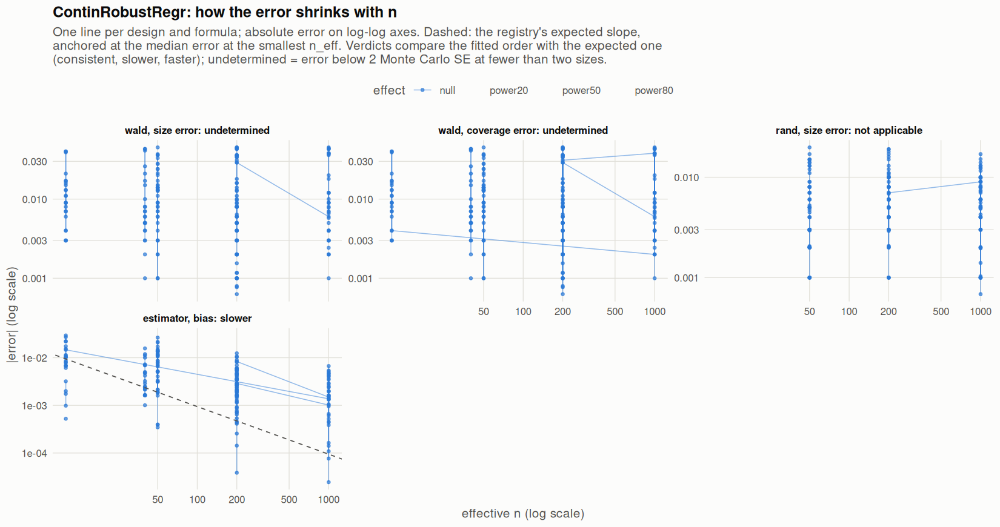

[← Campaign 2026-11-11-9d2edc5c summary](README.md)

# Class ContinRobustRegr

Part of the [Classes index](classes.md). Response type: continuous. Status: null effect complete, power effects not started. Verdict: **pending confirmation** (17 flagged test(s): 0 failing, 17 pending, 0 cleared).

<picture><source media="(prefers-color-scheme: dark)" srcset="figures/class-ContinRobustRegr-dark.png"></picture>

Convergence verdicts (worst over designs, formulas and effects; provisional until the class is complete):

| procedure | metric | verdict |
|---|---|---|
| estimator (bias) | bias | slower |
| wald | coverage | undetermined |
| rand | size | not applicable |
| wald | size | undetermined |

Null effect: 384 cells (17 failing). Size, coverage and bias / SD against the level each is held to.

| design | n | formula | procedure | size | coverage | bias / SD | size level | coverage level | verdict |
|---|---|---|---|---|---|---|---|---|---|
| Fixed:Bernoulli | 50 | `~.` | rand | 0.05 |  | -0.069 | 0.05 | 0.95 | ok |
| Fixed:Bernoulli | 200 | `~.` | rand | 0.045 |  | 0.0036 | 0.05 | 0.95 | ok |
| Fixed:Bernoulli | 1000 | `~.` | rand | 0.052 |  | 0.064 | 0.05 | 0.95 | ok |
| Fixed:Bernoulli | 50 | `~.` | wald | 0.057 | 0.943 | -0.069 | 0.1 | 0.9 | ok |
| Fixed:Bernoulli | 200 | `~.` | wald | 0.05 | 0.95 | 0.0036 | 0.1 | 0.9 | ok |
| Fixed:Bernoulli | 1000 | `~.` | wald | 0.052 | 0.948 | 0.064 | 0.0525 | 0.948 | ok |
| Fixed:Bernoulli | 50 | `~1` | rand | 0.041 |  | -0.017 | 0.05 | 0.95 | ok |
| Fixed:Bernoulli | 200 | `~1` | rand | 0.049 |  | -0.044 | 0.05 | 0.95 | ok |
| Fixed:Bernoulli | 1000 | `~1` | rand | 0.051 |  | 0.051 | 0.05 | 0.95 | ok |
| Fixed:Bernoulli | 50 | `~1` | wald | 0.041 | 0.959 | -0.017 | 0.1 | 0.9 | ok |
| Fixed:Bernoulli | 200 | `~1` | wald | 0.051 | 0.949 | -0.044 | 0.1 | 0.9 | ok |
| Fixed:Bernoulli | 1000 | `~1` | wald | 0.045 | 0.955 | 0.051 | 0.0525 | 0.948 | ok |
| Fixed:Bernoulli@0.2 | 50 | `~.` | rand | 0.051 |  | -0.075 | 0.05 | 0.95 | ok |
| Fixed:Bernoulli@0.2 | 200 | `~.` | rand | 0.052 |  | -0.039 | 0.05 | 0.95 | ok |
| Fixed:Bernoulli@0.2 | 1000 | `~.` | rand | 0.0556 |  | 0.043 | 0.05 | 0.95 | ok |
| Fixed:Bernoulli@0.2 | 50 | `~.` | wald | 0.056 | 0.944 | -0.075 | 0.1 | 0.9 | ok |
| Fixed:Bernoulli@0.2 | 200 | `~.` | wald | 0.058 | 0.942 | -0.039 | 0.1 | 0.9 | ok |
| Fixed:Bernoulli@0.2 | 1000 | `~.` | wald | 0.0492 | 0.951 | 0.043 | 0.0625 | 0.938 | ok |
| Fixed:Bernoulli@0.2 | 50 | `~1` | rand | 0.036 |  | -0.043 | 0.05 | 0.95 | ok |
| Fixed:Bernoulli@0.2 | 200 | `~1` | rand | 0.053 |  | -0.06 | 0.05 | 0.95 | ok |
| Fixed:Bernoulli@0.2 | 1000 | `~1` | rand | 0.0622 |  | 0.049 | 0.05 | 0.95 | ok |
| Fixed:Bernoulli@0.2 | 50 | `~1` | wald | 0.041 | 0.959 | -0.043 | 0.1 | 0.9 | ok |
| Fixed:Bernoulli@0.2 | 200 | `~1` | wald | 0.051 | 0.949 | -0.06 | 0.1 | 0.9 | ok |
| Fixed:Bernoulli@0.2 | 1000 | `~1` | wald | 0.066 | 0.934 | 0.049 | 0.0625 | 0.938 | ok |
| Fixed:BinaryMatch | 50 | `~.` | rand | 0.054 |  | 0.046 | 0.05 | 0.95 | ok |
| Fixed:BinaryMatch | 200 | `~.` | rand | 0.0529 |  | -0.018 | 0.05 | 0.95 | ok |
| Fixed:BinaryMatch | 1000 | `~.` | rand | 0.056 |  | 0.0095 | 0.05 | 0.95 | ok |
| Fixed:BinaryMatch | 50 | `~.` | wald | 0.059 | 0.941 | 0.046 | 0.1 | 0.9 | ok |
| Fixed:BinaryMatch | 200 | `~.` | wald | 0.0627 | 0.937 | -0.018 | 0.1 | 0.9 | ok |
| Fixed:BinaryMatch | 1000 | `~.` | wald | 0.054 | 0.946 | 0.0095 | 0.0525 | 0.948 | ok |
| Fixed:BinaryMatch | 50 | `~1` | rand | 0.051 |  | 0.051 | 0.05 | 0.95 | ok |
| Fixed:BinaryMatch | 200 | `~1` | rand | 0.065 |  | -0.018 | 0.05 | 0.95 | **FAIL** |
| Fixed:BinaryMatch | 1000 | `~1` | rand | 0.042 |  | -0.0016 | 0.05 | 0.95 | ok |
| Fixed:BinaryMatch | 50 | `~1` | wald | 0.022 | 0.978 | 0.051 | 0.1 | 0.9 | ok |
| Fixed:BinaryMatch | 200 | `~1` | wald | 0.0211 | 0.979 | -0.018 | 0.1 | 0.9 | ok |
| Fixed:BinaryMatch | 1000 | `~1` | wald | 0.007 | 0.993 | -0.0016 | 0.0525 | 0.948 | ok |
| Fixed:Blocking | 50 | `~.` | rand | 0.044 |  | 0.0062 | 0.05 | 0.95 | ok |
| Fixed:Blocking | 200 | `~.` | rand | 0.069 |  | -0.039 | 0.05 | 0.95 | **FAIL** |
| Fixed:Blocking | 1000 | `~.` | rand | 0.047 |  | 0.016 | 0.05 | 0.95 | ok |
| Fixed:Blocking | 50 | `~.` | wald | 0.055 | 0.945 | 0.0062 | 0.1 | 0.9 | ok |
| Fixed:Blocking | 200 | `~.` | wald | 0.068 | 0.932 | -0.039 | 0.1 | 0.9 | ok |
| Fixed:Blocking | 1000 | `~.` | wald | 0.044 | 0.956 | 0.016 | 0.0525 | 0.948 | ok |
| Fixed:Blocking | 50 | `~1` | rand | 0.05 |  | 0.027 | 0.05 | 0.95 | ok |
| Fixed:Blocking | 200 | `~1` | rand | 0.062 |  | -0.06 | 0.05 | 0.95 | **FAIL** |
| Fixed:Blocking | 1000 | `~1` | rand | 0.037 |  | 0.057 | 0.05 | 0.95 | ok |
| Fixed:Blocking | 50 | `~1` | wald | 0.042 | 0.958 | 0.027 | 0.1 | 0.9 | ok |
| Fixed:Blocking | 200 | `~1` | wald | 0.058 | 0.942 | -0.06 | 0.1 | 0.9 | ok |
| Fixed:Blocking | 1000 | `~1` | wald | 0.03 | 0.97 | 0.057 | 0.0525 | 0.948 | ok |
| Fixed:Blocking@0.2 | 50 | `~.` | rand | 0.047 |  | 0.029 | 0.05 | 0.95 | ok |
| Fixed:Blocking@0.2 | 200 | `~.` | rand | 0.06 |  | 0.013 | 0.05 | 0.95 | ok |
| Fixed:Blocking@0.2 | 1000 | `~.` | rand | 0.054 |  | -0.066 | 0.05 | 0.95 | ok |
| Fixed:Blocking@0.2 | 50 | `~.` | wald | 0.063 | 0.937 | 0.029 | 0.1 | 0.9 | ok |
| Fixed:Blocking@0.2 | 200 | `~.` | wald | 0.058 | 0.942 | 0.013 | 0.1 | 0.9 | ok |
| Fixed:Blocking@0.2 | 1000 | `~.` | wald | 0.058 | 0.942 | -0.066 | 0.0625 | 0.938 | ok |
| Fixed:Blocking@0.2 | 50 | `~1` | rand | 0.054 |  | 0.029 | 0.05 | 0.95 | ok |
| Fixed:Blocking@0.2 | 200 | `~1` | rand | 0.044 |  | 0.02 | 0.05 | 0.95 | ok |
| Fixed:Blocking@0.2 | 1000 | `~1` | rand | 0.056 |  | -0.054 | 0.05 | 0.95 | ok |
| Fixed:Blocking@0.2 | 50 | `~1` | wald | 0.046 | 0.954 | 0.029 | 0.1 | 0.9 | ok |
| Fixed:Blocking@0.2 | 200 | `~1` | wald | 0.035 | 0.965 | 0.02 | 0.1 | 0.9 | ok |
| Fixed:Blocking@0.2 | 1000 | `~1` | wald | 0.047 | 0.953 | -0.054 | 0.0625 | 0.938 | ok |
| Fixed:Greedy | 50 | `~.` | rand | 0.065 |  | -0.0071 | 0.05 | 0.95 | **FAIL** |
| Fixed:Greedy | 200 | `~.` | rand | 0.056 |  | 0.037 | 0.05 | 0.95 | ok |
| Fixed:Greedy | 1000 | `~.` | rand | 0.0582 |  | -0.01 | 0.05 | 0.95 | ok |
| Fixed:Greedy | 50 | `~.` | wald | 0.064 | 0.936 | -0.0071 | 0.1 | 0.9 | ok |
| Fixed:Greedy | 200 | `~.` | wald | 0.058 | 0.942 | 0.037 | 0.1 | 0.9 | ok |
| Fixed:Greedy | 1000 | `~.` | wald | 0.05 | 0.95 | -0.01 | 0.0525 | 0.948 | ok |
| Fixed:Greedy | 50 | `~1` | rand | 0.058 |  | -0.016 | 0.05 | 0.95 | ok |
| Fixed:Greedy | 200 | `~1` | rand | 0.06 |  | 0.031 | 0.05 | 0.95 | ok |
| Fixed:Greedy | 1000 | `~1` | rand | 0.0507 |  | -0.024 | 0.05 | 0.95 | ok |
| Fixed:Greedy | 50 | `~1` | wald | 0.014 | 0.986 | -0.016 | 0.1 | 0.9 | ok |
| Fixed:Greedy | 200 | `~1` | wald | 0.005 | 0.995 | 0.031 | 0.1 | 0.9 | ok |
| Fixed:Greedy | 1000 | `~1` | wald | 0.00685 | 0.993 | -0.024 | 0.0525 | 0.948 | ok |
| Fixed:Greedy@0.2 | 50 | `~.` | rand | 0.048 |  | -0.018 | 0.05 | 0.95 | ok |
| Fixed:Greedy@0.2 | 200 | `~.` | rand | 0.054 |  | -0.0091 | 0.05 | 0.95 | ok |
| Fixed:Greedy@0.2 | 1000 | `~.` | rand | 0.051 |  | 0.0094 | 0.05 | 0.95 | ok |
| Fixed:Greedy@0.2 | 50 | `~.` | wald | 0.061 | 0.939 | -0.018 | 0.1 | 0.9 | ok |
| Fixed:Greedy@0.2 | 200 | `~.` | wald | 0.055 | 0.945 | -0.0091 | 0.1 | 0.9 | ok |
| Fixed:Greedy@0.2 | 1000 | `~.` | wald | 0.0515 | 0.948 | 0.0094 | 0.0625 | 0.938 | ok |
| Fixed:Greedy@0.2 | 50 | `~1` | rand | 0.045 |  | -0.027 | 0.05 | 0.95 | ok |
| Fixed:Greedy@0.2 | 200 | `~1` | rand | 0.04 |  | -0.012 | 0.05 | 0.95 | ok |
| Fixed:Greedy@0.2 | 1000 | `~1` | rand | 0.0572 |  | -0.0083 | 0.05 | 0.95 | ok |
| Fixed:Greedy@0.2 | 50 | `~1` | wald | 0.01 | 0.99 | -0.027 | 0.1 | 0.9 | ok |
| Fixed:Greedy@0.2 | 200 | `~1` | wald | 0.007 | 0.993 | -0.012 | 0.1 | 0.9 | ok |
| Fixed:Greedy@0.2 | 1000 | `~1` | wald | 0.0149 | 0.985 | -0.0083 | 0.0625 | 0.938 | ok |
| Fixed:GreedyDOptimal | 50 | `~.` | rand | 0.065 |  | -0.0071 | 0.05 | 0.95 | **FAIL** |
| Fixed:GreedyDOptimal | 200 | `~.` | rand | 0.056 |  | 0.037 | 0.05 | 0.95 | ok |
| Fixed:GreedyDOptimal | 1000 | `~.` | rand | 0.06 |  | -0.021 | 0.05 | 0.95 | ok |
| Fixed:GreedyDOptimal | 50 | `~.` | wald | 0.064 | 0.936 | -0.0071 | 0.1 | 0.9 | ok |
| Fixed:GreedyDOptimal | 200 | `~.` | wald | 0.058 | 0.942 | 0.037 | 0.1 | 0.9 | ok |
| Fixed:GreedyDOptimal | 1000 | `~.` | wald | 0.052 | 0.948 | -0.021 | 0.0525 | 0.948 | ok |
| Fixed:GreedyDOptimal | 50 | `~1` | rand | 0.058 |  | -0.016 | 0.05 | 0.95 | ok |
| Fixed:GreedyDOptimal | 200 | `~1` | rand | 0.06 |  | 0.031 | 0.05 | 0.95 | ok |
| Fixed:GreedyDOptimal | 1000 | `~1` | rand | 0.054 |  | -0.029 | 0.05 | 0.95 | ok |
| Fixed:GreedyDOptimal | 50 | `~1` | wald | 0.014 | 0.986 | -0.016 | 0.1 | 0.9 | ok |
| Fixed:GreedyDOptimal | 200 | `~1` | wald | 0.005 | 0.995 | 0.031 | 0.1 | 0.9 | ok |
| Fixed:GreedyDOptimal | 1000 | `~1` | wald | 0.007 | 0.993 | -0.029 | 0.0525 | 0.948 | ok |
| Fixed:GreedyDOptimal@0.2 | 50 | `~.` | rand | 0.048 |  | -0.018 | 0.05 | 0.95 | ok |
| Fixed:GreedyDOptimal@0.2 | 200 | `~.` | rand | 0.054 |  | -0.0091 | 0.05 | 0.95 | ok |
| Fixed:GreedyDOptimal@0.2 | 1000 | `~.` | rand | 0.048 |  | 0.011 | 0.05 | 0.95 | ok |
| Fixed:GreedyDOptimal@0.2 | 50 | `~.` | wald | 0.061 | 0.939 | -0.018 | 0.1 | 0.9 | ok |
| Fixed:GreedyDOptimal@0.2 | 200 | `~.` | wald | 0.055 | 0.945 | -0.0091 | 0.1 | 0.9 | ok |
| Fixed:GreedyDOptimal@0.2 | 1000 | `~.` | wald | 0.0492 | 0.951 | 0.011 | 0.0625 | 0.938 | ok |
| Fixed:GreedyDOptimal@0.2 | 50 | `~1` | rand | 0.045 |  | -0.027 | 0.05 | 0.95 | ok |
| Fixed:GreedyDOptimal@0.2 | 200 | `~1` | rand | 0.04 |  | -0.012 | 0.05 | 0.95 | ok |
| Fixed:GreedyDOptimal@0.2 | 1000 | `~1` | rand | 0.0552 |  | -0.0054 | 0.05 | 0.95 | ok |
| Fixed:GreedyDOptimal@0.2 | 50 | `~1` | wald | 0.01 | 0.99 | -0.027 | 0.1 | 0.9 | ok |
| Fixed:GreedyDOptimal@0.2 | 200 | `~1` | wald | 0.007 | 0.993 | -0.012 | 0.1 | 0.9 | ok |
| Fixed:GreedyDOptimal@0.2 | 1000 | `~1` | wald | 0.0142 | 0.986 | -0.0054 | 0.0625 | 0.938 | ok |
| Fixed:iBCRD | 50 | `~.` | rand | 0.057 |  | -0.067 | 0.05 | 0.95 | ok |
| Fixed:iBCRD | 200 | `~.` | rand | 0.053 |  | -0.014 | 0.05 | 0.95 | ok |
| Fixed:iBCRD | 1000 | `~.` | rand | 0.0574 |  | -0.0011 | 0.05 | 0.95 | ok |
| Fixed:iBCRD | 50 | `~.` | wald | 0.065 | 0.935 | -0.067 | 0.1 | 0.9 | ok |
| Fixed:iBCRD | 200 | `~.` | wald | 0.052 | 0.948 | -0.014 | 0.1 | 0.9 | ok |
| Fixed:iBCRD | 1000 | `~.` | wald | 0.0578 | 0.942 | -0.0011 | 0.0525 | 0.948 | ok |
| Fixed:iBCRD | 50 | `~1` | rand | 0.058 |  | -0.026 | 0.05 | 0.95 | ok |
| Fixed:iBCRD | 200 | `~1` | rand | 0.067 |  | -0.017 | 0.05 | 0.95 | **FAIL** |
| Fixed:iBCRD | 1000 | `~1` | rand | 0.0651 |  | 0.014 | 0.05 | 0.95 | **FAIL** |
| Fixed:iBCRD | 50 | `~1` | wald | 0.059 | 0.941 | -0.026 | 0.1 | 0.9 | ok |
| Fixed:iBCRD | 200 | `~1` | wald | 0.063 | 0.937 | -0.017 | 0.1 | 0.9 | ok |
| Fixed:iBCRD | 1000 | `~1` | wald | 0.0566 | 0.943 | 0.014 | 0.0525 | 0.948 | ok |
| Fixed:iBCRD@0.2 | 50 | `~.` | rand | 0.056 |  | -0.0014 | 0.05 | 0.95 | ok |
| Fixed:iBCRD@0.2 | 200 | `~.` | rand | 0.068 |  | -0.0085 | 0.05 | 0.95 | **FAIL** |
| Fixed:iBCRD@0.2 | 1000 | `~.` | rand | 0.044 |  | -0.016 | 0.05 | 0.95 | ok |
| Fixed:iBCRD@0.2 | 50 | `~.` | wald | 0.066 | 0.934 | -0.0014 | 0.1 | 0.9 | ok |
| Fixed:iBCRD@0.2 | 200 | `~.` | wald | 0.067 | 0.933 | -0.0085 | 0.1 | 0.9 | ok |
| Fixed:iBCRD@0.2 | 1000 | `~.` | wald | 0.041 | 0.959 | -0.016 | 0.0625 | 0.938 | ok |
| Fixed:iBCRD@0.2 | 50 | `~1` | rand | 0.048 |  | 0.012 | 0.05 | 0.95 | ok |
| Fixed:iBCRD@0.2 | 200 | `~1` | rand | 0.066 |  | -0.026 | 0.05 | 0.95 | **FAIL** |
| Fixed:iBCRD@0.2 | 1000 | `~1` | rand | 0.055 |  | 0.025 | 0.05 | 0.95 | ok |
| Fixed:iBCRD@0.2 | 50 | `~1` | wald | 0.053 | 0.947 | 0.012 | 0.1 | 0.9 | ok |
| Fixed:iBCRD@0.2 | 200 | `~1` | wald | 0.071 | 0.929 | -0.026 | 0.1 | 0.9 | ok |
| Fixed:iBCRD@0.2 | 1000 | `~1` | wald | 0.052 | 0.948 | 0.025 | 0.0625 | 0.938 | ok |
| Fixed:MatchingGreedyPairSwitching | 50 | `~.` | rand | 0.065 |  | -0.049 | 0.05 | 0.95 | **FAIL** |
| Fixed:MatchingGreedyPairSwitching | 200 | `~.` | rand | 0.058 |  | 0.003 | 0.05 | 0.95 | ok |
| Fixed:MatchingGreedyPairSwitching | 1000 | `~.` | rand | 0.055 |  | 0.008 | 0.05 | 0.95 | ok |
| Fixed:MatchingGreedyPairSwitching | 50 | `~.` | wald | 0.063 | 0.937 | -0.049 | 0.1 | 0.9 | ok |
| Fixed:MatchingGreedyPairSwitching | 200 | `~.` | wald | 0.064 | 0.936 | 0.003 | 0.1 | 0.9 | ok |
| Fixed:MatchingGreedyPairSwitching | 1000 | `~.` | wald | 0.058 | 0.942 | 0.008 | 0.0525 | 0.948 | ok |
| Fixed:MatchingGreedyPairSwitching | 50 | `~1` | rand | 0.052 |  | -0.037 | 0.05 | 0.95 | ok |
| Fixed:MatchingGreedyPairSwitching | 200 | `~1` | rand | 0.061 |  | 0.0061 | 0.05 | 0.95 | **FAIL** |
| Fixed:MatchingGreedyPairSwitching | 1000 | `~1` | rand | 0.05 |  | 0.016 | 0.05 | 0.95 | ok |
| Fixed:MatchingGreedyPairSwitching | 50 | `~1` | wald | 0.005 | 0.995 | -0.037 | 0.1 | 0.9 | ok |
| Fixed:MatchingGreedyPairSwitching | 200 | `~1` | wald | 0.007 | 0.993 | 0.0061 | 0.1 | 0.9 | ok |
| Fixed:MatchingGreedyPairSwitching | 1000 | `~1` | wald | 0.006 | 0.994 | 0.016 | 0.0525 | 0.948 | ok |
| Fixed:Optimal | 50 | `~.` | wald | 0.063 | 0.937 | 0.0063 | 0.1 | 0.9 | ok |
| Fixed:Optimal | 200 | `~.` | wald | 0.044 | 0.956 | 0.013 | 0.1 | 0.9 | ok |
| Fixed:Optimal | 1000 | `~.` | wald | 0.051 | 0.949 | 0.04 | 0.0525 | 0.948 | ok |
| Fixed:Optimal | 50 | `~1` | wald | 0.017 | 0.983 | -0.01 | 0.1 | 0.9 | ok |
| Fixed:Optimal | 200 | `~1` | wald | 0.007 | 0.993 | -0.014 | 0.1 | 0.9 | ok |
| Fixed:Optimal | 1000 | `~1` | wald | 0.005 | 0.995 | 0.053 | 0.0525 | 0.948 | ok |
| Fixed:Optimal@0.2 | 50 | `~.` | wald | 0.057 | 0.943 | -0.0087 | 0.1 | 0.9 | ok |
| Fixed:Optimal@0.2 | 200 | `~.` | wald | 0.055 | 0.945 | 0.014 | 0.1 | 0.9 | ok |
| Fixed:Optimal@0.2 | 1000 | `~.` | wald | 0.053 | 0.947 | -0.0017 | 0.0625 | 0.938 | ok |
| Fixed:Optimal@0.2 | 50 | `~1` | wald | 0.011 | 0.989 | -0.0046 | 0.1 | 0.9 | ok |
| Fixed:Optimal@0.2 | 200 | `~1` | wald | 0.009 | 0.991 | 0.012 | 0.1 | 0.9 | ok |
| Fixed:Optimal@0.2 | 1000 | `~1` | wald | 0.006 | 0.994 | -0.003 | 0.0625 | 0.938 | ok |
| Fixed:OptimalBlocks | 50 | `~.` | rand | 0.053 |  | -0.017 | 0.05 | 0.95 | ok |
| Fixed:OptimalBlocks | 200 | `~.` | rand | 0.054 |  | -0.0028 | 0.05 | 0.95 | ok |
| Fixed:OptimalBlocks | 1000 | `~.` | rand | 0.0451 |  | 0.0069 | 0.05 | 0.95 | ok |
| Fixed:OptimalBlocks | 50 | `~.` | wald | 0.052 | 0.948 | -0.017 | 0.1 | 0.9 | ok |
| Fixed:OptimalBlocks | 200 | `~.` | wald | 0.048 | 0.952 | -0.0028 | 0.1 | 0.9 | ok |
| Fixed:OptimalBlocks | 1000 | `~.` | wald | 0.0431 | 0.957 | 0.0069 | 0.0525 | 0.948 | ok |
| Fixed:OptimalBlocks | 50 | `~1` | rand | 0.045 |  | 0.0011 | 0.05 | 0.95 | ok |
| Fixed:OptimalBlocks | 200 | `~1` | rand | 0.052 |  | 0.013 | 0.05 | 0.95 | ok |
| Fixed:OptimalBlocks | 1000 | `~1` | rand | 0.046 |  | -0.00034 | 0.05 | 0.95 | ok |
| Fixed:OptimalBlocks | 50 | `~1` | wald | 0.026 | 0.974 | 0.0011 | 0.1 | 0.9 | ok |
| Fixed:OptimalBlocks | 200 | `~1` | wald | 0.021 | 0.979 | 0.013 | 0.1 | 0.9 | ok |
| Fixed:OptimalBlocks | 1000 | `~1` | wald | 0.0121 | 0.988 | -0.00034 | 0.0525 | 0.948 | ok |
| Fixed:OptimalBlocks@0.2 | 50 | `~.` | rand | 0.048 |  | 0.041 | 0.05 | 0.95 | ok |
| Fixed:OptimalBlocks@0.2 | 200 | `~.` | rand | 0.044 |  | -0.062 | 0.05 | 0.95 | ok |
| Fixed:OptimalBlocks@0.2 | 1000 | `~.` | rand | 0.0543 |  | 0.00048 | 0.05 | 0.95 | ok |
| Fixed:OptimalBlocks@0.2 | 50 | `~.` | wald | 0.063 | 0.937 | 0.041 | 0.1 | 0.9 | ok |
| Fixed:OptimalBlocks@0.2 | 200 | `~.` | wald | 0.048 | 0.952 | -0.062 | 0.1 | 0.9 | ok |
| Fixed:OptimalBlocks@0.2 | 1000 | `~.` | wald | 0.0494 | 0.951 | 0.00048 | 0.0625 | 0.938 | ok |
| Fixed:OptimalBlocks@0.2 | 50 | `~1` | rand | 0.048 |  | 0.019 | 0.05 | 0.95 | ok |
| Fixed:OptimalBlocks@0.2 | 200 | `~1` | rand | 0.055 |  | -0.046 | 0.05 | 0.95 | ok |
| Fixed:OptimalBlocks@0.2 | 1000 | `~1` | rand | 0.0486 |  | 0.017 | 0.05 | 0.95 | ok |
| Fixed:OptimalBlocks@0.2 | 50 | `~1` | wald | 0.029 | 0.971 | 0.019 | 0.1 | 0.9 | ok |
| Fixed:OptimalBlocks@0.2 | 200 | `~1` | wald | 0.024 | 0.976 | -0.046 | 0.1 | 0.9 | ok |
| Fixed:OptimalBlocks@0.2 | 1000 | `~1` | wald | 0.0162 | 0.984 | 0.017 | 0.0625 | 0.938 | ok |
| Fixed:Rerandomization | 50 | `~.` | rand | 0.051 |  | 0.017 | 0.05 | 0.95 | ok |
| Fixed:Rerandomization | 200 | `~.` | rand | 0.058 |  | 0.04 | 0.05 | 0.95 | ok |
| Fixed:Rerandomization | 1000 | `~.` | rand | 0.053 |  | -0.025 | 0.05 | 0.95 | ok |
| Fixed:Rerandomization | 50 | `~.` | wald | 0.065 | 0.935 | 0.017 | 0.1 | 0.9 | ok |
| Fixed:Rerandomization | 200 | `~.` | wald | 0.055 | 0.945 | 0.04 | 0.1 | 0.9 | ok |
| Fixed:Rerandomization | 1000 | `~.` | wald | 0.053 | 0.947 | -0.025 | 0.0525 | 0.948 | ok |
| Fixed:Rerandomization | 50 | `~1` | rand | 0.054 |  | -0.0099 | 0.05 | 0.95 | ok |
| Fixed:Rerandomization | 200 | `~1` | rand | 0.046 |  | -0.012 | 0.05 | 0.95 | ok |
| Fixed:Rerandomization | 1000 | `~1` | rand | 0.067 |  | -0.025 | 0.05 | 0.95 | **FAIL** |
| Fixed:Rerandomization | 50 | `~1` | wald | 0.056 | 0.944 | -0.0099 | 0.1 | 0.9 | ok |
| Fixed:Rerandomization | 200 | `~1` | wald | 0.045 | 0.955 | -0.012 | 0.1 | 0.9 | ok |
| Fixed:Rerandomization | 1000 | `~1` | wald | 0.068 | 0.932 | -0.025 | 0.0525 | 0.948 | ok |
| Fixed:Rerandomization@0.2 | 50 | `~.` | rand | 0.067 |  | -0.028 | 0.05 | 0.95 | **FAIL** |
| Fixed:Rerandomization@0.2 | 200 | `~.` | rand | 0.053 |  | -0.037 | 0.05 | 0.95 | ok |
| Fixed:Rerandomization@0.2 | 1000 | `~.` | rand | 0.064 |  | -0.042 | 0.05 | 0.95 | ok |
| Fixed:Rerandomization@0.2 | 50 | `~.` | wald | 0.067 | 0.933 | -0.028 | 0.1 | 0.9 | ok |
| Fixed:Rerandomization@0.2 | 200 | `~.` | wald | 0.055 | 0.945 | -0.037 | 0.1 | 0.9 | ok |
| Fixed:Rerandomization@0.2 | 1000 | `~.` | wald | 0.055 | 0.945 | -0.042 | 0.0625 | 0.938 | ok |
| Fixed:Rerandomization@0.2 | 50 | `~1` | rand | 0.056 |  | 0.015 | 0.05 | 0.95 | ok |
| Fixed:Rerandomization@0.2 | 200 | `~1` | rand | 0.05 |  | -0.046 | 0.05 | 0.95 | ok |
| Fixed:Rerandomization@0.2 | 1000 | `~1` | rand | 0.056 |  | -0.018 | 0.05 | 0.95 | ok |
| Fixed:Rerandomization@0.2 | 50 | `~1` | wald | 0.058 | 0.942 | 0.015 | 0.1 | 0.9 | ok |
| Fixed:Rerandomization@0.2 | 200 | `~1` | wald | 0.054 | 0.946 | -0.046 | 0.1 | 0.9 | ok |
| Fixed:Rerandomization@0.2 | 1000 | `~1` | wald | 0.05 | 0.95 | -0.018 | 0.0625 | 0.938 | ok |
| SeqOneByOne:Atkinson | 50 | `~.` | rand | 0.048 |  | -0.011 | 0.05 | 0.95 | ok |
| SeqOneByOne:Atkinson | 200 | `~.` | rand | 0.0479 |  | -0.014 | 0.05 | 0.95 | ok |
| SeqOneByOne:Atkinson | 1000 | `~.` | rand | 0.051 |  | 0.025 | 0.05 | 0.95 | ok |
| SeqOneByOne:Atkinson | 50 | `~.` | wald | 0.053 | 0.947 | -0.011 | 0.1 | 0.9 | ok |
| SeqOneByOne:Atkinson | 200 | `~.` | wald | 0.0512 | 0.949 | -0.014 | 0.1 | 0.9 | ok |
| SeqOneByOne:Atkinson | 1000 | `~.` | wald | 0.047 | 0.953 | 0.025 | 0.0525 | 0.948 | ok |
| SeqOneByOne:Atkinson | 50 | `~1` | rand | 0.047 |  | -0.042 | 0.05 | 0.95 | ok |
| SeqOneByOne:Atkinson | 200 | `~1` | rand | 0.0605 |  | -0.018 | 0.05 | 0.95 | ok |
| SeqOneByOne:Atkinson | 1000 | `~1` | rand | 0.04 |  | 0.02 | 0.05 | 0.95 | ok |
| SeqOneByOne:Atkinson | 50 | `~1` | wald | 0.013 | 0.987 | -0.042 | 0.1 | 0.9 | ok |
| SeqOneByOne:Atkinson | 200 | `~1` | wald | 0.016 | 0.984 | -0.018 | 0.1 | 0.9 | ok |
| SeqOneByOne:Atkinson | 1000 | `~1` | wald | 0.012 | 0.988 | 0.02 | 0.0525 | 0.948 | ok |
| SeqOneByOne:Bernoulli | 50 | `~.` | rand | 0.05 |  | 0.038 | 0.05 | 0.95 | ok |
| SeqOneByOne:Bernoulli | 200 | `~.` | rand | 0.042 |  | -0.0079 | 0.05 | 0.95 | ok |
| SeqOneByOne:Bernoulli | 1000 | `~.` | rand | 0.05 |  | 0.023 | 0.05 | 0.95 | ok |
| SeqOneByOne:Bernoulli | 50 | `~.` | wald | 0.057 | 0.943 | 0.038 | 0.1 | 0.9 | ok |
| SeqOneByOne:Bernoulli | 200 | `~.` | wald | 0.044 | 0.956 | -0.0079 | 0.1 | 0.9 | ok |
| SeqOneByOne:Bernoulli | 1000 | `~.` | wald | 0.05 | 0.95 | 0.023 | 0.0525 | 0.948 | ok |
| SeqOneByOne:Bernoulli | 50 | `~1` | rand | 0.039 |  | 0.035 | 0.05 | 0.95 | ok |
| SeqOneByOne:Bernoulli | 200 | `~1` | rand | 0.05 |  | -0.013 | 0.05 | 0.95 | ok |
| SeqOneByOne:Bernoulli | 1000 | `~1` | rand | 0.059 |  | 0.043 | 0.05 | 0.95 | ok |
| SeqOneByOne:Bernoulli | 50 | `~1` | wald | 0.037 | 0.963 | 0.035 | 0.1 | 0.9 | ok |
| SeqOneByOne:Bernoulli | 200 | `~1` | wald | 0.049 | 0.951 | -0.013 | 0.1 | 0.9 | ok |
| SeqOneByOne:Bernoulli | 1000 | `~1` | wald | 0.059 | 0.941 | 0.043 | 0.0525 | 0.948 | ok |
| SeqOneByOne:Bernoulli@0.2 | 50 | `~.` | rand | 0.043 |  | -0.0051 | 0.05 | 0.95 | ok |
| SeqOneByOne:Bernoulli@0.2 | 200 | `~.` | rand | 0.061 |  | 0.018 | 0.05 | 0.95 | ok |
| SeqOneByOne:Bernoulli@0.2 | 1000 | `~.` | rand | 0.049 |  | 0.032 | 0.05 | 0.95 | ok |
| SeqOneByOne:Bernoulli@0.2 | 50 | `~.` | wald | 0.057 | 0.943 | -0.0051 | 0.1 | 0.9 | ok |
| SeqOneByOne:Bernoulli@0.2 | 200 | `~.` | wald | 0.057 | 0.943 | 0.018 | 0.1 | 0.9 | ok |
| SeqOneByOne:Bernoulli@0.2 | 1000 | `~.` | wald | 0.045 | 0.955 | 0.032 | 0.0625 | 0.938 | ok |
| SeqOneByOne:Bernoulli@0.2 | 50 | `~1` | rand | 0.042 |  | -0.0019 | 0.05 | 0.95 | ok |
| SeqOneByOne:Bernoulli@0.2 | 200 | `~1` | rand | 0.045 |  | -0.017 | 0.05 | 0.95 | ok |
| SeqOneByOne:Bernoulli@0.2 | 1000 | `~1` | rand | 0.058 |  | 0.034 | 0.05 | 0.95 | ok |
| SeqOneByOne:Bernoulli@0.2 | 50 | `~1` | wald | 0.041 | 0.959 | -0.0019 | 0.1 | 0.9 | ok |
| SeqOneByOne:Bernoulli@0.2 | 200 | `~1` | wald | 0.046 | 0.954 | -0.017 | 0.1 | 0.9 | ok |
| SeqOneByOne:Bernoulli@0.2 | 1000 | `~1` | wald | 0.052 | 0.948 | 0.034 | 0.0625 | 0.938 | ok |
| SeqOneByOne:Efron | 50 | `~.` | rand | 0.059 |  | 0.0011 | 0.05 | 0.95 | ok |
| SeqOneByOne:Efron | 200 | `~.` | rand | 0.055 |  | 0.031 | 0.05 | 0.95 | ok |
| SeqOneByOne:Efron | 1000 | `~.` | rand | 0.053 |  | 0.1 | 0.05 | 0.95 | ok |
| SeqOneByOne:Efron | 50 | `~.` | wald | 0.064 | 0.936 | 0.0011 | 0.1 | 0.9 | ok |
| SeqOneByOne:Efron | 200 | `~.` | wald | 0.052 | 0.948 | 0.031 | 0.1 | 0.9 | ok |
| SeqOneByOne:Efron | 1000 | `~.` | wald | 0.048 | 0.952 | 0.1 | 0.0525 | 0.948 | ok |
| SeqOneByOne:Efron | 50 | `~1` | rand | 0.051 |  | -0.03 | 0.05 | 0.95 | ok |
| SeqOneByOne:Efron | 200 | `~1` | rand | 0.047 |  | 0.0077 | 0.05 | 0.95 | ok |
| SeqOneByOne:Efron | 1000 | `~1` | rand | 0.051 |  | 0.061 | 0.05 | 0.95 | ok |
| SeqOneByOne:Efron | 50 | `~1` | wald | 0.049 | 0.951 | -0.03 | 0.1 | 0.9 | ok |
| SeqOneByOne:Efron | 200 | `~1` | wald | 0.045 | 0.955 | 0.0077 | 0.1 | 0.9 | ok |
| SeqOneByOne:Efron | 1000 | `~1` | wald | 0.05 | 0.95 | 0.061 | 0.0525 | 0.948 | ok |
| SeqOneByOne:iBCRD | 50 | `~.` | rand | 0.051 |  | -0.046 | 0.05 | 0.95 | ok |
| SeqOneByOne:iBCRD | 200 | `~.` | rand | 0.05 |  | 0.0096 | 0.05 | 0.95 | ok |
| SeqOneByOne:iBCRD | 1000 | `~.` | rand | 0.057 |  | 0.044 | 0.05 | 0.95 | ok |
| SeqOneByOne:iBCRD | 50 | `~.` | wald | 0.054 | 0.946 | -0.046 | 0.1 | 0.9 | ok |
| SeqOneByOne:iBCRD | 200 | `~.` | wald | 0.054 | 0.946 | 0.0096 | 0.1 | 0.9 | ok |
| SeqOneByOne:iBCRD | 1000 | `~.` | wald | 0.059 | 0.941 | 0.044 | 0.0525 | 0.948 | ok |
| SeqOneByOne:iBCRD | 50 | `~1` | rand | 0.05 |  | -0.064 | 0.05 | 0.95 | ok |
| SeqOneByOne:iBCRD | 200 | `~1` | rand | 0.057 |  | -0.011 | 0.05 | 0.95 | ok |
| SeqOneByOne:iBCRD | 1000 | `~1` | rand | 0.054 |  | 0.055 | 0.05 | 0.95 | ok |
| SeqOneByOne:iBCRD | 50 | `~1` | wald | 0.058 | 0.942 | -0.064 | 0.1 | 0.9 | ok |
| SeqOneByOne:iBCRD | 200 | `~1` | wald | 0.053 | 0.947 | -0.011 | 0.1 | 0.9 | ok |
| SeqOneByOne:iBCRD | 1000 | `~1` | wald | 0.057 | 0.943 | 0.055 | 0.0525 | 0.948 | ok |
| SeqOneByOne:iBCRD@0.2 | 50 | `~.` | rand | 0.048 |  | 0.022 | 0.05 | 0.95 | ok |
| SeqOneByOne:iBCRD@0.2 | 200 | `~.` | rand | 0.052 |  | 0.016 | 0.05 | 0.95 | ok |
| SeqOneByOne:iBCRD@0.2 | 1000 | `~.` | rand | 0.059 |  | 0.021 | 0.05 | 0.95 | ok |
| SeqOneByOne:iBCRD@0.2 | 50 | `~.` | wald | 0.046 | 0.954 | 0.022 | 0.1 | 0.9 | ok |
| SeqOneByOne:iBCRD@0.2 | 200 | `~.` | wald | 0.053 | 0.947 | 0.016 | 0.1 | 0.9 | ok |
| SeqOneByOne:iBCRD@0.2 | 1000 | `~.` | wald | 0.058 | 0.942 | 0.021 | 0.0625 | 0.938 | ok |
| SeqOneByOne:iBCRD@0.2 | 50 | `~1` | rand | 0.036 |  | 0.014 | 0.05 | 0.95 | ok |
| SeqOneByOne:iBCRD@0.2 | 200 | `~1` | rand | 0.045 |  | -0.0096 | 0.05 | 0.95 | ok |
| SeqOneByOne:iBCRD@0.2 | 1000 | `~1` | rand | 0.06 |  | 0.03 | 0.05 | 0.95 | ok |
| SeqOneByOne:iBCRD@0.2 | 50 | `~1` | wald | 0.035 | 0.965 | 0.014 | 0.1 | 0.9 | ok |
| SeqOneByOne:iBCRD@0.2 | 200 | `~1` | wald | 0.043 | 0.957 | -0.0096 | 0.1 | 0.9 | ok |
| SeqOneByOne:iBCRD@0.2 | 1000 | `~1` | wald | 0.054 | 0.946 | 0.03 | 0.0625 | 0.938 | ok |
| SeqOneByOne:KK14 | 50 | `~.` | rand | 0.0545 |  | -0.0051 | 0.05 | 0.95 | ok |
| SeqOneByOne:KK14 | 200 | `~.` | rand | 0.057 |  | -0.055 | 0.05 | 0.95 | ok |
| SeqOneByOne:KK14 | 1000 | `~.` | rand | 0.046 |  | 0.031 | 0.05 | 0.95 | ok |
| SeqOneByOne:KK14 | 50 | `~.` | wald | 0.0627 | 0.937 | -0.0051 | 0.1 | 0.9 | ok |
| SeqOneByOne:KK14 | 200 | `~.` | wald | 0.054 | 0.946 | -0.055 | 0.1 | 0.9 | ok |
| SeqOneByOne:KK14 | 1000 | `~.` | wald | 0.046 | 0.954 | 0.031 | 0.0525 | 0.948 | ok |
| SeqOneByOne:KK14 | 50 | `~1` | rand | 0.0547 |  | -0.023 | 0.05 | 0.95 | ok |
| SeqOneByOne:KK14 | 200 | `~1` | rand | 0.045 |  | -0.049 | 0.05 | 0.95 | ok |
| SeqOneByOne:KK14 | 1000 | `~1` | rand | 0.059 |  | 0.021 | 0.05 | 0.95 | ok |
| SeqOneByOne:KK14 | 50 | `~1` | wald | 0.0362 | 0.964 | -0.023 | 0.1 | 0.9 | ok |
| SeqOneByOne:KK14 | 200 | `~1` | wald | 0.019 | 0.981 | -0.049 | 0.1 | 0.9 | ok |
| SeqOneByOne:KK14 | 1000 | `~1` | wald | 0.012 | 0.988 | 0.021 | 0.0525 | 0.948 | ok |
| SeqOneByOne:KK21 | 50 | `~.` | rand | 0.0698 |  | -0.01 | 0.05 | 0.95 | **FAIL** |
| SeqOneByOne:KK21 | 200 | `~.` | rand | 0.045 |  | -0.076 | 0.05 | 0.95 | ok |
| SeqOneByOne:KK21 | 1000 | `~.` | rand | 0.0578 |  | 0.007 | 0.05 | 0.95 | ok |
| SeqOneByOne:KK21 | 50 | `~.` | wald | 0.074 | 0.926 | -0.01 | 0.1 | 0.9 | ok |
| SeqOneByOne:KK21 | 200 | `~.` | wald | 0.047 | 0.953 | -0.076 | 0.1 | 0.9 | ok |
| SeqOneByOne:KK21 | 1000 | `~.` | wald | 0.0524 | 0.948 | 0.007 | 0.0525 | 0.948 | ok |
| SeqOneByOne:KK21 | 50 | `~1` | rand | 0.0552 |  | -0.022 | 0.05 | 0.95 | ok |
| SeqOneByOne:KK21 | 200 | `~1` | rand | 0.051 |  | -0.064 | 0.05 | 0.95 | ok |
| SeqOneByOne:KK21 | 1000 | `~1` | rand | 0.0625 |  | -0.013 | 0.05 | 0.95 | ok |
| SeqOneByOne:KK21 | 50 | `~1` | wald | 0.0288 | 0.971 | -0.022 | 0.1 | 0.9 | ok |
| SeqOneByOne:KK21 | 200 | `~1` | wald | 0.014 | 0.986 | -0.064 | 0.1 | 0.9 | ok |
| SeqOneByOne:KK21 | 1000 | `~1` | wald | 0.0131 | 0.987 | -0.013 | 0.0525 | 0.948 | ok |
| SeqOneByOne:KK21stepwise | 50 | `~.` | rand | 0.053 |  | 0.037 | 0.05 | 0.95 | ok |
| SeqOneByOne:KK21stepwise | 200 | `~.` | rand | 0.056 |  | -0.029 | 0.05 | 0.95 | ok |
| SeqOneByOne:KK21stepwise | 1000 | `~.` | rand | 0.049 |  | -0.0026 | 0.05 | 0.95 | ok |
| SeqOneByOne:KK21stepwise | 50 | `~.` | wald | 0.0701 | 0.93 | 0.037 | 0.1 | 0.9 | ok |
| SeqOneByOne:KK21stepwise | 200 | `~.` | wald | 0.061 | 0.939 | -0.029 | 0.1 | 0.9 | ok |
| SeqOneByOne:KK21stepwise | 1000 | `~.` | wald | 0.047 | 0.953 | -0.0026 | 0.0525 | 0.948 | ok |
| SeqOneByOne:KK21stepwise | 50 | `~1` | rand | 0.0479 |  | 0.019 | 0.05 | 0.95 | ok |
| SeqOneByOne:KK21stepwise | 200 | `~1` | rand | 0.058 |  | -0.0039 | 0.05 | 0.95 | ok |
| SeqOneByOne:KK21stepwise | 1000 | `~1` | rand | 0.056 |  | 0.002 | 0.05 | 0.95 | ok |
| SeqOneByOne:KK21stepwise | 50 | `~1` | wald | 0.0222 | 0.978 | 0.019 | 0.1 | 0.9 | ok |
| SeqOneByOne:KK21stepwise | 200 | `~1` | wald | 0.014 | 0.986 | -0.0039 | 0.1 | 0.9 | ok |
| SeqOneByOne:KK21stepwise | 1000 | `~1` | wald | 0.014 | 0.986 | 0.002 | 0.0525 | 0.948 | ok |
| SeqOneByOne:PocockSimon | 50 | `~.` | rand | 0.062 |  | -0.021 | 0.05 | 0.95 | **FAIL** |
| SeqOneByOne:PocockSimon | 200 | `~.` | rand | 0.049 |  | -0.011 | 0.05 | 0.95 | ok |
| SeqOneByOne:PocockSimon | 1000 | `~.` | rand | 0.06 |  | -0.065 | 0.05 | 0.95 | ok |
| SeqOneByOne:PocockSimon | 50 | `~.` | wald | 0.063 | 0.937 | -0.021 | 0.1 | 0.9 | ok |
| SeqOneByOne:PocockSimon | 200 | `~.` | wald | 0.044 | 0.956 | -0.011 | 0.1 | 0.9 | ok |
| SeqOneByOne:PocockSimon | 1000 | `~.` | wald | 0.062 | 0.938 | -0.065 | 0.0525 | 0.948 | ok |
| SeqOneByOne:PocockSimon | 50 | `~1` | rand | 0.063 |  | -0.021 | 0.05 | 0.95 | **FAIL** |
| SeqOneByOne:PocockSimon | 200 | `~1` | rand | 0.058 |  | -0.0098 | 0.05 | 0.95 | ok |
| SeqOneByOne:PocockSimon | 1000 | `~1` | rand | 0.052 |  | -0.015 | 0.05 | 0.95 | ok |
| SeqOneByOne:PocockSimon | 50 | `~1` | wald | 0.053 | 0.947 | -0.021 | 0.1 | 0.9 | ok |
| SeqOneByOne:PocockSimon | 200 | `~1` | wald | 0.034 | 0.966 | -0.0098 | 0.1 | 0.9 | ok |
| SeqOneByOne:PocockSimon | 1000 | `~1` | wald | 0.038 | 0.962 | -0.015 | 0.0525 | 0.948 | ok |
| SeqOneByOne:RandomBlockSize | 50 | `~.` | rand | 0.048 |  | 0.045 | 0.05 | 0.95 | ok |
| SeqOneByOne:RandomBlockSize | 200 | `~.` | rand | 0.046 |  | -0.0078 | 0.05 | 0.95 | ok |
| SeqOneByOne:RandomBlockSize | 1000 | `~.` | rand | 0.063 |  | 0.042 | 0.05 | 0.95 | ok |
| SeqOneByOne:RandomBlockSize | 50 | `~.` | wald | 0.053 | 0.947 | 0.045 | 0.1 | 0.9 | ok |
| SeqOneByOne:RandomBlockSize | 200 | `~.` | wald | 0.04 | 0.96 | -0.0078 | 0.1 | 0.9 | ok |
| SeqOneByOne:RandomBlockSize | 1000 | `~.` | wald | 0.06 | 0.94 | 0.042 | 0.0525 | 0.948 | ok |
| SeqOneByOne:RandomBlockSize | 50 | `~1` | rand | 0.047 |  | 0.00097 | 0.05 | 0.95 | ok |
| SeqOneByOne:RandomBlockSize | 200 | `~1` | rand | 0.056 |  | -0.017 | 0.05 | 0.95 | ok |
| SeqOneByOne:RandomBlockSize | 1000 | `~1` | rand | 0.058 |  | 0.04 | 0.05 | 0.95 | ok |
| SeqOneByOne:RandomBlockSize | 50 | `~1` | wald | 0.044 | 0.956 | 0.00097 | 0.1 | 0.9 | ok |
| SeqOneByOne:RandomBlockSize | 200 | `~1` | wald | 0.051 | 0.949 | -0.017 | 0.1 | 0.9 | ok |
| SeqOneByOne:RandomBlockSize | 1000 | `~1` | wald | 0.046 | 0.954 | 0.04 | 0.0525 | 0.948 | ok |
| SeqOneByOne:RandomBlockSize@0.2 | 50 | `~.` | rand | 0.063 |  | 0.055 | 0.05 | 0.95 | ok |
| SeqOneByOne:RandomBlockSize@0.2 | 200 | `~.` | rand | 0.063 |  | 0.0087 | 0.05 | 0.95 | ok |
| SeqOneByOne:RandomBlockSize@0.2 | 1000 | `~.` | rand | 0.0449 |  | 0.02 | 0.05 | 0.95 | ok |
| SeqOneByOne:RandomBlockSize@0.2 | 50 | `~.` | wald | 0.067 | 0.933 | 0.055 | 0.1 | 0.9 | ok |
| SeqOneByOne:RandomBlockSize@0.2 | 200 | `~.` | wald | 0.06 | 0.94 | 0.0087 | 0.1 | 0.9 | ok |
| SeqOneByOne:RandomBlockSize@0.2 | 1000 | `~.` | wald | 0.0412 | 0.959 | 0.02 | 0.0625 | 0.938 | ok |
| SeqOneByOne:RandomBlockSize@0.2 | 50 | `~1` | rand | 0.055 |  | 0.055 | 0.05 | 0.95 | ok |
| SeqOneByOne:RandomBlockSize@0.2 | 200 | `~1` | rand | 0.05 |  | -0.0041 | 0.05 | 0.95 | ok |
| SeqOneByOne:RandomBlockSize@0.2 | 1000 | `~1` | rand | 0.0549 |  | 0.0064 | 0.05 | 0.95 | ok |
| SeqOneByOne:RandomBlockSize@0.2 | 50 | `~1` | wald | 0.047 | 0.953 | 0.055 | 0.1 | 0.9 | ok |
| SeqOneByOne:RandomBlockSize@0.2 | 200 | `~1` | wald | 0.044 | 0.956 | -0.0041 | 0.1 | 0.9 | ok |
| SeqOneByOne:RandomBlockSize@0.2 | 1000 | `~1` | wald | 0.0403 | 0.96 | 0.0064 | 0.0625 | 0.938 | ok |
| SeqOneByOne:SPBR | 50 | `~.` | rand | 0.05 |  | -0.006 | 0.05 | 0.95 | ok |
| SeqOneByOne:SPBR | 200 | `~.` | rand | 0.051 |  | 0.024 | 0.05 | 0.95 | ok |
| SeqOneByOne:SPBR | 1000 | `~.` | rand | 0.044 |  | 0.038 | 0.05 | 0.95 | ok |
| SeqOneByOne:SPBR | 50 | `~.` | wald | 0.061 | 0.939 | -0.006 | 0.1 | 0.9 | ok |
| SeqOneByOne:SPBR | 200 | `~.` | wald | 0.049 | 0.951 | 0.024 | 0.1 | 0.9 | ok |
| SeqOneByOne:SPBR | 1000 | `~.` | wald | 0.041 | 0.959 | 0.038 | 0.0525 | 0.948 | ok |
| SeqOneByOne:SPBR | 50 | `~1` | rand | 0.047 |  | 0.0085 | 0.05 | 0.95 | ok |
| SeqOneByOne:SPBR | 200 | `~1` | rand | 0.069 |  | 0.035 | 0.05 | 0.95 | **FAIL** |
| SeqOneByOne:SPBR | 1000 | `~1` | rand | 0.059 |  | 0.0043 | 0.05 | 0.95 | ok |
| SeqOneByOne:SPBR | 50 | `~1` | wald | 0.048 | 0.952 | 0.0085 | 0.1 | 0.9 | ok |
| SeqOneByOne:SPBR | 200 | `~1` | wald | 0.054 | 0.946 | 0.035 | 0.1 | 0.9 | ok |
| SeqOneByOne:SPBR | 1000 | `~1` | wald | 0.053 | 0.947 | 0.0043 | 0.0525 | 0.948 | ok |
| SeqOneByOne:SPBR@0.2 | 50 | `~.` | rand | 0.05 |  | 0.047 | 0.05 | 0.95 | ok |
| SeqOneByOne:SPBR@0.2 | 200 | `~.` | rand | 0.046 |  | 0.027 | 0.05 | 0.95 | ok |
| SeqOneByOne:SPBR@0.2 | 1000 | `~.` | rand | 0.052 |  | -0.063 | 0.05 | 0.95 | ok |
| SeqOneByOne:SPBR@0.2 | 50 | `~.` | wald | 0.059 | 0.941 | 0.047 | 0.1 | 0.9 | ok |
| SeqOneByOne:SPBR@0.2 | 200 | `~.` | wald | 0.044 | 0.956 | 0.027 | 0.1 | 0.9 | ok |
| SeqOneByOne:SPBR@0.2 | 1000 | `~.` | wald | 0.053 | 0.947 | -0.063 | 0.0625 | 0.938 | ok |
| SeqOneByOne:SPBR@0.2 | 50 | `~1` | rand | 0.053 |  | 0.021 | 0.05 | 0.95 | ok |
| SeqOneByOne:SPBR@0.2 | 200 | `~1` | rand | 0.059 |  | 0.02 | 0.05 | 0.95 | ok |
| SeqOneByOne:SPBR@0.2 | 1000 | `~1` | rand | 0.047 |  | -0.032 | 0.05 | 0.95 | ok |
| SeqOneByOne:SPBR@0.2 | 50 | `~1` | wald | 0.047 | 0.953 | 0.021 | 0.1 | 0.9 | ok |
| SeqOneByOne:SPBR@0.2 | 200 | `~1` | wald | 0.053 | 0.947 | 0.02 | 0.1 | 0.9 | ok |
| SeqOneByOne:SPBR@0.2 | 1000 | `~1` | wald | 0.042 | 0.958 | -0.032 | 0.0625 | 0.938 | ok |
| SeqOneByOne:Urn | 50 | `~.` | rand | 0.057 |  | -0.024 | 0.05 | 0.95 | ok |
| SeqOneByOne:Urn | 200 | `~.` | rand | 0.052 |  | 0.03 | 0.05 | 0.95 | ok |
| SeqOneByOne:Urn | 1000 | `~.` | rand | 0.0598 |  | 0.031 | 0.05 | 0.95 | ok |
| SeqOneByOne:Urn | 50 | `~.` | wald | 0.067 | 0.933 | -0.024 | 0.1 | 0.9 | ok |
| SeqOneByOne:Urn | 200 | `~.` | wald | 0.0488 | 0.951 | 0.03 | 0.1 | 0.9 | ok |
| SeqOneByOne:Urn | 1000 | `~.` | wald | 0.0558 | 0.944 | 0.031 | 0.0525 | 0.948 | ok |
| SeqOneByOne:Urn | 50 | `~1` | rand | 0.052 |  | -0.035 | 0.05 | 0.95 | ok |
| SeqOneByOne:Urn | 200 | `~1` | rand | 0.0431 |  | -0.021 | 0.05 | 0.95 | ok |
| SeqOneByOne:Urn | 1000 | `~1` | rand | 0.0616 |  | 0.049 | 0.05 | 0.95 | ok |
| SeqOneByOne:Urn | 50 | `~1` | wald | 0.051 | 0.949 | -0.035 | 0.1 | 0.9 | ok |
| SeqOneByOne:Urn | 200 | `~1` | wald | 0.0436 | 0.956 | -0.021 | 0.1 | 0.9 | ok |
| SeqOneByOne:Urn | 1000 | `~1` | wald | 0.062 | 0.938 | 0.049 | 0.0525 | 0.948 | ok |

[← Campaign 2026-11-11-9d2edc5c summary](README.md)
