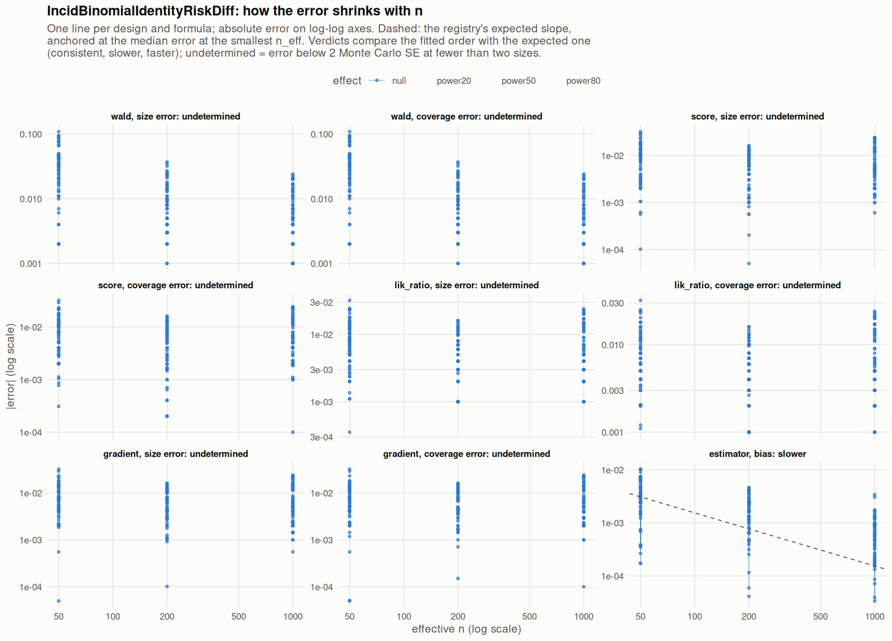

[← Campaign 2026-11-11-9d2edc5c summary](README.md)

# Class IncidBinomialIdentityRiskDiff

Part of the [Classes index](classes.md). Response type: incidence. Status: null effect complete, power effects not started. Verdict: **pending confirmation** (14 flagged test(s): 0 failing, 14 pending, 0 cleared).

<picture><source media="(prefers-color-scheme: dark)" srcset="figures/class-IncidBinomialIdentityRiskDiff-dark.png"></picture>

Convergence verdicts (worst over designs, formulas and effects; provisional until the class is complete):

| procedure | metric | verdict |
|---|---|---|
| estimator (bias) | bias | slower |
| gradient | coverage | undetermined |
| lik_ratio | coverage | undetermined |
| score | coverage | undetermined |
| wald | coverage | undetermined |
| gradient | size | undetermined |
| lik_ratio | size | undetermined |
| score | size | undetermined |
| wald | size | undetermined |

Null effect: 792 cells (7 failing). Size, coverage and bias / SD against the level each is held to.

| design | n | formula | procedure | size | coverage | bias / SD | size level | coverage level | verdict |
|---|---|---|---|---|---|---|---|---|---|
| Fixed:Bernoulli | 50 | `~.` | gradient | 0.0582 | 0.944 | -0.07 | 0.1 | 0.9 | ok |
| Fixed:Bernoulli | 200 | `~.` | gradient | 0.0437 | 0.958 | 0.025 | 0.1 | 0.9 | ok |
| Fixed:Bernoulli | 1000 | `~.` | gradient | 0.0383 | 0.961 | -0.011 | 0.0525 | 0.948 | ok |
| Fixed:Bernoulli | 50 | `~.` | lik_ratio | 0.0622 | 0.938 | -0.07 | 0.1 | 0.9 | ok |
| Fixed:Bernoulli | 200 | `~.` | lik_ratio | 0.044 | 0.956 | 0.025 | 0.1 | 0.9 | ok |
| Fixed:Bernoulli | 1000 | `~.` | lik_ratio | 0.039 | 0.961 | -0.011 | 0.0525 | 0.948 | ok |
| Fixed:Bernoulli | 50 | `~.` | score | 0.0664 | 0.936 | -0.07 | 0.1 | 0.9 | ok |
| Fixed:Bernoulli | 200 | `~.` | score | 0.049 | 0.952 | 0.025 | 0.1 | 0.9 | ok |
| Fixed:Bernoulli | 1000 | `~.` | score | 0.0404 | 0.961 | -0.011 | 0.0525 | 0.948 | ok |
| Fixed:Bernoulli | 50 | `~.` | wald | 0.098 | 0.902 | -0.07 | 0.1 | 0.9 | ok |
| Fixed:Bernoulli | 200 | `~.` | wald | 0.056 | 0.944 | 0.025 | 0.1 | 0.9 | ok |
| Fixed:Bernoulli | 1000 | `~.` | wald | 0.042 | 0.958 | -0.011 | 0.0525 | 0.948 | ok |
| Fixed:Bernoulli | 50 | `~1` | gradient | 0.065 | 0.935 | -0.07 | 0.1 | 0.9 | ok |
| Fixed:Bernoulli | 200 | `~1` | gradient | 0.045 | 0.955 | 0.0089 | 0.1 | 0.9 | ok |
| Fixed:Bernoulli | 1000 | `~1` | gradient | 0.043 | 0.957 | -0.007 | 0.0525 | 0.948 | ok |
| Fixed:Bernoulli | 50 | `~1` | lik_ratio | 0.065 | 0.935 | -0.07 | 0.1 | 0.9 | ok |
| Fixed:Bernoulli | 200 | `~1` | lik_ratio | 0.045 | 0.955 | 0.0089 | 0.1 | 0.9 | ok |
| Fixed:Bernoulli | 1000 | `~1` | lik_ratio | 0.043 | 0.957 | -0.007 | 0.0525 | 0.948 | ok |
| Fixed:Bernoulli | 50 | `~1` | score | 0.063 | 0.937 | -0.07 | 0.1 | 0.9 | ok |
| Fixed:Bernoulli | 200 | `~1` | score | 0.045 | 0.955 | 0.0089 | 0.1 | 0.9 | ok |
| Fixed:Bernoulli | 1000 | `~1` | score | 0.043 | 0.957 | -0.007 | 0.0525 | 0.948 | ok |
| Fixed:Bernoulli | 50 | `~1` | wald | 0.071 | 0.929 | -0.07 | 0.1 | 0.9 | ok |
| Fixed:Bernoulli | 200 | `~1` | wald | 0.047 | 0.953 | 0.0089 | 0.1 | 0.9 | ok |
| Fixed:Bernoulli | 1000 | `~1` | wald | 0.044 | 0.956 | -0.007 | 0.0525 | 0.948 | ok |
| Fixed:Bernoulli@0.2 | 50 | `~.` | gradient | 0.0474 | 0.952 | -0.02 | 0.1 | 0.9 | ok |
| Fixed:Bernoulli@0.2 | 200 | `~.` | gradient | 0.053 | 0.948 | 0.025 | 0.1 | 0.9 | ok |
| Fixed:Bernoulli@0.2 | 1000 | `~.` | gradient | 0.0514 | 0.95 | -0.024 | 0.0525 | 0.948 | ok |
| Fixed:Bernoulli@0.2 | 50 | `~.` | lik_ratio | 0.0588 | 0.94 | -0.02 | 0.1 | 0.9 | ok |
| Fixed:Bernoulli@0.2 | 200 | `~.` | lik_ratio | 0.054 | 0.946 | 0.025 | 0.1 | 0.9 | ok |
| Fixed:Bernoulli@0.2 | 1000 | `~.` | lik_ratio | 0.051 | 0.949 | -0.024 | 0.0525 | 0.948 | ok |
| Fixed:Bernoulli@0.2 | 50 | `~.` | score | 0.0506 | 0.95 | -0.02 | 0.1 | 0.9 | ok |
| Fixed:Bernoulli@0.2 | 200 | `~.` | score | 0.0541 | 0.947 | 0.025 | 0.1 | 0.9 | ok |
| Fixed:Bernoulli@0.2 | 1000 | `~.` | score | 0.0514 | 0.95 | -0.024 | 0.0525 | 0.948 | ok |
| Fixed:Bernoulli@0.2 | 50 | `~.` | wald | 0.144 | 0.856 | -0.02 | 0.1 | 0.9 | **FAIL** |
| Fixed:Bernoulli@0.2 | 200 | `~.` | wald | 0.071 | 0.929 | 0.025 | 0.1 | 0.9 | ok |
| Fixed:Bernoulli@0.2 | 1000 | `~.` | wald | 0.053 | 0.947 | -0.024 | 0.0525 | 0.948 | ok |
| Fixed:Bernoulli@0.2 | 50 | `~1` | gradient | 0.0494 | 0.951 | -0.015 | 0.1 | 0.9 | ok |
| Fixed:Bernoulli@0.2 | 200 | `~1` | gradient | 0.04 | 0.96 | 0.027 | 0.1 | 0.9 | ok |
| Fixed:Bernoulli@0.2 | 1000 | `~1` | gradient | 0.049 | 0.951 | -0.014 | 0.0525 | 0.948 | ok |
| Fixed:Bernoulli@0.2 | 50 | `~1` | lik_ratio | 0.0616 | 0.938 | -0.015 | 0.1 | 0.9 | ok |
| Fixed:Bernoulli@0.2 | 200 | `~1` | lik_ratio | 0.04 | 0.96 | 0.027 | 0.1 | 0.9 | ok |
| Fixed:Bernoulli@0.2 | 1000 | `~1` | lik_ratio | 0.049 | 0.951 | -0.014 | 0.0525 | 0.948 | ok |
| Fixed:Bernoulli@0.2 | 50 | `~1` | score | 0.0535 | 0.947 | -0.015 | 0.1 | 0.9 | ok |
| Fixed:Bernoulli@0.2 | 200 | `~1` | score | 0.039 | 0.961 | 0.027 | 0.1 | 0.9 | ok |
| Fixed:Bernoulli@0.2 | 1000 | `~1` | score | 0.048 | 0.952 | -0.014 | 0.0525 | 0.948 | ok |
| Fixed:Bernoulli@0.2 | 50 | `~1` | wald | 0.0938 | 0.906 | -0.015 | 0.1 | 0.9 | ok |
| Fixed:Bernoulli@0.2 | 200 | `~1` | wald | 0.047 | 0.953 | 0.027 | 0.1 | 0.9 | ok |
| Fixed:Bernoulli@0.2 | 1000 | `~1` | wald | 0.051 | 0.949 | -0.014 | 0.0525 | 0.948 | ok |
| Fixed:BinaryMatch | 50 | `~.` | gradient | 0.0401 | 0.962 | 0.023 | 0.1 | 0.9 | ok |
| Fixed:BinaryMatch | 200 | `~.` | gradient | 0.0509 | 0.95 | -0.046 | 0.1 | 0.9 | ok |
| Fixed:BinaryMatch | 1000 | `~.` | gradient | 0.0485 | 0.952 | 0.0011 | 0.0525 | 0.948 | ok |
| Fixed:BinaryMatch | 50 | `~.` | lik_ratio | 0.0423 | 0.958 | 0.023 | 0.1 | 0.9 | ok |
| Fixed:BinaryMatch | 200 | `~.` | lik_ratio | 0.05 | 0.95 | -0.046 | 0.1 | 0.9 | ok |
| Fixed:BinaryMatch | 1000 | `~.` | lik_ratio | 0.048 | 0.952 | 0.0011 | 0.0525 | 0.948 | ok |
| Fixed:BinaryMatch | 50 | `~.` | score | 0.042 | 0.958 | 0.023 | 0.1 | 0.9 | ok |
| Fixed:BinaryMatch | 200 | `~.` | score | 0.0512 | 0.95 | -0.046 | 0.1 | 0.9 | ok |
| Fixed:BinaryMatch | 1000 | `~.` | score | 0.0487 | 0.952 | 0.0011 | 0.0525 | 0.948 | ok |
| Fixed:BinaryMatch | 50 | `~.` | wald | 0.061 | 0.939 | 0.023 | 0.1 | 0.9 | ok |
| Fixed:BinaryMatch | 200 | `~.` | wald | 0.057 | 0.943 | -0.046 | 0.1 | 0.9 | ok |
| Fixed:BinaryMatch | 1000 | `~.` | wald | 0.048 | 0.952 | 0.0011 | 0.0525 | 0.948 | ok |
| Fixed:BinaryMatch | 50 | `~1` | gradient | 0.036 | 0.964 | 0.02 | 0.1 | 0.9 | ok |
| Fixed:BinaryMatch | 200 | `~1` | gradient | 0.043 | 0.957 | -0.054 | 0.1 | 0.9 | ok |
| Fixed:BinaryMatch | 1000 | `~1` | gradient | 0.035 | 0.965 | 0.0056 | 0.0525 | 0.948 | ok |
| Fixed:BinaryMatch | 50 | `~1` | lik_ratio | 0.036 | 0.964 | 0.02 | 0.1 | 0.9 | ok |
| Fixed:BinaryMatch | 200 | `~1` | lik_ratio | 0.043 | 0.957 | -0.054 | 0.1 | 0.9 | ok |
| Fixed:BinaryMatch | 1000 | `~1` | lik_ratio | 0.035 | 0.965 | 0.0056 | 0.0525 | 0.948 | ok |
| Fixed:BinaryMatch | 50 | `~1` | score | 0.036 | 0.964 | 0.02 | 0.1 | 0.9 | ok |
| Fixed:BinaryMatch | 200 | `~1` | score | 0.043 | 0.957 | -0.054 | 0.1 | 0.9 | ok |
| Fixed:BinaryMatch | 1000 | `~1` | score | 0.035 | 0.965 | 0.0056 | 0.0525 | 0.948 | ok |
| Fixed:BinaryMatch | 50 | `~1` | wald | 0.036 | 0.964 | 0.02 | 0.1 | 0.9 | ok |
| Fixed:BinaryMatch | 200 | `~1` | wald | 0.043 | 0.957 | -0.054 | 0.1 | 0.9 | ok |
| Fixed:BinaryMatch | 1000 | `~1` | wald | 0.035 | 0.965 | 0.0056 | 0.0525 | 0.948 | ok |
| Fixed:Blocking | 50 | `~.` | gradient | 0.0652 | 0.936 | 0.012 | 0.1 | 0.9 | ok |
| Fixed:Blocking | 200 | `~.` | gradient | 0.0487 | 0.951 | 0.039 | 0.1 | 0.9 | ok |
| Fixed:Blocking | 1000 | `~.` | gradient | 0.0543 | 0.947 | 0.039 | 0.0525 | 0.948 | ok |
| Fixed:Blocking | 50 | `~.` | lik_ratio | 0.0673 | 0.932 | 0.012 | 0.1 | 0.9 | ok |
| Fixed:Blocking | 200 | `~.` | lik_ratio | 0.049 | 0.951 | 0.039 | 0.1 | 0.9 | ok |
| Fixed:Blocking | 1000 | `~.` | lik_ratio | 0.055 | 0.945 | 0.039 | 0.0525 | 0.948 | ok |
| Fixed:Blocking | 50 | `~.` | score | 0.0692 | 0.934 | 0.012 | 0.1 | 0.9 | ok |
| Fixed:Blocking | 200 | `~.` | score | 0.049 | 0.95 | 0.039 | 0.1 | 0.9 | ok |
| Fixed:Blocking | 1000 | `~.` | score | 0.0545 | 0.946 | 0.039 | 0.0525 | 0.948 | ok |
| Fixed:Blocking | 50 | `~.` | wald | 0.1 | 0.9 | 0.012 | 0.1 | 0.9 | ok |
| Fixed:Blocking | 200 | `~.` | wald | 0.054 | 0.946 | 0.039 | 0.1 | 0.9 | ok |
| Fixed:Blocking | 1000 | `~.` | wald | 0.054 | 0.946 | 0.039 | 0.0525 | 0.948 | ok |
| Fixed:Blocking | 50 | `~1` | gradient | 0.073 | 0.927 | 0.0027 | 0.1 | 0.9 | ok |
| Fixed:Blocking | 200 | `~1` | gradient | 0.046 | 0.954 | 0.025 | 0.1 | 0.9 | ok |
| Fixed:Blocking | 1000 | `~1` | gradient | 0.056 | 0.944 | 0.025 | 0.0525 | 0.948 | ok |
| Fixed:Blocking | 50 | `~1` | lik_ratio | 0.073 | 0.927 | 0.0027 | 0.1 | 0.9 | ok |
| Fixed:Blocking | 200 | `~1` | lik_ratio | 0.046 | 0.954 | 0.025 | 0.1 | 0.9 | ok |
| Fixed:Blocking | 1000 | `~1` | lik_ratio | 0.059 | 0.941 | 0.025 | 0.0525 | 0.948 | ok |
| Fixed:Blocking | 50 | `~1` | score | 0.073 | 0.927 | 0.0027 | 0.1 | 0.9 | ok |
| Fixed:Blocking | 200 | `~1` | score | 0.046 | 0.954 | 0.025 | 0.1 | 0.9 | ok |
| Fixed:Blocking | 1000 | `~1` | score | 0.056 | 0.944 | 0.025 | 0.0525 | 0.948 | ok |
| Fixed:Blocking | 50 | `~1` | wald | 0.074 | 0.926 | 0.0027 | 0.1 | 0.9 | ok |
| Fixed:Blocking | 200 | `~1` | wald | 0.046 | 0.954 | 0.025 | 0.1 | 0.9 | ok |
| Fixed:Blocking | 1000 | `~1` | wald | 0.059 | 0.941 | 0.025 | 0.0525 | 0.948 | ok |
| Fixed:Blocking@0.2 | 50 | `~.` | gradient | 0.0637 | 0.936 | -0.036 | 0.1 | 0.9 | ok |
| Fixed:Blocking@0.2 | 200 | `~.` | gradient | 0.0441 | 0.959 | 0.031 | 0.1 | 0.9 | ok |
| Fixed:Blocking@0.2 | 1000 | `~.` | gradient | 0.0554 | 0.945 | 0.023 | 0.0525 | 0.948 | ok |
| Fixed:Blocking@0.2 | 50 | `~.` | lik_ratio | 0.0706 | 0.93 | -0.036 | 0.1 | 0.9 | ok |
| Fixed:Blocking@0.2 | 200 | `~.` | lik_ratio | 0.044 | 0.956 | 0.031 | 0.1 | 0.9 | ok |
| Fixed:Blocking@0.2 | 1000 | `~.` | lik_ratio | 0.055 | 0.945 | 0.023 | 0.0525 | 0.948 | ok |
| Fixed:Blocking@0.2 | 50 | `~.` | score | 0.0689 | 0.932 | -0.036 | 0.1 | 0.9 | ok |
| Fixed:Blocking@0.2 | 200 | `~.` | score | 0.0442 | 0.959 | 0.031 | 0.1 | 0.9 | ok |
| Fixed:Blocking@0.2 | 1000 | `~.` | score | 0.0558 | 0.945 | 0.023 | 0.0525 | 0.948 | ok |
| Fixed:Blocking@0.2 | 50 | `~.` | wald | 0.159 | 0.841 | -0.036 | 0.1 | 0.9 | **FAIL** |
| Fixed:Blocking@0.2 | 200 | `~.` | wald | 0.067 | 0.933 | 0.031 | 0.1 | 0.9 | ok |
| Fixed:Blocking@0.2 | 1000 | `~.` | wald | 0.057 | 0.943 | 0.023 | 0.0525 | 0.948 | ok |
| Fixed:Blocking@0.2 | 50 | `~1` | gradient | 0.0583 | 0.942 | -0.056 | 0.1 | 0.9 | ok |
| Fixed:Blocking@0.2 | 200 | `~1` | gradient | 0.043 | 0.957 | 0.011 | 0.1 | 0.9 | ok |
| Fixed:Blocking@0.2 | 1000 | `~1` | gradient | 0.052 | 0.948 | 0.037 | 0.0525 | 0.948 | ok |
| Fixed:Blocking@0.2 | 50 | `~1` | lik_ratio | 0.0593 | 0.941 | -0.056 | 0.1 | 0.9 | ok |
| Fixed:Blocking@0.2 | 200 | `~1` | lik_ratio | 0.044 | 0.956 | 0.011 | 0.1 | 0.9 | ok |
| Fixed:Blocking@0.2 | 1000 | `~1` | lik_ratio | 0.052 | 0.948 | 0.037 | 0.0525 | 0.948 | ok |
| Fixed:Blocking@0.2 | 50 | `~1` | score | 0.0553 | 0.945 | -0.056 | 0.1 | 0.9 | ok |
| Fixed:Blocking@0.2 | 200 | `~1` | score | 0.044 | 0.956 | 0.011 | 0.1 | 0.9 | ok |
| Fixed:Blocking@0.2 | 1000 | `~1` | score | 0.052 | 0.948 | 0.037 | 0.0525 | 0.948 | ok |
| Fixed:Blocking@0.2 | 50 | `~1` | wald | 0.0905 | 0.91 | -0.056 | 0.1 | 0.9 | ok |
| Fixed:Blocking@0.2 | 200 | `~1` | wald | 0.047 | 0.953 | 0.011 | 0.1 | 0.9 | ok |
| Fixed:Blocking@0.2 | 1000 | `~1` | wald | 0.052 | 0.948 | 0.037 | 0.0525 | 0.948 | ok |
| Fixed:Greedy | 50 | `~.` | gradient | 0.0546 | 0.946 | 0.0013 | 0.1 | 0.9 | ok |
| Fixed:Greedy | 200 | `~.` | gradient | 0.0456 | 0.955 | 0.044 | 0.1 | 0.9 | ok |
| Fixed:Greedy | 1000 | `~.` | gradient | 0.044 | 0.957 | -0.023 | 0.0525 | 0.948 | ok |
| Fixed:Greedy | 50 | `~.` | lik_ratio | 0.0563 | 0.944 | 0.0013 | 0.1 | 0.9 | ok |
| Fixed:Greedy | 200 | `~.` | lik_ratio | 0.047 | 0.953 | 0.044 | 0.1 | 0.9 | ok |
| Fixed:Greedy | 1000 | `~.` | lik_ratio | 0.0436 | 0.956 | -0.023 | 0.0525 | 0.948 | ok |
| Fixed:Greedy | 50 | `~.` | score | 0.0619 | 0.939 | 0.0013 | 0.1 | 0.9 | ok |
| Fixed:Greedy | 200 | `~.` | score | 0.0487 | 0.952 | 0.044 | 0.1 | 0.9 | ok |
| Fixed:Greedy | 1000 | `~.` | score | 0.0441 | 0.956 | -0.023 | 0.0525 | 0.948 | ok |
| Fixed:Greedy | 50 | `~.` | wald | 0.086 | 0.914 | 0.0013 | 0.1 | 0.9 | ok |
| Fixed:Greedy | 200 | `~.` | wald | 0.053 | 0.947 | 0.044 | 0.1 | 0.9 | ok |
| Fixed:Greedy | 1000 | `~.` | wald | 0.0446 | 0.955 | -0.023 | 0.0525 | 0.948 | ok |
| Fixed:Greedy | 50 | `~1` | gradient | 0.052 | 0.948 | 0.011 | 0.1 | 0.9 | ok |
| Fixed:Greedy | 200 | `~1` | gradient | 0.042 | 0.958 | 0.04 | 0.1 | 0.9 | ok |
| Fixed:Greedy | 1000 | `~1` | gradient | 0.0359 | 0.964 | -0.014 | 0.0525 | 0.948 | ok |
| Fixed:Greedy | 50 | `~1` | lik_ratio | 0.052 | 0.948 | 0.011 | 0.1 | 0.9 | ok |
| Fixed:Greedy | 200 | `~1` | lik_ratio | 0.042 | 0.958 | 0.04 | 0.1 | 0.9 | ok |
| Fixed:Greedy | 1000 | `~1` | lik_ratio | 0.0359 | 0.964 | -0.014 | 0.0525 | 0.948 | ok |
| Fixed:Greedy | 50 | `~1` | score | 0.052 | 0.948 | 0.011 | 0.1 | 0.9 | ok |
| Fixed:Greedy | 200 | `~1` | score | 0.042 | 0.958 | 0.04 | 0.1 | 0.9 | ok |
| Fixed:Greedy | 1000 | `~1` | score | 0.0359 | 0.964 | -0.014 | 0.0525 | 0.948 | ok |
| Fixed:Greedy | 50 | `~1` | wald | 0.052 | 0.948 | 0.011 | 0.1 | 0.9 | ok |
| Fixed:Greedy | 200 | `~1` | wald | 0.042 | 0.958 | 0.04 | 0.1 | 0.9 | ok |
| Fixed:Greedy | 1000 | `~1` | wald | 0.0359 | 0.964 | -0.014 | 0.0525 | 0.948 | ok |
| Fixed:Greedy@0.2 | 50 | `~.` | gradient | 0.0453 | 0.955 | 0.015 | 0.1 | 0.9 | ok |
| Fixed:Greedy@0.2 | 200 | `~.` | gradient | 0.0473 | 0.955 | -0.028 | 0.1 | 0.9 | ok |
| Fixed:Greedy@0.2 | 1000 | `~.` | gradient | 0.0343 | 0.967 | -0.048 | 0.0525 | 0.948 | ok |
| Fixed:Greedy@0.2 | 50 | `~.` | lik_ratio | 0.0524 | 0.948 | 0.015 | 0.1 | 0.9 | ok |
| Fixed:Greedy@0.2 | 200 | `~.` | lik_ratio | 0.048 | 0.952 | -0.028 | 0.1 | 0.9 | ok |
| Fixed:Greedy@0.2 | 1000 | `~.` | lik_ratio | 0.035 | 0.965 | -0.048 | 0.0525 | 0.948 | ok |
| Fixed:Greedy@0.2 | 50 | `~.` | score | 0.0475 | 0.953 | 0.015 | 0.1 | 0.9 | ok |
| Fixed:Greedy@0.2 | 200 | `~.` | score | 0.0494 | 0.952 | -0.028 | 0.1 | 0.9 | ok |
| Fixed:Greedy@0.2 | 1000 | `~.` | score | 0.0349 | 0.966 | -0.048 | 0.0525 | 0.948 | ok |
| Fixed:Greedy@0.2 | 50 | `~.` | wald | 0.117 | 0.883 | 0.015 | 0.1 | 0.9 | ok |
| Fixed:Greedy@0.2 | 200 | `~.` | wald | 0.073 | 0.927 | -0.028 | 0.1 | 0.9 | ok |
| Fixed:Greedy@0.2 | 1000 | `~.` | wald | 0.037 | 0.963 | -0.048 | 0.0525 | 0.948 | ok |
| Fixed:Greedy@0.2 | 50 | `~1` | gradient | 0.039 | 0.961 | 0.019 | 0.1 | 0.9 | ok |
| Fixed:Greedy@0.2 | 200 | `~1` | gradient | 0.038 | 0.962 | -0.023 | 0.1 | 0.9 | ok |
| Fixed:Greedy@0.2 | 1000 | `~1` | gradient | 0.029 | 0.971 | -0.045 | 0.0525 | 0.948 | ok |
| Fixed:Greedy@0.2 | 50 | `~1` | lik_ratio | 0.042 | 0.958 | 0.019 | 0.1 | 0.9 | ok |
| Fixed:Greedy@0.2 | 200 | `~1` | lik_ratio | 0.038 | 0.962 | -0.023 | 0.1 | 0.9 | ok |
| Fixed:Greedy@0.2 | 1000 | `~1` | lik_ratio | 0.029 | 0.971 | -0.045 | 0.0525 | 0.948 | ok |
| Fixed:Greedy@0.2 | 50 | `~1` | score | 0.04 | 0.96 | 0.019 | 0.1 | 0.9 | ok |
| Fixed:Greedy@0.2 | 200 | `~1` | score | 0.037 | 0.963 | -0.023 | 0.1 | 0.9 | ok |
| Fixed:Greedy@0.2 | 1000 | `~1` | score | 0.026 | 0.974 | -0.045 | 0.0525 | 0.948 | ok |
| Fixed:Greedy@0.2 | 50 | `~1` | wald | 0.0701 | 0.93 | 0.019 | 0.1 | 0.9 | ok |
| Fixed:Greedy@0.2 | 200 | `~1` | wald | 0.046 | 0.954 | -0.023 | 0.1 | 0.9 | ok |
| Fixed:Greedy@0.2 | 1000 | `~1` | wald | 0.029 | 0.971 | -0.045 | 0.0525 | 0.948 | ok |
| Fixed:GreedyDOptimal | 50 | `~.` | gradient | 0.0546 | 0.946 | 0.0013 | 0.1 | 0.9 | ok |
| Fixed:GreedyDOptimal | 200 | `~.` | gradient | 0.0456 | 0.955 | 0.044 | 0.1 | 0.9 | ok |
| Fixed:GreedyDOptimal | 1000 | `~.` | gradient | 0.0448 | 0.956 | -0.027 | 0.0525 | 0.948 | ok |
| Fixed:GreedyDOptimal | 50 | `~.` | lik_ratio | 0.0563 | 0.944 | 0.0013 | 0.1 | 0.9 | ok |
| Fixed:GreedyDOptimal | 200 | `~.` | lik_ratio | 0.047 | 0.953 | 0.044 | 0.1 | 0.9 | ok |
| Fixed:GreedyDOptimal | 1000 | `~.` | lik_ratio | 0.0444 | 0.956 | -0.027 | 0.0525 | 0.948 | ok |
| Fixed:GreedyDOptimal | 50 | `~.` | score | 0.0619 | 0.939 | 0.0013 | 0.1 | 0.9 | ok |
| Fixed:GreedyDOptimal | 200 | `~.` | score | 0.0487 | 0.952 | 0.044 | 0.1 | 0.9 | ok |
| Fixed:GreedyDOptimal | 1000 | `~.` | score | 0.0449 | 0.955 | -0.027 | 0.0525 | 0.948 | ok |
| Fixed:GreedyDOptimal | 50 | `~.` | wald | 0.086 | 0.914 | 0.0013 | 0.1 | 0.9 | ok |
| Fixed:GreedyDOptimal | 200 | `~.` | wald | 0.053 | 0.947 | 0.044 | 0.1 | 0.9 | ok |
| Fixed:GreedyDOptimal | 1000 | `~.` | wald | 0.0454 | 0.955 | -0.027 | 0.0525 | 0.948 | ok |
| Fixed:GreedyDOptimal | 50 | `~1` | gradient | 0.052 | 0.948 | 0.011 | 0.1 | 0.9 | ok |
| Fixed:GreedyDOptimal | 200 | `~1` | gradient | 0.042 | 0.958 | 0.04 | 0.1 | 0.9 | ok |
| Fixed:GreedyDOptimal | 1000 | `~1` | gradient | 0.0372 | 0.963 | -0.017 | 0.0525 | 0.948 | ok |
| Fixed:GreedyDOptimal | 50 | `~1` | lik_ratio | 0.052 | 0.948 | 0.011 | 0.1 | 0.9 | ok |
| Fixed:GreedyDOptimal | 200 | `~1` | lik_ratio | 0.042 | 0.958 | 0.04 | 0.1 | 0.9 | ok |
| Fixed:GreedyDOptimal | 1000 | `~1` | lik_ratio | 0.0372 | 0.963 | -0.017 | 0.0525 | 0.948 | ok |
| Fixed:GreedyDOptimal | 50 | `~1` | score | 0.052 | 0.948 | 0.011 | 0.1 | 0.9 | ok |
| Fixed:GreedyDOptimal | 200 | `~1` | score | 0.042 | 0.958 | 0.04 | 0.1 | 0.9 | ok |
| Fixed:GreedyDOptimal | 1000 | `~1` | score | 0.0372 | 0.963 | -0.017 | 0.0525 | 0.948 | ok |
| Fixed:GreedyDOptimal | 50 | `~1` | wald | 0.052 | 0.948 | 0.011 | 0.1 | 0.9 | ok |
| Fixed:GreedyDOptimal | 200 | `~1` | wald | 0.042 | 0.958 | 0.04 | 0.1 | 0.9 | ok |
| Fixed:GreedyDOptimal | 1000 | `~1` | wald | 0.0372 | 0.963 | -0.017 | 0.0525 | 0.948 | ok |
| Fixed:GreedyDOptimal@0.2 | 50 | `~.` | gradient | 0.0453 | 0.955 | 0.015 | 0.1 | 0.9 | ok |
| Fixed:GreedyDOptimal@0.2 | 200 | `~.` | gradient | 0.0473 | 0.955 | -0.028 | 0.1 | 0.9 | ok |
| Fixed:GreedyDOptimal@0.2 | 1000 | `~.` | gradient | 0.0343 | 0.967 | -0.048 | 0.0525 | 0.948 | ok |
| Fixed:GreedyDOptimal@0.2 | 50 | `~.` | lik_ratio | 0.0524 | 0.948 | 0.015 | 0.1 | 0.9 | ok |
| Fixed:GreedyDOptimal@0.2 | 200 | `~.` | lik_ratio | 0.048 | 0.952 | -0.028 | 0.1 | 0.9 | ok |
| Fixed:GreedyDOptimal@0.2 | 1000 | `~.` | lik_ratio | 0.035 | 0.965 | -0.048 | 0.0525 | 0.948 | ok |
| Fixed:GreedyDOptimal@0.2 | 50 | `~.` | score | 0.0475 | 0.953 | 0.015 | 0.1 | 0.9 | ok |
| Fixed:GreedyDOptimal@0.2 | 200 | `~.` | score | 0.0494 | 0.952 | -0.028 | 0.1 | 0.9 | ok |
| Fixed:GreedyDOptimal@0.2 | 1000 | `~.` | score | 0.0354 | 0.966 | -0.048 | 0.0525 | 0.948 | ok |
| Fixed:GreedyDOptimal@0.2 | 50 | `~.` | wald | 0.117 | 0.883 | 0.015 | 0.1 | 0.9 | ok |
| Fixed:GreedyDOptimal@0.2 | 200 | `~.` | wald | 0.073 | 0.927 | -0.028 | 0.1 | 0.9 | ok |
| Fixed:GreedyDOptimal@0.2 | 1000 | `~.` | wald | 0.037 | 0.963 | -0.048 | 0.0525 | 0.948 | ok |
| Fixed:GreedyDOptimal@0.2 | 50 | `~1` | gradient | 0.039 | 0.961 | 0.019 | 0.1 | 0.9 | ok |
| Fixed:GreedyDOptimal@0.2 | 200 | `~1` | gradient | 0.038 | 0.962 | -0.023 | 0.1 | 0.9 | ok |
| Fixed:GreedyDOptimal@0.2 | 1000 | `~1` | gradient | 0.029 | 0.971 | -0.045 | 0.0525 | 0.948 | ok |
| Fixed:GreedyDOptimal@0.2 | 50 | `~1` | lik_ratio | 0.042 | 0.958 | 0.019 | 0.1 | 0.9 | ok |
| Fixed:GreedyDOptimal@0.2 | 200 | `~1` | lik_ratio | 0.038 | 0.962 | -0.023 | 0.1 | 0.9 | ok |
| Fixed:GreedyDOptimal@0.2 | 1000 | `~1` | lik_ratio | 0.029 | 0.971 | -0.045 | 0.0525 | 0.948 | ok |
| Fixed:GreedyDOptimal@0.2 | 50 | `~1` | score | 0.04 | 0.96 | 0.019 | 0.1 | 0.9 | ok |
| Fixed:GreedyDOptimal@0.2 | 200 | `~1` | score | 0.037 | 0.963 | -0.023 | 0.1 | 0.9 | ok |
| Fixed:GreedyDOptimal@0.2 | 1000 | `~1` | score | 0.026 | 0.974 | -0.045 | 0.0525 | 0.948 | ok |
| Fixed:GreedyDOptimal@0.2 | 50 | `~1` | wald | 0.0701 | 0.93 | 0.019 | 0.1 | 0.9 | ok |
| Fixed:GreedyDOptimal@0.2 | 200 | `~1` | wald | 0.046 | 0.954 | -0.023 | 0.1 | 0.9 | ok |
| Fixed:GreedyDOptimal@0.2 | 1000 | `~1` | wald | 0.029 | 0.971 | -0.045 | 0.0525 | 0.948 | ok |
| Fixed:iBCRD | 50 | `~.` | gradient | 0.0635 | 0.938 | 0.0051 | 0.1 | 0.9 | ok |
| Fixed:iBCRD | 200 | `~.` | gradient | 0.0467 | 0.954 | -0.033 | 0.1 | 0.9 | ok |
| Fixed:iBCRD | 1000 | `~.` | gradient | 0.0544 | 0.946 | 0.045 | 0.0525 | 0.948 | ok |
| Fixed:iBCRD | 50 | `~.` | lik_ratio | 0.0653 | 0.934 | 0.0051 | 0.1 | 0.9 | ok |
| Fixed:iBCRD | 200 | `~.` | lik_ratio | 0.046 | 0.954 | -0.033 | 0.1 | 0.9 | ok |
| Fixed:iBCRD | 1000 | `~.` | lik_ratio | 0.054 | 0.946 | 0.045 | 0.0525 | 0.948 | ok |
| Fixed:iBCRD | 50 | `~.` | score | 0.0696 | 0.932 | 0.0051 | 0.1 | 0.9 | ok |
| Fixed:iBCRD | 200 | `~.` | score | 0.0498 | 0.951 | -0.033 | 0.1 | 0.9 | ok |
| Fixed:iBCRD | 1000 | `~.` | score | 0.0546 | 0.946 | 0.045 | 0.0525 | 0.948 | ok |
| Fixed:iBCRD | 50 | `~.` | wald | 0.098 | 0.902 | 0.0051 | 0.1 | 0.9 | ok |
| Fixed:iBCRD | 200 | `~.` | wald | 0.054 | 0.946 | -0.033 | 0.1 | 0.9 | ok |
| Fixed:iBCRD | 1000 | `~.` | wald | 0.055 | 0.945 | 0.045 | 0.0525 | 0.948 | ok |
| Fixed:iBCRD | 50 | `~1` | gradient | 0.063 | 0.937 | -0.0049 | 0.1 | 0.9 | ok |
| Fixed:iBCRD | 200 | `~1` | gradient | 0.05 | 0.95 | -0.037 | 0.1 | 0.9 | ok |
| Fixed:iBCRD | 1000 | `~1` | gradient | 0.048 | 0.952 | 0.043 | 0.0525 | 0.948 | ok |
| Fixed:iBCRD | 50 | `~1` | lik_ratio | 0.063 | 0.937 | -0.0049 | 0.1 | 0.9 | ok |
| Fixed:iBCRD | 200 | `~1` | lik_ratio | 0.05 | 0.95 | -0.037 | 0.1 | 0.9 | ok |
| Fixed:iBCRD | 1000 | `~1` | lik_ratio | 0.048 | 0.952 | 0.043 | 0.0525 | 0.948 | ok |
| Fixed:iBCRD | 50 | `~1` | score | 0.063 | 0.937 | -0.0049 | 0.1 | 0.9 | ok |
| Fixed:iBCRD | 200 | `~1` | score | 0.05 | 0.95 | -0.037 | 0.1 | 0.9 | ok |
| Fixed:iBCRD | 1000 | `~1` | score | 0.048 | 0.952 | 0.043 | 0.0525 | 0.948 | ok |
| Fixed:iBCRD | 50 | `~1` | wald | 0.063 | 0.937 | -0.0049 | 0.1 | 0.9 | ok |
| Fixed:iBCRD | 200 | `~1` | wald | 0.05 | 0.95 | -0.037 | 0.1 | 0.9 | ok |
| Fixed:iBCRD | 1000 | `~1` | wald | 0.048 | 0.952 | 0.043 | 0.0525 | 0.948 | ok |
| Fixed:iBCRD@0.2 | 50 | `~.` | gradient | 0.0573 | 0.944 | 0.0022 | 0.1 | 0.9 | ok |
| Fixed:iBCRD@0.2 | 200 | `~.` | gradient | 0.0624 | 0.94 | 0.015 | 0.1 | 0.9 | ok |
| Fixed:iBCRD@0.2 | 1000 | `~.` | gradient | 0.0552 | 0.946 | 0.031 | 0.0525 | 0.948 | ok |
| Fixed:iBCRD@0.2 | 50 | `~.` | lik_ratio | 0.0602 | 0.939 | 0.0022 | 0.1 | 0.9 | ok |
| Fixed:iBCRD@0.2 | 200 | `~.` | lik_ratio | 0.063 | 0.937 | 0.015 | 0.1 | 0.9 | ok |
| Fixed:iBCRD@0.2 | 1000 | `~.` | lik_ratio | 0.056 | 0.944 | 0.031 | 0.0525 | 0.948 | ok |
| Fixed:iBCRD@0.2 | 50 | `~.` | score | 0.0613 | 0.938 | 0.0022 | 0.1 | 0.9 | ok |
| Fixed:iBCRD@0.2 | 200 | `~.` | score | 0.0603 | 0.944 | 0.015 | 0.1 | 0.9 | ok |
| Fixed:iBCRD@0.2 | 1000 | `~.` | score | 0.0544 | 0.945 | 0.031 | 0.0525 | 0.948 | ok |
| Fixed:iBCRD@0.2 | 50 | `~.` | wald | 0.141 | 0.859 | 0.0022 | 0.1 | 0.9 | **FAIL** |
| Fixed:iBCRD@0.2 | 200 | `~.` | wald | 0.082 | 0.918 | 0.015 | 0.1 | 0.9 | ok |
| Fixed:iBCRD@0.2 | 1000 | `~.` | wald | 0.058 | 0.942 | 0.031 | 0.0525 | 0.948 | ok |
| Fixed:iBCRD@0.2 | 50 | `~1` | gradient | 0.0521 | 0.948 | 0.0071 | 0.1 | 0.9 | ok |
| Fixed:iBCRD@0.2 | 200 | `~1` | gradient | 0.057 | 0.943 | 0.015 | 0.1 | 0.9 | ok |
| Fixed:iBCRD@0.2 | 1000 | `~1` | gradient | 0.057 | 0.943 | 0.02 | 0.0525 | 0.948 | ok |
| Fixed:iBCRD@0.2 | 50 | `~1` | lik_ratio | 0.0551 | 0.945 | 0.0071 | 0.1 | 0.9 | ok |
| Fixed:iBCRD@0.2 | 200 | `~1` | lik_ratio | 0.057 | 0.943 | 0.015 | 0.1 | 0.9 | ok |
| Fixed:iBCRD@0.2 | 1000 | `~1` | lik_ratio | 0.057 | 0.943 | 0.02 | 0.0525 | 0.948 | ok |
| Fixed:iBCRD@0.2 | 50 | `~1` | score | 0.0531 | 0.946 | 0.0071 | 0.1 | 0.9 | ok |
| Fixed:iBCRD@0.2 | 200 | `~1` | score | 0.052 | 0.948 | 0.015 | 0.1 | 0.9 | ok |
| Fixed:iBCRD@0.2 | 1000 | `~1` | score | 0.056 | 0.944 | 0.02 | 0.0525 | 0.948 | ok |
| Fixed:iBCRD@0.2 | 50 | `~1` | wald | 0.0871 | 0.913 | 0.0071 | 0.1 | 0.9 | ok |
| Fixed:iBCRD@0.2 | 200 | `~1` | wald | 0.064 | 0.936 | 0.015 | 0.1 | 0.9 | ok |
| Fixed:iBCRD@0.2 | 1000 | `~1` | wald | 0.057 | 0.943 | 0.02 | 0.0525 | 0.948 | ok |
| Fixed:MatchingGreedyPairSwitching | 50 | `~.` | gradient | 0.0329 | 0.967 | 0.031 | 0.1 | 0.9 | ok |
| Fixed:MatchingGreedyPairSwitching | 200 | `~.` | gradient | 0.0427 | 0.957 | 0.0067 | 0.1 | 0.9 | ok |
| Fixed:MatchingGreedyPairSwitching | 1000 | `~.` | gradient | 0.0302 | 0.971 | -0.0078 | 0.0525 | 0.948 | ok |
| Fixed:MatchingGreedyPairSwitching | 50 | `~.` | lik_ratio | 0.0342 | 0.966 | 0.031 | 0.1 | 0.9 | ok |
| Fixed:MatchingGreedyPairSwitching | 200 | `~.` | lik_ratio | 0.044 | 0.956 | 0.0067 | 0.1 | 0.9 | ok |
| Fixed:MatchingGreedyPairSwitching | 1000 | `~.` | lik_ratio | 0.03 | 0.97 | -0.0078 | 0.0525 | 0.948 | ok |
| Fixed:MatchingGreedyPairSwitching | 50 | `~.` | score | 0.0401 | 0.961 | 0.031 | 0.1 | 0.9 | ok |
| Fixed:MatchingGreedyPairSwitching | 200 | `~.` | score | 0.0437 | 0.956 | 0.0067 | 0.1 | 0.9 | ok |
| Fixed:MatchingGreedyPairSwitching | 1000 | `~.` | score | 0.0303 | 0.971 | -0.0078 | 0.0525 | 0.948 | ok |
| Fixed:MatchingGreedyPairSwitching | 50 | `~.` | wald | 0.071 | 0.929 | 0.031 | 0.1 | 0.9 | ok |
| Fixed:MatchingGreedyPairSwitching | 200 | `~.` | wald | 0.061 | 0.939 | 0.0067 | 0.1 | 0.9 | ok |
| Fixed:MatchingGreedyPairSwitching | 1000 | `~.` | wald | 0.03 | 0.97 | -0.0078 | 0.0525 | 0.948 | ok |
| Fixed:MatchingGreedyPairSwitching | 50 | `~1` | gradient | 0.021 | 0.979 | 0.019 | 0.1 | 0.9 | ok |
| Fixed:MatchingGreedyPairSwitching | 200 | `~1` | gradient | 0.04 | 0.96 | 0.0096 | 0.1 | 0.9 | ok |
| Fixed:MatchingGreedyPairSwitching | 1000 | `~1` | gradient | 0.027 | 0.973 | -0.0053 | 0.0525 | 0.948 | ok |
| Fixed:MatchingGreedyPairSwitching | 50 | `~1` | lik_ratio | 0.026 | 0.974 | 0.019 | 0.1 | 0.9 | ok |
| Fixed:MatchingGreedyPairSwitching | 200 | `~1` | lik_ratio | 0.04 | 0.96 | 0.0096 | 0.1 | 0.9 | ok |
| Fixed:MatchingGreedyPairSwitching | 1000 | `~1` | lik_ratio | 0.027 | 0.973 | -0.0053 | 0.0525 | 0.948 | ok |
| Fixed:MatchingGreedyPairSwitching | 50 | `~1` | score | 0.021 | 0.979 | 0.019 | 0.1 | 0.9 | ok |
| Fixed:MatchingGreedyPairSwitching | 200 | `~1` | score | 0.04 | 0.96 | 0.0096 | 0.1 | 0.9 | ok |
| Fixed:MatchingGreedyPairSwitching | 1000 | `~1` | score | 0.027 | 0.973 | -0.0053 | 0.0525 | 0.948 | ok |
| Fixed:MatchingGreedyPairSwitching | 50 | `~1` | wald | 0.037 | 0.963 | 0.019 | 0.1 | 0.9 | ok |
| Fixed:MatchingGreedyPairSwitching | 200 | `~1` | wald | 0.04 | 0.96 | 0.0096 | 0.1 | 0.9 | ok |
| Fixed:MatchingGreedyPairSwitching | 1000 | `~1` | wald | 0.027 | 0.973 | -0.0053 | 0.0525 | 0.948 | ok |
| Fixed:Optimal | 50 | `~.` | gradient | 0.0622 | 0.94 | -0.018 | 0.1 | 0.9 | ok |
| Fixed:Optimal | 200 | `~.` | gradient | 0.0489 | 0.954 | -0.055 | 0.1 | 0.9 | ok |
| Fixed:Optimal | 1000 | `~.` | gradient | 0.0455 | 0.956 | -0.013 | 0.0525 | 0.948 | ok |
| Fixed:Optimal | 50 | `~.` | lik_ratio | 0.0622 | 0.938 | -0.018 | 0.1 | 0.9 | ok |
| Fixed:Optimal | 200 | `~.` | lik_ratio | 0.049 | 0.951 | -0.055 | 0.1 | 0.9 | ok |
| Fixed:Optimal | 1000 | `~.` | lik_ratio | 0.045 | 0.955 | -0.013 | 0.0525 | 0.948 | ok |
| Fixed:Optimal | 50 | `~.` | score | 0.0636 | 0.939 | -0.018 | 0.1 | 0.9 | ok |
| Fixed:Optimal | 200 | `~.` | score | 0.0519 | 0.952 | -0.055 | 0.1 | 0.9 | ok |
| Fixed:Optimal | 1000 | `~.` | score | 0.0447 | 0.957 | -0.013 | 0.0525 | 0.948 | ok |
| Fixed:Optimal | 50 | `~.` | wald | 0.077 | 0.923 | -0.018 | 0.1 | 0.9 | ok |
| Fixed:Optimal | 200 | `~.` | wald | 0.059 | 0.941 | -0.055 | 0.1 | 0.9 | ok |
| Fixed:Optimal | 1000 | `~.` | wald | 0.047 | 0.953 | -0.013 | 0.0525 | 0.948 | ok |
| Fixed:Optimal | 50 | `~1` | gradient | 0.057 | 0.943 | -0.024 | 0.1 | 0.9 | ok |
| Fixed:Optimal | 200 | `~1` | gradient | 0.037 | 0.963 | -0.051 | 0.1 | 0.9 | ok |
| Fixed:Optimal | 1000 | `~1` | gradient | 0.036 | 0.964 | -0.016 | 0.0525 | 0.948 | ok |
| Fixed:Optimal | 50 | `~1` | lik_ratio | 0.057 | 0.943 | -0.024 | 0.1 | 0.9 | ok |
| Fixed:Optimal | 200 | `~1` | lik_ratio | 0.037 | 0.963 | -0.051 | 0.1 | 0.9 | ok |
| Fixed:Optimal | 1000 | `~1` | lik_ratio | 0.036 | 0.964 | -0.016 | 0.0525 | 0.948 | ok |
| Fixed:Optimal | 50 | `~1` | score | 0.057 | 0.943 | -0.024 | 0.1 | 0.9 | ok |
| Fixed:Optimal | 200 | `~1` | score | 0.037 | 0.963 | -0.051 | 0.1 | 0.9 | ok |
| Fixed:Optimal | 1000 | `~1` | score | 0.036 | 0.964 | -0.016 | 0.0525 | 0.948 | ok |
| Fixed:Optimal | 50 | `~1` | wald | 0.057 | 0.943 | -0.024 | 0.1 | 0.9 | ok |
| Fixed:Optimal | 200 | `~1` | wald | 0.037 | 0.963 | -0.051 | 0.1 | 0.9 | ok |
| Fixed:Optimal | 1000 | `~1` | wald | 0.036 | 0.964 | -0.016 | 0.0525 | 0.948 | ok |
| Fixed:Optimal@0.2 | 50 | `~.` | gradient | 0.0358 | 0.963 | 0.045 | 0.1 | 0.9 | ok |
| Fixed:Optimal@0.2 | 200 | `~.` | gradient | 0.0388 | 0.963 | -0.0038 | 0.1 | 0.9 | ok |
| Fixed:Optimal@0.2 | 1000 | `~.` | gradient | 0.0463 | 0.954 | 0.037 | 0.0525 | 0.948 | ok |
| Fixed:Optimal@0.2 | 50 | `~.` | lik_ratio | 0.0431 | 0.957 | 0.045 | 0.1 | 0.9 | ok |
| Fixed:Optimal@0.2 | 200 | `~.` | lik_ratio | 0.04 | 0.96 | -0.0038 | 0.1 | 0.9 | ok |
| Fixed:Optimal@0.2 | 1000 | `~.` | lik_ratio | 0.047 | 0.953 | 0.037 | 0.0525 | 0.948 | ok |
| Fixed:Optimal@0.2 | 50 | `~.` | score | 0.0389 | 0.958 | 0.045 | 0.1 | 0.9 | ok |
| Fixed:Optimal@0.2 | 200 | `~.` | score | 0.0399 | 0.963 | -0.0038 | 0.1 | 0.9 | ok |
| Fixed:Optimal@0.2 | 1000 | `~.` | score | 0.0486 | 0.952 | 0.037 | 0.0525 | 0.948 | ok |
| Fixed:Optimal@0.2 | 50 | `~.` | wald | 0.116 | 0.884 | 0.045 | 0.1 | 0.9 | ok |
| Fixed:Optimal@0.2 | 200 | `~.` | wald | 0.064 | 0.936 | -0.0038 | 0.1 | 0.9 | ok |
| Fixed:Optimal@0.2 | 1000 | `~.` | wald | 0.052 | 0.948 | 0.037 | 0.0525 | 0.948 | ok |
| Fixed:Optimal@0.2 | 50 | `~1` | gradient | 0.032 | 0.968 | 0.047 | 0.1 | 0.9 | ok |
| Fixed:Optimal@0.2 | 200 | `~1` | gradient | 0.034 | 0.966 | -0.0057 | 0.1 | 0.9 | ok |
| Fixed:Optimal@0.2 | 1000 | `~1` | gradient | 0.033 | 0.967 | 0.033 | 0.0525 | 0.948 | ok |
| Fixed:Optimal@0.2 | 50 | `~1` | lik_ratio | 0.032 | 0.968 | 0.047 | 0.1 | 0.9 | ok |
| Fixed:Optimal@0.2 | 200 | `~1` | lik_ratio | 0.034 | 0.966 | -0.0057 | 0.1 | 0.9 | ok |
| Fixed:Optimal@0.2 | 1000 | `~1` | lik_ratio | 0.033 | 0.967 | 0.033 | 0.0525 | 0.948 | ok |
| Fixed:Optimal@0.2 | 50 | `~1` | score | 0.027 | 0.973 | 0.047 | 0.1 | 0.9 | ok |
| Fixed:Optimal@0.2 | 200 | `~1` | score | 0.034 | 0.966 | -0.0057 | 0.1 | 0.9 | ok |
| Fixed:Optimal@0.2 | 1000 | `~1` | score | 0.033 | 0.967 | 0.033 | 0.0525 | 0.948 | ok |
| Fixed:Optimal@0.2 | 50 | `~1` | wald | 0.0561 | 0.944 | 0.047 | 0.1 | 0.9 | ok |
| Fixed:Optimal@0.2 | 200 | `~1` | wald | 0.042 | 0.958 | -0.0057 | 0.1 | 0.9 | ok |
| Fixed:Optimal@0.2 | 1000 | `~1` | wald | 0.033 | 0.967 | 0.033 | 0.0525 | 0.948 | ok |
| Fixed:OptimalBlocks | 50 | `~.` | gradient | 0.0605 | 0.946 | 0.0025 | 0.1 | 0.9 | ok |
| Fixed:OptimalBlocks | 200 | `~.` | gradient | 0.0394 | 0.961 | 0.031 | 0.1 | 0.9 | ok |
| Fixed:OptimalBlocks | 1000 | `~.` | gradient | 0.0283 | 0.972 | 0.017 | 0.0525 | 0.948 | ok |
| Fixed:OptimalBlocks | 50 | `~.` | lik_ratio | 0.0622 | 0.938 | 0.0025 | 0.1 | 0.9 | ok |
| Fixed:OptimalBlocks | 200 | `~.` | lik_ratio | 0.04 | 0.96 | 0.031 | 0.1 | 0.9 | ok |
| Fixed:OptimalBlocks | 1000 | `~.` | lik_ratio | 0.028 | 0.972 | 0.017 | 0.0525 | 0.948 | ok |
| Fixed:OptimalBlocks | 50 | `~.` | score | 0.0676 | 0.94 | 0.0025 | 0.1 | 0.9 | ok |
| Fixed:OptimalBlocks | 200 | `~.` | score | 0.0415 | 0.958 | 0.031 | 0.1 | 0.9 | ok |
| Fixed:OptimalBlocks | 1000 | `~.` | score | 0.0283 | 0.972 | 0.017 | 0.0525 | 0.948 | ok |
| Fixed:OptimalBlocks | 50 | `~.` | wald | 0.094 | 0.906 | 0.0025 | 0.1 | 0.9 | ok |
| Fixed:OptimalBlocks | 200 | `~.` | wald | 0.047 | 0.953 | 0.031 | 0.1 | 0.9 | ok |
| Fixed:OptimalBlocks | 1000 | `~.` | wald | 0.029 | 0.971 | 0.017 | 0.0525 | 0.948 | ok |
| Fixed:OptimalBlocks | 50 | `~1` | gradient | 0.064 | 0.936 | 0.0055 | 0.1 | 0.9 | ok |
| Fixed:OptimalBlocks | 200 | `~1` | gradient | 0.039 | 0.961 | 0.024 | 0.1 | 0.9 | ok |
| Fixed:OptimalBlocks | 1000 | `~1` | gradient | 0.028 | 0.972 | 0.0066 | 0.0525 | 0.948 | ok |
| Fixed:OptimalBlocks | 50 | `~1` | lik_ratio | 0.064 | 0.936 | 0.0055 | 0.1 | 0.9 | ok |
| Fixed:OptimalBlocks | 200 | `~1` | lik_ratio | 0.039 | 0.961 | 0.024 | 0.1 | 0.9 | ok |
| Fixed:OptimalBlocks | 1000 | `~1` | lik_ratio | 0.03 | 0.97 | 0.0066 | 0.0525 | 0.948 | ok |
| Fixed:OptimalBlocks | 50 | `~1` | score | 0.064 | 0.936 | 0.0055 | 0.1 | 0.9 | ok |
| Fixed:OptimalBlocks | 200 | `~1` | score | 0.039 | 0.961 | 0.024 | 0.1 | 0.9 | ok |
| Fixed:OptimalBlocks | 1000 | `~1` | score | 0.028 | 0.972 | 0.0066 | 0.0525 | 0.948 | ok |
| Fixed:OptimalBlocks | 50 | `~1` | wald | 0.067 | 0.933 | 0.0055 | 0.1 | 0.9 | ok |
| Fixed:OptimalBlocks | 200 | `~1` | wald | 0.039 | 0.961 | 0.024 | 0.1 | 0.9 | ok |
| Fixed:OptimalBlocks | 1000 | `~1` | wald | 0.03 | 0.97 | 0.0066 | 0.0525 | 0.948 | ok |
| Fixed:OptimalBlocks@0.2 | 50 | `~.` | gradient | 0.0412 | 0.96 | -0.012 | 0.1 | 0.9 | ok |
| Fixed:OptimalBlocks@0.2 | 200 | `~.` | gradient | 0.0489 | 0.957 | -0.013 | 0.1 | 0.9 | ok |
| Fixed:OptimalBlocks@0.2 | 1000 | `~.` | gradient | 0.0331 | 0.967 | 0.019 | 0.0525 | 0.948 | ok |
| Fixed:OptimalBlocks@0.2 | 50 | `~.` | lik_ratio | 0.0504 | 0.949 | -0.012 | 0.1 | 0.9 | ok |
| Fixed:OptimalBlocks@0.2 | 200 | `~.` | lik_ratio | 0.049 | 0.951 | -0.013 | 0.1 | 0.9 | ok |
| Fixed:OptimalBlocks@0.2 | 1000 | `~.` | lik_ratio | 0.033 | 0.967 | 0.019 | 0.0525 | 0.948 | ok |
| Fixed:OptimalBlocks@0.2 | 50 | `~.` | score | 0.0421 | 0.958 | -0.012 | 0.1 | 0.9 | ok |
| Fixed:OptimalBlocks@0.2 | 200 | `~.` | score | 0.0492 | 0.956 | -0.013 | 0.1 | 0.9 | ok |
| Fixed:OptimalBlocks@0.2 | 1000 | `~.` | score | 0.0312 | 0.968 | 0.019 | 0.0525 | 0.948 | ok |
| Fixed:OptimalBlocks@0.2 | 50 | `~.` | wald | 0.124 | 0.876 | -0.012 | 0.1 | 0.9 | ok |
| Fixed:OptimalBlocks@0.2 | 200 | `~.` | wald | 0.074 | 0.926 | -0.013 | 0.1 | 0.9 | ok |
| Fixed:OptimalBlocks@0.2 | 1000 | `~.` | wald | 0.033 | 0.967 | 0.019 | 0.0525 | 0.948 | ok |
| Fixed:OptimalBlocks@0.2 | 50 | `~1` | gradient | 0.0361 | 0.964 | -0.036 | 0.1 | 0.9 | ok |
| Fixed:OptimalBlocks@0.2 | 200 | `~1` | gradient | 0.039 | 0.961 | -0.02 | 0.1 | 0.9 | ok |
| Fixed:OptimalBlocks@0.2 | 1000 | `~1` | gradient | 0.026 | 0.974 | 0.016 | 0.0525 | 0.948 | ok |
| Fixed:OptimalBlocks@0.2 | 50 | `~1` | lik_ratio | 0.0412 | 0.959 | -0.036 | 0.1 | 0.9 | ok |
| Fixed:OptimalBlocks@0.2 | 200 | `~1` | lik_ratio | 0.039 | 0.961 | -0.02 | 0.1 | 0.9 | ok |
| Fixed:OptimalBlocks@0.2 | 1000 | `~1` | lik_ratio | 0.026 | 0.974 | 0.016 | 0.0525 | 0.948 | ok |
| Fixed:OptimalBlocks@0.2 | 50 | `~1` | score | 0.0361 | 0.963 | -0.036 | 0.1 | 0.9 | ok |
| Fixed:OptimalBlocks@0.2 | 200 | `~1` | score | 0.041 | 0.959 | -0.02 | 0.1 | 0.9 | ok |
| Fixed:OptimalBlocks@0.2 | 1000 | `~1` | score | 0.026 | 0.974 | 0.016 | 0.0525 | 0.948 | ok |
| Fixed:OptimalBlocks@0.2 | 50 | `~1` | wald | 0.0753 | 0.925 | -0.036 | 0.1 | 0.9 | ok |
| Fixed:OptimalBlocks@0.2 | 200 | `~1` | wald | 0.047 | 0.953 | -0.02 | 0.1 | 0.9 | ok |
| Fixed:OptimalBlocks@0.2 | 1000 | `~1` | wald | 0.026 | 0.974 | 0.016 | 0.0525 | 0.948 | ok |
| Fixed:Rerandomization | 50 | `~.` | gradient | 0.072 | 0.934 | -0.039 | 0.1 | 0.9 | ok |
| Fixed:Rerandomization | 200 | `~.` | gradient | 0.0518 | 0.948 | 0.018 | 0.1 | 0.9 | ok |
| Fixed:Rerandomization | 1000 | `~.` | gradient | 0.0555 | 0.946 | -0.027 | 0.0525 | 0.948 | ok |
| Fixed:Rerandomization | 50 | `~.` | lik_ratio | 0.0743 | 0.925 | -0.039 | 0.1 | 0.9 | ok |
| Fixed:Rerandomization | 200 | `~.` | lik_ratio | 0.052 | 0.948 | 0.018 | 0.1 | 0.9 | ok |
| Fixed:Rerandomization | 1000 | `~.` | lik_ratio | 0.056 | 0.944 | -0.027 | 0.0525 | 0.948 | ok |
| Fixed:Rerandomization | 50 | `~.` | score | 0.0793 | 0.928 | -0.039 | 0.1 | 0.9 | ok |
| Fixed:Rerandomization | 200 | `~.` | score | 0.0569 | 0.943 | 0.018 | 0.1 | 0.9 | ok |
| Fixed:Rerandomization | 1000 | `~.` | score | 0.0547 | 0.946 | -0.027 | 0.0525 | 0.948 | ok |
| Fixed:Rerandomization | 50 | `~.` | wald | 0.095 | 0.905 | -0.039 | 0.1 | 0.9 | ok |
| Fixed:Rerandomization | 200 | `~.` | wald | 0.065 | 0.935 | 0.018 | 0.1 | 0.9 | ok |
| Fixed:Rerandomization | 1000 | `~.` | wald | 0.056 | 0.944 | -0.027 | 0.0525 | 0.948 | ok |
| Fixed:Rerandomization | 50 | `~1` | gradient | 0.082 | 0.918 | -0.044 | 0.1 | 0.9 | ok |
| Fixed:Rerandomization | 200 | `~1` | gradient | 0.057 | 0.943 | 0.018 | 0.1 | 0.9 | ok |
| Fixed:Rerandomization | 1000 | `~1` | gradient | 0.054 | 0.946 | -0.015 | 0.0525 | 0.948 | ok |
| Fixed:Rerandomization | 50 | `~1` | lik_ratio | 0.082 | 0.918 | -0.044 | 0.1 | 0.9 | ok |
| Fixed:Rerandomization | 200 | `~1` | lik_ratio | 0.057 | 0.943 | 0.018 | 0.1 | 0.9 | ok |
| Fixed:Rerandomization | 1000 | `~1` | lik_ratio | 0.054 | 0.946 | -0.015 | 0.0525 | 0.948 | ok |
| Fixed:Rerandomization | 50 | `~1` | score | 0.082 | 0.918 | -0.044 | 0.1 | 0.9 | ok |
| Fixed:Rerandomization | 200 | `~1` | score | 0.057 | 0.943 | 0.018 | 0.1 | 0.9 | ok |
| Fixed:Rerandomization | 1000 | `~1` | score | 0.054 | 0.946 | -0.015 | 0.0525 | 0.948 | ok |
| Fixed:Rerandomization | 50 | `~1` | wald | 0.082 | 0.918 | -0.044 | 0.1 | 0.9 | ok |
| Fixed:Rerandomization | 200 | `~1` | wald | 0.057 | 0.943 | 0.018 | 0.1 | 0.9 | ok |
| Fixed:Rerandomization | 1000 | `~1` | wald | 0.054 | 0.946 | -0.015 | 0.0525 | 0.948 | ok |
| Fixed:Rerandomization@0.2 | 50 | `~.` | gradient | 0.0542 | 0.947 | -0.016 | 0.1 | 0.9 | ok |
| Fixed:Rerandomization@0.2 | 200 | `~.` | gradient | 0.055 | 0.948 | 0.0013 | 0.1 | 0.9 | ok |
| Fixed:Rerandomization@0.2 | 1000 | `~.` | gradient | 0.0534 | 0.946 | -0.088 | 0.0525 | 0.948 | ok |
| Fixed:Rerandomization@0.2 | 50 | `~.` | lik_ratio | 0.0603 | 0.94 | -0.016 | 0.1 | 0.9 | ok |
| Fixed:Rerandomization@0.2 | 200 | `~.` | lik_ratio | 0.056 | 0.944 | 0.0013 | 0.1 | 0.9 | ok |
| Fixed:Rerandomization@0.2 | 1000 | `~.` | lik_ratio | 0.054 | 0.946 | -0.088 | 0.0525 | 0.948 | ok |
| Fixed:Rerandomization@0.2 | 50 | `~.` | score | 0.0605 | 0.939 | -0.016 | 0.1 | 0.9 | ok |
| Fixed:Rerandomization@0.2 | 200 | `~.` | score | 0.055 | 0.947 | 0.0013 | 0.1 | 0.9 | ok |
| Fixed:Rerandomization@0.2 | 1000 | `~.` | score | 0.0539 | 0.948 | -0.088 | 0.0525 | 0.948 | ok |
| Fixed:Rerandomization@0.2 | 50 | `~.` | wald | 0.129 | 0.871 | -0.016 | 0.1 | 0.9 | **FAIL** |
| Fixed:Rerandomization@0.2 | 200 | `~.` | wald | 0.085 | 0.915 | 0.0013 | 0.1 | 0.9 | ok |
| Fixed:Rerandomization@0.2 | 1000 | `~.` | wald | 0.055 | 0.945 | -0.088 | 0.0525 | 0.948 | ok |
| Fixed:Rerandomization@0.2 | 50 | `~1` | gradient | 0.0521 | 0.948 | -0.03 | 0.1 | 0.9 | ok |
| Fixed:Rerandomization@0.2 | 200 | `~1` | gradient | 0.057 | 0.943 | 0.026 | 0.1 | 0.9 | ok |
| Fixed:Rerandomization@0.2 | 1000 | `~1` | gradient | 0.055 | 0.945 | -0.076 | 0.0525 | 0.948 | ok |
| Fixed:Rerandomization@0.2 | 50 | `~1` | lik_ratio | 0.0541 | 0.946 | -0.03 | 0.1 | 0.9 | ok |
| Fixed:Rerandomization@0.2 | 200 | `~1` | lik_ratio | 0.057 | 0.943 | 0.026 | 0.1 | 0.9 | ok |
| Fixed:Rerandomization@0.2 | 1000 | `~1` | lik_ratio | 0.055 | 0.945 | -0.076 | 0.0525 | 0.948 | ok |
| Fixed:Rerandomization@0.2 | 50 | `~1` | score | 0.0511 | 0.948 | -0.03 | 0.1 | 0.9 | ok |
| Fixed:Rerandomization@0.2 | 200 | `~1` | score | 0.057 | 0.943 | 0.026 | 0.1 | 0.9 | ok |
| Fixed:Rerandomization@0.2 | 1000 | `~1` | score | 0.052 | 0.948 | -0.076 | 0.0525 | 0.948 | ok |
| Fixed:Rerandomization@0.2 | 50 | `~1` | wald | 0.0811 | 0.919 | -0.03 | 0.1 | 0.9 | ok |
| Fixed:Rerandomization@0.2 | 200 | `~1` | wald | 0.068 | 0.932 | 0.026 | 0.1 | 0.9 | ok |
| Fixed:Rerandomization@0.2 | 1000 | `~1` | wald | 0.055 | 0.945 | -0.076 | 0.0525 | 0.948 | ok |
| SeqOneByOne:Atkinson | 50 | `~.` | gradient | 0.045 | 0.958 | -0.018 | 0.1 | 0.9 | ok |
| SeqOneByOne:Atkinson | 200 | `~.` | gradient | 0.0529 | 0.948 | -0.00061 | 0.1 | 0.9 | ok |
| SeqOneByOne:Atkinson | 1000 | `~.` | gradient | 0.0369 | 0.963 | 0.044 | 0.0525 | 0.948 | ok |
| SeqOneByOne:Atkinson | 50 | `~.` | lik_ratio | 0.0473 | 0.953 | -0.018 | 0.1 | 0.9 | ok |
| SeqOneByOne:Atkinson | 200 | `~.` | lik_ratio | 0.052 | 0.948 | -0.00061 | 0.1 | 0.9 | ok |
| SeqOneByOne:Atkinson | 1000 | `~.` | lik_ratio | 0.0367 | 0.963 | 0.044 | 0.0525 | 0.948 | ok |
| SeqOneByOne:Atkinson | 50 | `~.` | score | 0.0533 | 0.951 | -0.018 | 0.1 | 0.9 | ok |
| SeqOneByOne:Atkinson | 200 | `~.` | score | 0.056 | 0.945 | -0.00061 | 0.1 | 0.9 | ok |
| SeqOneByOne:Atkinson | 1000 | `~.` | score | 0.038 | 0.962 | 0.044 | 0.0525 | 0.948 | ok |
| SeqOneByOne:Atkinson | 50 | `~.` | wald | 0.073 | 0.927 | -0.018 | 0.1 | 0.9 | ok |
| SeqOneByOne:Atkinson | 200 | `~.` | wald | 0.066 | 0.934 | -0.00061 | 0.1 | 0.9 | ok |
| SeqOneByOne:Atkinson | 1000 | `~.` | wald | 0.0396 | 0.96 | 0.044 | 0.0525 | 0.948 | ok |
| SeqOneByOne:Atkinson | 50 | `~1` | gradient | 0.048 | 0.952 | -0.025 | 0.1 | 0.9 | ok |
| SeqOneByOne:Atkinson | 200 | `~1` | gradient | 0.043 | 0.957 | 0.0094 | 0.1 | 0.9 | ok |
| SeqOneByOne:Atkinson | 1000 | `~1` | gradient | 0.0309 | 0.969 | 0.045 | 0.0525 | 0.948 | ok |
| SeqOneByOne:Atkinson | 50 | `~1` | lik_ratio | 0.048 | 0.952 | -0.025 | 0.1 | 0.9 | ok |
| SeqOneByOne:Atkinson | 200 | `~1` | lik_ratio | 0.043 | 0.957 | 0.0094 | 0.1 | 0.9 | ok |
| SeqOneByOne:Atkinson | 1000 | `~1` | lik_ratio | 0.0328 | 0.967 | 0.045 | 0.0525 | 0.948 | ok |
| SeqOneByOne:Atkinson | 50 | `~1` | score | 0.048 | 0.952 | -0.025 | 0.1 | 0.9 | ok |
| SeqOneByOne:Atkinson | 200 | `~1` | score | 0.043 | 0.957 | 0.0094 | 0.1 | 0.9 | ok |
| SeqOneByOne:Atkinson | 1000 | `~1` | score | 0.0309 | 0.969 | 0.045 | 0.0525 | 0.948 | ok |
| SeqOneByOne:Atkinson | 50 | `~1` | wald | 0.052 | 0.948 | -0.025 | 0.1 | 0.9 | ok |
| SeqOneByOne:Atkinson | 200 | `~1` | wald | 0.045 | 0.955 | 0.0094 | 0.1 | 0.9 | ok |
| SeqOneByOne:Atkinson | 1000 | `~1` | wald | 0.0338 | 0.966 | 0.045 | 0.0525 | 0.948 | ok |
| SeqOneByOne:Bernoulli | 50 | `~.` | gradient | 0.0482 | 0.952 | 0.049 | 0.1 | 0.9 | ok |
| SeqOneByOne:Bernoulli | 200 | `~.` | gradient | 0.0523 | 0.949 | 0.036 | 0.1 | 0.9 | ok |
| SeqOneByOne:Bernoulli | 1000 | `~.` | gradient | 0.0626 | 0.939 | 0.03 | 0.0525 | 0.948 | ok |
| SeqOneByOne:Bernoulli | 50 | `~.` | lik_ratio | 0.0511 | 0.948 | 0.049 | 0.1 | 0.9 | ok |
| SeqOneByOne:Bernoulli | 200 | `~.` | lik_ratio | 0.05 | 0.95 | 0.036 | 0.1 | 0.9 | ok |
| SeqOneByOne:Bernoulli | 1000 | `~.` | lik_ratio | 0.062 | 0.938 | 0.03 | 0.0525 | 0.948 | ok |
| SeqOneByOne:Bernoulli | 50 | `~.` | score | 0.0521 | 0.947 | 0.049 | 0.1 | 0.9 | ok |
| SeqOneByOne:Bernoulli | 200 | `~.` | score | 0.0524 | 0.95 | 0.036 | 0.1 | 0.9 | ok |
| SeqOneByOne:Bernoulli | 1000 | `~.` | score | 0.0626 | 0.939 | 0.03 | 0.0525 | 0.948 | ok |
| SeqOneByOne:Bernoulli | 50 | `~.` | wald | 0.078 | 0.922 | 0.049 | 0.1 | 0.9 | ok |
| SeqOneByOne:Bernoulli | 200 | `~.` | wald | 0.06 | 0.94 | 0.036 | 0.1 | 0.9 | ok |
| SeqOneByOne:Bernoulli | 1000 | `~.` | wald | 0.06 | 0.94 | 0.03 | 0.0525 | 0.948 | ok |
| SeqOneByOne:Bernoulli | 50 | `~1` | gradient | 0.042 | 0.958 | 0.054 | 0.1 | 0.9 | ok |
| SeqOneByOne:Bernoulli | 200 | `~1` | gradient | 0.048 | 0.952 | 0.05 | 0.1 | 0.9 | ok |
| SeqOneByOne:Bernoulli | 1000 | `~1` | gradient | 0.055 | 0.945 | 0.0055 | 0.0525 | 0.948 | ok |
| SeqOneByOne:Bernoulli | 50 | `~1` | lik_ratio | 0.042 | 0.958 | 0.054 | 0.1 | 0.9 | ok |
| SeqOneByOne:Bernoulli | 200 | `~1` | lik_ratio | 0.048 | 0.952 | 0.05 | 0.1 | 0.9 | ok |
| SeqOneByOne:Bernoulli | 1000 | `~1` | lik_ratio | 0.055 | 0.945 | 0.0055 | 0.0525 | 0.948 | ok |
| SeqOneByOne:Bernoulli | 50 | `~1` | score | 0.04 | 0.96 | 0.054 | 0.1 | 0.9 | ok |
| SeqOneByOne:Bernoulli | 200 | `~1` | score | 0.048 | 0.952 | 0.05 | 0.1 | 0.9 | ok |
| SeqOneByOne:Bernoulli | 1000 | `~1` | score | 0.055 | 0.945 | 0.0055 | 0.0525 | 0.948 | ok |
| SeqOneByOne:Bernoulli | 50 | `~1` | wald | 0.05 | 0.95 | 0.054 | 0.1 | 0.9 | ok |
| SeqOneByOne:Bernoulli | 200 | `~1` | wald | 0.051 | 0.949 | 0.05 | 0.1 | 0.9 | ok |
| SeqOneByOne:Bernoulli | 1000 | `~1` | wald | 0.055 | 0.945 | 0.0055 | 0.0525 | 0.948 | ok |
| SeqOneByOne:Bernoulli@0.2 | 50 | `~.` | gradient | 0.0454 | 0.955 | -0.028 | 0.1 | 0.9 | ok |
| SeqOneByOne:Bernoulli@0.2 | 200 | `~.` | gradient | 0.048 | 0.954 | -0.0045 | 0.1 | 0.9 | ok |
| SeqOneByOne:Bernoulli@0.2 | 1000 | `~.` | gradient | 0.0523 | 0.948 | 0.0071 | 0.0525 | 0.948 | ok |
| SeqOneByOne:Bernoulli@0.2 | 50 | `~.` | lik_ratio | 0.0526 | 0.947 | -0.028 | 0.1 | 0.9 | ok |
| SeqOneByOne:Bernoulli@0.2 | 200 | `~.` | lik_ratio | 0.049 | 0.951 | -0.0045 | 0.1 | 0.9 | ok |
| SeqOneByOne:Bernoulli@0.2 | 1000 | `~.` | lik_ratio | 0.052 | 0.948 | 0.0071 | 0.0525 | 0.948 | ok |
| SeqOneByOne:Bernoulli@0.2 | 50 | `~.` | score | 0.0506 | 0.949 | -0.028 | 0.1 | 0.9 | ok |
| SeqOneByOne:Bernoulli@0.2 | 200 | `~.` | score | 0.051 | 0.95 | -0.0045 | 0.1 | 0.9 | ok |
| SeqOneByOne:Bernoulli@0.2 | 1000 | `~.` | score | 0.0524 | 0.948 | 0.0071 | 0.0525 | 0.948 | ok |
| SeqOneByOne:Bernoulli@0.2 | 50 | `~.` | wald | 0.143 | 0.857 | -0.028 | 0.1 | 0.9 | **FAIL** |
| SeqOneByOne:Bernoulli@0.2 | 200 | `~.` | wald | 0.075 | 0.925 | -0.0045 | 0.1 | 0.9 | ok |
| SeqOneByOne:Bernoulli@0.2 | 1000 | `~.` | wald | 0.052 | 0.948 | 0.0071 | 0.0525 | 0.948 | ok |
| SeqOneByOne:Bernoulli@0.2 | 50 | `~1` | gradient | 0.0433 | 0.957 | -0.014 | 0.1 | 0.9 | ok |
| SeqOneByOne:Bernoulli@0.2 | 200 | `~1` | gradient | 0.05 | 0.95 | 0.0028 | 0.1 | 0.9 | ok |
| SeqOneByOne:Bernoulli@0.2 | 1000 | `~1` | gradient | 0.046 | 0.954 | -0.014 | 0.0525 | 0.948 | ok |
| SeqOneByOne:Bernoulli@0.2 | 50 | `~1` | lik_ratio | 0.0534 | 0.947 | -0.014 | 0.1 | 0.9 | ok |
| SeqOneByOne:Bernoulli@0.2 | 200 | `~1` | lik_ratio | 0.051 | 0.949 | 0.0028 | 0.1 | 0.9 | ok |
| SeqOneByOne:Bernoulli@0.2 | 1000 | `~1` | lik_ratio | 0.046 | 0.954 | -0.014 | 0.0525 | 0.948 | ok |
| SeqOneByOne:Bernoulli@0.2 | 50 | `~1` | score | 0.0464 | 0.954 | -0.014 | 0.1 | 0.9 | ok |
| SeqOneByOne:Bernoulli@0.2 | 200 | `~1` | score | 0.048 | 0.952 | 0.0028 | 0.1 | 0.9 | ok |
| SeqOneByOne:Bernoulli@0.2 | 1000 | `~1` | score | 0.046 | 0.954 | -0.014 | 0.0525 | 0.948 | ok |
| SeqOneByOne:Bernoulli@0.2 | 50 | `~1` | wald | 0.0847 | 0.915 | -0.014 | 0.1 | 0.9 | ok |
| SeqOneByOne:Bernoulli@0.2 | 200 | `~1` | wald | 0.055 | 0.945 | 0.0028 | 0.1 | 0.9 | ok |
| SeqOneByOne:Bernoulli@0.2 | 1000 | `~1` | wald | 0.046 | 0.954 | -0.014 | 0.0525 | 0.948 | ok |
| SeqOneByOne:Efron | 50 | `~.` | gradient | 0.071 | 0.933 | 0.05 | 0.1 | 0.9 | ok |
| SeqOneByOne:Efron | 200 | `~.` | gradient | 0.056 | 0.945 | 0.0099 | 0.1 | 0.9 | ok |
| SeqOneByOne:Efron | 1000 | `~.` | gradient | 0.0554 | 0.945 | -0.02 | 0.0525 | 0.948 | ok |
| SeqOneByOne:Efron | 50 | `~.` | lik_ratio | 0.0733 | 0.926 | 0.05 | 0.1 | 0.9 | ok |
| SeqOneByOne:Efron | 200 | `~.` | lik_ratio | 0.056 | 0.944 | 0.0099 | 0.1 | 0.9 | ok |
| SeqOneByOne:Efron | 1000 | `~.` | lik_ratio | 0.055 | 0.945 | -0.02 | 0.0525 | 0.948 | ok |
| SeqOneByOne:Efron | 50 | `~.` | score | 0.0764 | 0.929 | 0.05 | 0.1 | 0.9 | ok |
| SeqOneByOne:Efron | 200 | `~.` | score | 0.0593 | 0.943 | 0.0099 | 0.1 | 0.9 | ok |
| SeqOneByOne:Efron | 1000 | `~.` | score | 0.0554 | 0.946 | -0.02 | 0.0525 | 0.948 | ok |
| SeqOneByOne:Efron | 50 | `~.` | wald | 0.096 | 0.904 | 0.05 | 0.1 | 0.9 | ok |
| SeqOneByOne:Efron | 200 | `~.` | wald | 0.072 | 0.928 | 0.0099 | 0.1 | 0.9 | ok |
| SeqOneByOne:Efron | 1000 | `~.` | wald | 0.057 | 0.943 | -0.02 | 0.0525 | 0.948 | ok |
| SeqOneByOne:Efron | 50 | `~1` | gradient | 0.066 | 0.934 | 0.049 | 0.1 | 0.9 | ok |
| SeqOneByOne:Efron | 200 | `~1` | gradient | 0.062 | 0.938 | 0.015 | 0.1 | 0.9 | ok |
| SeqOneByOne:Efron | 1000 | `~1` | gradient | 0.054 | 0.946 | -0.04 | 0.0525 | 0.948 | ok |
| SeqOneByOne:Efron | 50 | `~1` | lik_ratio | 0.066 | 0.934 | 0.049 | 0.1 | 0.9 | ok |
| SeqOneByOne:Efron | 200 | `~1` | lik_ratio | 0.062 | 0.938 | 0.015 | 0.1 | 0.9 | ok |
| SeqOneByOne:Efron | 1000 | `~1` | lik_ratio | 0.055 | 0.945 | -0.04 | 0.0525 | 0.948 | ok |
| SeqOneByOne:Efron | 50 | `~1` | score | 0.066 | 0.934 | 0.049 | 0.1 | 0.9 | ok |
| SeqOneByOne:Efron | 200 | `~1` | score | 0.062 | 0.938 | 0.015 | 0.1 | 0.9 | ok |
| SeqOneByOne:Efron | 1000 | `~1` | score | 0.054 | 0.946 | -0.04 | 0.0525 | 0.948 | ok |
| SeqOneByOne:Efron | 50 | `~1` | wald | 0.068 | 0.932 | 0.049 | 0.1 | 0.9 | ok |
| SeqOneByOne:Efron | 200 | `~1` | wald | 0.063 | 0.937 | 0.015 | 0.1 | 0.9 | ok |
| SeqOneByOne:Efron | 1000 | `~1` | wald | 0.055 | 0.945 | -0.04 | 0.0525 | 0.948 | ok |
| SeqOneByOne:iBCRD | 50 | `~.` | gradient | 0.0465 | 0.955 | 0.022 | 0.1 | 0.9 | ok |
| SeqOneByOne:iBCRD | 200 | `~.` | gradient | 0.0547 | 0.947 | -0.00083 | 0.1 | 0.9 | ok |
| SeqOneByOne:iBCRD | 1000 | `~.` | gradient | 0.0522 | 0.948 | 0.0067 | 0.0525 | 0.948 | ok |
| SeqOneByOne:iBCRD | 50 | `~.` | lik_ratio | 0.0442 | 0.956 | 0.022 | 0.1 | 0.9 | ok |
| SeqOneByOne:iBCRD | 200 | `~.` | lik_ratio | 0.054 | 0.946 | -0.00083 | 0.1 | 0.9 | ok |
| SeqOneByOne:iBCRD | 1000 | `~.` | lik_ratio | 0.052 | 0.948 | 0.0067 | 0.0525 | 0.948 | ok |
| SeqOneByOne:iBCRD | 50 | `~.` | score | 0.0464 | 0.954 | 0.022 | 0.1 | 0.9 | ok |
| SeqOneByOne:iBCRD | 200 | `~.` | score | 0.057 | 0.946 | -0.00083 | 0.1 | 0.9 | ok |
| SeqOneByOne:iBCRD | 1000 | `~.` | score | 0.0544 | 0.948 | 0.0067 | 0.0525 | 0.948 | ok |
| SeqOneByOne:iBCRD | 50 | `~.` | wald | 0.078 | 0.922 | 0.022 | 0.1 | 0.9 | ok |
| SeqOneByOne:iBCRD | 200 | `~.` | wald | 0.064 | 0.936 | -0.00083 | 0.1 | 0.9 | ok |
| SeqOneByOne:iBCRD | 1000 | `~.` | wald | 0.054 | 0.946 | 0.0067 | 0.0525 | 0.948 | ok |
| SeqOneByOne:iBCRD | 50 | `~1` | gradient | 0.054 | 0.946 | 0.031 | 0.1 | 0.9 | ok |
| SeqOneByOne:iBCRD | 200 | `~1` | gradient | 0.066 | 0.934 | 0.0065 | 0.1 | 0.9 | ok |
| SeqOneByOne:iBCRD | 1000 | `~1` | gradient | 0.052 | 0.948 | 0.0055 | 0.0525 | 0.948 | ok |
| SeqOneByOne:iBCRD | 50 | `~1` | lik_ratio | 0.054 | 0.946 | 0.031 | 0.1 | 0.9 | ok |
| SeqOneByOne:iBCRD | 200 | `~1` | lik_ratio | 0.066 | 0.934 | 0.0065 | 0.1 | 0.9 | ok |
| SeqOneByOne:iBCRD | 1000 | `~1` | lik_ratio | 0.052 | 0.948 | 0.0055 | 0.0525 | 0.948 | ok |
| SeqOneByOne:iBCRD | 50 | `~1` | score | 0.054 | 0.946 | 0.031 | 0.1 | 0.9 | ok |
| SeqOneByOne:iBCRD | 200 | `~1` | score | 0.066 | 0.934 | 0.0065 | 0.1 | 0.9 | ok |
| SeqOneByOne:iBCRD | 1000 | `~1` | score | 0.052 | 0.948 | 0.0055 | 0.0525 | 0.948 | ok |
| SeqOneByOne:iBCRD | 50 | `~1` | wald | 0.054 | 0.946 | 0.031 | 0.1 | 0.9 | ok |
| SeqOneByOne:iBCRD | 200 | `~1` | wald | 0.066 | 0.934 | 0.0065 | 0.1 | 0.9 | ok |
| SeqOneByOne:iBCRD | 1000 | `~1` | wald | 0.052 | 0.948 | 0.0055 | 0.0525 | 0.948 | ok |
| SeqOneByOne:iBCRD@0.2 | 50 | `~.` | gradient | 0.0522 | 0.95 | -0.002 | 0.1 | 0.9 | ok |
| SeqOneByOne:iBCRD@0.2 | 200 | `~.` | gradient | 0.0542 | 0.947 | 0.0055 | 0.1 | 0.9 | ok |
| SeqOneByOne:iBCRD@0.2 | 1000 | `~.` | gradient | 0.0514 | 0.95 | 0.0051 | 0.0525 | 0.948 | ok |
| SeqOneByOne:iBCRD@0.2 | 50 | `~.` | lik_ratio | 0.0554 | 0.944 | -0.002 | 0.1 | 0.9 | ok |
| SeqOneByOne:iBCRD@0.2 | 200 | `~.` | lik_ratio | 0.053 | 0.947 | 0.0055 | 0.1 | 0.9 | ok |
| SeqOneByOne:iBCRD@0.2 | 1000 | `~.` | lik_ratio | 0.051 | 0.949 | 0.0051 | 0.0525 | 0.948 | ok |
| SeqOneByOne:iBCRD@0.2 | 50 | `~.` | score | 0.0583 | 0.942 | -0.002 | 0.1 | 0.9 | ok |
| SeqOneByOne:iBCRD@0.2 | 200 | `~.` | score | 0.0481 | 0.953 | 0.0055 | 0.1 | 0.9 | ok |
| SeqOneByOne:iBCRD@0.2 | 1000 | `~.` | score | 0.0515 | 0.949 | 0.0051 | 0.0525 | 0.948 | ok |
| SeqOneByOne:iBCRD@0.2 | 50 | `~.` | wald | 0.138 | 0.862 | -0.002 | 0.1 | 0.9 | **FAIL** |
| SeqOneByOne:iBCRD@0.2 | 200 | `~.` | wald | 0.077 | 0.923 | 0.0055 | 0.1 | 0.9 | ok |
| SeqOneByOne:iBCRD@0.2 | 1000 | `~.` | wald | 0.054 | 0.946 | 0.0051 | 0.0525 | 0.948 | ok |
| SeqOneByOne:iBCRD@0.2 | 50 | `~1` | gradient | 0.0522 | 0.948 | 0.0093 | 0.1 | 0.9 | ok |
| SeqOneByOne:iBCRD@0.2 | 200 | `~1` | gradient | 0.053 | 0.947 | 0.019 | 0.1 | 0.9 | ok |
| SeqOneByOne:iBCRD@0.2 | 1000 | `~1` | gradient | 0.05 | 0.95 | -0.016 | 0.0525 | 0.948 | ok |
| SeqOneByOne:iBCRD@0.2 | 50 | `~1` | lik_ratio | 0.0532 | 0.947 | 0.0093 | 0.1 | 0.9 | ok |
| SeqOneByOne:iBCRD@0.2 | 200 | `~1` | lik_ratio | 0.053 | 0.947 | 0.019 | 0.1 | 0.9 | ok |
| SeqOneByOne:iBCRD@0.2 | 1000 | `~1` | lik_ratio | 0.05 | 0.95 | -0.016 | 0.0525 | 0.948 | ok |
| SeqOneByOne:iBCRD@0.2 | 50 | `~1` | score | 0.0532 | 0.947 | 0.0093 | 0.1 | 0.9 | ok |
| SeqOneByOne:iBCRD@0.2 | 200 | `~1` | score | 0.051 | 0.949 | 0.019 | 0.1 | 0.9 | ok |
| SeqOneByOne:iBCRD@0.2 | 1000 | `~1` | score | 0.049 | 0.951 | -0.016 | 0.0525 | 0.948 | ok |
| SeqOneByOne:iBCRD@0.2 | 50 | `~1` | wald | 0.0934 | 0.907 | 0.0093 | 0.1 | 0.9 | ok |
| SeqOneByOne:iBCRD@0.2 | 200 | `~1` | wald | 0.058 | 0.942 | 0.019 | 0.1 | 0.9 | ok |
| SeqOneByOne:iBCRD@0.2 | 1000 | `~1` | wald | 0.05 | 0.95 | -0.016 | 0.0525 | 0.948 | ok |
| SeqOneByOne:KK14 | 50 | `~.` | gradient | 0.0431 | 0.959 | -0.046 | 0.1 | 0.9 | ok |
| SeqOneByOne:KK14 | 200 | `~.` | gradient | 0.0457 | 0.954 | 0.042 | 0.1 | 0.9 | ok |
| SeqOneByOne:KK14 | 1000 | `~.` | gradient | 0.0424 | 0.958 | -0.033 | 0.0525 | 0.948 | ok |
| SeqOneByOne:KK14 | 50 | `~.` | lik_ratio | 0.0451 | 0.955 | -0.046 | 0.1 | 0.9 | ok |
| SeqOneByOne:KK14 | 200 | `~.` | lik_ratio | 0.046 | 0.954 | 0.042 | 0.1 | 0.9 | ok |
| SeqOneByOne:KK14 | 1000 | `~.` | lik_ratio | 0.043 | 0.957 | -0.033 | 0.0525 | 0.948 | ok |
| SeqOneByOne:KK14 | 50 | `~.` | score | 0.0471 | 0.954 | -0.046 | 0.1 | 0.9 | ok |
| SeqOneByOne:KK14 | 200 | `~.` | score | 0.0499 | 0.95 | 0.042 | 0.1 | 0.9 | ok |
| SeqOneByOne:KK14 | 1000 | `~.` | score | 0.0434 | 0.958 | -0.033 | 0.0525 | 0.948 | ok |
| SeqOneByOne:KK14 | 50 | `~.` | wald | 0.08 | 0.92 | -0.046 | 0.1 | 0.9 | ok |
| SeqOneByOne:KK14 | 200 | `~.` | wald | 0.052 | 0.948 | 0.042 | 0.1 | 0.9 | ok |
| SeqOneByOne:KK14 | 1000 | `~.` | wald | 0.043 | 0.957 | -0.033 | 0.0525 | 0.948 | ok |
| SeqOneByOne:KK14 | 50 | `~1` | gradient | 0.046 | 0.954 | -0.026 | 0.1 | 0.9 | ok |
| SeqOneByOne:KK14 | 200 | `~1` | gradient | 0.046 | 0.954 | 0.038 | 0.1 | 0.9 | ok |
| SeqOneByOne:KK14 | 1000 | `~1` | gradient | 0.038 | 0.962 | -0.033 | 0.0525 | 0.948 | ok |
| SeqOneByOne:KK14 | 50 | `~1` | lik_ratio | 0.046 | 0.954 | -0.026 | 0.1 | 0.9 | ok |
| SeqOneByOne:KK14 | 200 | `~1` | lik_ratio | 0.046 | 0.954 | 0.038 | 0.1 | 0.9 | ok |
| SeqOneByOne:KK14 | 1000 | `~1` | lik_ratio | 0.039 | 0.961 | -0.033 | 0.0525 | 0.948 | ok |
| SeqOneByOne:KK14 | 50 | `~1` | score | 0.046 | 0.954 | -0.026 | 0.1 | 0.9 | ok |
| SeqOneByOne:KK14 | 200 | `~1` | score | 0.046 | 0.954 | 0.038 | 0.1 | 0.9 | ok |
| SeqOneByOne:KK14 | 1000 | `~1` | score | 0.038 | 0.962 | -0.033 | 0.0525 | 0.948 | ok |
| SeqOneByOne:KK14 | 50 | `~1` | wald | 0.048 | 0.952 | -0.026 | 0.1 | 0.9 | ok |
| SeqOneByOne:KK14 | 200 | `~1` | wald | 0.048 | 0.952 | 0.038 | 0.1 | 0.9 | ok |
| SeqOneByOne:KK14 | 1000 | `~1` | wald | 0.039 | 0.961 | -0.033 | 0.0525 | 0.948 | ok |
| SeqOneByOne:KK21 | 50 | `~.` | gradient | 0.0451 | 0.955 | 0.0019 | 0.1 | 0.9 | ok |
| SeqOneByOne:KK21 | 200 | `~.` | gradient | 0.0366 | 0.965 | 0.021 | 0.1 | 0.9 | ok |
| SeqOneByOne:KK21 | 1000 | `~.` | gradient | 0.0476 | 0.953 | 0.011 | 0.0525 | 0.948 | ok |
| SeqOneByOne:KK21 | 50 | `~.` | lik_ratio | 0.0443 | 0.955 | 0.0019 | 0.1 | 0.9 | ok |
| SeqOneByOne:KK21 | 200 | `~.` | lik_ratio | 0.037 | 0.963 | 0.021 | 0.1 | 0.9 | ok |
| SeqOneByOne:KK21 | 1000 | `~.` | lik_ratio | 0.047 | 0.953 | 0.011 | 0.0525 | 0.948 | ok |
| SeqOneByOne:KK21 | 50 | `~.` | score | 0.0501 | 0.95 | 0.0019 | 0.1 | 0.9 | ok |
| SeqOneByOne:KK21 | 200 | `~.` | score | 0.0376 | 0.963 | 0.021 | 0.1 | 0.9 | ok |
| SeqOneByOne:KK21 | 1000 | `~.` | score | 0.0485 | 0.952 | 0.011 | 0.0525 | 0.948 | ok |
| SeqOneByOne:KK21 | 50 | `~.` | wald | 0.083 | 0.917 | 0.0019 | 0.1 | 0.9 | ok |
| SeqOneByOne:KK21 | 200 | `~.` | wald | 0.047 | 0.953 | 0.021 | 0.1 | 0.9 | ok |
| SeqOneByOne:KK21 | 1000 | `~.` | wald | 0.051 | 0.949 | 0.011 | 0.0525 | 0.948 | ok |
| SeqOneByOne:KK21 | 50 | `~1` | gradient | 0.046 | 0.954 | 0.018 | 0.1 | 0.9 | ok |
| SeqOneByOne:KK21 | 200 | `~1` | gradient | 0.035 | 0.965 | 0.018 | 0.1 | 0.9 | ok |
| SeqOneByOne:KK21 | 1000 | `~1` | gradient | 0.045 | 0.955 | 0.0053 | 0.0525 | 0.948 | ok |
| SeqOneByOne:KK21 | 50 | `~1` | lik_ratio | 0.047 | 0.953 | 0.018 | 0.1 | 0.9 | ok |
| SeqOneByOne:KK21 | 200 | `~1` | lik_ratio | 0.035 | 0.965 | 0.018 | 0.1 | 0.9 | ok |
| SeqOneByOne:KK21 | 1000 | `~1` | lik_ratio | 0.046 | 0.954 | 0.0053 | 0.0525 | 0.948 | ok |
| SeqOneByOne:KK21 | 50 | `~1` | score | 0.045 | 0.955 | 0.018 | 0.1 | 0.9 | ok |
| SeqOneByOne:KK21 | 200 | `~1` | score | 0.035 | 0.965 | 0.018 | 0.1 | 0.9 | ok |
| SeqOneByOne:KK21 | 1000 | `~1` | score | 0.045 | 0.955 | 0.0053 | 0.0525 | 0.948 | ok |
| SeqOneByOne:KK21 | 50 | `~1` | wald | 0.054 | 0.946 | 0.018 | 0.1 | 0.9 | ok |
| SeqOneByOne:KK21 | 200 | `~1` | wald | 0.036 | 0.964 | 0.018 | 0.1 | 0.9 | ok |
| SeqOneByOne:KK21 | 1000 | `~1` | wald | 0.046 | 0.954 | 0.0053 | 0.0525 | 0.948 | ok |
| SeqOneByOne:KK21stepwise | 50 | `~.` | gradient | 0.0531 | 0.949 | -0.065 | 0.1 | 0.9 | ok |
| SeqOneByOne:KK21stepwise | 200 | `~.` | gradient | 0.0465 | 0.954 | 0.058 | 0.1 | 0.9 | ok |
| SeqOneByOne:KK21stepwise | 1000 | `~.` | gradient | 0.0414 | 0.959 | -0.033 | 0.0525 | 0.948 | ok |
| SeqOneByOne:KK21stepwise | 50 | `~.` | lik_ratio | 0.0572 | 0.943 | -0.065 | 0.1 | 0.9 | ok |
| SeqOneByOne:KK21stepwise | 200 | `~.` | lik_ratio | 0.0474 | 0.953 | 0.058 | 0.1 | 0.9 | ok |
| SeqOneByOne:KK21stepwise | 1000 | `~.` | lik_ratio | 0.041 | 0.959 | -0.033 | 0.0525 | 0.948 | ok |
| SeqOneByOne:KK21stepwise | 50 | `~.` | score | 0.0601 | 0.943 | -0.065 | 0.1 | 0.9 | ok |
| SeqOneByOne:KK21stepwise | 200 | `~.` | score | 0.0515 | 0.949 | 0.058 | 0.1 | 0.9 | ok |
| SeqOneByOne:KK21stepwise | 1000 | `~.` | score | 0.0415 | 0.96 | -0.033 | 0.0525 | 0.948 | ok |
| SeqOneByOne:KK21stepwise | 50 | `~.` | wald | 0.09 | 0.91 | -0.065 | 0.1 | 0.9 | ok |
| SeqOneByOne:KK21stepwise | 200 | `~.` | wald | 0.0595 | 0.941 | 0.058 | 0.1 | 0.9 | ok |
| SeqOneByOne:KK21stepwise | 1000 | `~.` | wald | 0.0429 | 0.957 | -0.033 | 0.0525 | 0.948 | ok |
| SeqOneByOne:KK21stepwise | 50 | `~1` | gradient | 0.058 | 0.942 | -0.045 | 0.1 | 0.9 | ok |
| SeqOneByOne:KK21stepwise | 200 | `~1` | gradient | 0.0403 | 0.96 | 0.06 | 0.1 | 0.9 | ok |
| SeqOneByOne:KK21stepwise | 1000 | `~1` | gradient | 0.0364 | 0.964 | -0.031 | 0.0525 | 0.948 | ok |
| SeqOneByOne:KK21stepwise | 50 | `~1` | lik_ratio | 0.059 | 0.941 | -0.045 | 0.1 | 0.9 | ok |
| SeqOneByOne:KK21stepwise | 200 | `~1` | lik_ratio | 0.0403 | 0.96 | 0.06 | 0.1 | 0.9 | ok |
| SeqOneByOne:KK21stepwise | 1000 | `~1` | lik_ratio | 0.0372 | 0.963 | -0.031 | 0.0525 | 0.948 | ok |
| SeqOneByOne:KK21stepwise | 50 | `~1` | score | 0.059 | 0.941 | -0.045 | 0.1 | 0.9 | ok |
| SeqOneByOne:KK21stepwise | 200 | `~1` | score | 0.0403 | 0.96 | 0.06 | 0.1 | 0.9 | ok |
| SeqOneByOne:KK21stepwise | 1000 | `~1` | score | 0.0364 | 0.964 | -0.031 | 0.0525 | 0.948 | ok |
| SeqOneByOne:KK21stepwise | 50 | `~1` | wald | 0.061 | 0.939 | -0.045 | 0.1 | 0.9 | ok |
| SeqOneByOne:KK21stepwise | 200 | `~1` | wald | 0.0403 | 0.96 | 0.06 | 0.1 | 0.9 | ok |
| SeqOneByOne:KK21stepwise | 1000 | `~1` | wald | 0.0372 | 0.963 | -0.031 | 0.0525 | 0.948 | ok |
| SeqOneByOne:PocockSimon | 50 | `~.` | gradient | 0.0573 | 0.945 | 0.048 | 0.1 | 0.9 | ok |
| SeqOneByOne:PocockSimon | 200 | `~.` | gradient | 0.0621 | 0.938 | 0.015 | 0.1 | 0.9 | ok |
| SeqOneByOne:PocockSimon | 1000 | `~.` | gradient | 0.0506 | 0.95 | 0.03 | 0.0525 | 0.948 | ok |
| SeqOneByOne:PocockSimon | 50 | `~.` | lik_ratio | 0.0602 | 0.939 | 0.048 | 0.1 | 0.9 | ok |
| SeqOneByOne:PocockSimon | 200 | `~.` | lik_ratio | 0.061 | 0.939 | 0.015 | 0.1 | 0.9 | ok |
| SeqOneByOne:PocockSimon | 1000 | `~.` | lik_ratio | 0.05 | 0.95 | 0.03 | 0.0525 | 0.948 | ok |
| SeqOneByOne:PocockSimon | 50 | `~.` | score | 0.0603 | 0.943 | 0.048 | 0.1 | 0.9 | ok |
| SeqOneByOne:PocockSimon | 200 | `~.` | score | 0.0631 | 0.939 | 0.015 | 0.1 | 0.9 | ok |
| SeqOneByOne:PocockSimon | 1000 | `~.` | score | 0.0506 | 0.95 | 0.03 | 0.0525 | 0.948 | ok |
| SeqOneByOne:PocockSimon | 50 | `~.` | wald | 0.092 | 0.908 | 0.048 | 0.1 | 0.9 | ok |
| SeqOneByOne:PocockSimon | 200 | `~.` | wald | 0.067 | 0.933 | 0.015 | 0.1 | 0.9 | ok |
| SeqOneByOne:PocockSimon | 1000 | `~.` | wald | 0.05 | 0.95 | 0.03 | 0.0525 | 0.948 | ok |
| SeqOneByOne:PocockSimon | 50 | `~1` | gradient | 0.068 | 0.932 | 0.043 | 0.1 | 0.9 | ok |
| SeqOneByOne:PocockSimon | 200 | `~1` | gradient | 0.064 | 0.936 | 0.011 | 0.1 | 0.9 | ok |
| SeqOneByOne:PocockSimon | 1000 | `~1` | gradient | 0.055 | 0.945 | 0.032 | 0.0525 | 0.948 | ok |
| SeqOneByOne:PocockSimon | 50 | `~1` | lik_ratio | 0.068 | 0.932 | 0.043 | 0.1 | 0.9 | ok |
| SeqOneByOne:PocockSimon | 200 | `~1` | lik_ratio | 0.064 | 0.936 | 0.011 | 0.1 | 0.9 | ok |
| SeqOneByOne:PocockSimon | 1000 | `~1` | lik_ratio | 0.055 | 0.945 | 0.032 | 0.0525 | 0.948 | ok |
| SeqOneByOne:PocockSimon | 50 | `~1` | score | 0.068 | 0.932 | 0.043 | 0.1 | 0.9 | ok |
| SeqOneByOne:PocockSimon | 200 | `~1` | score | 0.064 | 0.936 | 0.011 | 0.1 | 0.9 | ok |
| SeqOneByOne:PocockSimon | 1000 | `~1` | score | 0.055 | 0.945 | 0.032 | 0.0525 | 0.948 | ok |
| SeqOneByOne:PocockSimon | 50 | `~1` | wald | 0.068 | 0.932 | 0.043 | 0.1 | 0.9 | ok |
| SeqOneByOne:PocockSimon | 200 | `~1` | wald | 0.064 | 0.936 | 0.011 | 0.1 | 0.9 | ok |
| SeqOneByOne:PocockSimon | 1000 | `~1` | wald | 0.055 | 0.945 | 0.032 | 0.0525 | 0.948 | ok |
| SeqOneByOne:RandomBlockSize | 50 | `~.` | gradient | 0.0553 | 0.949 | -0.031 | 0.1 | 0.9 | ok |
| SeqOneByOne:RandomBlockSize | 200 | `~.` | gradient | 0.0489 | 0.954 | -0.025 | 0.1 | 0.9 | ok |
| SeqOneByOne:RandomBlockSize | 1000 | `~.` | gradient | 0.0436 | 0.957 | -0.0077 | 0.0525 | 0.948 | ok |
| SeqOneByOne:RandomBlockSize | 50 | `~.` | lik_ratio | 0.0582 | 0.942 | -0.031 | 0.1 | 0.9 | ok |
| SeqOneByOne:RandomBlockSize | 200 | `~.` | lik_ratio | 0.05 | 0.95 | -0.025 | 0.1 | 0.9 | ok |
| SeqOneByOne:RandomBlockSize | 1000 | `~.` | lik_ratio | 0.043 | 0.957 | -0.0077 | 0.0525 | 0.948 | ok |
| SeqOneByOne:RandomBlockSize | 50 | `~.` | score | 0.0573 | 0.945 | -0.031 | 0.1 | 0.9 | ok |
| SeqOneByOne:RandomBlockSize | 200 | `~.` | score | 0.0518 | 0.951 | -0.025 | 0.1 | 0.9 | ok |
| SeqOneByOne:RandomBlockSize | 1000 | `~.` | score | 0.0436 | 0.957 | -0.0077 | 0.0525 | 0.948 | ok |
| SeqOneByOne:RandomBlockSize | 50 | `~.` | wald | 0.09 | 0.91 | -0.031 | 0.1 | 0.9 | ok |
| SeqOneByOne:RandomBlockSize | 200 | `~.` | wald | 0.058 | 0.942 | -0.025 | 0.1 | 0.9 | ok |
| SeqOneByOne:RandomBlockSize | 1000 | `~.` | wald | 0.044 | 0.956 | -0.0077 | 0.0525 | 0.948 | ok |
| SeqOneByOne:RandomBlockSize | 50 | `~1` | gradient | 0.061 | 0.939 | -0.034 | 0.1 | 0.9 | ok |
| SeqOneByOne:RandomBlockSize | 200 | `~1` | gradient | 0.045 | 0.955 | -0.033 | 0.1 | 0.9 | ok |
| SeqOneByOne:RandomBlockSize | 1000 | `~1` | gradient | 0.048 | 0.952 | -0.0012 | 0.0525 | 0.948 | ok |
| SeqOneByOne:RandomBlockSize | 50 | `~1` | lik_ratio | 0.061 | 0.939 | -0.034 | 0.1 | 0.9 | ok |
| SeqOneByOne:RandomBlockSize | 200 | `~1` | lik_ratio | 0.045 | 0.955 | -0.033 | 0.1 | 0.9 | ok |
| SeqOneByOne:RandomBlockSize | 1000 | `~1` | lik_ratio | 0.048 | 0.952 | -0.0012 | 0.0525 | 0.948 | ok |
| SeqOneByOne:RandomBlockSize | 50 | `~1` | score | 0.061 | 0.939 | -0.034 | 0.1 | 0.9 | ok |
| SeqOneByOne:RandomBlockSize | 200 | `~1` | score | 0.045 | 0.955 | -0.033 | 0.1 | 0.9 | ok |
| SeqOneByOne:RandomBlockSize | 1000 | `~1` | score | 0.048 | 0.952 | -0.0012 | 0.0525 | 0.948 | ok |
| SeqOneByOne:RandomBlockSize | 50 | `~1` | wald | 0.061 | 0.939 | -0.034 | 0.1 | 0.9 | ok |
| SeqOneByOne:RandomBlockSize | 200 | `~1` | wald | 0.045 | 0.955 | -0.033 | 0.1 | 0.9 | ok |
| SeqOneByOne:RandomBlockSize | 1000 | `~1` | wald | 0.048 | 0.952 | -0.0012 | 0.0525 | 0.948 | ok |
| SeqOneByOne:RandomBlockSize@0.2 | 50 | `~.` | gradient | 0.0441 | 0.957 | 0.008 | 0.1 | 0.9 | ok |
| SeqOneByOne:RandomBlockSize@0.2 | 200 | `~.` | gradient | 0.0469 | 0.954 | 0.055 | 0.1 | 0.9 | ok |
| SeqOneByOne:RandomBlockSize@0.2 | 1000 | `~.` | gradient | 0.0525 | 0.948 | 0.019 | 0.0525 | 0.948 | ok |
| SeqOneByOne:RandomBlockSize@0.2 | 50 | `~.` | lik_ratio | 0.0514 | 0.946 | 0.008 | 0.1 | 0.9 | ok |
| SeqOneByOne:RandomBlockSize@0.2 | 200 | `~.` | lik_ratio | 0.047 | 0.953 | 0.055 | 0.1 | 0.9 | ok |
| SeqOneByOne:RandomBlockSize@0.2 | 1000 | `~.` | lik_ratio | 0.052 | 0.948 | 0.019 | 0.0525 | 0.948 | ok |
| SeqOneByOne:RandomBlockSize@0.2 | 50 | `~.` | score | 0.0524 | 0.949 | 0.008 | 0.1 | 0.9 | ok |
| SeqOneByOne:RandomBlockSize@0.2 | 200 | `~.` | score | 0.0439 | 0.957 | 0.055 | 0.1 | 0.9 | ok |
| SeqOneByOne:RandomBlockSize@0.2 | 1000 | `~.` | score | 0.0535 | 0.947 | 0.019 | 0.0525 | 0.948 | ok |
| SeqOneByOne:RandomBlockSize@0.2 | 50 | `~.` | wald | 0.125 | 0.875 | 0.008 | 0.1 | 0.9 | ok |
| SeqOneByOne:RandomBlockSize@0.2 | 200 | `~.` | wald | 0.076 | 0.924 | 0.055 | 0.1 | 0.9 | ok |
| SeqOneByOne:RandomBlockSize@0.2 | 1000 | `~.` | wald | 0.052 | 0.948 | 0.019 | 0.0525 | 0.948 | ok |
| SeqOneByOne:RandomBlockSize@0.2 | 50 | `~1` | gradient | 0.0501 | 0.95 | 0.021 | 0.1 | 0.9 | ok |
| SeqOneByOne:RandomBlockSize@0.2 | 200 | `~1` | gradient | 0.048 | 0.952 | 0.05 | 0.1 | 0.9 | ok |
| SeqOneByOne:RandomBlockSize@0.2 | 1000 | `~1` | gradient | 0.042 | 0.958 | 0.015 | 0.0525 | 0.948 | ok |
| SeqOneByOne:RandomBlockSize@0.2 | 50 | `~1` | lik_ratio | 0.0551 | 0.945 | 0.021 | 0.1 | 0.9 | ok |
| SeqOneByOne:RandomBlockSize@0.2 | 200 | `~1` | lik_ratio | 0.049 | 0.951 | 0.05 | 0.1 | 0.9 | ok |
| SeqOneByOne:RandomBlockSize@0.2 | 1000 | `~1` | lik_ratio | 0.042 | 0.958 | 0.015 | 0.0525 | 0.948 | ok |
| SeqOneByOne:RandomBlockSize@0.2 | 50 | `~1` | score | 0.0511 | 0.949 | 0.021 | 0.1 | 0.9 | ok |
| SeqOneByOne:RandomBlockSize@0.2 | 200 | `~1` | score | 0.047 | 0.953 | 0.05 | 0.1 | 0.9 | ok |
| SeqOneByOne:RandomBlockSize@0.2 | 1000 | `~1` | score | 0.042 | 0.958 | 0.015 | 0.0525 | 0.948 | ok |
| SeqOneByOne:RandomBlockSize@0.2 | 50 | `~1` | wald | 0.0821 | 0.918 | 0.021 | 0.1 | 0.9 | ok |
| SeqOneByOne:RandomBlockSize@0.2 | 200 | `~1` | wald | 0.055 | 0.945 | 0.05 | 0.1 | 0.9 | ok |
| SeqOneByOne:RandomBlockSize@0.2 | 1000 | `~1` | wald | 0.042 | 0.958 | 0.015 | 0.0525 | 0.948 | ok |
| SeqOneByOne:SPBR | 50 | `~.` | gradient | 0.0575 | 0.943 | -0.023 | 0.1 | 0.9 | ok |
| SeqOneByOne:SPBR | 200 | `~.` | gradient | 0.0395 | 0.96 | -0.045 | 0.1 | 0.9 | ok |
| SeqOneByOne:SPBR | 1000 | `~.` | gradient | 0.0476 | 0.953 | 0.0029 | 0.0525 | 0.948 | ok |
| SeqOneByOne:SPBR | 50 | `~.` | lik_ratio | 0.0634 | 0.937 | -0.023 | 0.1 | 0.9 | ok |
| SeqOneByOne:SPBR | 200 | `~.` | lik_ratio | 0.04 | 0.96 | -0.045 | 0.1 | 0.9 | ok |
| SeqOneByOne:SPBR | 1000 | `~.` | lik_ratio | 0.047 | 0.953 | 0.0029 | 0.0525 | 0.948 | ok |
| SeqOneByOne:SPBR | 50 | `~.` | score | 0.0678 | 0.934 | -0.023 | 0.1 | 0.9 | ok |
| SeqOneByOne:SPBR | 200 | `~.` | score | 0.0405 | 0.959 | -0.045 | 0.1 | 0.9 | ok |
| SeqOneByOne:SPBR | 1000 | `~.` | score | 0.0475 | 0.953 | 0.0029 | 0.0525 | 0.948 | ok |
| SeqOneByOne:SPBR | 50 | `~.` | wald | 0.098 | 0.902 | -0.023 | 0.1 | 0.9 | ok |
| SeqOneByOne:SPBR | 200 | `~.` | wald | 0.048 | 0.952 | -0.045 | 0.1 | 0.9 | ok |
| SeqOneByOne:SPBR | 1000 | `~.` | wald | 0.05 | 0.95 | 0.0029 | 0.0525 | 0.948 | ok |
| SeqOneByOne:SPBR | 50 | `~1` | gradient | 0.064 | 0.936 | -0.025 | 0.1 | 0.9 | ok |
| SeqOneByOne:SPBR | 200 | `~1` | gradient | 0.042 | 0.958 | -0.068 | 0.1 | 0.9 | ok |
| SeqOneByOne:SPBR | 1000 | `~1` | gradient | 0.049 | 0.951 | 0.0043 | 0.0525 | 0.948 | ok |
| SeqOneByOne:SPBR | 50 | `~1` | lik_ratio | 0.064 | 0.936 | -0.025 | 0.1 | 0.9 | ok |
| SeqOneByOne:SPBR | 200 | `~1` | lik_ratio | 0.042 | 0.958 | -0.068 | 0.1 | 0.9 | ok |
| SeqOneByOne:SPBR | 1000 | `~1` | lik_ratio | 0.051 | 0.949 | 0.0043 | 0.0525 | 0.948 | ok |
| SeqOneByOne:SPBR | 50 | `~1` | score | 0.064 | 0.936 | -0.025 | 0.1 | 0.9 | ok |
| SeqOneByOne:SPBR | 200 | `~1` | score | 0.042 | 0.958 | -0.068 | 0.1 | 0.9 | ok |
| SeqOneByOne:SPBR | 1000 | `~1` | score | 0.049 | 0.951 | 0.0043 | 0.0525 | 0.948 | ok |
| SeqOneByOne:SPBR | 50 | `~1` | wald | 0.066 | 0.934 | -0.025 | 0.1 | 0.9 | ok |
| SeqOneByOne:SPBR | 200 | `~1` | wald | 0.042 | 0.958 | -0.068 | 0.1 | 0.9 | ok |
| SeqOneByOne:SPBR | 1000 | `~1` | wald | 0.051 | 0.949 | 0.0043 | 0.0525 | 0.948 | ok |
| SeqOneByOne:SPBR@0.2 | 50 | `~.` | gradient | 0.0557 | 0.946 | 0.026 | 0.1 | 0.9 | ok |
| SeqOneByOne:SPBR@0.2 | 200 | `~.` | gradient | 0.0613 | 0.94 | 0.027 | 0.1 | 0.9 | ok |
| SeqOneByOne:SPBR@0.2 | 1000 | `~.` | gradient | 0.0533 | 0.948 | -0.0019 | 0.0525 | 0.948 | ok |
| SeqOneByOne:SPBR@0.2 | 50 | `~.` | lik_ratio | 0.0625 | 0.938 | 0.026 | 0.1 | 0.9 | ok |
| SeqOneByOne:SPBR@0.2 | 200 | `~.` | lik_ratio | 0.06 | 0.94 | 0.027 | 0.1 | 0.9 | ok |
| SeqOneByOne:SPBR@0.2 | 1000 | `~.` | lik_ratio | 0.053 | 0.947 | -0.0019 | 0.0525 | 0.948 | ok |
| SeqOneByOne:SPBR@0.2 | 50 | `~.` | score | 0.0526 | 0.948 | 0.026 | 0.1 | 0.9 | ok |
| SeqOneByOne:SPBR@0.2 | 200 | `~.` | score | 0.0606 | 0.941 | 0.027 | 0.1 | 0.9 | ok |
| SeqOneByOne:SPBR@0.2 | 1000 | `~.` | score | 0.0535 | 0.949 | -0.0019 | 0.0525 | 0.948 | ok |
| SeqOneByOne:SPBR@0.2 | 50 | `~.` | wald | 0.134 | 0.866 | 0.026 | 0.1 | 0.9 | **FAIL** |
| SeqOneByOne:SPBR@0.2 | 200 | `~.` | wald | 0.087 | 0.913 | 0.027 | 0.1 | 0.9 | ok |
| SeqOneByOne:SPBR@0.2 | 1000 | `~.` | wald | 0.051 | 0.949 | -0.0019 | 0.0525 | 0.948 | ok |
| SeqOneByOne:SPBR@0.2 | 50 | `~1` | gradient | 0.0531 | 0.947 | 0.017 | 0.1 | 0.9 | ok |
| SeqOneByOne:SPBR@0.2 | 200 | `~1` | gradient | 0.046 | 0.954 | 0.048 | 0.1 | 0.9 | ok |
| SeqOneByOne:SPBR@0.2 | 1000 | `~1` | gradient | 0.053 | 0.947 | 0.0097 | 0.0525 | 0.948 | ok |
| SeqOneByOne:SPBR@0.2 | 50 | `~1` | lik_ratio | 0.0511 | 0.949 | 0.017 | 0.1 | 0.9 | ok |
| SeqOneByOne:SPBR@0.2 | 200 | `~1` | lik_ratio | 0.046 | 0.954 | 0.048 | 0.1 | 0.9 | ok |
| SeqOneByOne:SPBR@0.2 | 1000 | `~1` | lik_ratio | 0.053 | 0.947 | 0.0097 | 0.0525 | 0.948 | ok |
| SeqOneByOne:SPBR@0.2 | 50 | `~1` | score | 0.0471 | 0.953 | 0.017 | 0.1 | 0.9 | ok |
| SeqOneByOne:SPBR@0.2 | 200 | `~1` | score | 0.046 | 0.954 | 0.048 | 0.1 | 0.9 | ok |
| SeqOneByOne:SPBR@0.2 | 1000 | `~1` | score | 0.053 | 0.947 | 0.0097 | 0.0525 | 0.948 | ok |
| SeqOneByOne:SPBR@0.2 | 50 | `~1` | wald | 0.0842 | 0.916 | 0.017 | 0.1 | 0.9 | ok |
| SeqOneByOne:SPBR@0.2 | 200 | `~1` | wald | 0.052 | 0.948 | 0.048 | 0.1 | 0.9 | ok |
| SeqOneByOne:SPBR@0.2 | 1000 | `~1` | wald | 0.053 | 0.947 | 0.0097 | 0.0525 | 0.948 | ok |
| SeqOneByOne:Urn | 50 | `~.` | gradient | 0.0545 | 0.95 | 0.014 | 0.1 | 0.9 | ok |
| SeqOneByOne:Urn | 200 | `~.` | gradient | 0.0499 | 0.951 | -0.025 | 0.1 | 0.9 | ok |
| SeqOneByOne:Urn | 1000 | `~.` | gradient | 0.0388 | 0.961 | 0.0089 | 0.0525 | 0.948 | ok |
| SeqOneByOne:Urn | 50 | `~.` | lik_ratio | 0.0553 | 0.945 | 0.014 | 0.1 | 0.9 | ok |
| SeqOneByOne:Urn | 200 | `~.` | lik_ratio | 0.049 | 0.951 | -0.025 | 0.1 | 0.9 | ok |
| SeqOneByOne:Urn | 1000 | `~.` | lik_ratio | 0.0385 | 0.961 | 0.0089 | 0.0525 | 0.948 | ok |
| SeqOneByOne:Urn | 50 | `~.` | score | 0.0584 | 0.945 | 0.014 | 0.1 | 0.9 | ok |
| SeqOneByOne:Urn | 200 | `~.` | score | 0.0531 | 0.948 | -0.025 | 0.1 | 0.9 | ok |
| SeqOneByOne:Urn | 1000 | `~.` | score | 0.0389 | 0.961 | 0.0089 | 0.0525 | 0.948 | ok |
| SeqOneByOne:Urn | 50 | `~.` | wald | 0.083 | 0.917 | 0.014 | 0.1 | 0.9 | ok |
| SeqOneByOne:Urn | 200 | `~.` | wald | 0.059 | 0.941 | -0.025 | 0.1 | 0.9 | ok |
| SeqOneByOne:Urn | 1000 | `~.` | wald | 0.0385 | 0.961 | 0.0089 | 0.0525 | 0.948 | ok |
| SeqOneByOne:Urn | 50 | `~1` | gradient | 0.058 | 0.942 | 0.017 | 0.1 | 0.9 | ok |
| SeqOneByOne:Urn | 200 | `~1` | gradient | 0.051 | 0.949 | -0.011 | 0.1 | 0.9 | ok |
| SeqOneByOne:Urn | 1000 | `~1` | gradient | 0.0435 | 0.957 | 0.015 | 0.0525 | 0.948 | ok |
| SeqOneByOne:Urn | 50 | `~1` | lik_ratio | 0.058 | 0.942 | 0.017 | 0.1 | 0.9 | ok |
| SeqOneByOne:Urn | 200 | `~1` | lik_ratio | 0.051 | 0.949 | -0.011 | 0.1 | 0.9 | ok |
| SeqOneByOne:Urn | 1000 | `~1` | lik_ratio | 0.0435 | 0.957 | 0.015 | 0.0525 | 0.948 | ok |
| SeqOneByOne:Urn | 50 | `~1` | score | 0.056 | 0.944 | 0.017 | 0.1 | 0.9 | ok |
| SeqOneByOne:Urn | 200 | `~1` | score | 0.049 | 0.951 | -0.011 | 0.1 | 0.9 | ok |
| SeqOneByOne:Urn | 1000 | `~1` | score | 0.0435 | 0.957 | 0.015 | 0.0525 | 0.948 | ok |
| SeqOneByOne:Urn | 50 | `~1` | wald | 0.06 | 0.94 | 0.017 | 0.1 | 0.9 | ok |
| SeqOneByOne:Urn | 200 | `~1` | wald | 0.051 | 0.949 | -0.011 | 0.1 | 0.9 | ok |
| SeqOneByOne:Urn | 1000 | `~1` | wald | 0.0435 | 0.957 | 0.015 | 0.0525 | 0.948 | ok |

[← Campaign 2026-11-11-9d2edc5c summary](README.md)
