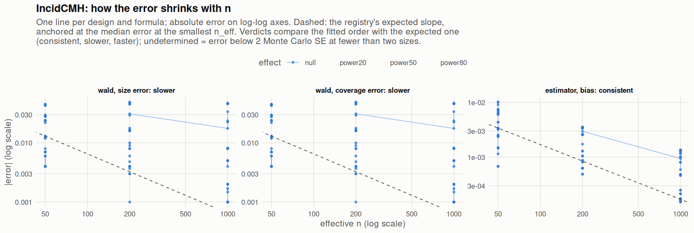

[← Campaign 2026-11-11-9d2edc5c summary](README.md)

# Class IncidCMH

Part of the [Classes index](classes.md). Response type: incidence. Status: null effect in progress, power effects not started. Verdict: **pass so far**.

<picture><source media="(prefers-color-scheme: dark)" srcset="figures/class-IncidCMH-dark.png"></picture>

Convergence verdicts (worst over designs, formulas and effects; provisional until the class is complete):

| procedure | metric | verdict |
|---|---|---|
| estimator (bias) | bias | consistent |
| wald | coverage | slower |
| wald | size | slower |

Null effect: 84 cells (0 failing). Size, coverage and bias / SD against the level each is held to.

| design | n | formula | procedure | size | coverage | bias / SD | size level | coverage level | verdict |
|---|---|---|---|---|---|---|---|---|---|
| Fixed:Bernoulli | 50 | `~.` | wald | 0.007 | 0.993 | -0.07 | 0.1 | 0.9 | ok |
| Fixed:Bernoulli | 200 | `~.` | wald | 0.005 | 0.995 | 0.0089 | 0.0625 | 0.938 | ok |
| Fixed:Bernoulli | 1000 | `~.` | wald | 0.003 | 0.997 | -0.007 | 0.0525 | 0.948 | ok |
| Fixed:Bernoulli | 50 | `~1` | wald | 0.007 | 0.993 | -0.07 | 0.1 | 0.9 | ok |
| Fixed:Bernoulli | 200 | `~1` | wald | 0.004 | 0.996 | 0.0089 | 0.0625 | 0.938 | ok |
| Fixed:Bernoulli | 1000 | `~1` | wald | 0.004 | 0.996 | -0.007 | 0.0525 | 0.948 | ok |
| Fixed:BinaryMatch | 50 | `~.` | wald | 0.038 | 0.962 | 0.02 | 0.1 | 0.9 | ok |
| Fixed:BinaryMatch | 200 | `~.` | wald | 0.058 | 0.942 | -0.054 | 0.0625 | 0.938 | ok |
| Fixed:BinaryMatch | 1000 | `~.` | wald | 0.0581 | 0.942 | 0.0054 | 0.0525 | 0.948 | ok |
| Fixed:BinaryMatch | 50 | `~1` | wald | 0.038 | 0.962 | 0.02 | 0.1 | 0.9 | ok |
| Fixed:BinaryMatch | 200 | `~1` | wald | 0.058 | 0.942 | -0.054 | 0.0625 | 0.938 | ok |
| Fixed:BinaryMatch | 1000 | `~1` | wald | 0.0581 | 0.942 | 0.0054 | 0.0525 | 0.948 | ok |
| Fixed:Greedy | 50 | `~.` | wald | 0.056 | 0.944 | 0.011 | 0.1 | 0.9 | ok |
| Fixed:Greedy | 200 | `~.` | wald | 0.0548 | 0.945 | 0.04 | 0.0625 | 0.938 | ok |
| Fixed:Greedy | 1000 | `~.` | wald | 0.0515 | 0.949 | -0.027 | 0.0525 | 0.948 | ok |
| Fixed:Greedy | 50 | `~1` | wald | 0.054 | 0.946 | 0.011 | 0.1 | 0.9 | ok |
| Fixed:Greedy | 200 | `~1` | wald | 0.0537 | 0.946 | 0.04 | 0.0625 | 0.938 | ok |
| Fixed:Greedy | 1000 | `~1` | wald | 0.0483 | 0.952 | -0.027 | 0.0525 | 0.948 | ok |
| Fixed:GreedyDOptimal | 50 | `~.` | wald | 0.056 | 0.944 | 0.011 | 0.1 | 0.9 | ok |
| Fixed:GreedyDOptimal | 200 | `~.` | wald | 0.054 | 0.946 | 0.04 | 0.0625 | 0.938 | ok |
| Fixed:GreedyDOptimal | 1000 | `~.` | wald | 0.051 | 0.949 | -0.0085 | 0.0525 | 0.948 | ok |
| Fixed:GreedyDOptimal | 50 | `~1` | wald | 0.054 | 0.946 | 0.011 | 0.1 | 0.9 | ok |
| Fixed:GreedyDOptimal | 200 | `~1` | wald | 0.053 | 0.947 | 0.04 | 0.0625 | 0.938 | ok |
| Fixed:GreedyDOptimal | 1000 | `~1` | wald | 0.049 | 0.951 | -0.0085 | 0.0525 | 0.948 | ok |
| Fixed:iBCRD | 50 | `~.` | wald | 0.063 | 0.937 | -0.0049 | 0.1 | 0.9 | ok |
| Fixed:iBCRD | 200 | `~.` | wald | 0.05 | 0.95 | -0.037 | 0.0625 | 0.938 | ok |
| Fixed:iBCRD | 1000 | `~.` | wald | 0.045 | 0.955 | 0.043 | 0.0525 | 0.948 | ok |
| Fixed:iBCRD | 50 | `~1` | wald | 0.063 | 0.937 | -0.0049 | 0.1 | 0.9 | ok |
| Fixed:iBCRD | 200 | `~1` | wald | 0.05 | 0.95 | -0.037 | 0.0625 | 0.938 | ok |
| Fixed:iBCRD | 1000 | `~1` | wald | 0.045 | 0.955 | 0.043 | 0.0525 | 0.948 | ok |
| Fixed:MatchingGreedyPairSwitching | 50 | `~.` | wald | 0.026 | 0.974 | 0.019 | 0.1 | 0.9 | ok |
| Fixed:MatchingGreedyPairSwitching | 200 | `~.` | wald | 0.054 | 0.946 | 0.0096 | 0.0625 | 0.938 | ok |
| Fixed:MatchingGreedyPairSwitching | 1000 | `~.` | wald | 0.042 | 0.958 | -0.0053 | 0.0525 | 0.948 | ok |
| Fixed:MatchingGreedyPairSwitching | 50 | `~1` | wald | 0.026 | 0.974 | 0.019 | 0.1 | 0.9 | ok |
| Fixed:MatchingGreedyPairSwitching | 200 | `~1` | wald | 0.054 | 0.946 | 0.0096 | 0.0625 | 0.938 | ok |
| Fixed:MatchingGreedyPairSwitching | 1000 | `~1` | wald | 0.042 | 0.958 | -0.0053 | 0.0525 | 0.948 | ok |
| Fixed:Optimal | 50 | `~.` | wald |  |  | -0.024 | 0.1 | 0.9 | ok |
| Fixed:Optimal | 200 | `~.` | wald |  |  | -0.051 | 0.0625 | 0.938 | ok |
| Fixed:Optimal | 1000 | `~.` | wald |  |  | -0.016 | 0.0525 | 0.948 | ok |
| Fixed:Optimal | 50 | `~1` | wald |  |  | -0.024 | 0.1 | 0.9 | ok |
| Fixed:Optimal | 200 | `~1` | wald |  |  | -0.051 | 0.0625 | 0.938 | ok |
| Fixed:Optimal | 1000 | `~1` | wald |  |  | -0.016 | 0.0525 | 0.948 | ok |
| Fixed:Rerandomization | 50 | `~.` | wald | 0.072 | 0.928 | -0.044 | 0.1 | 0.9 | ok |
| Fixed:Rerandomization | 200 | `~.` | wald | 0.053 | 0.947 | 0.018 | 0.0625 | 0.938 | ok |
| Fixed:Rerandomization | 1000 | `~.` | wald | 0.052 | 0.948 | -0.015 | 0.0525 | 0.948 | ok |
| Fixed:Rerandomization | 50 | `~1` | wald | 0.074 | 0.926 | -0.044 | 0.1 | 0.9 | ok |
| Fixed:Rerandomization | 200 | `~1` | wald | 0.056 | 0.944 | 0.018 | 0.0625 | 0.938 | ok |
| Fixed:Rerandomization | 1000 | `~1` | wald | 0.051 | 0.949 | -0.015 | 0.0525 | 0.948 | ok |
| SeqOneByOne:Atkinson | 50 | `~.` | wald | 0.022 | 0.978 | -0.025 | 0.1 | 0.9 | ok |
| SeqOneByOne:Atkinson | 200 | `~.` | wald | 0.0334 | 0.967 | 0.013 | 0.0625 | 0.938 | ok |
| SeqOneByOne:Atkinson | 1000 | `~.` | wald | 0.0274 | 0.973 | 0.04 | 0.0525 | 0.948 | ok |
| SeqOneByOne:Atkinson | 50 | `~1` | wald | 0.021 | 0.979 | -0.025 | 0.1 | 0.9 | ok |
| SeqOneByOne:Atkinson | 200 | `~1` | wald | 0.0322 | 0.968 | 0.013 | 0.0625 | 0.938 | ok |
| SeqOneByOne:Atkinson | 1000 | `~1` | wald | 0.0264 | 0.974 | 0.04 | 0.0525 | 0.948 | ok |
| SeqOneByOne:Bernoulli | 50 | `~.` | wald | 0.005 | 0.995 | 0.054 | 0.1 | 0.9 | ok |
| SeqOneByOne:Bernoulli | 200 | `~.` | wald | 0.001 | 0.999 | 0.05 | 0.0625 | 0.938 | ok |
| SeqOneByOne:Bernoulli | 1000 | `~.` | wald | 0.004 | 0.996 | 0.0055 | 0.0525 | 0.948 | ok |
| SeqOneByOne:Bernoulli | 50 | `~1` | wald | 0.005 | 0.995 | 0.054 | 0.1 | 0.9 | ok |
| SeqOneByOne:Bernoulli | 200 | `~1` | wald | 0.002 | 0.998 | 0.05 | 0.0625 | 0.938 | ok |
| SeqOneByOne:Bernoulli | 1000 | `~1` | wald | 0.004 | 0.996 | 0.0055 | 0.0525 | 0.948 | ok |
| SeqOneByOne:Efron | 50 | `~.` | wald | 0.042 | 0.958 | 0.049 | 0.1 | 0.9 | ok |
| SeqOneByOne:Efron | 200 | `~.` | wald | 0.051 | 0.949 | 0.015 | 0.0625 | 0.938 | ok |
| SeqOneByOne:Efron | 1000 | `~.` | wald | 0.051 | 0.949 | -0.04 | 0.0525 | 0.948 | ok |
| SeqOneByOne:Efron | 50 | `~1` | wald | 0.043 | 0.957 | 0.049 | 0.1 | 0.9 | ok |
| SeqOneByOne:Efron | 200 | `~1` | wald | 0.05 | 0.95 | 0.015 | 0.0625 | 0.938 | ok |
| SeqOneByOne:Efron | 1000 | `~1` | wald | 0.049 | 0.951 | -0.04 | 0.0525 | 0.948 | ok |
| SeqOneByOne:iBCRD | 50 | `~.` | wald | 0.054 | 0.946 | 0.031 | 0.1 | 0.9 | ok |
| SeqOneByOne:iBCRD | 200 | `~.` | wald | 0.066 | 0.934 | 0.0065 | 0.0625 | 0.938 | ok |
| SeqOneByOne:iBCRD | 1000 | `~.` | wald | 0.048 | 0.952 | 0.0055 | 0.0525 | 0.948 | ok |
| SeqOneByOne:iBCRD | 50 | `~1` | wald | 0.054 | 0.946 | 0.031 | 0.1 | 0.9 | ok |
| SeqOneByOne:iBCRD | 200 | `~1` | wald | 0.066 | 0.934 | 0.0065 | 0.0625 | 0.938 | ok |
| SeqOneByOne:iBCRD | 1000 | `~1` | wald | 0.048 | 0.952 | 0.0055 | 0.0525 | 0.948 | ok |
| SeqOneByOne:PocockSimon | 50 | `~.` | wald | 0.057 | 0.943 | 0.043 | 0.1 | 0.9 | ok |
| SeqOneByOne:PocockSimon | 200 | `~.` | wald | 0.059 | 0.941 | 0.011 | 0.0625 | 0.938 | ok |
| SeqOneByOne:PocockSimon | 1000 | `~.` | wald | 0.054 | 0.946 | 0.032 | 0.05 | 0.95 | ok |
| SeqOneByOne:PocockSimon | 50 | `~1` | wald | 0.057 | 0.943 | 0.043 | 0.1 | 0.9 | ok |
| SeqOneByOne:PocockSimon | 200 | `~1` | wald | 0.06 | 0.94 | 0.011 | 0.0625 | 0.938 | ok |
| SeqOneByOne:PocockSimon | 1000 | `~1` | wald | 0.055 | 0.945 | 0.032 | 0.05 | 0.95 | ok |
| SeqOneByOne:Urn | 50 | `~.` | wald | 0.0222 | 0.978 | -0.064 | 0.1 | 0.9 | ok |
| SeqOneByOne:Urn | 200 | `~.` | wald | 0.019 | 0.981 | -0.042 | 0.0625 | 0.938 | ok |
| SeqOneByOne:Urn | 1000 | `~.` | wald | 0.0324 | 0.968 | 0.028 | 0.0525 | 0.948 | ok |
| SeqOneByOne:Urn | 50 | `~1` | wald | 0.0203 | 0.98 | 0.0081 | 0.1 | 0.9 | ok |
| SeqOneByOne:Urn | 200 | `~1` | wald | 0.0207 | 0.979 | -0.025 | 0.0625 | 0.938 | ok |
| SeqOneByOne:Urn | 1000 | `~1` | wald | 0.0162 | 0.984 | 0.02 | 0.0525 | 0.948 | ok |

[← Campaign 2026-11-11-9d2edc5c summary](README.md)
