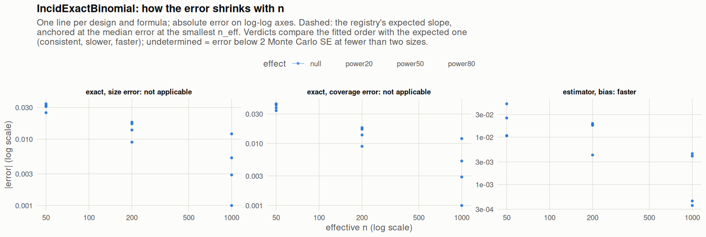

[← Campaign 2026-11-11-9d2edc5c summary](README.md)

# Class IncidExactBinomial

Part of the [Classes index](classes.md). Response type: incidence. Status: null effect complete, power effects not started. Verdict: **pass so far**.

<picture><source media="(prefers-color-scheme: dark)" srcset="figures/class-IncidExactBinomial-dark.png"></picture>

Convergence verdicts (worst over designs, formulas and effects; provisional until the class is complete):

| procedure | metric | verdict |
|---|---|---|
| estimator (bias) | bias | faster |
| exact | coverage | not applicable |
| exact | size | not applicable |

Null effect: 24 cells (0 failing). Size, coverage and bias / SD against the level each is held to.

| design | n | formula | procedure | size | coverage | bias / SD | size level | coverage level | verdict |
|---|---|---|---|---|---|---|---|---|---|
| Fixed:BinaryMatch | 50 | `~.` | exact | 0.018 | 0.984 | 0.017 | 0.05 | 0.95 | ok |
| Fixed:BinaryMatch | 200 | `~.` | exact | 0.041 | 0.959 | -0.063 | 0.05 | 0.95 | ok |
| Fixed:BinaryMatch | 1000 | `~.` | exact | 0.0471 | 0.953 | 0.0031 | 0.05 | 0.95 | ok |
| Fixed:BinaryMatch | 50 | `~1` | exact | 0.018 | 0.984 | 0.017 | 0.05 | 0.95 | ok |
| Fixed:BinaryMatch | 200 | `~1` | exact | 0.041 | 0.959 | -0.063 | 0.05 | 0.95 | ok |
| Fixed:BinaryMatch | 1000 | `~1` | exact | 0.0471 | 0.953 | 0.0031 | 0.05 | 0.95 | ok |
| SeqOneByOne:KK14 | 50 | `~.` | exact | 0.019 | 0.994 | -0.061 | 0.05 | 0.95 | ok |
| SeqOneByOne:KK14 | 200 | `~.` | exact | 0.032 | 0.968 | 0.055 | 0.05 | 0.95 | ok |
| SeqOneByOne:KK14 | 1000 | `~.` | exact | 0.038 | 0.962 | -0.032 | 0.05 | 0.95 | ok |
| SeqOneByOne:KK14 | 50 | `~1` | exact | 0.019 | 0.994 | -0.061 | 0.05 | 0.95 | ok |
| SeqOneByOne:KK14 | 200 | `~1` | exact | 0.032 | 0.968 | 0.055 | 0.05 | 0.95 | ok |
| SeqOneByOne:KK14 | 1000 | `~1` | exact | 0.038 | 0.962 | -0.032 | 0.05 | 0.95 | ok |
| SeqOneByOne:KK21 | 50 | `~.` | exact | 0.016 | 0.992 | -0.015 | 0.05 | 0.95 | ok |
| SeqOneByOne:KK21 | 200 | `~.` | exact | 0.033 | 0.967 | 0.013 | 0.05 | 0.95 | ok |
| SeqOneByOne:KK21 | 1000 | `~.` | exact | 0.049 | 0.951 | -0.0026 | 0.05 | 0.95 | ok |
| SeqOneByOne:KK21 | 50 | `~1` | exact | 0.016 | 0.992 | -0.015 | 0.05 | 0.95 | ok |
| SeqOneByOne:KK21 | 200 | `~1` | exact | 0.033 | 0.967 | 0.013 | 0.05 | 0.95 | ok |
| SeqOneByOne:KK21 | 1000 | `~1` | exact | 0.049 | 0.951 | -0.0026 | 0.05 | 0.95 | ok |
| SeqOneByOne:KK21stepwise | 50 | `~.` | exact | 0.025 | 0.988 | -0.034 | 0.05 | 0.95 | ok |
| SeqOneByOne:KK21stepwise | 200 | `~.` | exact | 0.0363 | 0.964 | 0.056 | 0.05 | 0.95 | ok |
| SeqOneByOne:KK21stepwise | 1000 | `~.` | exact | 0.0448 | 0.955 | -0.029 | 0.05 | 0.95 | ok |
| SeqOneByOne:KK21stepwise | 50 | `~1` | exact | 0.025 | 0.988 | -0.034 | 0.05 | 0.95 | ok |
| SeqOneByOne:KK21stepwise | 200 | `~1` | exact | 0.0363 | 0.964 | 0.056 | 0.05 | 0.95 | ok |
| SeqOneByOne:KK21stepwise | 1000 | `~1` | exact | 0.0448 | 0.955 | -0.029 | 0.05 | 0.95 | ok |

[← Campaign 2026-11-11-9d2edc5c summary](README.md)
