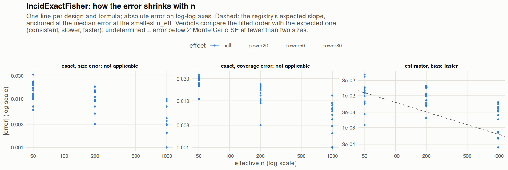

[← Campaign 2026-11-11-9d2edc5c summary](README.md)

# Class IncidExactFisher

Part of the [Classes index](classes.md). Response type: incidence. Status: null effect complete, power effects not started. Verdict: **pass so far**.

<picture><source media="(prefers-color-scheme: dark)" srcset="figures/class-IncidExactFisher-dark.png"></picture>

Convergence verdicts (worst over designs, formulas and effects; provisional until the class is complete):

| procedure | metric | verdict |
|---|---|---|
| estimator (bias) | bias | faster |
| exact | coverage | not applicable |
| exact | size | not applicable |

Null effect: 84 cells (0 failing). Size, coverage and bias / SD against the level each is held to.

| design | n | formula | procedure | size | coverage | bias / SD | size level | coverage level | verdict |
|---|---|---|---|---|---|---|---|---|---|
| Fixed:BinaryMatch | 50 | `~.` | exact | 0.018 | 0.984 | 0.0081 | 0.05 | 0.95 | ok |
| Fixed:BinaryMatch | 200 | `~.` | exact | 0.041 | 0.959 | -0.063 | 0.05 | 0.95 | ok |
| Fixed:BinaryMatch | 1000 | `~.` | exact | 0.0471 | 0.953 | 0.0031 | 0.05 | 0.95 | ok |
| Fixed:BinaryMatch | 50 | `~1` | exact | 0.018 | 0.984 | 0.0081 | 0.05 | 0.95 | ok |
| Fixed:BinaryMatch | 200 | `~1` | exact | 0.041 | 0.959 | -0.063 | 0.05 | 0.95 | ok |
| Fixed:BinaryMatch | 1000 | `~1` | exact | 0.0471 | 0.953 | 0.0031 | 0.05 | 0.95 | ok |
| Fixed:Blocking | 50 | `~.` | exact | 0.044 | 0.973 | 0.011 | 0.05 | 0.95 | ok |
| Fixed:Blocking | 200 | `~.` | exact | 0.035 | 0.973 | 0.026 | 0.05 | 0.95 | ok |
| Fixed:Blocking | 1000 | `~.` | exact | 0.053 | 0.951 | 0.024 | 0.05 | 0.95 | ok |
| Fixed:Blocking | 50 | `~1` | exact | 0.044 | 0.973 | 0.011 | 0.05 | 0.95 | ok |
| Fixed:Blocking | 200 | `~1` | exact | 0.035 | 0.973 | 0.026 | 0.05 | 0.95 | ok |
| Fixed:Blocking | 1000 | `~1` | exact | 0.053 | 0.951 | 0.024 | 0.05 | 0.95 | ok |
| Fixed:Blocking@0.2 | 50 | `~.` | exact | 0.043 | 0.973 | -0.056 | 0.05 | 0.95 | ok |
| Fixed:Blocking@0.2 | 200 | `~.` | exact | 0.039 | 0.967 | 0.014 | 0.05 | 0.95 | ok |
| Fixed:Blocking@0.2 | 1000 | `~.` | exact | 0.051 | 0.954 | 0.037 | 0.05 | 0.95 | ok |
| Fixed:Blocking@0.2 | 50 | `~1` | exact | 0.043 | 0.973 | -0.056 | 0.05 | 0.95 | ok |
| Fixed:Blocking@0.2 | 200 | `~1` | exact | 0.039 | 0.967 | 0.014 | 0.05 | 0.95 | ok |
| Fixed:Blocking@0.2 | 1000 | `~1` | exact | 0.051 | 0.954 | 0.037 | 0.05 | 0.95 | ok |
| Fixed:iBCRD | 50 | `~.` | exact | 0.039 | 0.961 | -0.0046 | 0.05 | 0.95 | ok |
| Fixed:iBCRD | 200 | `~.` | exact | 0.032 | 0.968 | -0.037 | 0.05 | 0.95 | ok |
| Fixed:iBCRD | 1000 | `~.` | exact | 0.041 | 0.959 | 0.043 | 0.05 | 0.95 | ok |
| Fixed:iBCRD | 50 | `~1` | exact | 0.039 | 0.961 | -0.0046 | 0.05 | 0.95 | ok |
| Fixed:iBCRD | 200 | `~1` | exact | 0.032 | 0.968 | -0.037 | 0.05 | 0.95 | ok |
| Fixed:iBCRD | 1000 | `~1` | exact | 0.041 | 0.959 | 0.043 | 0.05 | 0.95 | ok |
| Fixed:iBCRD@0.2 | 50 | `~.` | exact | 0.031 | 0.979 | 0.0077 | 0.05 | 0.95 | ok |
| Fixed:iBCRD@0.2 | 200 | `~.` | exact | 0.043 | 0.96 | 0.016 | 0.05 | 0.95 | ok |
| Fixed:iBCRD@0.2 | 1000 | `~.` | exact | 0.052 | 0.952 | 0.021 | 0.05 | 0.95 | ok |
| Fixed:iBCRD@0.2 | 50 | `~1` | exact | 0.031 | 0.979 | 0.0077 | 0.05 | 0.95 | ok |
| Fixed:iBCRD@0.2 | 200 | `~1` | exact | 0.043 | 0.96 | 0.016 | 0.05 | 0.95 | ok |
| Fixed:iBCRD@0.2 | 1000 | `~1` | exact | 0.052 | 0.952 | 0.021 | 0.05 | 0.95 | ok |
| SeqOneByOne:iBCRD | 50 | `~.` | exact | 0.029 | 0.971 | 0.032 | 0.05 | 0.95 | ok |
| SeqOneByOne:iBCRD | 200 | `~.` | exact | 0.053 | 0.947 | 0.0066 | 0.05 | 0.95 | ok |
| SeqOneByOne:iBCRD | 1000 | `~.` | exact | 0.043 | 0.957 | 0.0055 | 0.05 | 0.95 | ok |
| SeqOneByOne:iBCRD | 50 | `~1` | exact | 0.029 | 0.971 | 0.032 | 0.05 | 0.95 | ok |
| SeqOneByOne:iBCRD | 200 | `~1` | exact | 0.053 | 0.947 | 0.0066 | 0.05 | 0.95 | ok |
| SeqOneByOne:iBCRD | 1000 | `~1` | exact | 0.043 | 0.957 | 0.0055 | 0.05 | 0.95 | ok |
| SeqOneByOne:iBCRD@0.2 | 50 | `~.` | exact | 0.027 | 0.987 | 0.013 | 0.05 | 0.95 | ok |
| SeqOneByOne:iBCRD@0.2 | 200 | `~.` | exact | 0.041 | 0.961 | 0.02 | 0.05 | 0.95 | ok |
| SeqOneByOne:iBCRD@0.2 | 1000 | `~.` | exact | 0.048 | 0.956 | -0.015 | 0.05 | 0.95 | ok |
| SeqOneByOne:iBCRD@0.2 | 50 | `~1` | exact | 0.027 | 0.987 | 0.013 | 0.05 | 0.95 | ok |
| SeqOneByOne:iBCRD@0.2 | 200 | `~1` | exact | 0.041 | 0.961 | 0.02 | 0.05 | 0.95 | ok |
| SeqOneByOne:iBCRD@0.2 | 1000 | `~1` | exact | 0.048 | 0.956 | -0.015 | 0.05 | 0.95 | ok |
| SeqOneByOne:KK14 | 50 | `~.` | exact | 0.028 | 0.978 | -0.023 | 0.05 | 0.95 | ok |
| SeqOneByOne:KK14 | 200 | `~.` | exact | 0.045 | 0.959 | 0.037 | 0.05 | 0.95 | ok |
| SeqOneByOne:KK14 | 1000 | `~.` | exact | 0.05 | 0.954 | -0.032 | 0.05 | 0.95 | ok |
| SeqOneByOne:KK14 | 50 | `~1` | exact | 0.028 | 0.978 | -0.023 | 0.05 | 0.95 | ok |
| SeqOneByOne:KK14 | 200 | `~1` | exact | 0.045 | 0.959 | 0.037 | 0.05 | 0.95 | ok |
| SeqOneByOne:KK14 | 1000 | `~1` | exact | 0.05 | 0.954 | -0.032 | 0.05 | 0.95 | ok |
| SeqOneByOne:KK21 | 50 | `~.` | exact | 0.03 | 0.98 | -0.0018 | 0.05 | 0.95 | ok |
| SeqOneByOne:KK21 | 200 | `~.` | exact | 0.032 | 0.971 | 0.016 | 0.05 | 0.95 | ok |
| SeqOneByOne:KK21 | 1000 | `~.` | exact | 0.05 | 0.951 | 0.0052 | 0.05 | 0.95 | ok |
| SeqOneByOne:KK21 | 50 | `~1` | exact | 0.03 | 0.98 | -0.0018 | 0.05 | 0.95 | ok |
| SeqOneByOne:KK21 | 200 | `~1` | exact | 0.032 | 0.971 | 0.016 | 0.05 | 0.95 | ok |
| SeqOneByOne:KK21 | 1000 | `~1` | exact | 0.05 | 0.951 | 0.0052 | 0.05 | 0.95 | ok |
| SeqOneByOne:KK21stepwise | 50 | `~.` | exact | 0.037 | 0.974 | -0.056 | 0.05 | 0.95 | ok |
| SeqOneByOne:KK21stepwise | 200 | `~.` | exact | 0.0403 | 0.965 | 0.057 | 0.05 | 0.95 | ok |
| SeqOneByOne:KK21stepwise | 1000 | `~.` | exact | 0.0465 | 0.957 | -0.029 | 0.05 | 0.95 | ok |
| SeqOneByOne:KK21stepwise | 50 | `~1` | exact | 0.037 | 0.974 | -0.056 | 0.05 | 0.95 | ok |
| SeqOneByOne:KK21stepwise | 200 | `~1` | exact | 0.0403 | 0.965 | 0.057 | 0.05 | 0.95 | ok |
| SeqOneByOne:KK21stepwise | 1000 | `~1` | exact | 0.0465 | 0.957 | -0.029 | 0.05 | 0.95 | ok |
| SeqOneByOne:RandomBlockSize | 50 | `~.` | exact | 0.033 | 0.979 | -0.02 | 0.05 | 0.95 | ok |
| SeqOneByOne:RandomBlockSize | 200 | `~.` | exact | 0.036 | 0.97 | -0.033 | 0.05 | 0.95 | ok |
| SeqOneByOne:RandomBlockSize | 1000 | `~.` | exact | 0.047 | 0.955 | -0.0018 | 0.05 | 0.95 | ok |
| SeqOneByOne:RandomBlockSize | 50 | `~1` | exact | 0.033 | 0.979 | -0.02 | 0.05 | 0.95 | ok |
| SeqOneByOne:RandomBlockSize | 200 | `~1` | exact | 0.036 | 0.97 | -0.033 | 0.05 | 0.95 | ok |
| SeqOneByOne:RandomBlockSize | 1000 | `~1` | exact | 0.047 | 0.955 | -0.0018 | 0.05 | 0.95 | ok |
| SeqOneByOne:RandomBlockSize@0.2 | 50 | `~.` | exact | 0.038 | 0.981 | 0.017 | 0.05 | 0.95 | ok |
| SeqOneByOne:RandomBlockSize@0.2 | 200 | `~.` | exact | 0.041 | 0.968 | 0.05 | 0.05 | 0.95 | ok |
| SeqOneByOne:RandomBlockSize@0.2 | 1000 | `~.` | exact | 0.04 | 0.963 | 0.015 | 0.05 | 0.95 | ok |
| SeqOneByOne:RandomBlockSize@0.2 | 50 | `~1` | exact | 0.038 | 0.981 | 0.017 | 0.05 | 0.95 | ok |
| SeqOneByOne:RandomBlockSize@0.2 | 200 | `~1` | exact | 0.041 | 0.968 | 0.05 | 0.05 | 0.95 | ok |
| SeqOneByOne:RandomBlockSize@0.2 | 1000 | `~1` | exact | 0.04 | 0.963 | 0.015 | 0.05 | 0.95 | ok |
| SeqOneByOne:SPBR | 50 | `~.` | exact | 0.04 | 0.971 | -0.021 | 0.05 | 0.95 | ok |
| SeqOneByOne:SPBR | 200 | `~.` | exact | 0.036 | 0.969 | -0.068 | 0.05 | 0.95 | ok |
| SeqOneByOne:SPBR | 1000 | `~.` | exact | 0.046 | 0.958 | 0.0038 | 0.05 | 0.95 | ok |
| SeqOneByOne:SPBR | 50 | `~1` | exact | 0.04 | 0.971 | -0.021 | 0.05 | 0.95 | ok |
| SeqOneByOne:SPBR | 200 | `~1` | exact | 0.036 | 0.969 | -0.068 | 0.05 | 0.95 | ok |
| SeqOneByOne:SPBR | 1000 | `~1` | exact | 0.046 | 0.958 | 0.0038 | 0.05 | 0.95 | ok |
| SeqOneByOne:SPBR@0.2 | 50 | `~.` | exact | 0.035 | 0.979 | 0.022 | 0.05 | 0.95 | ok |
| SeqOneByOne:SPBR@0.2 | 200 | `~.` | exact | 0.041 | 0.963 | 0.048 | 0.05 | 0.95 | ok |
| SeqOneByOne:SPBR@0.2 | 1000 | `~.` | exact | 0.052 | 0.951 | 0.011 | 0.05 | 0.95 | ok |
| SeqOneByOne:SPBR@0.2 | 50 | `~1` | exact | 0.035 | 0.979 | 0.022 | 0.05 | 0.95 | ok |
| SeqOneByOne:SPBR@0.2 | 200 | `~1` | exact | 0.041 | 0.963 | 0.048 | 0.05 | 0.95 | ok |
| SeqOneByOne:SPBR@0.2 | 1000 | `~1` | exact | 0.052 | 0.951 | 0.011 | 0.05 | 0.95 | ok |

[← Campaign 2026-11-11-9d2edc5c summary](README.md)
