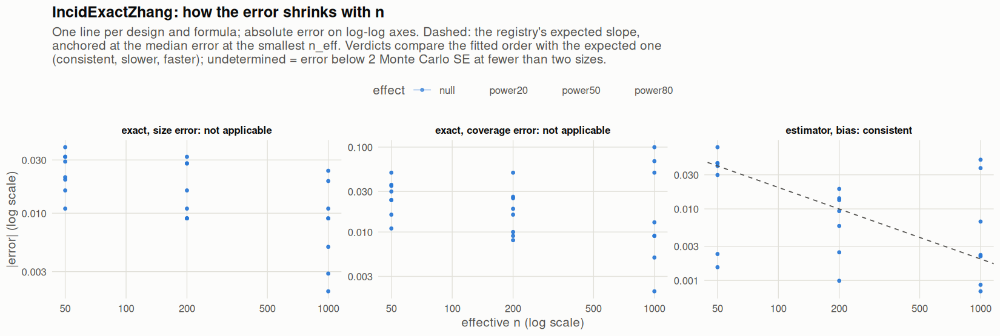

[← Campaign 2026-11-11-9d2edc5c summary](README.md)

# Class IncidExactZhang

Part of the [Classes index](classes.md). Response type: incidence. Status: null effect complete, power effects not started. Verdict: **pending confirmation** (4 flagged test(s): 0 failing, 4 pending, 0 cleared).

<picture><source media="(prefers-color-scheme: dark)" srcset="figures/class-IncidExactZhang-dark.png"></picture>

Convergence verdicts (worst over designs, formulas and effects; provisional until the class is complete):

| procedure | metric | verdict |
|---|---|---|
| estimator (bias) | bias | consistent |
| exact | coverage | not applicable |
| exact | size | not applicable |

Null effect: 48 cells (4 failing). Size, coverage and bias / SD against the level each is held to.

| design | n | formula | procedure | size | coverage | bias / SD | size level | coverage level | verdict |
|---|---|---|---|---|---|---|---|---|---|
| Fixed:Bernoulli | 50 | `~.` | exact | 0.039 | 0.961 | -0.069 | 0.05 | 0.95 | ok |
| Fixed:Bernoulli | 200 | `~.` | exact | 0.041 | 0.959 | 0.0087 | 0.05 | 0.95 | ok |
| Fixed:Bernoulli | 1000 | `~.` | exact | 0.041 | 0.959 | -0.0071 | 0.05 | 0.95 | ok |
| Fixed:Bernoulli | 50 | `~1` | exact | 0.039 | 0.961 | -0.069 | 0.05 | 0.95 | ok |
| Fixed:Bernoulli | 200 | `~1` | exact | 0.041 | 0.959 | 0.0087 | 0.05 | 0.95 | ok |
| Fixed:Bernoulli | 1000 | `~1` | exact | 0.041 | 0.959 | -0.0071 | 0.05 | 0.95 | ok |
| Fixed:Bernoulli@0.2 | 50 | `~.` | exact | 0.03 | 0.974 | 0.002 | 0.05 | 0.95 | ok |
| Fixed:Bernoulli@0.2 | 200 | `~.` | exact | 0.034 | 0.966 | 0.027 | 0.05 | 0.95 | ok |
| Fixed:Bernoulli@0.2 | 1000 | `~.` | exact | 0.045 | 0.955 | -0.014 | 0.05 | 0.95 | ok |
| Fixed:Bernoulli@0.2 | 50 | `~1` | exact | 0.03 | 0.974 | 0.002 | 0.05 | 0.95 | ok |
| Fixed:Bernoulli@0.2 | 200 | `~1` | exact | 0.034 | 0.966 | 0.027 | 0.05 | 0.95 | ok |
| Fixed:Bernoulli@0.2 | 1000 | `~1` | exact | 0.045 | 0.955 | -0.014 | 0.05 | 0.95 | ok |
| Fixed:BinaryMatch | 50 | `~.` | exact | 0.018 | 1 |  | 0.05 | 0.95 | ok |
| Fixed:BinaryMatch | 200 | `~.` | exact | 0.041 | 1 |  | 0.05 | 0.95 | ok |
| Fixed:BinaryMatch | 1000 | `~.` | exact | 0.0471 | 1 |  | 0.05 | 0.95 | ok |
| Fixed:BinaryMatch | 50 | `~1` | exact | 0.018 | 1 |  | 0.05 | 0.95 | ok |
| Fixed:BinaryMatch | 200 | `~1` | exact | 0.041 | 1 |  | 0.05 | 0.95 | ok |
| Fixed:BinaryMatch | 1000 | `~1` | exact | 0.0471 | 1 |  | 0.05 | 0.95 | ok |
| SeqOneByOne:Bernoulli | 50 | `~.` | exact | 0.034 | 0.966 | 0.054 | 0.05 | 0.95 | ok |
| SeqOneByOne:Bernoulli | 200 | `~.` | exact | 0.039 | 0.96 | 0.05 | 0.05 | 0.95 | ok |
| SeqOneByOne:Bernoulli | 1000 | `~.` | exact | 0.048 | 0.952 | 0.0055 | 0.05 | 0.95 | ok |
| SeqOneByOne:Bernoulli | 50 | `~1` | exact | 0.034 | 0.966 | 0.054 | 0.05 | 0.95 | ok |
| SeqOneByOne:Bernoulli | 200 | `~1` | exact | 0.039 | 0.96 | 0.05 | 0.05 | 0.95 | ok |
| SeqOneByOne:Bernoulli | 1000 | `~1` | exact | 0.048 | 0.952 | 0.0055 | 0.05 | 0.95 | ok |
| SeqOneByOne:Bernoulli@0.2 | 50 | `~.` | exact | 0.029 | 0.974 | 0.0032 | 0.05 | 0.95 | ok |
| SeqOneByOne:Bernoulli@0.2 | 200 | `~.` | exact | 0.041 | 0.958 | 0.0028 | 0.05 | 0.95 | ok |
| SeqOneByOne:Bernoulli@0.2 | 1000 | `~.` | exact | 0.041 | 0.959 | -0.015 | 0.05 | 0.95 | ok |
| SeqOneByOne:Bernoulli@0.2 | 50 | `~1` | exact | 0.029 | 0.974 | 0.0032 | 0.05 | 0.95 | ok |
| SeqOneByOne:Bernoulli@0.2 | 200 | `~1` | exact | 0.041 | 0.958 | 0.0028 | 0.05 | 0.95 | ok |
| SeqOneByOne:Bernoulli@0.2 | 1000 | `~1` | exact | 0.041 | 0.959 | -0.015 | 0.05 | 0.95 | ok |
| SeqOneByOne:KK14 | 50 | `~.` | exact | 0.018 | 0.98 | 0.048 | 0.05 | 0.95 | ok |
| SeqOneByOne:KK14 | 200 | `~.` | exact | 0.022 | 0.976 | -0.028 | 0.05 | 0.95 | ok |
| SeqOneByOne:KK14 | 1000 | `~.` | exact | 0.039 | 0.937 | -0.011 | 0.05 | 0.95 | ok |
| SeqOneByOne:KK14 | 50 | `~1` | exact | 0.018 | 0.98 | 0.048 | 0.05 | 0.95 | ok |
| SeqOneByOne:KK14 | 200 | `~1` | exact | 0.022 | 0.976 | -0.028 | 0.05 | 0.95 | ok |
| SeqOneByOne:KK14 | 1000 | `~1` | exact | 0.039 | 0.937 | -0.011 | 0.05 | 0.95 | ok |
| SeqOneByOne:KK21 | 50 | `~.` | exact | 0.011 | 0.986 | 0.053 | 0.05 | 0.95 | ok |
| SeqOneByOne:KK21 | 200 | `~.` | exact | 0.018 | 0.975 | 0.012 | 0.05 | 0.95 | ok |
| SeqOneByOne:KK21 | 1000 | `~.` | exact | 0.026 | 0.882 | 0.049 | 0.05 | 0.95 | **FAIL** |
| SeqOneByOne:KK21 | 50 | `~1` | exact | 0.011 | 0.986 | 0.053 | 0.05 | 0.95 | ok |
| SeqOneByOne:KK21 | 200 | `~1` | exact | 0.018 | 0.975 | 0.012 | 0.05 | 0.95 | ok |
| SeqOneByOne:KK21 | 1000 | `~1` | exact | 0.026 | 0.882 | 0.049 | 0.05 | 0.95 | **FAIL** |
| SeqOneByOne:KK21stepwise | 50 | `~.` | exact | 0.021 | 0.985 | -0.033 | 0.05 | 0.95 | ok |
| SeqOneByOne:KK21stepwise | 200 | `~.` | exact | 0.0222 | 0.969 | 0.0052 | 0.05 | 0.95 | ok |
| SeqOneByOne:KK21stepwise | 1000 | `~.` | exact | 0.0306 | 0.85 | -0.034 | 0.05 | 0.95 | **FAIL** |
| SeqOneByOne:KK21stepwise | 50 | `~1` | exact | 0.021 | 0.985 | -0.033 | 0.05 | 0.95 | ok |
| SeqOneByOne:KK21stepwise | 200 | `~1` | exact | 0.0222 | 0.969 | 0.0052 | 0.05 | 0.95 | ok |
| SeqOneByOne:KK21stepwise | 1000 | `~1` | exact | 0.0306 | 0.85 | -0.034 | 0.05 | 0.95 | **FAIL** |

[← Campaign 2026-11-11-9d2edc5c summary](README.md)
