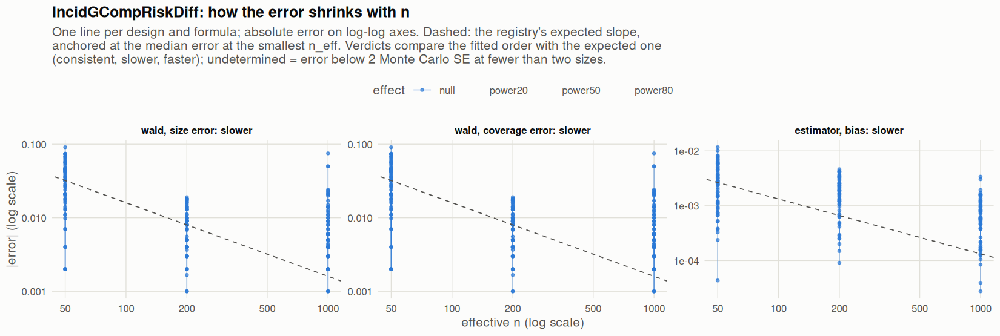

[← Campaign 2026-11-11-9d2edc5c summary](README.md)

# Class IncidGCompRiskDiff

Part of the [Classes index](classes.md). Response type: incidence. Status: null effect in progress, power effects not started. Verdict: **pending confirmation** (6 flagged test(s): 0 failing, 6 pending, 0 cleared).

<picture><source media="(prefers-color-scheme: dark)" srcset="figures/class-IncidGCompRiskDiff-dark.png"></picture>

Convergence verdicts (worst over designs, formulas and effects; provisional until the class is complete):

| procedure | metric | verdict |
|---|---|---|
| estimator (bias) | bias | slower |
| wald | coverage | slower |
| wald | size | slower |

Null effect: 198 cells (3 failing). Size, coverage and bias / SD against the level each is held to.

| design | n | formula | procedure | size | coverage | bias / SD | size level | coverage level | verdict |
|---|---|---|---|---|---|---|---|---|---|
| Fixed:Bernoulli | 50 | `~.` | wald | 0.105 | 0.895 | -0.059 | 0.1 | 0.9 | ok |
| Fixed:Bernoulli | 200 | `~.` | wald | 0.049 | 0.951 | 0.022 | 0.0625 | 0.938 | ok |
| Fixed:Bernoulli | 1000 | `~.` | wald | 0.047 | 0.953 | -0.032 | 0.0525 | 0.948 | ok |
| Fixed:Bernoulli | 50 | `~1` | wald | 0.071 | 0.929 | -0.07 | 0.1 | 0.9 | ok |
| Fixed:Bernoulli | 200 | `~1` | wald | 0.047 | 0.953 | 0.0089 | 0.0625 | 0.938 | ok |
| Fixed:Bernoulli | 1000 | `~1` | wald | 0.044 | 0.956 | -0.007 | 0.0525 | 0.948 | ok |
| Fixed:Bernoulli@0.2 | 50 | `~.` | wald | 0.123 | 0.877 | 0.003 | 0.1 | 0.9 | **FAIL** |
| Fixed:Bernoulli@0.2 | 200 | `~.` | wald | 0.06 | 0.94 | 0.013 | 0.0625 | 0.938 | ok |
| Fixed:Bernoulli@0.2 | 1000 | `~.` | wald | 0.047 | 0.953 | -0.044 | 0.0525 | 0.948 | ok |
| Fixed:Bernoulli@0.2 | 50 | `~1` | wald | 0.102 | 0.898 | -0.00023 | 0.1 | 0.9 | ok |
| Fixed:Bernoulli@0.2 | 200 | `~1` | wald | 0.047 | 0.953 | 0.027 | 0.0625 | 0.938 | ok |
| Fixed:Bernoulli@0.2 | 1000 | `~1` | wald | 0.051 | 0.949 | -0.014 | 0.0525 | 0.948 | ok |
| Fixed:BinaryMatch | 50 | `~.` | wald | 0.076 | 0.924 | 0.019 | 0.1 | 0.9 | ok |
| Fixed:BinaryMatch | 200 | `~.` | wald | 0.063 | 0.937 | -0.052 | 0.0625 | 0.938 | ok |
| Fixed:BinaryMatch | 1000 | `~.` | wald | 0.0639 | 0.936 | 0.0089 | 0.05 | 0.95 | **FAIL** |
| Fixed:BinaryMatch | 50 | `~1` | wald | 0.036 | 0.964 | 0.02 | 0.1 | 0.9 | ok |
| Fixed:BinaryMatch | 200 | `~1` | wald | 0.043 | 0.957 | -0.054 | 0.0625 | 0.938 | ok |
| Fixed:BinaryMatch | 1000 | `~1` | wald | 0.0351 | 0.965 | 0.0054 | 0.0525 | 0.948 | ok |
| Fixed:Blocking | 50 | `~.` | wald | 0.092 | 0.908 | 0.019 | 0.1 | 0.9 | ok |
| Fixed:Blocking | 200 | `~.` | wald | 0.045 | 0.955 | 0.037 | 0.0625 | 0.938 | ok |
| Fixed:Blocking | 1000 | `~.` | wald | 0.05 | 0.95 | 0.027 | 0.0525 | 0.948 | ok |
| Fixed:Blocking | 50 | `~1` | wald | 0.074 | 0.926 | 0.0027 | 0.1 | 0.9 | ok |
| Fixed:Blocking | 200 | `~1` | wald | 0.046 | 0.954 | 0.025 | 0.0625 | 0.938 | ok |
| Fixed:Blocking | 1000 | `~1` | wald | 0.059 | 0.941 | 0.025 | 0.0525 | 0.948 | ok |
| Fixed:Blocking@0.2 | 50 | `~.` | wald | 0.118 | 0.882 | -0.039 | 0.1 | 0.9 | ok |
| Fixed:Blocking@0.2 | 200 | `~.` | wald | 0.059 | 0.941 | 0.027 | 0.0625 | 0.938 | ok |
| Fixed:Blocking@0.2 | 1000 | `~.` | wald | 0.056 | 0.944 | 0.026 | 0.0525 | 0.948 | ok |
| Fixed:Blocking@0.2 | 50 | `~1` | wald | 0.095 | 0.905 | -0.063 | 0.1 | 0.9 | ok |
| Fixed:Blocking@0.2 | 200 | `~1` | wald | 0.047 | 0.953 | 0.011 | 0.0625 | 0.938 | ok |
| Fixed:Blocking@0.2 | 1000 | `~1` | wald | 0.052 | 0.948 | 0.037 | 0.0525 | 0.948 | ok |
| Fixed:Greedy | 50 | `~.` | wald | 0.096 | 0.904 | 0.0081 | 0.1 | 0.9 | ok |
| Fixed:Greedy | 200 | `~.` | wald | 0.0593 | 0.941 | 0.051 | 0.0625 | 0.938 | ok |
| Fixed:Greedy | 1000 | `~.` | wald | 0.125 | 0.875 | 0.021 | 0.0525 | 0.948 | ok |
| Fixed:Greedy | 50 | `~1` | wald | 0.052 | 0.948 | 0.011 | 0.1 | 0.9 | ok |
| Fixed:Greedy | 200 | `~1` | wald | 0.0444 | 0.956 | 0.039 | 0.0625 | 0.938 | ok |
| Fixed:Greedy | 1000 | `~1` | wald | 0 | 1 | -0.0036 | 0.0525 | 0.948 | ok |
| Fixed:Greedy@0.2 | 50 | `~.` | wald | 0.124 | 0.876 | 0.017 | 0.1 | 0.9 | ok |
| Fixed:Greedy@0.2 | 200 | `~.` | wald | 0.068 | 0.932 | -0.015 | 0.0625 | 0.938 | ok |
| Fixed:Greedy@0.2 | 1000 | `~.` | wald | 0.054 | 0.946 | -0.044 | 0.0525 | 0.948 | ok |
| Fixed:Greedy@0.2 | 50 | `~1` | wald | 0.071 | 0.929 | 0.016 | 0.1 | 0.9 | ok |
| Fixed:Greedy@0.2 | 200 | `~1` | wald | 0.046 | 0.954 | -0.023 | 0.0625 | 0.938 | ok |
| Fixed:Greedy@0.2 | 1000 | `~1` | wald | 0.029 | 0.971 | -0.045 | 0.0525 | 0.948 | ok |
| Fixed:GreedyDOptimal | 50 | `~.` | wald | 0.096 | 0.904 | 0.0081 | 0.1 | 0.9 | ok |
| Fixed:GreedyDOptimal | 200 | `~.` | wald | 0.059 | 0.941 | 0.049 | 0.0625 | 0.938 | ok |
| Fixed:GreedyDOptimal | 1000 | `~.` | wald | 0.0542 | 0.946 | -0.021 | 0.0525 | 0.948 | ok |
| Fixed:GreedyDOptimal | 50 | `~1` | wald | 0.052 | 0.948 | 0.011 | 0.1 | 0.9 | ok |
| Fixed:GreedyDOptimal | 200 | `~1` | wald | 0.042 | 0.958 | 0.04 | 0.0625 | 0.938 | ok |
| Fixed:GreedyDOptimal | 1000 | `~1` | wald | 0.0374 | 0.963 | -0.02 | 0.0525 | 0.948 | ok |
| Fixed:GreedyDOptimal@0.2 | 50 | `~.` | wald | 0.124 | 0.876 | 0.017 | 0.1 | 0.9 | ok |
| Fixed:GreedyDOptimal@0.2 | 200 | `~.` | wald | 0.068 | 0.932 | -0.015 | 0.0625 | 0.938 | ok |
| Fixed:GreedyDOptimal@0.2 | 1000 | `~.` | wald | 0.054 | 0.946 | -0.044 | 0.0525 | 0.948 | ok |
| Fixed:GreedyDOptimal@0.2 | 50 | `~1` | wald | 0.071 | 0.929 | 0.016 | 0.1 | 0.9 | ok |
| Fixed:GreedyDOptimal@0.2 | 200 | `~1` | wald | 0.046 | 0.954 | -0.023 | 0.0625 | 0.938 | ok |
| Fixed:GreedyDOptimal@0.2 | 1000 | `~1` | wald | 0.029 | 0.971 | -0.045 | 0.0525 | 0.948 | ok |
| Fixed:iBCRD | 50 | `~.` | wald | 0.093 | 0.907 | 0.0085 | 0.1 | 0.9 | ok |
| Fixed:iBCRD | 200 | `~.` | wald | 0.055 | 0.945 | -0.036 | 0.0625 | 0.938 | ok |
| Fixed:iBCRD | 1000 | `~.` | wald | 0.052 | 0.948 | 0.043 | 0.0525 | 0.948 | ok |
| Fixed:iBCRD | 50 | `~1` | wald | 0.063 | 0.937 | -0.0049 | 0.1 | 0.9 | ok |
| Fixed:iBCRD | 200 | `~1` | wald | 0.05 | 0.95 | -0.037 | 0.0625 | 0.938 | ok |
| Fixed:iBCRD | 1000 | `~1` | wald | 0.048 | 0.952 | 0.043 | 0.0525 | 0.948 | ok |
| Fixed:iBCRD@0.2 | 50 | `~.` | wald | 0.124 | 0.876 | -0.0031 | 0.1 | 0.9 | ok |
| Fixed:iBCRD@0.2 | 200 | `~.` | wald | 0.063 | 0.937 | 0.0085 | 0.0625 | 0.938 | ok |
| Fixed:iBCRD@0.2 | 1000 | `~.` | wald | 0.054 | 0.946 | 0.022 | 0.0525 | 0.948 | ok |
| Fixed:iBCRD@0.2 | 50 | `~1` | wald | 0.088 | 0.912 | 0.01 | 0.1 | 0.9 | ok |
| Fixed:iBCRD@0.2 | 200 | `~1` | wald | 0.064 | 0.936 | 0.015 | 0.0625 | 0.938 | ok |
| Fixed:iBCRD@0.2 | 1000 | `~1` | wald | 0.057 | 0.943 | 0.02 | 0.0525 | 0.948 | ok |
| Fixed:MatchingGreedyPairSwitching | 50 | `~.` | wald | 0.07 | 0.93 | 0.025 | 0.1 | 0.9 | ok |
| Fixed:MatchingGreedyPairSwitching | 200 | `~.` | wald | 0.066 | 0.934 | 0.01 | 0.0625 | 0.938 | ok |
| Fixed:MatchingGreedyPairSwitching | 1000 | `~.` | wald | 0.043 | 0.957 | -0.0056 | 0.0525 | 0.948 | ok |
| Fixed:MatchingGreedyPairSwitching | 50 | `~1` | wald | 0.037 | 0.963 | 0.019 | 0.1 | 0.9 | ok |
| Fixed:MatchingGreedyPairSwitching | 200 | `~1` | wald | 0.04 | 0.96 | 0.0096 | 0.0625 | 0.938 | ok |
| Fixed:MatchingGreedyPairSwitching | 1000 | `~1` | wald | 0.027 | 0.973 | -0.0053 | 0.0525 | 0.948 | ok |
| Fixed:Optimal | 50 | `~.` | wald | 0.098 | 0.902 | -0.021 | 0.1 | 0.9 | ok |
| Fixed:Optimal | 200 | `~.` | wald | 0.068 | 0.932 | -0.056 | 0.0625 | 0.938 | ok |
| Fixed:Optimal | 1000 | `~.` | wald | 0.061 | 0.939 | -0.013 | 0.05 | 0.95 | ok |
| Fixed:Optimal | 50 | `~1` | wald | 0.057 | 0.943 | -0.024 | 0.1 | 0.9 | ok |
| Fixed:Optimal | 200 | `~1` | wald | 0.037 | 0.963 | -0.051 | 0.0625 | 0.938 | ok |
| Fixed:Optimal | 1000 | `~1` | wald | 0.036 | 0.964 | -0.016 | 0.0525 | 0.948 | ok |
| Fixed:Optimal@0.2 | 50 | `~.` | wald | 0.096 | 0.904 | 0.036 | 0.1 | 0.9 | ok |
| Fixed:Optimal@0.2 | 200 | `~.` | wald | 0.067 | 0.933 | -0.0031 | 0.0625 | 0.938 | ok |
| Fixed:Optimal@0.2 | 1000 | `~.` | wald | 0.058 | 0.942 | 0.034 | 0.0525 | 0.948 | ok |
| Fixed:Optimal@0.2 | 50 | `~1` | wald | 0.057 | 0.943 | 0.05 | 0.1 | 0.9 | ok |
| Fixed:Optimal@0.2 | 200 | `~1` | wald | 0.042 | 0.958 | -0.0057 | 0.0625 | 0.938 | ok |
| Fixed:Optimal@0.2 | 1000 | `~1` | wald | 0.033 | 0.967 | 0.033 | 0.0525 | 0.948 | ok |
| Fixed:OptimalBlocks | 50 | `~.` | wald | 0.082 | 0.918 | 0.0069 | 0.1 | 0.9 | ok |
| Fixed:OptimalBlocks | 200 | `~.` | wald | 0.052 | 0.948 | 0.019 | 0.0625 | 0.938 | ok |
| Fixed:OptimalBlocks | 1000 | `~.` | wald | 0.048 | 0.952 | 0.019 | 0.0525 | 0.948 | ok |
| Fixed:OptimalBlocks | 50 | `~1` | wald | 0.067 | 0.933 | 0.0055 | 0.1 | 0.9 | ok |
| Fixed:OptimalBlocks | 200 | `~1` | wald | 0.039 | 0.961 | 0.024 | 0.0625 | 0.938 | ok |
| Fixed:OptimalBlocks | 1000 | `~1` | wald | 0.03 | 0.97 | 0.0066 | 0.0525 | 0.948 | ok |
| Fixed:OptimalBlocks@0.2 | 50 | `~.` | wald | 0.115 | 0.885 | -0.0093 | 0.1 | 0.9 | ok |
| Fixed:OptimalBlocks@0.2 | 200 | `~.` | wald | 0.067 | 0.933 | -0.023 | 0.0625 | 0.938 | ok |
| Fixed:OptimalBlocks@0.2 | 1000 | `~.` | wald | 0.04 | 0.96 | 0.017 | 0.0525 | 0.948 | ok |
| Fixed:OptimalBlocks@0.2 | 50 | `~1` | wald | 0.079 | 0.921 | -0.03 | 0.1 | 0.9 | ok |
| Fixed:OptimalBlocks@0.2 | 200 | `~1` | wald | 0.047 | 0.953 | -0.02 | 0.0625 | 0.938 | ok |
| Fixed:OptimalBlocks@0.2 | 1000 | `~1` | wald | 0.026 | 0.974 | 0.016 | 0.0525 | 0.948 | ok |
| Fixed:Rerandomization | 50 | `~.` | wald | 0.107 | 0.893 | -0.023 | 0.1 | 0.9 | ok |
| Fixed:Rerandomization | 200 | `~.` | wald | 0.059 | 0.941 | 0.03 | 0.0625 | 0.938 | ok |
| Fixed:Rerandomization | 1000 | `~.` | wald | 0.053 | 0.947 | -0.02 | 0.0525 | 0.948 | ok |
| Fixed:Rerandomization | 50 | `~1` | wald | 0.082 | 0.918 | -0.044 | 0.1 | 0.9 | ok |
| Fixed:Rerandomization | 200 | `~1` | wald | 0.057 | 0.943 | 0.018 | 0.0625 | 0.938 | ok |
| Fixed:Rerandomization | 1000 | `~1` | wald | 0.054 | 0.946 | -0.015 | 0.0525 | 0.948 | ok |
| Fixed:Rerandomization@0.2 | 50 | `~.` | wald | 0.106 | 0.894 | -0.0053 | 0.1 | 0.9 | ok |
| Fixed:Rerandomization@0.2 | 200 | `~.` | wald | 0.069 | 0.931 | 0.0034 | 0.0625 | 0.938 | ok |
| Fixed:Rerandomization@0.2 | 1000 | `~.` | wald | 0.056 | 0.944 | -0.092 | 0.0525 | 0.948 | ok |
| Fixed:Rerandomization@0.2 | 50 | `~1` | wald | 0.082 | 0.918 | -0.027 | 0.1 | 0.9 | ok |
| Fixed:Rerandomization@0.2 | 200 | `~1` | wald | 0.068 | 0.932 | 0.026 | 0.0625 | 0.938 | ok |
| Fixed:Rerandomization@0.2 | 1000 | `~1` | wald | 0.055 | 0.945 | -0.076 | 0.0525 | 0.948 | ok |
| SeqOneByOne:Atkinson | 50 | `~.` | wald | 0.094 | 0.906 | -0.021 | 0.1 | 0.9 | ok |
| SeqOneByOne:Atkinson | 200 | `~.` | wald | 0.0612 | 0.939 | 0.03 | 0.0625 | 0.938 | ok |
| SeqOneByOne:Atkinson | 1000 | `~.` | wald | 0.0278 | 0.972 | 0.069 | 0.0525 | 0.948 | ok |
| SeqOneByOne:Atkinson | 50 | `~1` | wald | 0.052 | 0.948 | -0.025 | 0.1 | 0.9 | ok |
| SeqOneByOne:Atkinson | 200 | `~1` | wald | 0.0432 | 0.957 | 0.027 | 0.0625 | 0.938 | ok |
| SeqOneByOne:Atkinson | 1000 | `~1` | wald | 0 | 1 | 0.062 | 0.0525 | 0.948 | ok |
| SeqOneByOne:Bernoulli | 50 | `~.` | wald | 0.077 | 0.923 | 0.007 | 0.1 | 0.9 | ok |
| SeqOneByOne:Bernoulli | 200 | `~.` | wald | 0.05 | 0.95 | 0.047 | 0.0625 | 0.938 | ok |
| SeqOneByOne:Bernoulli | 1000 | `~.` | wald | 0.059 | 0.941 | 0.041 | 0.0525 | 0.948 | ok |
| SeqOneByOne:Bernoulli | 50 | `~1` | wald | 0.05 | 0.95 | 0.054 | 0.1 | 0.9 | ok |
| SeqOneByOne:Bernoulli | 200 | `~1` | wald | 0.051 | 0.949 | 0.05 | 0.0625 | 0.938 | ok |
| SeqOneByOne:Bernoulli | 1000 | `~1` | wald | 0.055 | 0.945 | 0.0055 | 0.0525 | 0.948 | ok |
| SeqOneByOne:Bernoulli@0.2 | 50 | `~.` | wald | 0.109 | 0.891 | -0.01 | 0.1 | 0.9 | ok |
| SeqOneByOne:Bernoulli@0.2 | 200 | `~.` | wald | 0.059 | 0.941 | -0.0011 | 0.0625 | 0.938 | ok |
| SeqOneByOne:Bernoulli@0.2 | 1000 | `~.` | wald | 0.041 | 0.959 | 0.013 | 0.0525 | 0.948 | ok |
| SeqOneByOne:Bernoulli@0.2 | 50 | `~1` | wald | 0.092 | 0.908 | -0.0021 | 0.1 | 0.9 | ok |
| SeqOneByOne:Bernoulli@0.2 | 200 | `~1` | wald | 0.055 | 0.945 | 0.0028 | 0.0625 | 0.938 | ok |
| SeqOneByOne:Bernoulli@0.2 | 1000 | `~1` | wald | 0.046 | 0.954 | -0.014 | 0.0525 | 0.948 | ok |
| SeqOneByOne:Efron | 50 | `~.` | wald | 0.095 | 0.905 | 0.036 | 0.1 | 0.9 | ok |
| SeqOneByOne:Efron | 200 | `~.` | wald | 0.054 | 0.946 | 0.039 | 0.0625 | 0.938 | ok |
| SeqOneByOne:Efron | 1000 | `~.` | wald | 0.056 | 0.944 | -0.019 | 0.0525 | 0.948 | ok |
| SeqOneByOne:Efron | 50 | `~1` | wald | 0.068 | 0.932 | 0.049 | 0.1 | 0.9 | ok |
| SeqOneByOne:Efron | 200 | `~1` | wald | 0.063 | 0.937 | 0.015 | 0.0625 | 0.938 | ok |
| SeqOneByOne:Efron | 1000 | `~1` | wald | 0.055 | 0.945 | -0.04 | 0.05 | 0.95 | ok |
| SeqOneByOne:iBCRD | 50 | `~.` | wald | 0.071 | 0.929 | 0.0089 | 0.1 | 0.9 | ok |
| SeqOneByOne:iBCRD | 200 | `~.` | wald | 0.063 | 0.937 | 0.0022 | 0.0625 | 0.938 | ok |
| SeqOneByOne:iBCRD | 1000 | `~.` | wald | 0.056 | 0.944 | 0.00095 | 0.05 | 0.95 | ok |
| SeqOneByOne:iBCRD | 50 | `~1` | wald | 0.054 | 0.946 | 0.031 | 0.1 | 0.9 | ok |
| SeqOneByOne:iBCRD | 200 | `~1` | wald | 0.066 | 0.934 | 0.0065 | 0.0625 | 0.938 | ok |
| SeqOneByOne:iBCRD | 1000 | `~1` | wald | 0.052 | 0.948 | 0.0055 | 0.0525 | 0.948 | ok |
| SeqOneByOne:iBCRD@0.2 | 50 | `~.` | wald | 0.118 | 0.882 | -0.0014 | 0.1 | 0.9 | ok |
| SeqOneByOne:iBCRD@0.2 | 200 | `~.` | wald | 0.055 | 0.945 | 0.0037 | 0.0625 | 0.938 | ok |
| SeqOneByOne:iBCRD@0.2 | 1000 | `~.` | wald | 0.038 | 0.962 | 0.01 | 0.0525 | 0.948 | ok |
| SeqOneByOne:iBCRD@0.2 | 50 | `~1` | wald | 0.097 | 0.903 | 0.0086 | 0.1 | 0.9 | ok |
| SeqOneByOne:iBCRD@0.2 | 200 | `~1` | wald | 0.058 | 0.942 | 0.019 | 0.0625 | 0.938 | ok |
| SeqOneByOne:iBCRD@0.2 | 1000 | `~1` | wald | 0.05 | 0.95 | -0.016 | 0.0525 | 0.948 | ok |
| SeqOneByOne:KK14 | 50 | `~.` | wald | 0.085 | 0.915 | -0.044 | 0.1 | 0.9 | ok |
| SeqOneByOne:KK14 | 200 | `~.` | wald | 0.059 | 0.941 | 0.045 | 0.0625 | 0.938 | ok |
| SeqOneByOne:KK14 | 1000 | `~.` | wald | 0.05 | 0.95 | -0.036 | 0.0525 | 0.948 | ok |
| SeqOneByOne:KK14 | 50 | `~1` | wald | 0.048 | 0.952 | -0.026 | 0.1 | 0.9 | ok |
| SeqOneByOne:KK14 | 200 | `~1` | wald | 0.048 | 0.952 | 0.038 | 0.0625 | 0.938 | ok |
| SeqOneByOne:KK14 | 1000 | `~1` | wald | 0.039 | 0.961 | -0.033 | 0.0525 | 0.948 | ok |
| SeqOneByOne:KK21 | 50 | `~.` | wald | 0.071 | 0.929 | 0.015 | 0.1 | 0.9 | ok |
| SeqOneByOne:KK21 | 200 | `~.` | wald | 0.054 | 0.946 | 0.021 | 0.0625 | 0.938 | ok |
| SeqOneByOne:KK21 | 1000 | `~.` | wald | 0.06 | 0.94 | -0.0036 | 0.0525 | 0.948 | ok |
| SeqOneByOne:KK21 | 50 | `~1` | wald | 0.054 | 0.946 | 0.018 | 0.1 | 0.9 | ok |
| SeqOneByOne:KK21 | 200 | `~1` | wald | 0.036 | 0.964 | 0.018 | 0.0625 | 0.938 | ok |
| SeqOneByOne:KK21 | 1000 | `~1` | wald | 0.046 | 0.954 | 0.0053 | 0.0525 | 0.948 | ok |
| SeqOneByOne:KK21stepwise | 50 | `~.` | wald | 0.082 | 0.918 | -0.061 | 0.1 | 0.9 | ok |
| SeqOneByOne:KK21stepwise | 200 | `~.` | wald | 0.0581 | 0.942 | 0.064 | 0.0625 | 0.938 | ok |
| SeqOneByOne:KK21stepwise | 1000 | `~.` | wald | 0.0544 | 0.946 | -0.039 | 0.0525 | 0.948 | ok |
| SeqOneByOne:KK21stepwise | 50 | `~1` | wald | 0.061 | 0.939 | -0.045 | 0.1 | 0.9 | ok |
| SeqOneByOne:KK21stepwise | 200 | `~1` | wald | 0.0403 | 0.96 | 0.06 | 0.0625 | 0.938 | ok |
| SeqOneByOne:KK21stepwise | 1000 | `~1` | wald | 0.0361 | 0.964 | -0.028 | 0.0525 | 0.948 | ok |
| SeqOneByOne:PocockSimon | 50 | `~.` | wald | 0.086 | 0.914 | 0.043 | 0.1 | 0.9 | ok |
| SeqOneByOne:PocockSimon | 200 | `~.` | wald | 0.057 | 0.943 | 0.023 | 0.0625 | 0.938 | ok |
| SeqOneByOne:PocockSimon | 1000 | `~.` | wald | 0.047 | 0.953 | 0.018 | 0.0525 | 0.948 | ok |
| SeqOneByOne:PocockSimon | 50 | `~1` | wald | 0.068 | 0.932 | 0.043 | 0.1 | 0.9 | ok |
| SeqOneByOne:PocockSimon | 200 | `~1` | wald | 0.064 | 0.936 | 0.011 | 0.0625 | 0.938 | ok |
| SeqOneByOne:PocockSimon | 1000 | `~1` | wald | 0.055 | 0.945 | 0.032 | 0.05 | 0.95 | ok |
| SeqOneByOne:RandomBlockSize | 50 | `~.` | wald | 0.093 | 0.907 | -0.028 | 0.1 | 0.9 | ok |
| SeqOneByOne:RandomBlockSize | 200 | `~.` | wald | 0.046 | 0.954 | -0.03 | 0.0625 | 0.938 | ok |
| SeqOneByOne:RandomBlockSize | 1000 | `~.` | wald | 0.049 | 0.951 | -0.0029 | 0.0525 | 0.948 | ok |
| SeqOneByOne:RandomBlockSize | 50 | `~1` | wald | 0.061 | 0.939 | -0.034 | 0.1 | 0.9 | ok |
| SeqOneByOne:RandomBlockSize | 200 | `~1` | wald | 0.045 | 0.955 | -0.033 | 0.0625 | 0.938 | ok |
| SeqOneByOne:RandomBlockSize | 1000 | `~1` | wald | 0.048 | 0.952 | -0.0012 | 0.0525 | 0.948 | ok |
| SeqOneByOne:RandomBlockSize@0.2 | 50 | `~.` | wald | 0.112 | 0.888 | 0.0041 | 0.1 | 0.9 | ok |
| SeqOneByOne:RandomBlockSize@0.2 | 200 | `~.` | wald | 0.059 | 0.941 | 0.041 | 0.0625 | 0.938 | ok |
| SeqOneByOne:RandomBlockSize@0.2 | 1000 | `~.` | wald | 0.055 | 0.945 | 0.021 | 0.0525 | 0.948 | ok |
| SeqOneByOne:RandomBlockSize@0.2 | 50 | `~1` | wald | 0.083 | 0.917 | 0.023 | 0.1 | 0.9 | ok |
| SeqOneByOne:RandomBlockSize@0.2 | 200 | `~1` | wald | 0.055 | 0.945 | 0.05 | 0.0625 | 0.938 | ok |
| SeqOneByOne:RandomBlockSize@0.2 | 1000 | `~1` | wald | 0.042 | 0.958 | 0.015 | 0.0525 | 0.948 | ok |
| SeqOneByOne:SPBR | 50 | `~.` | wald | 0.09 | 0.91 | -0.043 | 0.1 | 0.9 | ok |
| SeqOneByOne:SPBR | 200 | `~.` | wald | 0.06 | 0.94 | -0.068 | 0.0625 | 0.938 | ok |
| SeqOneByOne:SPBR | 1000 | `~.` | wald | 0.05 | 0.95 | -0.0044 | 0.0525 | 0.948 | ok |
| SeqOneByOne:SPBR | 50 | `~1` | wald | 0.066 | 0.934 | -0.025 | 0.1 | 0.9 | ok |
| SeqOneByOne:SPBR | 200 | `~1` | wald | 0.042 | 0.958 | -0.068 | 0.0625 | 0.938 | ok |
| SeqOneByOne:SPBR | 1000 | `~1` | wald | 0.051 | 0.949 | 0.0043 | 0.0525 | 0.948 | ok |
| SeqOneByOne:SPBR@0.2 | 50 | `~.` | wald | 0.141 | 0.859 | -0.0019 | 0.1 | 0.9 | **FAIL** |
| SeqOneByOne:SPBR@0.2 | 200 | `~.` | wald | 0.065 | 0.935 | 0.026 | 0.0625 | 0.938 | ok |
| SeqOneByOne:SPBR@0.2 | 1000 | `~.` | wald | 0.047 | 0.953 | -0.0061 | 0.0525 | 0.948 | ok |
| SeqOneByOne:SPBR@0.2 | 50 | `~1` | wald | 0.086 | 0.914 | 0.012 | 0.1 | 0.9 | ok |
| SeqOneByOne:SPBR@0.2 | 200 | `~1` | wald | 0.052 | 0.948 | 0.048 | 0.0625 | 0.938 | ok |
| SeqOneByOne:SPBR@0.2 | 1000 | `~1` | wald | 0.053 | 0.947 | 0.0097 | 0.0525 | 0.948 | ok |
| SeqOneByOne:Urn | 50 | `~.` | wald | 0.0775 | 0.923 | 0.0089 | 0.1 | 0.9 | ok |
| SeqOneByOne:Urn | 200 | `~.` | wald | 0.0463 | 0.954 | -0.0032 | 0.0625 | 0.938 | ok |
| SeqOneByOne:Urn | 1000 | `~.` | wald | 0.0833 | 0.917 | 0.051 | 0.0525 | 0.948 | ok |
| SeqOneByOne:Urn | 50 | `~1` | wald | 0.0598 | 0.94 | -0.0052 | 0.1 | 0.9 | ok |
| SeqOneByOne:Urn | 200 | `~1` | wald | 0.0483 | 0.952 | -0.0059 | 0.0625 | 0.938 | ok |
| SeqOneByOne:Urn | 1000 | `~1` | wald | 0 | 1 | -0.15 | 0.0525 | 0.948 | ok |

[← Campaign 2026-11-11-9d2edc5c summary](README.md)
