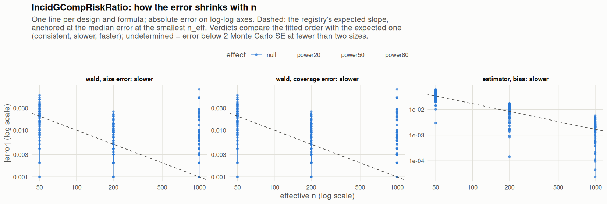

[← Campaign 2026-11-11-9d2edc5c summary](README.md)

# Class IncidGCompRiskRatio

Part of the [Classes index](classes.md). Response type: incidence. Status: null effect in progress, power effects not started. Verdict: **pass so far**.

<picture><source media="(prefers-color-scheme: dark)" srcset="figures/class-IncidGCompRiskRatio-dark.png"></picture>

Convergence verdicts (worst over designs, formulas and effects; provisional until the class is complete):

| procedure | metric | verdict |
|---|---|---|
| estimator (bias) | bias | slower |
| wald | coverage | slower |
| wald | size | slower |

Null effect: 198 cells (0 failing). Size, coverage and bias / SD against the level each is held to.

| design | n | formula | procedure | size | coverage | bias / SD | size level | coverage level | verdict |
|---|---|---|---|---|---|---|---|---|---|
| Fixed:Bernoulli | 50 | `~.` | wald | 0.079 | 0.921 | 0.08 | 0.1 | 0.9 | ok |
| Fixed:Bernoulli | 200 | `~.` | wald | 0.044 | 0.956 | 0.088 | 0.0625 | 0.938 | ok |
| Fixed:Bernoulli | 1000 | `~.` | wald | 0.045 | 0.955 | -0.0038 | 0.0525 | 0.948 | ok |
| Fixed:Bernoulli | 50 | `~1` | wald | 0.037 | 0.963 | 0.074 | 0.1 | 0.9 | ok |
| Fixed:Bernoulli | 200 | `~1` | wald | 0.04 | 0.96 | 0.079 | 0.0625 | 0.938 | ok |
| Fixed:Bernoulli | 1000 | `~1` | wald | 0.041 | 0.959 | 0.024 | 0.0525 | 0.948 | ok |
| Fixed:Bernoulli@0.2 | 50 | `~.` | wald | 0.096 | 0.904 | 0.056 | 0.1 | 0.9 | ok |
| Fixed:Bernoulli@0.2 | 200 | `~.` | wald | 0.055 | 0.945 | 0.046 | 0.0625 | 0.938 | ok |
| Fixed:Bernoulli@0.2 | 1000 | `~.` | wald | 0.046 | 0.954 | -0.031 | 0.0525 | 0.948 | ok |
| Fixed:Bernoulli@0.2 | 50 | `~1` | wald | 0.06 | 0.94 | 0.057 | 0.1 | 0.9 | ok |
| Fixed:Bernoulli@0.2 | 200 | `~1` | wald | 0.043 | 0.957 | 0.061 | 0.0625 | 0.938 | ok |
| Fixed:Bernoulli@0.2 | 1000 | `~1` | wald | 0.051 | 0.949 | 0.0003 | 0.0525 | 0.948 | ok |
| Fixed:BinaryMatch | 50 | `~.` | wald | 0.055 | 0.945 | 0.14 | 0.1 | 0.9 | ok |
| Fixed:BinaryMatch | 200 | `~.` | wald | 0.06 | 0.94 | 0.013 | 0.0625 | 0.938 | ok |
| Fixed:BinaryMatch | 1000 | `~.` | wald | 0.0599 | 0.94 | 0.039 | 0.05 | 0.95 | ok |
| Fixed:BinaryMatch | 50 | `~1` | wald | 0.017 | 0.983 | 0.14 | 0.1 | 0.9 | ok |
| Fixed:BinaryMatch | 200 | `~1` | wald | 0.036 | 0.964 | 0.01 | 0.0625 | 0.938 | ok |
| Fixed:BinaryMatch | 1000 | `~1` | wald | 0.0331 | 0.967 | 0.036 | 0.0525 | 0.948 | ok |
| Fixed:Blocking | 50 | `~.` | wald | 0.079 | 0.921 | 0.15 | 0.1 | 0.9 | ok |
| Fixed:Blocking | 200 | `~.` | wald | 0.04 | 0.96 | 0.098 | 0.0625 | 0.938 | ok |
| Fixed:Blocking | 1000 | `~.` | wald | 0.05 | 0.95 | 0.054 | 0.0525 | 0.948 | ok |
| Fixed:Blocking | 50 | `~1` | wald | 0.036 | 0.964 | 0.14 | 0.1 | 0.9 | ok |
| Fixed:Blocking | 200 | `~1` | wald | 0.033 | 0.967 | 0.093 | 0.0625 | 0.938 | ok |
| Fixed:Blocking | 1000 | `~1` | wald | 0.049 | 0.951 | 0.056 | 0.0525 | 0.948 | ok |
| Fixed:Blocking@0.2 | 50 | `~.` | wald | 0.084 | 0.916 | 0.028 | 0.1 | 0.9 | ok |
| Fixed:Blocking@0.2 | 200 | `~.` | wald | 0.062 | 0.938 | 0.054 | 0.0625 | 0.938 | ok |
| Fixed:Blocking@0.2 | 1000 | `~.` | wald | 0.05 | 0.95 | 0.042 | 0.0525 | 0.948 | ok |
| Fixed:Blocking@0.2 | 50 | `~1` | wald | 0.05 | 0.95 | 0.0077 | 0.1 | 0.9 | ok |
| Fixed:Blocking@0.2 | 200 | `~1` | wald | 0.048 | 0.952 | 0.04 | 0.0625 | 0.938 | ok |
| Fixed:Blocking@0.2 | 1000 | `~1` | wald | 0.052 | 0.948 | 0.054 | 0.0525 | 0.948 | ok |
| Fixed:Greedy | 50 | `~.` | wald | 0.071 | 0.929 | 0.13 | 0.1 | 0.9 | ok |
| Fixed:Greedy | 200 | `~.` | wald | 0.0556 | 0.944 | 0.12 | 0.0625 | 0.938 | ok |
| Fixed:Greedy | 1000 | `~.` | wald | 0.125 | 0.875 | 0.065 | 0.0525 | 0.948 | ok |
| Fixed:Greedy | 50 | `~1` | wald | 0.025 | 0.975 | 0.13 | 0.1 | 0.9 | ok |
| Fixed:Greedy | 200 | `~1` | wald | 0.0407 | 0.959 | 0.11 | 0.0625 | 0.938 | ok |
| Fixed:Greedy | 1000 | `~1` | wald | 0 | 1 | 0.041 | 0.0525 | 0.948 | ok |
| Fixed:Greedy@0.2 | 50 | `~.` | wald | 0.096 | 0.904 | 0.081 | 0.1 | 0.9 | ok |
| Fixed:Greedy@0.2 | 200 | `~.` | wald | 0.07 | 0.93 | 0.018 | 0.0625 | 0.938 | ok |
| Fixed:Greedy@0.2 | 1000 | `~.` | wald | 0.052 | 0.948 | -0.028 | 0.0525 | 0.948 | ok |
| Fixed:Greedy@0.2 | 50 | `~1` | wald | 0.049 | 0.951 | 0.078 | 0.1 | 0.9 | ok |
| Fixed:Greedy@0.2 | 200 | `~1` | wald | 0.041 | 0.959 | 0.01 | 0.0625 | 0.938 | ok |
| Fixed:Greedy@0.2 | 1000 | `~1` | wald | 0.026 | 0.974 | -0.029 | 0.0525 | 0.948 | ok |
| Fixed:GreedyDOptimal | 50 | `~.` | wald | 0.071 | 0.929 | 0.13 | 0.1 | 0.9 | ok |
| Fixed:GreedyDOptimal | 200 | `~.` | wald | 0.054 | 0.946 | 0.11 | 0.0625 | 0.938 | ok |
| Fixed:GreedyDOptimal | 1000 | `~.` | wald | 0.0542 | 0.946 | 0.0091 | 0.0525 | 0.948 | ok |
| Fixed:GreedyDOptimal | 50 | `~1` | wald | 0.025 | 0.975 | 0.13 | 0.1 | 0.9 | ok |
| Fixed:GreedyDOptimal | 200 | `~1` | wald | 0.037 | 0.963 | 0.1 | 0.0625 | 0.938 | ok |
| Fixed:GreedyDOptimal | 1000 | `~1` | wald | 0.0336 | 0.966 | 0.0099 | 0.0525 | 0.948 | ok |
| Fixed:GreedyDOptimal@0.2 | 50 | `~.` | wald | 0.096 | 0.904 | 0.081 | 0.1 | 0.9 | ok |
| Fixed:GreedyDOptimal@0.2 | 200 | `~.` | wald | 0.07 | 0.93 | 0.018 | 0.0625 | 0.938 | ok |
| Fixed:GreedyDOptimal@0.2 | 1000 | `~.` | wald | 0.052 | 0.948 | -0.028 | 0.0525 | 0.948 | ok |
| Fixed:GreedyDOptimal@0.2 | 50 | `~1` | wald | 0.049 | 0.951 | 0.078 | 0.1 | 0.9 | ok |
| Fixed:GreedyDOptimal@0.2 | 200 | `~1` | wald | 0.041 | 0.959 | 0.01 | 0.0625 | 0.938 | ok |
| Fixed:GreedyDOptimal@0.2 | 1000 | `~1` | wald | 0.026 | 0.974 | -0.029 | 0.0525 | 0.948 | ok |
| Fixed:iBCRD | 50 | `~.` | wald | 0.072 | 0.928 | 0.14 | 0.1 | 0.9 | ok |
| Fixed:iBCRD | 200 | `~.` | wald | 0.049 | 0.951 | 0.028 | 0.0625 | 0.938 | ok |
| Fixed:iBCRD | 1000 | `~.` | wald | 0.051 | 0.949 | 0.072 | 0.0525 | 0.948 | ok |
| Fixed:iBCRD | 50 | `~1` | wald | 0.041 | 0.959 | 0.14 | 0.1 | 0.9 | ok |
| Fixed:iBCRD | 200 | `~1` | wald | 0.038 | 0.962 | 0.032 | 0.0625 | 0.938 | ok |
| Fixed:iBCRD | 1000 | `~1` | wald | 0.042 | 0.958 | 0.074 | 0.0525 | 0.948 | ok |
| Fixed:iBCRD@0.2 | 50 | `~.` | wald | 0.087 | 0.913 | 0.069 | 0.1 | 0.9 | ok |
| Fixed:iBCRD@0.2 | 200 | `~.` | wald | 0.053 | 0.947 | 0.04 | 0.0625 | 0.938 | ok |
| Fixed:iBCRD@0.2 | 1000 | `~.` | wald | 0.054 | 0.946 | 0.036 | 0.0525 | 0.948 | ok |
| Fixed:iBCRD@0.2 | 50 | `~1` | wald | 0.048 | 0.952 | 0.085 | 0.1 | 0.9 | ok |
| Fixed:iBCRD@0.2 | 200 | `~1` | wald | 0.05 | 0.95 | 0.049 | 0.0625 | 0.938 | ok |
| Fixed:iBCRD@0.2 | 1000 | `~1` | wald | 0.059 | 0.941 | 0.036 | 0.0525 | 0.948 | ok |
| Fixed:MatchingGreedyPairSwitching | 50 | `~.` | wald | 0.056 | 0.944 | 0.15 | 0.1 | 0.9 | ok |
| Fixed:MatchingGreedyPairSwitching | 200 | `~.` | wald | 0.06 | 0.94 | 0.075 | 0.0625 | 0.938 | ok |
| Fixed:MatchingGreedyPairSwitching | 1000 | `~.` | wald | 0.043 | 0.957 | 0.022 | 0.0525 | 0.948 | ok |
| Fixed:MatchingGreedyPairSwitching | 50 | `~1` | wald | 0.014 | 0.986 | 0.14 | 0.1 | 0.9 | ok |
| Fixed:MatchingGreedyPairSwitching | 200 | `~1` | wald | 0.036 | 0.964 | 0.075 | 0.0625 | 0.938 | ok |
| Fixed:MatchingGreedyPairSwitching | 1000 | `~1` | wald | 0.022 | 0.978 | 0.022 | 0.0525 | 0.948 | ok |
| Fixed:Optimal | 50 | `~.` | wald | 0.082 | 0.918 | 0.12 | 0.1 | 0.9 | ok |
| Fixed:Optimal | 200 | `~.` | wald | 0.063 | 0.937 | 0.007 | 0.0625 | 0.938 | ok |
| Fixed:Optimal | 1000 | `~.` | wald | 0.059 | 0.941 | 0.015 | 0.05 | 0.95 | ok |
| Fixed:Optimal | 50 | `~1` | wald | 0.03 | 0.97 | 0.11 | 0.1 | 0.9 | ok |
| Fixed:Optimal | 200 | `~1` | wald | 0.025 | 0.975 | 0.012 | 0.0625 | 0.938 | ok |
| Fixed:Optimal | 1000 | `~1` | wald | 0.03 | 0.97 | 0.013 | 0.0525 | 0.948 | ok |
| Fixed:Optimal@0.2 | 50 | `~.` | wald | 0.073 | 0.927 | 0.1 | 0.1 | 0.9 | ok |
| Fixed:Optimal@0.2 | 200 | `~.` | wald | 0.064 | 0.936 | 0.03 | 0.0625 | 0.938 | ok |
| Fixed:Optimal@0.2 | 1000 | `~.` | wald | 0.06 | 0.94 | 0.048 | 0.05 | 0.95 | ok |
| Fixed:Optimal@0.2 | 50 | `~1` | wald | 0.035 | 0.965 | 0.11 | 0.1 | 0.9 | ok |
| Fixed:Optimal@0.2 | 200 | `~1` | wald | 0.038 | 0.962 | 0.027 | 0.0625 | 0.938 | ok |
| Fixed:Optimal@0.2 | 1000 | `~1` | wald | 0.031 | 0.969 | 0.047 | 0.0525 | 0.948 | ok |
| Fixed:OptimalBlocks | 50 | `~.` | wald | 0.065 | 0.935 | 0.13 | 0.1 | 0.9 | ok |
| Fixed:OptimalBlocks | 200 | `~.` | wald | 0.048 | 0.952 | 0.081 | 0.0625 | 0.938 | ok |
| Fixed:OptimalBlocks | 1000 | `~.` | wald | 0.046 | 0.954 | 0.047 | 0.0525 | 0.948 | ok |
| Fixed:OptimalBlocks | 50 | `~1` | wald | 0.034 | 0.966 | 0.14 | 0.1 | 0.9 | ok |
| Fixed:OptimalBlocks | 200 | `~1` | wald | 0.028 | 0.972 | 0.089 | 0.0625 | 0.938 | ok |
| Fixed:OptimalBlocks | 1000 | `~1` | wald | 0.025 | 0.975 | 0.035 | 0.0525 | 0.948 | ok |
| Fixed:OptimalBlocks@0.2 | 50 | `~.` | wald | 0.085 | 0.915 | 0.061 | 0.1 | 0.9 | ok |
| Fixed:OptimalBlocks@0.2 | 200 | `~.` | wald | 0.057 | 0.943 | 0.0094 | 0.0625 | 0.938 | ok |
| Fixed:OptimalBlocks@0.2 | 1000 | `~.` | wald | 0.041 | 0.959 | 0.032 | 0.0525 | 0.948 | ok |
| Fixed:OptimalBlocks@0.2 | 50 | `~1` | wald | 0.046 | 0.954 | 0.04 | 0.1 | 0.9 | ok |
| Fixed:OptimalBlocks@0.2 | 200 | `~1` | wald | 0.04 | 0.96 | 0.013 | 0.0625 | 0.938 | ok |
| Fixed:OptimalBlocks@0.2 | 1000 | `~1` | wald | 0.023 | 0.977 | 0.031 | 0.0525 | 0.948 | ok |
| Fixed:Rerandomization | 50 | `~.` | wald | 0.086 | 0.914 | 0.11 | 0.1 | 0.9 | ok |
| Fixed:Rerandomization | 200 | `~.` | wald | 0.052 | 0.948 | 0.096 | 0.0625 | 0.938 | ok |
| Fixed:Rerandomization | 1000 | `~.` | wald | 0.053 | 0.947 | 0.0088 | 0.0525 | 0.948 | ok |
| Fixed:Rerandomization | 50 | `~1` | wald | 0.048 | 0.952 | 0.098 | 0.1 | 0.9 | ok |
| Fixed:Rerandomization | 200 | `~1` | wald | 0.043 | 0.957 | 0.091 | 0.0625 | 0.938 | ok |
| Fixed:Rerandomization | 1000 | `~1` | wald | 0.05 | 0.95 | 0.016 | 0.0525 | 0.948 | ok |
| Fixed:Rerandomization@0.2 | 50 | `~.` | wald | 0.078 | 0.922 | 0.062 | 0.1 | 0.9 | ok |
| Fixed:Rerandomization@0.2 | 200 | `~.` | wald | 0.058 | 0.942 | 0.041 | 0.0625 | 0.938 | ok |
| Fixed:Rerandomization@0.2 | 1000 | `~.` | wald | 0.053 | 0.947 | -0.078 | 0.0525 | 0.948 | ok |
| Fixed:Rerandomization@0.2 | 50 | `~1` | wald | 0.046 | 0.954 | 0.04 | 0.1 | 0.9 | ok |
| Fixed:Rerandomization@0.2 | 200 | `~1` | wald | 0.052 | 0.948 | 0.066 | 0.0625 | 0.938 | ok |
| Fixed:Rerandomization@0.2 | 1000 | `~1` | wald | 0.048 | 0.952 | -0.061 | 0.0525 | 0.948 | ok |
| SeqOneByOne:Atkinson | 50 | `~.` | wald | 0.07 | 0.93 | 0.11 | 0.1 | 0.9 | ok |
| SeqOneByOne:Atkinson | 200 | `~.` | wald | 0.0594 | 0.941 | 0.093 | 0.0625 | 0.938 | ok |
| SeqOneByOne:Atkinson | 1000 | `~.` | wald | 0.0278 | 0.972 | 0.092 | 0.0525 | 0.948 | ok |
| SeqOneByOne:Atkinson | 50 | `~1` | wald | 0.023 | 0.977 | 0.11 | 0.1 | 0.9 | ok |
| SeqOneByOne:Atkinson | 200 | `~1` | wald | 0.0324 | 0.968 | 0.09 | 0.0625 | 0.938 | ok |
| SeqOneByOne:Atkinson | 1000 | `~1` | wald | 0 | 1 | 0.084 | 0.0525 | 0.948 | ok |
| SeqOneByOne:Bernoulli | 50 | `~.` | wald | 0.06 | 0.94 | 0.14 | 0.1 | 0.9 | ok |
| SeqOneByOne:Bernoulli | 200 | `~.` | wald | 0.046 | 0.954 | 0.11 | 0.0625 | 0.938 | ok |
| SeqOneByOne:Bernoulli | 1000 | `~.` | wald | 0.058 | 0.942 | 0.069 | 0.0525 | 0.948 | ok |
| SeqOneByOne:Bernoulli | 50 | `~1` | wald | 0.034 | 0.966 | 0.19 | 0.1 | 0.9 | ok |
| SeqOneByOne:Bernoulli | 200 | `~1` | wald | 0.039 | 0.961 | 0.12 | 0.0625 | 0.938 | ok |
| SeqOneByOne:Bernoulli | 1000 | `~1` | wald | 0.05 | 0.95 | 0.037 | 0.0525 | 0.948 | ok |
| SeqOneByOne:Bernoulli@0.2 | 50 | `~.` | wald | 0.09 | 0.91 | 0.054 | 0.1 | 0.9 | ok |
| SeqOneByOne:Bernoulli@0.2 | 200 | `~.` | wald | 0.059 | 0.941 | 0.03 | 0.0625 | 0.938 | ok |
| SeqOneByOne:Bernoulli@0.2 | 1000 | `~.` | wald | 0.043 | 0.957 | 0.027 | 0.0525 | 0.948 | ok |
| SeqOneByOne:Bernoulli@0.2 | 50 | `~1` | wald | 0.058 | 0.942 | 0.063 | 0.1 | 0.9 | ok |
| SeqOneByOne:Bernoulli@0.2 | 200 | `~1` | wald | 0.055 | 0.945 | 0.038 | 0.0625 | 0.938 | ok |
| SeqOneByOne:Bernoulli@0.2 | 1000 | `~1` | wald | 0.047 | 0.953 | 0.0012 | 0.0525 | 0.948 | ok |
| SeqOneByOne:Efron | 50 | `~.` | wald | 0.08 | 0.92 | 0.16 | 0.1 | 0.9 | ok |
| SeqOneByOne:Efron | 200 | `~.` | wald | 0.053 | 0.947 | 0.1 | 0.0625 | 0.938 | ok |
| SeqOneByOne:Efron | 1000 | `~.` | wald | 0.056 | 0.944 | 0.01 | 0.0525 | 0.948 | ok |
| SeqOneByOne:Efron | 50 | `~1` | wald | 0.043 | 0.957 | 0.18 | 0.1 | 0.9 | ok |
| SeqOneByOne:Efron | 200 | `~1` | wald | 0.048 | 0.952 | 0.083 | 0.0625 | 0.938 | ok |
| SeqOneByOne:Efron | 1000 | `~1` | wald | 0.044 | 0.956 | -0.0076 | 0.0525 | 0.948 | ok |
| SeqOneByOne:iBCRD | 50 | `~.` | wald | 0.059 | 0.941 | 0.14 | 0.1 | 0.9 | ok |
| SeqOneByOne:iBCRD | 200 | `~.` | wald | 0.059 | 0.941 | 0.07 | 0.0625 | 0.938 | ok |
| SeqOneByOne:iBCRD | 1000 | `~.` | wald | 0.056 | 0.944 | 0.029 | 0.05 | 0.95 | ok |
| SeqOneByOne:iBCRD | 50 | `~1` | wald | 0.029 | 0.971 | 0.17 | 0.1 | 0.9 | ok |
| SeqOneByOne:iBCRD | 200 | `~1` | wald | 0.058 | 0.942 | 0.081 | 0.0625 | 0.938 | ok |
| SeqOneByOne:iBCRD | 1000 | `~1` | wald | 0.043 | 0.957 | 0.036 | 0.0525 | 0.948 | ok |
| SeqOneByOne:iBCRD@0.2 | 50 | `~.` | wald | 0.1 | 0.9 | 0.063 | 0.1 | 0.9 | ok |
| SeqOneByOne:iBCRD@0.2 | 200 | `~.` | wald | 0.052 | 0.948 | 0.035 | 0.0625 | 0.938 | ok |
| SeqOneByOne:iBCRD@0.2 | 1000 | `~.` | wald | 0.044 | 0.956 | 0.025 | 0.0525 | 0.948 | ok |
| SeqOneByOne:iBCRD@0.2 | 50 | `~1` | wald | 0.062 | 0.938 | 0.076 | 0.1 | 0.9 | ok |
| SeqOneByOne:iBCRD@0.2 | 200 | `~1` | wald | 0.051 | 0.949 | 0.054 | 0.0625 | 0.938 | ok |
| SeqOneByOne:iBCRD@0.2 | 1000 | `~1` | wald | 0.049 | 0.951 | -0.00058 | 0.0525 | 0.948 | ok |
| SeqOneByOne:KK14 | 50 | `~.` | wald | 0.07 | 0.93 | 0.095 | 0.1 | 0.9 | ok |
| SeqOneByOne:KK14 | 200 | `~.` | wald | 0.055 | 0.945 | 0.11 | 0.0625 | 0.938 | ok |
| SeqOneByOne:KK14 | 1000 | `~.` | wald | 0.05 | 0.95 | -0.0067 | 0.0525 | 0.948 | ok |
| SeqOneByOne:KK14 | 50 | `~1` | wald | 0.029 | 0.971 | 0.12 | 0.1 | 0.9 | ok |
| SeqOneByOne:KK14 | 200 | `~1` | wald | 0.041 | 0.959 | 0.1 | 0.0625 | 0.938 | ok |
| SeqOneByOne:KK14 | 1000 | `~1` | wald | 0.037 | 0.963 | -0.0031 | 0.0525 | 0.948 | ok |
| SeqOneByOne:KK21 | 50 | `~.` | wald | 0.065 | 0.935 | 0.15 | 0.1 | 0.9 | ok |
| SeqOneByOne:KK21 | 200 | `~.` | wald | 0.051 | 0.949 | 0.082 | 0.0625 | 0.938 | ok |
| SeqOneByOne:KK21 | 1000 | `~.` | wald | 0.058 | 0.942 | 0.026 | 0.0525 | 0.948 | ok |
| SeqOneByOne:KK21 | 50 | `~1` | wald | 0.025 | 0.975 | 0.16 | 0.1 | 0.9 | ok |
| SeqOneByOne:KK21 | 200 | `~1` | wald | 0.028 | 0.972 | 0.082 | 0.0625 | 0.938 | ok |
| SeqOneByOne:KK21 | 1000 | `~1` | wald | 0.042 | 0.958 | 0.035 | 0.0525 | 0.948 | ok |
| SeqOneByOne:KK21stepwise | 50 | `~.` | wald | 0.068 | 0.932 | 0.073 | 0.1 | 0.9 | ok |
| SeqOneByOne:KK21stepwise | 200 | `~.` | wald | 0.0534 | 0.947 | 0.13 | 0.0625 | 0.938 | ok |
| SeqOneByOne:KK21stepwise | 1000 | `~.` | wald | 0.0532 | 0.947 | -0.0087 | 0.0525 | 0.948 | ok |
| SeqOneByOne:KK21stepwise | 50 | `~1` | wald | 0.035 | 0.965 | 0.096 | 0.1 | 0.9 | ok |
| SeqOneByOne:KK21stepwise | 200 | `~1` | wald | 0.0333 | 0.967 | 0.12 | 0.0625 | 0.938 | ok |
| SeqOneByOne:KK21stepwise | 1000 | `~1` | wald | 0.0306 | 0.969 | 0.0019 | 0.0525 | 0.948 | ok |
| SeqOneByOne:PocockSimon | 50 | `~.` | wald | 0.069 | 0.931 | 0.17 | 0.1 | 0.9 | ok |
| SeqOneByOne:PocockSimon | 200 | `~.` | wald | 0.055 | 0.945 | 0.086 | 0.0625 | 0.938 | ok |
| SeqOneByOne:PocockSimon | 1000 | `~.` | wald | 0.047 | 0.953 | 0.047 | 0.0525 | 0.948 | ok |
| SeqOneByOne:PocockSimon | 50 | `~1` | wald | 0.042 | 0.958 | 0.18 | 0.1 | 0.9 | ok |
| SeqOneByOne:PocockSimon | 200 | `~1` | wald | 0.046 | 0.954 | 0.082 | 0.0625 | 0.938 | ok |
| SeqOneByOne:PocockSimon | 1000 | `~1` | wald | 0.047 | 0.953 | 0.064 | 0.0525 | 0.948 | ok |
| SeqOneByOne:RandomBlockSize | 50 | `~.` | wald | 0.073 | 0.927 | 0.11 | 0.1 | 0.9 | ok |
| SeqOneByOne:RandomBlockSize | 200 | `~.` | wald | 0.039 | 0.961 | 0.034 | 0.0625 | 0.938 | ok |
| SeqOneByOne:RandomBlockSize | 1000 | `~.` | wald | 0.048 | 0.952 | 0.026 | 0.0525 | 0.948 | ok |
| SeqOneByOne:RandomBlockSize | 50 | `~1` | wald | 0.027 | 0.973 | 0.11 | 0.1 | 0.9 | ok |
| SeqOneByOne:RandomBlockSize | 200 | `~1` | wald | 0.034 | 0.966 | 0.036 | 0.0625 | 0.938 | ok |
| SeqOneByOne:RandomBlockSize | 1000 | `~1` | wald | 0.045 | 0.955 | 0.031 | 0.0525 | 0.948 | ok |
| SeqOneByOne:RandomBlockSize@0.2 | 50 | `~.` | wald | 0.075 | 0.925 | 0.058 | 0.1 | 0.9 | ok |
| SeqOneByOne:RandomBlockSize@0.2 | 200 | `~.` | wald | 0.053 | 0.947 | 0.068 | 0.0625 | 0.938 | ok |
| SeqOneByOne:RandomBlockSize@0.2 | 1000 | `~.` | wald | 0.057 | 0.943 | 0.035 | 0.0525 | 0.948 | ok |
| SeqOneByOne:RandomBlockSize@0.2 | 50 | `~1` | wald | 0.037 | 0.963 | 0.082 | 0.1 | 0.9 | ok |
| SeqOneByOne:RandomBlockSize@0.2 | 200 | `~1` | wald | 0.045 | 0.955 | 0.077 | 0.0625 | 0.938 | ok |
| SeqOneByOne:RandomBlockSize@0.2 | 1000 | `~1` | wald | 0.051 | 0.949 | 0.03 | 0.0525 | 0.948 | ok |
| SeqOneByOne:SPBR | 50 | `~.` | wald | 0.075 | 0.925 | 0.1 | 0.1 | 0.9 | ok |
| SeqOneByOne:SPBR | 200 | `~.` | wald | 0.054 | 0.946 | -0.0065 | 0.0625 | 0.938 | ok |
| SeqOneByOne:SPBR | 1000 | `~.` | wald | 0.047 | 0.953 | 0.024 | 0.0525 | 0.948 | ok |
| SeqOneByOne:SPBR | 50 | `~1` | wald | 0.039 | 0.961 | 0.12 | 0.1 | 0.9 | ok |
| SeqOneByOne:SPBR | 200 | `~1` | wald | 0.036 | 0.964 | -0.001 | 0.0625 | 0.938 | ok |
| SeqOneByOne:SPBR | 1000 | `~1` | wald | 0.043 | 0.957 | 0.035 | 0.0525 | 0.948 | ok |
| SeqOneByOne:SPBR@0.2 | 50 | `~.` | wald | 0.106 | 0.894 | 0.069 | 0.1 | 0.9 | ok |
| SeqOneByOne:SPBR@0.2 | 200 | `~.` | wald | 0.063 | 0.937 | 0.061 | 0.0625 | 0.938 | ok |
| SeqOneByOne:SPBR@0.2 | 1000 | `~.` | wald | 0.05 | 0.95 | 0.0078 | 0.0525 | 0.948 | ok |
| SeqOneByOne:SPBR@0.2 | 50 | `~1` | wald | 0.06 | 0.94 | 0.082 | 0.1 | 0.9 | ok |
| SeqOneByOne:SPBR@0.2 | 200 | `~1` | wald | 0.053 | 0.947 | 0.086 | 0.0625 | 0.938 | ok |
| SeqOneByOne:SPBR@0.2 | 1000 | `~1` | wald | 0.05 | 0.95 | 0.025 | 0.0525 | 0.948 | ok |
| SeqOneByOne:Urn | 50 | `~.` | wald | 0.0586 | 0.941 | 0.14 | 0.1 | 0.9 | ok |
| SeqOneByOne:Urn | 200 | `~.` | wald | 0.044 | 0.956 | 0.06 | 0.0625 | 0.938 | ok |
| SeqOneByOne:Urn | 1000 | `~.` | wald | 0.0417 | 0.958 | 0.081 | 0.0525 | 0.948 | ok |
| SeqOneByOne:Urn | 50 | `~1` | wald | 0.0421 | 0.958 | 0.14 | 0.1 | 0.9 | ok |
| SeqOneByOne:Urn | 200 | `~1` | wald | 0.0427 | 0.957 | 0.063 | 0.0625 | 0.938 | ok |
| SeqOneByOne:Urn | 1000 | `~1` | wald | 0 | 1 | -0.12 | 0.0525 | 0.948 | ok |

[← Campaign 2026-11-11-9d2edc5c summary](README.md)
