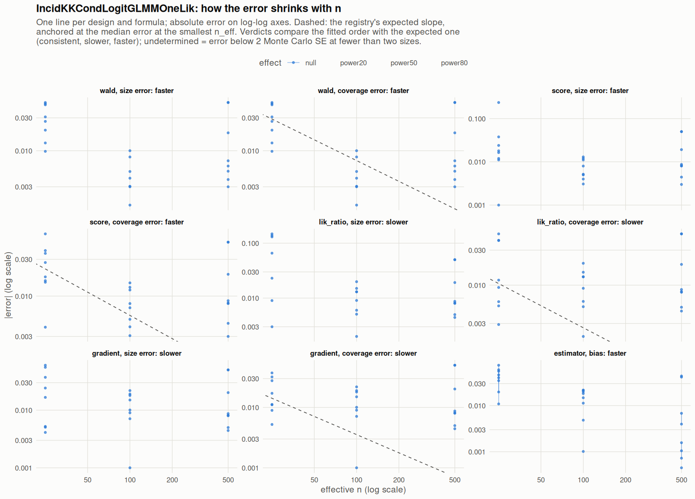

[← Campaign 2026-11-11-9d2edc5c summary](README.md)

# Class IncidKKCondLogitGLMMOneLik

Part of the [Classes index](classes.md). Response type: incidence. Status: null effect in progress, power effects not started. Verdict: **pending confirmation** (10 flagged test(s): 0 failing, 10 pending, 0 cleared).

<picture><source media="(prefers-color-scheme: dark)" srcset="figures/class-IncidKKCondLogitGLMMOneLik-dark.png"></picture>

Convergence verdicts (worst over designs, formulas and effects; provisional until the class is complete):

| procedure | metric | verdict |
|---|---|---|
| estimator (bias) | bias | faster |
| gradient | coverage | slower |
| lik_ratio | coverage | slower |
| score | coverage | faster |
| wald | coverage | faster |
| gradient | size | slower |
| lik_ratio | size | slower |
| score | size | faster |
| wald | size | faster |

Null effect: 96 cells (7 failing). Size, coverage and bias / SD against the level each is held to.

| design | n | formula | procedure | size | coverage | bias / SD | size level | coverage level | verdict |
|---|---|---|---|---|---|---|---|---|---|
| Fixed:BinaryMatch | 50 | `~.` | gradient | 0.0667 | 0.978 | 0.002 | 0.1 | 0.9 | ok |
| Fixed:BinaryMatch | 200 | `~.` | gradient | 0.069 | 0.931 | -0.057 | 0.075 | 0.925 | ok |
| Fixed:BinaryMatch | 1000 | `~.` | gradient | 0.0702 | 0.93 | 0.007 | 0.05 | 0.945 | **FAIL** |
| Fixed:BinaryMatch | 50 | `~.` | lik_ratio | 0.188 | 1 | 0.002 | 0.1 | 0.9 | **FAIL** |
| Fixed:BinaryMatch | 200 | `~.` | lik_ratio | 0.065 | 0.935 | -0.057 | 0.075 | 0.925 | ok |
| Fixed:BinaryMatch | 1000 | `~.` | lik_ratio | 0.0692 | 0.931 | 0.007 | 0.055 | 0.945 | **FAIL** |
| Fixed:BinaryMatch | 50 | `~.` | score | 0.286 | 0.886 | 0.002 | 0.1 | 0.9 | **FAIL** |
| Fixed:BinaryMatch | 200 | `~.` | score | 0.063 | 0.937 | -0.057 | 0.075 | 0.925 | ok |
| Fixed:BinaryMatch | 1000 | `~.` | score | 0.0692 | 0.931 | 0.007 | 0.055 | 0.945 | **FAIL** |
| Fixed:BinaryMatch | 50 | `~.` | wald | 0 | 1 | 0.002 | 0.1 | 0.9 | ok |
| Fixed:BinaryMatch | 200 | `~.` | wald | 0.054 | 0.946 | -0.057 | 0.075 | 0.925 | ok |
| Fixed:BinaryMatch | 1000 | `~.` | wald | 0.0682 | 0.932 | 0.007 | 0.055 | 0.945 | ok |
| Fixed:BinaryMatch | 50 | `~1` | gradient | 0.0552 | 0.945 | 0.033 | 0.1 | 0.9 | ok |
| Fixed:BinaryMatch | 200 | `~1` | gradient | 0.065 | 0.935 | -0.063 | 0.075 | 0.925 | ok |
| Fixed:BinaryMatch | 1000 | `~1` | gradient | 0.0581 | 0.942 | 0.0031 | 0.05 | 0.95 | ok |
| Fixed:BinaryMatch | 50 | `~1` | lik_ratio | 0.059 | 0.945 | 0.033 | 0.1 | 0.9 | ok |
| Fixed:BinaryMatch | 200 | `~1` | lik_ratio | 0.063 | 0.937 | -0.063 | 0.075 | 0.925 | ok |
| Fixed:BinaryMatch | 1000 | `~1` | lik_ratio | 0.0581 | 0.942 | 0.0031 | 0.05 | 0.95 | ok |
| Fixed:BinaryMatch | 50 | `~1` | score | 0.038 | 0.966 | 0.033 | 0.1 | 0.9 | ok |
| Fixed:BinaryMatch | 200 | `~1` | score | 0.058 | 0.942 | -0.063 | 0.075 | 0.925 | ok |
| Fixed:BinaryMatch | 1000 | `~1` | score | 0.0581 | 0.942 | 0.0031 | 0.055 | 0.945 | ok |
| Fixed:BinaryMatch | 50 | `~1` | wald | 0.0191 | 0.981 | 0.033 | 0.1 | 0.9 | ok |
| Fixed:BinaryMatch | 200 | `~1` | wald | 0.053 | 0.947 | -0.063 | 0.075 | 0.925 | ok |
| Fixed:BinaryMatch | 1000 | `~1` | wald | 0.0571 | 0.943 | 0.0031 | 0.055 | 0.945 | ok |
| SeqOneByOne:KK14 | 50 | `~.` | gradient | 0.105 | 0.918 | -0.047 | 0.1 | 0.9 | ok |
| SeqOneByOne:KK14 | 200 | `~.` | gradient | 0.068 | 0.932 | 0.041 | 0.075 | 0.925 | ok |
| SeqOneByOne:KK14 | 1000 | `~.` | gradient | 0 | 1 | -0.36 | 0.055 | 0.945 | ok |
| SeqOneByOne:KK14 | 50 | `~.` | lik_ratio | 0.116 | 0.962 | -0.047 | 0.1 | 0.9 | ok |
| SeqOneByOne:KK14 | 200 | `~.` | lik_ratio | 0.063 | 0.937 | 0.041 | 0.075 | 0.925 | ok |
| SeqOneByOne:KK14 | 1000 | `~.` | lik_ratio | 0 | 1 | -0.36 | 0.055 | 0.945 | ok |
| SeqOneByOne:KK14 | 50 | `~.` | score | 0.0122 | 0.968 | -0.047 | 0.1 | 0.9 | ok |
| SeqOneByOne:KK14 | 200 | `~.` | score | 0.0611 | 0.938 | 0.041 | 0.075 | 0.925 | ok |
| SeqOneByOne:KK14 | 1000 | `~.` | score | 0 | 1 | -0.36 | 0.055 | 0.945 | ok |
| SeqOneByOne:KK14 | 50 | `~.` | wald | 0.0234 | 0.977 | -0.047 | 0.1 | 0.9 | ok |
| SeqOneByOne:KK14 | 200 | `~.` | wald | 0.06 | 0.94 | 0.041 | 0.075 | 0.925 | ok |
| SeqOneByOne:KK14 | 1000 | `~.` | wald | 0 | 1 | -0.36 | 0.055 | 0.945 | ok |
| SeqOneByOne:KK14 | 50 | `~1` | gradient | 0.0551 | 0.939 | -0.038 | 0.1 | 0.9 | ok |
| SeqOneByOne:KK14 | 200 | `~1` | gradient | 0.059 | 0.941 | 0.037 | 0.075 | 0.925 | ok |
| SeqOneByOne:KK14 | 1000 | `~1` | gradient | 0 | 1 | -0.39 | 0.055 | 0.945 | ok |
| SeqOneByOne:KK14 | 50 | `~1` | lik_ratio | 0.047 | 0.956 | -0.038 | 0.1 | 0.9 | ok |
| SeqOneByOne:KK14 | 200 | `~1` | lik_ratio | 0.056 | 0.944 | 0.037 | 0.075 | 0.925 | ok |
| SeqOneByOne:KK14 | 1000 | `~1` | lik_ratio | 0 | 1 | -0.39 | 0.055 | 0.945 | ok |
| SeqOneByOne:KK14 | 50 | `~1` | score | 0.049 | 0.954 | -0.038 | 0.1 | 0.9 | ok |
| SeqOneByOne:KK14 | 200 | `~1` | score | 0.054 | 0.946 | 0.037 | 0.075 | 0.925 | ok |
| SeqOneByOne:KK14 | 1000 | `~1` | score | 0 | 1 | -0.39 | 0.055 | 0.945 | ok |
| SeqOneByOne:KK14 | 50 | `~1` | wald | 0.037 | 0.963 | -0.038 | 0.1 | 0.9 | ok |
| SeqOneByOne:KK14 | 200 | `~1` | wald | 0.05 | 0.95 | 0.037 | 0.075 | 0.925 | ok |
| SeqOneByOne:KK14 | 1000 | `~1` | wald | 0 | 1 | -0.39 | 0.055 | 0.945 | ok |
| SeqOneByOne:KK21 | 50 | `~.` | gradient | 0.11 | 0.961 | 0.018 | 0.1 | 0.9 | ok |
| SeqOneByOne:KK21 | 200 | `~.` | gradient | 0.0601 | 0.94 | -0.0027 | 0.075 | 0.925 | ok |
| SeqOneByOne:KK21 | 1000 | `~.` | gradient | 0.055 | 0.945 | -0.011 | 0.055 | 0.945 | ok |
| SeqOneByOne:KK21 | 50 | `~.` | lik_ratio | 0.198 | 0.991 | 0.018 | 0.1 | 0.9 | **FAIL** |
| SeqOneByOne:KK21 | 200 | `~.` | lik_ratio | 0.0591 | 0.941 | -0.0027 | 0.075 | 0.925 | ok |
| SeqOneByOne:KK21 | 1000 | `~.` | lik_ratio | 0.055 | 0.945 | -0.011 | 0.055 | 0.945 | ok |
| SeqOneByOne:KK21 | 50 | `~.` | score | 0.0389 | 0.989 | 0.018 | 0.1 | 0.9 | ok |
| SeqOneByOne:KK21 | 200 | `~.` | score | 0.0552 | 0.943 | -0.0027 | 0.075 | 0.925 | ok |
| SeqOneByOne:KK21 | 1000 | `~.` | score | 0.053 | 0.947 | -0.011 | 0.055 | 0.945 | ok |
| SeqOneByOne:KK21 | 50 | `~.` | wald | 0.0019 | 0.998 | 0.018 | 0.1 | 0.9 | ok |
| SeqOneByOne:KK21 | 200 | `~.` | wald | 0.0531 | 0.947 | -0.0027 | 0.075 | 0.925 | ok |
| SeqOneByOne:KK21 | 1000 | `~.` | wald | 0.053 | 0.947 | -0.011 | 0.055 | 0.945 | ok |
| SeqOneByOne:KK21 | 50 | `~1` | gradient | 0.0541 | 0.933 | 0.035 | 0.1 | 0.9 | ok |
| SeqOneByOne:KK21 | 200 | `~1` | gradient | 0.049 | 0.951 | 0.016 | 0.075 | 0.925 | ok |
| SeqOneByOne:KK21 | 1000 | `~1` | gradient | 0.058 | 0.942 | 0.0052 | 0.055 | 0.945 | ok |
| SeqOneByOne:KK21 | 50 | `~1` | lik_ratio | 0.05 | 0.953 | 0.035 | 0.1 | 0.9 | ok |
| SeqOneByOne:KK21 | 200 | `~1` | lik_ratio | 0.048 | 0.952 | 0.016 | 0.075 | 0.925 | ok |
| SeqOneByOne:KK21 | 1000 | `~1` | lik_ratio | 0.058 | 0.942 | 0.0052 | 0.055 | 0.945 | ok |
| SeqOneByOne:KK21 | 50 | `~1` | score | 0.068 | 0.935 | 0.035 | 0.1 | 0.9 | ok |
| SeqOneByOne:KK21 | 200 | `~1` | score | 0.045 | 0.955 | 0.016 | 0.075 | 0.925 | ok |
| SeqOneByOne:KK21 | 1000 | `~1` | score | 0.058 | 0.942 | 0.0052 | 0.055 | 0.945 | ok |
| SeqOneByOne:KK21 | 50 | `~1` | wald | 0.0301 | 0.97 | 0.035 | 0.1 | 0.9 | ok |
| SeqOneByOne:KK21 | 200 | `~1` | wald | 0.045 | 0.955 | 0.016 | 0.075 | 0.925 | ok |
| SeqOneByOne:KK21 | 1000 | `~1` | wald | 0.056 | 0.944 | 0.0052 | 0.055 | 0.945 | ok |
| SeqOneByOne:KK21stepwise | 50 | `~.` | gradient | 0.0872 | 0.959 | 0.011 | 0.1 | 0.9 | ok |
| SeqOneByOne:KK21stepwise | 200 | `~.` | gradient | 0.0719 | 0.928 | 0.053 | 0.075 | 0.925 | ok |
| SeqOneByOne:KK21stepwise | 1000 | `~.` | gradient | 0.0587 | 0.941 | -0.046 | 0.05 | 0.945 | ok |
| SeqOneByOne:KK21stepwise | 50 | `~.` | lik_ratio | 0.18 | 0.991 | 0.011 | 0.1 | 0.9 | **FAIL** |
| SeqOneByOne:KK21stepwise | 200 | `~.` | lik_ratio | 0.0699 | 0.93 | 0.053 | 0.075 | 0.925 | ok |
| SeqOneByOne:KK21stepwise | 1000 | `~.` | lik_ratio | 0.0587 | 0.941 | -0.046 | 0.055 | 0.945 | ok |
| SeqOneByOne:KK21stepwise | 50 | `~.` | score | 0.0336 | 0.986 | 0.011 | 0.1 | 0.9 | ok |
| SeqOneByOne:KK21stepwise | 200 | `~.` | score | 0.062 | 0.935 | 0.053 | 0.075 | 0.925 | ok |
| SeqOneByOne:KK21stepwise | 1000 | `~.` | score | 0.0587 | 0.941 | -0.046 | 0.055 | 0.945 | ok |
| SeqOneByOne:KK21stepwise | 50 | `~.` | wald | 0.00369 | 0.996 | 0.011 | 0.1 | 0.9 | ok |
| SeqOneByOne:KK21stepwise | 200 | `~.` | wald | 0.0581 | 0.942 | 0.053 | 0.075 | 0.925 | ok |
| SeqOneByOne:KK21stepwise | 1000 | `~.` | wald | 0.055 | 0.945 | -0.046 | 0.055 | 0.945 | ok |
| SeqOneByOne:KK21stepwise | 50 | `~1` | gradient | 0.0742 | 0.913 | -0.015 | 0.1 | 0.9 | ok |
| SeqOneByOne:KK21stepwise | 200 | `~1` | gradient | 0.0571 | 0.943 | 0.057 | 0.075 | 0.925 | ok |
| SeqOneByOne:KK21stepwise | 1000 | `~1` | gradient | 0.0544 | 0.946 | -0.029 | 0.055 | 0.945 | ok |
| SeqOneByOne:KK21stepwise | 50 | `~1` | lik_ratio | 0.073 | 0.941 | -0.015 | 0.1 | 0.9 | ok |
| SeqOneByOne:KK21stepwise | 200 | `~1` | lik_ratio | 0.0551 | 0.945 | 0.057 | 0.075 | 0.925 | ok |
| SeqOneByOne:KK21stepwise | 1000 | `~1` | lik_ratio | 0.0544 | 0.946 | -0.029 | 0.055 | 0.945 | ok |
| SeqOneByOne:KK21stepwise | 50 | `~1` | score | 0.074 | 0.923 | -0.015 | 0.1 | 0.9 | ok |
| SeqOneByOne:KK21stepwise | 200 | `~1` | score | 0.0531 | 0.947 | 0.057 | 0.075 | 0.925 | ok |
| SeqOneByOne:KK21stepwise | 1000 | `~1` | score | 0.0544 | 0.946 | -0.029 | 0.055 | 0.945 | ok |
| SeqOneByOne:KK21stepwise | 50 | `~1` | wald | 0.0402 | 0.96 | -0.015 | 0.1 | 0.9 | ok |
| SeqOneByOne:KK21stepwise | 200 | `~1` | wald | 0.0484 | 0.952 | 0.057 | 0.075 | 0.925 | ok |
| SeqOneByOne:KK21stepwise | 1000 | `~1` | wald | 0.0538 | 0.946 | -0.029 | 0.055 | 0.945 | ok |

[← Campaign 2026-11-11-9d2edc5c summary](README.md)
