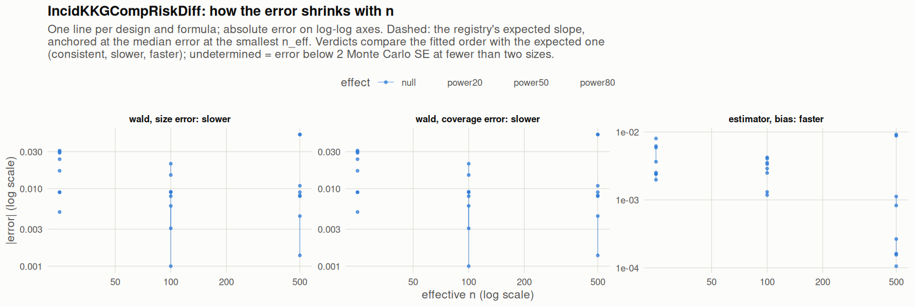

[← Campaign 2026-11-11-9d2edc5c summary](README.md)

# Class IncidKKGCompRiskDiff

Part of the [Classes index](classes.md). Response type: incidence. Status: null effect in progress, power effects not started. Verdict: **pass so far**.

<picture><source media="(prefers-color-scheme: dark)" srcset="figures/class-IncidKKGCompRiskDiff-dark.png"></picture>

Convergence verdicts (worst over designs, formulas and effects; provisional until the class is complete):

| procedure | metric | verdict |
|---|---|---|
| estimator (bias) | bias | faster |
| wald | coverage | slower |
| wald | size | slower |

Null effect: 24 cells (0 failing). Size, coverage and bias / SD against the level each is held to.

| design | n | formula | procedure | size | coverage | bias / SD | size level | coverage level | verdict |
|---|---|---|---|---|---|---|---|---|---|
| Fixed:BinaryMatch | 50 | `~.` | wald | 0.067 | 0.933 | 0.019 | 0.1 | 0.9 | ok |
| Fixed:BinaryMatch | 200 | `~.` | wald | 0.071 | 0.929 | -0.052 | 0.075 | 0.925 | ok |
| Fixed:BinaryMatch | 1000 | `~.` | wald | 0.0609 | 0.939 | 0.0089 | 0.05 | 0.95 | ok |
| Fixed:BinaryMatch | 50 | `~1` | wald | 0.059 | 0.941 | 0.02 | 0.1 | 0.9 | ok |
| Fixed:BinaryMatch | 200 | `~1` | wald | 0.065 | 0.935 | -0.054 | 0.075 | 0.925 | ok |
| Fixed:BinaryMatch | 1000 | `~1` | wald | 0.0581 | 0.942 | 0.0054 | 0.05 | 0.95 | ok |
| SeqOneByOne:KK14 | 50 | `~.` | wald | 0.079 | 0.921 | -0.044 | 0.1 | 0.9 | ok |
| SeqOneByOne:KK14 | 200 | `~.` | wald | 0.058 | 0.942 | 0.045 | 0.075 | 0.925 | ok |
| SeqOneByOne:KK14 | 1000 | `~.` | wald | 0 | 1 | -0.39 | 0.055 | 0.945 | ok |
| SeqOneByOne:KK14 | 50 | `~1` | wald | 0.055 | 0.945 | -0.026 | 0.1 | 0.9 | ok |
| SeqOneByOne:KK14 | 200 | `~1` | wald | 0.059 | 0.941 | 0.038 | 0.075 | 0.925 | ok |
| SeqOneByOne:KK14 | 1000 | `~1` | wald | 0 | 1 | -0.38 | 0.055 | 0.945 | ok |
| SeqOneByOne:KK21 | 50 | `~.` | wald | 0.08 | 0.92 | 0.015 | 0.1 | 0.9 | ok |
| SeqOneByOne:KK21 | 200 | `~.` | wald | 0.056 | 0.944 | 0.021 | 0.075 | 0.925 | ok |
| SeqOneByOne:KK21 | 1000 | `~.` | wald | 0.059 | 0.941 | -0.0036 | 0.055 | 0.945 | ok |
| SeqOneByOne:KK21 | 50 | `~1` | wald | 0.059 | 0.941 | 0.018 | 0.1 | 0.9 | ok |
| SeqOneByOne:KK21 | 200 | `~1` | wald | 0.049 | 0.951 | 0.018 | 0.075 | 0.925 | ok |
| SeqOneByOne:KK21 | 1000 | `~1` | wald | 0.058 | 0.942 | 0.0053 | 0.055 | 0.945 | ok |
| SeqOneByOne:KK21stepwise | 50 | `~.` | wald | 0.081 | 0.919 | -0.06 | 0.1 | 0.9 | ok |
| SeqOneByOne:KK21stepwise | 200 | `~.` | wald | 0.0591 | 0.941 | 0.064 | 0.075 | 0.925 | ok |
| SeqOneByOne:KK21stepwise | 1000 | `~.` | wald | 0.0514 | 0.949 | -0.039 | 0.055 | 0.945 | ok |
| SeqOneByOne:KK21stepwise | 50 | `~1` | wald | 0.074 | 0.926 | -0.045 | 0.1 | 0.9 | ok |
| SeqOneByOne:KK21stepwise | 200 | `~1` | wald | 0.0531 | 0.947 | 0.06 | 0.075 | 0.925 | ok |
| SeqOneByOne:KK21stepwise | 1000 | `~1` | wald | 0.0544 | 0.946 | -0.028 | 0.055 | 0.945 | ok |

[← Campaign 2026-11-11-9d2edc5c summary](README.md)
