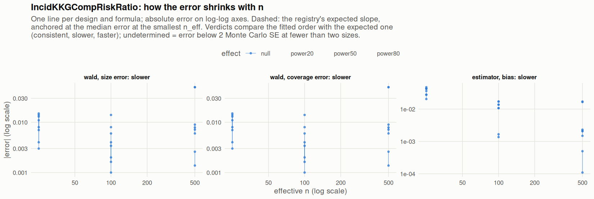

[← Campaign 2026-11-11-9d2edc5c summary](README.md)

# Class IncidKKGCompRiskRatio

Part of the [Classes index](classes.md). Response type: incidence. Status: null effect in progress, power effects not started. Verdict: **pass so far**.

<picture><source media="(prefers-color-scheme: dark)" srcset="figures/class-IncidKKGCompRiskRatio-dark.png"></picture>

Convergence verdicts (worst over designs, formulas and effects; provisional until the class is complete):

| procedure | metric | verdict |
|---|---|---|
| estimator (bias) | bias | slower |
| wald | coverage | slower |
| wald | size | slower |

Null effect: 24 cells (0 failing). Size, coverage and bias / SD against the level each is held to.

| design | n | formula | procedure | size | coverage | bias / SD | size level | coverage level | verdict |
|---|---|---|---|---|---|---|---|---|---|
| Fixed:BinaryMatch | 50 | `~.` | wald | 0.053 | 0.947 | 0.14 | 0.1 | 0.9 | ok |
| Fixed:BinaryMatch | 200 | `~.` | wald | 0.064 | 0.936 | 0.013 | 0.075 | 0.925 | ok |
| Fixed:BinaryMatch | 1000 | `~.` | wald | 0.0579 | 0.942 | 0.039 | 0.05 | 0.95 | ok |
| Fixed:BinaryMatch | 50 | `~1` | wald | 0.037 | 0.963 | 0.14 | 0.1 | 0.9 | ok |
| Fixed:BinaryMatch | 200 | `~1` | wald | 0.058 | 0.942 | 0.01 | 0.075 | 0.925 | ok |
| Fixed:BinaryMatch | 1000 | `~1` | wald | 0.0571 | 0.943 | 0.036 | 0.055 | 0.945 | ok |
| SeqOneByOne:KK14 | 50 | `~.` | wald | 0.065 | 0.935 | 0.095 | 0.1 | 0.9 | ok |
| SeqOneByOne:KK14 | 200 | `~.` | wald | 0.054 | 0.946 | 0.11 | 0.075 | 0.925 | ok |
| SeqOneByOne:KK14 | 1000 | `~.` | wald | 0 | 1 | -0.37 | 0.055 | 0.945 | ok |
| SeqOneByOne:KK14 | 50 | `~1` | wald | 0.042 | 0.958 | 0.12 | 0.1 | 0.9 | ok |
| SeqOneByOne:KK14 | 200 | `~1` | wald | 0.051 | 0.949 | 0.1 | 0.075 | 0.925 | ok |
| SeqOneByOne:KK14 | 1000 | `~1` | wald | 0 | 1 | -0.37 | 0.055 | 0.945 | ok |
| SeqOneByOne:KK21 | 50 | `~.` | wald | 0.064 | 0.936 | 0.15 | 0.1 | 0.9 | ok |
| SeqOneByOne:KK21 | 200 | `~.` | wald | 0.048 | 0.952 | 0.082 | 0.075 | 0.925 | ok |
| SeqOneByOne:KK21 | 1000 | `~.` | wald | 0.059 | 0.941 | 0.026 | 0.055 | 0.945 | ok |
| SeqOneByOne:KK21 | 50 | `~1` | wald | 0.043 | 0.957 | 0.16 | 0.1 | 0.9 | ok |
| SeqOneByOne:KK21 | 200 | `~1` | wald | 0.044 | 0.956 | 0.082 | 0.075 | 0.925 | ok |
| SeqOneByOne:KK21 | 1000 | `~1` | wald | 0.056 | 0.944 | 0.035 | 0.055 | 0.945 | ok |
| SeqOneByOne:KK21stepwise | 50 | `~.` | wald | 0.061 | 0.939 | 0.073 | 0.1 | 0.9 | ok |
| SeqOneByOne:KK21stepwise | 200 | `~.` | wald | 0.0534 | 0.947 | 0.13 | 0.075 | 0.925 | ok |
| SeqOneByOne:KK21stepwise | 1000 | `~.` | wald | 0.0514 | 0.949 | -0.0087 | 0.055 | 0.945 | ok |
| SeqOneByOne:KK21stepwise | 50 | `~1` | wald | 0.054 | 0.946 | 0.096 | 0.1 | 0.9 | ok |
| SeqOneByOne:KK21stepwise | 200 | `~1` | wald | 0.0484 | 0.952 | 0.12 | 0.075 | 0.925 | ok |
| SeqOneByOne:KK21stepwise | 1000 | `~1` | wald | 0.0526 | 0.947 | 0.0019 | 0.055 | 0.945 | ok |

[← Campaign 2026-11-11-9d2edc5c summary](README.md)
