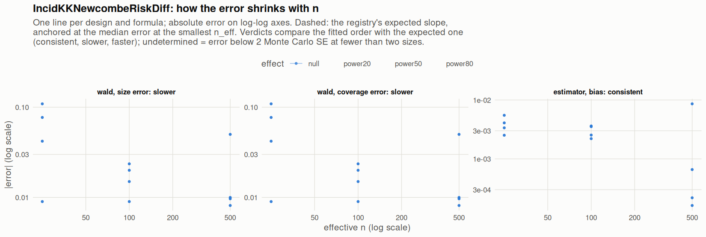

[← Campaign 2026-11-11-9d2edc5c summary](README.md)

# Class IncidKKNewcombeRiskDiff

Part of the [Classes index](classes.md). Response type: incidence. Status: null effect in progress, power effects not started. Verdict: **pending confirmation** (8 flagged test(s): 0 failing, 8 pending, 0 cleared).

<picture><source media="(prefers-color-scheme: dark)" srcset="figures/class-IncidKKNewcombeRiskDiff-dark.png"></picture>

Convergence verdicts (worst over designs, formulas and effects; provisional until the class is complete):

| procedure | metric | verdict |
|---|---|---|
| estimator (bias) | bias | consistent |
| wald | coverage | slower |
| wald | size | slower |

Null effect: 24 cells (4 failing). Size, coverage and bias / SD against the level each is held to.

| design | n | formula | procedure | size | coverage | bias / SD | size level | coverage level | verdict |
|---|---|---|---|---|---|---|---|---|---|
| Fixed:BinaryMatch | 50 | `~.` | wald | 0.059 | 0.941 | 0.02 | 0.1 | 0.9 | ok |
| Fixed:BinaryMatch | 200 | `~.` | wald | 0.065 | 0.935 | -0.054 | 0.075 | 0.925 | ok |
| Fixed:BinaryMatch | 1000 | `~.` | wald | 0.0581 | 0.942 | 0.0054 | 0.05 | 0.95 | ok |
| Fixed:BinaryMatch | 50 | `~1` | wald | 0.059 | 0.941 | 0.02 | 0.1 | 0.9 | ok |
| Fixed:BinaryMatch | 200 | `~1` | wald | 0.065 | 0.935 | -0.054 | 0.075 | 0.925 | ok |
| Fixed:BinaryMatch | 1000 | `~1` | wald | 0.0581 | 0.942 | 0.0054 | 0.05 | 0.95 | ok |
| SeqOneByOne:KK14 | 50 | `~.` | wald | 0.092 | 0.908 | -0.027 | 0.1 | 0.9 | ok |
| SeqOneByOne:KK14 | 200 | `~.` | wald | 0.059 | 0.941 | 0.038 | 0.075 | 0.925 | ok |
| SeqOneByOne:KK14 | 1000 | `~.` | wald | 0 | 1 | -0.37 | 0.055 | 0.945 | ok |
| SeqOneByOne:KK14 | 50 | `~1` | wald | 0.092 | 0.908 | -0.027 | 0.1 | 0.9 | ok |
| SeqOneByOne:KK14 | 200 | `~1` | wald | 0.059 | 0.941 | 0.038 | 0.075 | 0.925 | ok |
| SeqOneByOne:KK14 | 1000 | `~1` | wald | 0 | 1 | -0.37 | 0.055 | 0.945 | ok |
| SeqOneByOne:KK21 | 50 | `~.` | wald | 0.127 | 0.873 | 0.021 | 0.1 | 0.9 | **FAIL** |
| SeqOneByOne:KK21 | 200 | `~.` | wald | 0.07 | 0.93 | 0.032 | 0.075 | 0.925 | ok |
| SeqOneByOne:KK21 | 1000 | `~.` | wald | 0.06 | 0.94 | 0.0074 | 0.055 | 0.945 | ok |
| SeqOneByOne:KK21 | 50 | `~1` | wald | 0.127 | 0.873 | 0.021 | 0.1 | 0.9 | **FAIL** |
| SeqOneByOne:KK21 | 200 | `~1` | wald | 0.07 | 0.93 | 0.032 | 0.075 | 0.925 | ok |
| SeqOneByOne:KK21 | 1000 | `~1` | wald | 0.06 | 0.94 | 0.0074 | 0.055 | 0.945 | ok |
| SeqOneByOne:KK21stepwise | 50 | `~.` | wald | 0.159 | 0.841 | -0.034 | 0.1 | 0.9 | **FAIL** |
| SeqOneByOne:KK21stepwise | 200 | `~.` | wald | 0.0736 | 0.926 | 0.051 | 0.075 | 0.925 | ok |
| SeqOneByOne:KK21stepwise | 1000 | `~.` | wald | 0.0597 | 0.94 | -0.023 | 0.055 | 0.945 | ok |
| SeqOneByOne:KK21stepwise | 50 | `~1` | wald | 0.159 | 0.841 | -0.034 | 0.1 | 0.9 | **FAIL** |
| SeqOneByOne:KK21stepwise | 200 | `~1` | wald | 0.0736 | 0.926 | 0.051 | 0.075 | 0.925 | ok |
| SeqOneByOne:KK21stepwise | 1000 | `~1` | wald | 0.0597 | 0.94 | -0.023 | 0.055 | 0.945 | ok |

[← Campaign 2026-11-11-9d2edc5c summary](README.md)
