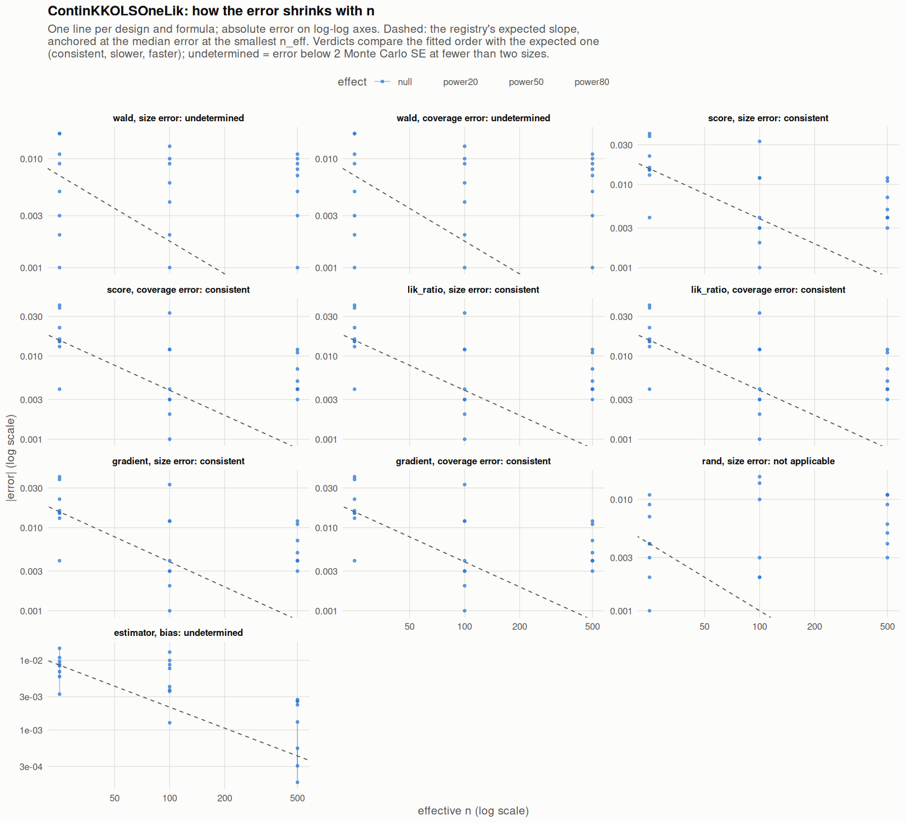

[← Campaign 2026-11-12-a46ab113 summary](README.md)

# Class ContinKKOLSOneLik

Part of the [Classes index](classes.md). Response type: continuous. Status: null effect complete, power effects not started. Verdict: **pass so far**.

<picture><source media="(prefers-color-scheme: dark)" srcset="figures/class-ContinKKOLSOneLik-dark.png"></picture>

Convergence verdicts (worst over designs, formulas and effects; provisional until the class is complete):

| procedure | metric | verdict |
|---|---|---|
| estimator (bias) | bias | undetermined |
| gradient | coverage | consistent |
| lik_ratio | coverage | consistent |
| score | coverage | consistent |
| wald | coverage | undetermined |
| gradient | size | consistent |
| lik_ratio | size | consistent |
| rand | size | not applicable |
| score | size | consistent |
| wald | size | undetermined |

Null effect: 120 cells (0 failing). Size, coverage and bias / SD against the level each is held to.

| design | n | formula | procedure | size | coverage | bias / SD | size level | coverage level | verdict |
|---|---|---|---|---|---|---|---|---|---|
| Fixed:BinaryMatch | 50 | `~.` | gradient | 0.072 | 0.928 | 0.033 | 0.1 | 0.9 | ok |
| Fixed:BinaryMatch | 200 | `~.` | gradient | 0.062 | 0.938 | -0.025 | 0.075 | 0.925 | ok |
| Fixed:BinaryMatch | 1000 | `~.` | gradient | 0.045 | 0.955 | 0.0087 | 0.055 | 0.945 | ok |
| Fixed:BinaryMatch | 50 | `~.` | lik_ratio | 0.072 | 0.928 | 0.033 | 0.1 | 0.9 | ok |
| Fixed:BinaryMatch | 200 | `~.` | lik_ratio | 0.062 | 0.938 | -0.025 | 0.075 | 0.925 | ok |
| Fixed:BinaryMatch | 1000 | `~.` | lik_ratio | 0.045 | 0.955 | 0.0087 | 0.055 | 0.945 | ok |
| Fixed:BinaryMatch | 50 | `~.` | rand | 0.046 |  | 0.033 | 0.05 | 0.95 | ok |
| Fixed:BinaryMatch | 200 | `~.` | rand | 0.05 |  | -0.025 | 0.05 | 0.95 | ok |
| Fixed:BinaryMatch | 1000 | `~.` | rand | 0.045 |  | 0.0087 | 0.05 | 0.95 | ok |
| Fixed:BinaryMatch | 50 | `~.` | score | 0.072 | 0.928 | 0.033 | 0.1 | 0.9 | ok |
| Fixed:BinaryMatch | 200 | `~.` | score | 0.062 | 0.938 | -0.025 | 0.075 | 0.925 | ok |
| Fixed:BinaryMatch | 1000 | `~.` | score | 0.045 | 0.955 | 0.0087 | 0.055 | 0.945 | ok |
| Fixed:BinaryMatch | 50 | `~.` | wald | 0.067 | 0.933 | 0.033 | 0.1 | 0.9 | ok |
| Fixed:BinaryMatch | 200 | `~.` | wald | 0.06 | 0.94 | -0.025 | 0.075 | 0.925 | ok |
| Fixed:BinaryMatch | 1000 | `~.` | wald | 0.043 | 0.957 | 0.0087 | 0.055 | 0.945 | ok |
| Fixed:BinaryMatch | 50 | `~1` | gradient | 0.065 | 0.935 | 0.046 | 0.1 | 0.9 | ok |
| Fixed:BinaryMatch | 200 | `~1` | gradient | 0.062 | 0.938 | -0.023 | 0.075 | 0.925 | ok |
| Fixed:BinaryMatch | 1000 | `~1` | gradient | 0.047 | 0.953 | -0.0028 | 0.055 | 0.945 | ok |
| Fixed:BinaryMatch | 50 | `~1` | lik_ratio | 0.065 | 0.935 | 0.046 | 0.1 | 0.9 | ok |
| Fixed:BinaryMatch | 200 | `~1` | lik_ratio | 0.062 | 0.938 | -0.023 | 0.075 | 0.925 | ok |
| Fixed:BinaryMatch | 1000 | `~1` | lik_ratio | 0.047 | 0.953 | -0.0028 | 0.055 | 0.945 | ok |
| Fixed:BinaryMatch | 50 | `~1` | rand | 0.059 |  | 0.046 | 0.05 | 0.95 | ok |
| Fixed:BinaryMatch | 200 | `~1` | rand | 0.06 |  | -0.023 | 0.05 | 0.95 | ok |
| Fixed:BinaryMatch | 1000 | `~1` | rand | 0.054 |  | -0.0028 | 0.05 | 0.95 | ok |
| Fixed:BinaryMatch | 50 | `~1` | score | 0.065 | 0.935 | 0.046 | 0.1 | 0.9 | ok |
| Fixed:BinaryMatch | 200 | `~1` | score | 0.062 | 0.938 | -0.023 | 0.075 | 0.925 | ok |
| Fixed:BinaryMatch | 1000 | `~1` | score | 0.047 | 0.953 | -0.0028 | 0.055 | 0.945 | ok |
| Fixed:BinaryMatch | 50 | `~1` | wald | 0.052 | 0.948 | 0.046 | 0.1 | 0.9 | ok |
| Fixed:BinaryMatch | 200 | `~1` | wald | 0.059 | 0.941 | -0.023 | 0.075 | 0.925 | ok |
| Fixed:BinaryMatch | 1000 | `~1` | wald | 0.047 | 0.953 | -0.0028 | 0.055 | 0.945 | ok |
| SeqOneByOne:KK14 | 50 | `~.` | gradient | 0.091 | 0.909 | -0.01 | 0.1 | 0.9 | ok |
| SeqOneByOne:KK14 | 200 | `~.` | gradient | 0.083 | 0.917 | -0.058 | 0.075 | 0.925 | ok |
| SeqOneByOne:KK14 | 1000 | `~.` | gradient | 0.043 | 0.957 | 0.037 | 0.055 | 0.945 | ok |
| SeqOneByOne:KK14 | 50 | `~.` | lik_ratio | 0.091 | 0.909 | -0.01 | 0.1 | 0.9 | ok |
| SeqOneByOne:KK14 | 200 | `~.` | lik_ratio | 0.083 | 0.917 | -0.058 | 0.075 | 0.925 | ok |
| SeqOneByOne:KK14 | 1000 | `~.` | lik_ratio | 0.043 | 0.957 | 0.037 | 0.055 | 0.945 | ok |
| SeqOneByOne:KK14 | 50 | `~.` | rand | 0.054 |  | -0.01 | 0.05 | 0.95 | ok |
| SeqOneByOne:KK14 | 200 | `~.` | rand | 0.052 |  | -0.058 | 0.05 | 0.95 | ok |
| SeqOneByOne:KK14 | 1000 | `~.` | rand | 0.044 |  | 0.037 | 0.05 | 0.95 | ok |
| SeqOneByOne:KK14 | 50 | `~.` | score | 0.091 | 0.909 | -0.01 | 0.1 | 0.9 | ok |
| SeqOneByOne:KK14 | 200 | `~.` | score | 0.083 | 0.917 | -0.058 | 0.075 | 0.925 | ok |
| SeqOneByOne:KK14 | 1000 | `~.` | score | 0.043 | 0.957 | 0.037 | 0.055 | 0.945 | ok |
| SeqOneByOne:KK14 | 50 | `~.` | wald | 0.055 | 0.945 | -0.01 | 0.1 | 0.9 | ok |
| SeqOneByOne:KK14 | 200 | `~.` | wald | 0.063 | 0.937 | -0.058 | 0.075 | 0.925 | ok |
| SeqOneByOne:KK14 | 1000 | `~.` | wald | 0.041 | 0.959 | 0.037 | 0.055 | 0.945 | ok |
| SeqOneByOne:KK14 | 50 | `~1` | gradient | 0.054 | 0.946 | -0.02 | 0.1 | 0.9 | ok |
| SeqOneByOne:KK14 | 200 | `~1` | gradient | 0.047 | 0.953 | -0.048 | 0.075 | 0.925 | ok |
| SeqOneByOne:KK14 | 1000 | `~1` | gradient | 0.054 | 0.946 | 0.039 | 0.055 | 0.945 | ok |
| SeqOneByOne:KK14 | 50 | `~1` | lik_ratio | 0.054 | 0.946 | -0.02 | 0.1 | 0.9 | ok |
| SeqOneByOne:KK14 | 200 | `~1` | lik_ratio | 0.047 | 0.953 | -0.048 | 0.075 | 0.925 | ok |
| SeqOneByOne:KK14 | 1000 | `~1` | lik_ratio | 0.054 | 0.946 | 0.039 | 0.055 | 0.945 | ok |
| SeqOneByOne:KK14 | 50 | `~1` | rand | 0.053 |  | -0.02 | 0.05 | 0.95 | ok |
| SeqOneByOne:KK14 | 200 | `~1` | rand | 0.053 |  | -0.048 | 0.05 | 0.95 | ok |
| SeqOneByOne:KK14 | 1000 | `~1` | rand | 0.061 |  | 0.039 | 0.05 | 0.95 | ok |
| SeqOneByOne:KK14 | 50 | `~1` | score | 0.054 | 0.946 | -0.02 | 0.1 | 0.9 | ok |
| SeqOneByOne:KK14 | 200 | `~1` | score | 0.047 | 0.953 | -0.048 | 0.075 | 0.925 | ok |
| SeqOneByOne:KK14 | 1000 | `~1` | score | 0.054 | 0.946 | 0.039 | 0.055 | 0.945 | ok |
| SeqOneByOne:KK14 | 50 | `~1` | wald | 0.053 | 0.947 | -0.02 | 0.1 | 0.9 | ok |
| SeqOneByOne:KK14 | 200 | `~1` | wald | 0.051 | 0.949 | -0.048 | 0.075 | 0.925 | ok |
| SeqOneByOne:KK14 | 1000 | `~1` | wald | 0.058 | 0.942 | 0.039 | 0.055 | 0.945 | ok |
| SeqOneByOne:KK21 | 50 | `~.` | gradient | 0.088 | 0.912 | -0.025 | 0.1 | 0.9 | ok |
| SeqOneByOne:KK21 | 200 | `~.` | gradient | 0.052 | 0.948 | -0.093 | 0.075 | 0.925 | ok |
| SeqOneByOne:KK21 | 1000 | `~.` | gradient | 0.062 | 0.938 | 0.042 | 0.055 | 0.945 | ok |
| SeqOneByOne:KK21 | 50 | `~.` | lik_ratio | 0.088 | 0.912 | -0.025 | 0.1 | 0.9 | ok |
| SeqOneByOne:KK21 | 200 | `~.` | lik_ratio | 0.052 | 0.948 | -0.093 | 0.075 | 0.925 | ok |
| SeqOneByOne:KK21 | 1000 | `~.` | lik_ratio | 0.062 | 0.938 | 0.042 | 0.055 | 0.945 | ok |
| SeqOneByOne:KK21 | 50 | `~.` | rand | 0.048 |  | -0.025 | 0.05 | 0.95 | ok |
| SeqOneByOne:KK21 | 200 | `~.` | rand | 0.036 |  | -0.093 | 0.05 | 0.95 | ok |
| SeqOneByOne:KK21 | 1000 | `~.` | rand | 0.047 |  | 0.042 | 0.05 | 0.95 | ok |
| SeqOneByOne:KK21 | 50 | `~.` | score | 0.088 | 0.912 | -0.025 | 0.1 | 0.9 | ok |
| SeqOneByOne:KK21 | 200 | `~.` | score | 0.052 | 0.948 | -0.093 | 0.075 | 0.925 | ok |
| SeqOneByOne:KK21 | 1000 | `~.` | score | 0.062 | 0.938 | 0.042 | 0.055 | 0.945 | ok |
| SeqOneByOne:KK21 | 50 | `~.` | wald | 0.067 | 0.933 | -0.025 | 0.1 | 0.9 | ok |
| SeqOneByOne:KK21 | 200 | `~.` | wald | 0.044 | 0.956 | -0.093 | 0.075 | 0.925 | ok |
| SeqOneByOne:KK21 | 1000 | `~.` | wald | 0.06 | 0.94 | 0.042 | 0.055 | 0.945 | ok |
| SeqOneByOne:KK21 | 50 | `~1` | gradient | 0.063 | 0.937 | -0.028 | 0.1 | 0.9 | ok |
| SeqOneByOne:KK21 | 200 | `~1` | gradient | 0.047 | 0.953 | -0.066 | 0.075 | 0.925 | ok |
| SeqOneByOne:KK21 | 1000 | `~1` | gradient | 0.061 | 0.939 | 0.038 | 0.055 | 0.945 | ok |
| SeqOneByOne:KK21 | 50 | `~1` | lik_ratio | 0.063 | 0.937 | -0.028 | 0.1 | 0.9 | ok |
| SeqOneByOne:KK21 | 200 | `~1` | lik_ratio | 0.047 | 0.953 | -0.066 | 0.075 | 0.925 | ok |
| SeqOneByOne:KK21 | 1000 | `~1` | lik_ratio | 0.061 | 0.939 | 0.038 | 0.055 | 0.945 | ok |
| SeqOneByOne:KK21 | 50 | `~1` | rand | 0.057 |  | -0.028 | 0.05 | 0.95 | ok |
| SeqOneByOne:KK21 | 200 | `~1` | rand | 0.05 |  | -0.066 | 0.05 | 0.95 | ok |
| SeqOneByOne:KK21 | 1000 | `~1` | rand | 0.061 |  | 0.038 | 0.05 | 0.95 | ok |
| SeqOneByOne:KK21 | 50 | `~1` | score | 0.063 | 0.937 | -0.028 | 0.1 | 0.9 | ok |
| SeqOneByOne:KK21 | 200 | `~1` | score | 0.047 | 0.953 | -0.066 | 0.075 | 0.925 | ok |
| SeqOneByOne:KK21 | 1000 | `~1` | score | 0.061 | 0.939 | 0.038 | 0.055 | 0.945 | ok |
| SeqOneByOne:KK21 | 50 | `~1` | wald | 0.059 | 0.941 | -0.028 | 0.1 | 0.9 | ok |
| SeqOneByOne:KK21 | 200 | `~1` | wald | 0.046 | 0.954 | -0.066 | 0.075 | 0.925 | ok |
| SeqOneByOne:KK21 | 1000 | `~1` | wald | 0.061 | 0.939 | 0.038 | 0.055 | 0.945 | ok |
| SeqOneByOne:KK21stepwise | 50 | `~.` | gradient | 0.066 | 0.934 | 0.027 | 0.1 | 0.9 | ok |
| SeqOneByOne:KK21stepwise | 200 | `~.` | gradient | 0.054 | 0.946 | -0.029 | 0.075 | 0.925 | ok |
| SeqOneByOne:KK21stepwise | 1000 | `~.` | gradient | 0.054 | 0.946 | 0.0049 | 0.055 | 0.945 | ok |
| SeqOneByOne:KK21stepwise | 50 | `~.` | lik_ratio | 0.066 | 0.934 | 0.027 | 0.1 | 0.9 | ok |
| SeqOneByOne:KK21stepwise | 200 | `~.` | lik_ratio | 0.054 | 0.946 | -0.029 | 0.075 | 0.925 | ok |
| SeqOneByOne:KK21stepwise | 1000 | `~.` | lik_ratio | 0.054 | 0.946 | 0.0049 | 0.055 | 0.945 | ok |
| SeqOneByOne:KK21stepwise | 50 | `~.` | rand | 0.051 |  | 0.027 | 0.05 | 0.95 | ok |
| SeqOneByOne:KK21stepwise | 200 | `~.` | rand | 0.034 |  | -0.029 | 0.05 | 0.95 | ok |
| SeqOneByOne:KK21stepwise | 1000 | `~.` | rand | 0.041 |  | 0.0049 | 0.05 | 0.95 | ok |
| SeqOneByOne:KK21stepwise | 50 | `~.` | score | 0.066 | 0.934 | 0.027 | 0.1 | 0.9 | ok |
| SeqOneByOne:KK21stepwise | 200 | `~.` | score | 0.054 | 0.946 | -0.029 | 0.075 | 0.925 | ok |
| SeqOneByOne:KK21stepwise | 1000 | `~.` | score | 0.054 | 0.946 | 0.0049 | 0.055 | 0.945 | ok |
| SeqOneByOne:KK21stepwise | 50 | `~.` | wald | 0.049 | 0.951 | 0.027 | 0.1 | 0.9 | ok |
| SeqOneByOne:KK21stepwise | 200 | `~.` | wald | 0.05 | 0.95 | -0.029 | 0.075 | 0.925 | ok |
| SeqOneByOne:KK21stepwise | 1000 | `~.` | wald | 0.051 | 0.949 | 0.0049 | 0.055 | 0.945 | ok |
| SeqOneByOne:KK21stepwise | 50 | `~1` | gradient | 0.065 | 0.935 | 0.017 | 0.1 | 0.9 | ok |
| SeqOneByOne:KK21stepwise | 200 | `~1` | gradient | 0.049 | 0.951 | 0.0082 | 0.075 | 0.925 | ok |
| SeqOneByOne:KK21stepwise | 1000 | `~1` | gradient | 0.054 | 0.946 | 0.019 | 0.055 | 0.945 | ok |
| SeqOneByOne:KK21stepwise | 50 | `~1` | lik_ratio | 0.065 | 0.935 | 0.017 | 0.1 | 0.9 | ok |
| SeqOneByOne:KK21stepwise | 200 | `~1` | lik_ratio | 0.049 | 0.951 | 0.0082 | 0.075 | 0.925 | ok |
| SeqOneByOne:KK21stepwise | 1000 | `~1` | lik_ratio | 0.054 | 0.946 | 0.019 | 0.055 | 0.945 | ok |
| SeqOneByOne:KK21stepwise | 50 | `~1` | rand | 0.061 |  | 0.017 | 0.05 | 0.95 | ok |
| SeqOneByOne:KK21stepwise | 200 | `~1` | rand | 0.048 |  | 0.0082 | 0.05 | 0.95 | ok |
| SeqOneByOne:KK21stepwise | 1000 | `~1` | rand | 0.061 |  | 0.019 | 0.05 | 0.95 | ok |
| SeqOneByOne:KK21stepwise | 50 | `~1` | score | 0.065 | 0.935 | 0.017 | 0.1 | 0.9 | ok |
| SeqOneByOne:KK21stepwise | 200 | `~1` | score | 0.049 | 0.951 | 0.0082 | 0.075 | 0.925 | ok |
| SeqOneByOne:KK21stepwise | 1000 | `~1` | score | 0.054 | 0.946 | 0.019 | 0.055 | 0.945 | ok |
| SeqOneByOne:KK21stepwise | 50 | `~1` | wald | 0.061 | 0.939 | 0.017 | 0.1 | 0.9 | ok |
| SeqOneByOne:KK21stepwise | 200 | `~1` | wald | 0.048 | 0.952 | 0.0082 | 0.075 | 0.925 | ok |
| SeqOneByOne:KK21stepwise | 1000 | `~1` | wald | 0.055 | 0.945 | 0.019 | 0.055 | 0.945 | ok |

[← Campaign 2026-11-12-a46ab113 summary](README.md)
