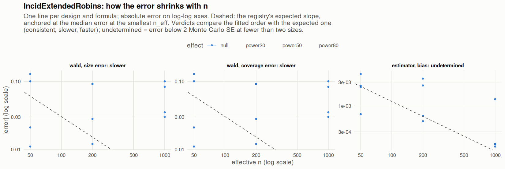

[← Campaign 2026-11-12-a46ab113 summary](README.md)

# Class IncidExtendedRobins

Part of the [Classes index](classes.md). Response type: incidence. Status: null effect complete, power effects not started. Verdict: **fail** (24 flagged test(s): 24 failing, 0 pending, 0 cleared).

<picture><source media="(prefers-color-scheme: dark)" srcset="figures/class-IncidExtendedRobins-dark.png"></picture>

Convergence verdicts (worst over designs, formulas and effects; provisional until the class is complete):

| procedure | metric | verdict |
|---|---|---|
| estimator (bias) | bias | undetermined |
| wald | coverage | slower |
| wald | size | slower |

Null effect: 24 cells (12 failing). Size, coverage and bias / SD against the level each is held to.

| design | n | formula | procedure | size | coverage | bias / SD | size level | coverage level | verdict |
|---|---|---|---|---|---|---|---|---|---|
| Fixed:BinaryMatch | 50 | `~.` | wald | 0.15 | 0.85 | 0.02 | 0.1 | 0.9 | **FAIL** |
| Fixed:BinaryMatch | 200 | `~.` | wald | 0.142 | 0.858 | -0.054 | 0.0625 | 0.938 | **FAIL** |
| Fixed:BinaryMatch | 1000 | `~.` | wald | 0.15 | 0.85 | 0.0056 | 0.05 | 0.95 | **FAIL** |
| Fixed:BinaryMatch | 50 | `~1` | wald | 0.15 | 0.85 | 0.02 | 0.1 | 0.9 | **FAIL** |
| Fixed:BinaryMatch | 200 | `~1` | wald | 0.142 | 0.858 | -0.054 | 0.0625 | 0.938 | **FAIL** |
| Fixed:BinaryMatch | 1000 | `~1` | wald | 0.15 | 0.85 | 0.0056 | 0.05 | 0.95 | **FAIL** |
| Fixed:iBCRD | 50 | `~.` | wald | 0.039 | 0.961 | -0.0049 | 0.1 | 0.9 | ok |
| Fixed:iBCRD | 200 | `~.` | wald | 0.022 | 0.978 | -0.037 | 0.0625 | 0.938 | ok |
| Fixed:iBCRD | 1000 | `~.` | wald | 0.015 | 0.985 | 0.043 | 0.0525 | 0.948 | ok |
| Fixed:iBCRD | 50 | `~1` | wald | 0.039 | 0.961 | -0.0049 | 0.1 | 0.9 | ok |
| Fixed:iBCRD | 200 | `~1` | wald | 0.022 | 0.978 | -0.037 | 0.0625 | 0.938 | ok |
| Fixed:iBCRD | 1000 | `~1` | wald | 0.015 | 0.985 | 0.043 | 0.0525 | 0.948 | ok |
| Fixed:MatchingGreedyPairSwitching | 50 | `~.` | wald | 0.178 | 0.822 | 0.019 | 0.1 | 0.9 | **FAIL** |
| Fixed:MatchingGreedyPairSwitching | 200 | `~.` | wald | 0.141 | 0.859 | 0.0096 | 0.0625 | 0.938 | **FAIL** |
| Fixed:MatchingGreedyPairSwitching | 1000 | `~.` | wald | 0.133 | 0.867 | -0.0053 | 0.05 | 0.95 | **FAIL** |
| Fixed:MatchingGreedyPairSwitching | 50 | `~1` | wald | 0.178 | 0.822 | 0.019 | 0.1 | 0.9 | **FAIL** |
| Fixed:MatchingGreedyPairSwitching | 200 | `~1` | wald | 0.141 | 0.859 | 0.0096 | 0.0625 | 0.938 | **FAIL** |
| Fixed:MatchingGreedyPairSwitching | 1000 | `~1` | wald | 0.133 | 0.867 | -0.0053 | 0.05 | 0.95 | **FAIL** |
| SeqOneByOne:iBCRD | 50 | `~.` | wald | 0.029 | 0.971 | 0.031 | 0.1 | 0.9 | ok |
| SeqOneByOne:iBCRD | 200 | `~.` | wald | 0.038 | 0.962 | 0.0065 | 0.0625 | 0.938 | ok |
| SeqOneByOne:iBCRD | 1000 | `~.` | wald | 0.02 | 0.98 | 0.0055 | 0.0525 | 0.948 | ok |
| SeqOneByOne:iBCRD | 50 | `~1` | wald | 0.029 | 0.971 | 0.031 | 0.1 | 0.9 | ok |
| SeqOneByOne:iBCRD | 200 | `~1` | wald | 0.038 | 0.962 | 0.0065 | 0.0625 | 0.938 | ok |
| SeqOneByOne:iBCRD | 1000 | `~1` | wald | 0.02 | 0.98 | 0.0055 | 0.0525 | 0.948 | ok |

[← Campaign 2026-11-12-a46ab113 summary](README.md)
