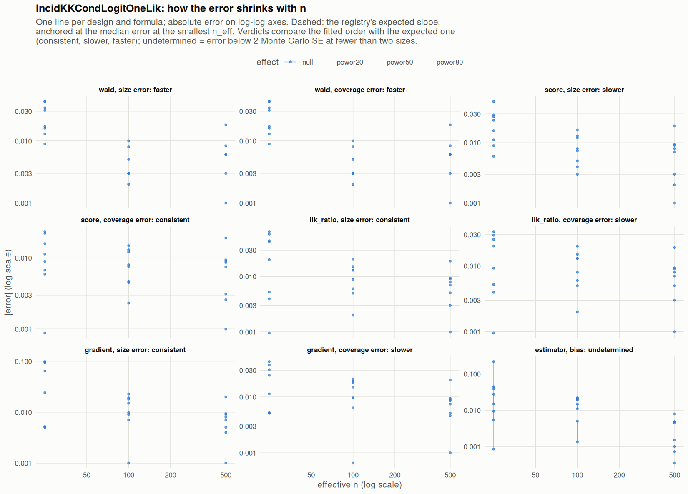

[← Campaign 2026-11-12-a46ab113 summary](README.md)

# Class IncidKKCondLogitOneLik

Part of the [Classes index](classes.md). Response type: incidence. Status: null effect complete, power effects not started. Verdict: **pending confirmation** (3 flagged test(s): 0 failing, 3 pending, 0 cleared).

<picture><source media="(prefers-color-scheme: dark)" srcset="figures/class-IncidKKCondLogitOneLik-dark.png"></picture>

Convergence verdicts (worst over designs, formulas and effects; provisional until the class is complete):

| procedure | metric | verdict |
|---|---|---|
| estimator (bias) | bias | undetermined |
| gradient | coverage | slower |
| lik_ratio | coverage | slower |
| score | coverage | consistent |
| wald | coverage | faster |
| gradient | size | consistent |
| lik_ratio | size | consistent |
| score | size | slower |
| wald | size | faster |

Null effect: 96 cells (3 failing). Size, coverage and bias / SD against the level each is held to.

| design | n | formula | procedure | size | coverage | bias / SD | size level | coverage level | verdict |
|---|---|---|---|---|---|---|---|---|---|
| Fixed:BinaryMatch | 50 | `~.` | gradient | 0.145 | 0.939 | -0.0038 | 0.1 | 0.9 | **FAIL** |
| Fixed:BinaryMatch | 200 | `~.` | gradient | 0.0691 | 0.931 | -0.056 | 0.075 | 0.925 | ok |
| Fixed:BinaryMatch | 1000 | `~.` | gradient | 0.07 | 0.93 | 0.0067 | 0.055 | 0.95 | ok |
| Fixed:BinaryMatch | 50 | `~.` | lik_ratio | 0.0928 | 0.941 | -0.0038 | 0.1 | 0.9 | ok |
| Fixed:BinaryMatch | 200 | `~.` | lik_ratio | 0.0651 | 0.935 | -0.056 | 0.075 | 0.925 | ok |
| Fixed:BinaryMatch | 1000 | `~.` | lik_ratio | 0.069 | 0.931 | 0.0067 | 0.055 | 0.95 | ok |
| Fixed:BinaryMatch | 50 | `~.` | score | 0.0735 | 0.951 | -0.0038 | 0.1 | 0.9 | ok |
| Fixed:BinaryMatch | 200 | `~.` | score | 0.063 | 0.937 | -0.056 | 0.075 | 0.925 | ok |
| Fixed:BinaryMatch | 1000 | `~.` | score | 0.069 | 0.931 | 0.0067 | 0.05 | 0.945 | ok |
| Fixed:BinaryMatch | 50 | `~.` | wald | 0.00703 | 0.993 | -0.0038 | 0.1 | 0.9 | ok |
| Fixed:BinaryMatch | 200 | `~.` | wald | 0.053 | 0.947 | -0.056 | 0.075 | 0.925 | ok |
| Fixed:BinaryMatch | 1000 | `~.` | wald | 0.068 | 0.932 | 0.0067 | 0.055 | 0.945 | ok |
| Fixed:BinaryMatch | 50 | `~1` | gradient | 0.0552 | 0.945 | 0.0081 | 0.1 | 0.9 | ok |
| Fixed:BinaryMatch | 200 | `~1` | gradient | 0.065 | 0.935 | -0.063 | 0.075 | 0.925 | ok |
| Fixed:BinaryMatch | 1000 | `~1` | gradient | 0.0594 | 0.941 | 0.0024 | 0.055 | 0.945 | ok |
| Fixed:BinaryMatch | 50 | `~1` | lik_ratio | 0.0552 | 0.945 | 0.0081 | 0.1 | 0.9 | ok |
| Fixed:BinaryMatch | 200 | `~1` | lik_ratio | 0.063 | 0.937 | -0.063 | 0.075 | 0.925 | ok |
| Fixed:BinaryMatch | 1000 | `~1` | lik_ratio | 0.0594 | 0.941 | 0.0024 | 0.055 | 0.945 | ok |
| Fixed:BinaryMatch | 50 | `~1` | score | 0.0341 | 0.966 | 0.0081 | 0.1 | 0.9 | ok |
| Fixed:BinaryMatch | 200 | `~1` | score | 0.058 | 0.942 | -0.063 | 0.075 | 0.925 | ok |
| Fixed:BinaryMatch | 1000 | `~1` | score | 0.0594 | 0.941 | 0.0024 | 0.055 | 0.945 | ok |
| Fixed:BinaryMatch | 50 | `~1` | wald | 0.0191 | 0.981 | 0.0081 | 0.1 | 0.9 | ok |
| Fixed:BinaryMatch | 200 | `~1` | wald | 0.053 | 0.947 | -0.063 | 0.075 | 0.925 | ok |
| Fixed:BinaryMatch | 1000 | `~1` | wald | 0.0583 | 0.942 | 0.0024 | 0.055 | 0.945 | ok |
| SeqOneByOne:KK14 | 50 | `~.` | gradient | 0.114 | 0.907 | -0.034 | 0.1 | 0.9 | ok |
| SeqOneByOne:KK14 | 200 | `~.` | gradient | 0.0681 | 0.932 | 0.041 | 0.075 | 0.925 | ok |
| SeqOneByOne:KK14 | 1000 | `~.` | gradient | 0.051 | 0.949 | -0.033 | 0.055 | 0.945 | ok |
| SeqOneByOne:KK14 | 50 | `~.` | lik_ratio | 0.0943 | 0.921 | -0.034 | 0.1 | 0.9 | ok |
| SeqOneByOne:KK14 | 200 | `~.` | lik_ratio | 0.0631 | 0.937 | 0.041 | 0.075 | 0.925 | ok |
| SeqOneByOne:KK14 | 1000 | `~.` | lik_ratio | 0.051 | 0.949 | -0.033 | 0.055 | 0.945 | ok |
| SeqOneByOne:KK14 | 50 | `~.` | score | 0.0772 | 0.928 | -0.034 | 0.1 | 0.9 | ok |
| SeqOneByOne:KK14 | 200 | `~.` | score | 0.0621 | 0.938 | 0.041 | 0.075 | 0.925 | ok |
| SeqOneByOne:KK14 | 1000 | `~.` | score | 0.051 | 0.949 | -0.033 | 0.055 | 0.945 | ok |
| SeqOneByOne:KK14 | 50 | `~.` | wald | 0.034 | 0.966 | -0.034 | 0.1 | 0.9 | ok |
| SeqOneByOne:KK14 | 200 | `~.` | wald | 0.06 | 0.94 | 0.041 | 0.075 | 0.925 | ok |
| SeqOneByOne:KK14 | 1000 | `~.` | wald | 0.05 | 0.95 | -0.033 | 0.055 | 0.945 | ok |
| SeqOneByOne:KK14 | 50 | `~1` | gradient | 0.0551 | 0.945 | -0.023 | 0.1 | 0.9 | ok |
| SeqOneByOne:KK14 | 200 | `~1` | gradient | 0.059 | 0.94 | 0.036 | 0.075 | 0.925 | ok |
| SeqOneByOne:KK14 | 1000 | `~1` | gradient | 0.054 | 0.945 | -0.032 | 0.055 | 0.945 | ok |
| SeqOneByOne:KK14 | 50 | `~1` | lik_ratio | 0.046 | 0.954 | -0.023 | 0.1 | 0.9 | ok |
| SeqOneByOne:KK14 | 200 | `~1` | lik_ratio | 0.056 | 0.944 | 0.036 | 0.075 | 0.925 | ok |
| SeqOneByOne:KK14 | 1000 | `~1` | lik_ratio | 0.053 | 0.947 | -0.032 | 0.055 | 0.945 | ok |
| SeqOneByOne:KK14 | 50 | `~1` | score | 0.041 | 0.959 | -0.023 | 0.1 | 0.9 | ok |
| SeqOneByOne:KK14 | 200 | `~1` | score | 0.054 | 0.946 | 0.036 | 0.075 | 0.925 | ok |
| SeqOneByOne:KK14 | 1000 | `~1` | score | 0.052 | 0.947 | -0.032 | 0.055 | 0.945 | ok |
| SeqOneByOne:KK14 | 50 | `~1` | wald | 0.037 | 0.963 | -0.023 | 0.1 | 0.9 | ok |
| SeqOneByOne:KK14 | 200 | `~1` | wald | 0.05 | 0.95 | 0.036 | 0.075 | 0.925 | ok |
| SeqOneByOne:KK14 | 1000 | `~1` | wald | 0.051 | 0.949 | -0.032 | 0.055 | 0.945 | ok |
| SeqOneByOne:KK21 | 50 | `~.` | gradient | 0.149 | 0.913 | 0.013 | 0.1 | 0.9 | **FAIL** |
| SeqOneByOne:KK21 | 200 | `~.` | gradient | 0.0598 | 0.94 | -0.0036 | 0.075 | 0.925 | ok |
| SeqOneByOne:KK21 | 1000 | `~.` | gradient | 0.0551 | 0.945 | -0.01 | 0.055 | 0.945 | ok |
| SeqOneByOne:KK21 | 50 | `~.` | lik_ratio | 0.108 | 0.925 | 0.013 | 0.1 | 0.9 | ok |
| SeqOneByOne:KK21 | 200 | `~.` | lik_ratio | 0.0588 | 0.942 | -0.0036 | 0.075 | 0.925 | ok |
| SeqOneByOne:KK21 | 1000 | `~.` | lik_ratio | 0.0551 | 0.945 | -0.01 | 0.055 | 0.945 | ok |
| SeqOneByOne:KK21 | 50 | `~.` | score | 0.0788 | 0.943 | 0.013 | 0.1 | 0.9 | ok |
| SeqOneByOne:KK21 | 200 | `~.` | score | 0.0573 | 0.942 | -0.0036 | 0.075 | 0.925 | ok |
| SeqOneByOne:KK21 | 1000 | `~.` | score | 0.053 | 0.947 | -0.01 | 0.055 | 0.945 | ok |
| SeqOneByOne:KK21 | 50 | `~.` | wald | 0.00701 | 0.993 | 0.013 | 0.1 | 0.9 | ok |
| SeqOneByOne:KK21 | 200 | `~.` | wald | 0.053 | 0.947 | -0.0036 | 0.075 | 0.925 | ok |
| SeqOneByOne:KK21 | 1000 | `~.` | wald | 0.053 | 0.947 | -0.01 | 0.055 | 0.945 | ok |
| SeqOneByOne:KK21 | 50 | `~1` | gradient | 0.0551 | 0.945 | 0.0012 | 0.1 | 0.9 | ok |
| SeqOneByOne:KK21 | 200 | `~1` | gradient | 0.049 | 0.951 | 0.016 | 0.075 | 0.925 | ok |
| SeqOneByOne:KK21 | 1000 | `~1` | gradient | 0.058 | 0.941 | 0.0052 | 0.055 | 0.945 | ok |
| SeqOneByOne:KK21 | 50 | `~1` | lik_ratio | 0.049 | 0.951 | 0.0012 | 0.1 | 0.9 | ok |
| SeqOneByOne:KK21 | 200 | `~1` | lik_ratio | 0.048 | 0.952 | 0.016 | 0.075 | 0.925 | ok |
| SeqOneByOne:KK21 | 1000 | `~1` | lik_ratio | 0.058 | 0.942 | 0.0052 | 0.055 | 0.945 | ok |
| SeqOneByOne:KK21 | 50 | `~1` | score | 0.044 | 0.956 | 0.0012 | 0.1 | 0.9 | ok |
| SeqOneByOne:KK21 | 200 | `~1` | score | 0.045 | 0.955 | 0.016 | 0.075 | 0.925 | ok |
| SeqOneByOne:KK21 | 1000 | `~1` | score | 0.058 | 0.941 | 0.0052 | 0.055 | 0.945 | ok |
| SeqOneByOne:KK21 | 50 | `~1` | wald | 0.033 | 0.967 | 0.0012 | 0.1 | 0.9 | ok |
| SeqOneByOne:KK21 | 200 | `~1` | wald | 0.045 | 0.955 | 0.016 | 0.075 | 0.925 | ok |
| SeqOneByOne:KK21 | 1000 | `~1` | wald | 0.056 | 0.944 | 0.0052 | 0.055 | 0.945 | ok |
| SeqOneByOne:KK21stepwise | 50 | `~.` | gradient | 0.147 | 0.919 | -0.1 | 0.1 | 0.9 | **FAIL** |
| SeqOneByOne:KK21stepwise | 200 | `~.` | gradient | 0.0727 | 0.929 | 0.055 | 0.075 | 0.925 | ok |
| SeqOneByOne:KK21stepwise | 1000 | `~.` | gradient | 0.0591 | 0.941 | -0.053 | 0.055 | 0.945 | ok |
| SeqOneByOne:KK21stepwise | 50 | `~.` | lik_ratio | 0.115 | 0.917 | -0.1 | 0.1 | 0.9 | ok |
| SeqOneByOne:KK21stepwise | 200 | `~.` | lik_ratio | 0.0707 | 0.93 | 0.055 | 0.075 | 0.925 | ok |
| SeqOneByOne:KK21stepwise | 1000 | `~.` | lik_ratio | 0.0591 | 0.941 | -0.053 | 0.055 | 0.945 | ok |
| SeqOneByOne:KK21stepwise | 50 | `~.` | score | 0.0982 | 0.927 | -0.1 | 0.1 | 0.9 | ok |
| SeqOneByOne:KK21stepwise | 200 | `~.` | score | 0.0662 | 0.935 | 0.055 | 0.075 | 0.925 | ok |
| SeqOneByOne:KK21stepwise | 1000 | `~.` | score | 0.059 | 0.941 | -0.053 | 0.055 | 0.945 | ok |
| SeqOneByOne:KK21stepwise | 50 | `~.` | wald | 0.016 | 0.984 | -0.1 | 0.1 | 0.9 | ok |
| SeqOneByOne:KK21stepwise | 200 | `~.` | wald | 0.058 | 0.942 | 0.055 | 0.075 | 0.925 | ok |
| SeqOneByOne:KK21stepwise | 1000 | `~.` | wald | 0.056 | 0.944 | -0.053 | 0.055 | 0.945 | ok |
| SeqOneByOne:KK21stepwise | 50 | `~1` | gradient | 0.0741 | 0.926 | -0.054 | 0.1 | 0.9 | ok |
| SeqOneByOne:KK21stepwise | 200 | `~1` | gradient | 0.057 | 0.944 | 0.059 | 0.075 | 0.925 | ok |
| SeqOneByOne:KK21stepwise | 1000 | `~1` | gradient | 0.057 | 0.943 | -0.035 | 0.055 | 0.945 | ok |
| SeqOneByOne:KK21stepwise | 50 | `~1` | lik_ratio | 0.0701 | 0.93 | -0.054 | 0.1 | 0.9 | ok |
| SeqOneByOne:KK21stepwise | 200 | `~1` | lik_ratio | 0.055 | 0.945 | 0.059 | 0.075 | 0.925 | ok |
| SeqOneByOne:KK21stepwise | 1000 | `~1` | lik_ratio | 0.057 | 0.943 | -0.035 | 0.055 | 0.945 | ok |
| SeqOneByOne:KK21stepwise | 50 | `~1` | score | 0.0611 | 0.939 | -0.054 | 0.1 | 0.9 | ok |
| SeqOneByOne:KK21stepwise | 200 | `~1` | score | 0.053 | 0.948 | 0.059 | 0.075 | 0.925 | ok |
| SeqOneByOne:KK21stepwise | 1000 | `~1` | score | 0.057 | 0.943 | -0.035 | 0.055 | 0.945 | ok |
| SeqOneByOne:KK21stepwise | 50 | `~1` | wald | 0.0411 | 0.959 | -0.054 | 0.1 | 0.9 | ok |
| SeqOneByOne:KK21stepwise | 200 | `~1` | wald | 0.048 | 0.952 | 0.059 | 0.075 | 0.925 | ok |
| SeqOneByOne:KK21stepwise | 1000 | `~1` | wald | 0.056 | 0.944 | -0.035 | 0.055 | 0.945 | ok |

[← Campaign 2026-11-12-a46ab113 summary](README.md)
