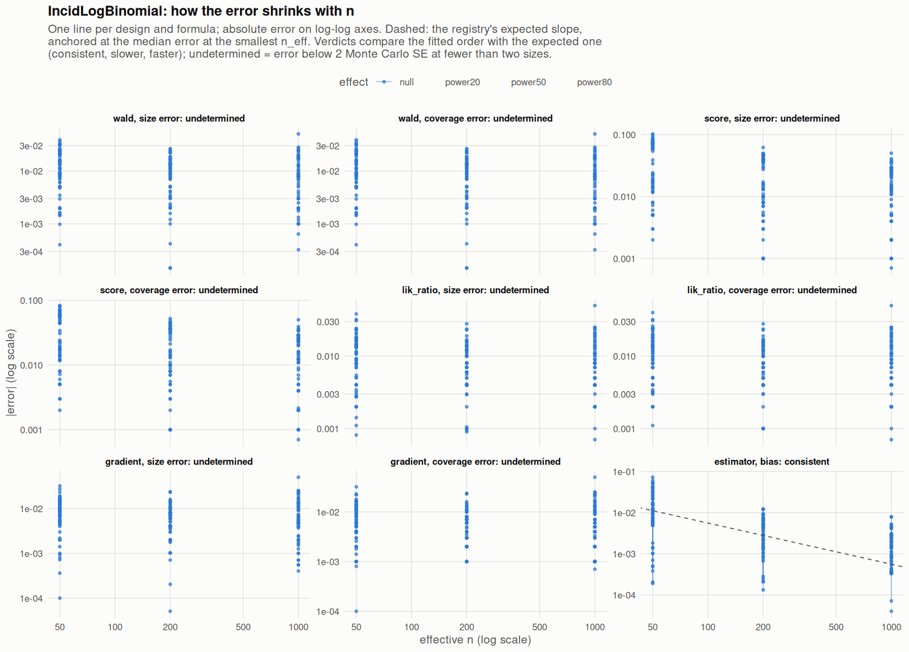

[← Campaign 2026-11-12-a46ab113 summary](README.md)

# Class IncidLogBinomial

Part of the [Classes index](classes.md). Response type: incidence. Status: null effect in progress, power effects not started. Verdict: **pending confirmation** (10 flagged test(s): 0 failing, 10 pending, 0 cleared).

<picture><source media="(prefers-color-scheme: dark)" srcset="figures/class-IncidLogBinomial-dark.png"></picture>

Convergence verdicts (worst over designs, formulas and effects; provisional until the class is complete):

| procedure | metric | verdict |
|---|---|---|
| estimator (bias) | bias | consistent |
| gradient | coverage | undetermined |
| lik_ratio | coverage | undetermined |
| score | coverage | undetermined |
| wald | coverage | undetermined |
| gradient | size | undetermined |
| lik_ratio | size | undetermined |
| score | size | undetermined |
| wald | size | undetermined |

Null effect: 792 cells (6 failing). Size, coverage and bias / SD against the level each is held to.

| design | n | formula | procedure | size | coverage | bias / SD | size level | coverage level | verdict |
|---|---|---|---|---|---|---|---|---|---|
| Fixed:Bernoulli | 50 | `~.` | gradient | 0.061 | 0.944 | -0.083 | 0.1 | 0.9 | ok |
| Fixed:Bernoulli | 200 | `~.` | gradient | 0.0578 | 0.947 | 0.023 | 0.1 | 0.9 | ok |
| Fixed:Bernoulli | 1000 | `~.` | gradient | 0.0494 | 0.951 | 0.0064 | 0.0525 | 0.948 | ok |
| Fixed:Bernoulli | 50 | `~.` | lik_ratio | 0.0728 | 0.924 | -0.083 | 0.1 | 0.9 | ok |
| Fixed:Bernoulli | 200 | `~.` | lik_ratio | 0.066 | 0.934 | 0.023 | 0.1 | 0.9 | ok |
| Fixed:Bernoulli | 1000 | `~.` | lik_ratio | 0.058 | 0.941 | 0.0064 | 0.0525 | 0.948 | ok |
| Fixed:Bernoulli | 50 | `~.` | score | 0.13 | 0.887 | -0.083 | 0.1 | 0.9 | ok |
| Fixed:Bernoulli | 200 | `~.` | score | 0.0963 | 0.905 | 0.023 | 0.1 | 0.9 | ok |
| Fixed:Bernoulli | 1000 | `~.` | score | 0.0766 | 0.924 | 0.0064 | 0.0525 | 0.948 | ok |
| Fixed:Bernoulli | 50 | `~.` | wald | 0.0411 | 0.959 | -0.083 | 0.1 | 0.9 | ok |
| Fixed:Bernoulli | 200 | `~.` | wald | 0.0465 | 0.953 | 0.023 | 0.1 | 0.9 | ok |
| Fixed:Bernoulli | 1000 | `~.` | wald | 0.0412 | 0.959 | 0.0064 | 0.0525 | 0.948 | ok |
| Fixed:Bernoulli | 50 | `~1` | gradient | 0.066 | 0.934 | -0.074 | 0.1 | 0.9 | ok |
| Fixed:Bernoulli | 200 | `~1` | gradient | 0.046 | 0.954 | 0.0092 | 0.1 | 0.9 | ok |
| Fixed:Bernoulli | 1000 | `~1` | gradient | 0.043 | 0.957 | -0.0059 | 0.0525 | 0.948 | ok |
| Fixed:Bernoulli | 50 | `~1` | lik_ratio | 0.065 | 0.935 | -0.074 | 0.1 | 0.9 | ok |
| Fixed:Bernoulli | 200 | `~1` | lik_ratio | 0.045 | 0.955 | 0.0092 | 0.1 | 0.9 | ok |
| Fixed:Bernoulli | 1000 | `~1` | lik_ratio | 0.043 | 0.957 | -0.0059 | 0.0525 | 0.948 | ok |
| Fixed:Bernoulli | 50 | `~1` | score | 0.071 | 0.929 | -0.074 | 0.1 | 0.9 | ok |
| Fixed:Bernoulli | 200 | `~1` | score | 0.047 | 0.953 | 0.0092 | 0.1 | 0.9 | ok |
| Fixed:Bernoulli | 1000 | `~1` | score | 0.043 | 0.957 | -0.0059 | 0.0525 | 0.948 | ok |
| Fixed:Bernoulli | 50 | `~1` | wald | 0.037 | 0.963 | -0.074 | 0.1 | 0.9 | ok |
| Fixed:Bernoulli | 200 | `~1` | wald | 0.04 | 0.96 | 0.0092 | 0.1 | 0.9 | ok |
| Fixed:Bernoulli | 1000 | `~1` | wald | 0.041 | 0.959 | -0.0059 | 0.0525 | 0.948 | ok |
| Fixed:Bernoulli@0.2 | 50 | `~.` | gradient | 0.0549 | 0.953 | -0.073 | 0.1 | 0.9 | ok |
| Fixed:Bernoulli@0.2 | 200 | `~.` | gradient | 0.056 | 0.949 | 0.012 | 0.1 | 0.9 | ok |
| Fixed:Bernoulli@0.2 | 1000 | `~.` | gradient | 0.0513 | 0.949 | 0.001 | 0.0525 | 0.948 | ok |
| Fixed:Bernoulli@0.2 | 50 | `~.` | lik_ratio | 0.058 | 0.936 | -0.073 | 0.1 | 0.9 | ok |
| Fixed:Bernoulli@0.2 | 200 | `~.` | lik_ratio | 0.073 | 0.927 | 0.012 | 0.1 | 0.9 | ok |
| Fixed:Bernoulli@0.2 | 1000 | `~.` | lik_ratio | 0.058 | 0.942 | 0.001 | 0.0525 | 0.948 | ok |
| Fixed:Bernoulli@0.2 | 50 | `~.` | score | 0.14 | 0.877 | -0.073 | 0.1 | 0.9 | ok |
| Fixed:Bernoulli@0.2 | 200 | `~.` | score | 0.0966 | 0.909 | 0.012 | 0.1 | 0.9 | ok |
| Fixed:Bernoulli@0.2 | 1000 | `~.` | score | 0.0797 | 0.922 | 0.001 | 0.0525 | 0.948 | ok |
| Fixed:Bernoulli@0.2 | 50 | `~.` | wald | 0.0748 | 0.925 | -0.073 | 0.1 | 0.9 | ok |
| Fixed:Bernoulli@0.2 | 200 | `~.` | wald | 0.0576 | 0.942 | 0.012 | 0.1 | 0.9 | ok |
| Fixed:Bernoulli@0.2 | 1000 | `~.` | wald | 0.0573 | 0.943 | 0.001 | 0.0525 | 0.948 | ok |
| Fixed:Bernoulli@0.2 | 50 | `~1` | gradient | 0.0616 | 0.938 | -0.15 | 0.1 | 0.9 | ok |
| Fixed:Bernoulli@0.2 | 200 | `~1` | gradient | 0.048 | 0.952 | -0.027 | 0.1 | 0.9 | ok |
| Fixed:Bernoulli@0.2 | 1000 | `~1` | gradient | 0.05 | 0.95 | -0.038 | 0.0525 | 0.948 | ok |
| Fixed:Bernoulli@0.2 | 50 | `~1` | lik_ratio | 0.0616 | 0.938 | -0.15 | 0.1 | 0.9 | ok |
| Fixed:Bernoulli@0.2 | 200 | `~1` | lik_ratio | 0.04 | 0.96 | -0.027 | 0.1 | 0.9 | ok |
| Fixed:Bernoulli@0.2 | 1000 | `~1` | lik_ratio | 0.049 | 0.951 | -0.038 | 0.0525 | 0.948 | ok |
| Fixed:Bernoulli@0.2 | 50 | `~1` | score | 0.0676 | 0.932 | -0.15 | 0.1 | 0.9 | ok |
| Fixed:Bernoulli@0.2 | 200 | `~1` | score | 0.045 | 0.955 | -0.027 | 0.1 | 0.9 | ok |
| Fixed:Bernoulli@0.2 | 1000 | `~1` | score | 0.051 | 0.949 | -0.038 | 0.0525 | 0.948 | ok |
| Fixed:Bernoulli@0.2 | 50 | `~1` | wald | 0.0515 | 0.949 | -0.15 | 0.1 | 0.9 | ok |
| Fixed:Bernoulli@0.2 | 200 | `~1` | wald | 0.043 | 0.957 | -0.027 | 0.1 | 0.9 | ok |
| Fixed:Bernoulli@0.2 | 1000 | `~1` | wald | 0.051 | 0.949 | -0.038 | 0.0525 | 0.948 | ok |
| Fixed:BinaryMatch | 50 | `~.` | gradient | 0.0413 | 0.961 | 0.019 | 0.1 | 0.9 | ok |
| Fixed:BinaryMatch | 200 | `~.` | gradient | 0.051 | 0.952 | -0.0017 | 0.1 | 0.9 | ok |
| Fixed:BinaryMatch | 1000 | `~.` | gradient | 0.0493 | 0.951 | -0.012 | 0.0525 | 0.948 | ok |
| Fixed:BinaryMatch | 50 | `~.` | lik_ratio | 0.0486 | 0.95 | 0.019 | 0.1 | 0.9 | ok |
| Fixed:BinaryMatch | 200 | `~.` | lik_ratio | 0.0561 | 0.944 | -0.0017 | 0.1 | 0.9 | ok |
| Fixed:BinaryMatch | 1000 | `~.` | lik_ratio | 0.054 | 0.946 | -0.012 | 0.0525 | 0.948 | ok |
| Fixed:BinaryMatch | 50 | `~.` | score | 0.11 | 0.906 | 0.019 | 0.1 | 0.9 | ok |
| Fixed:BinaryMatch | 200 | `~.` | score | 0.09 | 0.915 | -0.0017 | 0.1 | 0.9 | ok |
| Fixed:BinaryMatch | 1000 | `~.` | score | 0.0706 | 0.93 | -0.012 | 0.0525 | 0.948 | ok |
| Fixed:BinaryMatch | 50 | `~.` | wald | 0.0291 | 0.971 | 0.019 | 0.1 | 0.9 | ok |
| Fixed:BinaryMatch | 200 | `~.` | wald | 0.0533 | 0.947 | -0.0017 | 0.1 | 0.9 | ok |
| Fixed:BinaryMatch | 1000 | `~.` | wald | 0.0375 | 0.962 | -0.012 | 0.0525 | 0.948 | ok |
| Fixed:BinaryMatch | 50 | `~1` | gradient | 0.036 | 0.964 | 0.021 | 0.1 | 0.9 | ok |
| Fixed:BinaryMatch | 200 | `~1` | gradient | 0.043 | 0.957 | -0.055 | 0.1 | 0.9 | ok |
| Fixed:BinaryMatch | 1000 | `~1` | gradient | 0.035 | 0.965 | 0.0061 | 0.0525 | 0.948 | ok |
| Fixed:BinaryMatch | 50 | `~1` | lik_ratio | 0.036 | 0.964 | 0.021 | 0.1 | 0.9 | ok |
| Fixed:BinaryMatch | 200 | `~1` | lik_ratio | 0.043 | 0.957 | -0.055 | 0.1 | 0.9 | ok |
| Fixed:BinaryMatch | 1000 | `~1` | lik_ratio | 0.035 | 0.965 | 0.0061 | 0.0525 | 0.948 | ok |
| Fixed:BinaryMatch | 50 | `~1` | score | 0.036 | 0.964 | 0.021 | 0.1 | 0.9 | ok |
| Fixed:BinaryMatch | 200 | `~1` | score | 0.043 | 0.957 | -0.055 | 0.1 | 0.9 | ok |
| Fixed:BinaryMatch | 1000 | `~1` | score | 0.035 | 0.965 | 0.0061 | 0.0525 | 0.948 | ok |
| Fixed:BinaryMatch | 50 | `~1` | wald | 0.017 | 0.983 | 0.021 | 0.1 | 0.9 | ok |
| Fixed:BinaryMatch | 200 | `~1` | wald | 0.036 | 0.964 | -0.055 | 0.1 | 0.9 | ok |
| Fixed:BinaryMatch | 1000 | `~1` | wald | 0.033 | 0.967 | 0.0061 | 0.0525 | 0.948 | ok |
| Fixed:Blocking | 50 | `~.` | gradient | 0.0656 | 0.941 | 0.0062 | 0.1 | 0.9 | ok |
| Fixed:Blocking | 200 | `~.` | gradient | 0.0418 | 0.96 | 0.055 | 0.1 | 0.9 | ok |
| Fixed:Blocking | 1000 | `~.` | gradient | 0.0554 | 0.946 | 0.043 | 0.0525 | 0.948 | ok |
| Fixed:Blocking | 50 | `~.` | lik_ratio | 0.0707 | 0.93 | 0.0062 | 0.1 | 0.9 | ok |
| Fixed:Blocking | 200 | `~.` | lik_ratio | 0.0541 | 0.945 | 0.055 | 0.1 | 0.9 | ok |
| Fixed:Blocking | 1000 | `~.` | lik_ratio | 0.063 | 0.937 | 0.043 | 0.0525 | 0.948 | ok |
| Fixed:Blocking | 50 | `~.` | score | 0.122 | 0.9 | 0.0062 | 0.1 | 0.9 | ok |
| Fixed:Blocking | 200 | `~.` | score | 0.0905 | 0.915 | 0.055 | 0.1 | 0.9 | ok |
| Fixed:Blocking | 1000 | `~.` | score | 0.0784 | 0.922 | 0.043 | 0.0525 | 0.948 | ok |
| Fixed:Blocking | 50 | `~.` | wald | 0.0649 | 0.935 | 0.0062 | 0.1 | 0.9 | ok |
| Fixed:Blocking | 200 | `~.` | wald | 0.0469 | 0.953 | 0.055 | 0.1 | 0.9 | ok |
| Fixed:Blocking | 1000 | `~.` | wald | 0.0487 | 0.951 | 0.043 | 0.0525 | 0.948 | ok |
| Fixed:Blocking | 50 | `~1` | gradient | 0.073 | 0.927 | 0.0047 | 0.1 | 0.9 | ok |
| Fixed:Blocking | 200 | `~1` | gradient | 0.046 | 0.954 | 0.027 | 0.1 | 0.9 | ok |
| Fixed:Blocking | 1000 | `~1` | gradient | 0.059 | 0.941 | 0.025 | 0.0525 | 0.948 | ok |
| Fixed:Blocking | 50 | `~1` | lik_ratio | 0.073 | 0.927 | 0.0047 | 0.1 | 0.9 | ok |
| Fixed:Blocking | 200 | `~1` | lik_ratio | 0.046 | 0.954 | 0.027 | 0.1 | 0.9 | ok |
| Fixed:Blocking | 1000 | `~1` | lik_ratio | 0.059 | 0.941 | 0.025 | 0.0525 | 0.948 | ok |
| Fixed:Blocking | 50 | `~1` | score | 0.073 | 0.927 | 0.0047 | 0.1 | 0.9 | ok |
| Fixed:Blocking | 200 | `~1` | score | 0.046 | 0.954 | 0.027 | 0.1 | 0.9 | ok |
| Fixed:Blocking | 1000 | `~1` | score | 0.059 | 0.941 | 0.025 | 0.0525 | 0.948 | ok |
| Fixed:Blocking | 50 | `~1` | wald | 0.036 | 0.964 | 0.0047 | 0.1 | 0.9 | ok |
| Fixed:Blocking | 200 | `~1` | wald | 0.033 | 0.967 | 0.027 | 0.1 | 0.9 | ok |
| Fixed:Blocking | 1000 | `~1` | wald | 0.049 | 0.951 | 0.025 | 0.0525 | 0.948 | ok |
| Fixed:Blocking@0.2 | 50 | `~.` | gradient | 0.0685 | 0.936 | -0.11 | 0.1 | 0.9 | ok |
| Fixed:Blocking@0.2 | 200 | `~.` | gradient | 0.0449 | 0.956 | 0.01 | 0.1 | 0.9 | ok |
| Fixed:Blocking@0.2 | 1000 | `~.` | gradient | 0.0636 | 0.937 | 0.034 | 0.0525 | 0.948 | ok |
| Fixed:Blocking@0.2 | 50 | `~.` | lik_ratio | 0.0741 | 0.926 | -0.11 | 0.1 | 0.9 | ok |
| Fixed:Blocking@0.2 | 200 | `~.` | lik_ratio | 0.044 | 0.955 | 0.01 | 0.1 | 0.9 | ok |
| Fixed:Blocking@0.2 | 1000 | `~.` | lik_ratio | 0.075 | 0.925 | 0.034 | 0.0525 | 0.948 | ok |
| Fixed:Blocking@0.2 | 50 | `~.` | score | 0.153 | 0.867 | -0.11 | 0.1 | 0.9 | **FAIL** |
| Fixed:Blocking@0.2 | 200 | `~.` | score | 0.0805 | 0.924 | 0.01 | 0.1 | 0.9 | ok |
| Fixed:Blocking@0.2 | 1000 | `~.` | score | 0.0884 | 0.914 | 0.034 | 0.0525 | 0.948 | **FAIL** |
| Fixed:Blocking@0.2 | 50 | `~.` | wald | 0.0594 | 0.941 | -0.11 | 0.1 | 0.9 | ok |
| Fixed:Blocking@0.2 | 200 | `~.` | wald | 0.0458 | 0.954 | 0.01 | 0.1 | 0.9 | ok |
| Fixed:Blocking@0.2 | 1000 | `~.` | wald | 0.0482 | 0.952 | 0.034 | 0.0525 | 0.948 | ok |
| Fixed:Blocking@0.2 | 50 | `~1` | gradient | 0.0663 | 0.934 | -0.17 | 0.1 | 0.9 | ok |
| Fixed:Blocking@0.2 | 200 | `~1` | gradient | 0.042 | 0.958 | -0.043 | 0.1 | 0.9 | ok |
| Fixed:Blocking@0.2 | 1000 | `~1` | gradient | 0.049 | 0.951 | 0.014 | 0.0525 | 0.948 | ok |
| Fixed:Blocking@0.2 | 50 | `~1` | lik_ratio | 0.0593 | 0.941 | -0.17 | 0.1 | 0.9 | ok |
| Fixed:Blocking@0.2 | 200 | `~1` | lik_ratio | 0.044 | 0.956 | -0.043 | 0.1 | 0.9 | ok |
| Fixed:Blocking@0.2 | 1000 | `~1` | lik_ratio | 0.052 | 0.948 | 0.014 | 0.0525 | 0.948 | ok |
| Fixed:Blocking@0.2 | 50 | `~1` | score | 0.0673 | 0.933 | -0.17 | 0.1 | 0.9 | ok |
| Fixed:Blocking@0.2 | 200 | `~1` | score | 0.05 | 0.95 | -0.043 | 0.1 | 0.9 | ok |
| Fixed:Blocking@0.2 | 1000 | `~1` | score | 0.055 | 0.945 | 0.014 | 0.0525 | 0.948 | ok |
| Fixed:Blocking@0.2 | 50 | `~1` | wald | 0.0452 | 0.955 | -0.17 | 0.1 | 0.9 | ok |
| Fixed:Blocking@0.2 | 200 | `~1` | wald | 0.048 | 0.952 | -0.043 | 0.1 | 0.9 | ok |
| Fixed:Blocking@0.2 | 1000 | `~1` | wald | 0.052 | 0.948 | 0.014 | 0.0525 | 0.948 | ok |
| Fixed:Greedy | 50 | `~.` | gradient | 0.0568 | 0.949 | -0.018 | 0.1 | 0.9 | ok |
| Fixed:Greedy | 200 | `~.` | gradient | 0.0605 | 0.943 | 0.042 | 0.1 | 0.9 | ok |
| Fixed:Greedy | 1000 | `~.` | gradient | 0.0625 | 0.938 | -0.033 | 0.0525 | 0.948 | ok |
| Fixed:Greedy | 50 | `~.` | lik_ratio | 0.0664 | 0.934 | -0.018 | 0.1 | 0.9 | ok |
| Fixed:Greedy | 200 | `~.` | lik_ratio | 0.064 | 0.936 | 0.042 | 0.1 | 0.9 | ok |
| Fixed:Greedy | 1000 | `~.` | lik_ratio | 0.0625 | 0.938 | -0.033 | 0.0525 | 0.948 | ok |
| Fixed:Greedy | 50 | `~.` | score | 0.108 | 0.906 | -0.018 | 0.1 | 0.9 | ok |
| Fixed:Greedy | 200 | `~.` | score | 0.089 | 0.914 | 0.042 | 0.1 | 0.9 | ok |
| Fixed:Greedy | 1000 | `~.` | score | 0.0625 | 0.938 | -0.033 | 0.0525 | 0.948 | ok |
| Fixed:Greedy | 50 | `~.` | wald | 0.0484 | 0.952 | -0.018 | 0.1 | 0.9 | ok |
| Fixed:Greedy | 200 | `~.` | wald | 0.0499 | 0.95 | 0.042 | 0.1 | 0.9 | ok |
| Fixed:Greedy | 1000 | `~.` | wald | 0 | 1 | -0.033 | 0.0525 | 0.948 | ok |
| Fixed:Greedy | 50 | `~1` | gradient | 0.052 | 0.948 | 0.0037 | 0.1 | 0.9 | ok |
| Fixed:Greedy | 200 | `~1` | gradient | 0.042 | 0.958 | 0.041 | 0.1 | 0.9 | ok |
| Fixed:Greedy | 1000 | `~1` | gradient | 0 | 1 | 0.007 | 0.0525 | 0.948 | ok |
| Fixed:Greedy | 50 | `~1` | lik_ratio | 0.052 | 0.948 | 0.0037 | 0.1 | 0.9 | ok |
| Fixed:Greedy | 200 | `~1` | lik_ratio | 0.042 | 0.958 | 0.041 | 0.1 | 0.9 | ok |
| Fixed:Greedy | 1000 | `~1` | lik_ratio | 0 | 1 | 0.007 | 0.0525 | 0.948 | ok |
| Fixed:Greedy | 50 | `~1` | score | 0.053 | 0.947 | 0.0037 | 0.1 | 0.9 | ok |
| Fixed:Greedy | 200 | `~1` | score | 0.042 | 0.958 | 0.041 | 0.1 | 0.9 | ok |
| Fixed:Greedy | 1000 | `~1` | score | 0 | 1 | 0.007 | 0.0525 | 0.948 | ok |
| Fixed:Greedy | 50 | `~1` | wald | 0.025 | 0.975 | 0.0037 | 0.1 | 0.9 | ok |
| Fixed:Greedy | 200 | `~1` | wald | 0.037 | 0.963 | 0.041 | 0.1 | 0.9 | ok |
| Fixed:Greedy | 1000 | `~1` | wald | 0 | 1 | 0.007 | 0.0525 | 0.948 | ok |
| Fixed:Greedy@0.2 | 50 | `~.` | gradient | 0.0544 | 0.954 | -0.035 | 0.1 | 0.9 | ok |
| Fixed:Greedy@0.2 | 200 | `~.` | gradient | 0.049 | 0.95 | -0.046 | 0.1 | 0.9 | ok |
| Fixed:Greedy@0.2 | 1000 | `~.` | gradient | 0.0546 | 0.948 | -0.043 | 0.0525 | 0.948 | ok |
| Fixed:Greedy@0.2 | 50 | `~.` | lik_ratio | 0.0645 | 0.938 | -0.035 | 0.1 | 0.9 | ok |
| Fixed:Greedy@0.2 | 200 | `~.` | lik_ratio | 0.062 | 0.938 | -0.046 | 0.1 | 0.9 | ok |
| Fixed:Greedy@0.2 | 1000 | `~.` | lik_ratio | 0.058 | 0.942 | -0.043 | 0.0525 | 0.948 | ok |
| Fixed:Greedy@0.2 | 50 | `~.` | score | 0.124 | 0.882 | -0.035 | 0.1 | 0.9 | ok |
| Fixed:Greedy@0.2 | 200 | `~.` | score | 0.0896 | 0.913 | -0.046 | 0.1 | 0.9 | ok |
| Fixed:Greedy@0.2 | 1000 | `~.` | score | 0.0635 | 0.938 | -0.043 | 0.0525 | 0.948 | ok |
| Fixed:Greedy@0.2 | 50 | `~.` | wald | 0.0814 | 0.919 | -0.035 | 0.1 | 0.9 | ok |
| Fixed:Greedy@0.2 | 200 | `~.` | wald | 0.0611 | 0.939 | -0.046 | 0.1 | 0.9 | ok |
| Fixed:Greedy@0.2 | 1000 | `~.` | wald | 0.0303 | 0.97 | -0.043 | 0.0525 | 0.948 | ok |
| Fixed:Greedy@0.2 | 50 | `~1` | gradient | 0.04 | 0.96 | -0.088 | 0.1 | 0.9 | ok |
| Fixed:Greedy@0.2 | 200 | `~1` | gradient | 0.042 | 0.958 | -0.072 | 0.1 | 0.9 | ok |
| Fixed:Greedy@0.2 | 1000 | `~1` | gradient | 0.028 | 0.972 | -0.065 | 0.0525 | 0.948 | ok |
| Fixed:Greedy@0.2 | 50 | `~1` | lik_ratio | 0.042 | 0.958 | -0.088 | 0.1 | 0.9 | ok |
| Fixed:Greedy@0.2 | 200 | `~1` | lik_ratio | 0.038 | 0.962 | -0.072 | 0.1 | 0.9 | ok |
| Fixed:Greedy@0.2 | 1000 | `~1` | lik_ratio | 0.029 | 0.971 | -0.065 | 0.0525 | 0.948 | ok |
| Fixed:Greedy@0.2 | 50 | `~1` | score | 0.0551 | 0.945 | -0.088 | 0.1 | 0.9 | ok |
| Fixed:Greedy@0.2 | 200 | `~1` | score | 0.051 | 0.949 | -0.072 | 0.1 | 0.9 | ok |
| Fixed:Greedy@0.2 | 1000 | `~1` | score | 0.026 | 0.974 | -0.065 | 0.0525 | 0.948 | ok |
| Fixed:Greedy@0.2 | 50 | `~1` | wald | 0.048 | 0.952 | -0.088 | 0.1 | 0.9 | ok |
| Fixed:Greedy@0.2 | 200 | `~1` | wald | 0.041 | 0.959 | -0.072 | 0.1 | 0.9 | ok |
| Fixed:Greedy@0.2 | 1000 | `~1` | wald | 0.026 | 0.974 | -0.065 | 0.0525 | 0.948 | ok |
| Fixed:GreedyDOptimal | 50 | `~.` | gradient | 0.0568 | 0.949 | -0.018 | 0.1 | 0.9 | ok |
| Fixed:GreedyDOptimal | 200 | `~.` | gradient | 0.0605 | 0.943 | 0.042 | 0.1 | 0.9 | ok |
| Fixed:GreedyDOptimal | 1000 | `~.` | gradient | 0.0504 | 0.951 | -0.026 | 0.0525 | 0.948 | ok |
| Fixed:GreedyDOptimal | 50 | `~.` | lik_ratio | 0.0664 | 0.934 | -0.018 | 0.1 | 0.9 | ok |
| Fixed:GreedyDOptimal | 200 | `~.` | lik_ratio | 0.064 | 0.936 | 0.042 | 0.1 | 0.9 | ok |
| Fixed:GreedyDOptimal | 1000 | `~.` | lik_ratio | 0.058 | 0.942 | -0.026 | 0.0525 | 0.948 | ok |
| Fixed:GreedyDOptimal | 50 | `~.` | score | 0.108 | 0.906 | -0.018 | 0.1 | 0.9 | ok |
| Fixed:GreedyDOptimal | 200 | `~.` | score | 0.089 | 0.914 | 0.042 | 0.1 | 0.9 | ok |
| Fixed:GreedyDOptimal | 1000 | `~.` | score | 0.0735 | 0.927 | -0.026 | 0.0525 | 0.948 | ok |
| Fixed:GreedyDOptimal | 50 | `~.` | wald | 0.0484 | 0.952 | -0.018 | 0.1 | 0.9 | ok |
| Fixed:GreedyDOptimal | 200 | `~.` | wald | 0.0499 | 0.95 | 0.042 | 0.1 | 0.9 | ok |
| Fixed:GreedyDOptimal | 1000 | `~.` | wald | 0.0333 | 0.967 | -0.026 | 0.0525 | 0.948 | ok |
| Fixed:GreedyDOptimal | 50 | `~1` | gradient | 0.052 | 0.948 | 0.0037 | 0.1 | 0.9 | ok |
| Fixed:GreedyDOptimal | 200 | `~1` | gradient | 0.042 | 0.958 | 0.041 | 0.1 | 0.9 | ok |
| Fixed:GreedyDOptimal | 1000 | `~1` | gradient | 0.037 | 0.963 | -0.014 | 0.0525 | 0.948 | ok |
| Fixed:GreedyDOptimal | 50 | `~1` | lik_ratio | 0.052 | 0.948 | 0.0037 | 0.1 | 0.9 | ok |
| Fixed:GreedyDOptimal | 200 | `~1` | lik_ratio | 0.042 | 0.958 | 0.041 | 0.1 | 0.9 | ok |
| Fixed:GreedyDOptimal | 1000 | `~1` | lik_ratio | 0.037 | 0.963 | -0.014 | 0.0525 | 0.948 | ok |
| Fixed:GreedyDOptimal | 50 | `~1` | score | 0.053 | 0.947 | 0.0037 | 0.1 | 0.9 | ok |
| Fixed:GreedyDOptimal | 200 | `~1` | score | 0.042 | 0.958 | 0.041 | 0.1 | 0.9 | ok |
| Fixed:GreedyDOptimal | 1000 | `~1` | score | 0.037 | 0.963 | -0.014 | 0.0525 | 0.948 | ok |
| Fixed:GreedyDOptimal | 50 | `~1` | wald | 0.025 | 0.975 | 0.0037 | 0.1 | 0.9 | ok |
| Fixed:GreedyDOptimal | 200 | `~1` | wald | 0.037 | 0.963 | 0.041 | 0.1 | 0.9 | ok |
| Fixed:GreedyDOptimal | 1000 | `~1` | wald | 0.033 | 0.967 | -0.014 | 0.0525 | 0.948 | ok |
| Fixed:GreedyDOptimal@0.2 | 50 | `~.` | gradient | 0.0544 | 0.954 | -0.035 | 0.1 | 0.9 | ok |
| Fixed:GreedyDOptimal@0.2 | 200 | `~.` | gradient | 0.049 | 0.95 | -0.046 | 0.1 | 0.9 | ok |
| Fixed:GreedyDOptimal@0.2 | 1000 | `~.` | gradient | 0.0546 | 0.948 | -0.043 | 0.0525 | 0.948 | ok |
| Fixed:GreedyDOptimal@0.2 | 50 | `~.` | lik_ratio | 0.0645 | 0.938 | -0.035 | 0.1 | 0.9 | ok |
| Fixed:GreedyDOptimal@0.2 | 200 | `~.` | lik_ratio | 0.062 | 0.938 | -0.046 | 0.1 | 0.9 | ok |
| Fixed:GreedyDOptimal@0.2 | 1000 | `~.` | lik_ratio | 0.058 | 0.942 | -0.043 | 0.0525 | 0.948 | ok |
| Fixed:GreedyDOptimal@0.2 | 50 | `~.` | score | 0.124 | 0.882 | -0.035 | 0.1 | 0.9 | ok |
| Fixed:GreedyDOptimal@0.2 | 200 | `~.` | score | 0.0896 | 0.913 | -0.046 | 0.1 | 0.9 | ok |
| Fixed:GreedyDOptimal@0.2 | 1000 | `~.` | score | 0.0635 | 0.938 | -0.043 | 0.0525 | 0.948 | ok |
| Fixed:GreedyDOptimal@0.2 | 50 | `~.` | wald | 0.0814 | 0.919 | -0.035 | 0.1 | 0.9 | ok |
| Fixed:GreedyDOptimal@0.2 | 200 | `~.` | wald | 0.0611 | 0.939 | -0.046 | 0.1 | 0.9 | ok |
| Fixed:GreedyDOptimal@0.2 | 1000 | `~.` | wald | 0.0303 | 0.97 | -0.043 | 0.0525 | 0.948 | ok |
| Fixed:GreedyDOptimal@0.2 | 50 | `~1` | gradient | 0.04 | 0.96 | -0.088 | 0.1 | 0.9 | ok |
| Fixed:GreedyDOptimal@0.2 | 200 | `~1` | gradient | 0.042 | 0.958 | -0.072 | 0.1 | 0.9 | ok |
| Fixed:GreedyDOptimal@0.2 | 1000 | `~1` | gradient | 0.028 | 0.972 | -0.065 | 0.0525 | 0.948 | ok |
| Fixed:GreedyDOptimal@0.2 | 50 | `~1` | lik_ratio | 0.042 | 0.958 | -0.088 | 0.1 | 0.9 | ok |
| Fixed:GreedyDOptimal@0.2 | 200 | `~1` | lik_ratio | 0.038 | 0.962 | -0.072 | 0.1 | 0.9 | ok |
| Fixed:GreedyDOptimal@0.2 | 1000 | `~1` | lik_ratio | 0.029 | 0.971 | -0.065 | 0.0525 | 0.948 | ok |
| Fixed:GreedyDOptimal@0.2 | 50 | `~1` | score | 0.0551 | 0.945 | -0.088 | 0.1 | 0.9 | ok |
| Fixed:GreedyDOptimal@0.2 | 200 | `~1` | score | 0.051 | 0.949 | -0.072 | 0.1 | 0.9 | ok |
| Fixed:GreedyDOptimal@0.2 | 1000 | `~1` | score | 0.026 | 0.974 | -0.065 | 0.0525 | 0.948 | ok |
| Fixed:GreedyDOptimal@0.2 | 50 | `~1` | wald | 0.048 | 0.952 | -0.088 | 0.1 | 0.9 | ok |
| Fixed:GreedyDOptimal@0.2 | 200 | `~1` | wald | 0.041 | 0.959 | -0.072 | 0.1 | 0.9 | ok |
| Fixed:GreedyDOptimal@0.2 | 1000 | `~1` | wald | 0.026 | 0.974 | -0.065 | 0.0525 | 0.948 | ok |
| Fixed:iBCRD | 50 | `~.` | gradient | 0.0644 | 0.937 | 0.0017 | 0.1 | 0.9 | ok |
| Fixed:iBCRD | 200 | `~.` | gradient | 0.0539 | 0.947 | -0.019 | 0.1 | 0.9 | ok |
| Fixed:iBCRD | 1000 | `~.` | gradient | 0.0574 | 0.943 | 0.05 | 0.0525 | 0.948 | ok |
| Fixed:iBCRD | 50 | `~.` | lik_ratio | 0.0706 | 0.926 | 0.0017 | 0.1 | 0.9 | ok |
| Fixed:iBCRD | 200 | `~.` | lik_ratio | 0.0581 | 0.942 | -0.019 | 0.1 | 0.9 | ok |
| Fixed:iBCRD | 1000 | `~.` | lik_ratio | 0.064 | 0.936 | 0.05 | 0.0525 | 0.948 | ok |
| Fixed:iBCRD | 50 | `~.` | score | 0.114 | 0.893 | 0.0017 | 0.1 | 0.9 | ok |
| Fixed:iBCRD | 200 | `~.` | score | 0.0855 | 0.919 | -0.019 | 0.1 | 0.9 | ok |
| Fixed:iBCRD | 1000 | `~.` | score | 0.0796 | 0.921 | 0.05 | 0.0525 | 0.948 | ok |
| Fixed:iBCRD | 50 | `~.` | wald | 0.0714 | 0.929 | 0.0017 | 0.1 | 0.9 | ok |
| Fixed:iBCRD | 200 | `~.` | wald | 0.0504 | 0.95 | -0.019 | 0.1 | 0.9 | ok |
| Fixed:iBCRD | 1000 | `~.` | wald | 0.0467 | 0.953 | 0.05 | 0.0525 | 0.948 | ok |
| Fixed:iBCRD | 50 | `~1` | gradient | 0.063 | 0.937 | -0.00071 | 0.1 | 0.9 | ok |
| Fixed:iBCRD | 200 | `~1` | gradient | 0.05 | 0.95 | -0.037 | 0.1 | 0.9 | ok |
| Fixed:iBCRD | 1000 | `~1` | gradient | 0.048 | 0.952 | 0.043 | 0.0525 | 0.948 | ok |
| Fixed:iBCRD | 50 | `~1` | lik_ratio | 0.063 | 0.937 | -0.00071 | 0.1 | 0.9 | ok |
| Fixed:iBCRD | 200 | `~1` | lik_ratio | 0.05 | 0.95 | -0.037 | 0.1 | 0.9 | ok |
| Fixed:iBCRD | 1000 | `~1` | lik_ratio | 0.048 | 0.952 | 0.043 | 0.0525 | 0.948 | ok |
| Fixed:iBCRD | 50 | `~1` | score | 0.064 | 0.936 | -0.00071 | 0.1 | 0.9 | ok |
| Fixed:iBCRD | 200 | `~1` | score | 0.05 | 0.95 | -0.037 | 0.1 | 0.9 | ok |
| Fixed:iBCRD | 1000 | `~1` | score | 0.048 | 0.952 | 0.043 | 0.0525 | 0.948 | ok |
| Fixed:iBCRD | 50 | `~1` | wald | 0.041 | 0.959 | -0.00071 | 0.1 | 0.9 | ok |
| Fixed:iBCRD | 200 | `~1` | wald | 0.038 | 0.962 | -0.037 | 0.1 | 0.9 | ok |
| Fixed:iBCRD | 1000 | `~1` | wald | 0.042 | 0.958 | 0.043 | 0.0525 | 0.948 | ok |
| Fixed:iBCRD@0.2 | 50 | `~.` | gradient | 0.0644 | 0.943 | -0.056 | 0.1 | 0.9 | ok |
| Fixed:iBCRD@0.2 | 200 | `~.` | gradient | 0.0536 | 0.948 | 0.017 | 0.1 | 0.9 | ok |
| Fixed:iBCRD@0.2 | 1000 | `~.` | gradient | 0.0564 | 0.944 | 0.054 | 0.0525 | 0.948 | ok |
| Fixed:iBCRD@0.2 | 50 | `~.` | lik_ratio | 0.0665 | 0.931 | -0.056 | 0.1 | 0.9 | ok |
| Fixed:iBCRD@0.2 | 200 | `~.` | lik_ratio | 0.067 | 0.933 | 0.017 | 0.1 | 0.9 | ok |
| Fixed:iBCRD@0.2 | 1000 | `~.` | lik_ratio | 0.063 | 0.937 | 0.054 | 0.0525 | 0.948 | ok |
| Fixed:iBCRD@0.2 | 50 | `~.` | score | 0.134 | 0.889 | -0.056 | 0.1 | 0.9 | ok |
| Fixed:iBCRD@0.2 | 200 | `~.` | score | 0.0976 | 0.908 | 0.017 | 0.1 | 0.9 | ok |
| Fixed:iBCRD@0.2 | 1000 | `~.` | score | 0.0793 | 0.922 | 0.054 | 0.0525 | 0.948 | ok |
| Fixed:iBCRD@0.2 | 50 | `~.` | wald | 0.0703 | 0.93 | -0.056 | 0.1 | 0.9 | ok |
| Fixed:iBCRD@0.2 | 200 | `~.` | wald | 0.0663 | 0.934 | 0.017 | 0.1 | 0.9 | ok |
| Fixed:iBCRD@0.2 | 1000 | `~.` | wald | 0.0651 | 0.935 | 0.054 | 0.0525 | 0.948 | ok |
| Fixed:iBCRD@0.2 | 50 | `~1` | gradient | 0.0591 | 0.941 | -0.1 | 0.1 | 0.9 | ok |
| Fixed:iBCRD@0.2 | 200 | `~1` | gradient | 0.056 | 0.944 | -0.041 | 0.1 | 0.9 | ok |
| Fixed:iBCRD@0.2 | 1000 | `~1` | gradient | 0.054 | 0.946 | -0.0049 | 0.0525 | 0.948 | ok |
| Fixed:iBCRD@0.2 | 50 | `~1` | lik_ratio | 0.0551 | 0.945 | -0.1 | 0.1 | 0.9 | ok |
| Fixed:iBCRD@0.2 | 200 | `~1` | lik_ratio | 0.057 | 0.943 | -0.041 | 0.1 | 0.9 | ok |
| Fixed:iBCRD@0.2 | 1000 | `~1` | lik_ratio | 0.057 | 0.943 | -0.0049 | 0.0525 | 0.948 | ok |
| Fixed:iBCRD@0.2 | 50 | `~1` | score | 0.0641 | 0.936 | -0.1 | 0.1 | 0.9 | ok |
| Fixed:iBCRD@0.2 | 200 | `~1` | score | 0.06 | 0.94 | -0.041 | 0.1 | 0.9 | ok |
| Fixed:iBCRD@0.2 | 1000 | `~1` | score | 0.062 | 0.938 | -0.0049 | 0.0525 | 0.948 | ok |
| Fixed:iBCRD@0.2 | 50 | `~1` | wald | 0.047 | 0.953 | -0.1 | 0.1 | 0.9 | ok |
| Fixed:iBCRD@0.2 | 200 | `~1` | wald | 0.05 | 0.95 | -0.041 | 0.1 | 0.9 | ok |
| Fixed:iBCRD@0.2 | 1000 | `~1` | wald | 0.059 | 0.941 | -0.0049 | 0.0525 | 0.948 | ok |
| Fixed:MatchingGreedyPairSwitching | 50 | `~.` | gradient | 0.0335 | 0.966 | 0.029 | 0.1 | 0.9 | ok |
| Fixed:MatchingGreedyPairSwitching | 200 | `~.` | gradient | 0.058 | 0.946 | -0.0011 | 0.1 | 0.9 | ok |
| Fixed:MatchingGreedyPairSwitching | 1000 | `~.` | gradient | 0.0444 | 0.957 | -0.016 | 0.0525 | 0.948 | ok |
| Fixed:MatchingGreedyPairSwitching | 50 | `~.` | lik_ratio | 0.0364 | 0.957 | 0.029 | 0.1 | 0.9 | ok |
| Fixed:MatchingGreedyPairSwitching | 200 | `~.` | lik_ratio | 0.0621 | 0.938 | -0.0011 | 0.1 | 0.9 | ok |
| Fixed:MatchingGreedyPairSwitching | 1000 | `~.` | lik_ratio | 0.05 | 0.95 | -0.016 | 0.0525 | 0.948 | ok |
| Fixed:MatchingGreedyPairSwitching | 50 | `~.` | score | 0.122 | 0.894 | 0.029 | 0.1 | 0.9 | ok |
| Fixed:MatchingGreedyPairSwitching | 200 | `~.` | score | 0.0959 | 0.909 | -0.0011 | 0.1 | 0.9 | ok |
| Fixed:MatchingGreedyPairSwitching | 1000 | `~.` | score | 0.0676 | 0.934 | -0.016 | 0.0525 | 0.948 | ok |
| Fixed:MatchingGreedyPairSwitching | 50 | `~.` | wald | 0.027 | 0.973 | 0.029 | 0.1 | 0.9 | ok |
| Fixed:MatchingGreedyPairSwitching | 200 | `~.` | wald | 0.0629 | 0.937 | -0.0011 | 0.1 | 0.9 | ok |
| Fixed:MatchingGreedyPairSwitching | 1000 | `~.` | wald | 0.0391 | 0.961 | -0.016 | 0.0525 | 0.948 | ok |
| Fixed:MatchingGreedyPairSwitching | 50 | `~1` | gradient | 0.037 | 0.963 | 0.02 | 0.1 | 0.9 | ok |
| Fixed:MatchingGreedyPairSwitching | 200 | `~1` | gradient | 0.04 | 0.96 | 0.01 | 0.1 | 0.9 | ok |
| Fixed:MatchingGreedyPairSwitching | 1000 | `~1` | gradient | 0.027 | 0.973 | -0.0058 | 0.0525 | 0.948 | ok |
| Fixed:MatchingGreedyPairSwitching | 50 | `~1` | lik_ratio | 0.026 | 0.974 | 0.02 | 0.1 | 0.9 | ok |
| Fixed:MatchingGreedyPairSwitching | 200 | `~1` | lik_ratio | 0.04 | 0.96 | 0.01 | 0.1 | 0.9 | ok |
| Fixed:MatchingGreedyPairSwitching | 1000 | `~1` | lik_ratio | 0.027 | 0.973 | -0.0058 | 0.0525 | 0.948 | ok |
| Fixed:MatchingGreedyPairSwitching | 50 | `~1` | score | 0.037 | 0.963 | 0.02 | 0.1 | 0.9 | ok |
| Fixed:MatchingGreedyPairSwitching | 200 | `~1` | score | 0.04 | 0.96 | 0.01 | 0.1 | 0.9 | ok |
| Fixed:MatchingGreedyPairSwitching | 1000 | `~1` | score | 0.027 | 0.973 | -0.0058 | 0.0525 | 0.948 | ok |
| Fixed:MatchingGreedyPairSwitching | 50 | `~1` | wald | 0.014 | 0.986 | 0.02 | 0.1 | 0.9 | ok |
| Fixed:MatchingGreedyPairSwitching | 200 | `~1` | wald | 0.036 | 0.964 | 0.01 | 0.1 | 0.9 | ok |
| Fixed:MatchingGreedyPairSwitching | 1000 | `~1` | wald | 0.022 | 0.978 | -0.0058 | 0.0525 | 0.948 | ok |
| Fixed:Optimal | 50 | `~.` | gradient | 0.0652 | 0.939 | -0.027 | 0.1 | 0.9 | ok |
| Fixed:Optimal | 200 | `~.` | gradient | 0.0438 | 0.957 | -0.035 | 0.1 | 0.9 | ok |
| Fixed:Optimal | 1000 | `~.` | gradient | 0.0515 | 0.949 | 0.008 | 0.0525 | 0.948 | ok |
| Fixed:Optimal | 50 | `~.` | lik_ratio | 0.0676 | 0.931 | -0.027 | 0.1 | 0.9 | ok |
| Fixed:Optimal | 200 | `~.` | lik_ratio | 0.0541 | 0.946 | -0.035 | 0.1 | 0.9 | ok |
| Fixed:Optimal | 1000 | `~.` | lik_ratio | 0.059 | 0.941 | 0.008 | 0.0525 | 0.948 | ok |
| Fixed:Optimal | 50 | `~.` | score | 0.118 | 0.892 | -0.027 | 0.1 | 0.9 | ok |
| Fixed:Optimal | 200 | `~.` | score | 0.0948 | 0.915 | -0.035 | 0.1 | 0.9 | ok |
| Fixed:Optimal | 1000 | `~.` | score | 0.0774 | 0.925 | 0.008 | 0.0525 | 0.948 | ok |
| Fixed:Optimal | 50 | `~.` | wald | 0.0413 | 0.959 | -0.027 | 0.1 | 0.9 | ok |
| Fixed:Optimal | 200 | `~.` | wald | 0.036 | 0.964 | -0.035 | 0.1 | 0.9 | ok |
| Fixed:Optimal | 1000 | `~.` | wald | 0.0488 | 0.951 | 0.008 | 0.0525 | 0.948 | ok |
| Fixed:Optimal | 50 | `~1` | gradient | 0.057 | 0.943 | -0.022 | 0.1 | 0.9 | ok |
| Fixed:Optimal | 200 | `~1` | gradient | 0.037 | 0.963 | -0.054 | 0.1 | 0.9 | ok |
| Fixed:Optimal | 1000 | `~1` | gradient | 0.036 | 0.964 | -0.016 | 0.0525 | 0.948 | ok |
| Fixed:Optimal | 50 | `~1` | lik_ratio | 0.057 | 0.943 | -0.022 | 0.1 | 0.9 | ok |
| Fixed:Optimal | 200 | `~1` | lik_ratio | 0.037 | 0.963 | -0.054 | 0.1 | 0.9 | ok |
| Fixed:Optimal | 1000 | `~1` | lik_ratio | 0.036 | 0.964 | -0.016 | 0.0525 | 0.948 | ok |
| Fixed:Optimal | 50 | `~1` | score | 0.058 | 0.942 | -0.022 | 0.1 | 0.9 | ok |
| Fixed:Optimal | 200 | `~1` | score | 0.037 | 0.963 | -0.054 | 0.1 | 0.9 | ok |
| Fixed:Optimal | 1000 | `~1` | score | 0.036 | 0.964 | -0.016 | 0.0525 | 0.948 | ok |
| Fixed:Optimal | 50 | `~1` | wald | 0.03 | 0.97 | -0.022 | 0.1 | 0.9 | ok |
| Fixed:Optimal | 200 | `~1` | wald | 0.025 | 0.975 | -0.054 | 0.1 | 0.9 | ok |
| Fixed:Optimal | 1000 | `~1` | wald | 0.03 | 0.97 | -0.016 | 0.0525 | 0.948 | ok |
| Fixed:Optimal@0.2 | 50 | `~.` | gradient | 0.0443 | 0.956 | 0.021 | 0.1 | 0.9 | ok |
| Fixed:Optimal@0.2 | 200 | `~.` | gradient | 0.0498 | 0.952 | 0.0047 | 0.1 | 0.9 | ok |
| Fixed:Optimal@0.2 | 1000 | `~.` | gradient | 0.0476 | 0.953 | 0.064 | 0.0525 | 0.948 | ok |
| Fixed:Optimal@0.2 | 50 | `~.` | lik_ratio | 0.0472 | 0.947 | 0.021 | 0.1 | 0.9 | ok |
| Fixed:Optimal@0.2 | 200 | `~.` | lik_ratio | 0.057 | 0.942 | 0.0047 | 0.1 | 0.9 | ok |
| Fixed:Optimal@0.2 | 1000 | `~.` | lik_ratio | 0.05 | 0.95 | 0.064 | 0.0525 | 0.948 | ok |
| Fixed:Optimal@0.2 | 50 | `~.` | score | 0.137 | 0.869 | 0.021 | 0.1 | 0.9 | ok |
| Fixed:Optimal@0.2 | 200 | `~.` | score | 0.0866 | 0.919 | 0.0047 | 0.1 | 0.9 | ok |
| Fixed:Optimal@0.2 | 1000 | `~.` | score | 0.0573 | 0.944 | 0.064 | 0.0525 | 0.948 | ok |
| Fixed:Optimal@0.2 | 50 | `~.` | wald | 0.0645 | 0.935 | 0.021 | 0.1 | 0.9 | ok |
| Fixed:Optimal@0.2 | 200 | `~.` | wald | 0.0522 | 0.948 | 0.0047 | 0.1 | 0.9 | ok |
| Fixed:Optimal@0.2 | 1000 | `~.` | wald | 0.0423 | 0.958 | 0.064 | 0.0525 | 0.948 | ok |
| Fixed:Optimal@0.2 | 50 | `~1` | gradient | 0.036 | 0.964 | -0.051 | 0.1 | 0.9 | ok |
| Fixed:Optimal@0.2 | 200 | `~1` | gradient | 0.027 | 0.973 | -0.055 | 0.1 | 0.9 | ok |
| Fixed:Optimal@0.2 | 1000 | `~1` | gradient | 0.033 | 0.967 | 0.012 | 0.0525 | 0.948 | ok |
| Fixed:Optimal@0.2 | 50 | `~1` | lik_ratio | 0.032 | 0.968 | -0.051 | 0.1 | 0.9 | ok |
| Fixed:Optimal@0.2 | 200 | `~1` | lik_ratio | 0.034 | 0.966 | -0.055 | 0.1 | 0.9 | ok |
| Fixed:Optimal@0.2 | 1000 | `~1` | lik_ratio | 0.033 | 0.967 | 0.012 | 0.0525 | 0.948 | ok |
| Fixed:Optimal@0.2 | 50 | `~1` | score | 0.038 | 0.962 | -0.051 | 0.1 | 0.9 | ok |
| Fixed:Optimal@0.2 | 200 | `~1` | score | 0.047 | 0.953 | -0.055 | 0.1 | 0.9 | ok |
| Fixed:Optimal@0.2 | 1000 | `~1` | score | 0.034 | 0.966 | 0.012 | 0.0525 | 0.948 | ok |
| Fixed:Optimal@0.2 | 50 | `~1` | wald | 0.034 | 0.966 | -0.051 | 0.1 | 0.9 | ok |
| Fixed:Optimal@0.2 | 200 | `~1` | wald | 0.038 | 0.962 | -0.055 | 0.1 | 0.9 | ok |
| Fixed:Optimal@0.2 | 1000 | `~1` | wald | 0.031 | 0.969 | 0.012 | 0.0525 | 0.948 | ok |
| Fixed:OptimalBlocks | 50 | `~.` | gradient | 0.0551 | 0.945 | -0.005 | 0.1 | 0.9 | ok |
| Fixed:OptimalBlocks | 200 | `~.` | gradient | 0.0507 | 0.95 | 0.029 | 0.1 | 0.9 | ok |
| Fixed:OptimalBlocks | 1000 | `~.` | gradient | 0.0403 | 0.96 | 0.025 | 0.0525 | 0.948 | ok |
| Fixed:OptimalBlocks | 50 | `~.` | lik_ratio | 0.0554 | 0.94 | -0.005 | 0.1 | 0.9 | ok |
| Fixed:OptimalBlocks | 200 | `~.` | lik_ratio | 0.0511 | 0.949 | 0.029 | 0.1 | 0.9 | ok |
| Fixed:OptimalBlocks | 1000 | `~.` | lik_ratio | 0.041 | 0.959 | 0.025 | 0.0525 | 0.948 | ok |
| Fixed:OptimalBlocks | 50 | `~.` | score | 0.104 | 0.906 | -0.005 | 0.1 | 0.9 | ok |
| Fixed:OptimalBlocks | 200 | `~.` | score | 0.0904 | 0.913 | 0.029 | 0.1 | 0.9 | ok |
| Fixed:OptimalBlocks | 1000 | `~.` | score | 0.0554 | 0.948 | 0.025 | 0.0525 | 0.948 | ok |
| Fixed:OptimalBlocks | 50 | `~.` | wald | 0.0514 | 0.949 | -0.005 | 0.1 | 0.9 | ok |
| Fixed:OptimalBlocks | 200 | `~.` | wald | 0.0402 | 0.96 | 0.029 | 0.1 | 0.9 | ok |
| Fixed:OptimalBlocks | 1000 | `~.` | wald | 0.0367 | 0.963 | 0.025 | 0.0525 | 0.948 | ok |
| Fixed:OptimalBlocks | 50 | `~1` | gradient | 0.064 | 0.936 | 0.0024 | 0.1 | 0.9 | ok |
| Fixed:OptimalBlocks | 200 | `~1` | gradient | 0.039 | 0.961 | 0.023 | 0.1 | 0.9 | ok |
| Fixed:OptimalBlocks | 1000 | `~1` | gradient | 0.03 | 0.97 | 0.0067 | 0.0525 | 0.948 | ok |
| Fixed:OptimalBlocks | 50 | `~1` | lik_ratio | 0.064 | 0.936 | 0.0024 | 0.1 | 0.9 | ok |
| Fixed:OptimalBlocks | 200 | `~1` | lik_ratio | 0.039 | 0.961 | 0.023 | 0.1 | 0.9 | ok |
| Fixed:OptimalBlocks | 1000 | `~1` | lik_ratio | 0.03 | 0.97 | 0.0067 | 0.0525 | 0.948 | ok |
| Fixed:OptimalBlocks | 50 | `~1` | score | 0.067 | 0.933 | 0.0024 | 0.1 | 0.9 | ok |
| Fixed:OptimalBlocks | 200 | `~1` | score | 0.039 | 0.961 | 0.023 | 0.1 | 0.9 | ok |
| Fixed:OptimalBlocks | 1000 | `~1` | score | 0.03 | 0.97 | 0.0067 | 0.0525 | 0.948 | ok |
| Fixed:OptimalBlocks | 50 | `~1` | wald | 0.034 | 0.966 | 0.0024 | 0.1 | 0.9 | ok |
| Fixed:OptimalBlocks | 200 | `~1` | wald | 0.028 | 0.972 | 0.023 | 0.1 | 0.9 | ok |
| Fixed:OptimalBlocks | 1000 | `~1` | wald | 0.025 | 0.975 | 0.0067 | 0.0525 | 0.948 | ok |
| Fixed:OptimalBlocks@0.2 | 50 | `~.` | gradient | 0.057 | 0.952 | -0.071 | 0.1 | 0.9 | ok |
| Fixed:OptimalBlocks@0.2 | 200 | `~.` | gradient | 0.0541 | 0.949 | -0.027 | 0.1 | 0.9 | ok |
| Fixed:OptimalBlocks@0.2 | 1000 | `~.` | gradient | 0.0373 | 0.963 | 0.031 | 0.0525 | 0.948 | ok |
| Fixed:OptimalBlocks@0.2 | 50 | `~.` | lik_ratio | 0.0527 | 0.947 | -0.071 | 0.1 | 0.9 | ok |
| Fixed:OptimalBlocks@0.2 | 200 | `~.` | lik_ratio | 0.0581 | 0.942 | -0.027 | 0.1 | 0.9 | ok |
| Fixed:OptimalBlocks@0.2 | 1000 | `~.` | lik_ratio | 0.043 | 0.957 | 0.031 | 0.0525 | 0.948 | ok |
| Fixed:OptimalBlocks@0.2 | 50 | `~.` | score | 0.122 | 0.891 | -0.071 | 0.1 | 0.9 | ok |
| Fixed:OptimalBlocks@0.2 | 200 | `~.` | score | 0.0994 | 0.901 | -0.027 | 0.1 | 0.9 | ok |
| Fixed:OptimalBlocks@0.2 | 1000 | `~.` | score | 0.0624 | 0.942 | 0.031 | 0.0525 | 0.948 | ok |
| Fixed:OptimalBlocks@0.2 | 50 | `~.` | wald | 0.0615 | 0.938 | -0.071 | 0.1 | 0.9 | ok |
| Fixed:OptimalBlocks@0.2 | 200 | `~.` | wald | 0.0663 | 0.934 | -0.027 | 0.1 | 0.9 | ok |
| Fixed:OptimalBlocks@0.2 | 1000 | `~.` | wald | 0.0282 | 0.972 | 0.031 | 0.0525 | 0.948 | ok |
| Fixed:OptimalBlocks@0.2 | 50 | `~1` | gradient | 0.0492 | 0.951 | -0.14 | 0.1 | 0.9 | ok |
| Fixed:OptimalBlocks@0.2 | 200 | `~1` | gradient | 0.047 | 0.953 | -0.071 | 0.1 | 0.9 | ok |
| Fixed:OptimalBlocks@0.2 | 1000 | `~1` | gradient | 0.025 | 0.975 | -0.0048 | 0.0525 | 0.948 | ok |
| Fixed:OptimalBlocks@0.2 | 50 | `~1` | lik_ratio | 0.0412 | 0.959 | -0.14 | 0.1 | 0.9 | ok |
| Fixed:OptimalBlocks@0.2 | 200 | `~1` | lik_ratio | 0.039 | 0.961 | -0.071 | 0.1 | 0.9 | ok |
| Fixed:OptimalBlocks@0.2 | 1000 | `~1` | lik_ratio | 0.026 | 0.974 | -0.0048 | 0.0525 | 0.948 | ok |
| Fixed:OptimalBlocks@0.2 | 50 | `~1` | score | 0.0572 | 0.943 | -0.14 | 0.1 | 0.9 | ok |
| Fixed:OptimalBlocks@0.2 | 200 | `~1` | score | 0.046 | 0.954 | -0.071 | 0.1 | 0.9 | ok |
| Fixed:OptimalBlocks@0.2 | 1000 | `~1` | score | 0.024 | 0.976 | -0.0048 | 0.0525 | 0.948 | ok |
| Fixed:OptimalBlocks@0.2 | 50 | `~1` | wald | 0.0422 | 0.958 | -0.14 | 0.1 | 0.9 | ok |
| Fixed:OptimalBlocks@0.2 | 200 | `~1` | wald | 0.04 | 0.96 | -0.071 | 0.1 | 0.9 | ok |
| Fixed:OptimalBlocks@0.2 | 1000 | `~1` | wald | 0.023 | 0.977 | -0.0048 | 0.0525 | 0.948 | ok |
| Fixed:Rerandomization | 50 | `~.` | gradient | 0.0772 | 0.928 | -0.05 | 0.1 | 0.9 | ok |
| Fixed:Rerandomization | 200 | `~.` | gradient | 0.0541 | 0.949 | 0.022 | 0.1 | 0.9 | ok |
| Fixed:Rerandomization | 1000 | `~.` | gradient | 0.0592 | 0.941 | -0.02 | 0.0525 | 0.948 | ok |
| Fixed:Rerandomization | 50 | `~.` | lik_ratio | 0.0883 | 0.91 | -0.05 | 0.1 | 0.9 | ok |
| Fixed:Rerandomization | 200 | `~.` | lik_ratio | 0.062 | 0.938 | 0.022 | 0.1 | 0.9 | ok |
| Fixed:Rerandomization | 1000 | `~.` | lik_ratio | 0.062 | 0.938 | -0.02 | 0.0525 | 0.948 | ok |
| Fixed:Rerandomization | 50 | `~.` | score | 0.131 | 0.882 | -0.05 | 0.1 | 0.9 | ok |
| Fixed:Rerandomization | 200 | `~.` | score | 0.0867 | 0.917 | 0.022 | 0.1 | 0.9 | ok |
| Fixed:Rerandomization | 1000 | `~.` | score | 0.0785 | 0.922 | -0.02 | 0.0525 | 0.948 | ok |
| Fixed:Rerandomization | 50 | `~.` | wald | 0.0804 | 0.92 | -0.05 | 0.1 | 0.9 | ok |
| Fixed:Rerandomization | 200 | `~.` | wald | 0.0365 | 0.963 | 0.022 | 0.1 | 0.9 | ok |
| Fixed:Rerandomization | 1000 | `~.` | wald | 0.0463 | 0.954 | -0.02 | 0.0525 | 0.948 | ok |
| Fixed:Rerandomization | 50 | `~1` | gradient | 0.082 | 0.918 | -0.052 | 0.1 | 0.9 | ok |
| Fixed:Rerandomization | 200 | `~1` | gradient | 0.057 | 0.943 | 0.02 | 0.1 | 0.9 | ok |
| Fixed:Rerandomization | 1000 | `~1` | gradient | 0.054 | 0.946 | -0.015 | 0.0525 | 0.948 | ok |
| Fixed:Rerandomization | 50 | `~1` | lik_ratio | 0.082 | 0.918 | -0.052 | 0.1 | 0.9 | ok |
| Fixed:Rerandomization | 200 | `~1` | lik_ratio | 0.057 | 0.943 | 0.02 | 0.1 | 0.9 | ok |
| Fixed:Rerandomization | 1000 | `~1` | lik_ratio | 0.054 | 0.946 | -0.015 | 0.0525 | 0.948 | ok |
| Fixed:Rerandomization | 50 | `~1` | score | 0.084 | 0.916 | -0.052 | 0.1 | 0.9 | ok |
| Fixed:Rerandomization | 200 | `~1` | score | 0.057 | 0.943 | 0.02 | 0.1 | 0.9 | ok |
| Fixed:Rerandomization | 1000 | `~1` | score | 0.054 | 0.946 | -0.015 | 0.0525 | 0.948 | ok |
| Fixed:Rerandomization | 50 | `~1` | wald | 0.048 | 0.952 | -0.052 | 0.1 | 0.9 | ok |
| Fixed:Rerandomization | 200 | `~1` | wald | 0.043 | 0.957 | 0.02 | 0.1 | 0.9 | ok |
| Fixed:Rerandomization | 1000 | `~1` | wald | 0.05 | 0.95 | -0.015 | 0.0525 | 0.948 | ok |
| Fixed:Rerandomization@0.2 | 50 | `~.` | gradient | 0.0583 | 0.946 | -0.046 | 0.1 | 0.9 | ok |
| Fixed:Rerandomization@0.2 | 200 | `~.` | gradient | 0.0518 | 0.948 | -0.0053 | 0.1 | 0.9 | ok |
| Fixed:Rerandomization@0.2 | 1000 | `~.` | gradient | 0.0675 | 0.933 | -0.07 | 0.0525 | 0.948 | ok |
| Fixed:Rerandomization@0.2 | 50 | `~.` | lik_ratio | 0.0632 | 0.937 | -0.046 | 0.1 | 0.9 | ok |
| Fixed:Rerandomization@0.2 | 200 | `~.` | lik_ratio | 0.062 | 0.938 | -0.0053 | 0.1 | 0.9 | ok |
| Fixed:Rerandomization@0.2 | 1000 | `~.` | lik_ratio | 0.068 | 0.932 | -0.07 | 0.0525 | 0.948 | ok |
| Fixed:Rerandomization@0.2 | 50 | `~.` | score | 0.121 | 0.892 | -0.046 | 0.1 | 0.9 | ok |
| Fixed:Rerandomization@0.2 | 200 | `~.` | score | 0.0906 | 0.916 | -0.0053 | 0.1 | 0.9 | ok |
| Fixed:Rerandomization@0.2 | 1000 | `~.` | score | 0.0906 | 0.911 | -0.07 | 0.0525 | 0.948 | **FAIL** |
| Fixed:Rerandomization@0.2 | 50 | `~.` | wald | 0.0736 | 0.926 | -0.046 | 0.1 | 0.9 | ok |
| Fixed:Rerandomization@0.2 | 200 | `~.` | wald | 0.0674 | 0.933 | -0.0053 | 0.1 | 0.9 | ok |
| Fixed:Rerandomization@0.2 | 1000 | `~.` | wald | 0.0599 | 0.94 | -0.07 | 0.0525 | 0.948 | ok |
| Fixed:Rerandomization@0.2 | 50 | `~1` | gradient | 0.0591 | 0.941 | -0.14 | 0.1 | 0.9 | ok |
| Fixed:Rerandomization@0.2 | 200 | `~1` | gradient | 0.052 | 0.948 | -0.023 | 0.1 | 0.9 | ok |
| Fixed:Rerandomization@0.2 | 1000 | `~1` | gradient | 0.055 | 0.945 | -0.1 | 0.0525 | 0.948 | ok |
| Fixed:Rerandomization@0.2 | 50 | `~1` | lik_ratio | 0.0541 | 0.946 | -0.14 | 0.1 | 0.9 | ok |
| Fixed:Rerandomization@0.2 | 200 | `~1` | lik_ratio | 0.057 | 0.943 | -0.023 | 0.1 | 0.9 | ok |
| Fixed:Rerandomization@0.2 | 1000 | `~1` | lik_ratio | 0.055 | 0.945 | -0.1 | 0.0525 | 0.948 | ok |
| Fixed:Rerandomization@0.2 | 50 | `~1` | score | 0.0581 | 0.942 | -0.14 | 0.1 | 0.9 | ok |
| Fixed:Rerandomization@0.2 | 200 | `~1` | score | 0.058 | 0.942 | -0.023 | 0.1 | 0.9 | ok |
| Fixed:Rerandomization@0.2 | 1000 | `~1` | score | 0.05 | 0.95 | -0.1 | 0.0525 | 0.948 | ok |
| Fixed:Rerandomization@0.2 | 50 | `~1` | wald | 0.045 | 0.955 | -0.14 | 0.1 | 0.9 | ok |
| Fixed:Rerandomization@0.2 | 200 | `~1` | wald | 0.052 | 0.948 | -0.023 | 0.1 | 0.9 | ok |
| Fixed:Rerandomization@0.2 | 1000 | `~1` | wald | 0.048 | 0.952 | -0.1 | 0.0525 | 0.948 | ok |
| SeqOneByOne:Atkinson | 50 | `~.` | gradient | 0.0507 | 0.95 | -0.0018 | 0.1 | 0.9 | ok |
| SeqOneByOne:Atkinson | 200 | `~.` | gradient | 0.0558 | 0.945 | -0.0099 | 0.1 | 0.9 | ok |
| SeqOneByOne:Atkinson | 1000 | `~.` | gradient | 0.0404 | 0.96 | 0.05 | 0.0525 | 0.948 | ok |
| SeqOneByOne:Atkinson | 50 | `~.` | lik_ratio | 0.0607 | 0.936 | -0.0018 | 0.1 | 0.9 | ok |
| SeqOneByOne:Atkinson | 200 | `~.` | lik_ratio | 0.0662 | 0.934 | -0.0099 | 0.1 | 0.9 | ok |
| SeqOneByOne:Atkinson | 1000 | `~.` | lik_ratio | 0.047 | 0.953 | 0.05 | 0.0525 | 0.948 | ok |
| SeqOneByOne:Atkinson | 50 | `~.` | score | 0.118 | 0.892 | -0.0018 | 0.1 | 0.9 | ok |
| SeqOneByOne:Atkinson | 200 | `~.` | score | 0.0934 | 0.909 | -0.0099 | 0.1 | 0.9 | ok |
| SeqOneByOne:Atkinson | 1000 | `~.` | score | 0.0645 | 0.938 | 0.05 | 0.0525 | 0.948 | ok |
| SeqOneByOne:Atkinson | 50 | `~.` | wald | 0.0404 | 0.96 | -0.0018 | 0.1 | 0.9 | ok |
| SeqOneByOne:Atkinson | 200 | `~.` | wald | 0.0356 | 0.964 | -0.0099 | 0.1 | 0.9 | ok |
| SeqOneByOne:Atkinson | 1000 | `~.` | wald | 0.0459 | 0.954 | 0.05 | 0.0525 | 0.948 | ok |
| SeqOneByOne:Atkinson | 50 | `~1` | gradient | 0.049 | 0.951 | -0.03 | 0.1 | 0.9 | ok |
| SeqOneByOne:Atkinson | 200 | `~1` | gradient | 0.0465 | 0.954 | 0.0018 | 0.1 | 0.9 | ok |
| SeqOneByOne:Atkinson | 1000 | `~1` | gradient | 0.034 | 0.966 | 0.044 | 0.0525 | 0.948 | ok |
| SeqOneByOne:Atkinson | 50 | `~1` | lik_ratio | 0.048 | 0.952 | -0.03 | 0.1 | 0.9 | ok |
| SeqOneByOne:Atkinson | 200 | `~1` | lik_ratio | 0.0444 | 0.956 | 0.0018 | 0.1 | 0.9 | ok |
| SeqOneByOne:Atkinson | 1000 | `~1` | lik_ratio | 0.034 | 0.966 | 0.044 | 0.0525 | 0.948 | ok |
| SeqOneByOne:Atkinson | 50 | `~1` | score | 0.055 | 0.945 | -0.03 | 0.1 | 0.9 | ok |
| SeqOneByOne:Atkinson | 200 | `~1` | score | 0.0444 | 0.956 | 0.0018 | 0.1 | 0.9 | ok |
| SeqOneByOne:Atkinson | 1000 | `~1` | score | 0.035 | 0.965 | 0.044 | 0.0525 | 0.948 | ok |
| SeqOneByOne:Atkinson | 50 | `~1` | wald | 0.023 | 0.977 | -0.03 | 0.1 | 0.9 | ok |
| SeqOneByOne:Atkinson | 200 | `~1` | wald | 0.0372 | 0.963 | 0.0018 | 0.1 | 0.9 | ok |
| SeqOneByOne:Atkinson | 1000 | `~1` | wald | 0.032 | 0.968 | 0.044 | 0.0525 | 0.948 | ok |
| SeqOneByOne:Bernoulli | 50 | `~.` | gradient | 0.0491 | 0.952 | 0.0013 | 0.1 | 0.9 | ok |
| SeqOneByOne:Bernoulli | 200 | `~.` | gradient | 0.0428 | 0.957 | 0.014 | 0.1 | 0.9 | ok |
| SeqOneByOne:Bernoulli | 1000 | `~.` | gradient | 0.0625 | 0.938 | 0.027 | 0.0525 | 0.948 | ok |
| SeqOneByOne:Bernoulli | 50 | `~.` | lik_ratio | 0.0528 | 0.94 | 0.0013 | 0.1 | 0.9 | ok |
| SeqOneByOne:Bernoulli | 200 | `~.` | lik_ratio | 0.054 | 0.946 | 0.014 | 0.1 | 0.9 | ok |
| SeqOneByOne:Bernoulli | 1000 | `~.` | lik_ratio | 0.069 | 0.931 | 0.027 | 0.0525 | 0.948 | ok |
| SeqOneByOne:Bernoulli | 50 | `~.` | score | 0.0888 | 0.919 | 0.0013 | 0.1 | 0.9 | ok |
| SeqOneByOne:Bernoulli | 200 | `~.` | score | 0.0794 | 0.926 | 0.014 | 0.1 | 0.9 | ok |
| SeqOneByOne:Bernoulli | 1000 | `~.` | score | 0.0865 | 0.915 | 0.027 | 0.0525 | 0.948 | **FAIL** |
| SeqOneByOne:Bernoulli | 50 | `~.` | wald | 0.0315 | 0.968 | 0.0013 | 0.1 | 0.9 | ok |
| SeqOneByOne:Bernoulli | 200 | `~.` | wald | 0.0386 | 0.961 | 0.014 | 0.1 | 0.9 | ok |
| SeqOneByOne:Bernoulli | 1000 | `~.` | wald | 0.0475 | 0.952 | 0.027 | 0.0525 | 0.948 | ok |
| SeqOneByOne:Bernoulli | 50 | `~1` | gradient | 0.044 | 0.956 | 0.054 | 0.1 | 0.9 | ok |
| SeqOneByOne:Bernoulli | 200 | `~1` | gradient | 0.048 | 0.952 | 0.05 | 0.1 | 0.9 | ok |
| SeqOneByOne:Bernoulli | 1000 | `~1` | gradient | 0.055 | 0.945 | 0.0057 | 0.0525 | 0.948 | ok |
| SeqOneByOne:Bernoulli | 50 | `~1` | lik_ratio | 0.042 | 0.958 | 0.054 | 0.1 | 0.9 | ok |
| SeqOneByOne:Bernoulli | 200 | `~1` | lik_ratio | 0.048 | 0.952 | 0.05 | 0.1 | 0.9 | ok |
| SeqOneByOne:Bernoulli | 1000 | `~1` | lik_ratio | 0.055 | 0.945 | 0.0057 | 0.0525 | 0.948 | ok |
| SeqOneByOne:Bernoulli | 50 | `~1` | score | 0.05 | 0.95 | 0.054 | 0.1 | 0.9 | ok |
| SeqOneByOne:Bernoulli | 200 | `~1` | score | 0.051 | 0.949 | 0.05 | 0.1 | 0.9 | ok |
| SeqOneByOne:Bernoulli | 1000 | `~1` | score | 0.054 | 0.946 | 0.0057 | 0.0525 | 0.948 | ok |
| SeqOneByOne:Bernoulli | 50 | `~1` | wald | 0.034 | 0.966 | 0.054 | 0.1 | 0.9 | ok |
| SeqOneByOne:Bernoulli | 200 | `~1` | wald | 0.039 | 0.961 | 0.05 | 0.1 | 0.9 | ok |
| SeqOneByOne:Bernoulli | 1000 | `~1` | wald | 0.05 | 0.95 | 0.0057 | 0.0525 | 0.948 | ok |
| SeqOneByOne:Bernoulli@0.2 | 50 | `~.` | gradient | 0.0575 | 0.944 | -0.1 | 0.1 | 0.9 | ok |
| SeqOneByOne:Bernoulli@0.2 | 200 | `~.` | gradient | 0.0518 | 0.949 | -0.005 | 0.1 | 0.9 | ok |
| SeqOneByOne:Bernoulli@0.2 | 1000 | `~.` | gradient | 0.0516 | 0.949 | 0.023 | 0.0525 | 0.948 | ok |
| SeqOneByOne:Bernoulli@0.2 | 50 | `~.` | lik_ratio | 0.0589 | 0.935 | -0.1 | 0.1 | 0.9 | ok |
| SeqOneByOne:Bernoulli@0.2 | 200 | `~.` | lik_ratio | 0.064 | 0.936 | -0.005 | 0.1 | 0.9 | ok |
| SeqOneByOne:Bernoulli@0.2 | 1000 | `~.` | lik_ratio | 0.061 | 0.939 | 0.023 | 0.0525 | 0.948 | ok |
| SeqOneByOne:Bernoulli@0.2 | 50 | `~.` | score | 0.126 | 0.879 | -0.1 | 0.1 | 0.9 | ok |
| SeqOneByOne:Bernoulli@0.2 | 200 | `~.` | score | 0.0978 | 0.906 | -0.005 | 0.1 | 0.9 | ok |
| SeqOneByOne:Bernoulli@0.2 | 1000 | `~.` | score | 0.0786 | 0.922 | 0.023 | 0.0525 | 0.948 | ok |
| SeqOneByOne:Bernoulli@0.2 | 50 | `~.` | wald | 0.0633 | 0.937 | -0.1 | 0.1 | 0.9 | ok |
| SeqOneByOne:Bernoulli@0.2 | 200 | `~.` | wald | 0.0765 | 0.924 | -0.005 | 0.1 | 0.9 | ok |
| SeqOneByOne:Bernoulli@0.2 | 1000 | `~.` | wald | 0.0494 | 0.951 | 0.023 | 0.0525 | 0.948 | ok |
| SeqOneByOne:Bernoulli@0.2 | 50 | `~1` | gradient | 0.0514 | 0.949 | -0.13 | 0.1 | 0.9 | ok |
| SeqOneByOne:Bernoulli@0.2 | 200 | `~1` | gradient | 0.05 | 0.95 | -0.051 | 0.1 | 0.9 | ok |
| SeqOneByOne:Bernoulli@0.2 | 1000 | `~1` | gradient | 0.044 | 0.956 | -0.037 | 0.0525 | 0.948 | ok |
| SeqOneByOne:Bernoulli@0.2 | 50 | `~1` | lik_ratio | 0.0534 | 0.947 | -0.13 | 0.1 | 0.9 | ok |
| SeqOneByOne:Bernoulli@0.2 | 200 | `~1` | lik_ratio | 0.051 | 0.949 | -0.051 | 0.1 | 0.9 | ok |
| SeqOneByOne:Bernoulli@0.2 | 1000 | `~1` | lik_ratio | 0.046 | 0.954 | -0.037 | 0.0525 | 0.948 | ok |
| SeqOneByOne:Bernoulli@0.2 | 50 | `~1` | score | 0.0726 | 0.927 | -0.13 | 0.1 | 0.9 | ok |
| SeqOneByOne:Bernoulli@0.2 | 200 | `~1` | score | 0.06 | 0.94 | -0.051 | 0.1 | 0.9 | ok |
| SeqOneByOne:Bernoulli@0.2 | 1000 | `~1` | score | 0.049 | 0.951 | -0.037 | 0.0525 | 0.948 | ok |
| SeqOneByOne:Bernoulli@0.2 | 50 | `~1` | wald | 0.0504 | 0.95 | -0.13 | 0.1 | 0.9 | ok |
| SeqOneByOne:Bernoulli@0.2 | 200 | `~1` | wald | 0.055 | 0.945 | -0.051 | 0.1 | 0.9 | ok |
| SeqOneByOne:Bernoulli@0.2 | 1000 | `~1` | wald | 0.047 | 0.953 | -0.037 | 0.0525 | 0.948 | ok |
| SeqOneByOne:Efron | 50 | `~.` | gradient | 0.0691 | 0.933 | 0.031 | 0.1 | 0.9 | ok |
| SeqOneByOne:Efron | 200 | `~.` | gradient | 0.057 | 0.944 | -0.016 | 0.1 | 0.9 | ok |
| SeqOneByOne:Efron | 1000 | `~.` | gradient | 0.0634 | 0.937 | -0.0059 | 0.0525 | 0.948 | ok |
| SeqOneByOne:Efron | 50 | `~.` | lik_ratio | 0.0811 | 0.919 | 0.031 | 0.1 | 0.9 | ok |
| SeqOneByOne:Efron | 200 | `~.` | lik_ratio | 0.0641 | 0.935 | -0.016 | 0.1 | 0.9 | ok |
| SeqOneByOne:Efron | 1000 | `~.` | lik_ratio | 0.066 | 0.934 | -0.0059 | 0.0525 | 0.948 | ok |
| SeqOneByOne:Efron | 50 | `~.` | score | 0.126 | 0.886 | 0.031 | 0.1 | 0.9 | ok |
| SeqOneByOne:Efron | 200 | `~.` | score | 0.0997 | 0.904 | -0.016 | 0.1 | 0.9 | ok |
| SeqOneByOne:Efron | 1000 | `~.` | score | 0.0794 | 0.921 | -0.0059 | 0.0525 | 0.948 | ok |
| SeqOneByOne:Efron | 50 | `~.` | wald | 0.0449 | 0.955 | 0.031 | 0.1 | 0.9 | ok |
| SeqOneByOne:Efron | 200 | `~.` | wald | 0.0516 | 0.948 | -0.016 | 0.1 | 0.9 | ok |
| SeqOneByOne:Efron | 1000 | `~.` | wald | 0.0579 | 0.942 | -0.0059 | 0.0525 | 0.948 | ok |
| SeqOneByOne:Efron | 50 | `~1` | gradient | 0.066 | 0.934 | 0.042 | 0.1 | 0.9 | ok |
| SeqOneByOne:Efron | 200 | `~1` | gradient | 0.062 | 0.938 | 0.013 | 0.1 | 0.9 | ok |
| SeqOneByOne:Efron | 1000 | `~1` | gradient | 0.055 | 0.945 | -0.039 | 0.0525 | 0.948 | ok |
| SeqOneByOne:Efron | 50 | `~1` | lik_ratio | 0.066 | 0.934 | 0.042 | 0.1 | 0.9 | ok |
| SeqOneByOne:Efron | 200 | `~1` | lik_ratio | 0.062 | 0.938 | 0.013 | 0.1 | 0.9 | ok |
| SeqOneByOne:Efron | 1000 | `~1` | lik_ratio | 0.055 | 0.945 | -0.039 | 0.0525 | 0.948 | ok |
| SeqOneByOne:Efron | 50 | `~1` | score | 0.068 | 0.932 | 0.042 | 0.1 | 0.9 | ok |
| SeqOneByOne:Efron | 200 | `~1` | score | 0.063 | 0.937 | 0.013 | 0.1 | 0.9 | ok |
| SeqOneByOne:Efron | 1000 | `~1` | score | 0.055 | 0.945 | -0.039 | 0.0525 | 0.948 | ok |
| SeqOneByOne:Efron | 50 | `~1` | wald | 0.043 | 0.957 | 0.042 | 0.1 | 0.9 | ok |
| SeqOneByOne:Efron | 200 | `~1` | wald | 0.048 | 0.952 | 0.013 | 0.1 | 0.9 | ok |
| SeqOneByOne:Efron | 1000 | `~1` | wald | 0.044 | 0.956 | -0.039 | 0.0525 | 0.948 | ok |
| SeqOneByOne:iBCRD | 50 | `~.` | gradient | 0.0478 | 0.953 | -0.021 | 0.1 | 0.9 | ok |
| SeqOneByOne:iBCRD | 200 | `~.` | gradient | 0.0541 | 0.947 | -0.021 | 0.1 | 0.9 | ok |
| SeqOneByOne:iBCRD | 1000 | `~.` | gradient | 0.0554 | 0.945 | 0.013 | 0.0525 | 0.948 | ok |
| SeqOneByOne:iBCRD | 50 | `~.` | lik_ratio | 0.061 | 0.939 | -0.021 | 0.1 | 0.9 | ok |
| SeqOneByOne:iBCRD | 200 | `~.` | lik_ratio | 0.063 | 0.937 | -0.021 | 0.1 | 0.9 | ok |
| SeqOneByOne:iBCRD | 1000 | `~.` | lik_ratio | 0.069 | 0.931 | 0.013 | 0.0525 | 0.948 | ok |
| SeqOneByOne:iBCRD | 50 | `~.` | score | 0.11 | 0.902 | -0.021 | 0.1 | 0.9 | ok |
| SeqOneByOne:iBCRD | 200 | `~.` | score | 0.0867 | 0.917 | -0.021 | 0.1 | 0.9 | ok |
| SeqOneByOne:iBCRD | 1000 | `~.` | score | 0.0836 | 0.917 | 0.013 | 0.0525 | 0.948 | ok |
| SeqOneByOne:iBCRD | 50 | `~.` | wald | 0.0439 | 0.956 | -0.021 | 0.1 | 0.9 | ok |
| SeqOneByOne:iBCRD | 200 | `~.` | wald | 0.0686 | 0.931 | -0.021 | 0.1 | 0.9 | ok |
| SeqOneByOne:iBCRD | 1000 | `~.` | wald | 0.0603 | 0.94 | 0.013 | 0.0525 | 0.948 | ok |
| SeqOneByOne:iBCRD | 50 | `~1` | gradient | 0.054 | 0.946 | 0.034 | 0.1 | 0.9 | ok |
| SeqOneByOne:iBCRD | 200 | `~1` | gradient | 0.066 | 0.934 | 0.0072 | 0.1 | 0.9 | ok |
| SeqOneByOne:iBCRD | 1000 | `~1` | gradient | 0.052 | 0.948 | 0.0054 | 0.0525 | 0.948 | ok |
| SeqOneByOne:iBCRD | 50 | `~1` | lik_ratio | 0.054 | 0.946 | 0.034 | 0.1 | 0.9 | ok |
| SeqOneByOne:iBCRD | 200 | `~1` | lik_ratio | 0.066 | 0.934 | 0.0072 | 0.1 | 0.9 | ok |
| SeqOneByOne:iBCRD | 1000 | `~1` | lik_ratio | 0.052 | 0.948 | 0.0054 | 0.0525 | 0.948 | ok |
| SeqOneByOne:iBCRD | 50 | `~1` | score | 0.056 | 0.944 | 0.034 | 0.1 | 0.9 | ok |
| SeqOneByOne:iBCRD | 200 | `~1` | score | 0.066 | 0.934 | 0.0072 | 0.1 | 0.9 | ok |
| SeqOneByOne:iBCRD | 1000 | `~1` | score | 0.052 | 0.948 | 0.0054 | 0.0525 | 0.948 | ok |
| SeqOneByOne:iBCRD | 50 | `~1` | wald | 0.029 | 0.971 | 0.034 | 0.1 | 0.9 | ok |
| SeqOneByOne:iBCRD | 200 | `~1` | wald | 0.058 | 0.942 | 0.0072 | 0.1 | 0.9 | ok |
| SeqOneByOne:iBCRD | 1000 | `~1` | wald | 0.043 | 0.957 | 0.0054 | 0.0525 | 0.948 | ok |
| SeqOneByOne:iBCRD@0.2 | 50 | `~.` | gradient | 0.0566 | 0.942 | -0.097 | 0.1 | 0.9 | ok |
| SeqOneByOne:iBCRD@0.2 | 200 | `~.` | gradient | 0.054 | 0.947 | 0.004 | 0.1 | 0.9 | ok |
| SeqOneByOne:iBCRD@0.2 | 1000 | `~.` | gradient | 0.0525 | 0.948 | 0.019 | 0.0525 | 0.948 | ok |
| SeqOneByOne:iBCRD@0.2 | 50 | `~.` | lik_ratio | 0.0637 | 0.93 | -0.097 | 0.1 | 0.9 | ok |
| SeqOneByOne:iBCRD@0.2 | 200 | `~.` | lik_ratio | 0.066 | 0.934 | 0.004 | 0.1 | 0.9 | ok |
| SeqOneByOne:iBCRD@0.2 | 1000 | `~.` | lik_ratio | 0.06 | 0.94 | 0.019 | 0.0525 | 0.948 | ok |
| SeqOneByOne:iBCRD@0.2 | 50 | `~.` | score | 0.132 | 0.88 | -0.097 | 0.1 | 0.9 | ok |
| SeqOneByOne:iBCRD@0.2 | 200 | `~.` | score | 0.0888 | 0.914 | 0.004 | 0.1 | 0.9 | ok |
| SeqOneByOne:iBCRD@0.2 | 1000 | `~.` | score | 0.0855 | 0.916 | 0.019 | 0.0525 | 0.948 | **FAIL** |
| SeqOneByOne:iBCRD@0.2 | 50 | `~.` | wald | 0.0712 | 0.929 | -0.097 | 0.1 | 0.9 | ok |
| SeqOneByOne:iBCRD@0.2 | 200 | `~.` | wald | 0.063 | 0.937 | 0.004 | 0.1 | 0.9 | ok |
| SeqOneByOne:iBCRD@0.2 | 1000 | `~.` | wald | 0.047 | 0.953 | 0.019 | 0.0525 | 0.948 | ok |
| SeqOneByOne:iBCRD@0.2 | 50 | `~1` | gradient | 0.0552 | 0.945 | -0.11 | 0.1 | 0.9 | ok |
| SeqOneByOne:iBCRD@0.2 | 200 | `~1` | gradient | 0.05 | 0.95 | -0.034 | 0.1 | 0.9 | ok |
| SeqOneByOne:iBCRD@0.2 | 1000 | `~1` | gradient | 0.051 | 0.949 | -0.039 | 0.0525 | 0.948 | ok |
| SeqOneByOne:iBCRD@0.2 | 50 | `~1` | lik_ratio | 0.0532 | 0.947 | -0.11 | 0.1 | 0.9 | ok |
| SeqOneByOne:iBCRD@0.2 | 200 | `~1` | lik_ratio | 0.053 | 0.947 | -0.034 | 0.1 | 0.9 | ok |
| SeqOneByOne:iBCRD@0.2 | 1000 | `~1` | lik_ratio | 0.05 | 0.95 | -0.039 | 0.0525 | 0.948 | ok |
| SeqOneByOne:iBCRD@0.2 | 50 | `~1` | score | 0.0693 | 0.931 | -0.11 | 0.1 | 0.9 | ok |
| SeqOneByOne:iBCRD@0.2 | 200 | `~1` | score | 0.058 | 0.942 | -0.034 | 0.1 | 0.9 | ok |
| SeqOneByOne:iBCRD@0.2 | 1000 | `~1` | score | 0.051 | 0.949 | -0.039 | 0.0525 | 0.948 | ok |
| SeqOneByOne:iBCRD@0.2 | 50 | `~1` | wald | 0.0582 | 0.942 | -0.11 | 0.1 | 0.9 | ok |
| SeqOneByOne:iBCRD@0.2 | 200 | `~1` | wald | 0.051 | 0.949 | -0.034 | 0.1 | 0.9 | ok |
| SeqOneByOne:iBCRD@0.2 | 1000 | `~1` | wald | 0.049 | 0.951 | -0.039 | 0.0525 | 0.948 | ok |
| SeqOneByOne:KK14 | 50 | `~.` | gradient | 0.0428 | 0.958 | -0.073 | 0.1 | 0.9 | ok |
| SeqOneByOne:KK14 | 200 | `~.` | gradient | 0.0564 | 0.944 | 0.02 | 0.1 | 0.9 | ok |
| SeqOneByOne:KK14 | 1000 | `~.` | gradient | 0.0453 | 0.954 | -0.036 | 0.0525 | 0.948 | ok |
| SeqOneByOne:KK14 | 50 | `~.` | lik_ratio | 0.0508 | 0.945 | -0.073 | 0.1 | 0.9 | ok |
| SeqOneByOne:KK14 | 200 | `~.` | lik_ratio | 0.0661 | 0.933 | 0.02 | 0.1 | 0.9 | ok |
| SeqOneByOne:KK14 | 1000 | `~.` | lik_ratio | 0.054 | 0.946 | -0.036 | 0.0525 | 0.948 | ok |
| SeqOneByOne:KK14 | 50 | `~.` | score | 0.126 | 0.892 | -0.073 | 0.1 | 0.9 | ok |
| SeqOneByOne:KK14 | 200 | `~.` | score | 0.0888 | 0.914 | 0.02 | 0.1 | 0.9 | ok |
| SeqOneByOne:KK14 | 1000 | `~.` | score | 0.0735 | 0.927 | -0.036 | 0.0525 | 0.948 | ok |
| SeqOneByOne:KK14 | 50 | `~.` | wald | 0.0391 | 0.961 | -0.073 | 0.1 | 0.9 | ok |
| SeqOneByOne:KK14 | 200 | `~.` | wald | 0.0583 | 0.942 | 0.02 | 0.1 | 0.9 | ok |
| SeqOneByOne:KK14 | 1000 | `~.` | wald | 0.0432 | 0.957 | -0.036 | 0.0525 | 0.948 | ok |
| SeqOneByOne:KK14 | 50 | `~1` | gradient | 0.047 | 0.953 | -0.021 | 0.1 | 0.9 | ok |
| SeqOneByOne:KK14 | 200 | `~1` | gradient | 0.048 | 0.952 | 0.036 | 0.1 | 0.9 | ok |
| SeqOneByOne:KK14 | 1000 | `~1` | gradient | 0.039 | 0.961 | -0.032 | 0.0525 | 0.948 | ok |
| SeqOneByOne:KK14 | 50 | `~1` | lik_ratio | 0.046 | 0.954 | -0.021 | 0.1 | 0.9 | ok |
| SeqOneByOne:KK14 | 200 | `~1` | lik_ratio | 0.046 | 0.954 | 0.036 | 0.1 | 0.9 | ok |
| SeqOneByOne:KK14 | 1000 | `~1` | lik_ratio | 0.039 | 0.961 | -0.032 | 0.0525 | 0.948 | ok |
| SeqOneByOne:KK14 | 50 | `~1` | score | 0.05 | 0.95 | -0.021 | 0.1 | 0.9 | ok |
| SeqOneByOne:KK14 | 200 | `~1` | score | 0.048 | 0.952 | 0.036 | 0.1 | 0.9 | ok |
| SeqOneByOne:KK14 | 1000 | `~1` | score | 0.039 | 0.961 | -0.032 | 0.0525 | 0.948 | ok |
| SeqOneByOne:KK14 | 50 | `~1` | wald | 0.029 | 0.971 | -0.021 | 0.1 | 0.9 | ok |
| SeqOneByOne:KK14 | 200 | `~1` | wald | 0.041 | 0.959 | 0.036 | 0.1 | 0.9 | ok |
| SeqOneByOne:KK14 | 1000 | `~1` | wald | 0.037 | 0.963 | -0.032 | 0.0525 | 0.948 | ok |
| SeqOneByOne:KK21 | 50 | `~.` | gradient | 0.0496 | 0.951 | 0.00069 | 0.1 | 0.9 | ok |
| SeqOneByOne:KK21 | 200 | `~.` | gradient | 0.0358 | 0.963 | 0.0084 | 0.1 | 0.9 | ok |
| SeqOneByOne:KK21 | 1000 | `~.` | gradient | 0.0452 | 0.955 | -0.011 | 0.0525 | 0.948 | ok |
| SeqOneByOne:KK21 | 50 | `~.` | lik_ratio | 0.0587 | 0.937 | 0.00069 | 0.1 | 0.9 | ok |
| SeqOneByOne:KK21 | 200 | `~.` | lik_ratio | 0.047 | 0.953 | 0.0084 | 0.1 | 0.9 | ok |
| SeqOneByOne:KK21 | 1000 | `~.` | lik_ratio | 0.05 | 0.95 | -0.011 | 0.0525 | 0.948 | ok |
| SeqOneByOne:KK21 | 50 | `~.` | score | 0.113 | 0.891 | 0.00069 | 0.1 | 0.9 | ok |
| SeqOneByOne:KK21 | 200 | `~.` | score | 0.0654 | 0.935 | 0.0084 | 0.1 | 0.9 | ok |
| SeqOneByOne:KK21 | 1000 | `~.` | score | 0.0724 | 0.929 | -0.011 | 0.0525 | 0.948 | ok |
| SeqOneByOne:KK21 | 50 | `~.` | wald | 0.0561 | 0.944 | 0.00069 | 0.1 | 0.9 | ok |
| SeqOneByOne:KK21 | 200 | `~.` | wald | 0.0272 | 0.973 | 0.0084 | 0.1 | 0.9 | ok |
| SeqOneByOne:KK21 | 1000 | `~.` | wald | 0.0322 | 0.968 | -0.011 | 0.0525 | 0.948 | ok |
| SeqOneByOne:KK21 | 50 | `~1` | gradient | 0.045 | 0.955 | 0.023 | 0.1 | 0.9 | ok |
| SeqOneByOne:KK21 | 200 | `~1` | gradient | 0.035 | 0.965 | 0.017 | 0.1 | 0.9 | ok |
| SeqOneByOne:KK21 | 1000 | `~1` | gradient | 0.046 | 0.954 | 0.0059 | 0.0525 | 0.948 | ok |
| SeqOneByOne:KK21 | 50 | `~1` | lik_ratio | 0.047 | 0.953 | 0.023 | 0.1 | 0.9 | ok |
| SeqOneByOne:KK21 | 200 | `~1` | lik_ratio | 0.035 | 0.965 | 0.017 | 0.1 | 0.9 | ok |
| SeqOneByOne:KK21 | 1000 | `~1` | lik_ratio | 0.046 | 0.954 | 0.0059 | 0.0525 | 0.948 | ok |
| SeqOneByOne:KK21 | 50 | `~1` | score | 0.052 | 0.948 | 0.023 | 0.1 | 0.9 | ok |
| SeqOneByOne:KK21 | 200 | `~1` | score | 0.036 | 0.964 | 0.017 | 0.1 | 0.9 | ok |
| SeqOneByOne:KK21 | 1000 | `~1` | score | 0.046 | 0.954 | 0.0059 | 0.0525 | 0.948 | ok |
| SeqOneByOne:KK21 | 50 | `~1` | wald | 0.025 | 0.975 | 0.023 | 0.1 | 0.9 | ok |
| SeqOneByOne:KK21 | 200 | `~1` | wald | 0.028 | 0.972 | 0.017 | 0.1 | 0.9 | ok |
| SeqOneByOne:KK21 | 1000 | `~1` | wald | 0.042 | 0.958 | 0.0059 | 0.0525 | 0.948 | ok |
| SeqOneByOne:KK21stepwise | 50 | `~.` | gradient | 0.0602 | 0.938 | -0.06 | 0.1 | 0.9 | ok |
| SeqOneByOne:KK21stepwise | 200 | `~.` | gradient | 0.0501 | 0.952 | 0.073 | 0.1 | 0.9 | ok |
| SeqOneByOne:KK21stepwise | 1000 | `~.` | gradient | 0.0463 | 0.953 | -0.049 | 0.0525 | 0.948 | ok |
| SeqOneByOne:KK21stepwise | 50 | `~.` | lik_ratio | 0.0646 | 0.932 | -0.06 | 0.1 | 0.9 | ok |
| SeqOneByOne:KK21stepwise | 200 | `~.` | lik_ratio | 0.0602 | 0.94 | 0.073 | 0.1 | 0.9 | ok |
| SeqOneByOne:KK21stepwise | 1000 | `~.` | lik_ratio | 0.056 | 0.944 | -0.049 | 0.0525 | 0.948 | ok |
| SeqOneByOne:KK21stepwise | 50 | `~.` | score | 0.119 | 0.894 | -0.06 | 0.1 | 0.9 | ok |
| SeqOneByOne:KK21stepwise | 200 | `~.` | score | 0.0868 | 0.918 | 0.073 | 0.1 | 0.9 | ok |
| SeqOneByOne:KK21stepwise | 1000 | `~.` | score | 0.0765 | 0.925 | -0.049 | 0.0525 | 0.948 | ok |
| SeqOneByOne:KK21stepwise | 50 | `~.` | wald | 0.0586 | 0.941 | -0.06 | 0.1 | 0.9 | ok |
| SeqOneByOne:KK21stepwise | 200 | `~.` | wald | 0.0551 | 0.945 | 0.073 | 0.1 | 0.9 | ok |
| SeqOneByOne:KK21stepwise | 1000 | `~.` | wald | 0.0379 | 0.962 | -0.049 | 0.0525 | 0.948 | ok |
| SeqOneByOne:KK21stepwise | 50 | `~1` | gradient | 0.058 | 0.942 | -0.039 | 0.1 | 0.9 | ok |
| SeqOneByOne:KK21stepwise | 200 | `~1` | gradient | 0.04 | 0.96 | 0.062 | 0.1 | 0.9 | ok |
| SeqOneByOne:KK21stepwise | 1000 | `~1` | gradient | 0.039 | 0.961 | -0.033 | 0.0525 | 0.948 | ok |
| SeqOneByOne:KK21stepwise | 50 | `~1` | lik_ratio | 0.059 | 0.941 | -0.039 | 0.1 | 0.9 | ok |
| SeqOneByOne:KK21stepwise | 200 | `~1` | lik_ratio | 0.04 | 0.96 | 0.062 | 0.1 | 0.9 | ok |
| SeqOneByOne:KK21stepwise | 1000 | `~1` | lik_ratio | 0.039 | 0.961 | -0.033 | 0.0525 | 0.948 | ok |
| SeqOneByOne:KK21stepwise | 50 | `~1` | score | 0.065 | 0.935 | -0.039 | 0.1 | 0.9 | ok |
| SeqOneByOne:KK21stepwise | 200 | `~1` | score | 0.04 | 0.96 | 0.062 | 0.1 | 0.9 | ok |
| SeqOneByOne:KK21stepwise | 1000 | `~1` | score | 0.039 | 0.961 | -0.033 | 0.0525 | 0.948 | ok |
| SeqOneByOne:KK21stepwise | 50 | `~1` | wald | 0.035 | 0.965 | -0.039 | 0.1 | 0.9 | ok |
| SeqOneByOne:KK21stepwise | 200 | `~1` | wald | 0.033 | 0.967 | 0.062 | 0.1 | 0.9 | ok |
| SeqOneByOne:KK21stepwise | 1000 | `~1` | wald | 0.032 | 0.968 | -0.033 | 0.0525 | 0.948 | ok |
| SeqOneByOne:PocockSimon | 50 | `~.` | gradient | 0.0591 | 0.944 | 0.053 | 0.1 | 0.9 | ok |
| SeqOneByOne:PocockSimon | 200 | `~.` | gradient | 0.0639 | 0.939 | 0.0022 | 0.1 | 0.9 | ok |
| SeqOneByOne:PocockSimon | 1000 | `~.` | gradient | 0.0494 | 0.95 | 0.026 | 0.0525 | 0.948 | ok |
| SeqOneByOne:PocockSimon | 50 | `~.` | lik_ratio | 0.0615 | 0.936 | 0.053 | 0.1 | 0.9 | ok |
| SeqOneByOne:PocockSimon | 200 | `~.` | lik_ratio | 0.0691 | 0.931 | 0.0022 | 0.1 | 0.9 | ok |
| SeqOneByOne:PocockSimon | 1000 | `~.` | lik_ratio | 0.054 | 0.946 | 0.026 | 0.0525 | 0.948 | ok |
| SeqOneByOne:PocockSimon | 50 | `~.` | score | 0.114 | 0.905 | 0.053 | 0.1 | 0.9 | ok |
| SeqOneByOne:PocockSimon | 200 | `~.` | score | 0.0944 | 0.91 | 0.0022 | 0.1 | 0.9 | ok |
| SeqOneByOne:PocockSimon | 1000 | `~.` | score | 0.0714 | 0.93 | 0.026 | 0.0525 | 0.948 | ok |
| SeqOneByOne:PocockSimon | 50 | `~.` | wald | 0.0535 | 0.947 | 0.053 | 0.1 | 0.9 | ok |
| SeqOneByOne:PocockSimon | 200 | `~.` | wald | 0.0573 | 0.943 | 0.0022 | 0.1 | 0.9 | ok |
| SeqOneByOne:PocockSimon | 1000 | `~.` | wald | 0.0497 | 0.95 | 0.026 | 0.0525 | 0.948 | ok |
| SeqOneByOne:PocockSimon | 50 | `~1` | gradient | 0.068 | 0.932 | 0.039 | 0.1 | 0.9 | ok |
| SeqOneByOne:PocockSimon | 200 | `~1` | gradient | 0.064 | 0.936 | 0.01 | 0.1 | 0.9 | ok |
| SeqOneByOne:PocockSimon | 1000 | `~1` | gradient | 0.055 | 0.945 | 0.033 | 0.0525 | 0.948 | ok |
| SeqOneByOne:PocockSimon | 50 | `~1` | lik_ratio | 0.068 | 0.932 | 0.039 | 0.1 | 0.9 | ok |
| SeqOneByOne:PocockSimon | 200 | `~1` | lik_ratio | 0.064 | 0.936 | 0.01 | 0.1 | 0.9 | ok |
| SeqOneByOne:PocockSimon | 1000 | `~1` | lik_ratio | 0.055 | 0.945 | 0.033 | 0.0525 | 0.948 | ok |
| SeqOneByOne:PocockSimon | 50 | `~1` | score | 0.069 | 0.931 | 0.039 | 0.1 | 0.9 | ok |
| SeqOneByOne:PocockSimon | 200 | `~1` | score | 0.064 | 0.936 | 0.01 | 0.1 | 0.9 | ok |
| SeqOneByOne:PocockSimon | 1000 | `~1` | score | 0.055 | 0.945 | 0.033 | 0.0525 | 0.948 | ok |
| SeqOneByOne:PocockSimon | 50 | `~1` | wald | 0.042 | 0.958 | 0.039 | 0.1 | 0.9 | ok |
| SeqOneByOne:PocockSimon | 200 | `~1` | wald | 0.046 | 0.954 | 0.01 | 0.1 | 0.9 | ok |
| SeqOneByOne:PocockSimon | 1000 | `~1` | wald | 0.047 | 0.953 | 0.033 | 0.0525 | 0.948 | ok |
| SeqOneByOne:RandomBlockSize | 50 | `~.` | gradient | 0.0624 | 0.939 | -0.022 | 0.1 | 0.9 | ok |
| SeqOneByOne:RandomBlockSize | 200 | `~.` | gradient | 0.0438 | 0.957 | -0.041 | 0.1 | 0.9 | ok |
| SeqOneByOne:RandomBlockSize | 1000 | `~.` | gradient | 0.0565 | 0.944 | -0.034 | 0.0525 | 0.948 | ok |
| SeqOneByOne:RandomBlockSize | 50 | `~.` | lik_ratio | 0.0688 | 0.928 | -0.022 | 0.1 | 0.9 | ok |
| SeqOneByOne:RandomBlockSize | 200 | `~.` | lik_ratio | 0.0491 | 0.951 | -0.041 | 0.1 | 0.9 | ok |
| SeqOneByOne:RandomBlockSize | 1000 | `~.` | lik_ratio | 0.064 | 0.936 | -0.034 | 0.0525 | 0.948 | ok |
| SeqOneByOne:RandomBlockSize | 50 | `~.` | score | 0.119 | 0.896 | -0.022 | 0.1 | 0.9 | ok |
| SeqOneByOne:RandomBlockSize | 200 | `~.` | score | 0.0775 | 0.929 | -0.041 | 0.1 | 0.9 | ok |
| SeqOneByOne:RandomBlockSize | 1000 | `~.` | score | 0.0785 | 0.924 | -0.034 | 0.0525 | 0.948 | ok |
| SeqOneByOne:RandomBlockSize | 50 | `~.` | wald | 0.0611 | 0.939 | -0.022 | 0.1 | 0.9 | ok |
| SeqOneByOne:RandomBlockSize | 200 | `~.` | wald | 0.0313 | 0.969 | -0.041 | 0.1 | 0.9 | ok |
| SeqOneByOne:RandomBlockSize | 1000 | `~.` | wald | 0.0519 | 0.948 | -0.034 | 0.0525 | 0.948 | ok |
| SeqOneByOne:RandomBlockSize | 50 | `~1` | gradient | 0.061 | 0.939 | -0.033 | 0.1 | 0.9 | ok |
| SeqOneByOne:RandomBlockSize | 200 | `~1` | gradient | 0.045 | 0.955 | -0.031 | 0.1 | 0.9 | ok |
| SeqOneByOne:RandomBlockSize | 1000 | `~1` | gradient | 0.048 | 0.952 | -0.00064 | 0.0525 | 0.948 | ok |
| SeqOneByOne:RandomBlockSize | 50 | `~1` | lik_ratio | 0.061 | 0.939 | -0.033 | 0.1 | 0.9 | ok |
| SeqOneByOne:RandomBlockSize | 200 | `~1` | lik_ratio | 0.045 | 0.955 | -0.031 | 0.1 | 0.9 | ok |
| SeqOneByOne:RandomBlockSize | 1000 | `~1` | lik_ratio | 0.048 | 0.952 | -0.00064 | 0.0525 | 0.948 | ok |
| SeqOneByOne:RandomBlockSize | 50 | `~1` | score | 0.062 | 0.938 | -0.033 | 0.1 | 0.9 | ok |
| SeqOneByOne:RandomBlockSize | 200 | `~1` | score | 0.045 | 0.955 | -0.031 | 0.1 | 0.9 | ok |
| SeqOneByOne:RandomBlockSize | 1000 | `~1` | score | 0.048 | 0.952 | -0.00064 | 0.0525 | 0.948 | ok |
| SeqOneByOne:RandomBlockSize | 50 | `~1` | wald | 0.027 | 0.973 | -0.033 | 0.1 | 0.9 | ok |
| SeqOneByOne:RandomBlockSize | 200 | `~1` | wald | 0.034 | 0.966 | -0.031 | 0.1 | 0.9 | ok |
| SeqOneByOne:RandomBlockSize | 1000 | `~1` | wald | 0.045 | 0.955 | -0.00064 | 0.0525 | 0.948 | ok |
| SeqOneByOne:RandomBlockSize@0.2 | 50 | `~.` | gradient | 0.0607 | 0.942 | -0.063 | 0.1 | 0.9 | ok |
| SeqOneByOne:RandomBlockSize@0.2 | 200 | `~.` | gradient | 0.0458 | 0.956 | 0.04 | 0.1 | 0.9 | ok |
| SeqOneByOne:RandomBlockSize@0.2 | 1000 | `~.` | gradient | 0.0455 | 0.955 | 0.033 | 0.0525 | 0.948 | ok |
| SeqOneByOne:RandomBlockSize@0.2 | 50 | `~.` | lik_ratio | 0.0575 | 0.937 | -0.063 | 0.1 | 0.9 | ok |
| SeqOneByOne:RandomBlockSize@0.2 | 200 | `~.` | lik_ratio | 0.0541 | 0.946 | 0.04 | 0.1 | 0.9 | ok |
| SeqOneByOne:RandomBlockSize@0.2 | 1000 | `~.` | lik_ratio | 0.052 | 0.948 | 0.033 | 0.0525 | 0.948 | ok |
| SeqOneByOne:RandomBlockSize@0.2 | 50 | `~.` | score | 0.111 | 0.896 | -0.063 | 0.1 | 0.9 | ok |
| SeqOneByOne:RandomBlockSize@0.2 | 200 | `~.` | score | 0.0977 | 0.905 | 0.04 | 0.1 | 0.9 | ok |
| SeqOneByOne:RandomBlockSize@0.2 | 1000 | `~.` | score | 0.0794 | 0.921 | 0.033 | 0.0525 | 0.948 | ok |
| SeqOneByOne:RandomBlockSize@0.2 | 50 | `~.` | wald | 0.059 | 0.941 | -0.063 | 0.1 | 0.9 | ok |
| SeqOneByOne:RandomBlockSize@0.2 | 200 | `~.` | wald | 0.0512 | 0.949 | 0.04 | 0.1 | 0.9 | ok |
| SeqOneByOne:RandomBlockSize@0.2 | 1000 | `~.` | wald | 0.0519 | 0.948 | 0.033 | 0.0525 | 0.948 | ok |
| SeqOneByOne:RandomBlockSize@0.2 | 50 | `~1` | gradient | 0.0621 | 0.938 | -0.1 | 0.1 | 0.9 | ok |
| SeqOneByOne:RandomBlockSize@0.2 | 200 | `~1` | gradient | 0.047 | 0.953 | -0.0083 | 0.1 | 0.9 | ok |
| SeqOneByOne:RandomBlockSize@0.2 | 1000 | `~1` | gradient | 0.043 | 0.957 | -0.0084 | 0.0525 | 0.948 | ok |
| SeqOneByOne:RandomBlockSize@0.2 | 50 | `~1` | lik_ratio | 0.0551 | 0.945 | -0.1 | 0.1 | 0.9 | ok |
| SeqOneByOne:RandomBlockSize@0.2 | 200 | `~1` | lik_ratio | 0.049 | 0.951 | -0.0083 | 0.1 | 0.9 | ok |
| SeqOneByOne:RandomBlockSize@0.2 | 1000 | `~1` | lik_ratio | 0.042 | 0.958 | -0.0084 | 0.0525 | 0.948 | ok |
| SeqOneByOne:RandomBlockSize@0.2 | 50 | `~1` | score | 0.0551 | 0.945 | -0.1 | 0.1 | 0.9 | ok |
| SeqOneByOne:RandomBlockSize@0.2 | 200 | `~1` | score | 0.051 | 0.949 | -0.0083 | 0.1 | 0.9 | ok |
| SeqOneByOne:RandomBlockSize@0.2 | 1000 | `~1` | score | 0.052 | 0.948 | -0.0084 | 0.0525 | 0.948 | ok |
| SeqOneByOne:RandomBlockSize@0.2 | 50 | `~1` | wald | 0.036 | 0.964 | -0.1 | 0.1 | 0.9 | ok |
| SeqOneByOne:RandomBlockSize@0.2 | 200 | `~1` | wald | 0.045 | 0.955 | -0.0083 | 0.1 | 0.9 | ok |
| SeqOneByOne:RandomBlockSize@0.2 | 1000 | `~1` | wald | 0.051 | 0.949 | -0.0084 | 0.0525 | 0.948 | ok |
| SeqOneByOne:SPBR | 50 | `~.` | gradient | 0.0662 | 0.944 | -0.037 | 0.1 | 0.9 | ok |
| SeqOneByOne:SPBR | 200 | `~.` | gradient | 0.0407 | 0.961 | -0.044 | 0.1 | 0.9 | ok |
| SeqOneByOne:SPBR | 1000 | `~.` | gradient | 0.0518 | 0.947 | -0.0076 | 0.0525 | 0.948 | ok |
| SeqOneByOne:SPBR | 50 | `~.` | lik_ratio | 0.0675 | 0.933 | -0.037 | 0.1 | 0.9 | ok |
| SeqOneByOne:SPBR | 200 | `~.` | lik_ratio | 0.049 | 0.951 | -0.044 | 0.1 | 0.9 | ok |
| SeqOneByOne:SPBR | 1000 | `~.` | lik_ratio | 0.0604 | 0.94 | -0.0076 | 0.0525 | 0.948 | ok |
| SeqOneByOne:SPBR | 50 | `~.` | score | 0.119 | 0.895 | -0.037 | 0.1 | 0.9 | ok |
| SeqOneByOne:SPBR | 200 | `~.` | score | 0.0837 | 0.921 | -0.044 | 0.1 | 0.9 | ok |
| SeqOneByOne:SPBR | 1000 | `~.` | score | 0.072 | 0.927 | -0.0076 | 0.0525 | 0.948 | ok |
| SeqOneByOne:SPBR | 50 | `~.` | wald | 0.049 | 0.951 | -0.037 | 0.1 | 0.9 | ok |
| SeqOneByOne:SPBR | 200 | `~.` | wald | 0.0476 | 0.952 | -0.044 | 0.1 | 0.9 | ok |
| SeqOneByOne:SPBR | 1000 | `~.` | wald | 0.0411 | 0.959 | -0.0076 | 0.0525 | 0.948 | ok |
| SeqOneByOne:SPBR | 50 | `~1` | gradient | 0.066 | 0.934 | -0.025 | 0.1 | 0.9 | ok |
| SeqOneByOne:SPBR | 200 | `~1` | gradient | 0.042 | 0.958 | -0.069 | 0.1 | 0.9 | ok |
| SeqOneByOne:SPBR | 1000 | `~1` | gradient | 0.0493 | 0.951 | 0.0085 | 0.0525 | 0.948 | ok |
| SeqOneByOne:SPBR | 50 | `~1` | lik_ratio | 0.064 | 0.936 | -0.025 | 0.1 | 0.9 | ok |
| SeqOneByOne:SPBR | 200 | `~1` | lik_ratio | 0.042 | 0.958 | -0.069 | 0.1 | 0.9 | ok |
| SeqOneByOne:SPBR | 1000 | `~1` | lik_ratio | 0.0493 | 0.951 | 0.0085 | 0.0525 | 0.948 | ok |
| SeqOneByOne:SPBR | 50 | `~1` | score | 0.066 | 0.934 | -0.025 | 0.1 | 0.9 | ok |
| SeqOneByOne:SPBR | 200 | `~1` | score | 0.042 | 0.958 | -0.069 | 0.1 | 0.9 | ok |
| SeqOneByOne:SPBR | 1000 | `~1` | score | 0.0493 | 0.951 | 0.0085 | 0.0525 | 0.948 | ok |
| SeqOneByOne:SPBR | 50 | `~1` | wald | 0.039 | 0.961 | -0.025 | 0.1 | 0.9 | ok |
| SeqOneByOne:SPBR | 200 | `~1` | wald | 0.036 | 0.964 | -0.069 | 0.1 | 0.9 | ok |
| SeqOneByOne:SPBR | 1000 | `~1` | wald | 0.0423 | 0.958 | 0.0085 | 0.0525 | 0.948 | ok |
| SeqOneByOne:SPBR@0.2 | 50 | `~.` | gradient | 0.0583 | 0.946 | -0.032 | 0.1 | 0.9 | ok |
| SeqOneByOne:SPBR@0.2 | 200 | `~.` | gradient | 0.0591 | 0.944 | 0.029 | 0.1 | 0.9 | ok |
| SeqOneByOne:SPBR@0.2 | 1000 | `~.` | gradient | 0.0614 | 0.941 | -0.043 | 0.0525 | 0.948 | ok |
| SeqOneByOne:SPBR@0.2 | 50 | `~.` | lik_ratio | 0.0636 | 0.932 | -0.032 | 0.1 | 0.9 | ok |
| SeqOneByOne:SPBR@0.2 | 200 | `~.` | lik_ratio | 0.078 | 0.922 | 0.029 | 0.1 | 0.9 | ok |
| SeqOneByOne:SPBR@0.2 | 1000 | `~.` | lik_ratio | 0.0581 | 0.942 | -0.043 | 0.0525 | 0.948 | ok |
| SeqOneByOne:SPBR@0.2 | 50 | `~.` | score | 0.148 | 0.87 | -0.032 | 0.1 | 0.9 | **FAIL** |
| SeqOneByOne:SPBR@0.2 | 200 | `~.` | score | 0.112 | 0.898 | 0.029 | 0.1 | 0.9 | ok |
| SeqOneByOne:SPBR@0.2 | 1000 | `~.` | score | 0.0764 | 0.924 | -0.043 | 0.0525 | 0.948 | ok |
| SeqOneByOne:SPBR@0.2 | 50 | `~.` | wald | 0.0888 | 0.911 | -0.032 | 0.1 | 0.9 | ok |
| SeqOneByOne:SPBR@0.2 | 200 | `~.` | wald | 0.0645 | 0.935 | 0.029 | 0.1 | 0.9 | ok |
| SeqOneByOne:SPBR@0.2 | 1000 | `~.` | wald | 0.0415 | 0.958 | -0.043 | 0.0525 | 0.948 | ok |
| SeqOneByOne:SPBR@0.2 | 50 | `~1` | gradient | 0.0501 | 0.95 | -0.091 | 0.1 | 0.9 | ok |
| SeqOneByOne:SPBR@0.2 | 200 | `~1` | gradient | 0.05 | 0.95 | -0.0012 | 0.1 | 0.9 | ok |
| SeqOneByOne:SPBR@0.2 | 1000 | `~1` | gradient | 0.0608 | 0.939 | -0.054 | 0.0525 | 0.948 | ok |
| SeqOneByOne:SPBR@0.2 | 50 | `~1` | lik_ratio | 0.0511 | 0.949 | -0.091 | 0.1 | 0.9 | ok |
| SeqOneByOne:SPBR@0.2 | 200 | `~1` | lik_ratio | 0.046 | 0.954 | -0.0012 | 0.1 | 0.9 | ok |
| SeqOneByOne:SPBR@0.2 | 1000 | `~1` | lik_ratio | 0.0608 | 0.939 | -0.054 | 0.0525 | 0.948 | ok |
| SeqOneByOne:SPBR@0.2 | 50 | `~1` | score | 0.0741 | 0.926 | -0.091 | 0.1 | 0.9 | ok |
| SeqOneByOne:SPBR@0.2 | 200 | `~1` | score | 0.059 | 0.941 | -0.0012 | 0.1 | 0.9 | ok |
| SeqOneByOne:SPBR@0.2 | 1000 | `~1` | score | 0.0608 | 0.939 | -0.054 | 0.0525 | 0.948 | ok |
| SeqOneByOne:SPBR@0.2 | 50 | `~1` | wald | 0.0581 | 0.942 | -0.091 | 0.1 | 0.9 | ok |
| SeqOneByOne:SPBR@0.2 | 200 | `~1` | wald | 0.053 | 0.947 | -0.0012 | 0.1 | 0.9 | ok |
| SeqOneByOne:SPBR@0.2 | 1000 | `~1` | wald | 0.0554 | 0.945 | -0.054 | 0.0525 | 0.948 | ok |
| SeqOneByOne:Urn | 50 | `~.` | gradient | 0.0597 | 0.946 | -0.019 | 0.1 | 0.9 | ok |
| SeqOneByOne:Urn | 200 | `~.` | gradient | 0.0395 | 0.961 | -0.011 | 0.1 | 0.9 | ok |
| SeqOneByOne:Urn | 1000 | `~.` | gradient | 0.025 | 0.975 | -0.1 | 0.0525 | 0.948 | ok |
| SeqOneByOne:Urn | 50 | `~.` | lik_ratio | 0.0672 | 0.926 | -0.019 | 0.1 | 0.9 | ok |
| SeqOneByOne:Urn | 200 | `~.` | lik_ratio | 0.0461 | 0.954 | -0.011 | 0.1 | 0.9 | ok |
| SeqOneByOne:Urn | 1000 | `~.` | lik_ratio | 0.025 | 0.975 | -0.1 | 0.0525 | 0.948 | ok |
| SeqOneByOne:Urn | 50 | `~.` | score | 0.123 | 0.892 | -0.019 | 0.1 | 0.9 | ok |
| SeqOneByOne:Urn | 200 | `~.` | score | 0.0658 | 0.934 | -0.011 | 0.1 | 0.9 | ok |
| SeqOneByOne:Urn | 1000 | `~.` | score | 0.025 | 0.975 | -0.1 | 0.0525 | 0.948 | ok |
| SeqOneByOne:Urn | 50 | `~.` | wald | 0.055 | 0.945 | -0.019 | 0.1 | 0.9 | ok |
| SeqOneByOne:Urn | 200 | `~.` | wald | 0.0364 | 0.964 | -0.011 | 0.1 | 0.9 | ok |
| SeqOneByOne:Urn | 1000 | `~.` | wald | 0.05 | 0.95 | -0.1 | 0.0525 | 0.948 | ok |
| SeqOneByOne:Urn | 50 | `~1` | gradient | 0.0554 | 0.945 | -0.032 | 0.1 | 0.9 | ok |
| SeqOneByOne:Urn | 200 | `~1` | gradient | 0.0263 | 0.974 | -0.045 | 0.1 | 0.9 | ok |
| SeqOneByOne:Urn | 1000 | `~1` | gradient | 0 | 1 | -0.14 | 0.0525 | 0.948 | ok |
| SeqOneByOne:Urn | 50 | `~1` | lik_ratio | 0.057 | 0.943 | -0.032 | 0.1 | 0.9 | ok |
| SeqOneByOne:Urn | 200 | `~1` | lik_ratio | 0.0263 | 0.974 | -0.045 | 0.1 | 0.9 | ok |
| SeqOneByOne:Urn | 1000 | `~1` | lik_ratio | 0 | 1 | -0.14 | 0.0525 | 0.948 | ok |
| SeqOneByOne:Urn | 50 | `~1` | score | 0.0617 | 0.938 | -0.032 | 0.1 | 0.9 | ok |
| SeqOneByOne:Urn | 200 | `~1` | score | 0.0329 | 0.967 | -0.045 | 0.1 | 0.9 | ok |
| SeqOneByOne:Urn | 1000 | `~1` | score | 0 | 1 | -0.14 | 0.0525 | 0.948 | ok |
| SeqOneByOne:Urn | 50 | `~1` | wald | 0.0427 | 0.957 | -0.032 | 0.1 | 0.9 | ok |
| SeqOneByOne:Urn | 200 | `~1` | wald | 0.0263 | 0.974 | -0.045 | 0.1 | 0.9 | ok |
| SeqOneByOne:Urn | 1000 | `~1` | wald | 0 | 1 | -0.14 | 0.0525 | 0.948 | ok |

[← Campaign 2026-11-12-a46ab113 summary](README.md)
