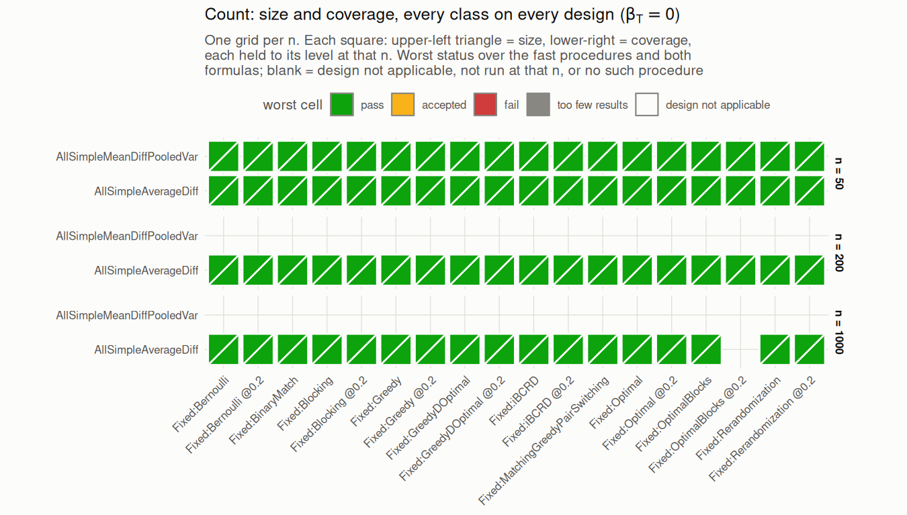
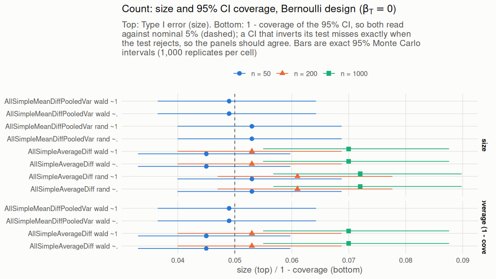
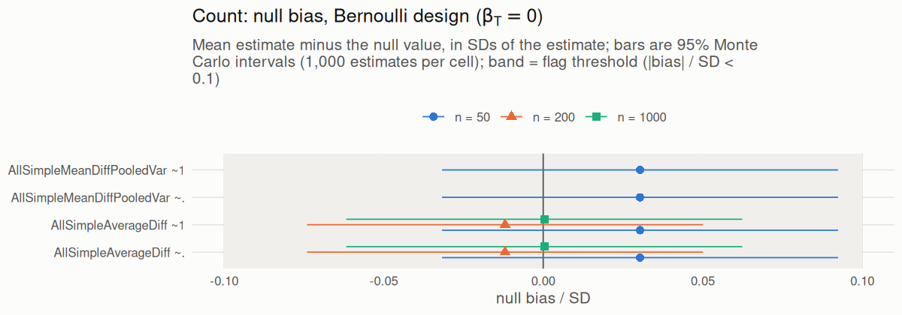
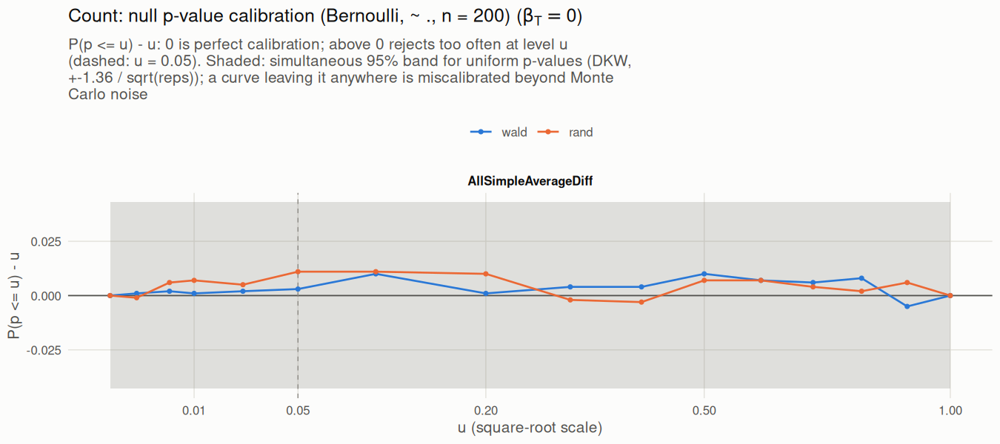
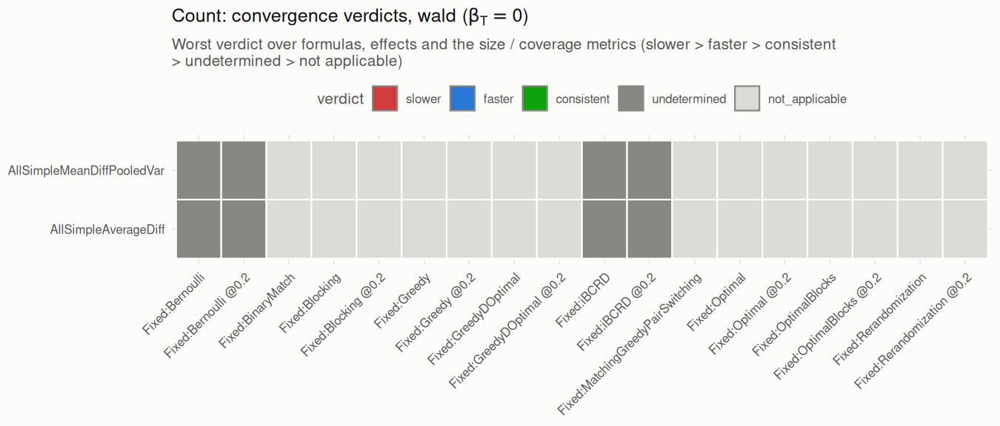
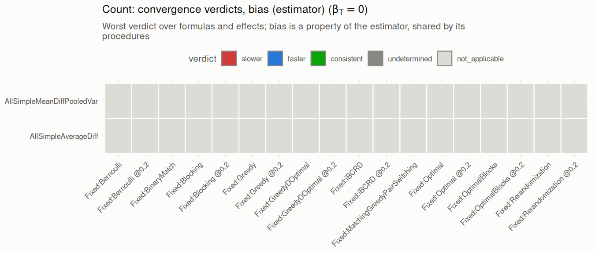

[← Campaign 2026-11-12-a46ab113 summary](README.md)

# Figures: count

### Null treatment effect (beta_T = 0)

<picture><source media="(prefers-color-scheme: dark)" srcset="figures/overview-count-dark.png"></picture>

<picture><source media="(prefers-color-scheme: dark)" srcset="figures/size-coverage-count-dark.png"></picture>

<picture><source media="(prefers-color-scheme: dark)" srcset="figures/null-bias-count-dark.png"></picture>

<picture><source media="(prefers-color-scheme: dark)" srcset="figures/pvalue-curves-count-dark.png"></picture>

##### Convergence of the error with n

140 of 280 cells ran at two or more sample sizes; the others, and every cell whose error is below 2 Monte Carlo SE at fewer than two sizes, are `undetermined`.
The verdict is the noise-aware power-law fit (binomial / normal likelihood) against the registry's expected order; reported, not gated. See `summary/convergence_summary.csv` (also the log-log regression slope, biased toward 0 where |error| is Monte Carlo noise).

<picture><source media="(prefers-color-scheme: dark)" srcset="figures/convergence-grid-count-wald-dark.png"></picture>

<picture><source media="(prefers-color-scheme: dark)" srcset="figures/convergence-grid-count-bias-dark.png"></picture>

### Non-null treatment effect (beta_T != 0)

Coverage and bias are measured against the true value of each class's own estimand; cells with no true value
(classes that apply only to matched designs, or failed large-sample fits) are shown as such and not tested.

[← Campaign 2026-11-12-a46ab113 summary](README.md)
