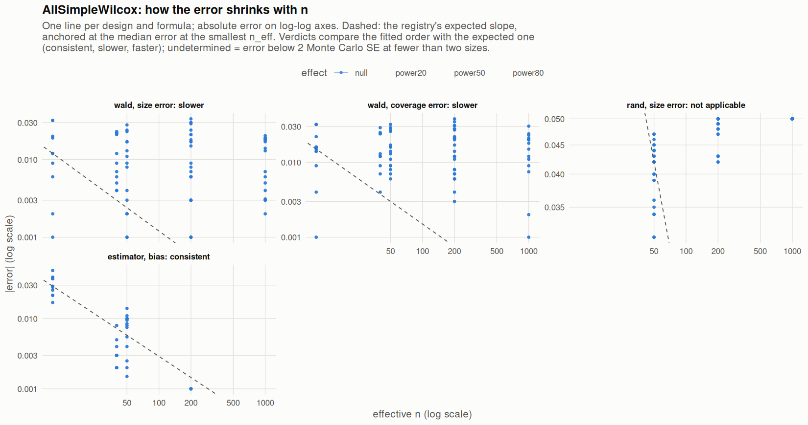

[← Campaign 2026-11-15-e36c7710 summary](README.md)

# Class AllSimpleWilcox

Part of the [Classes index](classes.md). Response type: ordinal. Status: null effect in progress, power effects not started. Verdict: **pass so far**.

<picture><source media="(prefers-color-scheme: dark)" srcset="figures/class-AllSimpleWilcox-dark.png"></picture>

Convergence verdicts (worst over designs, formulas and effects; provisional until the class is complete):

| procedure | metric | verdict |
|---|---|---|
| estimator (bias) | bias | consistent |
| wald | coverage | slower |
| rand | size | not applicable |
| wald | size | slower |

Null effect: 312 cells (0 failing). Size, coverage and bias / SD against the level each is held to.

| design | n | formula | procedure | size | coverage | bias / SD | size level | coverage level | verdict |
|---|---|---|---|---|---|---|---|---|---|
| Fixed:Bernoulli | 50 | `~.` | rand | 0.015 |  | -0.032 | 0.05 | 0.95 | ok |
| Fixed:Bernoulli | 200 | `~.` | rand | 0.001 |  | 0.032 | 0.05 | 0.95 | ok |
| Fixed:Bernoulli | 1000 | `~.` | rand | 0 |  |  | 0.05 | 0.95 | ok |
| Fixed:Bernoulli | 50 | `~.` | wald | 0.042 | 0.964 | -0.032 | 0.1 | 0.9 | ok |
| Fixed:Bernoulli | 200 | `~.` | wald | 0.049 | 0.957 | 0.032 | 0.0625 | 0.938 | ok |
| Fixed:Bernoulli | 1000 | `~.` | wald | 0.054 | 0.952 |  | 0.0525 | 0.948 | ok |
| Fixed:Bernoulli | 50 | `~1` | rand | 0.015 |  | -0.032 | 0.05 | 0.95 | ok |
| Fixed:Bernoulli | 200 | `~1` | rand | 0.001 |  | 0.032 | 0.05 | 0.95 | ok |
| Fixed:Bernoulli | 1000 | `~1` | rand | 0 |  |  | 0.05 | 0.95 | ok |
| Fixed:Bernoulli | 50 | `~1` | wald | 0.042 | 0.964 | -0.032 | 0.1 | 0.9 | ok |
| Fixed:Bernoulli | 200 | `~1` | wald | 0.049 | 0.957 | 0.032 | 0.0625 | 0.938 | ok |
| Fixed:Bernoulli | 1000 | `~1` | wald | 0.054 | 0.952 |  | 0.0525 | 0.948 | ok |
| Fixed:Bernoulli@0.2 | 50 | `~.` | rand | 0.005 |  | -0.067 | 0.05 | 0.95 | ok |
| Fixed:Bernoulli@0.2 | 200 | `~.` | rand | 0.007 |  | -0.036 | 0.05 | 0.95 | ok |
| Fixed:Bernoulli@0.2 | 1000 | `~.` | rand | 0 |  |  | 0.05 | 0.95 | ok |
| Fixed:Bernoulli@0.2 | 50 | `~.` | wald | 0.044 | 0.966 | -0.067 | 0.1 | 0.9 | ok |
| Fixed:Bernoulli@0.2 | 200 | `~.` | wald | 0.056 | 0.954 | -0.036 | 0.1 | 0.9 | ok |
| Fixed:Bernoulli@0.2 | 1000 | `~.` | wald | 0.049 | 0.957 |  | 0.0625 | 0.938 | ok |
| Fixed:Bernoulli@0.2 | 50 | `~1` | rand | 0.005 |  | -0.067 | 0.05 | 0.95 | ok |
| Fixed:Bernoulli@0.2 | 200 | `~1` | rand | 0.007 |  | -0.036 | 0.05 | 0.95 | ok |
| Fixed:Bernoulli@0.2 | 1000 | `~1` | rand | 0 |  |  | 0.05 | 0.95 | ok |
| Fixed:Bernoulli@0.2 | 50 | `~1` | wald | 0.044 | 0.966 | -0.067 | 0.1 | 0.9 | ok |
| Fixed:Bernoulli@0.2 | 200 | `~1` | wald | 0.056 | 0.954 | -0.036 | 0.1 | 0.9 | ok |
| Fixed:Bernoulli@0.2 | 1000 | `~1` | wald | 0.049 | 0.957 |  | 0.0625 | 0.938 | ok |
| Fixed:BinaryMatch | 50 | `~.` | rand | 0.016 |  | -0.028 | 0.05 | 0.95 | ok |
| Fixed:BinaryMatch | 200 | `~.` | rand | 0 |  |  | 0.05 | 0.95 | ok |
| Fixed:BinaryMatch | 1000 | `~.` | rand | 0 |  |  | 0.05 | 0.95 | ok |
| Fixed:BinaryMatch | 50 | `~.` | wald | 0.037 | 0.966 | -0.028 | 0.1 | 0.9 | ok |
| Fixed:BinaryMatch | 200 | `~.` | wald | 0.035 | 0.971 |  | 0.0625 | 0.938 | ok |
| Fixed:BinaryMatch | 1000 | `~.` | wald | 0.032 | 0.974 |  | 0.0525 | 0.948 | ok |
| Fixed:BinaryMatch | 50 | `~1` | rand | 0.016 |  | -0.028 | 0.05 | 0.95 | ok |
| Fixed:BinaryMatch | 200 | `~1` | rand | 0 |  |  | 0.05 | 0.95 | ok |
| Fixed:BinaryMatch | 1000 | `~1` | rand | 0 |  |  | 0.05 | 0.95 | ok |
| Fixed:BinaryMatch | 50 | `~1` | wald | 0.037 | 0.966 | -0.028 | 0.1 | 0.9 | ok |
| Fixed:BinaryMatch | 200 | `~1` | wald | 0.035 | 0.971 |  | 0.0625 | 0.938 | ok |
| Fixed:BinaryMatch | 1000 | `~1` | wald | 0.032 | 0.974 |  | 0.0525 | 0.948 | ok |
| Fixed:Blocking | 50 | `~.` | rand | 0.01 |  | 0.018 | 0.05 | 0.95 | ok |
| Fixed:Blocking | 200 | `~.` | rand | 0.001 |  | -0.032 | 0.05 | 0.95 | ok |
| Fixed:Blocking | 1000 | `~.` | rand | 0 |  |  | 0.05 | 0.95 | ok |
| Fixed:Blocking | 50 | `~.` | wald | 0.052 | 0.956 | 0.018 | 0.1 | 0.9 | ok |
| Fixed:Blocking | 200 | `~.` | wald | 0.044 | 0.962 | -0.032 | 0.0625 | 0.938 | ok |
| Fixed:Blocking | 1000 | `~.` | wald | 0.037 | 0.97 |  | 0.0525 | 0.948 | ok |
| Fixed:Blocking | 50 | `~1` | rand | 0.01 |  | 0.018 | 0.05 | 0.95 | ok |
| Fixed:Blocking | 200 | `~1` | rand | 0.001 |  | -0.032 | 0.05 | 0.95 | ok |
| Fixed:Blocking | 1000 | `~1` | rand | 0 |  |  | 0.05 | 0.95 | ok |
| Fixed:Blocking | 50 | `~1` | wald | 0.052 | 0.956 | 0.018 | 0.1 | 0.9 | ok |
| Fixed:Blocking | 200 | `~1` | wald | 0.044 | 0.962 | -0.032 | 0.0625 | 0.938 | ok |
| Fixed:Blocking | 1000 | `~1` | wald | 0.037 | 0.97 |  | 0.0525 | 0.948 | ok |
| Fixed:Blocking@0.2 | 50 | `~.` | rand | 0.006 |  | -0.096 | 0.05 | 0.95 | ok |
| Fixed:Blocking@0.2 | 200 | `~.` | rand | 0.008 |  | -0.09 | 0.05 | 0.95 | ok |
| Fixed:Blocking@0.2 | 1000 | `~.` | rand | 0 |  |  | 0.05 | 0.95 | ok |
| Fixed:Blocking@0.2 | 50 | `~.` | wald | 0.041 | 0.964 | -0.096 | 0.1 | 0.9 | ok |
| Fixed:Blocking@0.2 | 200 | `~.` | wald | 0.046 | 0.959 | -0.09 | 0.1 | 0.9 | ok |
| Fixed:Blocking@0.2 | 1000 | `~.` | wald | 0.05 | 0.954 |  | 0.0625 | 0.938 | ok |
| Fixed:Blocking@0.2 | 50 | `~1` | rand | 0.006 |  | -0.096 | 0.05 | 0.95 | ok |
| Fixed:Blocking@0.2 | 200 | `~1` | rand | 0.008 |  | -0.09 | 0.05 | 0.95 | ok |
| Fixed:Blocking@0.2 | 1000 | `~1` | rand | 0 |  |  | 0.05 | 0.95 | ok |
| Fixed:Blocking@0.2 | 50 | `~1` | wald | 0.041 | 0.964 | -0.096 | 0.1 | 0.9 | ok |
| Fixed:Blocking@0.2 | 200 | `~1` | wald | 0.046 | 0.959 | -0.09 | 0.1 | 0.9 | ok |
| Fixed:Blocking@0.2 | 1000 | `~1` | wald | 0.05 | 0.954 |  | 0.0625 | 0.938 | ok |
| Fixed:Greedy | 50 | `~.` | rand | 0.019 |  | 0.041 | 0.05 | 0.95 | ok |
| Fixed:Greedy | 200 | `~.` | rand | 0 |  |  | 0.05 | 0.95 | ok |
| Fixed:Greedy | 1000 | `~.` | rand | 0 |  |  | 0.05 | 0.95 | ok |
| Fixed:Greedy | 50 | `~.` | wald | 0.033 | 0.976 | 0.041 | 0.1 | 0.9 | ok |
| Fixed:Greedy | 200 | `~.` | wald | 0.029 | 0.978 |  | 0.0625 | 0.938 | ok |
| Fixed:Greedy | 1000 | `~.` | wald | 0.0297 | 0.97 |  | 0.0525 | 0.948 | ok |
| Fixed:Greedy | 50 | `~1` | rand | 0.019 |  | 0.041 | 0.05 | 0.95 | ok |
| Fixed:Greedy | 200 | `~1` | rand | 0 |  |  | 0.05 | 0.95 | ok |
| Fixed:Greedy | 1000 | `~1` | rand | 0 |  |  | 0.05 | 0.95 | ok |
| Fixed:Greedy | 50 | `~1` | wald | 0.033 | 0.976 | 0.041 | 0.1 | 0.9 | ok |
| Fixed:Greedy | 200 | `~1` | wald | 0.029 | 0.978 |  | 0.0625 | 0.938 | ok |
| Fixed:Greedy | 1000 | `~1` | wald | 0.0297 | 0.97 |  | 0.0525 | 0.948 | ok |
| Fixed:Greedy@0.2 | 50 | `~.` | rand | 0.003 |  | -0.064 | 0.05 | 0.95 | ok |
| Fixed:Greedy@0.2 | 200 | `~.` | rand | 0.002 |  | -0.045 | 0.05 | 0.95 | ok |
| Fixed:Greedy@0.2 | 1000 | `~.` | rand | 0 |  |  | 0.05 | 0.95 | ok |
| Fixed:Greedy@0.2 | 50 | `~.` | wald | 0.018 | 0.982 | -0.064 | 0.1 | 0.9 | ok |
| Fixed:Greedy@0.2 | 200 | `~.` | wald | 0.028 | 0.974 | -0.045 | 0.1 | 0.9 | ok |
| Fixed:Greedy@0.2 | 1000 | `~.` | wald | 0.0165 | 0.985 |  | 0.0625 | 0.938 | ok |
| Fixed:Greedy@0.2 | 50 | `~1` | rand | 0.003 |  | -0.064 | 0.05 | 0.95 | ok |
| Fixed:Greedy@0.2 | 200 | `~1` | rand | 0.002 |  | -0.045 | 0.05 | 0.95 | ok |
| Fixed:Greedy@0.2 | 1000 | `~1` | rand | 0 |  |  | 0.05 | 0.95 | ok |
| Fixed:Greedy@0.2 | 50 | `~1` | wald | 0.018 | 0.982 | -0.064 | 0.1 | 0.9 | ok |
| Fixed:Greedy@0.2 | 200 | `~1` | wald | 0.028 | 0.974 | -0.045 | 0.1 | 0.9 | ok |
| Fixed:Greedy@0.2 | 1000 | `~1` | wald | 0.0165 | 0.985 |  | 0.0625 | 0.938 | ok |
| Fixed:GreedyDOptimal | 50 | `~.` | rand | 0.019 |  | 0.041 | 0.05 | 0.95 | ok |
| Fixed:GreedyDOptimal | 200 | `~.` | rand | 0 |  |  | 0.05 | 0.95 | ok |
| Fixed:GreedyDOptimal | 1000 | `~.` | rand | 0 |  |  | 0.05 | 0.95 | ok |
| Fixed:GreedyDOptimal | 50 | `~.` | wald | 0.033 | 0.976 | 0.041 | 0.1 | 0.9 | ok |
| Fixed:GreedyDOptimal | 200 | `~.` | wald | 0.029 | 0.978 |  | 0.0625 | 0.938 | ok |
| Fixed:GreedyDOptimal | 1000 | `~.` | wald | 0.032 | 0.97 |  | 0.0525 | 0.948 | ok |
| Fixed:GreedyDOptimal | 50 | `~1` | rand | 0.019 |  | 0.041 | 0.05 | 0.95 | ok |
| Fixed:GreedyDOptimal | 200 | `~1` | rand | 0 |  |  | 0.05 | 0.95 | ok |
| Fixed:GreedyDOptimal | 1000 | `~1` | rand | 0 |  |  | 0.05 | 0.95 | ok |
| Fixed:GreedyDOptimal | 50 | `~1` | wald | 0.033 | 0.976 | 0.041 | 0.1 | 0.9 | ok |
| Fixed:GreedyDOptimal | 200 | `~1` | wald | 0.029 | 0.978 |  | 0.0625 | 0.938 | ok |
| Fixed:GreedyDOptimal | 1000 | `~1` | wald | 0.032 | 0.97 |  | 0.0525 | 0.948 | ok |
| Fixed:GreedyDOptimal@0.2 | 50 | `~.` | rand | 0.003 |  | -0.064 | 0.05 | 0.95 | ok |
| Fixed:GreedyDOptimal@0.2 | 200 | `~.` | rand | 0.002 |  | -0.045 | 0.05 | 0.95 | ok |
| Fixed:GreedyDOptimal@0.2 | 1000 | `~.` | rand | 0 |  |  | 0.05 | 0.95 | ok |
| Fixed:GreedyDOptimal@0.2 | 50 | `~.` | wald | 0.018 | 0.982 | -0.064 | 0.1 | 0.9 | ok |
| Fixed:GreedyDOptimal@0.2 | 200 | `~.` | wald | 0.028 | 0.974 | -0.045 | 0.1 | 0.9 | ok |
| Fixed:GreedyDOptimal@0.2 | 1000 | `~.` | wald | 0.0201 | 0.981 |  | 0.0625 | 0.938 | ok |
| Fixed:GreedyDOptimal@0.2 | 50 | `~1` | rand | 0.003 |  | -0.064 | 0.05 | 0.95 | ok |
| Fixed:GreedyDOptimal@0.2 | 200 | `~1` | rand | 0.002 |  | -0.045 | 0.05 | 0.95 | ok |
| Fixed:GreedyDOptimal@0.2 | 1000 | `~1` | rand | 0 |  |  | 0.05 | 0.95 | ok |
| Fixed:GreedyDOptimal@0.2 | 50 | `~1` | wald | 0.018 | 0.982 | -0.064 | 0.1 | 0.9 | ok |
| Fixed:GreedyDOptimal@0.2 | 200 | `~1` | wald | 0.028 | 0.974 | -0.045 | 0.1 | 0.9 | ok |
| Fixed:GreedyDOptimal@0.2 | 1000 | `~1` | wald | 0.0201 | 0.981 |  | 0.0625 | 0.938 | ok |
| Fixed:iBCRD | 50 | `~.` | rand | 0.005 |  | 0.035 | 0.05 | 0.95 | ok |
| Fixed:iBCRD | 200 | `~.` | rand | 0.001 |  | -0.032 | 0.05 | 0.95 | ok |
| Fixed:iBCRD | 1000 | `~.` | rand | 0 |  |  | 0.05 | 0.95 | ok |
| Fixed:iBCRD | 50 | `~.` | wald | 0.041 | 0.967 | 0.035 | 0.1 | 0.9 | ok |
| Fixed:iBCRD | 200 | `~.` | wald | 0.041 | 0.967 | -0.032 | 0.0625 | 0.938 | ok |
| Fixed:iBCRD | 1000 | `~.` | wald | 0.047 | 0.965 |  | 0.0525 | 0.948 | ok |
| Fixed:iBCRD | 50 | `~1` | rand | 0.005 |  | 0.035 | 0.05 | 0.95 | ok |
| Fixed:iBCRD | 200 | `~1` | rand | 0.001 |  | -0.032 | 0.05 | 0.95 | ok |
| Fixed:iBCRD | 1000 | `~1` | rand | 0 |  |  | 0.05 | 0.95 | ok |
| Fixed:iBCRD | 50 | `~1` | wald | 0.041 | 0.967 | 0.035 | 0.1 | 0.9 | ok |
| Fixed:iBCRD | 200 | `~1` | wald | 0.041 | 0.967 | -0.032 | 0.0625 | 0.938 | ok |
| Fixed:iBCRD | 1000 | `~1` | wald | 0.047 | 0.965 |  | 0.0525 | 0.948 | ok |
| Fixed:iBCRD@0.2 | 50 | `~.` | rand | 0.004 |  | -0.067 | 0.05 | 0.95 | ok |
| Fixed:iBCRD@0.2 | 200 | `~.` | rand | 0.002 |  | -0.045 | 0.05 | 0.95 | ok |
| Fixed:iBCRD@0.2 | 1000 | `~.` | rand | 0 |  |  | 0.05 | 0.95 | ok |
| Fixed:iBCRD@0.2 | 50 | `~.` | wald | 0.038 | 0.965 | -0.067 | 0.1 | 0.9 | ok |
| Fixed:iBCRD@0.2 | 200 | `~.` | wald | 0.038 | 0.963 | -0.045 | 0.1 | 0.9 | ok |
| Fixed:iBCRD@0.2 | 1000 | `~.` | wald | 0.05 | 0.953 |  | 0.0625 | 0.938 | ok |
| Fixed:iBCRD@0.2 | 50 | `~1` | rand | 0.004 |  | -0.067 | 0.05 | 0.95 | ok |
| Fixed:iBCRD@0.2 | 200 | `~1` | rand | 0.002 |  | -0.045 | 0.05 | 0.95 | ok |
| Fixed:iBCRD@0.2 | 1000 | `~1` | rand | 0 |  |  | 0.05 | 0.95 | ok |
| Fixed:iBCRD@0.2 | 50 | `~1` | wald | 0.038 | 0.965 | -0.067 | 0.1 | 0.9 | ok |
| Fixed:iBCRD@0.2 | 200 | `~1` | wald | 0.038 | 0.963 | -0.045 | 0.1 | 0.9 | ok |
| Fixed:iBCRD@0.2 | 1000 | `~1` | wald | 0.05 | 0.953 |  | 0.0625 | 0.938 | ok |
| Fixed:MatchingGreedyPairSwitching | 50 | `~.` | rand | 0.016 |  | 0.036 | 0.05 | 0.95 | ok |
| Fixed:MatchingGreedyPairSwitching | 200 | `~.` | rand | 0 |  |  | 0.05 | 0.95 | ok |
| Fixed:MatchingGreedyPairSwitching | 1000 | `~.` | rand | 0 |  |  | 0.05 | 0.95 | ok |
| Fixed:MatchingGreedyPairSwitching | 50 | `~.` | wald | 0.027 | 0.978 | 0.036 | 0.1 | 0.9 | ok |
| Fixed:MatchingGreedyPairSwitching | 200 | `~.` | wald | 0.032 | 0.972 |  | 0.0625 | 0.938 | ok |
| Fixed:MatchingGreedyPairSwitching | 1000 | `~.` | wald | 0.033 | 0.971 |  | 0.0525 | 0.948 | ok |
| Fixed:MatchingGreedyPairSwitching | 50 | `~1` | rand | 0.016 |  | 0.036 | 0.05 | 0.95 | ok |
| Fixed:MatchingGreedyPairSwitching | 200 | `~1` | rand | 0 |  |  | 0.05 | 0.95 | ok |
| Fixed:MatchingGreedyPairSwitching | 1000 | `~1` | rand | 0 |  |  | 0.05 | 0.95 | ok |
| Fixed:MatchingGreedyPairSwitching | 50 | `~1` | wald | 0.027 | 0.978 | 0.036 | 0.1 | 0.9 | ok |
| Fixed:MatchingGreedyPairSwitching | 200 | `~1` | wald | 0.032 | 0.972 |  | 0.0625 | 0.938 | ok |
| Fixed:MatchingGreedyPairSwitching | 1000 | `~1` | wald | 0.033 | 0.971 |  | 0.0525 | 0.948 | ok |
| Fixed:Optimal | 50 | `~.` | wald | 0.022 | 0.982 | -0.064 | 0.1 | 0.9 | ok |
| Fixed:Optimal | 200 | `~.` | wald | 0.033 | 0.97 |  | 0.0625 | 0.938 | ok |
| Fixed:Optimal | 1000 | `~.` | wald | 0.031 | 0.973 |  | 0.0525 | 0.948 | ok |
| Fixed:Optimal | 50 | `~1` | wald | 0.022 | 0.982 | -0.064 | 0.1 | 0.9 | ok |
| Fixed:Optimal | 200 | `~1` | wald | 0.033 | 0.97 |  | 0.0625 | 0.938 | ok |
| Fixed:Optimal | 1000 | `~1` | wald | 0.031 | 0.973 |  | 0.0525 | 0.948 | ok |
| Fixed:Optimal@0.2 | 50 | `~.` | wald | 0.031 | 0.972 | -0.051 | 0.1 | 0.9 | ok |
| Fixed:Optimal@0.2 | 200 | `~.` | wald | 0.027 | 0.979 |  | 0.1 | 0.9 | ok |
| Fixed:Optimal@0.2 | 1000 | `~.` | wald | 0.021 | 0.981 |  | 0.0625 | 0.938 | ok |
| Fixed:Optimal@0.2 | 50 | `~1` | wald | 0.031 | 0.972 | -0.051 | 0.1 | 0.9 | ok |
| Fixed:Optimal@0.2 | 200 | `~1` | wald | 0.027 | 0.979 |  | 0.1 | 0.9 | ok |
| Fixed:Optimal@0.2 | 1000 | `~1` | wald | 0.021 | 0.981 |  | 0.0625 | 0.938 | ok |
| Fixed:OptimalBlocks | 50 | `~.` | rand | 0.014 |  | 0.034 | 0.05 | 0.95 | ok |
| Fixed:OptimalBlocks | 200 | `~.` | rand | 0.001 |  | -0.032 | 0.05 | 0.95 | ok |
| Fixed:OptimalBlocks | 1000 | `~.` | rand | 0 |  |  | 0.05 | 0.95 | ok |
| Fixed:OptimalBlocks | 50 | `~.` | wald | 0.048 | 0.961 | 0.034 | 0.1 | 0.9 | ok |
| Fixed:OptimalBlocks | 200 | `~.` | wald | 0.033 | 0.971 | -0.032 | 0.0625 | 0.938 | ok |
| Fixed:OptimalBlocks | 1000 | `~.` | wald | 0.036 | 0.97 |  | 0.0525 | 0.948 | ok |
| Fixed:OptimalBlocks | 50 | `~1` | rand | 0.014 |  | 0.034 | 0.05 | 0.95 | ok |
| Fixed:OptimalBlocks | 200 | `~1` | rand | 0.001 |  | -0.032 | 0.05 | 0.95 | ok |
| Fixed:OptimalBlocks | 1000 | `~1` | rand | 0 |  |  | 0.05 | 0.95 | ok |
| Fixed:OptimalBlocks | 50 | `~1` | wald | 0.048 | 0.961 | 0.034 | 0.1 | 0.9 | ok |
| Fixed:OptimalBlocks | 200 | `~1` | wald | 0.033 | 0.971 | -0.032 | 0.0625 | 0.938 | ok |
| Fixed:OptimalBlocks | 1000 | `~1` | wald | 0.036 | 0.97 |  | 0.0525 | 0.948 | ok |
| Fixed:OptimalBlocks@0.2 | 50 | `~.` | rand | 0.008 |  | -0.087 | 0.05 | 0.95 | ok |
| Fixed:OptimalBlocks@0.2 | 200 | `~.` | rand | 0.003 |  | -0.055 | 0.05 | 0.95 | ok |
| Fixed:OptimalBlocks@0.2 | 1000 | `~.` | rand | 0 |  |  | 0.05 | 0.95 | ok |
| Fixed:OptimalBlocks@0.2 | 50 | `~.` | wald | 0.051 | 0.951 | -0.087 | 0.1 | 0.9 | ok |
| Fixed:OptimalBlocks@0.2 | 200 | `~.` | wald | 0.029 | 0.975 | -0.055 | 0.1 | 0.9 | ok |
| Fixed:OptimalBlocks@0.2 | 1000 | `~.` | wald | 0.026 | 0.977 |  | 0.0625 | 0.938 | ok |
| Fixed:OptimalBlocks@0.2 | 50 | `~1` | rand | 0.008 |  | -0.087 | 0.05 | 0.95 | ok |
| Fixed:OptimalBlocks@0.2 | 200 | `~1` | rand | 0.003 |  | -0.055 | 0.05 | 0.95 | ok |
| Fixed:OptimalBlocks@0.2 | 1000 | `~1` | rand | 0 |  |  | 0.05 | 0.95 | ok |
| Fixed:OptimalBlocks@0.2 | 50 | `~1` | wald | 0.051 | 0.951 | -0.087 | 0.1 | 0.9 | ok |
| Fixed:OptimalBlocks@0.2 | 200 | `~1` | wald | 0.029 | 0.975 | -0.055 | 0.1 | 0.9 | ok |
| Fixed:OptimalBlocks@0.2 | 1000 | `~1` | wald | 0.026 | 0.977 |  | 0.0625 | 0.938 | ok |
| Fixed:Rerandomization | 50 | `~.` | rand | 0.006 |  | 0.0073 | 0.05 | 0.95 | ok |
| Fixed:Rerandomization | 200 | `~.` | rand | 0 |  |  | 0.05 | 0.95 | ok |
| Fixed:Rerandomization | 1000 | `~.` | rand | 0 |  |  | 0.05 | 0.95 | ok |
| Fixed:Rerandomization | 50 | `~.` | wald | 0.039 | 0.966 | 0.0073 | 0.1 | 0.9 | ok |
| Fixed:Rerandomization | 200 | `~.` | wald | 0.057 | 0.95 |  | 0.0625 | 0.938 | ok |
| Fixed:Rerandomization | 1000 | `~.` | wald | 0.056 | 0.949 |  | 0.0525 | 0.948 | ok |
| Fixed:Rerandomization | 50 | `~1` | rand | 0.006 |  | 0.0073 | 0.05 | 0.95 | ok |
| Fixed:Rerandomization | 200 | `~1` | rand | 0 |  |  | 0.05 | 0.95 | ok |
| Fixed:Rerandomization | 1000 | `~1` | rand | 0 |  |  | 0.05 | 0.95 | ok |
| Fixed:Rerandomization | 50 | `~1` | wald | 0.039 | 0.966 | 0.0073 | 0.1 | 0.9 | ok |
| Fixed:Rerandomization | 200 | `~1` | wald | 0.057 | 0.95 |  | 0.0625 | 0.938 | ok |
| Fixed:Rerandomization | 1000 | `~1` | wald | 0.056 | 0.949 |  | 0.0525 | 0.948 | ok |
| Fixed:Rerandomization@0.2 | 50 | `~.` | rand | 0.007 |  | -0.066 | 0.05 | 0.95 | ok |
| Fixed:Rerandomization@0.2 | 200 | `~.` | rand | 0.007 |  | -0.036 | 0.05 | 0.95 | ok |
| Fixed:Rerandomization@0.2 | 1000 | `~.` | rand | 0 |  |  | 0.05 | 0.95 | ok |
| Fixed:Rerandomization@0.2 | 50 | `~.` | wald | 0.05 | 0.954 | -0.066 | 0.1 | 0.9 | ok |
| Fixed:Rerandomization@0.2 | 200 | `~.` | wald | 0.041 | 0.962 | -0.036 | 0.1 | 0.9 | ok |
| Fixed:Rerandomization@0.2 | 1000 | `~.` | wald | 0.044 | 0.964 |  | 0.0625 | 0.938 | ok |
| Fixed:Rerandomization@0.2 | 50 | `~1` | rand | 0.007 |  | -0.066 | 0.05 | 0.95 | ok |
| Fixed:Rerandomization@0.2 | 200 | `~1` | rand | 0.007 |  | -0.036 | 0.05 | 0.95 | ok |
| Fixed:Rerandomization@0.2 | 1000 | `~1` | rand | 0 |  |  | 0.05 | 0.95 | ok |
| Fixed:Rerandomization@0.2 | 50 | `~1` | wald | 0.05 | 0.954 | -0.066 | 0.1 | 0.9 | ok |
| Fixed:Rerandomization@0.2 | 200 | `~1` | wald | 0.041 | 0.962 | -0.036 | 0.1 | 0.9 | ok |
| Fixed:Rerandomization@0.2 | 1000 | `~1` | wald | 0.044 | 0.964 |  | 0.0625 | 0.938 | ok |
| SeqOneByOne:Atkinson | 50 | `~.` | rand | 0.01 |  | 0.011 | 0.05 | 0.95 | ok |
| SeqOneByOne:Atkinson | 200 | `~.` | rand | 0 |  |  | 0.05 | 0.95 | ok |
| SeqOneByOne:Atkinson | 1000 | `~.` | rand | 0 |  |  | 0.05 | 0.95 | ok |
| SeqOneByOne:Atkinson | 50 | `~.` | wald | 0.026 | 0.979 | 0.011 | 0.1 | 0.9 | ok |
| SeqOneByOne:Atkinson | 200 | `~.` | wald | 0.02 | 0.988 |  | 0.0625 | 0.938 | ok |
| SeqOneByOne:Atkinson | 1000 | `~.` | wald | 0.031 | 0.98 |  | 0.0525 | 0.948 | ok |
| SeqOneByOne:Atkinson | 50 | `~1` | rand | 0.01 |  | 0.011 | 0.05 | 0.95 | ok |
| SeqOneByOne:Atkinson | 200 | `~1` | rand | 0 |  |  | 0.05 | 0.95 | ok |
| SeqOneByOne:Atkinson | 1000 | `~1` | rand | 0 |  |  | 0.05 | 0.95 | ok |
| SeqOneByOne:Atkinson | 50 | `~1` | wald | 0.026 | 0.979 | 0.011 | 0.1 | 0.9 | ok |
| SeqOneByOne:Atkinson | 200 | `~1` | wald | 0.02 | 0.988 |  | 0.0625 | 0.938 | ok |
| SeqOneByOne:Atkinson | 1000 | `~1` | wald | 0.031 | 0.98 |  | 0.0525 | 0.948 | ok |
| SeqOneByOne:Bernoulli | 50 | `~.` | rand | 0.011 |  | 0 | 0.05 | 0.95 | ok |
| SeqOneByOne:Bernoulli | 200 | `~.` | rand | 0 |  |  | 0.05 | 0.95 | ok |
| SeqOneByOne:Bernoulli | 1000 | `~.` | rand | 0 |  |  | 0.05 | 0.95 | ok |
| SeqOneByOne:Bernoulli | 50 | `~.` | wald | 0.049 | 0.958 | 0 | 0.1 | 0.9 | ok |
| SeqOneByOne:Bernoulli | 200 | `~.` | wald | 0.049 | 0.962 |  | 0.0625 | 0.938 | ok |
| SeqOneByOne:Bernoulli | 1000 | `~.` | wald | 0.055 | 0.959 |  | 0.0525 | 0.948 | ok |
| SeqOneByOne:Bernoulli | 50 | `~1` | rand | 0.011 |  | 0 | 0.05 | 0.95 | ok |
| SeqOneByOne:Bernoulli | 200 | `~1` | rand | 0 |  |  | 0.05 | 0.95 | ok |
| SeqOneByOne:Bernoulli | 1000 | `~1` | rand | 0 |  |  | 0.05 | 0.95 | ok |
| SeqOneByOne:Bernoulli | 50 | `~1` | wald | 0.049 | 0.958 | 0 | 0.1 | 0.9 | ok |
| SeqOneByOne:Bernoulli | 200 | `~1` | wald | 0.049 | 0.962 |  | 0.0625 | 0.938 | ok |
| SeqOneByOne:Bernoulli | 1000 | `~1` | wald | 0.055 | 0.959 |  | 0.0525 | 0.948 | ok |
| SeqOneByOne:Bernoulli@0.2 | 50 | `~.` | rand | 0.008 |  | -0.091 | 0.05 | 0.95 | ok |
| SeqOneByOne:Bernoulli@0.2 | 200 | `~.` | rand | 0.007 |  | -0.06 | 0.05 | 0.95 | ok |
| SeqOneByOne:Bernoulli@0.2 | 1000 | `~.` | rand | 0 |  |  | 0.05 | 0.95 | ok |
| SeqOneByOne:Bernoulli@0.2 | 50 | `~.` | wald | 0.048 | 0.959 | -0.091 | 0.1 | 0.9 | ok |
| SeqOneByOne:Bernoulli@0.2 | 200 | `~.` | wald | 0.054 | 0.957 | -0.06 | 0.1 | 0.9 | ok |
| SeqOneByOne:Bernoulli@0.2 | 1000 | `~.` | wald | 0.044 | 0.958 |  | 0.0625 | 0.938 | ok |
| SeqOneByOne:Bernoulli@0.2 | 50 | `~1` | rand | 0.008 |  | -0.091 | 0.05 | 0.95 | ok |
| SeqOneByOne:Bernoulli@0.2 | 200 | `~1` | rand | 0.007 |  | -0.06 | 0.05 | 0.95 | ok |
| SeqOneByOne:Bernoulli@0.2 | 1000 | `~1` | rand | 0 |  |  | 0.05 | 0.95 | ok |
| SeqOneByOne:Bernoulli@0.2 | 50 | `~1` | wald | 0.048 | 0.959 | -0.091 | 0.1 | 0.9 | ok |
| SeqOneByOne:Bernoulli@0.2 | 200 | `~1` | wald | 0.054 | 0.957 | -0.06 | 0.1 | 0.9 | ok |
| SeqOneByOne:Bernoulli@0.2 | 1000 | `~1` | wald | 0.044 | 0.958 |  | 0.0625 | 0.938 | ok |
| SeqOneByOne:Efron | 50 | `~.` | rand | 0.008 |  | 0.036 | 0.05 | 0.95 | ok |
| SeqOneByOne:Efron | 200 | `~.` | rand | 0 |  |  | 0.05 | 0.95 | ok |
| SeqOneByOne:Efron | 1000 | `~.` | rand | 0 |  |  | 0.05 | 0.95 | ok |
| SeqOneByOne:Efron | 50 | `~.` | wald | 0.048 | 0.959 | 0.036 | 0.1 | 0.9 | ok |
| SeqOneByOne:Efron | 200 | `~.` | wald | 0.047 | 0.961 |  | 0.0625 | 0.938 | ok |
| SeqOneByOne:Efron | 1000 | `~.` | wald | 0.043 | 0.968 |  | 0.0525 | 0.948 | ok |
| SeqOneByOne:Efron | 50 | `~1` | rand | 0.008 |  | 0.036 | 0.05 | 0.95 | ok |
| SeqOneByOne:Efron | 200 | `~1` | rand | 0 |  |  | 0.05 | 0.95 | ok |
| SeqOneByOne:Efron | 1000 | `~1` | rand | 0 |  |  | 0.05 | 0.95 | ok |
| SeqOneByOne:Efron | 50 | `~1` | wald | 0.048 | 0.959 | 0.036 | 0.1 | 0.9 | ok |
| SeqOneByOne:Efron | 200 | `~1` | wald | 0.047 | 0.961 |  | 0.0625 | 0.938 | ok |
| SeqOneByOne:Efron | 1000 | `~1` | wald | 0.043 | 0.968 |  | 0.0525 | 0.948 | ok |
| SeqOneByOne:iBCRD | 50 | `~.` | rand | 0.006 |  | 0.014 | 0.05 | 0.95 | ok |
| SeqOneByOne:iBCRD | 200 | `~.` | rand | 0.002 |  | 0 | 0.05 | 0.95 | ok |
| SeqOneByOne:iBCRD | 1000 | `~.` | rand | 0 |  |  | 0.05 | 0.95 | ok |
| SeqOneByOne:iBCRD | 50 | `~.` | wald | 0.047 | 0.959 | 0.014 | 0.1 | 0.9 | ok |
| SeqOneByOne:iBCRD | 200 | `~.` | wald | 0.049 | 0.956 | 0 | 0.0625 | 0.938 | ok |
| SeqOneByOne:iBCRD | 1000 | `~.` | wald | 0.052 | 0.961 |  | 0.0525 | 0.948 | ok |
| SeqOneByOne:iBCRD | 50 | `~1` | rand | 0.006 |  | 0.014 | 0.05 | 0.95 | ok |
| SeqOneByOne:iBCRD | 200 | `~1` | rand | 0.002 |  | 0 | 0.05 | 0.95 | ok |
| SeqOneByOne:iBCRD | 1000 | `~1` | rand | 0 |  |  | 0.05 | 0.95 | ok |
| SeqOneByOne:iBCRD | 50 | `~1` | wald | 0.047 | 0.959 | 0.014 | 0.1 | 0.9 | ok |
| SeqOneByOne:iBCRD | 200 | `~1` | wald | 0.049 | 0.956 | 0 | 0.0625 | 0.938 | ok |
| SeqOneByOne:iBCRD | 1000 | `~1` | wald | 0.052 | 0.961 |  | 0.0525 | 0.948 | ok |
| SeqOneByOne:iBCRD@0.2 | 50 | `~.` | rand | 0.007 |  | -0.11 | 0.05 | 0.95 | ok |
| SeqOneByOne:iBCRD@0.2 | 200 | `~.` | rand | 0.008 |  | -0.045 | 0.05 | 0.95 | ok |
| SeqOneByOne:iBCRD@0.2 | 1000 | `~.` | rand | 0 |  |  | 0.05 | 0.95 | ok |
| SeqOneByOne:iBCRD@0.2 | 50 | `~.` | wald | 0.07 | 0.936 | -0.11 | 0.1 | 0.9 | ok |
| SeqOneByOne:iBCRD@0.2 | 200 | `~.` | wald | 0.043 | 0.962 | -0.045 | 0.1 | 0.9 | ok |
| SeqOneByOne:iBCRD@0.2 | 1000 | `~.` | wald | 0.047 | 0.956 |  | 0.0625 | 0.938 | ok |
| SeqOneByOne:iBCRD@0.2 | 50 | `~1` | rand | 0.007 |  | -0.11 | 0.05 | 0.95 | ok |
| SeqOneByOne:iBCRD@0.2 | 200 | `~1` | rand | 0.008 |  | -0.045 | 0.05 | 0.95 | ok |
| SeqOneByOne:iBCRD@0.2 | 1000 | `~1` | rand | 0 |  |  | 0.05 | 0.95 | ok |
| SeqOneByOne:iBCRD@0.2 | 50 | `~1` | wald | 0.07 | 0.936 | -0.11 | 0.1 | 0.9 | ok |
| SeqOneByOne:iBCRD@0.2 | 200 | `~1` | wald | 0.043 | 0.962 | -0.045 | 0.1 | 0.9 | ok |
| SeqOneByOne:iBCRD@0.2 | 1000 | `~1` | wald | 0.047 | 0.956 |  | 0.0625 | 0.938 | ok |
| SeqOneByOne:PocockSimon | 50 | `~.` | rand | 0.011 |  | 0.0052 | 0.05 | 0.95 | ok |
| SeqOneByOne:PocockSimon | 200 | `~.` | rand | 0 |  |  | 0.05 | 0.95 | ok |
| SeqOneByOne:PocockSimon | 1000 | `~.` | rand | 0 |  |  | 0.05 | 0.95 | ok |
| SeqOneByOne:PocockSimon | 50 | `~.` | wald | 0.046 | 0.963 | 0.0052 | 0.1 | 0.9 | ok |
| SeqOneByOne:PocockSimon | 200 | `~.` | wald | 0.053 | 0.95 |  | 0.0625 | 0.938 | ok |
| SeqOneByOne:PocockSimon | 1000 | `~.` | wald | 0.047 | 0.962 |  | 0.0525 | 0.948 | ok |
| SeqOneByOne:PocockSimon | 50 | `~1` | rand | 0.011 |  | 0.0052 | 0.05 | 0.95 | ok |
| SeqOneByOne:PocockSimon | 200 | `~1` | rand | 0 |  |  | 0.05 | 0.95 | ok |
| SeqOneByOne:PocockSimon | 1000 | `~1` | rand | 0 |  |  | 0.05 | 0.95 | ok |
| SeqOneByOne:PocockSimon | 50 | `~1` | wald | 0.046 | 0.963 | 0.0052 | 0.1 | 0.9 | ok |
| SeqOneByOne:PocockSimon | 200 | `~1` | wald | 0.053 | 0.95 |  | 0.0625 | 0.938 | ok |
| SeqOneByOne:PocockSimon | 1000 | `~1` | wald | 0.047 | 0.962 |  | 0.0525 | 0.948 | ok |
| SeqOneByOne:RandomBlockSize | 50 | `~.` | rand | 0.006 |  | 0.024 | 0.05 | 0.95 | ok |
| SeqOneByOne:RandomBlockSize | 200 | `~.` | rand | 0.001 |  | 0.032 | 0.05 | 0.95 | ok |
| SeqOneByOne:RandomBlockSize | 1000 | `~.` | rand | 0 |  |  | 0.05 | 0.95 | ok |
| SeqOneByOne:RandomBlockSize | 50 | `~.` | wald | 0.051 | 0.957 | 0.024 | 0.1 | 0.9 | ok |
| SeqOneByOne:RandomBlockSize | 200 | `~.` | wald | 0.047 | 0.958 | 0.032 | 0.0625 | 0.938 | ok |
| SeqOneByOne:RandomBlockSize | 1000 | `~.` | wald | 0.0469 | 0.957 |  | 0.0525 | 0.948 | ok |
| SeqOneByOne:RandomBlockSize | 50 | `~1` | rand | 0.006 |  | 0.024 | 0.05 | 0.95 | ok |
| SeqOneByOne:RandomBlockSize | 200 | `~1` | rand | 0.001 |  | 0.032 | 0.05 | 0.95 | ok |
| SeqOneByOne:RandomBlockSize | 1000 | `~1` | rand | 0 |  |  | 0.05 | 0.95 | ok |
| SeqOneByOne:RandomBlockSize | 50 | `~1` | wald | 0.051 | 0.957 | 0.024 | 0.1 | 0.9 | ok |
| SeqOneByOne:RandomBlockSize | 200 | `~1` | wald | 0.047 | 0.958 | 0.032 | 0.0625 | 0.938 | ok |
| SeqOneByOne:RandomBlockSize | 1000 | `~1` | wald | 0.0469 | 0.957 |  | 0.0525 | 0.948 | ok |
| SeqOneByOne:RandomBlockSize@0.2 | 50 | `~.` | rand | 0.008 |  | -0.09 | 0.05 | 0.95 | ok |
| SeqOneByOne:RandomBlockSize@0.2 | 200 | `~.` | rand | 0.003 |  | -0.055 | 0.05 | 0.95 | ok |
| SeqOneByOne:RandomBlockSize@0.2 | 1000 | `~.` | rand | 0 |  |  | 0.05 | 0.95 | ok |
| SeqOneByOne:RandomBlockSize@0.2 | 50 | `~.` | wald | 0.038 | 0.966 | -0.09 | 0.1 | 0.9 | ok |
| SeqOneByOne:RandomBlockSize@0.2 | 200 | `~.` | wald | 0.055 | 0.95 | -0.055 | 0.1 | 0.9 | ok |
| SeqOneByOne:RandomBlockSize@0.2 | 1000 | `~.` | wald | 0.058 | 0.95 |  | 0.0625 | 0.938 | ok |
| SeqOneByOne:RandomBlockSize@0.2 | 50 | `~1` | rand | 0.008 |  | -0.09 | 0.05 | 0.95 | ok |
| SeqOneByOne:RandomBlockSize@0.2 | 200 | `~1` | rand | 0.003 |  | -0.055 | 0.05 | 0.95 | ok |
| SeqOneByOne:RandomBlockSize@0.2 | 1000 | `~1` | rand | 0 |  |  | 0.05 | 0.95 | ok |
| SeqOneByOne:RandomBlockSize@0.2 | 50 | `~1` | wald | 0.038 | 0.966 | -0.09 | 0.1 | 0.9 | ok |
| SeqOneByOne:RandomBlockSize@0.2 | 200 | `~1` | wald | 0.055 | 0.95 | -0.055 | 0.1 | 0.9 | ok |
| SeqOneByOne:RandomBlockSize@0.2 | 1000 | `~1` | wald | 0.058 | 0.95 |  | 0.0625 | 0.938 | ok |

[← Campaign 2026-11-15-e36c7710 summary](README.md)
