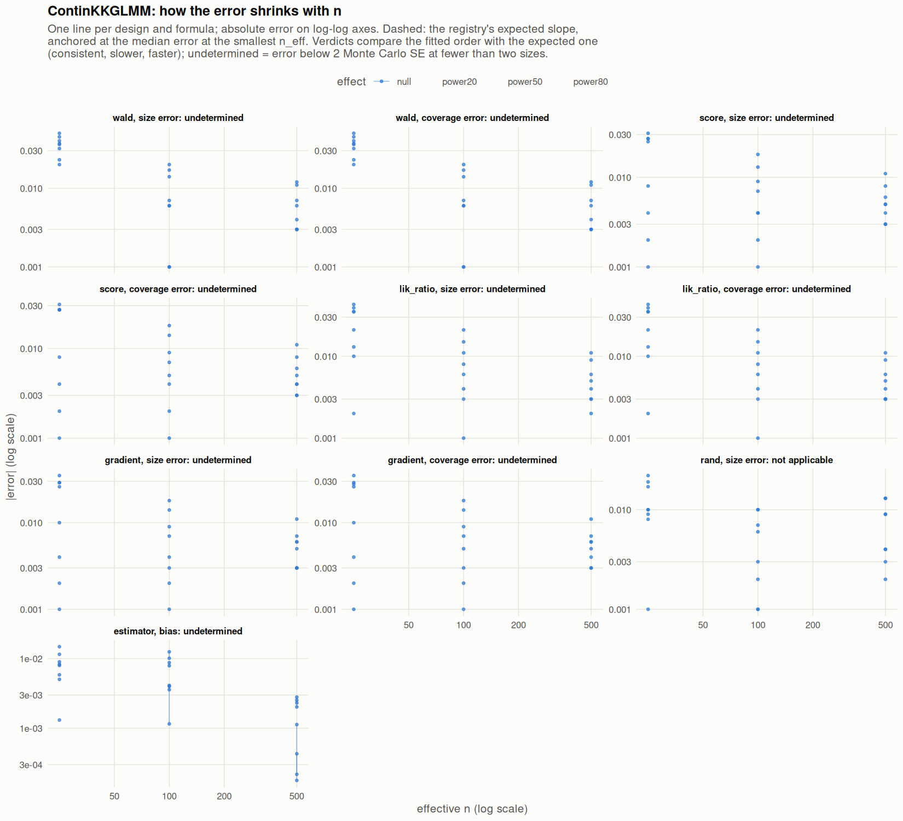

[← Campaign 2026-11-15-e36c7710 summary](README.md)

# Class ContinKKGLMM

Part of the [Classes index](classes.md). Response type: continuous. Status: null effect complete, power effects in progress. Verdict: **pass so far**.

<picture><source media="(prefers-color-scheme: dark)" srcset="figures/class-ContinKKGLMM-dark.png"></picture>

Convergence verdicts (worst over designs, formulas and effects; provisional until the class is complete):

| procedure | metric | verdict |
|---|---|---|
| estimator (bias) | bias | undetermined |
| gradient | coverage | undetermined |
| lik_ratio | coverage | undetermined |
| score | coverage | undetermined |
| wald | coverage | undetermined |
| gradient | size | undetermined |
| lik_ratio | size | undetermined |
| rand | size | not applicable |
| score | size | undetermined |
| wald | size | undetermined |

Null effect: 120 cells (0 failing). Size, coverage and bias / SD against the level each is held to.

| design | n | formula | procedure | size | coverage | bias / SD | size level | coverage level | verdict |
|---|---|---|---|---|---|---|---|---|---|
| Fixed:BinaryMatch | 50 | `~.` | gradient | 0.076 | 0.924 | 0.039 | 0.1 | 0.9 | ok |
| Fixed:BinaryMatch | 200 | `~.` | gradient | 0.064 | 0.936 | -0.028 | 0.1 | 0.9 | ok |
| Fixed:BinaryMatch | 1000 | `~.` | gradient | 0.047 | 0.954 | 0.0068 | 0.055 | 0.945 | ok |
| Fixed:BinaryMatch | 50 | `~.` | lik_ratio | 0.085 | 0.915 | 0.039 | 0.1 | 0.9 | ok |
| Fixed:BinaryMatch | 200 | `~.` | lik_ratio | 0.065 | 0.935 | -0.028 | 0.1 | 0.9 | ok |
| Fixed:BinaryMatch | 1000 | `~.` | lik_ratio | 0.048 | 0.953 | 0.0068 | 0.055 | 0.945 | ok |
| Fixed:BinaryMatch | 50 | `~.` | rand | 0.058 |  | 0.039 | 0.05 | 0.95 | ok |
| Fixed:BinaryMatch | 200 | `~.` | rand | 0.056 |  | -0.028 | 0.05 | 0.95 | ok |
| Fixed:BinaryMatch | 1000 | `~.` | rand | 0.048 |  | 0.0068 | 0.05 | 0.95 | ok |
| Fixed:BinaryMatch | 50 | `~.` | score | 0.075 | 0.923 | 0.039 | 0.1 | 0.9 | ok |
| Fixed:BinaryMatch | 200 | `~.` | score | 0.063 | 0.936 | -0.028 | 0.1 | 0.9 | ok |
| Fixed:BinaryMatch | 1000 | `~.` | score | 0.046 | 0.954 | 0.0068 | 0.055 | 0.945 | ok |
| Fixed:BinaryMatch | 50 | `~.` | wald | 0.0901 | 0.91 | 0.039 | 0.1 | 0.9 | ok |
| Fixed:BinaryMatch | 200 | `~.` | wald | 0.067 | 0.933 | -0.028 | 0.1 | 0.9 | ok |
| Fixed:BinaryMatch | 1000 | `~.` | wald | 0.047 | 0.953 | 0.0068 | 0.055 | 0.945 | ok |
| Fixed:BinaryMatch | 50 | `~1` | gradient | 0.051 | 0.949 | 0.046 | 0.1 | 0.9 | ok |
| Fixed:BinaryMatch | 200 | `~1` | gradient | 0.059 | 0.941 | -0.023 | 0.1 | 0.9 | ok |
| Fixed:BinaryMatch | 1000 | `~1` | gradient | 0.047 | 0.953 | -0.0028 | 0.055 | 0.945 | ok |
| Fixed:BinaryMatch | 50 | `~1` | lik_ratio | 0.06 | 0.94 | 0.046 | 0.1 | 0.9 | ok |
| Fixed:BinaryMatch | 200 | `~1` | lik_ratio | 0.061 | 0.939 | -0.023 | 0.1 | 0.9 | ok |
| Fixed:BinaryMatch | 1000 | `~1` | lik_ratio | 0.047 | 0.953 | -0.0028 | 0.055 | 0.945 | ok |
| Fixed:BinaryMatch | 50 | `~1` | rand | 0.059 |  | 0.046 | 0.05 | 0.95 | ok |
| Fixed:BinaryMatch | 200 | `~1` | rand | 0.06 |  | -0.023 | 0.05 | 0.95 | ok |
| Fixed:BinaryMatch | 1000 | `~1` | rand | 0.054 |  | -0.0028 | 0.05 | 0.95 | ok |
| Fixed:BinaryMatch | 50 | `~1` | score | 0.051 | 0.949 | 0.046 | 0.1 | 0.9 | ok |
| Fixed:BinaryMatch | 200 | `~1` | score | 0.059 | 0.941 | -0.023 | 0.1 | 0.9 | ok |
| Fixed:BinaryMatch | 1000 | `~1` | score | 0.047 | 0.953 | -0.0028 | 0.055 | 0.945 | ok |
| Fixed:BinaryMatch | 50 | `~1` | wald | 0.073 | 0.927 | 0.046 | 0.1 | 0.9 | ok |
| Fixed:BinaryMatch | 200 | `~1` | wald | 0.064 | 0.936 | -0.023 | 0.1 | 0.9 | ok |
| Fixed:BinaryMatch | 1000 | `~1` | wald | 0.047 | 0.953 | -0.0028 | 0.055 | 0.945 | ok |
| SeqOneByOne:KK14 | 50 | `~.` | gradient | 0.085 | 0.915 | -0.0043 | 0.1 | 0.9 | ok |
| SeqOneByOne:KK14 | 200 | `~.` | gradient | 0.068 | 0.932 | -0.061 | 0.1 | 0.9 | ok |
| SeqOneByOne:KK14 | 1000 | `~.` | gradient | 0.044 | 0.956 | 0.032 | 0.055 | 0.945 | ok |
| SeqOneByOne:KK14 | 50 | `~.` | lik_ratio | 0.093 | 0.907 | -0.0043 | 0.1 | 0.9 | ok |
| SeqOneByOne:KK14 | 200 | `~.` | lik_ratio | 0.071 | 0.929 | -0.061 | 0.1 | 0.9 | ok |
| SeqOneByOne:KK14 | 1000 | `~.` | lik_ratio | 0.046 | 0.954 | 0.032 | 0.055 | 0.945 | ok |
| SeqOneByOne:KK14 | 50 | `~.` | rand | 0.069 |  | -0.0043 | 0.05 | 0.95 | ok |
| SeqOneByOne:KK14 | 200 | `~.` | rand | 0.06 |  | -0.061 | 0.05 | 0.95 | ok |
| SeqOneByOne:KK14 | 1000 | `~.` | rand | 0.047 |  | 0.032 | 0.05 | 0.95 | ok |
| SeqOneByOne:KK14 | 50 | `~.` | score | 0.081 | 0.919 | -0.0043 | 0.1 | 0.9 | ok |
| SeqOneByOne:KK14 | 200 | `~.` | score | 0.068 | 0.932 | -0.061 | 0.1 | 0.9 | ok |
| SeqOneByOne:KK14 | 1000 | `~.` | score | 0.045 | 0.954 | 0.032 | 0.055 | 0.945 | ok |
| SeqOneByOne:KK14 | 50 | `~.` | wald | 0.095 | 0.905 | -0.0043 | 0.1 | 0.9 | ok |
| SeqOneByOne:KK14 | 200 | `~.` | wald | 0.07 | 0.93 | -0.061 | 0.1 | 0.9 | ok |
| SeqOneByOne:KK14 | 1000 | `~.` | wald | 0.047 | 0.953 | 0.032 | 0.055 | 0.945 | ok |
| SeqOneByOne:KK14 | 50 | `~1` | gradient | 0.048 | 0.952 | -0.024 | 0.1 | 0.9 | ok |
| SeqOneByOne:KK14 | 200 | `~1` | gradient | 0.051 | 0.949 | -0.05 | 0.1 | 0.9 | ok |
| SeqOneByOne:KK14 | 1000 | `~1` | gradient | 0.057 | 0.943 | 0.038 | 0.055 | 0.945 | ok |
| SeqOneByOne:KK14 | 50 | `~1` | lik_ratio | 0.052 | 0.948 | -0.024 | 0.1 | 0.9 | ok |
| SeqOneByOne:KK14 | 200 | `~1` | lik_ratio | 0.054 | 0.946 | -0.05 | 0.1 | 0.9 | ok |
| SeqOneByOne:KK14 | 1000 | `~1` | lik_ratio | 0.059 | 0.941 | 0.038 | 0.055 | 0.945 | ok |
| SeqOneByOne:KK14 | 50 | `~1` | rand | 0.051 |  | -0.024 | 0.05 | 0.95 | ok |
| SeqOneByOne:KK14 | 200 | `~1` | rand | 0.057 |  | -0.05 | 0.05 | 0.95 | ok |
| SeqOneByOne:KK14 | 1000 | `~1` | rand | 0.059 |  | 0.038 | 0.05 | 0.95 | ok |
| SeqOneByOne:KK14 | 50 | `~1` | score | 0.046 | 0.954 | -0.024 | 0.1 | 0.9 | ok |
| SeqOneByOne:KK14 | 200 | `~1` | score | 0.051 | 0.949 | -0.05 | 0.1 | 0.9 | ok |
| SeqOneByOne:KK14 | 1000 | `~1` | score | 0.058 | 0.942 | 0.038 | 0.055 | 0.945 | ok |
| SeqOneByOne:KK14 | 50 | `~1` | wald | 0.07 | 0.93 | -0.024 | 0.1 | 0.9 | ok |
| SeqOneByOne:KK14 | 200 | `~1` | wald | 0.057 | 0.943 | -0.05 | 0.1 | 0.9 | ok |
| SeqOneByOne:KK14 | 1000 | `~1` | wald | 0.061 | 0.939 | 0.038 | 0.055 | 0.945 | ok |
| SeqOneByOne:KK21 | 50 | `~.` | gradient | 0.079 | 0.921 | -0.019 | 0.1 | 0.9 | ok |
| SeqOneByOne:KK21 | 200 | `~.` | gradient | 0.054 | 0.945 | -0.091 | 0.1 | 0.9 | ok |
| SeqOneByOne:KK21 | 1000 | `~.` | gradient | 0.056 | 0.944 | 0.044 | 0.055 | 0.945 | ok |
| SeqOneByOne:KK21 | 50 | `~.` | lik_ratio | 0.085 | 0.915 | -0.019 | 0.1 | 0.9 | ok |
| SeqOneByOne:KK21 | 200 | `~.` | lik_ratio | 0.056 | 0.944 | -0.091 | 0.1 | 0.9 | ok |
| SeqOneByOne:KK21 | 1000 | `~.` | lik_ratio | 0.056 | 0.944 | 0.044 | 0.055 | 0.945 | ok |
| SeqOneByOne:KK21 | 50 | `~.` | rand | 0.072 |  | -0.019 | 0.05 | 0.95 | ok |
| SeqOneByOne:KK21 | 200 | `~.` | rand | 0.049 |  | -0.091 | 0.05 | 0.95 | ok |
| SeqOneByOne:KK21 | 1000 | `~.` | rand | 0.063 |  | 0.044 | 0.05 | 0.95 | ok |
| SeqOneByOne:KK21 | 50 | `~.` | score | 0.077 | 0.923 | -0.019 | 0.1 | 0.9 | ok |
| SeqOneByOne:KK21 | 200 | `~.` | score | 0.054 | 0.945 | -0.091 | 0.1 | 0.9 | ok |
| SeqOneByOne:KK21 | 1000 | `~.` | score | 0.056 | 0.944 | 0.044 | 0.055 | 0.945 | ok |
| SeqOneByOne:KK21 | 50 | `~.` | wald | 0.087 | 0.913 | -0.019 | 0.1 | 0.9 | ok |
| SeqOneByOne:KK21 | 200 | `~.` | wald | 0.056 | 0.944 | -0.091 | 0.1 | 0.9 | ok |
| SeqOneByOne:KK21 | 1000 | `~.` | wald | 0.054 | 0.946 | 0.044 | 0.055 | 0.945 | ok |
| SeqOneByOne:KK21 | 50 | `~1` | gradient | 0.054 | 0.946 | -0.026 | 0.1 | 0.9 | ok |
| SeqOneByOne:KK21 | 200 | `~1` | gradient | 0.048 | 0.952 | -0.067 | 0.1 | 0.9 | ok |
| SeqOneByOne:KK21 | 1000 | `~1` | gradient | 0.061 | 0.939 | 0.034 | 0.055 | 0.945 | ok |
| SeqOneByOne:KK21 | 50 | `~1` | lik_ratio | 0.063 | 0.937 | -0.026 | 0.1 | 0.9 | ok |
| SeqOneByOne:KK21 | 200 | `~1` | lik_ratio | 0.049 | 0.951 | -0.067 | 0.1 | 0.9 | ok |
| SeqOneByOne:KK21 | 1000 | `~1` | lik_ratio | 0.061 | 0.939 | 0.034 | 0.055 | 0.945 | ok |
| SeqOneByOne:KK21 | 50 | `~1` | rand | 0.06 |  | -0.026 | 0.05 | 0.95 | ok |
| SeqOneByOne:KK21 | 200 | `~1` | rand | 0.048 |  | -0.067 | 0.05 | 0.95 | ok |
| SeqOneByOne:KK21 | 1000 | `~1` | rand | 0.063 |  | 0.034 | 0.05 | 0.95 | ok |
| SeqOneByOne:KK21 | 50 | `~1` | score | 0.052 | 0.948 | -0.026 | 0.1 | 0.9 | ok |
| SeqOneByOne:KK21 | 200 | `~1` | score | 0.048 | 0.952 | -0.067 | 0.1 | 0.9 | ok |
| SeqOneByOne:KK21 | 1000 | `~1` | score | 0.061 | 0.939 | 0.034 | 0.055 | 0.945 | ok |
| SeqOneByOne:KK21 | 50 | `~1` | wald | 0.082 | 0.918 | -0.026 | 0.1 | 0.9 | ok |
| SeqOneByOne:KK21 | 200 | `~1` | wald | 0.049 | 0.951 | -0.067 | 0.1 | 0.9 | ok |
| SeqOneByOne:KK21 | 1000 | `~1` | wald | 0.062 | 0.938 | 0.034 | 0.055 | 0.945 | ok |
| SeqOneByOne:KK21stepwise | 50 | `~.` | gradient | 0.079 | 0.922 | 0.026 | 0.1 | 0.9 | ok |
| SeqOneByOne:KK21stepwise | 200 | `~.` | gradient | 0.057 | 0.943 | -0.028 | 0.1 | 0.9 | ok |
| SeqOneByOne:KK21stepwise | 1000 | `~.` | gradient | 0.053 | 0.947 | 0.0035 | 0.055 | 0.945 | ok |
| SeqOneByOne:KK21stepwise | 50 | `~.` | lik_ratio | 0.089 | 0.911 | 0.026 | 0.1 | 0.9 | ok |
| SeqOneByOne:KK21stepwise | 200 | `~.` | lik_ratio | 0.058 | 0.942 | -0.028 | 0.1 | 0.9 | ok |
| SeqOneByOne:KK21stepwise | 1000 | `~.` | lik_ratio | 0.053 | 0.947 | 0.0035 | 0.055 | 0.945 | ok |
| SeqOneByOne:KK21stepwise | 50 | `~.` | rand | 0.06 |  | 0.026 | 0.05 | 0.95 | ok |
| SeqOneByOne:KK21stepwise | 200 | `~.` | rand | 0.049 |  | -0.028 | 0.05 | 0.95 | ok |
| SeqOneByOne:KK21stepwise | 1000 | `~.` | rand | 0.054 |  | 0.0035 | 0.05 | 0.95 | ok |
| SeqOneByOne:KK21stepwise | 50 | `~.` | score | 0.077 | 0.923 | 0.026 | 0.1 | 0.9 | ok |
| SeqOneByOne:KK21stepwise | 200 | `~.` | score | 0.057 | 0.943 | -0.028 | 0.1 | 0.9 | ok |
| SeqOneByOne:KK21stepwise | 1000 | `~.` | score | 0.053 | 0.947 | 0.0035 | 0.055 | 0.945 | ok |
| SeqOneByOne:KK21stepwise | 50 | `~.` | wald | 0.1 | 0.9 | 0.026 | 0.1 | 0.9 | ok |
| SeqOneByOne:KK21stepwise | 200 | `~.` | wald | 0.056 | 0.944 | -0.028 | 0.1 | 0.9 | ok |
| SeqOneByOne:KK21stepwise | 1000 | `~.` | wald | 0.057 | 0.943 | 0.0035 | 0.055 | 0.945 | ok |
| SeqOneByOne:KK21stepwise | 50 | `~1` | gradient | 0.06 | 0.94 | 0.015 | 0.1 | 0.9 | ok |
| SeqOneByOne:KK21stepwise | 200 | `~1` | gradient | 0.047 | 0.953 | 0.0074 | 0.1 | 0.9 | ok |
| SeqOneByOne:KK21stepwise | 1000 | `~1` | gradient | 0.055 | 0.945 | 0.017 | 0.055 | 0.945 | ok |
| SeqOneByOne:KK21stepwise | 50 | `~1` | lik_ratio | 0.071 | 0.929 | 0.015 | 0.1 | 0.9 | ok |
| SeqOneByOne:KK21stepwise | 200 | `~1` | lik_ratio | 0.047 | 0.953 | 0.0074 | 0.1 | 0.9 | ok |
| SeqOneByOne:KK21stepwise | 1000 | `~1` | lik_ratio | 0.055 | 0.945 | 0.017 | 0.055 | 0.945 | ok |
| SeqOneByOne:KK21stepwise | 50 | `~1` | rand | 0.067 |  | 0.015 | 0.05 | 0.95 | ok |
| SeqOneByOne:KK21stepwise | 200 | `~1` | rand | 0.047 |  | 0.0074 | 0.05 | 0.95 | ok |
| SeqOneByOne:KK21stepwise | 1000 | `~1` | rand | 0.059 |  | 0.017 | 0.05 | 0.95 | ok |
| SeqOneByOne:KK21stepwise | 50 | `~1` | score | 0.058 | 0.942 | 0.015 | 0.1 | 0.9 | ok |
| SeqOneByOne:KK21stepwise | 200 | `~1` | score | 0.046 | 0.954 | 0.0074 | 0.1 | 0.9 | ok |
| SeqOneByOne:KK21stepwise | 1000 | `~1` | score | 0.055 | 0.945 | 0.017 | 0.055 | 0.945 | ok |
| SeqOneByOne:KK21stepwise | 50 | `~1` | wald | 0.086 | 0.914 | 0.015 | 0.1 | 0.9 | ok |
| SeqOneByOne:KK21stepwise | 200 | `~1` | wald | 0.049 | 0.951 | 0.0074 | 0.1 | 0.9 | ok |
| SeqOneByOne:KK21stepwise | 1000 | `~1` | wald | 0.056 | 0.944 | 0.017 | 0.055 | 0.945 | ok |

Power effects: 160 cells (0 failing coverage).

| design | n | effect | formula | procedure | power | coverage of the true estimand | coverage level | verdict |
|---|---|---|---|---|---|---|---|---|
| Fixed:BinaryMatch | 50 | power20 | `~.` | gradient | 0.272 |  | 0.9 | ok |
| Fixed:BinaryMatch | 200 | power20 | `~.` | gradient | 0.232 |  | 0.925 | ok |
| Fixed:BinaryMatch | 50 | power50 | `~.` | gradient | 0.562 |  | 0.9 | ok |
| Fixed:BinaryMatch | 200 | power50 | `~.` | gradient | 0.516 |  | 0.925 | ok |
| Fixed:BinaryMatch | 50 | power20 | `~.` | lik_ratio | 0.296 |  | 0.9 | ok |
| Fixed:BinaryMatch | 200 | power20 | `~.` | lik_ratio | 0.232 |  | 0.925 | ok |
| Fixed:BinaryMatch | 50 | power50 | `~.` | lik_ratio | 0.578 |  | 0.9 | ok |
| Fixed:BinaryMatch | 200 | power50 | `~.` | lik_ratio | 0.518 |  | 0.925 | ok |
| Fixed:BinaryMatch | 50 | power20 | `~.` | rand | 0.212 |  | 0.95 | ok |
| Fixed:BinaryMatch | 200 | power20 | `~.` | rand | 0.218 |  | 0.95 | ok |
| Fixed:BinaryMatch | 50 | power50 | `~.` | rand | 0.484 |  | 0.95 | ok |
| Fixed:BinaryMatch | 200 | power50 | `~.` | rand | 0.478 |  | 0.95 | ok |
| Fixed:BinaryMatch | 50 | power20 | `~.` | score | 0.27 |  | 0.9 | ok |
| Fixed:BinaryMatch | 200 | power20 | `~.` | score | 0.232 |  | 0.925 | ok |
| Fixed:BinaryMatch | 50 | power50 | `~.` | score | 0.562 |  | 0.9 | ok |
| Fixed:BinaryMatch | 200 | power50 | `~.` | score | 0.516 |  | 0.925 | ok |
| Fixed:BinaryMatch | 50 | power20 | `~.` | wald | 0.272 |  | 0.9 | ok |
| Fixed:BinaryMatch | 200 | power20 | `~.` | wald | 0.234 |  | 0.925 | ok |
| Fixed:BinaryMatch | 50 | power50 | `~.` | wald | 0.574 |  | 0.9 | ok |
| Fixed:BinaryMatch | 200 | power50 | `~.` | wald | 0.502 |  | 0.925 | ok |
| Fixed:BinaryMatch | 50 | power20 | `~1` | gradient | 0.182 |  | 0.9 | ok |
| Fixed:BinaryMatch | 200 | power20 | `~1` | gradient | 0.212 |  | 0.925 | ok |
| Fixed:BinaryMatch | 50 | power50 | `~1` | gradient | 0.43 |  | 0.9 | ok |
| Fixed:BinaryMatch | 200 | power50 | `~1` | gradient | 0.454 |  | 0.925 | ok |
| Fixed:BinaryMatch | 50 | power20 | `~1` | lik_ratio | 0.202 |  | 0.9 | ok |
| Fixed:BinaryMatch | 200 | power20 | `~1` | lik_ratio | 0.216 |  | 0.925 | ok |
| Fixed:BinaryMatch | 50 | power50 | `~1` | lik_ratio | 0.46 |  | 0.9 | ok |
| Fixed:BinaryMatch | 200 | power50 | `~1` | lik_ratio | 0.46 |  | 0.925 | ok |
| Fixed:BinaryMatch | 50 | power20 | `~1` | rand | 0.176 |  | 0.95 | ok |
| Fixed:BinaryMatch | 200 | power20 | `~1` | rand | 0.206 |  | 0.95 | ok |
| Fixed:BinaryMatch | 50 | power50 | `~1` | rand | 0.428 |  | 0.95 | ok |
| Fixed:BinaryMatch | 200 | power50 | `~1` | rand | 0.446 |  | 0.95 | ok |
| Fixed:BinaryMatch | 50 | power20 | `~1` | score | 0.182 |  | 0.9 | ok |
| Fixed:BinaryMatch | 200 | power20 | `~1` | score | 0.212 |  | 0.925 | ok |
| Fixed:BinaryMatch | 50 | power50 | `~1` | score | 0.43 |  | 0.9 | ok |
| Fixed:BinaryMatch | 200 | power50 | `~1` | score | 0.456 |  | 0.925 | ok |
| Fixed:BinaryMatch | 50 | power20 | `~1` | wald | 0.228 |  | 0.9 | ok |
| Fixed:BinaryMatch | 200 | power20 | `~1` | wald | 0.224 |  | 0.925 | ok |
| Fixed:BinaryMatch | 50 | power50 | `~1` | wald | 0.486 |  | 0.9 | ok |
| Fixed:BinaryMatch | 200 | power50 | `~1` | wald | 0.47 |  | 0.925 | ok |
| SeqOneByOne:KK14 | 50 | power20 | `~.` | gradient | 0.22 |  | 0.9 | ok |
| SeqOneByOne:KK14 | 200 | power20 | `~.` | gradient | 0.184 |  | 0.925 | ok |
| SeqOneByOne:KK14 | 50 | power50 | `~.` | gradient | 0.52 |  | 0.9 | ok |
| SeqOneByOne:KK14 | 200 | power50 | `~.` | gradient | 0.48 |  | 0.925 | ok |
| SeqOneByOne:KK14 | 50 | power20 | `~.` | lik_ratio | 0.246 |  | 0.9 | ok |
| SeqOneByOne:KK14 | 200 | power20 | `~.` | lik_ratio | 0.186 |  | 0.925 | ok |
| SeqOneByOne:KK14 | 50 | power50 | `~.` | lik_ratio | 0.532 |  | 0.9 | ok |
| SeqOneByOne:KK14 | 200 | power50 | `~.` | lik_ratio | 0.482 |  | 0.925 | ok |
| SeqOneByOne:KK14 | 50 | power20 | `~.` | rand | 0.186 |  | 0.95 | ok |
| SeqOneByOne:KK14 | 200 | power20 | `~.` | rand | 0.176 |  | 0.95 | ok |
| SeqOneByOne:KK14 | 50 | power50 | `~.` | rand | 0.458 |  | 0.95 | ok |
| SeqOneByOne:KK14 | 200 | power50 | `~.` | rand | 0.45 |  | 0.95 | ok |
| SeqOneByOne:KK14 | 50 | power20 | `~.` | score | 0.222 |  | 0.9 | ok |
| SeqOneByOne:KK14 | 200 | power20 | `~.` | score | 0.184 |  | 0.925 | ok |
| SeqOneByOne:KK14 | 50 | power50 | `~.` | score | 0.518 |  | 0.9 | ok |
| SeqOneByOne:KK14 | 200 | power50 | `~.` | score | 0.48 |  | 0.925 | ok |
| SeqOneByOne:KK14 | 50 | power20 | `~.` | wald | 0.234 |  | 0.9 | ok |
| SeqOneByOne:KK14 | 200 | power20 | `~.` | wald | 0.17 |  | 0.925 | ok |
| SeqOneByOne:KK14 | 50 | power50 | `~.` | wald | 0.522 |  | 0.9 | ok |
| SeqOneByOne:KK14 | 200 | power50 | `~.` | wald | 0.45 |  | 0.925 | ok |
| SeqOneByOne:KK14 | 50 | power20 | `~1` | gradient | 0.124 |  | 0.9 | ok |
| SeqOneByOne:KK14 | 200 | power20 | `~1` | gradient | 0.158 |  | 0.925 | ok |
| SeqOneByOne:KK14 | 50 | power50 | `~1` | gradient | 0.352 |  | 0.9 | ok |
| SeqOneByOne:KK14 | 200 | power50 | `~1` | gradient | 0.382 |  | 0.925 | ok |
| SeqOneByOne:KK14 | 50 | power20 | `~1` | lik_ratio | 0.154 |  | 0.9 | ok |
| SeqOneByOne:KK14 | 200 | power20 | `~1` | lik_ratio | 0.166 |  | 0.925 | ok |
| SeqOneByOne:KK14 | 50 | power50 | `~1` | lik_ratio | 0.376 |  | 0.9 | ok |
| SeqOneByOne:KK14 | 200 | power50 | `~1` | lik_ratio | 0.386 |  | 0.925 | ok |
| SeqOneByOne:KK14 | 50 | power20 | `~1` | rand | 0.146 |  | 0.95 | ok |
| SeqOneByOne:KK14 | 200 | power20 | `~1` | rand | 0.164 |  | 0.95 | ok |
| SeqOneByOne:KK14 | 50 | power50 | `~1` | rand | 0.362 |  | 0.95 | ok |
| SeqOneByOne:KK14 | 200 | power50 | `~1` | rand | 0.388 |  | 0.95 | ok |
| SeqOneByOne:KK14 | 50 | power20 | `~1` | score | 0.114 |  | 0.9 | ok |
| SeqOneByOne:KK14 | 200 | power20 | `~1` | score | 0.158 |  | 0.925 | ok |
| SeqOneByOne:KK14 | 50 | power50 | `~1` | score | 0.344 |  | 0.9 | ok |
| SeqOneByOne:KK14 | 200 | power50 | `~1` | score | 0.382 |  | 0.925 | ok |
| SeqOneByOne:KK14 | 50 | power20 | `~1` | wald | 0.178 |  | 0.9 | ok |
| SeqOneByOne:KK14 | 200 | power20 | `~1` | wald | 0.17 |  | 0.925 | ok |
| SeqOneByOne:KK14 | 50 | power50 | `~1` | wald | 0.416 |  | 0.9 | ok |
| SeqOneByOne:KK14 | 200 | power50 | `~1` | wald | 0.394 |  | 0.925 | ok |
| SeqOneByOne:KK21 | 50 | power20 | `~.` | gradient | 0.208 |  | 0.9 | ok |
| SeqOneByOne:KK21 | 200 | power20 | `~.` | gradient | 0.19 |  | 0.925 | ok |
| SeqOneByOne:KK21 | 50 | power50 | `~.` | gradient | 0.518 |  | 0.9 | ok |
| SeqOneByOne:KK21 | 200 | power50 | `~.` | gradient | 0.472 |  | 0.925 | ok |
| SeqOneByOne:KK21 | 50 | power20 | `~.` | lik_ratio | 0.224 |  | 0.9 | ok |
| SeqOneByOne:KK21 | 200 | power20 | `~.` | lik_ratio | 0.196 |  | 0.925 | ok |
| SeqOneByOne:KK21 | 50 | power50 | `~.` | lik_ratio | 0.534 |  | 0.9 | ok |
| SeqOneByOne:KK21 | 200 | power50 | `~.` | lik_ratio | 0.474 |  | 0.925 | ok |
| SeqOneByOne:KK21 | 50 | power20 | `~.` | rand | 0.17 |  | 0.95 | ok |
| SeqOneByOne:KK21 | 200 | power20 | `~.` | rand | 0.186 |  | 0.95 | ok |
| SeqOneByOne:KK21 | 50 | power50 | `~.` | rand | 0.444 |  | 0.95 | ok |
| SeqOneByOne:KK21 | 200 | power50 | `~.` | rand | 0.462 |  | 0.95 | ok |
| SeqOneByOne:KK21 | 50 | power20 | `~.` | score | 0.208 |  | 0.9 | ok |
| SeqOneByOne:KK21 | 200 | power20 | `~.` | score | 0.188 |  | 0.925 | ok |
| SeqOneByOne:KK21 | 50 | power50 | `~.` | score | 0.518 |  | 0.9 | ok |
| SeqOneByOne:KK21 | 200 | power50 | `~.` | score | 0.472 |  | 0.925 | ok |
| SeqOneByOne:KK21 | 50 | power20 | `~.` | wald | 0.226 |  | 0.9 | ok |
| SeqOneByOne:KK21 | 200 | power20 | `~.` | wald | 0.192 |  | 0.925 | ok |
| SeqOneByOne:KK21 | 50 | power50 | `~.` | wald | 0.502 |  | 0.9 | ok |
| SeqOneByOne:KK21 | 200 | power50 | `~.` | wald | 0.458 |  | 0.925 | ok |
| SeqOneByOne:KK21 | 50 | power20 | `~1` | gradient | 0.132 |  | 0.9 | ok |
| SeqOneByOne:KK21 | 200 | power20 | `~1` | gradient | 0.152 |  | 0.925 | ok |
| SeqOneByOne:KK21 | 50 | power50 | `~1` | gradient | 0.332 |  | 0.9 | ok |
| SeqOneByOne:KK21 | 200 | power50 | `~1` | gradient | 0.372 |  | 0.925 | ok |
| SeqOneByOne:KK21 | 50 | power20 | `~1` | lik_ratio | 0.156 |  | 0.9 | ok |
| SeqOneByOne:KK21 | 200 | power20 | `~1` | lik_ratio | 0.156 |  | 0.925 | ok |
| SeqOneByOne:KK21 | 50 | power50 | `~1` | lik_ratio | 0.37 |  | 0.9 | ok |
| SeqOneByOne:KK21 | 200 | power50 | `~1` | lik_ratio | 0.384 |  | 0.925 | ok |
| SeqOneByOne:KK21 | 50 | power20 | `~1` | rand | 0.152 |  | 0.95 | ok |
| SeqOneByOne:KK21 | 200 | power20 | `~1` | rand | 0.156 |  | 0.95 | ok |
| SeqOneByOne:KK21 | 50 | power50 | `~1` | rand | 0.354 |  | 0.95 | ok |
| SeqOneByOne:KK21 | 200 | power50 | `~1` | rand | 0.382 |  | 0.95 | ok |
| SeqOneByOne:KK21 | 50 | power20 | `~1` | score | 0.132 |  | 0.9 | ok |
| SeqOneByOne:KK21 | 200 | power20 | `~1` | score | 0.152 |  | 0.925 | ok |
| SeqOneByOne:KK21 | 50 | power50 | `~1` | score | 0.33 |  | 0.9 | ok |
| SeqOneByOne:KK21 | 200 | power50 | `~1` | score | 0.37 |  | 0.925 | ok |
| SeqOneByOne:KK21 | 50 | power20 | `~1` | wald | 0.174 |  | 0.9 | ok |
| SeqOneByOne:KK21 | 200 | power20 | `~1` | wald | 0.162 |  | 0.925 | ok |
| SeqOneByOne:KK21 | 50 | power50 | `~1` | wald | 0.398 |  | 0.9 | ok |
| SeqOneByOne:KK21 | 200 | power50 | `~1` | wald | 0.384 |  | 0.925 | ok |
| SeqOneByOne:KK21stepwise | 50 | power20 | `~.` | gradient | 0.262 |  | 0.9 | ok |
| SeqOneByOne:KK21stepwise | 200 | power20 | `~.` | gradient | 0.202 |  | 0.925 | ok |
| SeqOneByOne:KK21stepwise | 50 | power50 | `~.` | gradient | 0.534 |  | 0.9 | ok |
| SeqOneByOne:KK21stepwise | 200 | power50 | `~.` | gradient | 0.51 |  | 0.925 | ok |
| SeqOneByOne:KK21stepwise | 50 | power20 | `~.` | lik_ratio | 0.292 |  | 0.9 | ok |
| SeqOneByOne:KK21stepwise | 200 | power20 | `~.` | lik_ratio | 0.206 |  | 0.925 | ok |
| SeqOneByOne:KK21stepwise | 50 | power50 | `~.` | lik_ratio | 0.55 |  | 0.9 | ok |
| SeqOneByOne:KK21stepwise | 200 | power50 | `~.` | lik_ratio | 0.516 |  | 0.925 | ok |
| SeqOneByOne:KK21stepwise | 50 | power20 | `~.` | rand | 0.212 |  | 0.95 | ok |
| SeqOneByOne:KK21stepwise | 200 | power20 | `~.` | rand | 0.2 |  | 0.95 | ok |
| SeqOneByOne:KK21stepwise | 50 | power50 | `~.` | rand | 0.48 |  | 0.95 | ok |
| SeqOneByOne:KK21stepwise | 200 | power50 | `~.` | rand | 0.492 |  | 0.95 | ok |
| SeqOneByOne:KK21stepwise | 50 | power20 | `~.` | score | 0.26 |  | 0.9 | ok |
| SeqOneByOne:KK21stepwise | 200 | power20 | `~.` | score | 0.202 |  | 0.925 | ok |
| SeqOneByOne:KK21stepwise | 50 | power50 | `~.` | score | 0.536 |  | 0.9 | ok |
| SeqOneByOne:KK21stepwise | 200 | power50 | `~.` | score | 0.508 |  | 0.925 | ok |
| SeqOneByOne:KK21stepwise | 50 | power20 | `~.` | wald | 0.264 |  | 0.9 | ok |
| SeqOneByOne:KK21stepwise | 200 | power20 | `~.` | wald | 0.196 |  | 0.925 | ok |
| SeqOneByOne:KK21stepwise | 50 | power50 | `~.` | wald | 0.52 |  | 0.9 | ok |
| SeqOneByOne:KK21stepwise | 200 | power50 | `~.` | wald | 0.508 |  | 0.925 | ok |
| SeqOneByOne:KK21stepwise | 50 | power20 | `~1` | gradient | 0.158 |  | 0.9 | ok |
| SeqOneByOne:KK21stepwise | 200 | power20 | `~1` | gradient | 0.172 |  | 0.925 | ok |
| SeqOneByOne:KK21stepwise | 50 | power50 | `~1` | gradient | 0.38 |  | 0.9 | ok |
| SeqOneByOne:KK21stepwise | 200 | power50 | `~1` | gradient | 0.434 |  | 0.925 | ok |
| SeqOneByOne:KK21stepwise | 50 | power20 | `~1` | lik_ratio | 0.174 |  | 0.9 | ok |
| SeqOneByOne:KK21stepwise | 200 | power20 | `~1` | lik_ratio | 0.178 |  | 0.925 | ok |
| SeqOneByOne:KK21stepwise | 50 | power50 | `~1` | lik_ratio | 0.4 |  | 0.9 | ok |
| SeqOneByOne:KK21stepwise | 200 | power50 | `~1` | lik_ratio | 0.436 |  | 0.925 | ok |
| SeqOneByOne:KK21stepwise | 50 | power20 | `~1` | rand | 0.17 |  | 0.95 | ok |
| SeqOneByOne:KK21stepwise | 200 | power20 | `~1` | rand | 0.192 |  | 0.95 | ok |
| SeqOneByOne:KK21stepwise | 50 | power50 | `~1` | rand | 0.386 |  | 0.95 | ok |
| SeqOneByOne:KK21stepwise | 200 | power50 | `~1` | rand | 0.424 |  | 0.95 | ok |
| SeqOneByOne:KK21stepwise | 50 | power20 | `~1` | score | 0.15 |  | 0.9 | ok |
| SeqOneByOne:KK21stepwise | 200 | power20 | `~1` | score | 0.172 |  | 0.925 | ok |
| SeqOneByOne:KK21stepwise | 50 | power50 | `~1` | score | 0.374 |  | 0.9 | ok |
| SeqOneByOne:KK21stepwise | 200 | power50 | `~1` | score | 0.43 |  | 0.925 | ok |
| SeqOneByOne:KK21stepwise | 50 | power20 | `~1` | wald | 0.196 |  | 0.9 | ok |
| SeqOneByOne:KK21stepwise | 200 | power20 | `~1` | wald | 0.18 |  | 0.925 | ok |
| SeqOneByOne:KK21stepwise | 50 | power50 | `~1` | wald | 0.428 |  | 0.9 | ok |
| SeqOneByOne:KK21stepwise | 200 | power50 | `~1` | wald | 0.44 |  | 0.925 | ok |

[← Campaign 2026-11-15-e36c7710 summary](README.md)
