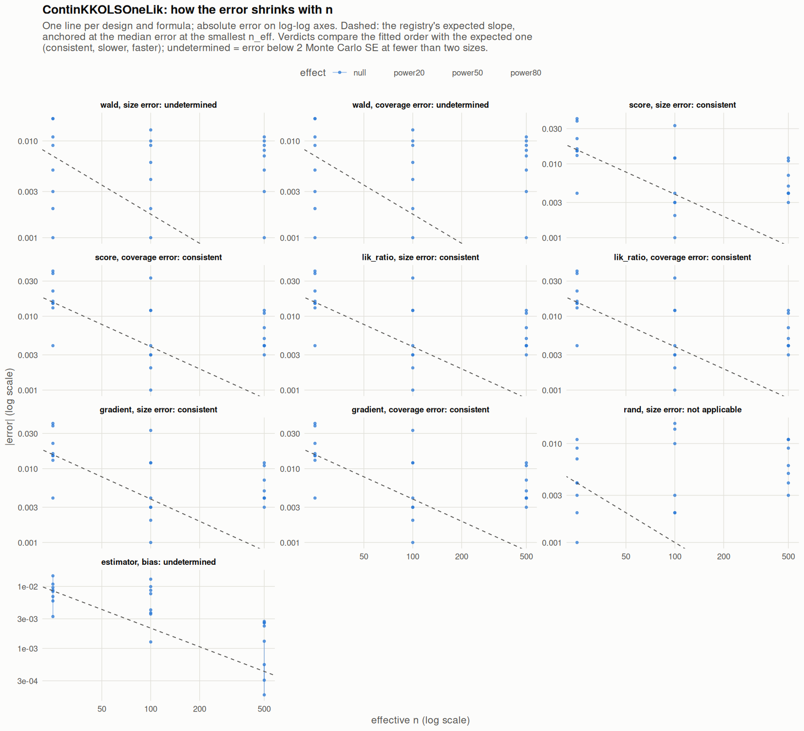

[← Campaign 2026-11-15-e36c7710 summary](README.md)

# Class ContinKKOLSOneLik

Part of the [Classes index](classes.md). Response type: continuous. Status: null effect complete, power effects in progress. Verdict: **pass so far**.

<picture><source media="(prefers-color-scheme: dark)" srcset="figures/class-ContinKKOLSOneLik-dark.png"></picture>

Convergence verdicts (worst over designs, formulas and effects; provisional until the class is complete):

| procedure | metric | verdict |
|---|---|---|
| estimator (bias) | bias | undetermined |
| gradient | coverage | consistent |
| lik_ratio | coverage | consistent |
| score | coverage | consistent |
| wald | coverage | undetermined |
| gradient | size | consistent |
| lik_ratio | size | consistent |
| rand | size | not applicable |
| score | size | consistent |
| wald | size | undetermined |

Null effect: 120 cells (0 failing). Size, coverage and bias / SD against the level each is held to.

| design | n | formula | procedure | size | coverage | bias / SD | size level | coverage level | verdict |
|---|---|---|---|---|---|---|---|---|---|
| Fixed:BinaryMatch | 50 | `~.` | gradient | 0.072 | 0.928 | 0.033 | 0.1 | 0.9 | ok |
| Fixed:BinaryMatch | 200 | `~.` | gradient | 0.062 | 0.938 | -0.025 | 0.075 | 0.925 | ok |
| Fixed:BinaryMatch | 1000 | `~.` | gradient | 0.045 | 0.955 | 0.0087 | 0.055 | 0.945 | ok |
| Fixed:BinaryMatch | 50 | `~.` | lik_ratio | 0.072 | 0.928 | 0.033 | 0.1 | 0.9 | ok |
| Fixed:BinaryMatch | 200 | `~.` | lik_ratio | 0.062 | 0.938 | -0.025 | 0.075 | 0.925 | ok |
| Fixed:BinaryMatch | 1000 | `~.` | lik_ratio | 0.045 | 0.955 | 0.0087 | 0.055 | 0.945 | ok |
| Fixed:BinaryMatch | 50 | `~.` | rand | 0.046 |  | 0.033 | 0.05 | 0.95 | ok |
| Fixed:BinaryMatch | 200 | `~.` | rand | 0.05 |  | -0.025 | 0.05 | 0.95 | ok |
| Fixed:BinaryMatch | 1000 | `~.` | rand | 0.045 |  | 0.0087 | 0.05 | 0.95 | ok |
| Fixed:BinaryMatch | 50 | `~.` | score | 0.072 | 0.928 | 0.033 | 0.1 | 0.9 | ok |
| Fixed:BinaryMatch | 200 | `~.` | score | 0.062 | 0.938 | -0.025 | 0.075 | 0.925 | ok |
| Fixed:BinaryMatch | 1000 | `~.` | score | 0.045 | 0.955 | 0.0087 | 0.055 | 0.945 | ok |
| Fixed:BinaryMatch | 50 | `~.` | wald | 0.067 | 0.933 | 0.033 | 0.1 | 0.9 | ok |
| Fixed:BinaryMatch | 200 | `~.` | wald | 0.06 | 0.94 | -0.025 | 0.075 | 0.925 | ok |
| Fixed:BinaryMatch | 1000 | `~.` | wald | 0.043 | 0.957 | 0.0087 | 0.055 | 0.945 | ok |
| Fixed:BinaryMatch | 50 | `~1` | gradient | 0.065 | 0.935 | 0.046 | 0.1 | 0.9 | ok |
| Fixed:BinaryMatch | 200 | `~1` | gradient | 0.062 | 0.938 | -0.023 | 0.075 | 0.925 | ok |
| Fixed:BinaryMatch | 1000 | `~1` | gradient | 0.047 | 0.953 | -0.0028 | 0.055 | 0.945 | ok |
| Fixed:BinaryMatch | 50 | `~1` | lik_ratio | 0.065 | 0.935 | 0.046 | 0.1 | 0.9 | ok |
| Fixed:BinaryMatch | 200 | `~1` | lik_ratio | 0.062 | 0.938 | -0.023 | 0.075 | 0.925 | ok |
| Fixed:BinaryMatch | 1000 | `~1` | lik_ratio | 0.047 | 0.953 | -0.0028 | 0.055 | 0.945 | ok |
| Fixed:BinaryMatch | 50 | `~1` | rand | 0.059 |  | 0.046 | 0.05 | 0.95 | ok |
| Fixed:BinaryMatch | 200 | `~1` | rand | 0.06 |  | -0.023 | 0.05 | 0.95 | ok |
| Fixed:BinaryMatch | 1000 | `~1` | rand | 0.054 |  | -0.0028 | 0.05 | 0.95 | ok |
| Fixed:BinaryMatch | 50 | `~1` | score | 0.065 | 0.935 | 0.046 | 0.1 | 0.9 | ok |
| Fixed:BinaryMatch | 200 | `~1` | score | 0.062 | 0.938 | -0.023 | 0.075 | 0.925 | ok |
| Fixed:BinaryMatch | 1000 | `~1` | score | 0.047 | 0.953 | -0.0028 | 0.055 | 0.945 | ok |
| Fixed:BinaryMatch | 50 | `~1` | wald | 0.052 | 0.948 | 0.046 | 0.1 | 0.9 | ok |
| Fixed:BinaryMatch | 200 | `~1` | wald | 0.059 | 0.941 | -0.023 | 0.075 | 0.925 | ok |
| Fixed:BinaryMatch | 1000 | `~1` | wald | 0.047 | 0.953 | -0.0028 | 0.055 | 0.945 | ok |
| SeqOneByOne:KK14 | 50 | `~.` | gradient | 0.091 | 0.909 | -0.01 | 0.1 | 0.9 | ok |
| SeqOneByOne:KK14 | 200 | `~.` | gradient | 0.083 | 0.917 | -0.058 | 0.075 | 0.925 | ok |
| SeqOneByOne:KK14 | 1000 | `~.` | gradient | 0.043 | 0.957 | 0.037 | 0.055 | 0.945 | ok |
| SeqOneByOne:KK14 | 50 | `~.` | lik_ratio | 0.091 | 0.909 | -0.01 | 0.1 | 0.9 | ok |
| SeqOneByOne:KK14 | 200 | `~.` | lik_ratio | 0.083 | 0.917 | -0.058 | 0.075 | 0.925 | ok |
| SeqOneByOne:KK14 | 1000 | `~.` | lik_ratio | 0.043 | 0.957 | 0.037 | 0.055 | 0.945 | ok |
| SeqOneByOne:KK14 | 50 | `~.` | rand | 0.054 |  | -0.01 | 0.05 | 0.95 | ok |
| SeqOneByOne:KK14 | 200 | `~.` | rand | 0.052 |  | -0.058 | 0.05 | 0.95 | ok |
| SeqOneByOne:KK14 | 1000 | `~.` | rand | 0.044 |  | 0.037 | 0.05 | 0.95 | ok |
| SeqOneByOne:KK14 | 50 | `~.` | score | 0.091 | 0.909 | -0.01 | 0.1 | 0.9 | ok |
| SeqOneByOne:KK14 | 200 | `~.` | score | 0.083 | 0.917 | -0.058 | 0.075 | 0.925 | ok |
| SeqOneByOne:KK14 | 1000 | `~.` | score | 0.043 | 0.957 | 0.037 | 0.055 | 0.945 | ok |
| SeqOneByOne:KK14 | 50 | `~.` | wald | 0.055 | 0.945 | -0.01 | 0.1 | 0.9 | ok |
| SeqOneByOne:KK14 | 200 | `~.` | wald | 0.063 | 0.937 | -0.058 | 0.075 | 0.925 | ok |
| SeqOneByOne:KK14 | 1000 | `~.` | wald | 0.041 | 0.959 | 0.037 | 0.055 | 0.945 | ok |
| SeqOneByOne:KK14 | 50 | `~1` | gradient | 0.054 | 0.946 | -0.02 | 0.1 | 0.9 | ok |
| SeqOneByOne:KK14 | 200 | `~1` | gradient | 0.047 | 0.953 | -0.048 | 0.075 | 0.925 | ok |
| SeqOneByOne:KK14 | 1000 | `~1` | gradient | 0.054 | 0.946 | 0.039 | 0.055 | 0.945 | ok |
| SeqOneByOne:KK14 | 50 | `~1` | lik_ratio | 0.054 | 0.946 | -0.02 | 0.1 | 0.9 | ok |
| SeqOneByOne:KK14 | 200 | `~1` | lik_ratio | 0.047 | 0.953 | -0.048 | 0.075 | 0.925 | ok |
| SeqOneByOne:KK14 | 1000 | `~1` | lik_ratio | 0.054 | 0.946 | 0.039 | 0.055 | 0.945 | ok |
| SeqOneByOne:KK14 | 50 | `~1` | rand | 0.053 |  | -0.02 | 0.05 | 0.95 | ok |
| SeqOneByOne:KK14 | 200 | `~1` | rand | 0.053 |  | -0.048 | 0.05 | 0.95 | ok |
| SeqOneByOne:KK14 | 1000 | `~1` | rand | 0.061 |  | 0.039 | 0.05 | 0.95 | ok |
| SeqOneByOne:KK14 | 50 | `~1` | score | 0.054 | 0.946 | -0.02 | 0.1 | 0.9 | ok |
| SeqOneByOne:KK14 | 200 | `~1` | score | 0.047 | 0.953 | -0.048 | 0.075 | 0.925 | ok |
| SeqOneByOne:KK14 | 1000 | `~1` | score | 0.054 | 0.946 | 0.039 | 0.055 | 0.945 | ok |
| SeqOneByOne:KK14 | 50 | `~1` | wald | 0.053 | 0.947 | -0.02 | 0.1 | 0.9 | ok |
| SeqOneByOne:KK14 | 200 | `~1` | wald | 0.051 | 0.949 | -0.048 | 0.075 | 0.925 | ok |
| SeqOneByOne:KK14 | 1000 | `~1` | wald | 0.058 | 0.942 | 0.039 | 0.055 | 0.945 | ok |
| SeqOneByOne:KK21 | 50 | `~.` | gradient | 0.088 | 0.912 | -0.025 | 0.1 | 0.9 | ok |
| SeqOneByOne:KK21 | 200 | `~.` | gradient | 0.052 | 0.948 | -0.093 | 0.075 | 0.925 | ok |
| SeqOneByOne:KK21 | 1000 | `~.` | gradient | 0.062 | 0.938 | 0.042 | 0.055 | 0.945 | ok |
| SeqOneByOne:KK21 | 50 | `~.` | lik_ratio | 0.088 | 0.912 | -0.025 | 0.1 | 0.9 | ok |
| SeqOneByOne:KK21 | 200 | `~.` | lik_ratio | 0.052 | 0.948 | -0.093 | 0.075 | 0.925 | ok |
| SeqOneByOne:KK21 | 1000 | `~.` | lik_ratio | 0.062 | 0.938 | 0.042 | 0.055 | 0.945 | ok |
| SeqOneByOne:KK21 | 50 | `~.` | rand | 0.048 |  | -0.025 | 0.05 | 0.95 | ok |
| SeqOneByOne:KK21 | 200 | `~.` | rand | 0.036 |  | -0.093 | 0.05 | 0.95 | ok |
| SeqOneByOne:KK21 | 1000 | `~.` | rand | 0.047 |  | 0.042 | 0.05 | 0.95 | ok |
| SeqOneByOne:KK21 | 50 | `~.` | score | 0.088 | 0.912 | -0.025 | 0.1 | 0.9 | ok |
| SeqOneByOne:KK21 | 200 | `~.` | score | 0.052 | 0.948 | -0.093 | 0.075 | 0.925 | ok |
| SeqOneByOne:KK21 | 1000 | `~.` | score | 0.062 | 0.938 | 0.042 | 0.055 | 0.945 | ok |
| SeqOneByOne:KK21 | 50 | `~.` | wald | 0.067 | 0.933 | -0.025 | 0.1 | 0.9 | ok |
| SeqOneByOne:KK21 | 200 | `~.` | wald | 0.044 | 0.956 | -0.093 | 0.075 | 0.925 | ok |
| SeqOneByOne:KK21 | 1000 | `~.` | wald | 0.06 | 0.94 | 0.042 | 0.055 | 0.945 | ok |
| SeqOneByOne:KK21 | 50 | `~1` | gradient | 0.063 | 0.937 | -0.028 | 0.1 | 0.9 | ok |
| SeqOneByOne:KK21 | 200 | `~1` | gradient | 0.047 | 0.953 | -0.066 | 0.075 | 0.925 | ok |
| SeqOneByOne:KK21 | 1000 | `~1` | gradient | 0.061 | 0.939 | 0.038 | 0.055 | 0.945 | ok |
| SeqOneByOne:KK21 | 50 | `~1` | lik_ratio | 0.063 | 0.937 | -0.028 | 0.1 | 0.9 | ok |
| SeqOneByOne:KK21 | 200 | `~1` | lik_ratio | 0.047 | 0.953 | -0.066 | 0.075 | 0.925 | ok |
| SeqOneByOne:KK21 | 1000 | `~1` | lik_ratio | 0.061 | 0.939 | 0.038 | 0.055 | 0.945 | ok |
| SeqOneByOne:KK21 | 50 | `~1` | rand | 0.057 |  | -0.028 | 0.05 | 0.95 | ok |
| SeqOneByOne:KK21 | 200 | `~1` | rand | 0.05 |  | -0.066 | 0.05 | 0.95 | ok |
| SeqOneByOne:KK21 | 1000 | `~1` | rand | 0.061 |  | 0.038 | 0.05 | 0.95 | ok |
| SeqOneByOne:KK21 | 50 | `~1` | score | 0.063 | 0.937 | -0.028 | 0.1 | 0.9 | ok |
| SeqOneByOne:KK21 | 200 | `~1` | score | 0.047 | 0.953 | -0.066 | 0.075 | 0.925 | ok |
| SeqOneByOne:KK21 | 1000 | `~1` | score | 0.061 | 0.939 | 0.038 | 0.055 | 0.945 | ok |
| SeqOneByOne:KK21 | 50 | `~1` | wald | 0.059 | 0.941 | -0.028 | 0.1 | 0.9 | ok |
| SeqOneByOne:KK21 | 200 | `~1` | wald | 0.046 | 0.954 | -0.066 | 0.075 | 0.925 | ok |
| SeqOneByOne:KK21 | 1000 | `~1` | wald | 0.061 | 0.939 | 0.038 | 0.055 | 0.945 | ok |
| SeqOneByOne:KK21stepwise | 50 | `~.` | gradient | 0.066 | 0.934 | 0.027 | 0.1 | 0.9 | ok |
| SeqOneByOne:KK21stepwise | 200 | `~.` | gradient | 0.054 | 0.946 | -0.029 | 0.075 | 0.925 | ok |
| SeqOneByOne:KK21stepwise | 1000 | `~.` | gradient | 0.054 | 0.946 | 0.0049 | 0.055 | 0.945 | ok |
| SeqOneByOne:KK21stepwise | 50 | `~.` | lik_ratio | 0.066 | 0.934 | 0.027 | 0.1 | 0.9 | ok |
| SeqOneByOne:KK21stepwise | 200 | `~.` | lik_ratio | 0.054 | 0.946 | -0.029 | 0.075 | 0.925 | ok |
| SeqOneByOne:KK21stepwise | 1000 | `~.` | lik_ratio | 0.054 | 0.946 | 0.0049 | 0.055 | 0.945 | ok |
| SeqOneByOne:KK21stepwise | 50 | `~.` | rand | 0.051 |  | 0.027 | 0.05 | 0.95 | ok |
| SeqOneByOne:KK21stepwise | 200 | `~.` | rand | 0.034 |  | -0.029 | 0.05 | 0.95 | ok |
| SeqOneByOne:KK21stepwise | 1000 | `~.` | rand | 0.041 |  | 0.0049 | 0.05 | 0.95 | ok |
| SeqOneByOne:KK21stepwise | 50 | `~.` | score | 0.066 | 0.934 | 0.027 | 0.1 | 0.9 | ok |
| SeqOneByOne:KK21stepwise | 200 | `~.` | score | 0.054 | 0.946 | -0.029 | 0.075 | 0.925 | ok |
| SeqOneByOne:KK21stepwise | 1000 | `~.` | score | 0.054 | 0.946 | 0.0049 | 0.055 | 0.945 | ok |
| SeqOneByOne:KK21stepwise | 50 | `~.` | wald | 0.049 | 0.951 | 0.027 | 0.1 | 0.9 | ok |
| SeqOneByOne:KK21stepwise | 200 | `~.` | wald | 0.05 | 0.95 | -0.029 | 0.075 | 0.925 | ok |
| SeqOneByOne:KK21stepwise | 1000 | `~.` | wald | 0.051 | 0.949 | 0.0049 | 0.055 | 0.945 | ok |
| SeqOneByOne:KK21stepwise | 50 | `~1` | gradient | 0.065 | 0.935 | 0.017 | 0.1 | 0.9 | ok |
| SeqOneByOne:KK21stepwise | 200 | `~1` | gradient | 0.049 | 0.951 | 0.0082 | 0.075 | 0.925 | ok |
| SeqOneByOne:KK21stepwise | 1000 | `~1` | gradient | 0.054 | 0.946 | 0.019 | 0.055 | 0.945 | ok |
| SeqOneByOne:KK21stepwise | 50 | `~1` | lik_ratio | 0.065 | 0.935 | 0.017 | 0.1 | 0.9 | ok |
| SeqOneByOne:KK21stepwise | 200 | `~1` | lik_ratio | 0.049 | 0.951 | 0.0082 | 0.075 | 0.925 | ok |
| SeqOneByOne:KK21stepwise | 1000 | `~1` | lik_ratio | 0.054 | 0.946 | 0.019 | 0.055 | 0.945 | ok |
| SeqOneByOne:KK21stepwise | 50 | `~1` | rand | 0.061 |  | 0.017 | 0.05 | 0.95 | ok |
| SeqOneByOne:KK21stepwise | 200 | `~1` | rand | 0.048 |  | 0.0082 | 0.05 | 0.95 | ok |
| SeqOneByOne:KK21stepwise | 1000 | `~1` | rand | 0.061 |  | 0.019 | 0.05 | 0.95 | ok |
| SeqOneByOne:KK21stepwise | 50 | `~1` | score | 0.065 | 0.935 | 0.017 | 0.1 | 0.9 | ok |
| SeqOneByOne:KK21stepwise | 200 | `~1` | score | 0.049 | 0.951 | 0.0082 | 0.075 | 0.925 | ok |
| SeqOneByOne:KK21stepwise | 1000 | `~1` | score | 0.054 | 0.946 | 0.019 | 0.055 | 0.945 | ok |
| SeqOneByOne:KK21stepwise | 50 | `~1` | wald | 0.061 | 0.939 | 0.017 | 0.1 | 0.9 | ok |
| SeqOneByOne:KK21stepwise | 200 | `~1` | wald | 0.048 | 0.952 | 0.0082 | 0.075 | 0.925 | ok |
| SeqOneByOne:KK21stepwise | 1000 | `~1` | wald | 0.055 | 0.945 | 0.019 | 0.055 | 0.945 | ok |

Power effects: 160 cells (0 failing coverage).

| design | n | effect | formula | procedure | power | coverage of the true estimand | coverage level | verdict |
|---|---|---|---|---|---|---|---|---|
| Fixed:BinaryMatch | 50 | power20 | `~.` | gradient | 0.224 |  | 0.9 | ok |
| Fixed:BinaryMatch | 200 | power20 | `~.` | gradient | 0.212 |  | 0.925 | ok |
| Fixed:BinaryMatch | 50 | power50 | `~.` | gradient | 0.44 |  | 0.9 | ok |
| Fixed:BinaryMatch | 200 | power50 | `~.` | gradient | 0.466 |  | 0.925 | ok |
| Fixed:BinaryMatch | 50 | power20 | `~.` | lik_ratio | 0.224 |  | 0.9 | ok |
| Fixed:BinaryMatch | 200 | power20 | `~.` | lik_ratio | 0.212 |  | 0.925 | ok |
| Fixed:BinaryMatch | 50 | power50 | `~.` | lik_ratio | 0.44 |  | 0.9 | ok |
| Fixed:BinaryMatch | 200 | power50 | `~.` | lik_ratio | 0.466 |  | 0.925 | ok |
| Fixed:BinaryMatch | 50 | power20 | `~.` | rand | 0.144 |  | 0.95 | ok |
| Fixed:BinaryMatch | 200 | power20 | `~.` | rand | 0.186 |  | 0.95 | ok |
| Fixed:BinaryMatch | 50 | power50 | `~.` | rand | 0.376 |  | 0.95 | ok |
| Fixed:BinaryMatch | 200 | power50 | `~.` | rand | 0.418 |  | 0.95 | ok |
| Fixed:BinaryMatch | 50 | power20 | `~.` | score | 0.224 |  | 0.9 | ok |
| Fixed:BinaryMatch | 200 | power20 | `~.` | score | 0.212 |  | 0.925 | ok |
| Fixed:BinaryMatch | 50 | power50 | `~.` | score | 0.44 |  | 0.9 | ok |
| Fixed:BinaryMatch | 200 | power50 | `~.` | score | 0.466 |  | 0.925 | ok |
| Fixed:BinaryMatch | 50 | power20 | `~.` | wald | 0.196 |  | 0.9 | ok |
| Fixed:BinaryMatch | 200 | power20 | `~.` | wald | 0.216 |  | 0.925 | ok |
| Fixed:BinaryMatch | 50 | power50 | `~.` | wald | 0.426 |  | 0.9 | ok |
| Fixed:BinaryMatch | 200 | power50 | `~.` | wald | 0.46 |  | 0.925 | ok |
| Fixed:BinaryMatch | 50 | power20 | `~1` | gradient | 0.214 |  | 0.9 | ok |
| Fixed:BinaryMatch | 200 | power20 | `~1` | gradient | 0.218 |  | 0.925 | ok |
| Fixed:BinaryMatch | 50 | power50 | `~1` | gradient | 0.468 |  | 0.9 | ok |
| Fixed:BinaryMatch | 200 | power50 | `~1` | gradient | 0.464 |  | 0.925 | ok |
| Fixed:BinaryMatch | 50 | power20 | `~1` | lik_ratio | 0.214 |  | 0.9 | ok |
| Fixed:BinaryMatch | 200 | power20 | `~1` | lik_ratio | 0.218 |  | 0.925 | ok |
| Fixed:BinaryMatch | 50 | power50 | `~1` | lik_ratio | 0.468 |  | 0.9 | ok |
| Fixed:BinaryMatch | 200 | power50 | `~1` | lik_ratio | 0.464 |  | 0.925 | ok |
| Fixed:BinaryMatch | 50 | power20 | `~1` | rand | 0.176 |  | 0.95 | ok |
| Fixed:BinaryMatch | 200 | power20 | `~1` | rand | 0.206 |  | 0.95 | ok |
| Fixed:BinaryMatch | 50 | power50 | `~1` | rand | 0.428 |  | 0.95 | ok |
| Fixed:BinaryMatch | 200 | power50 | `~1` | rand | 0.446 |  | 0.95 | ok |
| Fixed:BinaryMatch | 50 | power20 | `~1` | score | 0.214 |  | 0.9 | ok |
| Fixed:BinaryMatch | 200 | power20 | `~1` | score | 0.218 |  | 0.925 | ok |
| Fixed:BinaryMatch | 50 | power50 | `~1` | score | 0.468 |  | 0.9 | ok |
| Fixed:BinaryMatch | 200 | power50 | `~1` | score | 0.464 |  | 0.925 | ok |
| Fixed:BinaryMatch | 50 | power20 | `~1` | wald | 0.188 |  | 0.9 | ok |
| Fixed:BinaryMatch | 200 | power20 | `~1` | wald | 0.212 |  | 0.925 | ok |
| Fixed:BinaryMatch | 50 | power50 | `~1` | wald | 0.434 |  | 0.9 | ok |
| Fixed:BinaryMatch | 200 | power50 | `~1` | wald | 0.456 |  | 0.925 | ok |
| SeqOneByOne:KK14 | 50 | power20 | `~.` | gradient | 0.232 |  | 0.9 | ok |
| SeqOneByOne:KK14 | 200 | power20 | `~.` | gradient | 0.172 |  | 0.925 | ok |
| SeqOneByOne:KK14 | 50 | power50 | `~.` | gradient | 0.504 |  | 0.9 | ok |
| SeqOneByOne:KK14 | 200 | power50 | `~.` | gradient | 0.482 |  | 0.925 | ok |
| SeqOneByOne:KK14 | 50 | power20 | `~.` | lik_ratio | 0.232 |  | 0.9 | ok |
| SeqOneByOne:KK14 | 200 | power20 | `~.` | lik_ratio | 0.172 |  | 0.925 | ok |
| SeqOneByOne:KK14 | 50 | power50 | `~.` | lik_ratio | 0.504 |  | 0.9 | ok |
| SeqOneByOne:KK14 | 200 | power50 | `~.` | lik_ratio | 0.482 |  | 0.925 | ok |
| SeqOneByOne:KK14 | 50 | power20 | `~.` | rand | 0.142 |  | 0.95 | ok |
| SeqOneByOne:KK14 | 200 | power20 | `~.` | rand | 0.162 |  | 0.95 | ok |
| SeqOneByOne:KK14 | 50 | power50 | `~.` | rand | 0.392 |  | 0.95 | ok |
| SeqOneByOne:KK14 | 200 | power50 | `~.` | rand | 0.396 |  | 0.95 | ok |
| SeqOneByOne:KK14 | 50 | power20 | `~.` | score | 0.232 |  | 0.9 | ok |
| SeqOneByOne:KK14 | 200 | power20 | `~.` | score | 0.172 |  | 0.925 | ok |
| SeqOneByOne:KK14 | 50 | power50 | `~.` | score | 0.504 |  | 0.9 | ok |
| SeqOneByOne:KK14 | 200 | power50 | `~.` | score | 0.482 |  | 0.925 | ok |
| SeqOneByOne:KK14 | 50 | power20 | `~.` | wald | 0.17 |  | 0.9 | ok |
| SeqOneByOne:KK14 | 200 | power20 | `~.` | wald | 0.16 |  | 0.925 | ok |
| SeqOneByOne:KK14 | 50 | power50 | `~.` | wald | 0.43 |  | 0.9 | ok |
| SeqOneByOne:KK14 | 200 | power50 | `~.` | wald | 0.46 |  | 0.925 | ok |
| SeqOneByOne:KK14 | 50 | power20 | `~1` | gradient | 0.152 |  | 0.9 | ok |
| SeqOneByOne:KK14 | 200 | power20 | `~1` | gradient | 0.156 |  | 0.925 | ok |
| SeqOneByOne:KK14 | 50 | power50 | `~1` | gradient | 0.386 |  | 0.9 | ok |
| SeqOneByOne:KK14 | 200 | power50 | `~1` | gradient | 0.384 |  | 0.925 | ok |
| SeqOneByOne:KK14 | 50 | power20 | `~1` | lik_ratio | 0.152 |  | 0.9 | ok |
| SeqOneByOne:KK14 | 200 | power20 | `~1` | lik_ratio | 0.156 |  | 0.925 | ok |
| SeqOneByOne:KK14 | 50 | power50 | `~1` | lik_ratio | 0.386 |  | 0.9 | ok |
| SeqOneByOne:KK14 | 200 | power50 | `~1` | lik_ratio | 0.384 |  | 0.925 | ok |
| SeqOneByOne:KK14 | 50 | power20 | `~1` | rand | 0.132 |  | 0.95 | ok |
| SeqOneByOne:KK14 | 200 | power20 | `~1` | rand | 0.164 |  | 0.95 | ok |
| SeqOneByOne:KK14 | 50 | power50 | `~1` | rand | 0.344 |  | 0.95 | ok |
| SeqOneByOne:KK14 | 200 | power50 | `~1` | rand | 0.394 |  | 0.95 | ok |
| SeqOneByOne:KK14 | 50 | power20 | `~1` | score | 0.152 |  | 0.9 | ok |
| SeqOneByOne:KK14 | 200 | power20 | `~1` | score | 0.156 |  | 0.925 | ok |
| SeqOneByOne:KK14 | 50 | power50 | `~1` | score | 0.386 |  | 0.9 | ok |
| SeqOneByOne:KK14 | 200 | power50 | `~1` | score | 0.384 |  | 0.925 | ok |
| SeqOneByOne:KK14 | 50 | power20 | `~1` | wald | 0.142 |  | 0.9 | ok |
| SeqOneByOne:KK14 | 200 | power20 | `~1` | wald | 0.162 |  | 0.925 | ok |
| SeqOneByOne:KK14 | 50 | power50 | `~1` | wald | 0.356 |  | 0.9 | ok |
| SeqOneByOne:KK14 | 200 | power50 | `~1` | wald | 0.386 |  | 0.925 | ok |
| SeqOneByOne:KK21 | 50 | power20 | `~.` | gradient | 0.214 |  | 0.9 | ok |
| SeqOneByOne:KK21 | 200 | power20 | `~.` | gradient | 0.188 |  | 0.925 | ok |
| SeqOneByOne:KK21 | 50 | power50 | `~.` | gradient | 0.456 |  | 0.9 | ok |
| SeqOneByOne:KK21 | 200 | power50 | `~.` | gradient | 0.468 |  | 0.925 | ok |
| SeqOneByOne:KK21 | 50 | power20 | `~.` | lik_ratio | 0.214 |  | 0.9 | ok |
| SeqOneByOne:KK21 | 200 | power20 | `~.` | lik_ratio | 0.188 |  | 0.925 | ok |
| SeqOneByOne:KK21 | 50 | power50 | `~.` | lik_ratio | 0.456 |  | 0.9 | ok |
| SeqOneByOne:KK21 | 200 | power50 | `~.` | lik_ratio | 0.468 |  | 0.925 | ok |
| SeqOneByOne:KK21 | 50 | power20 | `~.` | rand | 0.138 |  | 0.95 | ok |
| SeqOneByOne:KK21 | 200 | power20 | `~.` | rand | 0.126 |  | 0.95 | ok |
| SeqOneByOne:KK21 | 50 | power50 | `~.` | rand | 0.342 |  | 0.95 | ok |
| SeqOneByOne:KK21 | 200 | power50 | `~.` | rand | 0.392 |  | 0.95 | ok |
| SeqOneByOne:KK21 | 50 | power20 | `~.` | score | 0.214 |  | 0.9 | ok |
| SeqOneByOne:KK21 | 200 | power20 | `~.` | score | 0.188 |  | 0.925 | ok |
| SeqOneByOne:KK21 | 50 | power50 | `~.` | score | 0.456 |  | 0.9 | ok |
| SeqOneByOne:KK21 | 200 | power50 | `~.` | score | 0.468 |  | 0.925 | ok |
| SeqOneByOne:KK21 | 50 | power20 | `~.` | wald | 0.178 |  | 0.9 | ok |
| SeqOneByOne:KK21 | 200 | power20 | `~.` | wald | 0.168 |  | 0.925 | ok |
| SeqOneByOne:KK21 | 50 | power50 | `~.` | wald | 0.39 |  | 0.9 | ok |
| SeqOneByOne:KK21 | 200 | power50 | `~.` | wald | 0.442 |  | 0.925 | ok |
| SeqOneByOne:KK21 | 50 | power20 | `~1` | gradient | 0.16 |  | 0.9 | ok |
| SeqOneByOne:KK21 | 200 | power20 | `~1` | gradient | 0.152 |  | 0.925 | ok |
| SeqOneByOne:KK21 | 50 | power50 | `~1` | gradient | 0.372 |  | 0.9 | ok |
| SeqOneByOne:KK21 | 200 | power50 | `~1` | gradient | 0.376 |  | 0.925 | ok |
| SeqOneByOne:KK21 | 50 | power20 | `~1` | lik_ratio | 0.16 |  | 0.9 | ok |
| SeqOneByOne:KK21 | 200 | power20 | `~1` | lik_ratio | 0.152 |  | 0.925 | ok |
| SeqOneByOne:KK21 | 50 | power50 | `~1` | lik_ratio | 0.372 |  | 0.9 | ok |
| SeqOneByOne:KK21 | 200 | power50 | `~1` | lik_ratio | 0.376 |  | 0.925 | ok |
| SeqOneByOne:KK21 | 50 | power20 | `~1` | rand | 0.148 |  | 0.95 | ok |
| SeqOneByOne:KK21 | 200 | power20 | `~1` | rand | 0.146 |  | 0.95 | ok |
| SeqOneByOne:KK21 | 50 | power50 | `~1` | rand | 0.346 |  | 0.95 | ok |
| SeqOneByOne:KK21 | 200 | power50 | `~1` | rand | 0.39 |  | 0.95 | ok |
| SeqOneByOne:KK21 | 50 | power20 | `~1` | score | 0.16 |  | 0.9 | ok |
| SeqOneByOne:KK21 | 200 | power20 | `~1` | score | 0.152 |  | 0.925 | ok |
| SeqOneByOne:KK21 | 50 | power50 | `~1` | score | 0.372 |  | 0.9 | ok |
| SeqOneByOne:KK21 | 200 | power50 | `~1` | score | 0.376 |  | 0.925 | ok |
| SeqOneByOne:KK21 | 50 | power20 | `~1` | wald | 0.148 |  | 0.9 | ok |
| SeqOneByOne:KK21 | 200 | power20 | `~1` | wald | 0.15 |  | 0.925 | ok |
| SeqOneByOne:KK21 | 50 | power50 | `~1` | wald | 0.366 |  | 0.9 | ok |
| SeqOneByOne:KK21 | 200 | power50 | `~1` | wald | 0.38 |  | 0.925 | ok |
| SeqOneByOne:KK21stepwise | 50 | power20 | `~.` | gradient | 0.238 |  | 0.9 | ok |
| SeqOneByOne:KK21stepwise | 200 | power20 | `~.` | gradient | 0.198 |  | 0.925 | ok |
| SeqOneByOne:KK21stepwise | 50 | power50 | `~.` | gradient | 0.494 |  | 0.9 | ok |
| SeqOneByOne:KK21stepwise | 200 | power50 | `~.` | gradient | 0.492 |  | 0.925 | ok |
| SeqOneByOne:KK21stepwise | 50 | power20 | `~.` | lik_ratio | 0.238 |  | 0.9 | ok |
| SeqOneByOne:KK21stepwise | 200 | power20 | `~.` | lik_ratio | 0.198 |  | 0.925 | ok |
| SeqOneByOne:KK21stepwise | 50 | power50 | `~.` | lik_ratio | 0.494 |  | 0.9 | ok |
| SeqOneByOne:KK21stepwise | 200 | power50 | `~.` | lik_ratio | 0.492 |  | 0.925 | ok |
| SeqOneByOne:KK21stepwise | 50 | power20 | `~.` | rand | 0.154 |  | 0.95 | ok |
| SeqOneByOne:KK21stepwise | 200 | power20 | `~.` | rand | 0.158 |  | 0.95 | ok |
| SeqOneByOne:KK21stepwise | 50 | power50 | `~.` | rand | 0.368 |  | 0.95 | ok |
| SeqOneByOne:KK21stepwise | 200 | power50 | `~.` | rand | 0.388 |  | 0.95 | ok |
| SeqOneByOne:KK21stepwise | 50 | power20 | `~.` | score | 0.238 |  | 0.9 | ok |
| SeqOneByOne:KK21stepwise | 200 | power20 | `~.` | score | 0.198 |  | 0.925 | ok |
| SeqOneByOne:KK21stepwise | 50 | power50 | `~.` | score | 0.494 |  | 0.9 | ok |
| SeqOneByOne:KK21stepwise | 200 | power50 | `~.` | score | 0.492 |  | 0.925 | ok |
| SeqOneByOne:KK21stepwise | 50 | power20 | `~.` | wald | 0.192 |  | 0.9 | ok |
| SeqOneByOne:KK21stepwise | 200 | power20 | `~.` | wald | 0.182 |  | 0.925 | ok |
| SeqOneByOne:KK21stepwise | 50 | power50 | `~.` | wald | 0.444 |  | 0.9 | ok |
| SeqOneByOne:KK21stepwise | 200 | power50 | `~.` | wald | 0.474 |  | 0.925 | ok |
| SeqOneByOne:KK21stepwise | 50 | power20 | `~1` | gradient | 0.18 |  | 0.9 | ok |
| SeqOneByOne:KK21stepwise | 200 | power20 | `~1` | gradient | 0.17 |  | 0.925 | ok |
| SeqOneByOne:KK21stepwise | 50 | power50 | `~1` | gradient | 0.396 |  | 0.9 | ok |
| SeqOneByOne:KK21stepwise | 200 | power50 | `~1` | gradient | 0.426 |  | 0.925 | ok |
| SeqOneByOne:KK21stepwise | 50 | power20 | `~1` | lik_ratio | 0.18 |  | 0.9 | ok |
| SeqOneByOne:KK21stepwise | 200 | power20 | `~1` | lik_ratio | 0.17 |  | 0.925 | ok |
| SeqOneByOne:KK21stepwise | 50 | power50 | `~1` | lik_ratio | 0.396 |  | 0.9 | ok |
| SeqOneByOne:KK21stepwise | 200 | power50 | `~1` | lik_ratio | 0.426 |  | 0.925 | ok |
| SeqOneByOne:KK21stepwise | 50 | power20 | `~1` | rand | 0.168 |  | 0.95 | ok |
| SeqOneByOne:KK21stepwise | 200 | power20 | `~1` | rand | 0.18 |  | 0.95 | ok |
| SeqOneByOne:KK21stepwise | 50 | power50 | `~1` | rand | 0.386 |  | 0.95 | ok |
| SeqOneByOne:KK21stepwise | 200 | power50 | `~1` | rand | 0.418 |  | 0.95 | ok |
| SeqOneByOne:KK21stepwise | 50 | power20 | `~1` | score | 0.18 |  | 0.9 | ok |
| SeqOneByOne:KK21stepwise | 200 | power20 | `~1` | score | 0.17 |  | 0.925 | ok |
| SeqOneByOne:KK21stepwise | 50 | power50 | `~1` | score | 0.396 |  | 0.9 | ok |
| SeqOneByOne:KK21stepwise | 200 | power50 | `~1` | score | 0.426 |  | 0.925 | ok |
| SeqOneByOne:KK21stepwise | 50 | power20 | `~1` | wald | 0.168 |  | 0.9 | ok |
| SeqOneByOne:KK21stepwise | 200 | power20 | `~1` | wald | 0.166 |  | 0.925 | ok |
| SeqOneByOne:KK21stepwise | 50 | power50 | `~1` | wald | 0.386 |  | 0.9 | ok |
| SeqOneByOne:KK21stepwise | 200 | power50 | `~1` | wald | 0.428 |  | 0.925 | ok |

[← Campaign 2026-11-15-e36c7710 summary](README.md)
