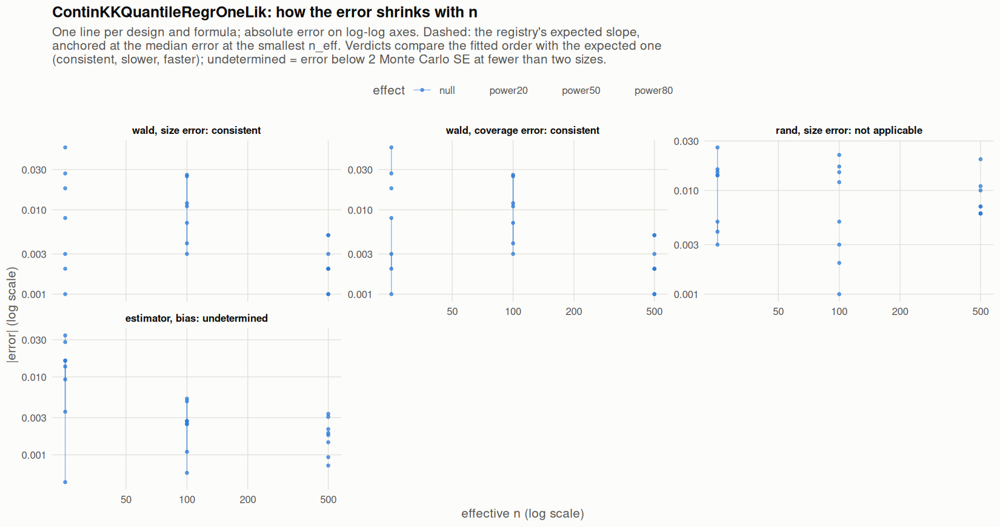

[← Campaign 2026-11-15-e36c7710 summary](README.md)

# Class ContinKKQuantileRegrOneLik

Part of the [Classes index](classes.md). Response type: continuous. Status: null effect complete, power effects in progress. Verdict: **pass so far**.

<picture><source media="(prefers-color-scheme: dark)" srcset="figures/class-ContinKKQuantileRegrOneLik-dark.png"></picture>

Convergence verdicts (worst over designs, formulas and effects; provisional until the class is complete):

| procedure | metric | verdict |
|---|---|---|
| estimator (bias) | bias | undetermined |
| wald | coverage | consistent |
| rand | size | not applicable |
| wald | size | consistent |

Null effect: 48 cells (0 failing). Size, coverage and bias / SD against the level each is held to.

| design | n | formula | procedure | size | coverage | bias / SD | size level | coverage level | verdict |
|---|---|---|---|---|---|---|---|---|---|
| Fixed:BinaryMatch | 50 | `~.` | rand | 0.036 |  | 0.024 | 0.05 | 0.95 | ok |
| Fixed:BinaryMatch | 200 | `~.` | rand | 0.047 |  | -0.026 | 0.05 | 0.95 | ok |
| Fixed:BinaryMatch | 1000 | `~.` | rand | 0.057 |  | 0.022 | 0.05 | 0.95 | ok |
| Fixed:BinaryMatch | 50 | `~.` | wald | 0.068 | 0.932 | 0.024 | 0.1 | 0.9 | ok |
| Fixed:BinaryMatch | 200 | `~.` | wald | 0.075 | 0.925 | -0.026 | 0.0815 | 0.919 | ok |
| Fixed:BinaryMatch | 1000 | `~.` | wald | 0.055 | 0.945 | 0.022 | 0.0608 | 0.939 | ok |
| Fixed:BinaryMatch | 50 | `~1` | rand | 0.046 |  | 0.042 | 0.05 | 0.95 | ok |
| Fixed:BinaryMatch | 200 | `~1` | rand | 0.051 |  | -0.014 | 0.05 | 0.95 | ok |
| Fixed:BinaryMatch | 1000 | `~1` | rand | 0.056 |  | 0.043 | 0.05 | 0.95 | ok |
| Fixed:BinaryMatch | 50 | `~1` | wald | 0.05 | 0.95 | 0.042 | 0.1 | 0.9 | ok |
| Fixed:BinaryMatch | 200 | `~1` | wald | 0.047 | 0.953 | -0.014 | 0.0815 | 0.919 | ok |
| Fixed:BinaryMatch | 1000 | `~1` | wald | 0.053 | 0.947 | 0.043 | 0.0608 | 0.939 | ok |
| SeqOneByOne:KK14 | 50 | `~.` | rand | 0.047 |  | 0.0093 | 0.05 | 0.95 | ok |
| SeqOneByOne:KK14 | 200 | `~.` | rand | 0.035 |  | -0.015 | 0.05 | 0.95 | ok |
| SeqOneByOne:KK14 | 1000 | `~.` | rand | 0.03 |  | 0.04 | 0.05 | 0.95 | ok |
| SeqOneByOne:KK14 | 50 | `~.` | wald | 0.105 | 0.895 | 0.0093 | 0.1 | 0.9 | ok |
| SeqOneByOne:KK14 | 200 | `~.` | wald | 0.076 | 0.924 | -0.015 | 0.0815 | 0.919 | ok |
| SeqOneByOne:KK14 | 1000 | `~.` | wald | 0.048 | 0.952 | 0.04 | 0.0608 | 0.939 | ok |
| SeqOneByOne:KK14 | 50 | `~1` | rand | 0.045 |  | 0.034 | 0.05 | 0.95 | ok |
| SeqOneByOne:KK14 | 200 | `~1` | rand | 0.045 |  | 0.0031 | 0.05 | 0.95 | ok |
| SeqOneByOne:KK14 | 1000 | `~1` | rand | 0.044 |  | 0.011 | 0.05 | 0.95 | ok |
| SeqOneByOne:KK14 | 50 | `~1` | wald | 0.077 | 0.923 | 0.034 | 0.1 | 0.9 | ok |
| SeqOneByOne:KK14 | 200 | `~1` | wald | 0.061 | 0.939 | 0.0031 | 0.0815 | 0.919 | ok |
| SeqOneByOne:KK14 | 1000 | `~1` | wald | 0.052 | 0.948 | 0.011 | 0.0608 | 0.939 | ok |
| SeqOneByOne:KK21 | 50 | `~.` | rand | 0.034 |  | 0.0011 | 0.05 | 0.95 | ok |
| SeqOneByOne:KK21 | 200 | `~.` | rand | 0.033 |  | -0.029 | 0.05 | 0.95 | ok |
| SeqOneByOne:KK21 | 1000 | `~.` | rand | 0.044 |  | 0.026 | 0.05 | 0.95 | ok |
| SeqOneByOne:KK21 | 50 | `~.` | wald | 0.053 | 0.947 | 0.0011 | 0.1 | 0.9 | ok |
| SeqOneByOne:KK21 | 200 | `~.` | wald | 0.043 | 0.957 | -0.029 | 0.0815 | 0.919 | ok |
| SeqOneByOne:KK21 | 1000 | `~.` | wald | 0.051 | 0.949 | 0.026 | 0.0608 | 0.939 | ok |
| SeqOneByOne:KK21 | 50 | `~1` | rand | 0.035 |  | 0.04 | 0.05 | 0.95 | ok |
| SeqOneByOne:KK21 | 200 | `~1` | rand | 0.038 |  | 0.013 | 0.05 | 0.95 | ok |
| SeqOneByOne:KK21 | 1000 | `~1` | rand | 0.057 |  | 0.023 | 0.05 | 0.95 | ok |
| SeqOneByOne:KK21 | 50 | `~1` | wald | 0.048 | 0.952 | 0.04 | 0.1 | 0.9 | ok |
| SeqOneByOne:KK21 | 200 | `~1` | wald | 0.054 | 0.946 | 0.013 | 0.0815 | 0.919 | ok |
| SeqOneByOne:KK21 | 1000 | `~1` | wald | 0.052 | 0.948 | 0.023 | 0.0608 | 0.939 | ok |
| SeqOneByOne:KK21stepwise | 50 | `~.` | rand | 0.024 |  | 0.073 | 0.05 | 0.95 | ok |
| SeqOneByOne:KK21stepwise | 200 | `~.` | rand | 0.028 |  | -0.015 | 0.05 | 0.95 | ok |
| SeqOneByOne:KK21stepwise | 1000 | `~.` | rand | 0.039 |  | -0.018 | 0.05 | 0.95 | ok |
| SeqOneByOne:KK21stepwise | 50 | `~.` | wald | 0.049 | 0.951 | 0.073 | 0.1 | 0.9 | ok |
| SeqOneByOne:KK21stepwise | 200 | `~.` | wald | 0.062 | 0.938 | -0.015 | 0.0815 | 0.919 | ok |
| SeqOneByOne:KK21stepwise | 1000 | `~.` | wald | 0.051 | 0.949 | -0.018 | 0.0608 | 0.939 | ok |
| SeqOneByOne:KK21stepwise | 50 | `~1` | rand | 0.036 |  | 0.083 | 0.05 | 0.95 | ok |
| SeqOneByOne:KK21stepwise | 200 | `~1` | rand | 0.052 |  | 0.0056 | 0.05 | 0.95 | ok |
| SeqOneByOne:KK21stepwise | 1000 | `~1` | rand | 0.04 |  | 0.0086 | 0.05 | 0.95 | ok |
| SeqOneByOne:KK21stepwise | 50 | `~1` | wald | 0.058 | 0.942 | 0.083 | 0.1 | 0.9 | ok |
| SeqOneByOne:KK21stepwise | 200 | `~1` | wald | 0.05 | 0.95 | 0.0056 | 0.0815 | 0.919 | ok |
| SeqOneByOne:KK21stepwise | 1000 | `~1` | wald | 0.055 | 0.945 | 0.0086 | 0.0608 | 0.939 | ok |

Power effects: 64 cells (0 failing coverage).

| design | n | effect | formula | procedure | power | coverage of the true estimand | coverage level | verdict |
|---|---|---|---|---|---|---|---|---|
| Fixed:BinaryMatch | 50 | power20 | `~.` | rand | 0.094 |  | 0.95 | ok |
| Fixed:BinaryMatch | 200 | power20 | `~.` | rand | 0.156 |  | 0.95 | ok |
| Fixed:BinaryMatch | 50 | power50 | `~.` | rand | 0.222 |  | 0.95 | ok |
| Fixed:BinaryMatch | 200 | power50 | `~.` | rand | 0.318 |  | 0.95 | ok |
| Fixed:BinaryMatch | 50 | power20 | `~.` | wald | 0.14 |  | 0.9 | ok |
| Fixed:BinaryMatch | 200 | power20 | `~.` | wald | 0.174 |  | 0.919 | ok |
| Fixed:BinaryMatch | 50 | power50 | `~.` | wald | 0.282 |  | 0.9 | ok |
| Fixed:BinaryMatch | 200 | power50 | `~.` | wald | 0.33 |  | 0.919 | ok |
| Fixed:BinaryMatch | 50 | power20 | `~1` | rand | 0.116 |  | 0.95 | ok |
| Fixed:BinaryMatch | 200 | power20 | `~1` | rand | 0.134 |  | 0.95 | ok |
| Fixed:BinaryMatch | 50 | power50 | `~1` | rand | 0.308 |  | 0.95 | ok |
| Fixed:BinaryMatch | 200 | power50 | `~1` | rand | 0.348 |  | 0.95 | ok |
| Fixed:BinaryMatch | 50 | power20 | `~1` | wald | 0.108 |  | 0.9 | ok |
| Fixed:BinaryMatch | 200 | power20 | `~1` | wald | 0.118 |  | 0.919 | ok |
| Fixed:BinaryMatch | 50 | power50 | `~1` | wald | 0.262 |  | 0.9 | ok |
| Fixed:BinaryMatch | 200 | power50 | `~1` | wald | 0.264 |  | 0.919 | ok |
| SeqOneByOne:KK14 | 50 | power20 | `~.` | rand | 0.106 |  | 0.95 | ok |
| SeqOneByOne:KK14 | 200 | power20 | `~.` | rand | 0.12 |  | 0.95 | ok |
| SeqOneByOne:KK14 | 50 | power50 | `~.` | rand | 0.266 |  | 0.95 | ok |
| SeqOneByOne:KK14 | 200 | power50 | `~.` | rand | 0.266 |  | 0.95 | ok |
| SeqOneByOne:KK14 | 50 | power20 | `~.` | wald | 0.188 |  | 0.9 | ok |
| SeqOneByOne:KK14 | 200 | power20 | `~.` | wald | 0.176 |  | 0.919 | ok |
| SeqOneByOne:KK14 | 50 | power50 | `~.` | wald | 0.368 |  | 0.9 | ok |
| SeqOneByOne:KK14 | 200 | power50 | `~.` | wald | 0.374 |  | 0.919 | ok |
| SeqOneByOne:KK14 | 50 | power20 | `~1` | rand | 0.108 |  | 0.95 | ok |
| SeqOneByOne:KK14 | 200 | power20 | `~1` | rand | 0.116 |  | 0.95 | ok |
| SeqOneByOne:KK14 | 50 | power50 | `~1` | rand | 0.218 |  | 0.95 | ok |
| SeqOneByOne:KK14 | 200 | power50 | `~1` | rand | 0.266 |  | 0.95 | ok |
| SeqOneByOne:KK14 | 50 | power20 | `~1` | wald | 0.152 |  | 0.9 | ok |
| SeqOneByOne:KK14 | 200 | power20 | `~1` | wald | 0.142 |  | 0.919 | ok |
| SeqOneByOne:KK14 | 50 | power50 | `~1` | wald | 0.326 |  | 0.9 | ok |
| SeqOneByOne:KK14 | 200 | power50 | `~1` | wald | 0.32 |  | 0.919 | ok |
| SeqOneByOne:KK21 | 50 | power20 | `~.` | rand | 0.09 |  | 0.95 | ok |
| SeqOneByOne:KK21 | 200 | power20 | `~.` | rand | 0.086 |  | 0.95 | ok |
| SeqOneByOne:KK21 | 50 | power50 | `~.` | rand | 0.21 |  | 0.95 | ok |
| SeqOneByOne:KK21 | 200 | power50 | `~.` | rand | 0.228 |  | 0.95 | ok |
| SeqOneByOne:KK21 | 50 | power20 | `~.` | wald | 0.142 |  | 0.9 | ok |
| SeqOneByOne:KK21 | 200 | power20 | `~.` | wald | 0.126 |  | 0.919 | ok |
| SeqOneByOne:KK21 | 50 | power50 | `~.` | wald | 0.284 |  | 0.9 | ok |
| SeqOneByOne:KK21 | 200 | power50 | `~.` | wald | 0.29 |  | 0.919 | ok |
| SeqOneByOne:KK21 | 50 | power20 | `~1` | rand | 0.092 |  | 0.95 | ok |
| SeqOneByOne:KK21 | 200 | power20 | `~1` | rand | 0.106 |  | 0.95 | ok |
| SeqOneByOne:KK21 | 50 | power50 | `~1` | rand | 0.23 |  | 0.95 | ok |
| SeqOneByOne:KK21 | 200 | power50 | `~1` | rand | 0.29 |  | 0.95 | ok |
| SeqOneByOne:KK21 | 50 | power20 | `~1` | wald | 0.146 |  | 0.9 | ok |
| SeqOneByOne:KK21 | 200 | power20 | `~1` | wald | 0.116 |  | 0.919 | ok |
| SeqOneByOne:KK21 | 50 | power50 | `~1` | wald | 0.268 |  | 0.9 | ok |
| SeqOneByOne:KK21 | 200 | power50 | `~1` | wald | 0.274 |  | 0.919 | ok |
| SeqOneByOne:KK21stepwise | 50 | power20 | `~.` | rand | 0.1 |  | 0.95 | ok |
| SeqOneByOne:KK21stepwise | 200 | power20 | `~.` | rand | 0.096 |  | 0.95 | ok |
| SeqOneByOne:KK21stepwise | 50 | power50 | `~.` | rand | 0.224 |  | 0.95 | ok |
| SeqOneByOne:KK21stepwise | 200 | power50 | `~.` | rand | 0.24 |  | 0.95 | ok |
| SeqOneByOne:KK21stepwise | 50 | power20 | `~.` | wald | 0.142 |  | 0.9 | ok |
| SeqOneByOne:KK21stepwise | 200 | power20 | `~.` | wald | 0.146 |  | 0.919 | ok |
| SeqOneByOne:KK21stepwise | 50 | power50 | `~.` | wald | 0.3 |  | 0.9 | ok |
| SeqOneByOne:KK21stepwise | 200 | power50 | `~.` | wald | 0.306 |  | 0.919 | ok |
| SeqOneByOne:KK21stepwise | 50 | power20 | `~1` | rand | 0.104 |  | 0.95 | ok |
| SeqOneByOne:KK21stepwise | 200 | power20 | `~1` | rand | 0.124 |  | 0.95 | ok |
| SeqOneByOne:KK21stepwise | 50 | power50 | `~1` | rand | 0.24 |  | 0.95 | ok |
| SeqOneByOne:KK21stepwise | 200 | power50 | `~1` | rand | 0.29 |  | 0.95 | ok |
| SeqOneByOne:KK21stepwise | 50 | power20 | `~1` | wald | 0.136 |  | 0.9 | ok |
| SeqOneByOne:KK21stepwise | 200 | power20 | `~1` | wald | 0.134 |  | 0.919 | ok |
| SeqOneByOne:KK21stepwise | 50 | power50 | `~1` | wald | 0.284 |  | 0.9 | ok |
| SeqOneByOne:KK21stepwise | 200 | power50 | `~1` | wald | 0.312 |  | 0.919 | ok |

[← Campaign 2026-11-15-e36c7710 summary](README.md)
