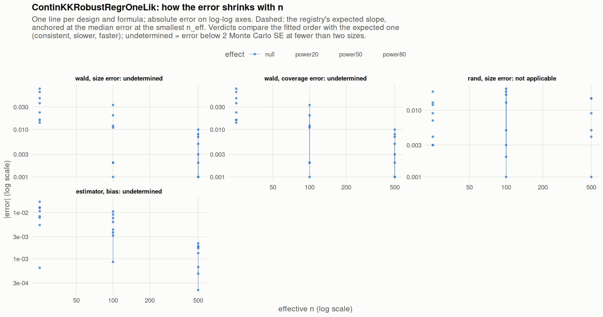

[← Campaign 2026-11-15-e36c7710 summary](README.md)

# Class ContinKKRobustRegrOneLik

Part of the [Classes index](classes.md). Response type: continuous. Status: null effect complete, power effects in progress. Verdict: **pass so far**.

<picture><source media="(prefers-color-scheme: dark)" srcset="figures/class-ContinKKRobustRegrOneLik-dark.png"></picture>

Convergence verdicts (worst over designs, formulas and effects; provisional until the class is complete):

| procedure | metric | verdict |
|---|---|---|
| estimator (bias) | bias | undetermined |
| wald | coverage | undetermined |
| rand | size | not applicable |
| wald | size | undetermined |

Null effect: 48 cells (0 failing). Size, coverage and bias / SD against the level each is held to.

| design | n | formula | procedure | size | coverage | bias / SD | size level | coverage level | verdict |
|---|---|---|---|---|---|---|---|---|---|
| Fixed:BinaryMatch | 50 | `~.` | rand | 0.038 |  | 0.037 | 0.05 | 0.95 | ok |
| Fixed:BinaryMatch | 200 | `~.` | rand | 0.048 |  | -0.024 | 0.05 | 0.95 | ok |
| Fixed:BinaryMatch | 1000 | `~.` | rand | 0.051 |  | 0.02 | 0.05 | 0.95 | ok |
| Fixed:BinaryMatch | 50 | `~.` | wald | 0.086 | 0.914 | 0.037 | 0.1 | 0.9 | ok |
| Fixed:BinaryMatch | 200 | `~.` | wald | 0.061 | 0.939 | -0.024 | 0.1 | 0.9 | ok |
| Fixed:BinaryMatch | 1000 | `~.` | wald | 0.058 | 0.942 | 0.02 | 0.055 | 0.945 | ok |
| Fixed:BinaryMatch | 50 | `~1` | rand | 0.053 |  | 0.051 | 0.05 | 0.95 | ok |
| Fixed:BinaryMatch | 200 | `~1` | rand | 0.067 |  | -0.02 | 0.05 | 0.95 | ok |
| Fixed:BinaryMatch | 1000 | `~1` | rand | 0.054 |  | 0.0032 | 0.05 | 0.95 | ok |
| Fixed:BinaryMatch | 50 | `~1` | wald | 0.064 | 0.936 | 0.051 | 0.1 | 0.9 | ok |
| Fixed:BinaryMatch | 200 | `~1` | wald | 0.062 | 0.938 | -0.02 | 0.1 | 0.9 | ok |
| Fixed:BinaryMatch | 1000 | `~1` | wald | 0.052 | 0.948 | 0.0032 | 0.055 | 0.945 | ok |
| SeqOneByOne:KK14 | 50 | `~.` | rand | 0.046 |  | 0.0019 | 0.05 | 0.95 | ok |
| SeqOneByOne:KK14 | 200 | `~.` | rand | 0.037 |  | -0.049 | 0.05 | 0.95 | ok |
| SeqOneByOne:KK14 | 1000 | `~.` | rand | 0.035 |  | 0.026 | 0.05 | 0.95 | ok |
| SeqOneByOne:KK14 | 50 | `~.` | wald | 0.123 | 0.877 | 0.0019 | 0.1 | 0.9 | ok |
| SeqOneByOne:KK14 | 200 | `~.` | wald | 0.083 | 0.917 | -0.049 | 0.1 | 0.9 | ok |
| SeqOneByOne:KK14 | 1000 | `~.` | wald | 0.049 | 0.951 | 0.026 | 0.055 | 0.945 | ok |
| SeqOneByOne:KK14 | 50 | `~1` | rand | 0.057 |  | -0.015 | 0.05 | 0.95 | ok |
| SeqOneByOne:KK14 | 200 | `~1` | rand | 0.049 |  | -0.039 | 0.05 | 0.95 | ok |
| SeqOneByOne:KK14 | 1000 | `~1` | rand | 0.05 |  | 0.028 | 0.05 | 0.95 | ok |
| SeqOneByOne:KK14 | 50 | `~1` | wald | 0.066 | 0.934 | -0.015 | 0.1 | 0.9 | ok |
| SeqOneByOne:KK14 | 200 | `~1` | wald | 0.048 | 0.952 | -0.039 | 0.1 | 0.9 | ok |
| SeqOneByOne:KK14 | 1000 | `~1` | wald | 0.047 | 0.953 | 0.028 | 0.055 | 0.945 | ok |
| SeqOneByOne:KK21 | 50 | `~.` | rand | 0.037 |  | -0.025 | 0.05 | 0.95 | ok |
| SeqOneByOne:KK21 | 200 | `~.` | rand | 0.029 |  | -0.072 | 0.05 | 0.95 | ok |
| SeqOneByOne:KK21 | 1000 | `~.` | rand | 0.045 |  | 0.033 | 0.05 | 0.95 | ok |
| SeqOneByOne:KK21 | 50 | `~.` | wald | 0.112 | 0.888 | -0.025 | 0.1 | 0.9 | ok |
| SeqOneByOne:KK21 | 200 | `~.` | wald | 0.052 | 0.948 | -0.072 | 0.1 | 0.9 | ok |
| SeqOneByOne:KK21 | 1000 | `~.` | wald | 0.057 | 0.943 | 0.033 | 0.055 | 0.945 | ok |
| SeqOneByOne:KK21 | 50 | `~1` | rand | 0.059 |  | -0.022 | 0.05 | 0.95 | ok |
| SeqOneByOne:KK21 | 200 | `~1` | rand | 0.045 |  | -0.058 | 0.05 | 0.95 | ok |
| SeqOneByOne:KK21 | 1000 | `~1` | rand | 0.059 |  | 0.026 | 0.05 | 0.95 | ok |
| SeqOneByOne:KK21 | 50 | `~1` | wald | 0.066 | 0.934 | -0.022 | 0.1 | 0.9 | ok |
| SeqOneByOne:KK21 | 200 | `~1` | wald | 0.05 | 0.95 | -0.058 | 0.1 | 0.9 | ok |
| SeqOneByOne:KK21 | 1000 | `~1` | wald | 0.06 | 0.94 | 0.026 | 0.055 | 0.945 | ok |
| SeqOneByOne:KK21stepwise | 50 | `~.` | rand | 0.031 |  | 0.039 | 0.05 | 0.95 | ok |
| SeqOneByOne:KK21stepwise | 200 | `~.` | rand | 0.031 |  | -0.029 | 0.05 | 0.95 | ok |
| SeqOneByOne:KK21stepwise | 1000 | `~.` | rand | 0.035 |  | -0.01 | 0.05 | 0.95 | ok |
| SeqOneByOne:KK21stepwise | 50 | `~.` | wald | 0.096 | 0.904 | 0.039 | 0.1 | 0.9 | ok |
| SeqOneByOne:KK21stepwise | 200 | `~.` | wald | 0.07 | 0.93 | -0.029 | 0.1 | 0.9 | ok |
| SeqOneByOne:KK21stepwise | 1000 | `~.` | wald | 0.055 | 0.945 | -0.01 | 0.055 | 0.945 | ok |
| SeqOneByOne:KK21stepwise | 50 | `~1` | rand | 0.053 |  | 0.03 | 0.05 | 0.95 | ok |
| SeqOneByOne:KK21stepwise | 200 | `~1` | rand | 0.047 |  | -0.0054 | 0.05 | 0.95 | ok |
| SeqOneByOne:KK21stepwise | 1000 | `~1` | rand | 0.05 |  | 0.007 | 0.05 | 0.95 | ok |
| SeqOneByOne:KK21stepwise | 50 | `~1` | wald | 0.073 | 0.927 | 0.03 | 0.1 | 0.9 | ok |
| SeqOneByOne:KK21stepwise | 200 | `~1` | wald | 0.049 | 0.951 | -0.0054 | 0.1 | 0.9 | ok |
| SeqOneByOne:KK21stepwise | 1000 | `~1` | wald | 0.049 | 0.951 | 0.007 | 0.055 | 0.945 | ok |

Power effects: 64 cells (0 failing coverage).

| design | n | effect | formula | procedure | power | coverage of the true estimand | coverage level | verdict |
|---|---|---|---|---|---|---|---|---|
| Fixed:BinaryMatch | 50 | power20 | `~.` | rand | 0.112 |  | 0.95 | ok |
| Fixed:BinaryMatch | 200 | power20 | `~.` | rand | 0.164 |  | 0.95 | ok |
| Fixed:BinaryMatch | 50 | power50 | `~.` | rand | 0.318 |  | 0.95 | ok |
| Fixed:BinaryMatch | 200 | power50 | `~.` | rand | 0.398 |  | 0.95 | ok |
| Fixed:BinaryMatch | 50 | power20 | `~.` | wald | 0.254 |  | 0.9 | ok |
| Fixed:BinaryMatch | 200 | power20 | `~.` | wald | 0.192 |  | 0.925 | ok |
| Fixed:BinaryMatch | 50 | power50 | `~.` | wald | 0.464 |  | 0.9 | ok |
| Fixed:BinaryMatch | 200 | power50 | `~.` | wald | 0.46 |  | 0.925 | ok |
| Fixed:BinaryMatch | 50 | power20 | `~1` | rand | 0.174 |  | 0.95 | ok |
| Fixed:BinaryMatch | 200 | power20 | `~1` | rand | 0.18 |  | 0.95 | ok |
| Fixed:BinaryMatch | 50 | power50 | `~1` | rand | 0.398 |  | 0.95 | ok |
| Fixed:BinaryMatch | 200 | power50 | `~1` | rand | 0.432 |  | 0.95 | ok |
| Fixed:BinaryMatch | 50 | power20 | `~1` | wald | 0.208 |  | 0.9 | ok |
| Fixed:BinaryMatch | 200 | power20 | `~1` | wald | 0.188 |  | 0.925 | ok |
| Fixed:BinaryMatch | 50 | power50 | `~1` | wald | 0.432 |  | 0.9 | ok |
| Fixed:BinaryMatch | 200 | power50 | `~1` | wald | 0.45 |  | 0.925 | ok |
| SeqOneByOne:KK14 | 50 | power20 | `~.` | rand | 0.112 |  | 0.95 | ok |
| SeqOneByOne:KK14 | 200 | power20 | `~.` | rand | 0.13 |  | 0.95 | ok |
| SeqOneByOne:KK14 | 50 | power50 | `~.` | rand | 0.322 |  | 0.95 | ok |
| SeqOneByOne:KK14 | 200 | power50 | `~.` | rand | 0.34 |  | 0.95 | ok |
| SeqOneByOne:KK14 | 50 | power20 | `~.` | wald | 0.254 |  | 0.9 | ok |
| SeqOneByOne:KK14 | 200 | power20 | `~.` | wald | 0.2 |  | 0.925 | ok |
| SeqOneByOne:KK14 | 50 | power50 | `~.` | wald | 0.528 |  | 0.9 | ok |
| SeqOneByOne:KK14 | 200 | power50 | `~.` | wald | 0.492 |  | 0.925 | ok |
| SeqOneByOne:KK14 | 50 | power20 | `~1` | rand | 0.132 |  | 0.95 | ok |
| SeqOneByOne:KK14 | 200 | power20 | `~1` | rand | 0.154 |  | 0.95 | ok |
| SeqOneByOne:KK14 | 50 | power50 | `~1` | rand | 0.318 |  | 0.95 | ok |
| SeqOneByOne:KK14 | 200 | power50 | `~1` | rand | 0.366 |  | 0.95 | ok |
| SeqOneByOne:KK14 | 50 | power20 | `~1` | wald | 0.136 |  | 0.9 | ok |
| SeqOneByOne:KK14 | 200 | power20 | `~1` | wald | 0.14 |  | 0.925 | ok |
| SeqOneByOne:KK14 | 50 | power50 | `~1` | wald | 0.36 |  | 0.9 | ok |
| SeqOneByOne:KK14 | 200 | power50 | `~1` | wald | 0.356 |  | 0.925 | ok |
| SeqOneByOne:KK21 | 50 | power20 | `~.` | rand | 0.108 |  | 0.95 | ok |
| SeqOneByOne:KK21 | 200 | power20 | `~.` | rand | 0.118 |  | 0.95 | ok |
| SeqOneByOne:KK21 | 50 | power50 | `~.` | rand | 0.28 |  | 0.95 | ok |
| SeqOneByOne:KK21 | 200 | power50 | `~.` | rand | 0.348 |  | 0.95 | ok |
| SeqOneByOne:KK21 | 50 | power20 | `~.` | wald | 0.248 |  | 0.9 | ok |
| SeqOneByOne:KK21 | 200 | power20 | `~.` | wald | 0.194 |  | 0.925 | ok |
| SeqOneByOne:KK21 | 50 | power50 | `~.` | wald | 0.492 |  | 0.9 | ok |
| SeqOneByOne:KK21 | 200 | power50 | `~.` | wald | 0.448 |  | 0.925 | ok |
| SeqOneByOne:KK21 | 50 | power20 | `~1` | rand | 0.134 |  | 0.95 | ok |
| SeqOneByOne:KK21 | 200 | power20 | `~1` | rand | 0.162 |  | 0.95 | ok |
| SeqOneByOne:KK21 | 50 | power50 | `~1` | rand | 0.33 |  | 0.95 | ok |
| SeqOneByOne:KK21 | 200 | power50 | `~1` | rand | 0.378 |  | 0.95 | ok |
| SeqOneByOne:KK21 | 50 | power20 | `~1` | wald | 0.164 |  | 0.9 | ok |
| SeqOneByOne:KK21 | 200 | power20 | `~1` | wald | 0.156 |  | 0.925 | ok |
| SeqOneByOne:KK21 | 50 | power50 | `~1` | wald | 0.348 |  | 0.9 | ok |
| SeqOneByOne:KK21 | 200 | power50 | `~1` | wald | 0.376 |  | 0.925 | ok |
| SeqOneByOne:KK21stepwise | 50 | power20 | `~.` | rand | 0.11 |  | 0.95 | ok |
| SeqOneByOne:KK21stepwise | 200 | power20 | `~.` | rand | 0.144 |  | 0.95 | ok |
| SeqOneByOne:KK21stepwise | 50 | power50 | `~.` | rand | 0.3 |  | 0.95 | ok |
| SeqOneByOne:KK21stepwise | 200 | power50 | `~.` | rand | 0.342 |  | 0.95 | ok |
| SeqOneByOne:KK21stepwise | 50 | power20 | `~.` | wald | 0.278 |  | 0.9 | ok |
| SeqOneByOne:KK21stepwise | 200 | power20 | `~.` | wald | 0.2 |  | 0.925 | ok |
| SeqOneByOne:KK21stepwise | 50 | power50 | `~.` | wald | 0.512 |  | 0.9 | ok |
| SeqOneByOne:KK21stepwise | 200 | power50 | `~.` | wald | 0.478 |  | 0.925 | ok |
| SeqOneByOne:KK21stepwise | 50 | power20 | `~1` | rand | 0.16 |  | 0.95 | ok |
| SeqOneByOne:KK21stepwise | 200 | power20 | `~1` | rand | 0.172 |  | 0.95 | ok |
| SeqOneByOne:KK21stepwise | 50 | power50 | `~1` | rand | 0.348 |  | 0.95 | ok |
| SeqOneByOne:KK21stepwise | 200 | power50 | `~1` | rand | 0.378 |  | 0.95 | ok |
| SeqOneByOne:KK21stepwise | 50 | power20 | `~1` | wald | 0.192 |  | 0.9 | ok |
| SeqOneByOne:KK21stepwise | 200 | power20 | `~1` | wald | 0.166 |  | 0.925 | ok |
| SeqOneByOne:KK21stepwise | 50 | power50 | `~1` | wald | 0.384 |  | 0.9 | ok |
| SeqOneByOne:KK21stepwise | 200 | power50 | `~1` | wald | 0.394 |  | 0.925 | ok |

[← Campaign 2026-11-15-e36c7710 summary](README.md)
