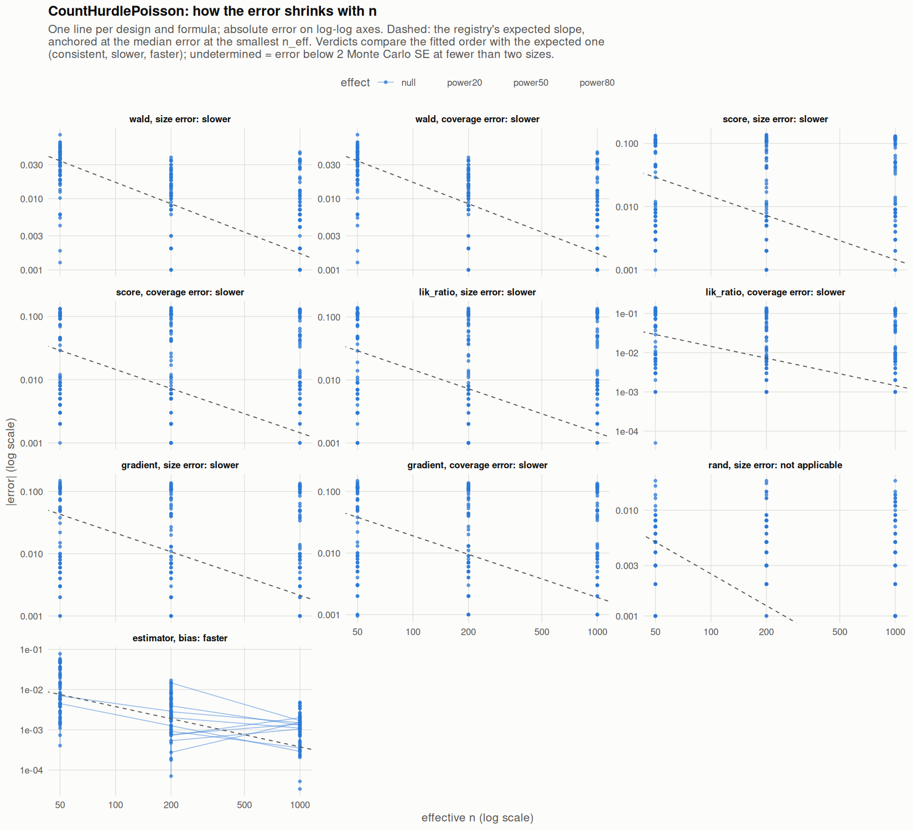

[← Campaign 2026-11-15-e36c7710 summary](README.md)

# Class CountHurdlePoisson

Part of the [Classes index](classes.md). Response type: count. Status: null effect complete, power effects not started. Verdict: **fail** (500 flagged test(s): 500 failing, 0 pending, 0 cleared).

<picture><source media="(prefers-color-scheme: dark)" srcset="figures/class-CountHurdlePoisson-dark.png"></picture>

Convergence verdicts (worst over designs, formulas and effects; provisional until the class is complete):

| procedure | metric | verdict |
|---|---|---|
| estimator (bias) | bias | faster |
| gradient | coverage | slower |
| lik_ratio | coverage | slower |
| score | coverage | slower |
| wald | coverage | slower |
| gradient | size | slower |
| lik_ratio | size | slower |
| rand | size | not applicable |
| score | size | slower |
| wald | size | slower |

Null effect: 978 cells (250 failing). Size, coverage and bias / SD against the level each is held to.

| design | n | formula | procedure | size | coverage | bias / SD | size level | coverage level | verdict |
|---|---|---|---|---|---|---|---|---|---|
| Fixed:Bernoulli | 50 | `~.` | gradient | 0.06 | 0.94 | 0.064 | 0.1 | 0.9 | ok |
| Fixed:Bernoulli | 200 | `~.` | gradient | 0.046 | 0.954 | -0.0083 | 0.0625 | 0.938 | ok |
| Fixed:Bernoulli | 1000 | `~.` | gradient | 0.058 | 0.942 | -0.051 | 0.0525 | 0.948 | ok |
| Fixed:Bernoulli | 50 | `~.` | lik_ratio | 0.059 | 0.941 | 0.064 | 0.1 | 0.9 | ok |
| Fixed:Bernoulli | 200 | `~.` | lik_ratio | 0.046 | 0.954 | -0.0083 | 0.0625 | 0.938 | ok |
| Fixed:Bernoulli | 1000 | `~.` | lik_ratio | 0.058 | 0.942 | -0.051 | 0.0525 | 0.948 | ok |
| Fixed:Bernoulli | 50 | `~.` | rand | 0.046 |  | 0.064 | 0.05 | 0.95 | ok |
| Fixed:Bernoulli | 200 | `~.` | rand | 0.046 |  | -0.0083 | 0.05 | 0.95 | ok |
| Fixed:Bernoulli | 1000 | `~.` | rand | 0.051 |  | -0.051 | 0.05 | 0.95 | ok |
| Fixed:Bernoulli | 50 | `~.` | score | 0.057 | 0.943 | 0.064 | 0.1 | 0.9 | ok |
| Fixed:Bernoulli | 200 | `~.` | score | 0.045 | 0.955 | -0.0083 | 0.0625 | 0.938 | ok |
| Fixed:Bernoulli | 1000 | `~.` | score | 0.058 | 0.942 | -0.051 | 0.0525 | 0.948 | ok |
| Fixed:Bernoulli | 50 | `~.` | wald | 0.0856 | 0.914 | 0.064 | 0.1 | 0.9 | ok |
| Fixed:Bernoulli | 200 | `~.` | wald | 0.053 | 0.947 | -0.0083 | 0.0625 | 0.938 | ok |
| Fixed:Bernoulli | 1000 | `~.` | wald | 0.054 | 0.946 | -0.051 | 0.0525 | 0.948 | ok |
| Fixed:Bernoulli | 50 | `~1` | gradient | 0.166 | 0.834 | 0.043 | 0.1 | 0.9 | **FAIL** |
| Fixed:Bernoulli | 200 | `~1` | gradient | 0.17 | 0.83 | -0.013 | 0.0625 | 0.938 | **FAIL** |
| Fixed:Bernoulli | 1000 | `~1` | gradient | 0.171 | 0.829 | -0.0089 | 0.05 | 0.95 | **FAIL** |
| Fixed:Bernoulli | 50 | `~1` | lik_ratio | 0.165 | 0.835 | 0.043 | 0.1 | 0.9 | **FAIL** |
| Fixed:Bernoulli | 200 | `~1` | lik_ratio | 0.17 | 0.83 | -0.013 | 0.0625 | 0.938 | **FAIL** |
| Fixed:Bernoulli | 1000 | `~1` | lik_ratio | 0.171 | 0.829 | -0.0089 | 0.05 | 0.95 | **FAIL** |
| Fixed:Bernoulli | 50 | `~1` | rand | 0.053 |  | 0.043 | 0.05 | 0.95 | ok |
| Fixed:Bernoulli | 200 | `~1` | rand | 0.059 |  | -0.013 | 0.05 | 0.95 | ok |
| Fixed:Bernoulli | 1000 | `~1` | rand | 0.053 |  | -0.0089 | 0.05 | 0.95 | ok |
| Fixed:Bernoulli | 50 | `~1` | score | 0.163 | 0.837 | 0.043 | 0.1 | 0.9 | **FAIL** |
| Fixed:Bernoulli | 200 | `~1` | score | 0.17 | 0.83 | -0.013 | 0.0625 | 0.938 | **FAIL** |
| Fixed:Bernoulli | 1000 | `~1` | score | 0.172 | 0.828 | -0.0089 | 0.05 | 0.95 | **FAIL** |
| Fixed:Bernoulli | 50 | `~1` | wald | 0.0714 | 0.929 | 0.043 | 0.1 | 0.9 | ok |
| Fixed:Bernoulli | 200 | `~1` | wald | 0.065 | 0.935 | -0.013 | 0.0625 | 0.938 | ok |
| Fixed:Bernoulli | 1000 | `~1` | wald | 0.057 | 0.943 | -0.0089 | 0.0525 | 0.948 | ok |
| Fixed:Bernoulli@0.2 | 50 | `~.` | gradient | 0.054 | 0.947 | -0.066 | 0.1 | 0.9 | ok |
| Fixed:Bernoulli@0.2 | 200 | `~.` | gradient | 0.059 | 0.941 | -0.039 | 0.0625 | 0.938 | ok |
| Fixed:Bernoulli@0.2 | 1000 | `~.` | gradient | 0.044 | 0.956 | -0.0039 | 0.0525 | 0.948 | ok |
| Fixed:Bernoulli@0.2 | 50 | `~.` | lik_ratio | 0.055 | 0.946 | -0.066 | 0.1 | 0.9 | ok |
| Fixed:Bernoulli@0.2 | 200 | `~.` | lik_ratio | 0.058 | 0.942 | -0.039 | 0.0625 | 0.938 | ok |
| Fixed:Bernoulli@0.2 | 1000 | `~.` | lik_ratio | 0.044 | 0.956 | -0.0039 | 0.0525 | 0.948 | ok |
| Fixed:Bernoulli@0.2 | 50 | `~.` | rand | 0.055 |  | -0.066 | 0.05 | 0.95 | ok |
| Fixed:Bernoulli@0.2 | 200 | `~.` | rand | 0.055 |  | -0.039 | 0.05 | 0.95 | ok |
| Fixed:Bernoulli@0.2 | 1000 | `~.` | rand | 0.042 |  | -0.0039 | 0.05 | 0.95 | ok |
| Fixed:Bernoulli@0.2 | 50 | `~.` | score | 0.058 | 0.942 | -0.066 | 0.1 | 0.9 | ok |
| Fixed:Bernoulli@0.2 | 200 | `~.` | score | 0.055 | 0.945 | -0.039 | 0.0625 | 0.938 | ok |
| Fixed:Bernoulli@0.2 | 1000 | `~.` | score | 0.041 | 0.959 | -0.0039 | 0.0525 | 0.948 | ok |
| Fixed:Bernoulli@0.2 | 50 | `~.` | wald | 0.096 | 0.904 | -0.066 | 0.1 | 0.9 | ok |
| Fixed:Bernoulli@0.2 | 200 | `~.` | wald | 0.077 | 0.923 | -0.039 | 0.0625 | 0.938 | ok |
| Fixed:Bernoulli@0.2 | 1000 | `~.` | wald | 0.043 | 0.957 | -0.0039 | 0.0525 | 0.948 | ok |
| Fixed:Bernoulli@0.2 | 50 | `~1` | gradient | 0.168 | 0.833 | -0.11 | 0.1 | 0.9 | **FAIL** |
| Fixed:Bernoulli@0.2 | 200 | `~1` | gradient | 0.176 | 0.824 | -0.017 | 0.0625 | 0.938 | **FAIL** |
| Fixed:Bernoulli@0.2 | 1000 | `~1` | gradient | 0.159 | 0.841 | -0.026 | 0.05 | 0.95 | **FAIL** |
| Fixed:Bernoulli@0.2 | 50 | `~1` | lik_ratio | 0.166 | 0.835 | -0.11 | 0.1 | 0.9 | **FAIL** |
| Fixed:Bernoulli@0.2 | 200 | `~1` | lik_ratio | 0.171 | 0.829 | -0.017 | 0.0625 | 0.938 | **FAIL** |
| Fixed:Bernoulli@0.2 | 1000 | `~1` | lik_ratio | 0.161 | 0.839 | -0.026 | 0.05 | 0.95 | **FAIL** |
| Fixed:Bernoulli@0.2 | 50 | `~1` | rand | 0.053 |  | -0.11 | 0.05 | 0.95 | ok |
| Fixed:Bernoulli@0.2 | 200 | `~1` | rand | 0.054 |  | -0.017 | 0.05 | 0.95 | ok |
| Fixed:Bernoulli@0.2 | 1000 | `~1` | rand | 0.046 |  | -0.026 | 0.05 | 0.95 | ok |
| Fixed:Bernoulli@0.2 | 50 | `~1` | score | 0.153 | 0.848 | -0.11 | 0.1 | 0.9 | **FAIL** |
| Fixed:Bernoulli@0.2 | 200 | `~1` | score | 0.172 | 0.828 | -0.017 | 0.0625 | 0.938 | **FAIL** |
| Fixed:Bernoulli@0.2 | 1000 | `~1` | score | 0.161 | 0.839 | -0.026 | 0.05 | 0.95 | **FAIL** |
| Fixed:Bernoulli@0.2 | 50 | `~1` | wald | 0.106 | 0.894 | -0.11 | 0.1 | 0.9 | ok |
| Fixed:Bernoulli@0.2 | 200 | `~1` | wald | 0.062 | 0.938 | -0.017 | 0.0625 | 0.938 | ok |
| Fixed:Bernoulli@0.2 | 1000 | `~1` | wald | 0.046 | 0.954 | -0.026 | 0.0525 | 0.948 | ok |
| Fixed:BinaryMatch | 50 | `~.` | gradient | 0.047 | 0.953 | -0.019 | 0.1 | 0.9 | ok |
| Fixed:BinaryMatch | 200 | `~.` | gradient | 0.041 | 0.959 | -0.05 | 0.0625 | 0.938 | ok |
| Fixed:BinaryMatch | 1000 | `~.` | gradient | 0.043 | 0.957 | 0.031 | 0.0525 | 0.948 | ok |
| Fixed:BinaryMatch | 50 | `~.` | lik_ratio | 0.047 | 0.953 | -0.019 | 0.1 | 0.9 | ok |
| Fixed:BinaryMatch | 200 | `~.` | lik_ratio | 0.041 | 0.959 | -0.05 | 0.0625 | 0.938 | ok |
| Fixed:BinaryMatch | 1000 | `~.` | lik_ratio | 0.043 | 0.957 | 0.031 | 0.0525 | 0.948 | ok |
| Fixed:BinaryMatch | 50 | `~.` | rand | 0.041 |  | -0.019 | 0.05 | 0.95 | ok |
| Fixed:BinaryMatch | 200 | `~.` | rand | 0.043 |  | -0.05 | 0.05 | 0.95 | ok |
| Fixed:BinaryMatch | 1000 | `~.` | rand | 0.046 |  | 0.031 | 0.05 | 0.95 | ok |
| Fixed:BinaryMatch | 50 | `~.` | score | 0.046 | 0.954 | -0.019 | 0.1 | 0.9 | ok |
| Fixed:BinaryMatch | 200 | `~.` | score | 0.041 | 0.959 | -0.05 | 0.0625 | 0.938 | ok |
| Fixed:BinaryMatch | 1000 | `~.` | score | 0.043 | 0.957 | 0.031 | 0.0525 | 0.948 | ok |
| Fixed:BinaryMatch | 50 | `~.` | wald | 0.0755 | 0.924 | -0.019 | 0.1 | 0.9 | ok |
| Fixed:BinaryMatch | 200 | `~.` | wald | 0.052 | 0.948 | -0.05 | 0.0625 | 0.938 | ok |
| Fixed:BinaryMatch | 1000 | `~.` | wald | 0.048 | 0.952 | 0.031 | 0.0525 | 0.948 | ok |
| Fixed:BinaryMatch | 50 | `~1` | gradient | 0.088 | 0.912 | -0.031 | 0.1 | 0.9 | ok |
| Fixed:BinaryMatch | 200 | `~1` | gradient | 0.077 | 0.923 | -0.053 | 0.0625 | 0.938 | ok |
| Fixed:BinaryMatch | 1000 | `~1` | gradient | 0.053 | 0.947 | 0.037 | 0.0525 | 0.948 | ok |
| Fixed:BinaryMatch | 50 | `~1` | lik_ratio | 0.087 | 0.913 | -0.031 | 0.1 | 0.9 | ok |
| Fixed:BinaryMatch | 200 | `~1` | lik_ratio | 0.075 | 0.925 | -0.053 | 0.0625 | 0.938 | ok |
| Fixed:BinaryMatch | 1000 | `~1` | lik_ratio | 0.053 | 0.947 | 0.037 | 0.0525 | 0.948 | ok |
| Fixed:BinaryMatch | 50 | `~1` | rand | 0.046 |  | -0.031 | 0.05 | 0.95 | ok |
| Fixed:BinaryMatch | 200 | `~1` | rand | 0.047 |  | -0.053 | 0.05 | 0.95 | ok |
| Fixed:BinaryMatch | 1000 | `~1` | rand | 0.042 |  | 0.037 | 0.05 | 0.95 | ok |
| Fixed:BinaryMatch | 50 | `~1` | score | 0.085 | 0.915 | -0.031 | 0.1 | 0.9 | ok |
| Fixed:BinaryMatch | 200 | `~1` | score | 0.076 | 0.924 | -0.053 | 0.0625 | 0.938 | ok |
| Fixed:BinaryMatch | 1000 | `~1` | score | 0.053 | 0.947 | 0.037 | 0.0525 | 0.948 | ok |
| Fixed:BinaryMatch | 50 | `~1` | wald | 0.0313 | 0.969 | -0.031 | 0.1 | 0.9 | ok |
| Fixed:BinaryMatch | 200 | `~1` | wald | 0.015 | 0.985 | -0.053 | 0.0625 | 0.938 | ok |
| Fixed:BinaryMatch | 1000 | `~1` | wald | 0.007 | 0.993 | 0.037 | 0.0525 | 0.948 | ok |
| Fixed:Blocking | 50 | `~.` | gradient | 0.053 | 0.947 | -0.007 | 0.1 | 0.9 | ok |
| Fixed:Blocking | 200 | `~.` | gradient | 0.044 | 0.956 | -0.0087 | 0.0625 | 0.938 | ok |
| Fixed:Blocking | 1000 | `~.` | gradient | 0.041 | 0.959 | 0.011 | 0.0525 | 0.948 | ok |
| Fixed:Blocking | 50 | `~.` | lik_ratio | 0.053 | 0.947 | -0.007 | 0.1 | 0.9 | ok |
| Fixed:Blocking | 200 | `~.` | lik_ratio | 0.044 | 0.956 | -0.0087 | 0.0625 | 0.938 | ok |
| Fixed:Blocking | 1000 | `~.` | lik_ratio | 0.041 | 0.959 | 0.011 | 0.0525 | 0.948 | ok |
| Fixed:Blocking | 50 | `~.` | rand | 0.056 |  | -0.007 | 0.05 | 0.95 | ok |
| Fixed:Blocking | 200 | `~.` | rand | 0.05 |  | -0.0087 | 0.05 | 0.95 | ok |
| Fixed:Blocking | 1000 | `~.` | rand | 0.047 |  | 0.011 | 0.05 | 0.95 | ok |
| Fixed:Blocking | 50 | `~.` | score | 0.052 | 0.948 | -0.007 | 0.1 | 0.9 | ok |
| Fixed:Blocking | 200 | `~.` | score | 0.044 | 0.956 | -0.0087 | 0.0625 | 0.938 | ok |
| Fixed:Blocking | 1000 | `~.` | score | 0.041 | 0.959 | 0.011 | 0.0525 | 0.948 | ok |
| Fixed:Blocking | 50 | `~.` | wald | 0.0857 | 0.914 | -0.007 | 0.1 | 0.9 | ok |
| Fixed:Blocking | 200 | `~.` | wald | 0.053 | 0.947 | -0.0087 | 0.0625 | 0.938 | ok |
| Fixed:Blocking | 1000 | `~.` | wald | 0.045 | 0.955 | 0.011 | 0.0525 | 0.948 | ok |
| Fixed:Blocking | 50 | `~1` | gradient | 0.158 | 0.842 | -0.03 | 0.1 | 0.9 | **FAIL** |
| Fixed:Blocking | 200 | `~1` | gradient | 0.16 | 0.84 | 0.02 | 0.0625 | 0.938 | **FAIL** |
| Fixed:Blocking | 1000 | `~1` | gradient | 0.135 | 0.865 | -0.0072 | 0.05 | 0.95 | **FAIL** |
| Fixed:Blocking | 50 | `~1` | lik_ratio | 0.157 | 0.843 | -0.03 | 0.1 | 0.9 | **FAIL** |
| Fixed:Blocking | 200 | `~1` | lik_ratio | 0.159 | 0.841 | 0.02 | 0.0625 | 0.938 | **FAIL** |
| Fixed:Blocking | 1000 | `~1` | lik_ratio | 0.135 | 0.865 | -0.0072 | 0.05 | 0.95 | **FAIL** |
| Fixed:Blocking | 50 | `~1` | rand | 0.053 |  | -0.03 | 0.05 | 0.95 | ok |
| Fixed:Blocking | 200 | `~1` | rand | 0.052 |  | 0.02 | 0.05 | 0.95 | ok |
| Fixed:Blocking | 1000 | `~1` | rand | 0.037 |  | -0.0072 | 0.05 | 0.95 | ok |
| Fixed:Blocking | 50 | `~1` | score | 0.156 | 0.844 | -0.03 | 0.1 | 0.9 | **FAIL** |
| Fixed:Blocking | 200 | `~1` | score | 0.159 | 0.841 | 0.02 | 0.0625 | 0.938 | **FAIL** |
| Fixed:Blocking | 1000 | `~1` | score | 0.135 | 0.865 | -0.0072 | 0.05 | 0.95 | **FAIL** |
| Fixed:Blocking | 50 | `~1` | wald | 0.068 | 0.932 | -0.03 | 0.1 | 0.9 | ok |
| Fixed:Blocking | 200 | `~1` | wald | 0.057 | 0.943 | 0.02 | 0.0625 | 0.938 | ok |
| Fixed:Blocking | 1000 | `~1` | wald | 0.03 | 0.97 | -0.0072 | 0.0525 | 0.948 | ok |
| Fixed:Blocking@0.2 | 50 | `~.` | gradient | 0.065 | 0.935 | -0.13 | 0.1 | 0.9 | ok |
| Fixed:Blocking@0.2 | 200 | `~.` | gradient | 0.045 | 0.955 | -0.025 | 0.0625 | 0.938 | ok |
| Fixed:Blocking@0.2 | 1000 | `~.` | gradient | 0.046 | 0.954 | -0.024 | 0.0525 | 0.948 | ok |
| Fixed:Blocking@0.2 | 50 | `~.` | lik_ratio | 0.064 | 0.936 | -0.13 | 0.1 | 0.9 | ok |
| Fixed:Blocking@0.2 | 200 | `~.` | lik_ratio | 0.046 | 0.954 | -0.025 | 0.0625 | 0.938 | ok |
| Fixed:Blocking@0.2 | 1000 | `~.` | lik_ratio | 0.044 | 0.956 | -0.024 | 0.0525 | 0.948 | ok |
| Fixed:Blocking@0.2 | 50 | `~.` | rand | 0.047 |  | -0.13 | 0.05 | 0.95 | ok |
| Fixed:Blocking@0.2 | 200 | `~.` | rand | 0.053 |  | -0.025 | 0.05 | 0.95 | ok |
| Fixed:Blocking@0.2 | 1000 | `~.` | rand | 0.049 |  | -0.024 | 0.05 | 0.95 | ok |
| Fixed:Blocking@0.2 | 50 | `~.` | score | 0.06 | 0.94 | -0.13 | 0.1 | 0.9 | ok |
| Fixed:Blocking@0.2 | 200 | `~.` | score | 0.05 | 0.95 | -0.025 | 0.0625 | 0.938 | ok |
| Fixed:Blocking@0.2 | 1000 | `~.` | score | 0.044 | 0.956 | -0.024 | 0.0525 | 0.948 | ok |
| Fixed:Blocking@0.2 | 50 | `~.` | wald | 0.112 | 0.888 | -0.13 | 0.1 | 0.9 | ok |
| Fixed:Blocking@0.2 | 200 | `~.` | wald | 0.066 | 0.934 | -0.025 | 0.0625 | 0.938 | ok |
| Fixed:Blocking@0.2 | 1000 | `~.` | wald | 0.05 | 0.95 | -0.024 | 0.0525 | 0.948 | ok |
| Fixed:Blocking@0.2 | 50 | `~1` | gradient | 0.164 | 0.836 | -0.14 | 0.1 | 0.9 | **FAIL** |
| Fixed:Blocking@0.2 | 200 | `~1` | gradient | 0.156 | 0.844 | -0.072 | 0.0625 | 0.938 | **FAIL** |
| Fixed:Blocking@0.2 | 1000 | `~1` | gradient | 0.15 | 0.85 | -0.055 | 0.05 | 0.95 | **FAIL** |
| Fixed:Blocking@0.2 | 50 | `~1` | lik_ratio | 0.163 | 0.837 | -0.14 | 0.1 | 0.9 | **FAIL** |
| Fixed:Blocking@0.2 | 200 | `~1` | lik_ratio | 0.153 | 0.847 | -0.072 | 0.0625 | 0.938 | **FAIL** |
| Fixed:Blocking@0.2 | 1000 | `~1` | lik_ratio | 0.15 | 0.85 | -0.055 | 0.05 | 0.95 | **FAIL** |
| Fixed:Blocking@0.2 | 50 | `~1` | rand | 0.045 |  | -0.14 | 0.05 | 0.95 | ok |
| Fixed:Blocking@0.2 | 200 | `~1` | rand | 0.058 |  | -0.072 | 0.05 | 0.95 | ok |
| Fixed:Blocking@0.2 | 1000 | `~1` | rand | 0.044 |  | -0.055 | 0.05 | 0.95 | ok |
| Fixed:Blocking@0.2 | 50 | `~1` | score | 0.154 | 0.846 | -0.14 | 0.1 | 0.9 | **FAIL** |
| Fixed:Blocking@0.2 | 200 | `~1` | score | 0.151 | 0.849 | -0.072 | 0.0625 | 0.938 | **FAIL** |
| Fixed:Blocking@0.2 | 1000 | `~1` | score | 0.15 | 0.85 | -0.055 | 0.05 | 0.95 | **FAIL** |
| Fixed:Blocking@0.2 | 50 | `~1` | wald | 0.0944 | 0.906 | -0.14 | 0.1 | 0.9 | ok |
| Fixed:Blocking@0.2 | 200 | `~1` | wald | 0.064 | 0.936 | -0.072 | 0.0625 | 0.938 | ok |
| Fixed:Blocking@0.2 | 1000 | `~1` | wald | 0.047 | 0.953 | -0.055 | 0.0525 | 0.948 | ok |
| Fixed:Greedy | 50 | `~.` | gradient | 0.059 | 0.941 | -0.0097 | 0.1 | 0.9 | ok |
| Fixed:Greedy | 200 | `~.` | gradient | 0.052 | 0.948 | -0.041 | 0.0625 | 0.938 | ok |
| Fixed:Greedy | 1000 | `~.` | gradient | 0.059 | 0.941 | -0.0074 | 0.0525 | 0.948 | ok |
| Fixed:Greedy | 50 | `~.` | lik_ratio | 0.059 | 0.941 | -0.0097 | 0.1 | 0.9 | ok |
| Fixed:Greedy | 200 | `~.` | lik_ratio | 0.052 | 0.948 | -0.041 | 0.0625 | 0.938 | ok |
| Fixed:Greedy | 1000 | `~.` | lik_ratio | 0.059 | 0.941 | -0.0074 | 0.0525 | 0.948 | ok |
| Fixed:Greedy | 50 | `~.` | rand | 0.058 |  | -0.0097 | 0.05 | 0.95 | ok |
| Fixed:Greedy | 200 | `~.` | rand | 0.058 |  | -0.041 | 0.05 | 0.95 | ok |
| Fixed:Greedy | 1000 | `~.` | rand | 0.061 |  | -0.0074 | 0.05 | 0.95 | ok |
| Fixed:Greedy | 50 | `~.` | score | 0.059 | 0.941 | -0.0097 | 0.1 | 0.9 | ok |
| Fixed:Greedy | 200 | `~.` | score | 0.052 | 0.948 | -0.041 | 0.0625 | 0.938 | ok |
| Fixed:Greedy | 1000 | `~.` | score | 0.059 | 0.941 | -0.0074 | 0.0525 | 0.948 | ok |
| Fixed:Greedy | 50 | `~.` | wald | 0.0862 | 0.914 | -0.0097 | 0.1 | 0.9 | ok |
| Fixed:Greedy | 200 | `~.` | wald | 0.065 | 0.935 | -0.041 | 0.0625 | 0.938 | ok |
| Fixed:Greedy | 1000 | `~.` | wald | 0.061 | 0.939 | -0.0074 | 0.0525 | 0.948 | ok |
| Fixed:Greedy | 50 | `~1` | gradient | 0.1 | 0.9 | 0.02 | 0.1 | 0.9 | ok |
| Fixed:Greedy | 200 | `~1` | gradient | 0.094 | 0.906 | -0.075 | 0.0625 | 0.938 | **FAIL** |
| Fixed:Greedy | 1000 | `~1` | gradient | 0.1 | 0.9 | -0.006 | 0.05 | 0.95 | **FAIL** |
| Fixed:Greedy | 50 | `~1` | lik_ratio | 0.097 | 0.903 | 0.02 | 0.1 | 0.9 | ok |
| Fixed:Greedy | 200 | `~1` | lik_ratio | 0.094 | 0.906 | -0.075 | 0.0625 | 0.938 | **FAIL** |
| Fixed:Greedy | 1000 | `~1` | lik_ratio | 0.1 | 0.9 | -0.006 | 0.05 | 0.95 | **FAIL** |
| Fixed:Greedy | 50 | `~1` | rand | 0.049 |  | 0.02 | 0.05 | 0.95 | ok |
| Fixed:Greedy | 200 | `~1` | rand | 0.048 |  | -0.075 | 0.05 | 0.95 | ok |
| Fixed:Greedy | 1000 | `~1` | rand | 0.046 |  | -0.006 | 0.05 | 0.95 | ok |
| Fixed:Greedy | 50 | `~1` | score | 0.096 | 0.904 | 0.02 | 0.1 | 0.9 | ok |
| Fixed:Greedy | 200 | `~1` | score | 0.094 | 0.906 | -0.075 | 0.0625 | 0.938 | **FAIL** |
| Fixed:Greedy | 1000 | `~1` | score | 0.1 | 0.9 | -0.006 | 0.05 | 0.95 | **FAIL** |
| Fixed:Greedy | 50 | `~1` | wald | 0.0337 | 0.966 | 0.02 | 0.1 | 0.9 | ok |
| Fixed:Greedy | 200 | `~1` | wald | 0.02 | 0.98 | -0.075 | 0.0625 | 0.938 | ok |
| Fixed:Greedy | 1000 | `~1` | wald | 0.016 | 0.984 | -0.006 | 0.0525 | 0.948 | ok |
| Fixed:Greedy@0.2 | 50 | `~.` | gradient | 0.045 | 0.955 | -0.13 | 0.1 | 0.9 | ok |
| Fixed:Greedy@0.2 | 200 | `~.` | gradient | 0.052 | 0.948 | -0.022 | 0.0625 | 0.938 | ok |
| Fixed:Greedy@0.2 | 1000 | `~.` | gradient | 0.06 | 0.94 | 0.013 | 0.0525 | 0.948 | ok |
| Fixed:Greedy@0.2 | 50 | `~.` | lik_ratio | 0.043 | 0.957 | -0.13 | 0.1 | 0.9 | ok |
| Fixed:Greedy@0.2 | 200 | `~.` | lik_ratio | 0.051 | 0.949 | -0.022 | 0.0625 | 0.938 | ok |
| Fixed:Greedy@0.2 | 1000 | `~.` | lik_ratio | 0.06 | 0.94 | 0.013 | 0.0525 | 0.948 | ok |
| Fixed:Greedy@0.2 | 50 | `~.` | rand | 0.041 |  | -0.13 | 0.05 | 0.95 | ok |
| Fixed:Greedy@0.2 | 200 | `~.` | rand | 0.053 |  | -0.022 | 0.05 | 0.95 | ok |
| Fixed:Greedy@0.2 | 1000 | `~.` | rand | 0.058 |  | 0.013 | 0.05 | 0.95 | ok |
| Fixed:Greedy@0.2 | 50 | `~.` | score | 0.043 | 0.957 | -0.13 | 0.1 | 0.9 | ok |
| Fixed:Greedy@0.2 | 200 | `~.` | score | 0.052 | 0.948 | -0.022 | 0.0625 | 0.938 | ok |
| Fixed:Greedy@0.2 | 1000 | `~.` | score | 0.061 | 0.939 | 0.013 | 0.0525 | 0.948 | ok |
| Fixed:Greedy@0.2 | 50 | `~.` | wald | 0.0824 | 0.918 | -0.13 | 0.1 | 0.9 | ok |
| Fixed:Greedy@0.2 | 200 | `~.` | wald | 0.062 | 0.938 | -0.022 | 0.0625 | 0.938 | ok |
| Fixed:Greedy@0.2 | 1000 | `~.` | wald | 0.056 | 0.944 | 0.013 | 0.0525 | 0.948 | ok |
| Fixed:Greedy@0.2 | 50 | `~1` | gradient | 0.106 | 0.894 | -0.17 | 0.1 | 0.9 | ok |
| Fixed:Greedy@0.2 | 200 | `~1` | gradient | 0.09 | 0.91 | -0.016 | 0.0625 | 0.938 | **FAIL** |
| Fixed:Greedy@0.2 | 1000 | `~1` | gradient | 0.099 | 0.901 | 0.077 | 0.05 | 0.95 | **FAIL** |
| Fixed:Greedy@0.2 | 50 | `~1` | lik_ratio | 0.099 | 0.901 | -0.17 | 0.1 | 0.9 | ok |
| Fixed:Greedy@0.2 | 200 | `~1` | lik_ratio | 0.087 | 0.913 | -0.016 | 0.0625 | 0.938 | ok |
| Fixed:Greedy@0.2 | 1000 | `~1` | lik_ratio | 0.1 | 0.9 | 0.077 | 0.05 | 0.95 | **FAIL** |
| Fixed:Greedy@0.2 | 50 | `~1` | rand | 0.043 |  | -0.17 | 0.05 | 0.95 | ok |
| Fixed:Greedy@0.2 | 200 | `~1` | rand | 0.041 |  | -0.016 | 0.05 | 0.95 | ok |
| Fixed:Greedy@0.2 | 1000 | `~1` | rand | 0.051 |  | 0.077 | 0.05 | 0.95 | ok |
| Fixed:Greedy@0.2 | 50 | `~1` | score | 0.093 | 0.907 | -0.17 | 0.1 | 0.9 | ok |
| Fixed:Greedy@0.2 | 200 | `~1` | score | 0.091 | 0.909 | -0.016 | 0.0625 | 0.938 | **FAIL** |
| Fixed:Greedy@0.2 | 1000 | `~1` | score | 0.101 | 0.899 | 0.077 | 0.05 | 0.95 | **FAIL** |
| Fixed:Greedy@0.2 | 50 | `~1` | wald | 0.056 | 0.944 | -0.17 | 0.1 | 0.9 | ok |
| Fixed:Greedy@0.2 | 200 | `~1` | wald | 0.016 | 0.984 | -0.016 | 0.0625 | 0.938 | ok |
| Fixed:Greedy@0.2 | 1000 | `~1` | wald | 0.023 | 0.977 | 0.077 | 0.0525 | 0.948 | ok |
| Fixed:GreedyDOptimal | 50 | `~.` | gradient | 0.059 | 0.941 | -0.0097 | 0.1 | 0.9 | ok |
| Fixed:GreedyDOptimal | 200 | `~.` | gradient | 0.052 | 0.948 | -0.041 | 0.0625 | 0.938 | ok |
| Fixed:GreedyDOptimal | 1000 | `~.` | gradient | 0.059 | 0.941 | -0.0074 | 0.0525 | 0.948 | ok |
| Fixed:GreedyDOptimal | 50 | `~.` | lik_ratio | 0.059 | 0.941 | -0.0097 | 0.1 | 0.9 | ok |
| Fixed:GreedyDOptimal | 200 | `~.` | lik_ratio | 0.052 | 0.948 | -0.041 | 0.0625 | 0.938 | ok |
| Fixed:GreedyDOptimal | 1000 | `~.` | lik_ratio | 0.059 | 0.941 | -0.0074 | 0.0525 | 0.948 | ok |
| Fixed:GreedyDOptimal | 50 | `~.` | rand | 0.058 |  | -0.0097 | 0.05 | 0.95 | ok |
| Fixed:GreedyDOptimal | 200 | `~.` | rand | 0.058 |  | -0.041 | 0.05 | 0.95 | ok |
| Fixed:GreedyDOptimal | 1000 | `~.` | rand | 0.061 |  | -0.0074 | 0.05 | 0.95 | ok |
| Fixed:GreedyDOptimal | 50 | `~.` | score | 0.059 | 0.941 | -0.0097 | 0.1 | 0.9 | ok |
| Fixed:GreedyDOptimal | 200 | `~.` | score | 0.052 | 0.948 | -0.041 | 0.0625 | 0.938 | ok |
| Fixed:GreedyDOptimal | 1000 | `~.` | score | 0.059 | 0.941 | -0.0074 | 0.0525 | 0.948 | ok |
| Fixed:GreedyDOptimal | 50 | `~.` | wald | 0.0862 | 0.914 | -0.0097 | 0.1 | 0.9 | ok |
| Fixed:GreedyDOptimal | 200 | `~.` | wald | 0.065 | 0.935 | -0.041 | 0.0625 | 0.938 | ok |
| Fixed:GreedyDOptimal | 1000 | `~.` | wald | 0.061 | 0.939 | -0.0074 | 0.0525 | 0.948 | ok |
| Fixed:GreedyDOptimal | 50 | `~1` | gradient | 0.1 | 0.9 | 0.02 | 0.1 | 0.9 | ok |
| Fixed:GreedyDOptimal | 200 | `~1` | gradient | 0.094 | 0.906 | -0.075 | 0.0625 | 0.938 | **FAIL** |
| Fixed:GreedyDOptimal | 1000 | `~1` | gradient | 0.1 | 0.9 | -0.006 | 0.05 | 0.95 | **FAIL** |
| Fixed:GreedyDOptimal | 50 | `~1` | lik_ratio | 0.097 | 0.903 | 0.02 | 0.1 | 0.9 | ok |
| Fixed:GreedyDOptimal | 200 | `~1` | lik_ratio | 0.094 | 0.906 | -0.075 | 0.0625 | 0.938 | **FAIL** |
| Fixed:GreedyDOptimal | 1000 | `~1` | lik_ratio | 0.1 | 0.9 | -0.006 | 0.05 | 0.95 | **FAIL** |
| Fixed:GreedyDOptimal | 50 | `~1` | rand | 0.049 |  | 0.02 | 0.05 | 0.95 | ok |
| Fixed:GreedyDOptimal | 200 | `~1` | rand | 0.048 |  | -0.075 | 0.05 | 0.95 | ok |
| Fixed:GreedyDOptimal | 1000 | `~1` | rand | 0.046 |  | -0.006 | 0.05 | 0.95 | ok |
| Fixed:GreedyDOptimal | 50 | `~1` | score | 0.096 | 0.904 | 0.02 | 0.1 | 0.9 | ok |
| Fixed:GreedyDOptimal | 200 | `~1` | score | 0.094 | 0.906 | -0.075 | 0.0625 | 0.938 | **FAIL** |
| Fixed:GreedyDOptimal | 1000 | `~1` | score | 0.1 | 0.9 | -0.006 | 0.05 | 0.95 | **FAIL** |
| Fixed:GreedyDOptimal | 50 | `~1` | wald | 0.0337 | 0.966 | 0.02 | 0.1 | 0.9 | ok |
| Fixed:GreedyDOptimal | 200 | `~1` | wald | 0.02 | 0.98 | -0.075 | 0.0625 | 0.938 | ok |
| Fixed:GreedyDOptimal | 1000 | `~1` | wald | 0.016 | 0.984 | -0.006 | 0.0525 | 0.948 | ok |
| Fixed:GreedyDOptimal@0.2 | 50 | `~.` | gradient | 0.045 | 0.955 | -0.13 | 0.1 | 0.9 | ok |
| Fixed:GreedyDOptimal@0.2 | 200 | `~.` | gradient | 0.052 | 0.948 | -0.022 | 0.0625 | 0.938 | ok |
| Fixed:GreedyDOptimal@0.2 | 1000 | `~.` | gradient | 0.06 | 0.94 | 0.013 | 0.0525 | 0.948 | ok |
| Fixed:GreedyDOptimal@0.2 | 50 | `~.` | lik_ratio | 0.043 | 0.957 | -0.13 | 0.1 | 0.9 | ok |
| Fixed:GreedyDOptimal@0.2 | 200 | `~.` | lik_ratio | 0.051 | 0.949 | -0.022 | 0.0625 | 0.938 | ok |
| Fixed:GreedyDOptimal@0.2 | 1000 | `~.` | lik_ratio | 0.06 | 0.94 | 0.013 | 0.0525 | 0.948 | ok |
| Fixed:GreedyDOptimal@0.2 | 50 | `~.` | rand | 0.041 |  | -0.13 | 0.05 | 0.95 | ok |
| Fixed:GreedyDOptimal@0.2 | 200 | `~.` | rand | 0.053 |  | -0.022 | 0.05 | 0.95 | ok |
| Fixed:GreedyDOptimal@0.2 | 1000 | `~.` | rand | 0.058 |  | 0.013 | 0.05 | 0.95 | ok |
| Fixed:GreedyDOptimal@0.2 | 50 | `~.` | score | 0.043 | 0.957 | -0.13 | 0.1 | 0.9 | ok |
| Fixed:GreedyDOptimal@0.2 | 200 | `~.` | score | 0.052 | 0.948 | -0.022 | 0.0625 | 0.938 | ok |
| Fixed:GreedyDOptimal@0.2 | 1000 | `~.` | score | 0.061 | 0.939 | 0.013 | 0.0525 | 0.948 | ok |
| Fixed:GreedyDOptimal@0.2 | 50 | `~.` | wald | 0.0824 | 0.918 | -0.13 | 0.1 | 0.9 | ok |
| Fixed:GreedyDOptimal@0.2 | 200 | `~.` | wald | 0.062 | 0.938 | -0.022 | 0.0625 | 0.938 | ok |
| Fixed:GreedyDOptimal@0.2 | 1000 | `~.` | wald | 0.056 | 0.944 | 0.013 | 0.0525 | 0.948 | ok |
| Fixed:GreedyDOptimal@0.2 | 50 | `~1` | gradient | 0.106 | 0.894 | -0.17 | 0.1 | 0.9 | ok |
| Fixed:GreedyDOptimal@0.2 | 200 | `~1` | gradient | 0.09 | 0.91 | -0.016 | 0.0625 | 0.938 | **FAIL** |
| Fixed:GreedyDOptimal@0.2 | 1000 | `~1` | gradient | 0.099 | 0.901 | 0.077 | 0.05 | 0.95 | **FAIL** |
| Fixed:GreedyDOptimal@0.2 | 50 | `~1` | lik_ratio | 0.099 | 0.901 | -0.17 | 0.1 | 0.9 | ok |
| Fixed:GreedyDOptimal@0.2 | 200 | `~1` | lik_ratio | 0.087 | 0.913 | -0.016 | 0.0625 | 0.938 | ok |
| Fixed:GreedyDOptimal@0.2 | 1000 | `~1` | lik_ratio | 0.1 | 0.9 | 0.077 | 0.05 | 0.95 | **FAIL** |
| Fixed:GreedyDOptimal@0.2 | 50 | `~1` | rand | 0.043 |  | -0.17 | 0.05 | 0.95 | ok |
| Fixed:GreedyDOptimal@0.2 | 200 | `~1` | rand | 0.041 |  | -0.016 | 0.05 | 0.95 | ok |
| Fixed:GreedyDOptimal@0.2 | 1000 | `~1` | rand | 0.051 |  | 0.077 | 0.05 | 0.95 | ok |
| Fixed:GreedyDOptimal@0.2 | 50 | `~1` | score | 0.093 | 0.907 | -0.17 | 0.1 | 0.9 | ok |
| Fixed:GreedyDOptimal@0.2 | 200 | `~1` | score | 0.091 | 0.909 | -0.016 | 0.0625 | 0.938 | **FAIL** |
| Fixed:GreedyDOptimal@0.2 | 1000 | `~1` | score | 0.101 | 0.899 | 0.077 | 0.05 | 0.95 | **FAIL** |
| Fixed:GreedyDOptimal@0.2 | 50 | `~1` | wald | 0.056 | 0.944 | -0.17 | 0.1 | 0.9 | ok |
| Fixed:GreedyDOptimal@0.2 | 200 | `~1` | wald | 0.016 | 0.984 | -0.016 | 0.0625 | 0.938 | ok |
| Fixed:GreedyDOptimal@0.2 | 1000 | `~1` | wald | 0.023 | 0.977 | 0.077 | 0.0525 | 0.948 | ok |
| Fixed:iBCRD | 50 | `~.` | gradient | 0.05 | 0.95 | -0.021 | 0.1 | 0.9 | ok |
| Fixed:iBCRD | 200 | `~.` | gradient | 0.057 | 0.943 | 0.01 | 0.0625 | 0.938 | ok |
| Fixed:iBCRD | 1000 | `~.` | gradient | 0.053 | 0.947 | -0.0098 | 0.0525 | 0.948 | ok |
| Fixed:iBCRD | 50 | `~.` | lik_ratio | 0.049 | 0.951 | -0.021 | 0.1 | 0.9 | ok |
| Fixed:iBCRD | 200 | `~.` | lik_ratio | 0.057 | 0.943 | 0.01 | 0.0625 | 0.938 | ok |
| Fixed:iBCRD | 1000 | `~.` | lik_ratio | 0.053 | 0.947 | -0.0098 | 0.0525 | 0.948 | ok |
| Fixed:iBCRD | 50 | `~.` | rand | 0.042 |  | -0.021 | 0.05 | 0.95 | ok |
| Fixed:iBCRD | 200 | `~.` | rand | 0.054 |  | 0.01 | 0.05 | 0.95 | ok |
| Fixed:iBCRD | 1000 | `~.` | rand | 0.052 |  | -0.0098 | 0.05 | 0.95 | ok |
| Fixed:iBCRD | 50 | `~.` | score | 0.047 | 0.953 | -0.021 | 0.1 | 0.9 | ok |
| Fixed:iBCRD | 200 | `~.` | score | 0.057 | 0.943 | 0.01 | 0.0625 | 0.938 | ok |
| Fixed:iBCRD | 1000 | `~.` | score | 0.053 | 0.947 | -0.0098 | 0.0525 | 0.948 | ok |
| Fixed:iBCRD | 50 | `~.` | wald | 0.079 | 0.921 | -0.021 | 0.1 | 0.9 | ok |
| Fixed:iBCRD | 200 | `~.` | wald | 0.063 | 0.937 | 0.01 | 0.0625 | 0.938 | ok |
| Fixed:iBCRD | 1000 | `~.` | wald | 0.056 | 0.944 | -0.0098 | 0.0525 | 0.948 | ok |
| Fixed:iBCRD | 50 | `~1` | gradient | 0.164 | 0.836 | 0.014 | 0.1 | 0.9 | **FAIL** |
| Fixed:iBCRD | 200 | `~1` | gradient | 0.16 | 0.84 | 0.032 | 0.0625 | 0.938 | **FAIL** |
| Fixed:iBCRD | 1000 | `~1` | gradient | 0.166 | 0.834 | -0.017 | 0.05 | 0.95 | **FAIL** |
| Fixed:iBCRD | 50 | `~1` | lik_ratio | 0.163 | 0.837 | 0.014 | 0.1 | 0.9 | **FAIL** |
| Fixed:iBCRD | 200 | `~1` | lik_ratio | 0.16 | 0.84 | 0.032 | 0.0625 | 0.938 | **FAIL** |
| Fixed:iBCRD | 1000 | `~1` | lik_ratio | 0.166 | 0.834 | -0.017 | 0.05 | 0.95 | **FAIL** |
| Fixed:iBCRD | 50 | `~1` | rand | 0.042 |  | 0.014 | 0.05 | 0.95 | ok |
| Fixed:iBCRD | 200 | `~1` | rand | 0.045 |  | 0.032 | 0.05 | 0.95 | ok |
| Fixed:iBCRD | 1000 | `~1` | rand | 0.059 |  | -0.017 | 0.05 | 0.95 | ok |
| Fixed:iBCRD | 50 | `~1` | score | 0.162 | 0.838 | 0.014 | 0.1 | 0.9 | **FAIL** |
| Fixed:iBCRD | 200 | `~1` | score | 0.16 | 0.84 | 0.032 | 0.0625 | 0.938 | **FAIL** |
| Fixed:iBCRD | 1000 | `~1` | score | 0.165 | 0.835 | -0.017 | 0.05 | 0.95 | **FAIL** |
| Fixed:iBCRD | 50 | `~1` | wald | 0.0624 | 0.938 | 0.014 | 0.1 | 0.9 | ok |
| Fixed:iBCRD | 200 | `~1` | wald | 0.049 | 0.951 | 0.032 | 0.0625 | 0.938 | ok |
| Fixed:iBCRD | 1000 | `~1` | wald | 0.055 | 0.945 | -0.017 | 0.0525 | 0.948 | ok |
| Fixed:iBCRD@0.2 | 50 | `~.` | gradient | 0.05 | 0.95 | -0.082 | 0.1 | 0.9 | ok |
| Fixed:iBCRD@0.2 | 200 | `~.` | gradient | 0.045 | 0.955 | -0.036 | 0.0625 | 0.938 | ok |
| Fixed:iBCRD@0.2 | 1000 | `~.` | gradient | 0.056 | 0.944 | -0.019 | 0.0525 | 0.948 | ok |
| Fixed:iBCRD@0.2 | 50 | `~.` | lik_ratio | 0.05 | 0.95 | -0.082 | 0.1 | 0.9 | ok |
| Fixed:iBCRD@0.2 | 200 | `~.` | lik_ratio | 0.044 | 0.956 | -0.036 | 0.0625 | 0.938 | ok |
| Fixed:iBCRD@0.2 | 1000 | `~.` | lik_ratio | 0.056 | 0.944 | -0.019 | 0.0525 | 0.948 | ok |
| Fixed:iBCRD@0.2 | 50 | `~.` | rand | 0.05 |  | -0.082 | 0.05 | 0.95 | ok |
| Fixed:iBCRD@0.2 | 200 | `~.` | rand | 0.042 |  | -0.036 | 0.05 | 0.95 | ok |
| Fixed:iBCRD@0.2 | 1000 | `~.` | rand | 0.051 |  | -0.019 | 0.05 | 0.95 | ok |
| Fixed:iBCRD@0.2 | 50 | `~.` | score | 0.048 | 0.952 | -0.082 | 0.1 | 0.9 | ok |
| Fixed:iBCRD@0.2 | 200 | `~.` | score | 0.044 | 0.956 | -0.036 | 0.0625 | 0.938 | ok |
| Fixed:iBCRD@0.2 | 1000 | `~.` | score | 0.055 | 0.945 | -0.019 | 0.0525 | 0.948 | ok |
| Fixed:iBCRD@0.2 | 50 | `~.` | wald | 0.0883 | 0.912 | -0.082 | 0.1 | 0.9 | ok |
| Fixed:iBCRD@0.2 | 200 | `~.` | wald | 0.052 | 0.948 | -0.036 | 0.0625 | 0.938 | ok |
| Fixed:iBCRD@0.2 | 1000 | `~.` | wald | 0.057 | 0.943 | -0.019 | 0.0525 | 0.948 | ok |
| Fixed:iBCRD@0.2 | 50 | `~1` | gradient | 0.169 | 0.831 | -0.15 | 0.1 | 0.9 | **FAIL** |
| Fixed:iBCRD@0.2 | 200 | `~1` | gradient | 0.155 | 0.845 | -0.039 | 0.0625 | 0.938 | **FAIL** |
| Fixed:iBCRD@0.2 | 1000 | `~1` | gradient | 0.172 | 0.828 | -0.024 | 0.05 | 0.95 | **FAIL** |
| Fixed:iBCRD@0.2 | 50 | `~1` | lik_ratio | 0.164 | 0.836 | -0.15 | 0.1 | 0.9 | **FAIL** |
| Fixed:iBCRD@0.2 | 200 | `~1` | lik_ratio | 0.157 | 0.843 | -0.039 | 0.0625 | 0.938 | **FAIL** |
| Fixed:iBCRD@0.2 | 1000 | `~1` | lik_ratio | 0.171 | 0.829 | -0.024 | 0.05 | 0.95 | **FAIL** |
| Fixed:iBCRD@0.2 | 50 | `~1` | rand | 0.055 |  | -0.15 | 0.05 | 0.95 | ok |
| Fixed:iBCRD@0.2 | 200 | `~1` | rand | 0.042 |  | -0.039 | 0.05 | 0.95 | ok |
| Fixed:iBCRD@0.2 | 1000 | `~1` | rand | 0.055 |  | -0.024 | 0.05 | 0.95 | ok |
| Fixed:iBCRD@0.2 | 50 | `~1` | score | 0.161 | 0.839 | -0.15 | 0.1 | 0.9 | **FAIL** |
| Fixed:iBCRD@0.2 | 200 | `~1` | score | 0.157 | 0.843 | -0.039 | 0.0625 | 0.938 | **FAIL** |
| Fixed:iBCRD@0.2 | 1000 | `~1` | score | 0.173 | 0.827 | -0.024 | 0.05 | 0.95 | **FAIL** |
| Fixed:iBCRD@0.2 | 50 | `~1` | wald | 0.103 | 0.897 | -0.15 | 0.1 | 0.9 | ok |
| Fixed:iBCRD@0.2 | 200 | `~1` | wald | 0.061 | 0.939 | -0.039 | 0.0625 | 0.938 | ok |
| Fixed:iBCRD@0.2 | 1000 | `~1` | wald | 0.058 | 0.942 | -0.024 | 0.0525 | 0.948 | ok |
| Fixed:MatchingGreedyPairSwitching | 50 | `~.` | gradient | 0.048 | 0.952 | 0.0094 | 0.1 | 0.9 | ok |
| Fixed:MatchingGreedyPairSwitching | 200 | `~.` | gradient | 0.054 | 0.946 | 0.0072 | 0.0625 | 0.938 | ok |
| Fixed:MatchingGreedyPairSwitching | 1000 | `~.` | gradient | 0.049 | 0.951 | 0.047 | 0.0525 | 0.948 | ok |
| Fixed:MatchingGreedyPairSwitching | 50 | `~.` | lik_ratio | 0.047 | 0.953 | 0.0094 | 0.1 | 0.9 | ok |
| Fixed:MatchingGreedyPairSwitching | 200 | `~.` | lik_ratio | 0.053 | 0.947 | 0.0072 | 0.0625 | 0.938 | ok |
| Fixed:MatchingGreedyPairSwitching | 1000 | `~.` | lik_ratio | 0.049 | 0.951 | 0.047 | 0.0525 | 0.948 | ok |
| Fixed:MatchingGreedyPairSwitching | 50 | `~.` | rand | 0.056 |  | 0.0094 | 0.05 | 0.95 | ok |
| Fixed:MatchingGreedyPairSwitching | 200 | `~.` | rand | 0.048 |  | 0.0072 | 0.05 | 0.95 | ok |
| Fixed:MatchingGreedyPairSwitching | 1000 | `~.` | rand | 0.045 |  | 0.047 | 0.05 | 0.95 | ok |
| Fixed:MatchingGreedyPairSwitching | 50 | `~.` | score | 0.046 | 0.954 | 0.0094 | 0.1 | 0.9 | ok |
| Fixed:MatchingGreedyPairSwitching | 200 | `~.` | score | 0.053 | 0.947 | 0.0072 | 0.0625 | 0.938 | ok |
| Fixed:MatchingGreedyPairSwitching | 1000 | `~.` | score | 0.049 | 0.951 | 0.047 | 0.0525 | 0.948 | ok |
| Fixed:MatchingGreedyPairSwitching | 50 | `~.` | wald | 0.0787 | 0.921 | 0.0094 | 0.1 | 0.9 | ok |
| Fixed:MatchingGreedyPairSwitching | 200 | `~.` | wald | 0.062 | 0.938 | 0.0072 | 0.0625 | 0.938 | ok |
| Fixed:MatchingGreedyPairSwitching | 1000 | `~.` | wald | 0.049 | 0.951 | 0.047 | 0.0525 | 0.948 | ok |
| Fixed:MatchingGreedyPairSwitching | 50 | `~1` | gradient | 0.081 | 0.919 | -0.0063 | 0.1 | 0.9 | ok |
| Fixed:MatchingGreedyPairSwitching | 200 | `~1` | gradient | 0.074 | 0.926 | -0.0079 | 0.0625 | 0.938 | ok |
| Fixed:MatchingGreedyPairSwitching | 1000 | `~1` | gradient | 0.063 | 0.937 | 0.03 | 0.05 | 0.95 | ok |
| Fixed:MatchingGreedyPairSwitching | 50 | `~1` | lik_ratio | 0.079 | 0.921 | -0.0063 | 0.1 | 0.9 | ok |
| Fixed:MatchingGreedyPairSwitching | 200 | `~1` | lik_ratio | 0.074 | 0.926 | -0.0079 | 0.0625 | 0.938 | ok |
| Fixed:MatchingGreedyPairSwitching | 1000 | `~1` | lik_ratio | 0.063 | 0.937 | 0.03 | 0.05 | 0.95 | ok |
| Fixed:MatchingGreedyPairSwitching | 50 | `~1` | rand | 0.047 |  | -0.0063 | 0.05 | 0.95 | ok |
| Fixed:MatchingGreedyPairSwitching | 200 | `~1` | rand | 0.057 |  | -0.0079 | 0.05 | 0.95 | ok |
| Fixed:MatchingGreedyPairSwitching | 1000 | `~1` | rand | 0.05 |  | 0.03 | 0.05 | 0.95 | ok |
| Fixed:MatchingGreedyPairSwitching | 50 | `~1` | score | 0.079 | 0.921 | -0.0063 | 0.1 | 0.9 | ok |
| Fixed:MatchingGreedyPairSwitching | 200 | `~1` | score | 0.073 | 0.927 | -0.0079 | 0.0625 | 0.938 | ok |
| Fixed:MatchingGreedyPairSwitching | 1000 | `~1` | score | 0.063 | 0.937 | 0.03 | 0.05 | 0.95 | ok |
| Fixed:MatchingGreedyPairSwitching | 50 | `~1` | wald | 0.0203 | 0.98 | -0.0063 | 0.1 | 0.9 | ok |
| Fixed:MatchingGreedyPairSwitching | 200 | `~1` | wald | 0.012 | 0.988 | -0.0079 | 0.0625 | 0.938 | ok |
| Fixed:MatchingGreedyPairSwitching | 1000 | `~1` | wald | 0.005 | 0.995 | 0.03 | 0.0525 | 0.948 | ok |
| Fixed:Optimal | 50 | `~.` | gradient | 0.051 | 0.949 | -0.019 | 0.1 | 0.9 | ok |
| Fixed:Optimal | 200 | `~.` | gradient | 0.049 | 0.951 | -0.0097 | 0.0625 | 0.938 | ok |
| Fixed:Optimal | 1000 | `~.` | gradient | 0.036 | 0.964 | -0.0085 | 0.0525 | 0.948 | ok |
| Fixed:Optimal | 50 | `~.` | lik_ratio | 0.051 | 0.949 | -0.019 | 0.1 | 0.9 | ok |
| Fixed:Optimal | 200 | `~.` | lik_ratio | 0.049 | 0.951 | -0.0097 | 0.0625 | 0.938 | ok |
| Fixed:Optimal | 1000 | `~.` | lik_ratio | 0.036 | 0.964 | -0.0085 | 0.0525 | 0.948 | ok |
| Fixed:Optimal | 50 | `~.` | score | 0.051 | 0.949 | -0.019 | 0.1 | 0.9 | ok |
| Fixed:Optimal | 200 | `~.` | score | 0.049 | 0.951 | -0.0097 | 0.0625 | 0.938 | ok |
| Fixed:Optimal | 1000 | `~.` | score | 0.036 | 0.964 | -0.0085 | 0.0525 | 0.948 | ok |
| Fixed:Optimal | 50 | `~.` | wald | 0.0933 | 0.907 | -0.019 | 0.1 | 0.9 | ok |
| Fixed:Optimal | 200 | `~.` | wald | 0.06 | 0.94 | -0.0097 | 0.0625 | 0.938 | ok |
| Fixed:Optimal | 1000 | `~.` | wald | 0.039 | 0.961 | -0.0085 | 0.0525 | 0.948 | ok |
| Fixed:Optimal | 50 | `~1` | gradient | 0.098 | 0.902 | 0.012 | 0.1 | 0.9 | ok |
| Fixed:Optimal | 200 | `~1` | gradient | 0.093 | 0.907 | 0.015 | 0.0625 | 0.938 | **FAIL** |
| Fixed:Optimal | 1000 | `~1` | gradient | 0.089 | 0.911 | -0.016 | 0.05 | 0.95 | **FAIL** |
| Fixed:Optimal | 50 | `~1` | lik_ratio | 0.096 | 0.904 | 0.012 | 0.1 | 0.9 | ok |
| Fixed:Optimal | 200 | `~1` | lik_ratio | 0.092 | 0.908 | 0.015 | 0.0625 | 0.938 | **FAIL** |
| Fixed:Optimal | 1000 | `~1` | lik_ratio | 0.089 | 0.911 | -0.016 | 0.05 | 0.95 | **FAIL** |
| Fixed:Optimal | 50 | `~1` | score | 0.096 | 0.904 | 0.012 | 0.1 | 0.9 | ok |
| Fixed:Optimal | 200 | `~1` | score | 0.091 | 0.909 | 0.015 | 0.0625 | 0.938 | **FAIL** |
| Fixed:Optimal | 1000 | `~1` | score | 0.089 | 0.911 | -0.016 | 0.05 | 0.95 | **FAIL** |
| Fixed:Optimal | 50 | `~1` | wald | 0.0315 | 0.968 | 0.012 | 0.1 | 0.9 | ok |
| Fixed:Optimal | 200 | `~1` | wald | 0.025 | 0.975 | 0.015 | 0.0625 | 0.938 | ok |
| Fixed:Optimal | 1000 | `~1` | wald | 0.019 | 0.981 | -0.016 | 0.0525 | 0.948 | ok |
| Fixed:Optimal@0.2 | 50 | `~.` | gradient | 0.053 | 0.947 | -0.084 | 0.1 | 0.9 | ok |
| Fixed:Optimal@0.2 | 200 | `~.` | gradient | 0.049 | 0.951 | -0.024 | 0.0625 | 0.938 | ok |
| Fixed:Optimal@0.2 | 1000 | `~.` | gradient | 0.049 | 0.951 | -0.028 | 0.0525 | 0.948 | ok |
| Fixed:Optimal@0.2 | 50 | `~.` | lik_ratio | 0.051 | 0.949 | -0.084 | 0.1 | 0.9 | ok |
| Fixed:Optimal@0.2 | 200 | `~.` | lik_ratio | 0.049 | 0.951 | -0.024 | 0.0625 | 0.938 | ok |
| Fixed:Optimal@0.2 | 1000 | `~.` | lik_ratio | 0.049 | 0.951 | -0.028 | 0.0525 | 0.948 | ok |
| Fixed:Optimal@0.2 | 50 | `~.` | score | 0.05 | 0.95 | -0.084 | 0.1 | 0.9 | ok |
| Fixed:Optimal@0.2 | 200 | `~.` | score | 0.045 | 0.955 | -0.024 | 0.0625 | 0.938 | ok |
| Fixed:Optimal@0.2 | 1000 | `~.` | score | 0.05 | 0.95 | -0.028 | 0.0525 | 0.948 | ok |
| Fixed:Optimal@0.2 | 50 | `~.` | wald | 0.0866 | 0.913 | -0.084 | 0.1 | 0.9 | ok |
| Fixed:Optimal@0.2 | 200 | `~.` | wald | 0.064 | 0.936 | -0.024 | 0.0625 | 0.938 | ok |
| Fixed:Optimal@0.2 | 1000 | `~.` | wald | 0.051 | 0.949 | -0.028 | 0.0525 | 0.948 | ok |
| Fixed:Optimal@0.2 | 50 | `~1` | gradient | 0.102 | 0.898 | -0.17 | 0.1 | 0.9 | ok |
| Fixed:Optimal@0.2 | 200 | `~1` | gradient | 0.103 | 0.897 | -0.057 | 0.0625 | 0.938 | **FAIL** |
| Fixed:Optimal@0.2 | 1000 | `~1` | gradient | 0.098 | 0.902 | -0.043 | 0.05 | 0.95 | **FAIL** |
| Fixed:Optimal@0.2 | 50 | `~1` | lik_ratio | 0.095 | 0.905 | -0.17 | 0.1 | 0.9 | ok |
| Fixed:Optimal@0.2 | 200 | `~1` | lik_ratio | 0.1 | 0.9 | -0.057 | 0.0625 | 0.938 | **FAIL** |
| Fixed:Optimal@0.2 | 1000 | `~1` | lik_ratio | 0.097 | 0.903 | -0.043 | 0.05 | 0.95 | **FAIL** |
| Fixed:Optimal@0.2 | 50 | `~1` | score | 0.093 | 0.907 | -0.17 | 0.1 | 0.9 | ok |
| Fixed:Optimal@0.2 | 200 | `~1` | score | 0.103 | 0.897 | -0.057 | 0.0625 | 0.938 | **FAIL** |
| Fixed:Optimal@0.2 | 1000 | `~1` | score | 0.093 | 0.907 | -0.043 | 0.05 | 0.95 | **FAIL** |
| Fixed:Optimal@0.2 | 50 | `~1` | wald | 0.0481 | 0.952 | -0.17 | 0.1 | 0.9 | ok |
| Fixed:Optimal@0.2 | 200 | `~1` | wald | 0.03 | 0.97 | -0.057 | 0.0625 | 0.938 | ok |
| Fixed:Optimal@0.2 | 1000 | `~1` | wald | 0.015 | 0.985 | -0.043 | 0.0525 | 0.948 | ok |
| Fixed:OptimalBlocks | 50 | `~.` | gradient | 0.05 | 0.95 | -0.013 | 0.1 | 0.9 | ok |
| Fixed:OptimalBlocks | 200 | `~.` | gradient | 0.056 | 0.944 | -0.0048 | 0.0625 | 0.938 | ok |
| Fixed:OptimalBlocks | 1000 | `~.` | gradient | 0.05 | 0.95 | 0.0008 | 0.0525 | 0.948 | ok |
| Fixed:OptimalBlocks | 50 | `~.` | lik_ratio | 0.047 | 0.953 | -0.013 | 0.1 | 0.9 | ok |
| Fixed:OptimalBlocks | 200 | `~.` | lik_ratio | 0.056 | 0.944 | -0.0048 | 0.0625 | 0.938 | ok |
| Fixed:OptimalBlocks | 1000 | `~.` | lik_ratio | 0.05 | 0.95 | 0.0008 | 0.0525 | 0.948 | ok |
| Fixed:OptimalBlocks | 50 | `~.` | rand | 0.042 |  | -0.013 | 0.05 | 0.95 | ok |
| Fixed:OptimalBlocks | 200 | `~.` | rand | 0.064 |  | -0.0048 | 0.05 | 0.95 | ok |
| Fixed:OptimalBlocks | 1000 | `~.` | rand | 0.051 |  | 0.0008 | 0.05 | 0.95 | ok |
| Fixed:OptimalBlocks | 50 | `~.` | score | 0.047 | 0.953 | -0.013 | 0.1 | 0.9 | ok |
| Fixed:OptimalBlocks | 200 | `~.` | score | 0.055 | 0.945 | -0.0048 | 0.0625 | 0.938 | ok |
| Fixed:OptimalBlocks | 1000 | `~.` | score | 0.05 | 0.95 | 0.0008 | 0.0525 | 0.948 | ok |
| Fixed:OptimalBlocks | 50 | `~.` | wald | 0.0862 | 0.914 | -0.013 | 0.1 | 0.9 | ok |
| Fixed:OptimalBlocks | 200 | `~.` | wald | 0.069 | 0.931 | -0.0048 | 0.0625 | 0.938 | ok |
| Fixed:OptimalBlocks | 1000 | `~.` | wald | 0.052 | 0.948 | 0.0008 | 0.0525 | 0.948 | ok |
| Fixed:OptimalBlocks | 50 | `~1` | gradient | 0.142 | 0.858 | -0.023 | 0.1 | 0.9 | **FAIL** |
| Fixed:OptimalBlocks | 200 | `~1` | gradient | 0.123 | 0.877 | 0.0063 | 0.0625 | 0.938 | **FAIL** |
| Fixed:OptimalBlocks | 1000 | `~1` | gradient | 0.114 | 0.886 | 0.027 | 0.05 | 0.95 | **FAIL** |
| Fixed:OptimalBlocks | 50 | `~1` | lik_ratio | 0.141 | 0.859 | -0.023 | 0.1 | 0.9 | **FAIL** |
| Fixed:OptimalBlocks | 200 | `~1` | lik_ratio | 0.123 | 0.877 | 0.0063 | 0.0625 | 0.938 | **FAIL** |
| Fixed:OptimalBlocks | 1000 | `~1` | lik_ratio | 0.114 | 0.886 | 0.027 | 0.05 | 0.95 | **FAIL** |
| Fixed:OptimalBlocks | 50 | `~1` | rand | 0.048 |  | -0.023 | 0.05 | 0.95 | ok |
| Fixed:OptimalBlocks | 200 | `~1` | rand | 0.055 |  | 0.0063 | 0.05 | 0.95 | ok |
| Fixed:OptimalBlocks | 1000 | `~1` | rand | 0.054 |  | 0.027 | 0.05 | 0.95 | ok |
| Fixed:OptimalBlocks | 50 | `~1` | score | 0.141 | 0.859 | -0.023 | 0.1 | 0.9 | **FAIL** |
| Fixed:OptimalBlocks | 200 | `~1` | score | 0.121 | 0.879 | 0.0063 | 0.0625 | 0.938 | **FAIL** |
| Fixed:OptimalBlocks | 1000 | `~1` | score | 0.114 | 0.886 | 0.027 | 0.05 | 0.95 | **FAIL** |
| Fixed:OptimalBlocks | 50 | `~1` | wald | 0.0542 | 0.946 | -0.023 | 0.1 | 0.9 | ok |
| Fixed:OptimalBlocks | 200 | `~1` | wald | 0.034 | 0.966 | 0.0063 | 0.0625 | 0.938 | ok |
| Fixed:OptimalBlocks | 1000 | `~1` | wald | 0.024 | 0.976 | 0.027 | 0.0525 | 0.948 | ok |
| Fixed:OptimalBlocks@0.2 | 50 | `~.` | gradient | 0.072 | 0.928 | -0.023 | 0.1 | 0.9 | ok |
| Fixed:OptimalBlocks@0.2 | 200 | `~.` | gradient | 0.057 | 0.943 | -0.1 | 0.0625 | 0.938 | ok |
| Fixed:OptimalBlocks@0.2 | 1000 | `~.` | gradient | 0.044 | 0.956 | -0.04 | 0.0525 | 0.948 | ok |
| Fixed:OptimalBlocks@0.2 | 50 | `~.` | lik_ratio | 0.069 | 0.931 | -0.023 | 0.1 | 0.9 | ok |
| Fixed:OptimalBlocks@0.2 | 200 | `~.` | lik_ratio | 0.058 | 0.942 | -0.1 | 0.0625 | 0.938 | ok |
| Fixed:OptimalBlocks@0.2 | 1000 | `~.` | lik_ratio | 0.044 | 0.956 | -0.04 | 0.0525 | 0.948 | ok |
| Fixed:OptimalBlocks@0.2 | 50 | `~.` | rand | 0.069 |  | -0.023 | 0.05 | 0.95 | ok |
| Fixed:OptimalBlocks@0.2 | 200 | `~.` | rand | 0.065 |  | -0.1 | 0.05 | 0.95 | ok |
| Fixed:OptimalBlocks@0.2 | 1000 | `~.` | rand | 0.048 |  | -0.04 | 0.05 | 0.95 | ok |
| Fixed:OptimalBlocks@0.2 | 50 | `~.` | score | 0.061 | 0.939 | -0.023 | 0.1 | 0.9 | ok |
| Fixed:OptimalBlocks@0.2 | 200 | `~.` | score | 0.06 | 0.94 | -0.1 | 0.0625 | 0.938 | ok |
| Fixed:OptimalBlocks@0.2 | 1000 | `~.` | score | 0.045 | 0.955 | -0.04 | 0.0525 | 0.948 | ok |
| Fixed:OptimalBlocks@0.2 | 50 | `~.` | wald | 0.107 | 0.893 | -0.023 | 0.1 | 0.9 | ok |
| Fixed:OptimalBlocks@0.2 | 200 | `~.` | wald | 0.075 | 0.925 | -0.1 | 0.0625 | 0.938 | ok |
| Fixed:OptimalBlocks@0.2 | 1000 | `~.` | wald | 0.049 | 0.951 | -0.04 | 0.0525 | 0.948 | ok |
| Fixed:OptimalBlocks@0.2 | 50 | `~1` | gradient | 0.15 | 0.85 | -0.11 | 0.1 | 0.9 | **FAIL** |
| Fixed:OptimalBlocks@0.2 | 200 | `~1` | gradient | 0.14 | 0.86 | -0.097 | 0.0625 | 0.938 | **FAIL** |
| Fixed:OptimalBlocks@0.2 | 1000 | `~1` | gradient | 0.099 | 0.901 | -0.027 | 0.05 | 0.95 | **FAIL** |
| Fixed:OptimalBlocks@0.2 | 50 | `~1` | lik_ratio | 0.141 | 0.859 | -0.11 | 0.1 | 0.9 | **FAIL** |
| Fixed:OptimalBlocks@0.2 | 200 | `~1` | lik_ratio | 0.138 | 0.862 | -0.097 | 0.0625 | 0.938 | **FAIL** |
| Fixed:OptimalBlocks@0.2 | 1000 | `~1` | lik_ratio | 0.099 | 0.901 | -0.027 | 0.05 | 0.95 | **FAIL** |
| Fixed:OptimalBlocks@0.2 | 50 | `~1` | rand | 0.052 |  | -0.11 | 0.05 | 0.95 | ok |
| Fixed:OptimalBlocks@0.2 | 200 | `~1` | rand | 0.047 |  | -0.097 | 0.05 | 0.95 | ok |
| Fixed:OptimalBlocks@0.2 | 1000 | `~1` | rand | 0.044 |  | -0.027 | 0.05 | 0.95 | ok |
| Fixed:OptimalBlocks@0.2 | 50 | `~1` | score | 0.142 | 0.858 | -0.11 | 0.1 | 0.9 | **FAIL** |
| Fixed:OptimalBlocks@0.2 | 200 | `~1` | score | 0.14 | 0.86 | -0.097 | 0.0625 | 0.938 | **FAIL** |
| Fixed:OptimalBlocks@0.2 | 1000 | `~1` | score | 0.098 | 0.902 | -0.027 | 0.05 | 0.95 | **FAIL** |
| Fixed:OptimalBlocks@0.2 | 50 | `~1` | wald | 0.0821 | 0.918 | -0.11 | 0.1 | 0.9 | ok |
| Fixed:OptimalBlocks@0.2 | 200 | `~1` | wald | 0.035 | 0.965 | -0.097 | 0.0625 | 0.938 | ok |
| Fixed:OptimalBlocks@0.2 | 1000 | `~1` | wald | 0.022 | 0.978 | -0.027 | 0.0525 | 0.948 | ok |
| Fixed:Rerandomization | 50 | `~.` | gradient | 0.059 | 0.941 | 0.0018 | 0.1 | 0.9 | ok |
| Fixed:Rerandomization | 200 | `~.` | gradient | 0.057 | 0.943 | -0.013 | 0.0625 | 0.938 | ok |
| Fixed:Rerandomization | 1000 | `~.` | gradient | 0.055 | 0.945 | -0.0012 | 0.0525 | 0.948 | ok |
| Fixed:Rerandomization | 50 | `~.` | lik_ratio | 0.059 | 0.941 | 0.0018 | 0.1 | 0.9 | ok |
| Fixed:Rerandomization | 200 | `~.` | lik_ratio | 0.057 | 0.943 | -0.013 | 0.0625 | 0.938 | ok |
| Fixed:Rerandomization | 1000 | `~.` | lik_ratio | 0.055 | 0.945 | -0.0012 | 0.0525 | 0.948 | ok |
| Fixed:Rerandomization | 50 | `~.` | rand | 0.056 |  | 0.0018 | 0.05 | 0.95 | ok |
| Fixed:Rerandomization | 200 | `~.` | rand | 0.055 |  | -0.013 | 0.05 | 0.95 | ok |
| Fixed:Rerandomization | 1000 | `~.` | rand | 0.053 |  | -0.0012 | 0.05 | 0.95 | ok |
| Fixed:Rerandomization | 50 | `~.` | score | 0.059 | 0.941 | 0.0018 | 0.1 | 0.9 | ok |
| Fixed:Rerandomization | 200 | `~.` | score | 0.056 | 0.944 | -0.013 | 0.0625 | 0.938 | ok |
| Fixed:Rerandomization | 1000 | `~.` | score | 0.055 | 0.945 | -0.0012 | 0.0525 | 0.948 | ok |
| Fixed:Rerandomization | 50 | `~.` | wald | 0.0939 | 0.906 | 0.0018 | 0.1 | 0.9 | ok |
| Fixed:Rerandomization | 200 | `~.` | wald | 0.068 | 0.932 | -0.013 | 0.0625 | 0.938 | ok |
| Fixed:Rerandomization | 1000 | `~.` | wald | 0.055 | 0.945 | -0.0012 | 0.0525 | 0.948 | ok |
| Fixed:Rerandomization | 50 | `~1` | gradient | 0.184 | 0.816 | 0.071 | 0.1 | 0.9 | **FAIL** |
| Fixed:Rerandomization | 200 | `~1` | gradient | 0.158 | 0.842 | -0.078 | 0.0625 | 0.938 | **FAIL** |
| Fixed:Rerandomization | 1000 | `~1` | gradient | 0.17 | 0.83 | -0.013 | 0.05 | 0.95 | **FAIL** |
| Fixed:Rerandomization | 50 | `~1` | lik_ratio | 0.182 | 0.818 | 0.071 | 0.1 | 0.9 | **FAIL** |
| Fixed:Rerandomization | 200 | `~1` | lik_ratio | 0.158 | 0.842 | -0.078 | 0.0625 | 0.938 | **FAIL** |
| Fixed:Rerandomization | 1000 | `~1` | lik_ratio | 0.17 | 0.83 | -0.013 | 0.05 | 0.95 | **FAIL** |
| Fixed:Rerandomization | 50 | `~1` | rand | 0.053 |  | 0.071 | 0.05 | 0.95 | ok |
| Fixed:Rerandomization | 200 | `~1` | rand | 0.043 |  | -0.078 | 0.05 | 0.95 | ok |
| Fixed:Rerandomization | 1000 | `~1` | rand | 0.053 |  | -0.013 | 0.05 | 0.95 | ok |
| Fixed:Rerandomization | 50 | `~1` | score | 0.179 | 0.821 | 0.071 | 0.1 | 0.9 | **FAIL** |
| Fixed:Rerandomization | 200 | `~1` | score | 0.157 | 0.843 | -0.078 | 0.0625 | 0.938 | **FAIL** |
| Fixed:Rerandomization | 1000 | `~1` | score | 0.169 | 0.831 | -0.013 | 0.05 | 0.95 | **FAIL** |
| Fixed:Rerandomization | 50 | `~1` | wald | 0.0751 | 0.925 | 0.071 | 0.1 | 0.9 | ok |
| Fixed:Rerandomization | 200 | `~1` | wald | 0.048 | 0.952 | -0.078 | 0.0625 | 0.938 | ok |
| Fixed:Rerandomization | 1000 | `~1` | wald | 0.052 | 0.948 | -0.013 | 0.0525 | 0.948 | ok |
| Fixed:Rerandomization@0.2 | 50 | `~.` | gradient | 0.063 | 0.937 | -0.088 | 0.1 | 0.9 | ok |
| Fixed:Rerandomization@0.2 | 200 | `~.` | gradient | 0.045 | 0.955 | -0.03 | 0.0625 | 0.938 | ok |
| Fixed:Rerandomization@0.2 | 1000 | `~.` | gradient | 0.056 | 0.944 | -0.0041 | 0.0525 | 0.948 | ok |
| Fixed:Rerandomization@0.2 | 50 | `~.` | lik_ratio | 0.061 | 0.939 | -0.088 | 0.1 | 0.9 | ok |
| Fixed:Rerandomization@0.2 | 200 | `~.` | lik_ratio | 0.045 | 0.955 | -0.03 | 0.0625 | 0.938 | ok |
| Fixed:Rerandomization@0.2 | 1000 | `~.` | lik_ratio | 0.057 | 0.943 | -0.0041 | 0.0525 | 0.948 | ok |
| Fixed:Rerandomization@0.2 | 50 | `~.` | rand | 0.055 |  | -0.088 | 0.05 | 0.95 | ok |
| Fixed:Rerandomization@0.2 | 200 | `~.` | rand | 0.044 |  | -0.03 | 0.05 | 0.95 | ok |
| Fixed:Rerandomization@0.2 | 1000 | `~.` | rand | 0.059 |  | -0.0041 | 0.05 | 0.95 | ok |
| Fixed:Rerandomization@0.2 | 50 | `~.` | score | 0.061 | 0.939 | -0.088 | 0.1 | 0.9 | ok |
| Fixed:Rerandomization@0.2 | 200 | `~.` | score | 0.043 | 0.957 | -0.03 | 0.0625 | 0.938 | ok |
| Fixed:Rerandomization@0.2 | 1000 | `~.` | score | 0.058 | 0.942 | -0.0041 | 0.0525 | 0.948 | ok |
| Fixed:Rerandomization@0.2 | 50 | `~.` | wald | 0.101 | 0.899 | -0.088 | 0.1 | 0.9 | ok |
| Fixed:Rerandomization@0.2 | 200 | `~.` | wald | 0.061 | 0.939 | -0.03 | 0.0625 | 0.938 | ok |
| Fixed:Rerandomization@0.2 | 1000 | `~.` | wald | 0.057 | 0.943 | -0.0041 | 0.0525 | 0.948 | ok |
| Fixed:Rerandomization@0.2 | 50 | `~1` | gradient | 0.199 | 0.801 | -0.14 | 0.1 | 0.9 | **FAIL** |
| Fixed:Rerandomization@0.2 | 200 | `~1` | gradient | 0.168 | 0.832 | -0.055 | 0.0625 | 0.938 | **FAIL** |
| Fixed:Rerandomization@0.2 | 1000 | `~1` | gradient | 0.16 | 0.84 | -0.012 | 0.05 | 0.95 | **FAIL** |
| Fixed:Rerandomization@0.2 | 50 | `~1` | lik_ratio | 0.19 | 0.81 | -0.14 | 0.1 | 0.9 | **FAIL** |
| Fixed:Rerandomization@0.2 | 200 | `~1` | lik_ratio | 0.166 | 0.834 | -0.055 | 0.0625 | 0.938 | **FAIL** |
| Fixed:Rerandomization@0.2 | 1000 | `~1` | lik_ratio | 0.164 | 0.836 | -0.012 | 0.05 | 0.95 | **FAIL** |
| Fixed:Rerandomization@0.2 | 50 | `~1` | rand | 0.06 |  | -0.14 | 0.05 | 0.95 | ok |
| Fixed:Rerandomization@0.2 | 200 | `~1` | rand | 0.045 |  | -0.055 | 0.05 | 0.95 | ok |
| Fixed:Rerandomization@0.2 | 1000 | `~1` | rand | 0.055 |  | -0.012 | 0.05 | 0.95 | ok |
| Fixed:Rerandomization@0.2 | 50 | `~1` | score | 0.181 | 0.819 | -0.14 | 0.1 | 0.9 | **FAIL** |
| Fixed:Rerandomization@0.2 | 200 | `~1` | score | 0.161 | 0.839 | -0.055 | 0.0625 | 0.938 | **FAIL** |
| Fixed:Rerandomization@0.2 | 1000 | `~1` | score | 0.163 | 0.837 | -0.012 | 0.05 | 0.95 | **FAIL** |
| Fixed:Rerandomization@0.2 | 50 | `~1` | wald | 0.129 | 0.871 | -0.14 | 0.1 | 0.9 | ok |
| Fixed:Rerandomization@0.2 | 200 | `~1` | wald | 0.061 | 0.939 | -0.055 | 0.0625 | 0.938 | ok |
| Fixed:Rerandomization@0.2 | 1000 | `~1` | wald | 0.056 | 0.944 | -0.012 | 0.0525 | 0.948 | ok |
| SeqOneByOne:Atkinson | 50 | `~.` | gradient | 0.056 | 0.944 | 0.058 | 0.1 | 0.9 | ok |
| SeqOneByOne:Atkinson | 200 | `~.` | gradient | 0.057 | 0.943 | -0.011 | 0.0625 | 0.938 | ok |
| SeqOneByOne:Atkinson | 1000 | `~.` | gradient | 0.046 | 0.954 | 0.028 | 0.0525 | 0.948 | ok |
| SeqOneByOne:Atkinson | 50 | `~.` | lik_ratio | 0.055 | 0.945 | 0.058 | 0.1 | 0.9 | ok |
| SeqOneByOne:Atkinson | 200 | `~.` | lik_ratio | 0.057 | 0.943 | -0.011 | 0.0625 | 0.938 | ok |
| SeqOneByOne:Atkinson | 1000 | `~.` | lik_ratio | 0.046 | 0.954 | 0.028 | 0.0525 | 0.948 | ok |
| SeqOneByOne:Atkinson | 50 | `~.` | rand | 0.054 |  | 0.058 | 0.05 | 0.95 | ok |
| SeqOneByOne:Atkinson | 200 | `~.` | rand | 0.055 |  | -0.011 | 0.05 | 0.95 | ok |
| SeqOneByOne:Atkinson | 1000 | `~.` | rand | 0.045 |  | 0.028 | 0.05 | 0.95 | ok |
| SeqOneByOne:Atkinson | 50 | `~.` | score | 0.055 | 0.945 | 0.058 | 0.1 | 0.9 | ok |
| SeqOneByOne:Atkinson | 200 | `~.` | score | 0.056 | 0.944 | -0.011 | 0.0625 | 0.938 | ok |
| SeqOneByOne:Atkinson | 1000 | `~.` | score | 0.046 | 0.954 | 0.028 | 0.0525 | 0.948 | ok |
| SeqOneByOne:Atkinson | 50 | `~.` | wald | 0.0963 | 0.904 | 0.058 | 0.1 | 0.9 | ok |
| SeqOneByOne:Atkinson | 200 | `~.` | wald | 0.062 | 0.938 | -0.011 | 0.0625 | 0.938 | ok |
| SeqOneByOne:Atkinson | 1000 | `~.` | wald | 0.044 | 0.956 | 0.028 | 0.0525 | 0.948 | ok |
| SeqOneByOne:Atkinson | 50 | `~1` | gradient | 0.126 | 0.874 | 0.057 | 0.1 | 0.9 | ok |
| SeqOneByOne:Atkinson | 200 | `~1` | gradient | 0.129 | 0.871 | 0.017 | 0.0625 | 0.938 | **FAIL** |
| SeqOneByOne:Atkinson | 1000 | `~1` | gradient | 0.108 | 0.892 | 0.029 | 0.05 | 0.95 | **FAIL** |
| SeqOneByOne:Atkinson | 50 | `~1` | lik_ratio | 0.125 | 0.875 | 0.057 | 0.1 | 0.9 | ok |
| SeqOneByOne:Atkinson | 200 | `~1` | lik_ratio | 0.129 | 0.871 | 0.017 | 0.0625 | 0.938 | **FAIL** |
| SeqOneByOne:Atkinson | 1000 | `~1` | lik_ratio | 0.108 | 0.892 | 0.029 | 0.05 | 0.95 | **FAIL** |
| SeqOneByOne:Atkinson | 50 | `~1` | rand | 0.064 |  | 0.057 | 0.05 | 0.95 | ok |
| SeqOneByOne:Atkinson | 200 | `~1` | rand | 0.055 |  | 0.017 | 0.05 | 0.95 | ok |
| SeqOneByOne:Atkinson | 1000 | `~1` | rand | 0.048 |  | 0.029 | 0.05 | 0.95 | ok |
| SeqOneByOne:Atkinson | 50 | `~1` | score | 0.123 | 0.877 | 0.057 | 0.1 | 0.9 | ok |
| SeqOneByOne:Atkinson | 200 | `~1` | score | 0.13 | 0.87 | 0.017 | 0.0625 | 0.938 | **FAIL** |
| SeqOneByOne:Atkinson | 1000 | `~1` | score | 0.108 | 0.892 | 0.029 | 0.05 | 0.95 | **FAIL** |
| SeqOneByOne:Atkinson | 50 | `~1` | wald | 0.0487 | 0.951 | 0.057 | 0.1 | 0.9 | ok |
| SeqOneByOne:Atkinson | 200 | `~1` | wald | 0.032 | 0.968 | 0.017 | 0.0625 | 0.938 | ok |
| SeqOneByOne:Atkinson | 1000 | `~1` | wald | 0.017 | 0.983 | 0.029 | 0.0525 | 0.948 | ok |
| SeqOneByOne:Bernoulli | 50 | `~.` | gradient | 0.057 | 0.943 | 0.013 | 0.1 | 0.9 | ok |
| SeqOneByOne:Bernoulli | 200 | `~.` | gradient | 0.058 | 0.942 | -0.0055 | 0.0625 | 0.938 | ok |
| SeqOneByOne:Bernoulli | 1000 | `~.` | gradient | 0.05 | 0.95 | -0.025 | 0.0525 | 0.948 | ok |
| SeqOneByOne:Bernoulli | 50 | `~.` | lik_ratio | 0.053 | 0.947 | 0.013 | 0.1 | 0.9 | ok |
| SeqOneByOne:Bernoulli | 200 | `~.` | lik_ratio | 0.058 | 0.942 | -0.0055 | 0.0625 | 0.938 | ok |
| SeqOneByOne:Bernoulli | 1000 | `~.` | lik_ratio | 0.049 | 0.951 | -0.025 | 0.0525 | 0.948 | ok |
| SeqOneByOne:Bernoulli | 50 | `~.` | rand | 0.053 |  | 0.013 | 0.05 | 0.95 | ok |
| SeqOneByOne:Bernoulli | 200 | `~.` | rand | 0.048 |  | -0.0055 | 0.05 | 0.95 | ok |
| SeqOneByOne:Bernoulli | 1000 | `~.` | rand | 0.051 |  | -0.025 | 0.05 | 0.95 | ok |
| SeqOneByOne:Bernoulli | 50 | `~.` | score | 0.053 | 0.947 | 0.013 | 0.1 | 0.9 | ok |
| SeqOneByOne:Bernoulli | 200 | `~.` | score | 0.057 | 0.943 | -0.0055 | 0.0625 | 0.938 | ok |
| SeqOneByOne:Bernoulli | 1000 | `~.` | score | 0.048 | 0.952 | -0.025 | 0.0525 | 0.948 | ok |
| SeqOneByOne:Bernoulli | 50 | `~.` | wald | 0.0869 | 0.913 | 0.013 | 0.1 | 0.9 | ok |
| SeqOneByOne:Bernoulli | 200 | `~.` | wald | 0.06 | 0.94 | -0.0055 | 0.0625 | 0.938 | ok |
| SeqOneByOne:Bernoulli | 1000 | `~.` | wald | 0.049 | 0.951 | -0.025 | 0.0525 | 0.948 | ok |
| SeqOneByOne:Bernoulli | 50 | `~1` | gradient | 0.168 | 0.832 | 0.0087 | 0.1 | 0.9 | **FAIL** |
| SeqOneByOne:Bernoulli | 200 | `~1` | gradient | 0.159 | 0.841 | -0.017 | 0.0625 | 0.938 | **FAIL** |
| SeqOneByOne:Bernoulli | 1000 | `~1` | gradient | 0.179 | 0.821 | -0.018 | 0.05 | 0.95 | **FAIL** |
| SeqOneByOne:Bernoulli | 50 | `~1` | lik_ratio | 0.166 | 0.834 | 0.0087 | 0.1 | 0.9 | **FAIL** |
| SeqOneByOne:Bernoulli | 200 | `~1` | lik_ratio | 0.159 | 0.841 | -0.017 | 0.0625 | 0.938 | **FAIL** |
| SeqOneByOne:Bernoulli | 1000 | `~1` | lik_ratio | 0.179 | 0.821 | -0.018 | 0.05 | 0.95 | **FAIL** |
| SeqOneByOne:Bernoulli | 50 | `~1` | rand | 0.051 |  | 0.0087 | 0.05 | 0.95 | ok |
| SeqOneByOne:Bernoulli | 200 | `~1` | rand | 0.047 |  | -0.017 | 0.05 | 0.95 | ok |
| SeqOneByOne:Bernoulli | 1000 | `~1` | rand | 0.065 |  | -0.018 | 0.05 | 0.95 | ok |
| SeqOneByOne:Bernoulli | 50 | `~1` | score | 0.165 | 0.835 | 0.0087 | 0.1 | 0.9 | **FAIL** |
| SeqOneByOne:Bernoulli | 200 | `~1` | score | 0.158 | 0.842 | -0.017 | 0.0625 | 0.938 | **FAIL** |
| SeqOneByOne:Bernoulli | 1000 | `~1` | score | 0.179 | 0.821 | -0.018 | 0.05 | 0.95 | **FAIL** |
| SeqOneByOne:Bernoulli | 50 | `~1` | wald | 0.074 | 0.926 | 0.0087 | 0.1 | 0.9 | ok |
| SeqOneByOne:Bernoulli | 200 | `~1` | wald | 0.051 | 0.949 | -0.017 | 0.0625 | 0.938 | ok |
| SeqOneByOne:Bernoulli | 1000 | `~1` | wald | 0.067 | 0.933 | -0.018 | 0.0525 | 0.948 | ok |
| SeqOneByOne:Bernoulli@0.2 | 50 | `~.` | gradient | 0.05 | 0.951 | -0.046 | 0.1 | 0.9 | ok |
| SeqOneByOne:Bernoulli@0.2 | 200 | `~.` | gradient | 0.05 | 0.95 | -0.051 | 0.0625 | 0.938 | ok |
| SeqOneByOne:Bernoulli@0.2 | 1000 | `~.` | gradient | 0.051 | 0.949 | -0.049 | 0.0525 | 0.948 | ok |
| SeqOneByOne:Bernoulli@0.2 | 50 | `~.` | lik_ratio | 0.051 | 0.95 | -0.046 | 0.1 | 0.9 | ok |
| SeqOneByOne:Bernoulli@0.2 | 200 | `~.` | lik_ratio | 0.044 | 0.956 | -0.051 | 0.0625 | 0.938 | ok |
| SeqOneByOne:Bernoulli@0.2 | 1000 | `~.` | lik_ratio | 0.052 | 0.948 | -0.049 | 0.0525 | 0.948 | ok |
| SeqOneByOne:Bernoulli@0.2 | 50 | `~.` | rand | 0.05 |  | -0.046 | 0.05 | 0.95 | ok |
| SeqOneByOne:Bernoulli@0.2 | 200 | `~.` | rand | 0.049 |  | -0.051 | 0.05 | 0.95 | ok |
| SeqOneByOne:Bernoulli@0.2 | 1000 | `~.` | rand | 0.054 |  | -0.049 | 0.05 | 0.95 | ok |
| SeqOneByOne:Bernoulli@0.2 | 50 | `~.` | score | 0.046 | 0.954 | -0.046 | 0.1 | 0.9 | ok |
| SeqOneByOne:Bernoulli@0.2 | 200 | `~.` | score | 0.042 | 0.958 | -0.051 | 0.0625 | 0.938 | ok |
| SeqOneByOne:Bernoulli@0.2 | 1000 | `~.` | score | 0.053 | 0.947 | -0.049 | 0.0525 | 0.948 | ok |
| SeqOneByOne:Bernoulli@0.2 | 50 | `~.` | wald | 0.0915 | 0.909 | -0.046 | 0.1 | 0.9 | ok |
| SeqOneByOne:Bernoulli@0.2 | 200 | `~.` | wald | 0.057 | 0.943 | -0.051 | 0.0625 | 0.938 | ok |
| SeqOneByOne:Bernoulli@0.2 | 1000 | `~.` | wald | 0.052 | 0.948 | -0.049 | 0.0525 | 0.948 | ok |
| SeqOneByOne:Bernoulli@0.2 | 50 | `~1` | gradient | 0.166 | 0.835 | -0.072 | 0.1 | 0.9 | **FAIL** |
| SeqOneByOne:Bernoulli@0.2 | 200 | `~1` | gradient | 0.177 | 0.823 | -0.098 | 0.0625 | 0.938 | **FAIL** |
| SeqOneByOne:Bernoulli@0.2 | 1000 | `~1` | gradient | 0.185 | 0.815 | -0.051 | 0.05 | 0.95 | **FAIL** |
| SeqOneByOne:Bernoulli@0.2 | 50 | `~1` | lik_ratio | 0.162 | 0.839 | -0.072 | 0.1 | 0.9 | **FAIL** |
| SeqOneByOne:Bernoulli@0.2 | 200 | `~1` | lik_ratio | 0.179 | 0.821 | -0.098 | 0.0625 | 0.938 | **FAIL** |
| SeqOneByOne:Bernoulli@0.2 | 1000 | `~1` | lik_ratio | 0.185 | 0.815 | -0.051 | 0.05 | 0.95 | **FAIL** |
| SeqOneByOne:Bernoulli@0.2 | 50 | `~1` | rand | 0.057 |  | -0.072 | 0.05 | 0.95 | ok |
| SeqOneByOne:Bernoulli@0.2 | 200 | `~1` | rand | 0.055 |  | -0.098 | 0.05 | 0.95 | ok |
| SeqOneByOne:Bernoulli@0.2 | 1000 | `~1` | rand | 0.061 |  | -0.051 | 0.05 | 0.95 | ok |
| SeqOneByOne:Bernoulli@0.2 | 50 | `~1` | score | 0.154 | 0.846 | -0.072 | 0.1 | 0.9 | **FAIL** |
| SeqOneByOne:Bernoulli@0.2 | 200 | `~1` | score | 0.179 | 0.821 | -0.098 | 0.0625 | 0.938 | **FAIL** |
| SeqOneByOne:Bernoulli@0.2 | 1000 | `~1` | score | 0.18 | 0.82 | -0.051 | 0.05 | 0.95 | **FAIL** |
| SeqOneByOne:Bernoulli@0.2 | 50 | `~1` | wald | 0.108 | 0.892 | -0.072 | 0.1 | 0.9 | ok |
| SeqOneByOne:Bernoulli@0.2 | 200 | `~1` | wald | 0.065 | 0.935 | -0.098 | 0.0625 | 0.938 | ok |
| SeqOneByOne:Bernoulli@0.2 | 1000 | `~1` | wald | 0.063 | 0.937 | -0.051 | 0.0525 | 0.948 | ok |
| SeqOneByOne:Efron | 50 | `~.` | gradient | 0.056 | 0.944 | -0.0071 | 0.1 | 0.9 | ok |
| SeqOneByOne:Efron | 200 | `~.` | gradient | 0.039 | 0.961 | 0.012 | 0.0625 | 0.938 | ok |
| SeqOneByOne:Efron | 1000 | `~.` | gradient | 0.059 | 0.941 | -0.05 | 0.0525 | 0.948 | ok |
| SeqOneByOne:Efron | 50 | `~.` | lik_ratio | 0.056 | 0.944 | -0.0071 | 0.1 | 0.9 | ok |
| SeqOneByOne:Efron | 200 | `~.` | lik_ratio | 0.039 | 0.961 | 0.012 | 0.0625 | 0.938 | ok |
| SeqOneByOne:Efron | 1000 | `~.` | lik_ratio | 0.059 | 0.941 | -0.05 | 0.0525 | 0.948 | ok |
| SeqOneByOne:Efron | 50 | `~.` | rand | 0.05 |  | -0.0071 | 0.05 | 0.95 | ok |
| SeqOneByOne:Efron | 200 | `~.` | rand | 0.042 |  | 0.012 | 0.05 | 0.95 | ok |
| SeqOneByOne:Efron | 1000 | `~.` | rand | 0.064 |  | -0.05 | 0.05 | 0.95 | ok |
| SeqOneByOne:Efron | 50 | `~.` | score | 0.056 | 0.944 | -0.0071 | 0.1 | 0.9 | ok |
| SeqOneByOne:Efron | 200 | `~.` | score | 0.038 | 0.962 | 0.012 | 0.0625 | 0.938 | ok |
| SeqOneByOne:Efron | 1000 | `~.` | score | 0.059 | 0.941 | -0.05 | 0.0525 | 0.948 | ok |
| SeqOneByOne:Efron | 50 | `~.` | wald | 0.0966 | 0.903 | -0.0071 | 0.1 | 0.9 | ok |
| SeqOneByOne:Efron | 200 | `~.` | wald | 0.044 | 0.956 | 0.012 | 0.0625 | 0.938 | ok |
| SeqOneByOne:Efron | 1000 | `~.` | wald | 0.06 | 0.94 | -0.05 | 0.0525 | 0.948 | ok |
| SeqOneByOne:Efron | 50 | `~1` | gradient | 0.166 | 0.834 | -0.014 | 0.1 | 0.9 | **FAIL** |
| SeqOneByOne:Efron | 200 | `~1` | gradient | 0.158 | 0.842 | 0.017 | 0.0625 | 0.938 | **FAIL** |
| SeqOneByOne:Efron | 1000 | `~1` | gradient | 0.165 | 0.835 | -0.029 | 0.05 | 0.95 | **FAIL** |
| SeqOneByOne:Efron | 50 | `~1` | lik_ratio | 0.165 | 0.835 | -0.014 | 0.1 | 0.9 | **FAIL** |
| SeqOneByOne:Efron | 200 | `~1` | lik_ratio | 0.158 | 0.842 | 0.017 | 0.0625 | 0.938 | **FAIL** |
| SeqOneByOne:Efron | 1000 | `~1` | lik_ratio | 0.165 | 0.835 | -0.029 | 0.05 | 0.95 | **FAIL** |
| SeqOneByOne:Efron | 50 | `~1` | rand | 0.052 |  | -0.014 | 0.05 | 0.95 | ok |
| SeqOneByOne:Efron | 200 | `~1` | rand | 0.046 |  | 0.017 | 0.05 | 0.95 | ok |
| SeqOneByOne:Efron | 1000 | `~1` | rand | 0.052 |  | -0.029 | 0.05 | 0.95 | ok |
| SeqOneByOne:Efron | 50 | `~1` | score | 0.165 | 0.835 | -0.014 | 0.1 | 0.9 | **FAIL** |
| SeqOneByOne:Efron | 200 | `~1` | score | 0.157 | 0.843 | 0.017 | 0.0625 | 0.938 | **FAIL** |
| SeqOneByOne:Efron | 1000 | `~1` | score | 0.165 | 0.835 | -0.029 | 0.05 | 0.95 | **FAIL** |
| SeqOneByOne:Efron | 50 | `~1` | wald | 0.0719 | 0.928 | -0.014 | 0.1 | 0.9 | ok |
| SeqOneByOne:Efron | 200 | `~1` | wald | 0.049 | 0.951 | 0.017 | 0.0625 | 0.938 | ok |
| SeqOneByOne:Efron | 1000 | `~1` | wald | 0.052 | 0.948 | -0.029 | 0.0525 | 0.948 | ok |
| SeqOneByOne:iBCRD | 50 | `~.` | gradient | 0.057 | 0.943 | -0.0032 | 0.1 | 0.9 | ok |
| SeqOneByOne:iBCRD | 200 | `~.` | gradient | 0.055 | 0.945 | -0.028 | 0.0625 | 0.938 | ok |
| SeqOneByOne:iBCRD | 1000 | `~.` | gradient | 0.06 | 0.94 | 0.027 | 0.0525 | 0.948 | ok |
| SeqOneByOne:iBCRD | 50 | `~.` | lik_ratio | 0.057 | 0.943 | -0.0032 | 0.1 | 0.9 | ok |
| SeqOneByOne:iBCRD | 200 | `~.` | lik_ratio | 0.054 | 0.946 | -0.028 | 0.0625 | 0.938 | ok |
| SeqOneByOne:iBCRD | 1000 | `~.` | lik_ratio | 0.06 | 0.94 | 0.027 | 0.0525 | 0.948 | ok |
| SeqOneByOne:iBCRD | 50 | `~.` | rand | 0.051 |  | -0.0032 | 0.05 | 0.95 | ok |
| SeqOneByOne:iBCRD | 200 | `~.` | rand | 0.048 |  | -0.028 | 0.05 | 0.95 | ok |
| SeqOneByOne:iBCRD | 1000 | `~.` | rand | 0.063 |  | 0.027 | 0.05 | 0.95 | ok |
| SeqOneByOne:iBCRD | 50 | `~.` | score | 0.055 | 0.945 | -0.0032 | 0.1 | 0.9 | ok |
| SeqOneByOne:iBCRD | 200 | `~.` | score | 0.055 | 0.945 | -0.028 | 0.0625 | 0.938 | ok |
| SeqOneByOne:iBCRD | 1000 | `~.` | score | 0.059 | 0.941 | 0.027 | 0.0525 | 0.948 | ok |
| SeqOneByOne:iBCRD | 50 | `~.` | wald | 0.0909 | 0.909 | -0.0032 | 0.1 | 0.9 | ok |
| SeqOneByOne:iBCRD | 200 | `~.` | wald | 0.058 | 0.942 | -0.028 | 0.0625 | 0.938 | ok |
| SeqOneByOne:iBCRD | 1000 | `~.` | wald | 0.063 | 0.937 | 0.027 | 0.0525 | 0.948 | ok |
| SeqOneByOne:iBCRD | 50 | `~1` | gradient | 0.188 | 0.812 | -0.016 | 0.1 | 0.9 | **FAIL** |
| SeqOneByOne:iBCRD | 200 | `~1` | gradient | 0.187 | 0.813 | -0.03 | 0.0625 | 0.938 | **FAIL** |
| SeqOneByOne:iBCRD | 1000 | `~1` | gradient | 0.179 | 0.821 | 0.021 | 0.05 | 0.95 | **FAIL** |
| SeqOneByOne:iBCRD | 50 | `~1` | lik_ratio | 0.185 | 0.815 | -0.016 | 0.1 | 0.9 | **FAIL** |
| SeqOneByOne:iBCRD | 200 | `~1` | lik_ratio | 0.187 | 0.813 | -0.03 | 0.0625 | 0.938 | **FAIL** |
| SeqOneByOne:iBCRD | 1000 | `~1` | lik_ratio | 0.179 | 0.821 | 0.021 | 0.05 | 0.95 | **FAIL** |
| SeqOneByOne:iBCRD | 50 | `~1` | rand | 0.057 |  | -0.016 | 0.05 | 0.95 | ok |
| SeqOneByOne:iBCRD | 200 | `~1` | rand | 0.065 |  | -0.03 | 0.05 | 0.95 | ok |
| SeqOneByOne:iBCRD | 1000 | `~1` | rand | 0.054 |  | 0.021 | 0.05 | 0.95 | ok |
| SeqOneByOne:iBCRD | 50 | `~1` | score | 0.183 | 0.817 | -0.016 | 0.1 | 0.9 | **FAIL** |
| SeqOneByOne:iBCRD | 200 | `~1` | score | 0.187 | 0.813 | -0.03 | 0.0625 | 0.938 | **FAIL** |
| SeqOneByOne:iBCRD | 1000 | `~1` | score | 0.179 | 0.821 | 0.021 | 0.05 | 0.95 | **FAIL** |
| SeqOneByOne:iBCRD | 50 | `~1` | wald | 0.0714 | 0.929 | -0.016 | 0.1 | 0.9 | ok |
| SeqOneByOne:iBCRD | 200 | `~1` | wald | 0.072 | 0.928 | -0.03 | 0.0625 | 0.938 | ok |
| SeqOneByOne:iBCRD | 1000 | `~1` | wald | 0.056 | 0.944 | 0.021 | 0.05 | 0.95 | ok |
| SeqOneByOne:iBCRD@0.2 | 50 | `~.` | gradient | 0.047 | 0.953 | -0.075 | 0.1 | 0.9 | ok |
| SeqOneByOne:iBCRD@0.2 | 200 | `~.` | gradient | 0.05 | 0.95 | -0.045 | 0.0625 | 0.938 | ok |
| SeqOneByOne:iBCRD@0.2 | 1000 | `~.` | gradient | 0.052 | 0.948 | -0.044 | 0.0525 | 0.948 | ok |
| SeqOneByOne:iBCRD@0.2 | 50 | `~.` | lik_ratio | 0.046 | 0.954 | -0.075 | 0.1 | 0.9 | ok |
| SeqOneByOne:iBCRD@0.2 | 200 | `~.` | lik_ratio | 0.048 | 0.952 | -0.045 | 0.0625 | 0.938 | ok |
| SeqOneByOne:iBCRD@0.2 | 1000 | `~.` | lik_ratio | 0.052 | 0.948 | -0.044 | 0.0525 | 0.948 | ok |
| SeqOneByOne:iBCRD@0.2 | 50 | `~.` | rand | 0.045 |  | -0.075 | 0.05 | 0.95 | ok |
| SeqOneByOne:iBCRD@0.2 | 200 | `~.` | rand | 0.047 |  | -0.045 | 0.05 | 0.95 | ok |
| SeqOneByOne:iBCRD@0.2 | 1000 | `~.` | rand | 0.051 |  | -0.044 | 0.05 | 0.95 | ok |
| SeqOneByOne:iBCRD@0.2 | 50 | `~.` | score | 0.045 | 0.955 | -0.075 | 0.1 | 0.9 | ok |
| SeqOneByOne:iBCRD@0.2 | 200 | `~.` | score | 0.049 | 0.951 | -0.045 | 0.0625 | 0.938 | ok |
| SeqOneByOne:iBCRD@0.2 | 1000 | `~.` | score | 0.053 | 0.947 | -0.044 | 0.0525 | 0.948 | ok |
| SeqOneByOne:iBCRD@0.2 | 50 | `~.` | wald | 0.0894 | 0.911 | -0.075 | 0.1 | 0.9 | ok |
| SeqOneByOne:iBCRD@0.2 | 200 | `~.` | wald | 0.06 | 0.94 | -0.045 | 0.0625 | 0.938 | ok |
| SeqOneByOne:iBCRD@0.2 | 1000 | `~.` | wald | 0.054 | 0.946 | -0.044 | 0.0525 | 0.948 | ok |
| SeqOneByOne:iBCRD@0.2 | 50 | `~1` | gradient | 0.161 | 0.839 | -0.098 | 0.1 | 0.9 | **FAIL** |
| SeqOneByOne:iBCRD@0.2 | 200 | `~1` | gradient | 0.177 | 0.823 | -0.084 | 0.0625 | 0.938 | **FAIL** |
| SeqOneByOne:iBCRD@0.2 | 1000 | `~1` | gradient | 0.177 | 0.823 | -0.044 | 0.05 | 0.95 | **FAIL** |
| SeqOneByOne:iBCRD@0.2 | 50 | `~1` | lik_ratio | 0.154 | 0.846 | -0.098 | 0.1 | 0.9 | **FAIL** |
| SeqOneByOne:iBCRD@0.2 | 200 | `~1` | lik_ratio | 0.173 | 0.827 | -0.084 | 0.0625 | 0.938 | **FAIL** |
| SeqOneByOne:iBCRD@0.2 | 1000 | `~1` | lik_ratio | 0.177 | 0.823 | -0.044 | 0.05 | 0.95 | **FAIL** |
| SeqOneByOne:iBCRD@0.2 | 50 | `~1` | rand | 0.043 |  | -0.098 | 0.05 | 0.95 | ok |
| SeqOneByOne:iBCRD@0.2 | 200 | `~1` | rand | 0.069 |  | -0.084 | 0.05 | 0.95 | ok |
| SeqOneByOne:iBCRD@0.2 | 1000 | `~1` | rand | 0.069 |  | -0.044 | 0.05 | 0.95 | ok |
| SeqOneByOne:iBCRD@0.2 | 50 | `~1` | score | 0.152 | 0.848 | -0.098 | 0.1 | 0.9 | **FAIL** |
| SeqOneByOne:iBCRD@0.2 | 200 | `~1` | score | 0.174 | 0.826 | -0.084 | 0.0625 | 0.938 | **FAIL** |
| SeqOneByOne:iBCRD@0.2 | 1000 | `~1` | score | 0.174 | 0.826 | -0.044 | 0.05 | 0.95 | **FAIL** |
| SeqOneByOne:iBCRD@0.2 | 50 | `~1` | wald | 0.099 | 0.901 | -0.098 | 0.1 | 0.9 | ok |
| SeqOneByOne:iBCRD@0.2 | 200 | `~1` | wald | 0.07 | 0.93 | -0.084 | 0.0625 | 0.938 | ok |
| SeqOneByOne:iBCRD@0.2 | 1000 | `~1` | wald | 0.069 | 0.931 | -0.044 | 0.05 | 0.95 | ok |
| SeqOneByOne:KK14 | 50 | `~.` | gradient | 0.049 | 0.951 | -0.0066 | 0.1 | 0.9 | ok |
| SeqOneByOne:KK14 | 200 | `~.` | gradient | 0.049 | 0.951 | 0.038 | 0.0625 | 0.938 | ok |
| SeqOneByOne:KK14 | 1000 | `~.` | gradient | 0.052 | 0.948 | -0.012 | 0.0525 | 0.948 | ok |
| SeqOneByOne:KK14 | 50 | `~.` | lik_ratio | 0.047 | 0.953 | -0.0066 | 0.1 | 0.9 | ok |
| SeqOneByOne:KK14 | 200 | `~.` | lik_ratio | 0.049 | 0.951 | 0.038 | 0.0625 | 0.938 | ok |
| SeqOneByOne:KK14 | 1000 | `~.` | lik_ratio | 0.052 | 0.948 | -0.012 | 0.0525 | 0.948 | ok |
| SeqOneByOne:KK14 | 50 | `~.` | rand | 0.058 |  | -0.0066 | 0.05 | 0.95 | ok |
| SeqOneByOne:KK14 | 200 | `~.` | rand | 0.056 |  | 0.038 | 0.05 | 0.95 | ok |
| SeqOneByOne:KK14 | 1000 | `~.` | rand | 0.058 |  | -0.012 | 0.05 | 0.95 | ok |
| SeqOneByOne:KK14 | 50 | `~.` | score | 0.046 | 0.954 | -0.0066 | 0.1 | 0.9 | ok |
| SeqOneByOne:KK14 | 200 | `~.` | score | 0.049 | 0.951 | 0.038 | 0.0625 | 0.938 | ok |
| SeqOneByOne:KK14 | 1000 | `~.` | score | 0.052 | 0.948 | -0.012 | 0.0525 | 0.948 | ok |
| SeqOneByOne:KK14 | 50 | `~.` | wald | 0.0809 | 0.919 | -0.0066 | 0.1 | 0.9 | ok |
| SeqOneByOne:KK14 | 200 | `~.` | wald | 0.061 | 0.939 | 0.038 | 0.0625 | 0.938 | ok |
| SeqOneByOne:KK14 | 1000 | `~.` | wald | 0.055 | 0.945 | -0.012 | 0.0525 | 0.948 | ok |
| SeqOneByOne:KK14 | 50 | `~1` | gradient | 0.144 | 0.856 | 0.0043 | 0.1 | 0.9 | **FAIL** |
| SeqOneByOne:KK14 | 200 | `~1` | gradient | 0.128 | 0.872 | 0.0016 | 0.0625 | 0.938 | **FAIL** |
| SeqOneByOne:KK14 | 1000 | `~1` | gradient | 0.092 | 0.908 | -0.029 | 0.05 | 0.95 | **FAIL** |
| SeqOneByOne:KK14 | 50 | `~1` | lik_ratio | 0.142 | 0.858 | 0.0043 | 0.1 | 0.9 | **FAIL** |
| SeqOneByOne:KK14 | 200 | `~1` | lik_ratio | 0.127 | 0.873 | 0.0016 | 0.0625 | 0.938 | **FAIL** |
| SeqOneByOne:KK14 | 1000 | `~1` | lik_ratio | 0.092 | 0.908 | -0.029 | 0.05 | 0.95 | **FAIL** |
| SeqOneByOne:KK14 | 50 | `~1` | rand | 0.054 |  | 0.0043 | 0.05 | 0.95 | ok |
| SeqOneByOne:KK14 | 200 | `~1` | rand | 0.049 |  | 0.0016 | 0.05 | 0.95 | ok |
| SeqOneByOne:KK14 | 1000 | `~1` | rand | 0.053 |  | -0.029 | 0.05 | 0.95 | ok |
| SeqOneByOne:KK14 | 50 | `~1` | score | 0.142 | 0.858 | 0.0043 | 0.1 | 0.9 | **FAIL** |
| SeqOneByOne:KK14 | 200 | `~1` | score | 0.126 | 0.874 | 0.0016 | 0.0625 | 0.938 | **FAIL** |
| SeqOneByOne:KK14 | 1000 | `~1` | score | 0.092 | 0.908 | -0.029 | 0.05 | 0.95 | **FAIL** |
| SeqOneByOne:KK14 | 50 | `~1` | wald | 0.056 | 0.944 | 0.0043 | 0.1 | 0.9 | ok |
| SeqOneByOne:KK14 | 200 | `~1` | wald | 0.027 | 0.973 | 0.0016 | 0.0625 | 0.938 | ok |
| SeqOneByOne:KK14 | 1000 | `~1` | wald | 0.016 | 0.984 | -0.029 | 0.0525 | 0.948 | ok |
| SeqOneByOne:KK21 | 50 | `~.` | gradient | 0.048 | 0.952 | 0.026 | 0.1 | 0.9 | ok |
| SeqOneByOne:KK21 | 200 | `~.` | gradient | 0.063 | 0.937 | 0.079 | 0.0625 | 0.938 | ok |
| SeqOneByOne:KK21 | 1000 | `~.` | gradient | 0.051 | 0.949 | -0.025 | 0.0525 | 0.948 | ok |
| SeqOneByOne:KK21 | 50 | `~.` | lik_ratio | 0.047 | 0.953 | 0.026 | 0.1 | 0.9 | ok |
| SeqOneByOne:KK21 | 200 | `~.` | lik_ratio | 0.062 | 0.938 | 0.079 | 0.0625 | 0.938 | ok |
| SeqOneByOne:KK21 | 1000 | `~.` | lik_ratio | 0.051 | 0.949 | -0.025 | 0.0525 | 0.948 | ok |
| SeqOneByOne:KK21 | 50 | `~.` | rand | 0.043 |  | 0.026 | 0.05 | 0.95 | ok |
| SeqOneByOne:KK21 | 200 | `~.` | rand | 0.058 |  | 0.079 | 0.05 | 0.95 | ok |
| SeqOneByOne:KK21 | 1000 | `~.` | rand | 0.057 |  | -0.025 | 0.05 | 0.95 | ok |
| SeqOneByOne:KK21 | 50 | `~.` | score | 0.047 | 0.953 | 0.026 | 0.1 | 0.9 | ok |
| SeqOneByOne:KK21 | 200 | `~.` | score | 0.061 | 0.939 | 0.079 | 0.0625 | 0.938 | ok |
| SeqOneByOne:KK21 | 1000 | `~.` | score | 0.051 | 0.949 | -0.025 | 0.0525 | 0.948 | ok |
| SeqOneByOne:KK21 | 50 | `~.` | wald | 0.0785 | 0.922 | 0.026 | 0.1 | 0.9 | ok |
| SeqOneByOne:KK21 | 200 | `~.` | wald | 0.072 | 0.928 | 0.079 | 0.0625 | 0.938 | ok |
| SeqOneByOne:KK21 | 1000 | `~.` | wald | 0.052 | 0.948 | -0.025 | 0.0525 | 0.948 | ok |
| SeqOneByOne:KK21 | 50 | `~1` | gradient | 0.124 | 0.876 | 0.057 | 0.1 | 0.9 | ok |
| SeqOneByOne:KK21 | 200 | `~1` | gradient | 0.108 | 0.892 | 0.052 | 0.0625 | 0.938 | **FAIL** |
| SeqOneByOne:KK21 | 1000 | `~1` | gradient | 0.087 | 0.913 | -0.023 | 0.05 | 0.95 | **FAIL** |
| SeqOneByOne:KK21 | 50 | `~1` | lik_ratio | 0.123 | 0.877 | 0.057 | 0.1 | 0.9 | ok |
| SeqOneByOne:KK21 | 200 | `~1` | lik_ratio | 0.108 | 0.892 | 0.052 | 0.0625 | 0.938 | **FAIL** |
| SeqOneByOne:KK21 | 1000 | `~1` | lik_ratio | 0.086 | 0.914 | -0.023 | 0.05 | 0.95 | **FAIL** |
| SeqOneByOne:KK21 | 50 | `~1` | rand | 0.043 |  | 0.057 | 0.05 | 0.95 | ok |
| SeqOneByOne:KK21 | 200 | `~1` | rand | 0.053 |  | 0.052 | 0.05 | 0.95 | ok |
| SeqOneByOne:KK21 | 1000 | `~1` | rand | 0.051 |  | -0.023 | 0.05 | 0.95 | ok |
| SeqOneByOne:KK21 | 50 | `~1` | score | 0.124 | 0.876 | 0.057 | 0.1 | 0.9 | ok |
| SeqOneByOne:KK21 | 200 | `~1` | score | 0.108 | 0.892 | 0.052 | 0.0625 | 0.938 | **FAIL** |
| SeqOneByOne:KK21 | 1000 | `~1` | score | 0.086 | 0.914 | -0.023 | 0.05 | 0.95 | **FAIL** |
| SeqOneByOne:KK21 | 50 | `~1` | wald | 0.0446 | 0.955 | 0.057 | 0.1 | 0.9 | ok |
| SeqOneByOne:KK21 | 200 | `~1` | wald | 0.024 | 0.976 | 0.052 | 0.0625 | 0.938 | ok |
| SeqOneByOne:KK21 | 1000 | `~1` | wald | 0.015 | 0.985 | -0.023 | 0.0525 | 0.948 | ok |
| SeqOneByOne:KK21stepwise | 50 | `~.` | gradient | 0.044 | 0.956 | 0.029 | 0.1 | 0.9 | ok |
| SeqOneByOne:KK21stepwise | 200 | `~.` | gradient | 0.057 | 0.943 | 0.061 | 0.0625 | 0.938 | ok |
| SeqOneByOne:KK21stepwise | 1000 | `~.` | gradient | 0.042 | 0.958 | 0.018 | 0.0525 | 0.948 | ok |
| SeqOneByOne:KK21stepwise | 50 | `~.` | lik_ratio | 0.043 | 0.957 | 0.029 | 0.1 | 0.9 | ok |
| SeqOneByOne:KK21stepwise | 200 | `~.` | lik_ratio | 0.057 | 0.943 | 0.061 | 0.0625 | 0.938 | ok |
| SeqOneByOne:KK21stepwise | 1000 | `~.` | lik_ratio | 0.042 | 0.958 | 0.018 | 0.0525 | 0.948 | ok |
| SeqOneByOne:KK21stepwise | 50 | `~.` | rand | 0.039 |  | 0.029 | 0.05 | 0.95 | ok |
| SeqOneByOne:KK21stepwise | 200 | `~.` | rand | 0.055 |  | 0.061 | 0.05 | 0.95 | ok |
| SeqOneByOne:KK21stepwise | 1000 | `~.` | rand | 0.05 |  | 0.018 | 0.05 | 0.95 | ok |
| SeqOneByOne:KK21stepwise | 50 | `~.` | score | 0.042 | 0.958 | 0.029 | 0.1 | 0.9 | ok |
| SeqOneByOne:KK21stepwise | 200 | `~.` | score | 0.056 | 0.944 | 0.061 | 0.0625 | 0.938 | ok |
| SeqOneByOne:KK21stepwise | 1000 | `~.` | score | 0.042 | 0.958 | 0.018 | 0.0525 | 0.948 | ok |
| SeqOneByOne:KK21stepwise | 50 | `~.` | wald | 0.0736 | 0.926 | 0.029 | 0.1 | 0.9 | ok |
| SeqOneByOne:KK21stepwise | 200 | `~.` | wald | 0.066 | 0.934 | 0.061 | 0.0625 | 0.938 | ok |
| SeqOneByOne:KK21stepwise | 1000 | `~.` | wald | 0.042 | 0.958 | 0.018 | 0.0525 | 0.948 | ok |
| SeqOneByOne:KK21stepwise | 50 | `~1` | gradient | 0.122 | 0.878 | 0.064 | 0.1 | 0.9 | ok |
| SeqOneByOne:KK21stepwise | 200 | `~1` | gradient | 0.112 | 0.888 | 0.052 | 0.0625 | 0.938 | **FAIL** |
| SeqOneByOne:KK21stepwise | 1000 | `~1` | gradient | 0.084 | 0.916 | -0.0053 | 0.05 | 0.95 | **FAIL** |
| SeqOneByOne:KK21stepwise | 50 | `~1` | lik_ratio | 0.121 | 0.879 | 0.064 | 0.1 | 0.9 | ok |
| SeqOneByOne:KK21stepwise | 200 | `~1` | lik_ratio | 0.11 | 0.89 | 0.052 | 0.0625 | 0.938 | **FAIL** |
| SeqOneByOne:KK21stepwise | 1000 | `~1` | lik_ratio | 0.083 | 0.917 | -0.0053 | 0.05 | 0.95 | **FAIL** |
| SeqOneByOne:KK21stepwise | 50 | `~1` | rand | 0.045 |  | 0.064 | 0.05 | 0.95 | ok |
| SeqOneByOne:KK21stepwise | 200 | `~1` | rand | 0.055 |  | 0.052 | 0.05 | 0.95 | ok |
| SeqOneByOne:KK21stepwise | 1000 | `~1` | rand | 0.047 |  | -0.0053 | 0.05 | 0.95 | ok |
| SeqOneByOne:KK21stepwise | 50 | `~1` | score | 0.12 | 0.881 | 0.064 | 0.1 | 0.9 | ok |
| SeqOneByOne:KK21stepwise | 200 | `~1` | score | 0.109 | 0.891 | 0.052 | 0.0625 | 0.938 | **FAIL** |
| SeqOneByOne:KK21stepwise | 1000 | `~1` | score | 0.083 | 0.917 | -0.0053 | 0.05 | 0.95 | **FAIL** |
| SeqOneByOne:KK21stepwise | 50 | `~1` | wald | 0.0367 | 0.963 | 0.064 | 0.1 | 0.9 | ok |
| SeqOneByOne:KK21stepwise | 200 | `~1` | wald | 0.025 | 0.975 | 0.052 | 0.0625 | 0.938 | ok |
| SeqOneByOne:KK21stepwise | 1000 | `~1` | wald | 0.014 | 0.986 | -0.0053 | 0.0525 | 0.948 | ok |
| SeqOneByOne:PocockSimon | 50 | `~.` | gradient | 0.045 | 0.955 | 0.021 | 0.1 | 0.9 | ok |
| SeqOneByOne:PocockSimon | 200 | `~.` | gradient | 0.063 | 0.937 | -0.00069 | 0.0625 | 0.938 | ok |
| SeqOneByOne:PocockSimon | 1000 | `~.` | gradient | 0.044 | 0.956 | 0.049 | 0.0525 | 0.948 | ok |
| SeqOneByOne:PocockSimon | 50 | `~.` | lik_ratio | 0.044 | 0.956 | 0.021 | 0.1 | 0.9 | ok |
| SeqOneByOne:PocockSimon | 200 | `~.` | lik_ratio | 0.063 | 0.937 | -0.00069 | 0.0625 | 0.938 | ok |
| SeqOneByOne:PocockSimon | 1000 | `~.` | lik_ratio | 0.043 | 0.957 | 0.049 | 0.0525 | 0.948 | ok |
| SeqOneByOne:PocockSimon | 50 | `~.` | rand | 0.052 |  | 0.021 | 0.05 | 0.95 | ok |
| SeqOneByOne:PocockSimon | 200 | `~.` | rand | 0.063 |  | -0.00069 | 0.05 | 0.95 | ok |
| SeqOneByOne:PocockSimon | 1000 | `~.` | rand | 0.042 |  | 0.049 | 0.05 | 0.95 | ok |
| SeqOneByOne:PocockSimon | 50 | `~.` | score | 0.044 | 0.956 | 0.021 | 0.1 | 0.9 | ok |
| SeqOneByOne:PocockSimon | 200 | `~.` | score | 0.061 | 0.939 | -0.00069 | 0.0625 | 0.938 | ok |
| SeqOneByOne:PocockSimon | 1000 | `~.` | score | 0.043 | 0.957 | 0.049 | 0.0525 | 0.948 | ok |
| SeqOneByOne:PocockSimon | 50 | `~.` | wald | 0.0954 | 0.905 | 0.021 | 0.1 | 0.9 | ok |
| SeqOneByOne:PocockSimon | 200 | `~.` | wald | 0.072 | 0.928 | -0.00069 | 0.0625 | 0.938 | ok |
| SeqOneByOne:PocockSimon | 1000 | `~.` | wald | 0.045 | 0.955 | 0.049 | 0.0525 | 0.948 | ok |
| SeqOneByOne:PocockSimon | 50 | `~1` | gradient | 0.151 | 0.849 | 0.04 | 0.1 | 0.9 | **FAIL** |
| SeqOneByOne:PocockSimon | 200 | `~1` | gradient | 0.159 | 0.841 | 0.015 | 0.0625 | 0.938 | **FAIL** |
| SeqOneByOne:PocockSimon | 1000 | `~1` | gradient | 0.169 | 0.831 | 0.019 | 0.05 | 0.95 | **FAIL** |
| SeqOneByOne:PocockSimon | 50 | `~1` | lik_ratio | 0.15 | 0.85 | 0.04 | 0.1 | 0.9 | **FAIL** |
| SeqOneByOne:PocockSimon | 200 | `~1` | lik_ratio | 0.158 | 0.842 | 0.015 | 0.0625 | 0.938 | **FAIL** |
| SeqOneByOne:PocockSimon | 1000 | `~1` | lik_ratio | 0.169 | 0.831 | 0.019 | 0.05 | 0.95 | **FAIL** |
| SeqOneByOne:PocockSimon | 50 | `~1` | rand | 0.047 |  | 0.04 | 0.05 | 0.95 | ok |
| SeqOneByOne:PocockSimon | 200 | `~1` | rand | 0.048 |  | 0.015 | 0.05 | 0.95 | ok |
| SeqOneByOne:PocockSimon | 1000 | `~1` | rand | 0.064 |  | 0.019 | 0.05 | 0.95 | ok |
| SeqOneByOne:PocockSimon | 50 | `~1` | score | 0.15 | 0.85 | 0.04 | 0.1 | 0.9 | **FAIL** |
| SeqOneByOne:PocockSimon | 200 | `~1` | score | 0.158 | 0.842 | 0.015 | 0.0625 | 0.938 | **FAIL** |
| SeqOneByOne:PocockSimon | 1000 | `~1` | score | 0.169 | 0.831 | 0.019 | 0.05 | 0.95 | **FAIL** |
| SeqOneByOne:PocockSimon | 50 | `~1` | wald | 0.0602 | 0.94 | 0.04 | 0.1 | 0.9 | ok |
| SeqOneByOne:PocockSimon | 200 | `~1` | wald | 0.052 | 0.948 | 0.015 | 0.0625 | 0.938 | ok |
| SeqOneByOne:PocockSimon | 1000 | `~1` | wald | 0.055 | 0.945 | 0.019 | 0.0525 | 0.948 | ok |
| SeqOneByOne:RandomBlockSize | 50 | `~.` | gradient | 0.04 | 0.96 | 0.028 | 0.1 | 0.9 | ok |
| SeqOneByOne:RandomBlockSize | 200 | `~.` | gradient | 0.049 | 0.951 | -0.013 | 0.0625 | 0.938 | ok |
| SeqOneByOne:RandomBlockSize | 1000 | `~.` | gradient | 0.047 | 0.953 | -0.038 | 0.0525 | 0.948 | ok |
| SeqOneByOne:RandomBlockSize | 50 | `~.` | lik_ratio | 0.04 | 0.96 | 0.028 | 0.1 | 0.9 | ok |
| SeqOneByOne:RandomBlockSize | 200 | `~.` | lik_ratio | 0.049 | 0.951 | -0.013 | 0.0625 | 0.938 | ok |
| SeqOneByOne:RandomBlockSize | 1000 | `~.` | lik_ratio | 0.046 | 0.954 | -0.038 | 0.0525 | 0.948 | ok |
| SeqOneByOne:RandomBlockSize | 50 | `~.` | rand | 0.037 |  | 0.028 | 0.05 | 0.95 | ok |
| SeqOneByOne:RandomBlockSize | 200 | `~.` | rand | 0.048 |  | -0.013 | 0.05 | 0.95 | ok |
| SeqOneByOne:RandomBlockSize | 1000 | `~.` | rand | 0.055 |  | -0.038 | 0.05 | 0.95 | ok |
| SeqOneByOne:RandomBlockSize | 50 | `~.` | score | 0.038 | 0.962 | 0.028 | 0.1 | 0.9 | ok |
| SeqOneByOne:RandomBlockSize | 200 | `~.` | score | 0.049 | 0.951 | -0.013 | 0.0625 | 0.938 | ok |
| SeqOneByOne:RandomBlockSize | 1000 | `~.` | score | 0.046 | 0.954 | -0.038 | 0.0525 | 0.948 | ok |
| SeqOneByOne:RandomBlockSize | 50 | `~.` | wald | 0.0655 | 0.934 | 0.028 | 0.1 | 0.9 | ok |
| SeqOneByOne:RandomBlockSize | 200 | `~.` | wald | 0.057 | 0.943 | -0.013 | 0.0625 | 0.938 | ok |
| SeqOneByOne:RandomBlockSize | 1000 | `~.` | wald | 0.049 | 0.951 | -0.038 | 0.0525 | 0.948 | ok |
| SeqOneByOne:RandomBlockSize | 50 | `~1` | gradient | 0.173 | 0.827 | 0.031 | 0.1 | 0.9 | **FAIL** |
| SeqOneByOne:RandomBlockSize | 200 | `~1` | gradient | 0.157 | 0.843 | 0.0014 | 0.0625 | 0.938 | **FAIL** |
| SeqOneByOne:RandomBlockSize | 1000 | `~1` | gradient | 0.146 | 0.854 | 0.024 | 0.05 | 0.95 | **FAIL** |
| SeqOneByOne:RandomBlockSize | 50 | `~1` | lik_ratio | 0.17 | 0.83 | 0.031 | 0.1 | 0.9 | **FAIL** |
| SeqOneByOne:RandomBlockSize | 200 | `~1` | lik_ratio | 0.157 | 0.843 | 0.0014 | 0.0625 | 0.938 | **FAIL** |
| SeqOneByOne:RandomBlockSize | 1000 | `~1` | lik_ratio | 0.146 | 0.854 | 0.024 | 0.05 | 0.95 | **FAIL** |
| SeqOneByOne:RandomBlockSize | 50 | `~1` | rand | 0.055 |  | 0.031 | 0.05 | 0.95 | ok |
| SeqOneByOne:RandomBlockSize | 200 | `~1` | rand | 0.054 |  | 0.0014 | 0.05 | 0.95 | ok |
| SeqOneByOne:RandomBlockSize | 1000 | `~1` | rand | 0.052 |  | 0.024 | 0.05 | 0.95 | ok |
| SeqOneByOne:RandomBlockSize | 50 | `~1` | score | 0.168 | 0.832 | 0.031 | 0.1 | 0.9 | **FAIL** |
| SeqOneByOne:RandomBlockSize | 200 | `~1` | score | 0.157 | 0.843 | 0.0014 | 0.0625 | 0.938 | **FAIL** |
| SeqOneByOne:RandomBlockSize | 1000 | `~1` | score | 0.145 | 0.855 | 0.024 | 0.05 | 0.95 | **FAIL** |
| SeqOneByOne:RandomBlockSize | 50 | `~1` | wald | 0.0712 | 0.929 | 0.031 | 0.1 | 0.9 | ok |
| SeqOneByOne:RandomBlockSize | 200 | `~1` | wald | 0.057 | 0.943 | 0.0014 | 0.0625 | 0.938 | ok |
| SeqOneByOne:RandomBlockSize | 1000 | `~1` | wald | 0.041 | 0.959 | 0.024 | 0.0525 | 0.948 | ok |
| SeqOneByOne:RandomBlockSize@0.2 | 50 | `~.` | gradient | 0.058 | 0.942 | -0.13 | 0.1 | 0.9 | ok |
| SeqOneByOne:RandomBlockSize@0.2 | 200 | `~.` | gradient | 0.063 | 0.937 | -0.017 | 0.0625 | 0.938 | ok |
| SeqOneByOne:RandomBlockSize@0.2 | 1000 | `~.` | gradient | 0.044 | 0.956 | -0.066 | 0.0525 | 0.948 | ok |
| SeqOneByOne:RandomBlockSize@0.2 | 50 | `~.` | lik_ratio | 0.055 | 0.945 | -0.13 | 0.1 | 0.9 | ok |
| SeqOneByOne:RandomBlockSize@0.2 | 200 | `~.` | lik_ratio | 0.064 | 0.936 | -0.017 | 0.0625 | 0.938 | ok |
| SeqOneByOne:RandomBlockSize@0.2 | 1000 | `~.` | lik_ratio | 0.044 | 0.956 | -0.066 | 0.0525 | 0.948 | ok |
| SeqOneByOne:RandomBlockSize@0.2 | 50 | `~.` | rand | 0.049 |  | -0.13 | 0.05 | 0.95 | ok |
| SeqOneByOne:RandomBlockSize@0.2 | 200 | `~.` | rand | 0.063 |  | -0.017 | 0.05 | 0.95 | ok |
| SeqOneByOne:RandomBlockSize@0.2 | 1000 | `~.` | rand | 0.051 |  | -0.066 | 0.05 | 0.95 | ok |
| SeqOneByOne:RandomBlockSize@0.2 | 50 | `~.` | score | 0.052 | 0.948 | -0.13 | 0.1 | 0.9 | ok |
| SeqOneByOne:RandomBlockSize@0.2 | 200 | `~.` | score | 0.067 | 0.933 | -0.017 | 0.0625 | 0.938 | ok |
| SeqOneByOne:RandomBlockSize@0.2 | 1000 | `~.` | score | 0.043 | 0.957 | -0.066 | 0.0525 | 0.948 | ok |
| SeqOneByOne:RandomBlockSize@0.2 | 50 | `~.` | wald | 0.102 | 0.898 | -0.13 | 0.1 | 0.9 | ok |
| SeqOneByOne:RandomBlockSize@0.2 | 200 | `~.` | wald | 0.07 | 0.93 | -0.017 | 0.0625 | 0.938 | ok |
| SeqOneByOne:RandomBlockSize@0.2 | 1000 | `~.` | wald | 0.045 | 0.955 | -0.066 | 0.0525 | 0.948 | ok |
| SeqOneByOne:RandomBlockSize@0.2 | 50 | `~1` | gradient | 0.162 | 0.838 | -0.16 | 0.1 | 0.9 | **FAIL** |
| SeqOneByOne:RandomBlockSize@0.2 | 200 | `~1` | gradient | 0.165 | 0.835 | -0.018 | 0.0625 | 0.938 | **FAIL** |
| SeqOneByOne:RandomBlockSize@0.2 | 1000 | `~1` | gradient | 0.153 | 0.847 | -0.063 | 0.05 | 0.95 | **FAIL** |
| SeqOneByOne:RandomBlockSize@0.2 | 50 | `~1` | lik_ratio | 0.16 | 0.84 | -0.16 | 0.1 | 0.9 | **FAIL** |
| SeqOneByOne:RandomBlockSize@0.2 | 200 | `~1` | lik_ratio | 0.165 | 0.835 | -0.018 | 0.0625 | 0.938 | **FAIL** |
| SeqOneByOne:RandomBlockSize@0.2 | 1000 | `~1` | lik_ratio | 0.152 | 0.848 | -0.063 | 0.05 | 0.95 | **FAIL** |
| SeqOneByOne:RandomBlockSize@0.2 | 50 | `~1` | rand | 0.057 |  | -0.16 | 0.05 | 0.95 | ok |
| SeqOneByOne:RandomBlockSize@0.2 | 200 | `~1` | rand | 0.057 |  | -0.018 | 0.05 | 0.95 | ok |
| SeqOneByOne:RandomBlockSize@0.2 | 1000 | `~1` | rand | 0.038 |  | -0.063 | 0.05 | 0.95 | ok |
| SeqOneByOne:RandomBlockSize@0.2 | 50 | `~1` | score | 0.15 | 0.85 | -0.16 | 0.1 | 0.9 | **FAIL** |
| SeqOneByOne:RandomBlockSize@0.2 | 200 | `~1` | score | 0.168 | 0.832 | -0.018 | 0.0625 | 0.938 | **FAIL** |
| SeqOneByOne:RandomBlockSize@0.2 | 1000 | `~1` | score | 0.152 | 0.848 | -0.063 | 0.05 | 0.95 | **FAIL** |
| SeqOneByOne:RandomBlockSize@0.2 | 50 | `~1` | wald | 0.103 | 0.897 | -0.16 | 0.1 | 0.9 | ok |
| SeqOneByOne:RandomBlockSize@0.2 | 200 | `~1` | wald | 0.061 | 0.939 | -0.018 | 0.0625 | 0.938 | ok |
| SeqOneByOne:RandomBlockSize@0.2 | 1000 | `~1` | wald | 0.038 | 0.962 | -0.063 | 0.0525 | 0.948 | ok |
| SeqOneByOne:SPBR | 50 | `~.` | gradient | 0.058 | 0.942 | -0.019 | 0.1 | 0.9 | ok |
| SeqOneByOne:SPBR | 200 | `~.` | gradient | 0.07 | 0.93 | 0.024 | 0.0625 | 0.938 | ok |
| SeqOneByOne:SPBR | 1000 | `~.` | gradient | 0.062 | 0.938 | -0.047 | 0.0525 | 0.948 | ok |
| SeqOneByOne:SPBR | 50 | `~.` | lik_ratio | 0.057 | 0.943 | -0.019 | 0.1 | 0.9 | ok |
| SeqOneByOne:SPBR | 200 | `~.` | lik_ratio | 0.07 | 0.93 | 0.024 | 0.0625 | 0.938 | ok |
| SeqOneByOne:SPBR | 1000 | `~.` | lik_ratio | 0.062 | 0.938 | -0.047 | 0.0525 | 0.948 | ok |
| SeqOneByOne:SPBR | 50 | `~.` | rand | 0.058 |  | -0.019 | 0.05 | 0.95 | ok |
| SeqOneByOne:SPBR | 200 | `~.` | rand | 0.068 |  | 0.024 | 0.05 | 0.95 | ok |
| SeqOneByOne:SPBR | 1000 | `~.` | rand | 0.062 |  | -0.047 | 0.05 | 0.95 | ok |
| SeqOneByOne:SPBR | 50 | `~.` | score | 0.055 | 0.945 | -0.019 | 0.1 | 0.9 | ok |
| SeqOneByOne:SPBR | 200 | `~.` | score | 0.07 | 0.93 | 0.024 | 0.0625 | 0.938 | ok |
| SeqOneByOne:SPBR | 1000 | `~.` | score | 0.062 | 0.938 | -0.047 | 0.0525 | 0.948 | ok |
| SeqOneByOne:SPBR | 50 | `~.` | wald | 0.0967 | 0.903 | -0.019 | 0.1 | 0.9 | ok |
| SeqOneByOne:SPBR | 200 | `~.` | wald | 0.077 | 0.923 | 0.024 | 0.0625 | 0.938 | ok |
| SeqOneByOne:SPBR | 1000 | `~.` | wald | 0.062 | 0.938 | -0.047 | 0.05 | 0.95 | ok |
| SeqOneByOne:SPBR | 50 | `~1` | gradient | 0.17 | 0.83 | -0.023 | 0.1 | 0.9 | **FAIL** |
| SeqOneByOne:SPBR | 200 | `~1` | gradient | 0.163 | 0.837 | 0.0021 | 0.0625 | 0.938 | **FAIL** |
| SeqOneByOne:SPBR | 1000 | `~1` | gradient | 0.145 | 0.855 | -0.027 | 0.05 | 0.95 | **FAIL** |
| SeqOneByOne:SPBR | 50 | `~1` | lik_ratio | 0.169 | 0.831 | -0.023 | 0.1 | 0.9 | **FAIL** |
| SeqOneByOne:SPBR | 200 | `~1` | lik_ratio | 0.163 | 0.837 | 0.0021 | 0.0625 | 0.938 | **FAIL** |
| SeqOneByOne:SPBR | 1000 | `~1` | lik_ratio | 0.145 | 0.855 | -0.027 | 0.05 | 0.95 | **FAIL** |
| SeqOneByOne:SPBR | 50 | `~1` | rand | 0.067 |  | -0.023 | 0.05 | 0.95 | ok |
| SeqOneByOne:SPBR | 200 | `~1` | rand | 0.053 |  | 0.0021 | 0.05 | 0.95 | ok |
| SeqOneByOne:SPBR | 1000 | `~1` | rand | 0.04 |  | -0.027 | 0.05 | 0.95 | ok |
| SeqOneByOne:SPBR | 50 | `~1` | score | 0.167 | 0.833 | -0.023 | 0.1 | 0.9 | **FAIL** |
| SeqOneByOne:SPBR | 200 | `~1` | score | 0.162 | 0.838 | 0.0021 | 0.0625 | 0.938 | **FAIL** |
| SeqOneByOne:SPBR | 1000 | `~1` | score | 0.144 | 0.856 | -0.027 | 0.05 | 0.95 | **FAIL** |
| SeqOneByOne:SPBR | 50 | `~1` | wald | 0.0855 | 0.915 | -0.023 | 0.1 | 0.9 | ok |
| SeqOneByOne:SPBR | 200 | `~1` | wald | 0.058 | 0.942 | 0.0021 | 0.0625 | 0.938 | ok |
| SeqOneByOne:SPBR | 1000 | `~1` | wald | 0.041 | 0.959 | -0.027 | 0.0525 | 0.948 | ok |
| SeqOneByOne:SPBR@0.2 | 50 | `~.` | gradient | 0.054 | 0.946 | -0.11 | 0.1 | 0.9 | ok |
| SeqOneByOne:SPBR@0.2 | 200 | `~.` | gradient | 0.057 | 0.943 | -0.057 | 0.0625 | 0.938 | ok |
| SeqOneByOne:SPBR@0.2 | 1000 | `~.` | gradient | 0.056 | 0.944 | -0.018 | 0.0525 | 0.948 | ok |
| SeqOneByOne:SPBR@0.2 | 50 | `~.` | lik_ratio | 0.048 | 0.952 | -0.11 | 0.1 | 0.9 | ok |
| SeqOneByOne:SPBR@0.2 | 200 | `~.` | lik_ratio | 0.055 | 0.945 | -0.057 | 0.0625 | 0.938 | ok |
| SeqOneByOne:SPBR@0.2 | 1000 | `~.` | lik_ratio | 0.057 | 0.943 | -0.018 | 0.0525 | 0.948 | ok |
| SeqOneByOne:SPBR@0.2 | 50 | `~.` | rand | 0.044 |  | -0.11 | 0.05 | 0.95 | ok |
| SeqOneByOne:SPBR@0.2 | 200 | `~.` | rand | 0.05 |  | -0.057 | 0.05 | 0.95 | ok |
| SeqOneByOne:SPBR@0.2 | 1000 | `~.` | rand | 0.054 |  | -0.018 | 0.05 | 0.95 | ok |
| SeqOneByOne:SPBR@0.2 | 50 | `~.` | score | 0.047 | 0.953 | -0.11 | 0.1 | 0.9 | ok |
| SeqOneByOne:SPBR@0.2 | 200 | `~.` | score | 0.053 | 0.947 | -0.057 | 0.0625 | 0.938 | ok |
| SeqOneByOne:SPBR@0.2 | 1000 | `~.` | score | 0.057 | 0.943 | -0.018 | 0.0525 | 0.948 | ok |
| SeqOneByOne:SPBR@0.2 | 50 | `~.` | wald | 0.0952 | 0.905 | -0.11 | 0.1 | 0.9 | ok |
| SeqOneByOne:SPBR@0.2 | 200 | `~.` | wald | 0.071 | 0.929 | -0.057 | 0.0625 | 0.938 | ok |
| SeqOneByOne:SPBR@0.2 | 1000 | `~.` | wald | 0.057 | 0.943 | -0.018 | 0.0525 | 0.948 | ok |
| SeqOneByOne:SPBR@0.2 | 50 | `~1` | gradient | 0.176 | 0.824 | -0.13 | 0.1 | 0.9 | **FAIL** |
| SeqOneByOne:SPBR@0.2 | 200 | `~1` | gradient | 0.148 | 0.852 | -0.054 | 0.0625 | 0.938 | **FAIL** |
| SeqOneByOne:SPBR@0.2 | 1000 | `~1` | gradient | 0.171 | 0.829 | -0.021 | 0.05 | 0.95 | **FAIL** |
| SeqOneByOne:SPBR@0.2 | 50 | `~1` | lik_ratio | 0.159 | 0.841 | -0.13 | 0.1 | 0.9 | **FAIL** |
| SeqOneByOne:SPBR@0.2 | 200 | `~1` | lik_ratio | 0.143 | 0.857 | -0.054 | 0.0625 | 0.938 | **FAIL** |
| SeqOneByOne:SPBR@0.2 | 1000 | `~1` | lik_ratio | 0.17 | 0.83 | -0.021 | 0.05 | 0.95 | **FAIL** |
| SeqOneByOne:SPBR@0.2 | 50 | `~1` | rand | 0.046 |  | -0.13 | 0.05 | 0.95 | ok |
| SeqOneByOne:SPBR@0.2 | 200 | `~1` | rand | 0.046 |  | -0.054 | 0.05 | 0.95 | ok |
| SeqOneByOne:SPBR@0.2 | 1000 | `~1` | rand | 0.056 |  | -0.021 | 0.05 | 0.95 | ok |
| SeqOneByOne:SPBR@0.2 | 50 | `~1` | score | 0.151 | 0.849 | -0.13 | 0.1 | 0.9 | **FAIL** |
| SeqOneByOne:SPBR@0.2 | 200 | `~1` | score | 0.143 | 0.857 | -0.054 | 0.0625 | 0.938 | **FAIL** |
| SeqOneByOne:SPBR@0.2 | 1000 | `~1` | score | 0.171 | 0.829 | -0.021 | 0.05 | 0.95 | **FAIL** |
| SeqOneByOne:SPBR@0.2 | 50 | `~1` | wald | 0.112 | 0.888 | -0.13 | 0.1 | 0.9 | ok |
| SeqOneByOne:SPBR@0.2 | 200 | `~1` | wald | 0.058 | 0.942 | -0.054 | 0.0625 | 0.938 | ok |
| SeqOneByOne:SPBR@0.2 | 1000 | `~1` | wald | 0.054 | 0.946 | -0.021 | 0.0525 | 0.948 | ok |
| SeqOneByOne:Urn | 50 | `~.` | gradient | 0.057 | 0.943 | 0.0077 | 0.1 | 0.9 | ok |
| SeqOneByOne:Urn | 200 | `~.` | gradient | 0.053 | 0.947 | -0.024 | 0.0625 | 0.938 | ok |
| SeqOneByOne:Urn | 1000 | `~.` | gradient | 0.058 | 0.942 | -0.0053 | 0.0525 | 0.948 | ok |
| SeqOneByOne:Urn | 50 | `~.` | lik_ratio | 0.056 | 0.944 | 0.0077 | 0.1 | 0.9 | ok |
| SeqOneByOne:Urn | 200 | `~.` | lik_ratio | 0.053 | 0.947 | -0.024 | 0.0625 | 0.938 | ok |
| SeqOneByOne:Urn | 1000 | `~.` | lik_ratio | 0.058 | 0.942 | -0.0053 | 0.0525 | 0.948 | ok |
| SeqOneByOne:Urn | 50 | `~.` | rand | 0.047 |  | 0.0077 | 0.05 | 0.95 | ok |
| SeqOneByOne:Urn | 200 | `~.` | rand | 0.054 |  | -0.024 | 0.05 | 0.95 | ok |
| SeqOneByOne:Urn | 1000 | `~.` | rand | 0.059 |  | -0.0053 | 0.05 | 0.95 | ok |
| SeqOneByOne:Urn | 50 | `~.` | score | 0.058 | 0.942 | 0.0077 | 0.1 | 0.9 | ok |
| SeqOneByOne:Urn | 200 | `~.` | score | 0.052 | 0.948 | -0.024 | 0.0625 | 0.938 | ok |
| SeqOneByOne:Urn | 1000 | `~.` | score | 0.058 | 0.942 | -0.0053 | 0.0525 | 0.948 | ok |
| SeqOneByOne:Urn | 50 | `~.` | wald | 0.092 | 0.908 | 0.0077 | 0.1 | 0.9 | ok |
| SeqOneByOne:Urn | 200 | `~.` | wald | 0.059 | 0.941 | -0.024 | 0.0625 | 0.938 | ok |
| SeqOneByOne:Urn | 1000 | `~.` | wald | 0.063 | 0.937 | -0.0053 | 0.0525 | 0.948 | ok |
| SeqOneByOne:Urn | 50 | `~1` | gradient | 0.163 | 0.837 | -0.0052 | 0.1 | 0.9 | **FAIL** |
| SeqOneByOne:Urn | 200 | `~1` | gradient | 0.185 | 0.815 | -0.015 | 0.0625 | 0.938 | **FAIL** |
| SeqOneByOne:Urn | 1000 | `~1` | gradient | 0.173 | 0.827 | 0.014 | 0.05 | 0.95 | **FAIL** |
| SeqOneByOne:Urn | 50 | `~1` | lik_ratio | 0.162 | 0.838 | -0.0052 | 0.1 | 0.9 | **FAIL** |
| SeqOneByOne:Urn | 200 | `~1` | lik_ratio | 0.184 | 0.816 | -0.015 | 0.0625 | 0.938 | **FAIL** |
| SeqOneByOne:Urn | 1000 | `~1` | lik_ratio | 0.173 | 0.827 | 0.014 | 0.05 | 0.95 | **FAIL** |
| SeqOneByOne:Urn | 50 | `~1` | rand | 0.051 |  | -0.0052 | 0.05 | 0.95 | ok |
| SeqOneByOne:Urn | 200 | `~1` | rand | 0.053 |  | -0.015 | 0.05 | 0.95 | ok |
| SeqOneByOne:Urn | 1000 | `~1` | rand | 0.062 |  | 0.014 | 0.05 | 0.95 | ok |
| SeqOneByOne:Urn | 50 | `~1` | score | 0.157 | 0.843 | -0.0052 | 0.1 | 0.9 | **FAIL** |
| SeqOneByOne:Urn | 200 | `~1` | score | 0.184 | 0.816 | -0.015 | 0.0625 | 0.938 | **FAIL** |
| SeqOneByOne:Urn | 1000 | `~1` | score | 0.173 | 0.827 | 0.014 | 0.05 | 0.95 | **FAIL** |
| SeqOneByOne:Urn | 50 | `~1` | wald | 0.0683 | 0.932 | -0.0052 | 0.1 | 0.9 | ok |
| SeqOneByOne:Urn | 200 | `~1` | wald | 0.057 | 0.943 | -0.015 | 0.0625 | 0.938 | ok |
| SeqOneByOne:Urn | 1000 | `~1` | wald | 0.06 | 0.94 | 0.014 | 0.0525 | 0.948 | ok |

[← Campaign 2026-11-15-e36c7710 summary](README.md)
