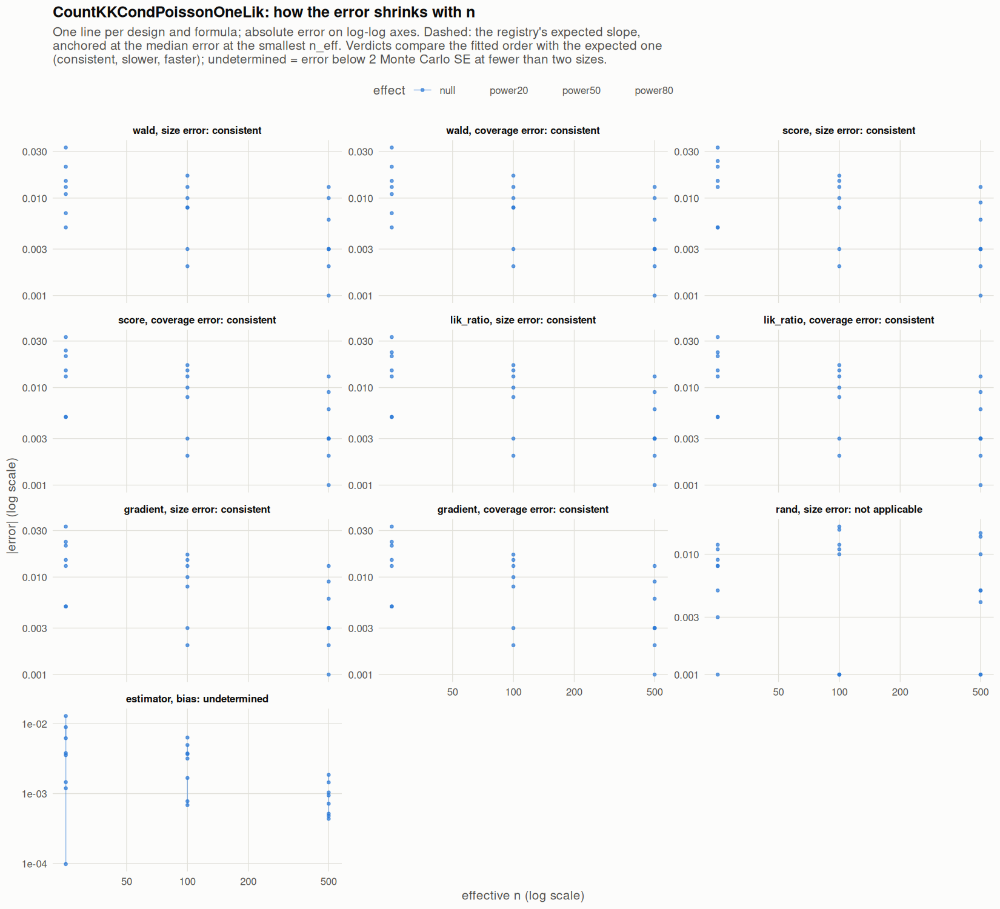

[← Campaign 2026-11-15-e36c7710 summary](README.md)

# Class CountKKCondPoissonOneLik

Part of the [Classes index](classes.md). Response type: count. Status: null effect complete, power effects in progress. Verdict: **pass so far**.

<picture><source media="(prefers-color-scheme: dark)" srcset="figures/class-CountKKCondPoissonOneLik-dark.png"></picture>

Convergence verdicts (worst over designs, formulas and effects; provisional until the class is complete):

| procedure | metric | verdict |
|---|---|---|
| estimator (bias) | bias | undetermined |
| gradient | coverage | consistent |
| lik_ratio | coverage | consistent |
| score | coverage | consistent |
| wald | coverage | consistent |
| gradient | size | consistent |
| lik_ratio | size | consistent |
| rand | size | not applicable |
| score | size | consistent |
| wald | size | consistent |

Null effect: 120 cells (0 failing). Size, coverage and bias / SD against the level each is held to.

| design | n | formula | procedure | size | coverage | bias / SD | size level | coverage level | verdict |
|---|---|---|---|---|---|---|---|---|---|
| Fixed:BinaryMatch | 50 | `~.` | gradient | 0.027 | 0.973 | -0.016 | 0.1 | 0.9 | ok |
| Fixed:BinaryMatch | 200 | `~.` | gradient | 0.035 | 0.965 | -0.0078 | 0.075 | 0.925 | ok |
| Fixed:BinaryMatch | 1000 | `~.` | gradient | 0.059 | 0.941 | 0.036 | 0.055 | 0.945 | ok |
| Fixed:BinaryMatch | 50 | `~.` | lik_ratio | 0.027 | 0.973 | -0.016 | 0.1 | 0.9 | ok |
| Fixed:BinaryMatch | 200 | `~.` | lik_ratio | 0.035 | 0.965 | -0.0078 | 0.075 | 0.925 | ok |
| Fixed:BinaryMatch | 1000 | `~.` | lik_ratio | 0.059 | 0.941 | 0.036 | 0.055 | 0.945 | ok |
| Fixed:BinaryMatch | 50 | `~.` | rand | 0.038 |  | -0.016 | 0.05 | 0.95 | ok |
| Fixed:BinaryMatch | 200 | `~.` | rand | 0.034 |  | -0.0078 | 0.05 | 0.95 | ok |
| Fixed:BinaryMatch | 1000 | `~.` | rand | 0.055 |  | 0.036 | 0.05 | 0.95 | ok |
| Fixed:BinaryMatch | 50 | `~.` | score | 0.026 | 0.974 | -0.016 | 0.1 | 0.9 | ok |
| Fixed:BinaryMatch | 200 | `~.` | score | 0.035 | 0.965 | -0.0078 | 0.075 | 0.925 | ok |
| Fixed:BinaryMatch | 1000 | `~.` | score | 0.059 | 0.941 | 0.036 | 0.055 | 0.945 | ok |
| Fixed:BinaryMatch | 50 | `~.` | wald | 0.039 | 0.961 | -0.016 | 0.1 | 0.9 | ok |
| Fixed:BinaryMatch | 200 | `~.` | wald | 0.04 | 0.96 | -0.0078 | 0.075 | 0.925 | ok |
| Fixed:BinaryMatch | 1000 | `~.` | wald | 0.06 | 0.94 | 0.036 | 0.055 | 0.945 | ok |
| Fixed:BinaryMatch | 50 | `~1` | gradient | 0.045 | 0.955 | -0.019 | 0.1 | 0.9 | ok |
| Fixed:BinaryMatch | 200 | `~1` | gradient | 0.04 | 0.96 | -0.019 | 0.075 | 0.925 | ok |
| Fixed:BinaryMatch | 1000 | `~1` | gradient | 0.063 | 0.937 | 0.045 | 0.055 | 0.945 | ok |
| Fixed:BinaryMatch | 50 | `~1` | lik_ratio | 0.045 | 0.955 | -0.019 | 0.1 | 0.9 | ok |
| Fixed:BinaryMatch | 200 | `~1` | lik_ratio | 0.04 | 0.96 | -0.019 | 0.075 | 0.925 | ok |
| Fixed:BinaryMatch | 1000 | `~1` | lik_ratio | 0.063 | 0.937 | 0.045 | 0.055 | 0.945 | ok |
| Fixed:BinaryMatch | 50 | `~1` | rand | 0.042 |  | -0.019 | 0.05 | 0.95 | ok |
| Fixed:BinaryMatch | 200 | `~1` | rand | 0.038 |  | -0.019 | 0.05 | 0.95 | ok |
| Fixed:BinaryMatch | 1000 | `~1` | rand | 0.064 |  | 0.045 | 0.05 | 0.95 | ok |
| Fixed:BinaryMatch | 50 | `~1` | score | 0.045 | 0.955 | -0.019 | 0.1 | 0.9 | ok |
| Fixed:BinaryMatch | 200 | `~1` | score | 0.04 | 0.96 | -0.019 | 0.075 | 0.925 | ok |
| Fixed:BinaryMatch | 1000 | `~1` | score | 0.063 | 0.937 | 0.045 | 0.055 | 0.945 | ok |
| Fixed:BinaryMatch | 50 | `~1` | wald | 0.057 | 0.943 | -0.019 | 0.1 | 0.9 | ok |
| Fixed:BinaryMatch | 200 | `~1` | wald | 0.042 | 0.958 | -0.019 | 0.075 | 0.925 | ok |
| Fixed:BinaryMatch | 1000 | `~1` | wald | 0.063 | 0.937 | 0.045 | 0.055 | 0.945 | ok |
| SeqOneByOne:KK14 | 50 | `~.` | gradient | 0.037 | 0.963 | -0.0058 | 0.1 | 0.9 | ok |
| SeqOneByOne:KK14 | 200 | `~.` | gradient | 0.05 | 0.95 | 0.035 | 0.075 | 0.925 | ok |
| SeqOneByOne:KK14 | 1000 | `~.` | gradient | 0.056 | 0.944 | 0.011 | 0.055 | 0.945 | ok |
| SeqOneByOne:KK14 | 50 | `~.` | lik_ratio | 0.037 | 0.963 | -0.0058 | 0.1 | 0.9 | ok |
| SeqOneByOne:KK14 | 200 | `~.` | lik_ratio | 0.05 | 0.95 | 0.035 | 0.075 | 0.925 | ok |
| SeqOneByOne:KK14 | 1000 | `~.` | lik_ratio | 0.056 | 0.944 | 0.011 | 0.055 | 0.945 | ok |
| SeqOneByOne:KK14 | 50 | `~.` | rand | 0.059 |  | -0.0058 | 0.05 | 0.95 | ok |
| SeqOneByOne:KK14 | 200 | `~.` | rand | 0.049 |  | 0.035 | 0.05 | 0.95 | ok |
| SeqOneByOne:KK14 | 1000 | `~.` | rand | 0.055 |  | 0.011 | 0.05 | 0.95 | ok |
| SeqOneByOne:KK14 | 50 | `~.` | score | 0.037 | 0.963 | -0.0058 | 0.1 | 0.9 | ok |
| SeqOneByOne:KK14 | 200 | `~.` | score | 0.05 | 0.95 | 0.035 | 0.075 | 0.925 | ok |
| SeqOneByOne:KK14 | 1000 | `~.` | score | 0.056 | 0.944 | 0.011 | 0.055 | 0.945 | ok |
| SeqOneByOne:KK14 | 50 | `~.` | wald | 0.037 | 0.963 | -0.0058 | 0.1 | 0.9 | ok |
| SeqOneByOne:KK14 | 200 | `~.` | wald | 0.05 | 0.95 | 0.035 | 0.075 | 0.925 | ok |
| SeqOneByOne:KK14 | 1000 | `~.` | wald | 0.056 | 0.944 | 0.011 | 0.055 | 0.945 | ok |
| SeqOneByOne:KK14 | 50 | `~1` | gradient | 0.065 | 0.935 | 0.0061 | 0.1 | 0.9 | ok |
| SeqOneByOne:KK14 | 200 | `~1` | gradient | 0.063 | 0.937 | 0.0072 | 0.075 | 0.925 | ok |
| SeqOneByOne:KK14 | 1000 | `~1` | gradient | 0.051 | 0.949 | -0.012 | 0.055 | 0.945 | ok |
| SeqOneByOne:KK14 | 50 | `~1` | lik_ratio | 0.065 | 0.935 | 0.0061 | 0.1 | 0.9 | ok |
| SeqOneByOne:KK14 | 200 | `~1` | lik_ratio | 0.063 | 0.937 | 0.0072 | 0.075 | 0.925 | ok |
| SeqOneByOne:KK14 | 1000 | `~1` | lik_ratio | 0.051 | 0.949 | -0.012 | 0.055 | 0.945 | ok |
| SeqOneByOne:KK14 | 50 | `~1` | rand | 0.058 |  | 0.0061 | 0.05 | 0.95 | ok |
| SeqOneByOne:KK14 | 200 | `~1` | rand | 0.067 |  | 0.0072 | 0.05 | 0.95 | ok |
| SeqOneByOne:KK14 | 1000 | `~1` | rand | 0.054 |  | -0.012 | 0.05 | 0.95 | ok |
| SeqOneByOne:KK14 | 50 | `~1` | score | 0.065 | 0.935 | 0.0061 | 0.1 | 0.9 | ok |
| SeqOneByOne:KK14 | 200 | `~1` | score | 0.063 | 0.937 | 0.0072 | 0.075 | 0.925 | ok |
| SeqOneByOne:KK14 | 1000 | `~1` | score | 0.051 | 0.949 | -0.012 | 0.055 | 0.945 | ok |
| SeqOneByOne:KK14 | 50 | `~1` | wald | 0.065 | 0.935 | 0.0061 | 0.1 | 0.9 | ok |
| SeqOneByOne:KK14 | 200 | `~1` | wald | 0.063 | 0.937 | 0.0072 | 0.075 | 0.925 | ok |
| SeqOneByOne:KK14 | 1000 | `~1` | wald | 0.051 | 0.949 | -0.012 | 0.055 | 0.945 | ok |
| SeqOneByOne:KK21 | 50 | `~.` | gradient | 0.029 | 0.971 | 0.00049 | 0.1 | 0.9 | ok |
| SeqOneByOne:KK21 | 200 | `~.` | gradient | 0.033 | 0.967 | 0.07 | 0.075 | 0.925 | ok |
| SeqOneByOne:KK21 | 1000 | `~.` | gradient | 0.047 | 0.953 | -0.024 | 0.055 | 0.945 | ok |
| SeqOneByOne:KK21 | 50 | `~.` | lik_ratio | 0.029 | 0.971 | 0.00049 | 0.1 | 0.9 | ok |
| SeqOneByOne:KK21 | 200 | `~.` | lik_ratio | 0.033 | 0.967 | 0.07 | 0.075 | 0.925 | ok |
| SeqOneByOne:KK21 | 1000 | `~.` | lik_ratio | 0.047 | 0.953 | -0.024 | 0.055 | 0.945 | ok |
| SeqOneByOne:KK21 | 50 | `~.` | rand | 0.039 |  | 0.00049 | 0.05 | 0.95 | ok |
| SeqOneByOne:KK21 | 200 | `~.` | rand | 0.039 |  | 0.07 | 0.05 | 0.95 | ok |
| SeqOneByOne:KK21 | 1000 | `~.` | rand | 0.04 |  | -0.024 | 0.05 | 0.95 | ok |
| SeqOneByOne:KK21 | 50 | `~.` | score | 0.029 | 0.971 | 0.00049 | 0.1 | 0.9 | ok |
| SeqOneByOne:KK21 | 200 | `~.` | score | 0.033 | 0.967 | 0.07 | 0.075 | 0.925 | ok |
| SeqOneByOne:KK21 | 1000 | `~.` | score | 0.047 | 0.953 | -0.024 | 0.055 | 0.945 | ok |
| SeqOneByOne:KK21 | 50 | `~.` | wald | 0.029 | 0.971 | 0.00049 | 0.1 | 0.9 | ok |
| SeqOneByOne:KK21 | 200 | `~.` | wald | 0.033 | 0.967 | 0.07 | 0.075 | 0.925 | ok |
| SeqOneByOne:KK21 | 1000 | `~.` | wald | 0.047 | 0.953 | -0.024 | 0.055 | 0.945 | ok |
| SeqOneByOne:KK21 | 50 | `~1` | gradient | 0.05 | 0.95 | 0.041 | 0.1 | 0.9 | ok |
| SeqOneByOne:KK21 | 200 | `~1` | gradient | 0.053 | 0.947 | 0.036 | 0.075 | 0.925 | ok |
| SeqOneByOne:KK21 | 1000 | `~1` | gradient | 0.052 | 0.948 | -0.017 | 0.055 | 0.945 | ok |
| SeqOneByOne:KK21 | 50 | `~1` | lik_ratio | 0.05 | 0.95 | 0.041 | 0.1 | 0.9 | ok |
| SeqOneByOne:KK21 | 200 | `~1` | lik_ratio | 0.053 | 0.947 | 0.036 | 0.075 | 0.925 | ok |
| SeqOneByOne:KK21 | 1000 | `~1` | lik_ratio | 0.052 | 0.948 | -0.017 | 0.055 | 0.945 | ok |
| SeqOneByOne:KK21 | 50 | `~1` | rand | 0.047 |  | 0.041 | 0.05 | 0.95 | ok |
| SeqOneByOne:KK21 | 200 | `~1` | rand | 0.051 |  | 0.036 | 0.05 | 0.95 | ok |
| SeqOneByOne:KK21 | 1000 | `~1` | rand | 0.049 |  | -0.017 | 0.05 | 0.95 | ok |
| SeqOneByOne:KK21 | 50 | `~1` | score | 0.05 | 0.95 | 0.041 | 0.1 | 0.9 | ok |
| SeqOneByOne:KK21 | 200 | `~1` | score | 0.053 | 0.947 | 0.036 | 0.075 | 0.925 | ok |
| SeqOneByOne:KK21 | 1000 | `~1` | score | 0.052 | 0.948 | -0.017 | 0.055 | 0.945 | ok |
| SeqOneByOne:KK21 | 50 | `~1` | wald | 0.05 | 0.95 | 0.041 | 0.1 | 0.9 | ok |
| SeqOneByOne:KK21 | 200 | `~1` | wald | 0.053 | 0.947 | 0.036 | 0.075 | 0.925 | ok |
| SeqOneByOne:KK21 | 1000 | `~1` | wald | 0.052 | 0.948 | -0.017 | 0.055 | 0.945 | ok |
| SeqOneByOne:KK21stepwise | 50 | `~.` | gradient | 0.017 | 0.983 | 0.031 | 0.1 | 0.9 | ok |
| SeqOneByOne:KK21stepwise | 200 | `~.` | gradient | 0.042 | 0.958 | 0.041 | 0.075 | 0.925 | ok |
| SeqOneByOne:KK21stepwise | 1000 | `~.` | gradient | 0.047 | 0.953 | 0.026 | 0.055 | 0.945 | ok |
| SeqOneByOne:KK21stepwise | 50 | `~.` | lik_ratio | 0.017 | 0.983 | 0.031 | 0.1 | 0.9 | ok |
| SeqOneByOne:KK21stepwise | 200 | `~.` | lik_ratio | 0.042 | 0.958 | 0.041 | 0.075 | 0.925 | ok |
| SeqOneByOne:KK21stepwise | 1000 | `~.` | lik_ratio | 0.047 | 0.953 | 0.026 | 0.055 | 0.945 | ok |
| SeqOneByOne:KK21stepwise | 50 | `~.` | rand | 0.045 |  | 0.031 | 0.05 | 0.95 | ok |
| SeqOneByOne:KK21stepwise | 200 | `~.` | rand | 0.04 |  | 0.041 | 0.05 | 0.95 | ok |
| SeqOneByOne:KK21stepwise | 1000 | `~.` | rand | 0.035 |  | 0.026 | 0.05 | 0.95 | ok |
| SeqOneByOne:KK21stepwise | 50 | `~.` | score | 0.017 | 0.983 | 0.031 | 0.1 | 0.9 | ok |
| SeqOneByOne:KK21stepwise | 200 | `~.` | score | 0.042 | 0.958 | 0.041 | 0.075 | 0.925 | ok |
| SeqOneByOne:KK21stepwise | 1000 | `~.` | score | 0.047 | 0.953 | 0.026 | 0.055 | 0.945 | ok |
| SeqOneByOne:KK21stepwise | 50 | `~.` | wald | 0.017 | 0.983 | 0.031 | 0.1 | 0.9 | ok |
| SeqOneByOne:KK21stepwise | 200 | `~.` | wald | 0.042 | 0.958 | 0.041 | 0.075 | 0.925 | ok |
| SeqOneByOne:KK21stepwise | 1000 | `~.` | wald | 0.047 | 0.953 | 0.026 | 0.055 | 0.945 | ok |
| SeqOneByOne:KK21stepwise | 50 | `~1` | gradient | 0.045 | 0.955 | 0.059 | 0.1 | 0.9 | ok |
| SeqOneByOne:KK21stepwise | 200 | `~1` | gradient | 0.048 | 0.952 | 0.048 | 0.075 | 0.925 | ok |
| SeqOneByOne:KK21stepwise | 1000 | `~1` | gradient | 0.047 | 0.953 | 0.011 | 0.055 | 0.945 | ok |
| SeqOneByOne:KK21stepwise | 50 | `~1` | lik_ratio | 0.045 | 0.955 | 0.059 | 0.1 | 0.9 | ok |
| SeqOneByOne:KK21stepwise | 200 | `~1` | lik_ratio | 0.048 | 0.952 | 0.048 | 0.075 | 0.925 | ok |
| SeqOneByOne:KK21stepwise | 1000 | `~1` | lik_ratio | 0.047 | 0.953 | 0.011 | 0.055 | 0.945 | ok |
| SeqOneByOne:KK21stepwise | 50 | `~1` | rand | 0.049 |  | 0.059 | 0.05 | 0.95 | ok |
| SeqOneByOne:KK21stepwise | 200 | `~1` | rand | 0.051 |  | 0.048 | 0.05 | 0.95 | ok |
| SeqOneByOne:KK21stepwise | 1000 | `~1` | rand | 0.049 |  | 0.011 | 0.05 | 0.95 | ok |
| SeqOneByOne:KK21stepwise | 50 | `~1` | score | 0.045 | 0.955 | 0.059 | 0.1 | 0.9 | ok |
| SeqOneByOne:KK21stepwise | 200 | `~1` | score | 0.048 | 0.952 | 0.048 | 0.075 | 0.925 | ok |
| SeqOneByOne:KK21stepwise | 1000 | `~1` | score | 0.047 | 0.953 | 0.011 | 0.055 | 0.945 | ok |
| SeqOneByOne:KK21stepwise | 50 | `~1` | wald | 0.045 | 0.955 | 0.059 | 0.1 | 0.9 | ok |
| SeqOneByOne:KK21stepwise | 200 | `~1` | wald | 0.048 | 0.952 | 0.048 | 0.075 | 0.925 | ok |
| SeqOneByOne:KK21stepwise | 1000 | `~1` | wald | 0.047 | 0.953 | 0.011 | 0.055 | 0.945 | ok |

Power effects: 160 cells (0 failing coverage).

| design | n | effect | formula | procedure | power | coverage of the true estimand | coverage level | verdict |
|---|---|---|---|---|---|---|---|---|
| Fixed:BinaryMatch | 50 | power20 | `~.` | gradient | 0.086 |  | 0.9 | ok |
| Fixed:BinaryMatch | 200 | power20 | `~.` | gradient | 0.14 |  | 0.925 | ok |
| Fixed:BinaryMatch | 50 | power50 | `~.` | gradient | 0.318 |  | 0.9 | ok |
| Fixed:BinaryMatch | 200 | power50 | `~.` | gradient | 0.456 |  | 0.925 | ok |
| Fixed:BinaryMatch | 50 | power20 | `~.` | lik_ratio | 0.086 |  | 0.9 | ok |
| Fixed:BinaryMatch | 200 | power20 | `~.` | lik_ratio | 0.14 |  | 0.925 | ok |
| Fixed:BinaryMatch | 50 | power50 | `~.` | lik_ratio | 0.318 |  | 0.9 | ok |
| Fixed:BinaryMatch | 200 | power50 | `~.` | lik_ratio | 0.456 |  | 0.925 | ok |
| Fixed:BinaryMatch | 50 | power20 | `~.` | rand | 0.098 |  | 0.95 | ok |
| Fixed:BinaryMatch | 200 | power20 | `~.` | rand | 0.132 |  | 0.95 | ok |
| Fixed:BinaryMatch | 50 | power50 | `~.` | rand | 0.314 |  | 0.95 | ok |
| Fixed:BinaryMatch | 200 | power50 | `~.` | rand | 0.422 |  | 0.95 | ok |
| Fixed:BinaryMatch | 50 | power20 | `~.` | score | 0.086 |  | 0.9 | ok |
| Fixed:BinaryMatch | 200 | power20 | `~.` | score | 0.138 |  | 0.925 | ok |
| Fixed:BinaryMatch | 50 | power50 | `~.` | score | 0.318 |  | 0.9 | ok |
| Fixed:BinaryMatch | 200 | power50 | `~.` | score | 0.456 |  | 0.925 | ok |
| Fixed:BinaryMatch | 50 | power20 | `~.` | wald | 0.114 |  | 0.9 | ok |
| Fixed:BinaryMatch | 200 | power20 | `~.` | wald | 0.16 |  | 0.925 | ok |
| Fixed:BinaryMatch | 50 | power50 | `~.` | wald | 0.348 |  | 0.9 | ok |
| Fixed:BinaryMatch | 200 | power50 | `~.` | wald | 0.476 |  | 0.925 | ok |
| Fixed:BinaryMatch | 50 | power20 | `~1` | gradient | 0.134 |  | 0.9 | ok |
| Fixed:BinaryMatch | 200 | power20 | `~1` | gradient | 0.132 |  | 0.925 | ok |
| Fixed:BinaryMatch | 50 | power50 | `~1` | gradient | 0.412 |  | 0.9 | ok |
| Fixed:BinaryMatch | 200 | power50 | `~1` | gradient | 0.448 |  | 0.925 | ok |
| Fixed:BinaryMatch | 50 | power20 | `~1` | lik_ratio | 0.134 |  | 0.9 | ok |
| Fixed:BinaryMatch | 200 | power20 | `~1` | lik_ratio | 0.132 |  | 0.925 | ok |
| Fixed:BinaryMatch | 50 | power50 | `~1` | lik_ratio | 0.412 |  | 0.9 | ok |
| Fixed:BinaryMatch | 200 | power50 | `~1` | lik_ratio | 0.448 |  | 0.925 | ok |
| Fixed:BinaryMatch | 50 | power20 | `~1` | rand | 0.12 |  | 0.95 | ok |
| Fixed:BinaryMatch | 200 | power20 | `~1` | rand | 0.126 |  | 0.95 | ok |
| Fixed:BinaryMatch | 50 | power50 | `~1` | rand | 0.36 |  | 0.95 | ok |
| Fixed:BinaryMatch | 200 | power50 | `~1` | rand | 0.428 |  | 0.95 | ok |
| Fixed:BinaryMatch | 50 | power20 | `~1` | score | 0.134 |  | 0.9 | ok |
| Fixed:BinaryMatch | 200 | power20 | `~1` | score | 0.132 |  | 0.925 | ok |
| Fixed:BinaryMatch | 50 | power50 | `~1` | score | 0.41 |  | 0.9 | ok |
| Fixed:BinaryMatch | 200 | power50 | `~1` | score | 0.448 |  | 0.925 | ok |
| Fixed:BinaryMatch | 50 | power20 | `~1` | wald | 0.148 |  | 0.9 | ok |
| Fixed:BinaryMatch | 200 | power20 | `~1` | wald | 0.14 |  | 0.925 | ok |
| Fixed:BinaryMatch | 50 | power50 | `~1` | wald | 0.422 |  | 0.9 | ok |
| Fixed:BinaryMatch | 200 | power50 | `~1` | wald | 0.458 |  | 0.925 | ok |
| SeqOneByOne:KK14 | 50 | power20 | `~.` | gradient | 0.142 |  | 0.9 | ok |
| SeqOneByOne:KK14 | 200 | power20 | `~.` | gradient | 0.124 |  | 0.925 | ok |
| SeqOneByOne:KK14 | 50 | power50 | `~.` | gradient | 0.362 |  | 0.9 | ok |
| SeqOneByOne:KK14 | 200 | power50 | `~.` | gradient | 0.436 |  | 0.925 | ok |
| SeqOneByOne:KK14 | 50 | power20 | `~.` | lik_ratio | 0.142 |  | 0.9 | ok |
| SeqOneByOne:KK14 | 200 | power20 | `~.` | lik_ratio | 0.124 |  | 0.925 | ok |
| SeqOneByOne:KK14 | 50 | power50 | `~.` | lik_ratio | 0.362 |  | 0.9 | ok |
| SeqOneByOne:KK14 | 200 | power50 | `~.` | lik_ratio | 0.436 |  | 0.925 | ok |
| SeqOneByOne:KK14 | 50 | power20 | `~.` | rand | 0.182 |  | 0.95 | ok |
| SeqOneByOne:KK14 | 200 | power20 | `~.` | rand | 0.138 |  | 0.95 | ok |
| SeqOneByOne:KK14 | 50 | power50 | `~.` | rand | 0.404 |  | 0.95 | ok |
| SeqOneByOne:KK14 | 200 | power50 | `~.` | rand | 0.42 |  | 0.95 | ok |
| SeqOneByOne:KK14 | 50 | power20 | `~.` | score | 0.142 |  | 0.9 | ok |
| SeqOneByOne:KK14 | 200 | power20 | `~.` | score | 0.124 |  | 0.925 | ok |
| SeqOneByOne:KK14 | 50 | power50 | `~.` | score | 0.362 |  | 0.9 | ok |
| SeqOneByOne:KK14 | 200 | power50 | `~.` | score | 0.436 |  | 0.925 | ok |
| SeqOneByOne:KK14 | 50 | power20 | `~.` | wald | 0.142 |  | 0.9 | ok |
| SeqOneByOne:KK14 | 200 | power20 | `~.` | wald | 0.124 |  | 0.925 | ok |
| SeqOneByOne:KK14 | 50 | power50 | `~.` | wald | 0.362 |  | 0.9 | ok |
| SeqOneByOne:KK14 | 200 | power50 | `~.` | wald | 0.436 |  | 0.925 | ok |
| SeqOneByOne:KK14 | 50 | power20 | `~1` | gradient | 0.128 |  | 0.9 | ok |
| SeqOneByOne:KK14 | 200 | power20 | `~1` | gradient | 0.116 |  | 0.925 | ok |
| SeqOneByOne:KK14 | 50 | power50 | `~1` | gradient | 0.314 |  | 0.9 | ok |
| SeqOneByOne:KK14 | 200 | power50 | `~1` | gradient | 0.342 |  | 0.925 | ok |
| SeqOneByOne:KK14 | 50 | power20 | `~1` | lik_ratio | 0.128 |  | 0.9 | ok |
| SeqOneByOne:KK14 | 200 | power20 | `~1` | lik_ratio | 0.116 |  | 0.925 | ok |
| SeqOneByOne:KK14 | 50 | power50 | `~1` | lik_ratio | 0.314 |  | 0.9 | ok |
| SeqOneByOne:KK14 | 200 | power50 | `~1` | lik_ratio | 0.342 |  | 0.925 | ok |
| SeqOneByOne:KK14 | 50 | power20 | `~1` | rand | 0.128 |  | 0.95 | ok |
| SeqOneByOne:KK14 | 200 | power20 | `~1` | rand | 0.124 |  | 0.95 | ok |
| SeqOneByOne:KK14 | 50 | power50 | `~1` | rand | 0.31 |  | 0.95 | ok |
| SeqOneByOne:KK14 | 200 | power50 | `~1` | rand | 0.33 |  | 0.95 | ok |
| SeqOneByOne:KK14 | 50 | power20 | `~1` | score | 0.128 |  | 0.9 | ok |
| SeqOneByOne:KK14 | 200 | power20 | `~1` | score | 0.116 |  | 0.925 | ok |
| SeqOneByOne:KK14 | 50 | power50 | `~1` | score | 0.314 |  | 0.9 | ok |
| SeqOneByOne:KK14 | 200 | power50 | `~1` | score | 0.342 |  | 0.925 | ok |
| SeqOneByOne:KK14 | 50 | power20 | `~1` | wald | 0.128 |  | 0.9 | ok |
| SeqOneByOne:KK14 | 200 | power20 | `~1` | wald | 0.116 |  | 0.925 | ok |
| SeqOneByOne:KK14 | 50 | power50 | `~1` | wald | 0.314 |  | 0.9 | ok |
| SeqOneByOne:KK14 | 200 | power50 | `~1` | wald | 0.342 |  | 0.925 | ok |
| SeqOneByOne:KK21 | 50 | power20 | `~.` | gradient | 0.102 |  | 0.9 | ok |
| SeqOneByOne:KK21 | 200 | power20 | `~.` | gradient | 0.16 |  | 0.925 | ok |
| SeqOneByOne:KK21 | 50 | power50 | `~.` | gradient | 0.286 |  | 0.9 | ok |
| SeqOneByOne:KK21 | 200 | power50 | `~.` | gradient | 0.406 |  | 0.925 | ok |
| SeqOneByOne:KK21 | 50 | power20 | `~.` | lik_ratio | 0.102 |  | 0.9 | ok |
| SeqOneByOne:KK21 | 200 | power20 | `~.` | lik_ratio | 0.16 |  | 0.925 | ok |
| SeqOneByOne:KK21 | 50 | power50 | `~.` | lik_ratio | 0.286 |  | 0.9 | ok |
| SeqOneByOne:KK21 | 200 | power50 | `~.` | lik_ratio | 0.406 |  | 0.925 | ok |
| SeqOneByOne:KK21 | 50 | power20 | `~.` | rand | 0.128 |  | 0.95 | ok |
| SeqOneByOne:KK21 | 200 | power20 | `~.` | rand | 0.14 |  | 0.95 | ok |
| SeqOneByOne:KK21 | 50 | power50 | `~.` | rand | 0.34 |  | 0.95 | ok |
| SeqOneByOne:KK21 | 200 | power50 | `~.` | rand | 0.36 |  | 0.95 | ok |
| SeqOneByOne:KK21 | 50 | power20 | `~.` | score | 0.1 |  | 0.9 | ok |
| SeqOneByOne:KK21 | 200 | power20 | `~.` | score | 0.16 |  | 0.925 | ok |
| SeqOneByOne:KK21 | 50 | power50 | `~.` | score | 0.286 |  | 0.9 | ok |
| SeqOneByOne:KK21 | 200 | power50 | `~.` | score | 0.406 |  | 0.925 | ok |
| SeqOneByOne:KK21 | 50 | power20 | `~.` | wald | 0.102 |  | 0.9 | ok |
| SeqOneByOne:KK21 | 200 | power20 | `~.` | wald | 0.16 |  | 0.925 | ok |
| SeqOneByOne:KK21 | 50 | power50 | `~.` | wald | 0.288 |  | 0.9 | ok |
| SeqOneByOne:KK21 | 200 | power50 | `~.` | wald | 0.406 |  | 0.925 | ok |
| SeqOneByOne:KK21 | 50 | power20 | `~1` | gradient | 0.156 |  | 0.9 | ok |
| SeqOneByOne:KK21 | 200 | power20 | `~1` | gradient | 0.134 |  | 0.925 | ok |
| SeqOneByOne:KK21 | 50 | power50 | `~1` | gradient | 0.342 |  | 0.9 | ok |
| SeqOneByOne:KK21 | 200 | power50 | `~1` | gradient | 0.326 |  | 0.925 | ok |
| SeqOneByOne:KK21 | 50 | power20 | `~1` | lik_ratio | 0.156 |  | 0.9 | ok |
| SeqOneByOne:KK21 | 200 | power20 | `~1` | lik_ratio | 0.134 |  | 0.925 | ok |
| SeqOneByOne:KK21 | 50 | power50 | `~1` | lik_ratio | 0.342 |  | 0.9 | ok |
| SeqOneByOne:KK21 | 200 | power50 | `~1` | lik_ratio | 0.326 |  | 0.925 | ok |
| SeqOneByOne:KK21 | 50 | power20 | `~1` | rand | 0.128 |  | 0.95 | ok |
| SeqOneByOne:KK21 | 200 | power20 | `~1` | rand | 0.136 |  | 0.95 | ok |
| SeqOneByOne:KK21 | 50 | power50 | `~1` | rand | 0.322 |  | 0.95 | ok |
| SeqOneByOne:KK21 | 200 | power50 | `~1` | rand | 0.33 |  | 0.95 | ok |
| SeqOneByOne:KK21 | 50 | power20 | `~1` | score | 0.156 |  | 0.9 | ok |
| SeqOneByOne:KK21 | 200 | power20 | `~1` | score | 0.134 |  | 0.925 | ok |
| SeqOneByOne:KK21 | 50 | power50 | `~1` | score | 0.342 |  | 0.9 | ok |
| SeqOneByOne:KK21 | 200 | power50 | `~1` | score | 0.326 |  | 0.925 | ok |
| SeqOneByOne:KK21 | 50 | power20 | `~1` | wald | 0.156 |  | 0.9 | ok |
| SeqOneByOne:KK21 | 200 | power20 | `~1` | wald | 0.134 |  | 0.925 | ok |
| SeqOneByOne:KK21 | 50 | power50 | `~1` | wald | 0.342 |  | 0.9 | ok |
| SeqOneByOne:KK21 | 200 | power50 | `~1` | wald | 0.326 |  | 0.925 | ok |
| SeqOneByOne:KK21stepwise | 50 | power20 | `~.` | gradient | 0.082 |  | 0.9 | ok |
| SeqOneByOne:KK21stepwise | 200 | power20 | `~.` | gradient | 0.134 |  | 0.925 | ok |
| SeqOneByOne:KK21stepwise | 50 | power50 | `~.` | gradient | 0.31 |  | 0.9 | ok |
| SeqOneByOne:KK21stepwise | 200 | power50 | `~.` | gradient | 0.438 |  | 0.925 | ok |
| SeqOneByOne:KK21stepwise | 50 | power20 | `~.` | lik_ratio | 0.082 |  | 0.9 | ok |
| SeqOneByOne:KK21stepwise | 200 | power20 | `~.` | lik_ratio | 0.134 |  | 0.925 | ok |
| SeqOneByOne:KK21stepwise | 50 | power50 | `~.` | lik_ratio | 0.31 |  | 0.9 | ok |
| SeqOneByOne:KK21stepwise | 200 | power50 | `~.` | lik_ratio | 0.438 |  | 0.925 | ok |
| SeqOneByOne:KK21stepwise | 50 | power20 | `~.` | rand | 0.128 |  | 0.95 | ok |
| SeqOneByOne:KK21stepwise | 200 | power20 | `~.` | rand | 0.138 |  | 0.95 | ok |
| SeqOneByOne:KK21stepwise | 50 | power50 | `~.` | rand | 0.342 |  | 0.95 | ok |
| SeqOneByOne:KK21stepwise | 200 | power50 | `~.` | rand | 0.388 |  | 0.95 | ok |
| SeqOneByOne:KK21stepwise | 50 | power20 | `~.` | score | 0.082 |  | 0.9 | ok |
| SeqOneByOne:KK21stepwise | 200 | power20 | `~.` | score | 0.134 |  | 0.925 | ok |
| SeqOneByOne:KK21stepwise | 50 | power50 | `~.` | score | 0.31 |  | 0.9 | ok |
| SeqOneByOne:KK21stepwise | 200 | power50 | `~.` | score | 0.438 |  | 0.925 | ok |
| SeqOneByOne:KK21stepwise | 50 | power20 | `~.` | wald | 0.082 |  | 0.9 | ok |
| SeqOneByOne:KK21stepwise | 200 | power20 | `~.` | wald | 0.134 |  | 0.925 | ok |
| SeqOneByOne:KK21stepwise | 50 | power50 | `~.` | wald | 0.31 |  | 0.9 | ok |
| SeqOneByOne:KK21stepwise | 200 | power50 | `~.` | wald | 0.438 |  | 0.925 | ok |
| SeqOneByOne:KK21stepwise | 50 | power20 | `~1` | gradient | 0.164 |  | 0.9 | ok |
| SeqOneByOne:KK21stepwise | 200 | power20 | `~1` | gradient | 0.132 |  | 0.925 | ok |
| SeqOneByOne:KK21stepwise | 50 | power50 | `~1` | gradient | 0.362 |  | 0.9 | ok |
| SeqOneByOne:KK21stepwise | 200 | power50 | `~1` | gradient | 0.36 |  | 0.925 | ok |
| SeqOneByOne:KK21stepwise | 50 | power20 | `~1` | lik_ratio | 0.164 |  | 0.9 | ok |
| SeqOneByOne:KK21stepwise | 200 | power20 | `~1` | lik_ratio | 0.132 |  | 0.925 | ok |
| SeqOneByOne:KK21stepwise | 50 | power50 | `~1` | lik_ratio | 0.362 |  | 0.9 | ok |
| SeqOneByOne:KK21stepwise | 200 | power50 | `~1` | lik_ratio | 0.36 |  | 0.925 | ok |
| SeqOneByOne:KK21stepwise | 50 | power20 | `~1` | rand | 0.14 |  | 0.95 | ok |
| SeqOneByOne:KK21stepwise | 200 | power20 | `~1` | rand | 0.132 |  | 0.95 | ok |
| SeqOneByOne:KK21stepwise | 50 | power50 | `~1` | rand | 0.35 |  | 0.95 | ok |
| SeqOneByOne:KK21stepwise | 200 | power50 | `~1` | rand | 0.364 |  | 0.95 | ok |
| SeqOneByOne:KK21stepwise | 50 | power20 | `~1` | score | 0.164 |  | 0.9 | ok |
| SeqOneByOne:KK21stepwise | 200 | power20 | `~1` | score | 0.132 |  | 0.925 | ok |
| SeqOneByOne:KK21stepwise | 50 | power50 | `~1` | score | 0.362 |  | 0.9 | ok |
| SeqOneByOne:KK21stepwise | 200 | power50 | `~1` | score | 0.36 |  | 0.925 | ok |
| SeqOneByOne:KK21stepwise | 50 | power20 | `~1` | wald | 0.164 |  | 0.9 | ok |
| SeqOneByOne:KK21stepwise | 200 | power20 | `~1` | wald | 0.132 |  | 0.925 | ok |
| SeqOneByOne:KK21stepwise | 50 | power50 | `~1` | wald | 0.362 |  | 0.9 | ok |
| SeqOneByOne:KK21stepwise | 200 | power50 | `~1` | wald | 0.36 |  | 0.925 | ok |

[← Campaign 2026-11-15-e36c7710 summary](README.md)
