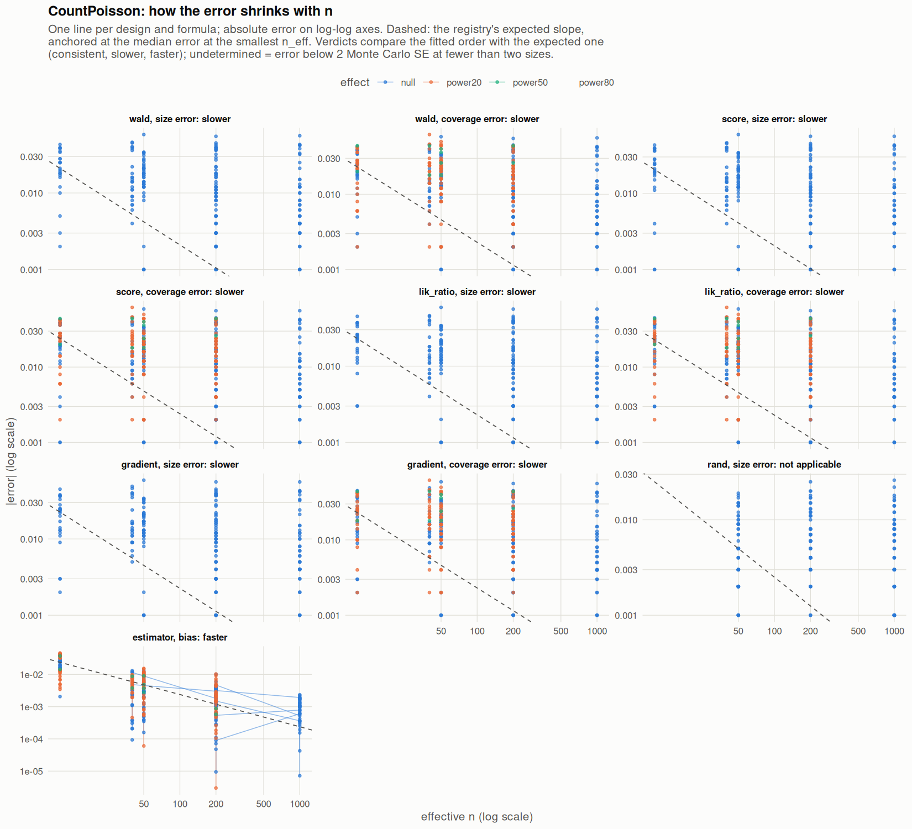

[← Campaign 2026-11-15-e36c7710 summary](README.md)

# Class CountPoisson

Part of the [Classes index](classes.md). Response type: count. Status: null effect complete, power effects in progress. Verdict: **fail** (80 flagged test(s): 78 failing, 0 pending, 2 cleared).

<picture><source media="(prefers-color-scheme: dark)" srcset="figures/class-CountPoisson-dark.png"></picture>

Convergence verdicts (worst over designs, formulas and effects; provisional until the class is complete):

| procedure | metric | verdict |
|---|---|---|
| estimator (bias) | bias | faster |
| gradient | coverage | slower |
| lik_ratio | coverage | slower |
| score | coverage | slower |
| wald | coverage | slower |
| gradient | size | slower |
| lik_ratio | size | slower |
| rand | size | not applicable |
| score | size | slower |
| wald | size | slower |

Null effect: 978 cells (32 failing). Size, coverage and bias / SD against the level each is held to.

| design | n | formula | procedure | size | coverage | bias / SD | size level | coverage level | verdict |
|---|---|---|---|---|---|---|---|---|---|
| Fixed:Bernoulli | 50 | `~.` | gradient | 0.033 | 0.967 | 0.048 | 0.1 | 0.9 | ok |
| Fixed:Bernoulli | 200 | `~.` | gradient | 0.042 | 0.958 | -0.0074 | 0.0625 | 0.938 | ok |
| Fixed:Bernoulli | 1000 | `~.` | gradient | 0.056 | 0.944 | -0.058 | 0.0525 | 0.948 | ok |
| Fixed:Bernoulli | 50 | `~.` | lik_ratio | 0.034 | 0.966 | 0.048 | 0.1 | 0.9 | ok |
| Fixed:Bernoulli | 200 | `~.` | lik_ratio | 0.042 | 0.958 | -0.0074 | 0.0625 | 0.938 | ok |
| Fixed:Bernoulli | 1000 | `~.` | lik_ratio | 0.056 | 0.944 | -0.058 | 0.0525 | 0.948 | ok |
| Fixed:Bernoulli | 50 | `~.` | rand | 0.047 |  | 0.048 | 0.05 | 0.95 | ok |
| Fixed:Bernoulli | 200 | `~.` | rand | 0.054 |  | -0.0074 | 0.05 | 0.95 | ok |
| Fixed:Bernoulli | 1000 | `~.` | rand | 0.058 |  | -0.058 | 0.05 | 0.95 | ok |
| Fixed:Bernoulli | 50 | `~.` | score | 0.034 | 0.966 | 0.048 | 0.1 | 0.9 | ok |
| Fixed:Bernoulli | 200 | `~.` | score | 0.042 | 0.958 | -0.0074 | 0.0625 | 0.938 | ok |
| Fixed:Bernoulli | 1000 | `~.` | score | 0.056 | 0.944 | -0.058 | 0.0525 | 0.948 | ok |
| Fixed:Bernoulli | 50 | `~.` | wald | 0.033 | 0.967 | 0.048 | 0.1 | 0.9 | ok |
| Fixed:Bernoulli | 200 | `~.` | wald | 0.042 | 0.958 | -0.0074 | 0.0625 | 0.938 | ok |
| Fixed:Bernoulli | 1000 | `~.` | wald | 0.056 | 0.944 | -0.058 | 0.0525 | 0.948 | ok |
| Fixed:Bernoulli | 50 | `~1` | gradient | 0.05 | 0.95 | 0.033 | 0.1 | 0.9 | ok |
| Fixed:Bernoulli | 200 | `~1` | gradient | 0.057 | 0.943 | -0.01 | 0.0625 | 0.938 | ok |
| Fixed:Bernoulli | 1000 | `~1` | gradient | 0.071 | 0.929 | 0.00072 | 0.0525 | 0.948 | ok |
| Fixed:Bernoulli | 50 | `~1` | lik_ratio | 0.05 | 0.95 | 0.033 | 0.1 | 0.9 | ok |
| Fixed:Bernoulli | 200 | `~1` | lik_ratio | 0.057 | 0.943 | -0.01 | 0.0625 | 0.938 | ok |
| Fixed:Bernoulli | 1000 | `~1` | lik_ratio | 0.071 | 0.929 | 0.00072 | 0.0525 | 0.948 | ok |
| Fixed:Bernoulli | 50 | `~1` | rand | 0.051 |  | 0.033 | 0.05 | 0.95 | ok |
| Fixed:Bernoulli | 200 | `~1` | rand | 0.06 |  | -0.01 | 0.05 | 0.95 | ok |
| Fixed:Bernoulli | 1000 | `~1` | rand | 0.072 |  | 0.00072 | 0.05 | 0.95 | ok |
| Fixed:Bernoulli | 50 | `~1` | score | 0.05 | 0.95 | 0.033 | 0.1 | 0.9 | ok |
| Fixed:Bernoulli | 200 | `~1` | score | 0.057 | 0.943 | -0.01 | 0.0625 | 0.938 | ok |
| Fixed:Bernoulli | 1000 | `~1` | score | 0.071 | 0.929 | 0.00072 | 0.0525 | 0.948 | ok |
| Fixed:Bernoulli | 50 | `~1` | wald | 0.05 | 0.95 | 0.033 | 0.1 | 0.9 | ok |
| Fixed:Bernoulli | 200 | `~1` | wald | 0.057 | 0.943 | -0.01 | 0.0625 | 0.938 | ok |
| Fixed:Bernoulli | 1000 | `~1` | wald | 0.071 | 0.929 | 0.00072 | 0.0525 | 0.948 | ok |
| Fixed:Bernoulli@0.2 | 50 | `~.` | gradient | 0.027 | 0.973 | -0.077 | 0.1 | 0.9 | ok |
| Fixed:Bernoulli@0.2 | 200 | `~.` | gradient | 0.036 | 0.964 | -0.03 | 0.1 | 0.9 | ok |
| Fixed:Bernoulli@0.2 | 1000 | `~.` | gradient | 0.051 | 0.949 | 0.00019 | 0.0625 | 0.938 | ok |
| Fixed:Bernoulli@0.2 | 50 | `~.` | lik_ratio | 0.027 | 0.973 | -0.077 | 0.1 | 0.9 | ok |
| Fixed:Bernoulli@0.2 | 200 | `~.` | lik_ratio | 0.037 | 0.963 | -0.03 | 0.1 | 0.9 | ok |
| Fixed:Bernoulli@0.2 | 1000 | `~.` | lik_ratio | 0.051 | 0.949 | 0.00019 | 0.0625 | 0.938 | ok |
| Fixed:Bernoulli@0.2 | 50 | `~.` | rand | 0.06 |  | -0.077 | 0.05 | 0.95 | ok |
| Fixed:Bernoulli@0.2 | 200 | `~.` | rand | 0.048 |  | -0.03 | 0.05 | 0.95 | ok |
| Fixed:Bernoulli@0.2 | 1000 | `~.` | rand | 0.052 |  | 0.00019 | 0.05 | 0.95 | ok |
| Fixed:Bernoulli@0.2 | 50 | `~.` | score | 0.026 | 0.974 | -0.077 | 0.1 | 0.9 | ok |
| Fixed:Bernoulli@0.2 | 200 | `~.` | score | 0.036 | 0.964 | -0.03 | 0.1 | 0.9 | ok |
| Fixed:Bernoulli@0.2 | 1000 | `~.` | score | 0.052 | 0.948 | 0.00019 | 0.0625 | 0.938 | ok |
| Fixed:Bernoulli@0.2 | 50 | `~.` | wald | 0.025 | 0.975 | -0.077 | 0.1 | 0.9 | ok |
| Fixed:Bernoulli@0.2 | 200 | `~.` | wald | 0.036 | 0.964 | -0.03 | 0.1 | 0.9 | ok |
| Fixed:Bernoulli@0.2 | 1000 | `~.` | wald | 0.052 | 0.948 | 0.00019 | 0.0625 | 0.938 | ok |
| Fixed:Bernoulli@0.2 | 50 | `~1` | gradient | 0.053 | 0.947 | -0.12 | 0.1 | 0.9 | ok |
| Fixed:Bernoulli@0.2 | 200 | `~1` | gradient | 0.061 | 0.939 | -0.012 | 0.1 | 0.9 | ok |
| Fixed:Bernoulli@0.2 | 1000 | `~1` | gradient | 0.049 | 0.951 | -0.0079 | 0.0625 | 0.938 | ok |
| Fixed:Bernoulli@0.2 | 50 | `~1` | lik_ratio | 0.053 | 0.947 | -0.12 | 0.1 | 0.9 | ok |
| Fixed:Bernoulli@0.2 | 200 | `~1` | lik_ratio | 0.061 | 0.939 | -0.012 | 0.1 | 0.9 | ok |
| Fixed:Bernoulli@0.2 | 1000 | `~1` | lik_ratio | 0.049 | 0.951 | -0.0079 | 0.0625 | 0.938 | ok |
| Fixed:Bernoulli@0.2 | 50 | `~1` | rand | 0.064 |  | -0.12 | 0.05 | 0.95 | ok |
| Fixed:Bernoulli@0.2 | 200 | `~1` | rand | 0.061 |  | -0.012 | 0.05 | 0.95 | ok |
| Fixed:Bernoulli@0.2 | 1000 | `~1` | rand | 0.051 |  | -0.0079 | 0.05 | 0.95 | ok |
| Fixed:Bernoulli@0.2 | 50 | `~1` | score | 0.051 | 0.949 | -0.12 | 0.1 | 0.9 | ok |
| Fixed:Bernoulli@0.2 | 200 | `~1` | score | 0.061 | 0.939 | -0.012 | 0.1 | 0.9 | ok |
| Fixed:Bernoulli@0.2 | 1000 | `~1` | score | 0.049 | 0.951 | -0.0079 | 0.0625 | 0.938 | ok |
| Fixed:Bernoulli@0.2 | 50 | `~1` | wald | 0.05 | 0.95 | -0.12 | 0.1 | 0.9 | ok |
| Fixed:Bernoulli@0.2 | 200 | `~1` | wald | 0.061 | 0.939 | -0.012 | 0.1 | 0.9 | ok |
| Fixed:Bernoulli@0.2 | 1000 | `~1` | wald | 0.049 | 0.951 | -0.0079 | 0.0625 | 0.938 | ok |
| Fixed:BinaryMatch | 50 | `~.` | gradient | 0.03 | 0.97 | -0.015 | 0.1 | 0.9 | ok |
| Fixed:BinaryMatch | 200 | `~.` | gradient | 0.029 | 0.971 | -0.021 | 0.0625 | 0.938 | ok |
| Fixed:BinaryMatch | 1000 | `~.` | gradient | 0.057 | 0.943 | 0.038 | 0.0525 | 0.948 | ok |
| Fixed:BinaryMatch | 50 | `~.` | lik_ratio | 0.03 | 0.97 | -0.015 | 0.1 | 0.9 | ok |
| Fixed:BinaryMatch | 200 | `~.` | lik_ratio | 0.028 | 0.972 | -0.021 | 0.0625 | 0.938 | ok |
| Fixed:BinaryMatch | 1000 | `~.` | lik_ratio | 0.057 | 0.943 | 0.038 | 0.0525 | 0.948 | ok |
| Fixed:BinaryMatch | 50 | `~.` | rand | 0.046 |  | -0.015 | 0.05 | 0.95 | ok |
| Fixed:BinaryMatch | 200 | `~.` | rand | 0.037 |  | -0.021 | 0.05 | 0.95 | ok |
| Fixed:BinaryMatch | 1000 | `~.` | rand | 0.059 |  | 0.038 | 0.05 | 0.95 | ok |
| Fixed:BinaryMatch | 50 | `~.` | score | 0.03 | 0.97 | -0.015 | 0.1 | 0.9 | ok |
| Fixed:BinaryMatch | 200 | `~.` | score | 0.028 | 0.972 | -0.021 | 0.0625 | 0.938 | ok |
| Fixed:BinaryMatch | 1000 | `~.` | score | 0.057 | 0.943 | 0.038 | 0.0525 | 0.948 | ok |
| Fixed:BinaryMatch | 50 | `~.` | wald | 0.029 | 0.971 | -0.015 | 0.1 | 0.9 | ok |
| Fixed:BinaryMatch | 200 | `~.` | wald | 0.028 | 0.972 | -0.021 | 0.0625 | 0.938 | ok |
| Fixed:BinaryMatch | 1000 | `~.` | wald | 0.057 | 0.943 | 0.038 | 0.0525 | 0.948 | ok |
| Fixed:BinaryMatch | 50 | `~1` | gradient | 0.042 | 0.958 | -0.019 | 0.1 | 0.9 | ok |
| Fixed:BinaryMatch | 200 | `~1` | gradient | 0.041 | 0.959 | -0.019 | 0.0625 | 0.938 | ok |
| Fixed:BinaryMatch | 1000 | `~1` | gradient | 0.062 | 0.938 | 0.045 | 0.0525 | 0.948 | ok |
| Fixed:BinaryMatch | 50 | `~1` | lik_ratio | 0.042 | 0.958 | -0.019 | 0.1 | 0.9 | ok |
| Fixed:BinaryMatch | 200 | `~1` | lik_ratio | 0.041 | 0.959 | -0.019 | 0.0625 | 0.938 | ok |
| Fixed:BinaryMatch | 1000 | `~1` | lik_ratio | 0.062 | 0.938 | 0.045 | 0.0525 | 0.948 | ok |
| Fixed:BinaryMatch | 50 | `~1` | rand | 0.042 |  | -0.019 | 0.05 | 0.95 | ok |
| Fixed:BinaryMatch | 200 | `~1` | rand | 0.038 |  | -0.019 | 0.05 | 0.95 | ok |
| Fixed:BinaryMatch | 1000 | `~1` | rand | 0.064 |  | 0.045 | 0.05 | 0.95 | ok |
| Fixed:BinaryMatch | 50 | `~1` | score | 0.042 | 0.958 | -0.019 | 0.1 | 0.9 | ok |
| Fixed:BinaryMatch | 200 | `~1` | score | 0.041 | 0.959 | -0.019 | 0.0625 | 0.938 | ok |
| Fixed:BinaryMatch | 1000 | `~1` | score | 0.062 | 0.938 | 0.045 | 0.0525 | 0.948 | ok |
| Fixed:BinaryMatch | 50 | `~1` | wald | 0.042 | 0.958 | -0.019 | 0.1 | 0.9 | ok |
| Fixed:BinaryMatch | 200 | `~1` | wald | 0.041 | 0.959 | -0.019 | 0.0625 | 0.938 | ok |
| Fixed:BinaryMatch | 1000 | `~1` | wald | 0.062 | 0.938 | 0.045 | 0.0525 | 0.948 | ok |
| Fixed:Blocking | 50 | `~.` | gradient | 0.031 | 0.969 | -0.027 | 0.1 | 0.9 | ok |
| Fixed:Blocking | 200 | `~.` | gradient | 0.038 | 0.962 | 0.0032 | 0.0625 | 0.938 | ok |
| Fixed:Blocking | 1000 | `~.` | gradient | 0.026 | 0.974 | 0.0097 | 0.0525 | 0.948 | ok |
| Fixed:Blocking | 50 | `~.` | lik_ratio | 0.031 | 0.969 | -0.027 | 0.1 | 0.9 | ok |
| Fixed:Blocking | 200 | `~.` | lik_ratio | 0.038 | 0.962 | 0.0032 | 0.0625 | 0.938 | ok |
| Fixed:Blocking | 1000 | `~.` | lik_ratio | 0.025 | 0.975 | 0.0097 | 0.0525 | 0.948 | ok |
| Fixed:Blocking | 50 | `~.` | rand | 0.046 |  | -0.027 | 0.05 | 0.95 | ok |
| Fixed:Blocking | 200 | `~.` | rand | 0.046 |  | 0.0032 | 0.05 | 0.95 | ok |
| Fixed:Blocking | 1000 | `~.` | rand | 0.044 |  | 0.0097 | 0.05 | 0.95 | ok |
| Fixed:Blocking | 50 | `~.` | score | 0.031 | 0.969 | -0.027 | 0.1 | 0.9 | ok |
| Fixed:Blocking | 200 | `~.` | score | 0.038 | 0.962 | 0.0032 | 0.0625 | 0.938 | ok |
| Fixed:Blocking | 1000 | `~.` | score | 0.025 | 0.975 | 0.0097 | 0.0525 | 0.948 | ok |
| Fixed:Blocking | 50 | `~.` | wald | 0.031 | 0.969 | -0.027 | 0.1 | 0.9 | ok |
| Fixed:Blocking | 200 | `~.` | wald | 0.038 | 0.962 | 0.0032 | 0.0625 | 0.938 | ok |
| Fixed:Blocking | 1000 | `~.` | wald | 0.025 | 0.975 | 0.0097 | 0.0525 | 0.948 | ok |
| Fixed:Blocking | 50 | `~1` | gradient | 0.08 | 0.92 | -0.021 | 0.1 | 0.9 | ok |
| Fixed:Blocking | 200 | `~1` | gradient | 0.087 | 0.913 | 0.029 | 0.0625 | 0.938 | ok |
| Fixed:Blocking | 1000 | `~1` | gradient | 0.083 | 0.917 | -0.013 | 0.05 | 0.95 | **FAIL** |
| Fixed:Blocking | 50 | `~1` | lik_ratio | 0.08 | 0.92 | -0.021 | 0.1 | 0.9 | ok |
| Fixed:Blocking | 200 | `~1` | lik_ratio | 0.087 | 0.913 | 0.029 | 0.0625 | 0.938 | ok |
| Fixed:Blocking | 1000 | `~1` | lik_ratio | 0.083 | 0.917 | -0.013 | 0.05 | 0.95 | **FAIL** |
| Fixed:Blocking | 50 | `~1` | rand | 0.047 |  | -0.021 | 0.05 | 0.95 | ok |
| Fixed:Blocking | 200 | `~1` | rand | 0.045 |  | 0.029 | 0.05 | 0.95 | ok |
| Fixed:Blocking | 1000 | `~1` | rand | 0.04 |  | -0.013 | 0.05 | 0.95 | ok |
| Fixed:Blocking | 50 | `~1` | score | 0.08 | 0.92 | -0.021 | 0.1 | 0.9 | ok |
| Fixed:Blocking | 200 | `~1` | score | 0.087 | 0.913 | 0.029 | 0.0625 | 0.938 | ok |
| Fixed:Blocking | 1000 | `~1` | score | 0.083 | 0.917 | -0.013 | 0.05 | 0.95 | **FAIL** |
| Fixed:Blocking | 50 | `~1` | wald | 0.077 | 0.923 | -0.021 | 0.1 | 0.9 | ok |
| Fixed:Blocking | 200 | `~1` | wald | 0.086 | 0.914 | 0.029 | 0.0625 | 0.938 | ok |
| Fixed:Blocking | 1000 | `~1` | wald | 0.083 | 0.917 | -0.013 | 0.05 | 0.95 | **FAIL** |
| Fixed:Blocking@0.2 | 50 | `~.` | gradient | 0.03 | 0.97 | -0.12 | 0.1 | 0.9 | ok |
| Fixed:Blocking@0.2 | 200 | `~.` | gradient | 0.037 | 0.963 | 0.00086 | 0.1 | 0.9 | ok |
| Fixed:Blocking@0.2 | 1000 | `~.` | gradient | 0.043 | 0.957 | -0.03 | 0.0625 | 0.938 | ok |
| Fixed:Blocking@0.2 | 50 | `~.` | lik_ratio | 0.029 | 0.971 | -0.12 | 0.1 | 0.9 | ok |
| Fixed:Blocking@0.2 | 200 | `~.` | lik_ratio | 0.036 | 0.964 | 0.00086 | 0.1 | 0.9 | ok |
| Fixed:Blocking@0.2 | 1000 | `~.` | lik_ratio | 0.042 | 0.958 | -0.03 | 0.0625 | 0.938 | ok |
| Fixed:Blocking@0.2 | 50 | `~.` | rand | 0.051 |  | -0.12 | 0.05 | 0.95 | ok |
| Fixed:Blocking@0.2 | 200 | `~.` | rand | 0.053 |  | 0.00086 | 0.05 | 0.95 | ok |
| Fixed:Blocking@0.2 | 1000 | `~.` | rand | 0.053 |  | -0.03 | 0.05 | 0.95 | ok |
| Fixed:Blocking@0.2 | 50 | `~.` | score | 0.029 | 0.971 | -0.12 | 0.1 | 0.9 | ok |
| Fixed:Blocking@0.2 | 200 | `~.` | score | 0.036 | 0.964 | 0.00086 | 0.1 | 0.9 | ok |
| Fixed:Blocking@0.2 | 1000 | `~.` | score | 0.042 | 0.958 | -0.03 | 0.0625 | 0.938 | ok |
| Fixed:Blocking@0.2 | 50 | `~.` | wald | 0.029 | 0.971 | -0.12 | 0.1 | 0.9 | ok |
| Fixed:Blocking@0.2 | 200 | `~.` | wald | 0.036 | 0.964 | 0.00086 | 0.1 | 0.9 | ok |
| Fixed:Blocking@0.2 | 1000 | `~.` | wald | 0.042 | 0.958 | -0.03 | 0.0625 | 0.938 | ok |
| Fixed:Blocking@0.2 | 50 | `~1` | gradient | 0.083 | 0.917 | -0.12 | 0.1 | 0.9 | ok |
| Fixed:Blocking@0.2 | 200 | `~1` | gradient | 0.085 | 0.915 | -0.038 | 0.1 | 0.9 | ok |
| Fixed:Blocking@0.2 | 1000 | `~1` | gradient | 0.082 | 0.918 | -0.05 | 0.05 | 0.95 | **FAIL** |
| Fixed:Blocking@0.2 | 50 | `~1` | lik_ratio | 0.083 | 0.917 | -0.12 | 0.1 | 0.9 | ok |
| Fixed:Blocking@0.2 | 200 | `~1` | lik_ratio | 0.085 | 0.915 | -0.038 | 0.1 | 0.9 | ok |
| Fixed:Blocking@0.2 | 1000 | `~1` | lik_ratio | 0.082 | 0.918 | -0.05 | 0.05 | 0.95 | **FAIL** |
| Fixed:Blocking@0.2 | 50 | `~1` | rand | 0.051 |  | -0.12 | 0.05 | 0.95 | ok |
| Fixed:Blocking@0.2 | 200 | `~1` | rand | 0.057 |  | -0.038 | 0.05 | 0.95 | ok |
| Fixed:Blocking@0.2 | 1000 | `~1` | rand | 0.044 |  | -0.05 | 0.05 | 0.95 | ok |
| Fixed:Blocking@0.2 | 50 | `~1` | score | 0.086 | 0.914 | -0.12 | 0.1 | 0.9 | ok |
| Fixed:Blocking@0.2 | 200 | `~1` | score | 0.086 | 0.914 | -0.038 | 0.1 | 0.9 | ok |
| Fixed:Blocking@0.2 | 1000 | `~1` | score | 0.082 | 0.918 | -0.05 | 0.05 | 0.95 | **FAIL** |
| Fixed:Blocking@0.2 | 50 | `~1` | wald | 0.085 | 0.915 | -0.12 | 0.1 | 0.9 | ok |
| Fixed:Blocking@0.2 | 200 | `~1` | wald | 0.086 | 0.914 | -0.038 | 0.1 | 0.9 | ok |
| Fixed:Blocking@0.2 | 1000 | `~1` | wald | 0.082 | 0.918 | -0.05 | 0.05 | 0.95 | **FAIL** |
| Fixed:Greedy | 50 | `~.` | gradient | 0.037 | 0.963 | -0.021 | 0.1 | 0.9 | ok |
| Fixed:Greedy | 200 | `~.` | gradient | 0.055 | 0.945 | -0.025 | 0.0625 | 0.938 | ok |
| Fixed:Greedy | 1000 | `~.` | gradient | 0.055 | 0.945 | -0.0093 | 0.0525 | 0.948 | ok |
| Fixed:Greedy | 50 | `~.` | lik_ratio | 0.036 | 0.964 | -0.021 | 0.1 | 0.9 | ok |
| Fixed:Greedy | 200 | `~.` | lik_ratio | 0.055 | 0.945 | -0.025 | 0.0625 | 0.938 | ok |
| Fixed:Greedy | 1000 | `~.` | lik_ratio | 0.055 | 0.945 | -0.0093 | 0.0525 | 0.948 | ok |
| Fixed:Greedy | 50 | `~.` | rand | 0.059 |  | -0.021 | 0.05 | 0.95 | ok |
| Fixed:Greedy | 200 | `~.` | rand | 0.07 |  | -0.025 | 0.05 | 0.95 | ok |
| Fixed:Greedy | 1000 | `~.` | rand | 0.059 |  | -0.0093 | 0.05 | 0.95 | ok |
| Fixed:Greedy | 50 | `~.` | score | 0.036 | 0.964 | -0.021 | 0.1 | 0.9 | ok |
| Fixed:Greedy | 200 | `~.` | score | 0.055 | 0.945 | -0.025 | 0.0625 | 0.938 | ok |
| Fixed:Greedy | 1000 | `~.` | score | 0.055 | 0.945 | -0.0093 | 0.0525 | 0.948 | ok |
| Fixed:Greedy | 50 | `~.` | wald | 0.036 | 0.964 | -0.021 | 0.1 | 0.9 | ok |
| Fixed:Greedy | 200 | `~.` | wald | 0.055 | 0.945 | -0.025 | 0.0625 | 0.938 | ok |
| Fixed:Greedy | 1000 | `~.` | wald | 0.055 | 0.945 | -0.0093 | 0.0525 | 0.948 | ok |
| Fixed:Greedy | 50 | `~1` | gradient | 0.016 | 0.984 | -0.002 | 0.1 | 0.9 | ok |
| Fixed:Greedy | 200 | `~1` | gradient | 0.013 | 0.987 | -0.047 | 0.0625 | 0.938 | ok |
| Fixed:Greedy | 1000 | `~1` | gradient | 0.008 | 0.992 | -0.014 | 0.0525 | 0.948 | ok |
| Fixed:Greedy | 50 | `~1` | lik_ratio | 0.016 | 0.984 | -0.002 | 0.1 | 0.9 | ok |
| Fixed:Greedy | 200 | `~1` | lik_ratio | 0.013 | 0.987 | -0.047 | 0.0625 | 0.938 | ok |
| Fixed:Greedy | 1000 | `~1` | lik_ratio | 0.008 | 0.992 | -0.014 | 0.0525 | 0.948 | ok |
| Fixed:Greedy | 50 | `~1` | rand | 0.052 |  | -0.002 | 0.05 | 0.95 | ok |
| Fixed:Greedy | 200 | `~1` | rand | 0.057 |  | -0.047 | 0.05 | 0.95 | ok |
| Fixed:Greedy | 1000 | `~1` | rand | 0.051 |  | -0.014 | 0.05 | 0.95 | ok |
| Fixed:Greedy | 50 | `~1` | score | 0.016 | 0.984 | -0.002 | 0.1 | 0.9 | ok |
| Fixed:Greedy | 200 | `~1` | score | 0.013 | 0.987 | -0.047 | 0.0625 | 0.938 | ok |
| Fixed:Greedy | 1000 | `~1` | score | 0.008 | 0.992 | -0.014 | 0.0525 | 0.948 | ok |
| Fixed:Greedy | 50 | `~1` | wald | 0.016 | 0.984 | -0.002 | 0.1 | 0.9 | ok |
| Fixed:Greedy | 200 | `~1` | wald | 0.013 | 0.987 | -0.047 | 0.0625 | 0.938 | ok |
| Fixed:Greedy | 1000 | `~1` | wald | 0.008 | 0.992 | -0.014 | 0.0525 | 0.948 | ok |
| Fixed:Greedy@0.2 | 50 | `~.` | gradient | 0.025 | 0.975 | -0.071 | 0.1 | 0.9 | ok |
| Fixed:Greedy@0.2 | 200 | `~.` | gradient | 0.041 | 0.959 | -0.002 | 0.1 | 0.9 | ok |
| Fixed:Greedy@0.2 | 1000 | `~.` | gradient | 0.06 | 0.94 | 0.021 | 0.0625 | 0.938 | ok |
| Fixed:Greedy@0.2 | 50 | `~.` | lik_ratio | 0.024 | 0.976 | -0.071 | 0.1 | 0.9 | ok |
| Fixed:Greedy@0.2 | 200 | `~.` | lik_ratio | 0.042 | 0.958 | -0.002 | 0.1 | 0.9 | ok |
| Fixed:Greedy@0.2 | 1000 | `~.` | lik_ratio | 0.061 | 0.939 | 0.021 | 0.0625 | 0.938 | ok |
| Fixed:Greedy@0.2 | 50 | `~.` | rand | 0.048 |  | -0.071 | 0.05 | 0.95 | ok |
| Fixed:Greedy@0.2 | 200 | `~.` | rand | 0.056 |  | -0.002 | 0.05 | 0.95 | ok |
| Fixed:Greedy@0.2 | 1000 | `~.` | rand | 0.066 |  | 0.021 | 0.05 | 0.95 | ok |
| Fixed:Greedy@0.2 | 50 | `~.` | score | 0.022 | 0.978 | -0.071 | 0.1 | 0.9 | ok |
| Fixed:Greedy@0.2 | 200 | `~.` | score | 0.041 | 0.959 | -0.002 | 0.1 | 0.9 | ok |
| Fixed:Greedy@0.2 | 1000 | `~.` | score | 0.06 | 0.94 | 0.021 | 0.0625 | 0.938 | ok |
| Fixed:Greedy@0.2 | 50 | `~.` | wald | 0.022 | 0.978 | -0.071 | 0.1 | 0.9 | ok |
| Fixed:Greedy@0.2 | 200 | `~.` | wald | 0.041 | 0.959 | -0.002 | 0.1 | 0.9 | ok |
| Fixed:Greedy@0.2 | 1000 | `~.` | wald | 0.06 | 0.94 | 0.021 | 0.0625 | 0.938 | ok |
| Fixed:Greedy@0.2 | 50 | `~1` | gradient | 0.013 | 0.987 | -0.1 | 0.1 | 0.9 | ok |
| Fixed:Greedy@0.2 | 200 | `~1` | gradient | 0.01 | 0.99 | 0.0032 | 0.1 | 0.9 | ok |
| Fixed:Greedy@0.2 | 1000 | `~1` | gradient | 0.011 | 0.989 | 0.073 | 0.0625 | 0.938 | ok |
| Fixed:Greedy@0.2 | 50 | `~1` | lik_ratio | 0.013 | 0.987 | -0.1 | 0.1 | 0.9 | ok |
| Fixed:Greedy@0.2 | 200 | `~1` | lik_ratio | 0.01 | 0.99 | 0.0032 | 0.1 | 0.9 | ok |
| Fixed:Greedy@0.2 | 1000 | `~1` | lik_ratio | 0.011 | 0.989 | 0.073 | 0.0625 | 0.938 | ok |
| Fixed:Greedy@0.2 | 50 | `~1` | rand | 0.035 |  | -0.1 | 0.05 | 0.95 | ok |
| Fixed:Greedy@0.2 | 200 | `~1` | rand | 0.043 |  | 0.0032 | 0.05 | 0.95 | ok |
| Fixed:Greedy@0.2 | 1000 | `~1` | rand | 0.053 |  | 0.073 | 0.05 | 0.95 | ok |
| Fixed:Greedy@0.2 | 50 | `~1` | score | 0.011 | 0.989 | -0.1 | 0.1 | 0.9 | ok |
| Fixed:Greedy@0.2 | 200 | `~1` | score | 0.01 | 0.99 | 0.0032 | 0.1 | 0.9 | ok |
| Fixed:Greedy@0.2 | 1000 | `~1` | score | 0.011 | 0.989 | 0.073 | 0.0625 | 0.938 | ok |
| Fixed:Greedy@0.2 | 50 | `~1` | wald | 0.011 | 0.989 | -0.1 | 0.1 | 0.9 | ok |
| Fixed:Greedy@0.2 | 200 | `~1` | wald | 0.01 | 0.99 | 0.0032 | 0.1 | 0.9 | ok |
| Fixed:Greedy@0.2 | 1000 | `~1` | wald | 0.011 | 0.989 | 0.073 | 0.0625 | 0.938 | ok |
| Fixed:GreedyDOptimal | 50 | `~.` | gradient | 0.037 | 0.963 | -0.021 | 0.1 | 0.9 | ok |
| Fixed:GreedyDOptimal | 200 | `~.` | gradient | 0.055 | 0.945 | -0.025 | 0.0625 | 0.938 | ok |
| Fixed:GreedyDOptimal | 1000 | `~.` | gradient | 0.055 | 0.945 | -0.0093 | 0.0525 | 0.948 | ok |
| Fixed:GreedyDOptimal | 50 | `~.` | lik_ratio | 0.036 | 0.964 | -0.021 | 0.1 | 0.9 | ok |
| Fixed:GreedyDOptimal | 200 | `~.` | lik_ratio | 0.055 | 0.945 | -0.025 | 0.0625 | 0.938 | ok |
| Fixed:GreedyDOptimal | 1000 | `~.` | lik_ratio | 0.055 | 0.945 | -0.0093 | 0.0525 | 0.948 | ok |
| Fixed:GreedyDOptimal | 50 | `~.` | rand | 0.059 |  | -0.021 | 0.05 | 0.95 | ok |
| Fixed:GreedyDOptimal | 200 | `~.` | rand | 0.07 |  | -0.025 | 0.05 | 0.95 | ok |
| Fixed:GreedyDOptimal | 1000 | `~.` | rand | 0.059 |  | -0.0093 | 0.05 | 0.95 | ok |
| Fixed:GreedyDOptimal | 50 | `~.` | score | 0.036 | 0.964 | -0.021 | 0.1 | 0.9 | ok |
| Fixed:GreedyDOptimal | 200 | `~.` | score | 0.055 | 0.945 | -0.025 | 0.0625 | 0.938 | ok |
| Fixed:GreedyDOptimal | 1000 | `~.` | score | 0.055 | 0.945 | -0.0093 | 0.0525 | 0.948 | ok |
| Fixed:GreedyDOptimal | 50 | `~.` | wald | 0.036 | 0.964 | -0.021 | 0.1 | 0.9 | ok |
| Fixed:GreedyDOptimal | 200 | `~.` | wald | 0.055 | 0.945 | -0.025 | 0.0625 | 0.938 | ok |
| Fixed:GreedyDOptimal | 1000 | `~.` | wald | 0.055 | 0.945 | -0.0093 | 0.0525 | 0.948 | ok |
| Fixed:GreedyDOptimal | 50 | `~1` | gradient | 0.016 | 0.984 | -0.002 | 0.1 | 0.9 | ok |
| Fixed:GreedyDOptimal | 200 | `~1` | gradient | 0.013 | 0.987 | -0.047 | 0.0625 | 0.938 | ok |
| Fixed:GreedyDOptimal | 1000 | `~1` | gradient | 0.008 | 0.992 | -0.014 | 0.0525 | 0.948 | ok |
| Fixed:GreedyDOptimal | 50 | `~1` | lik_ratio | 0.016 | 0.984 | -0.002 | 0.1 | 0.9 | ok |
| Fixed:GreedyDOptimal | 200 | `~1` | lik_ratio | 0.013 | 0.987 | -0.047 | 0.0625 | 0.938 | ok |
| Fixed:GreedyDOptimal | 1000 | `~1` | lik_ratio | 0.008 | 0.992 | -0.014 | 0.0525 | 0.948 | ok |
| Fixed:GreedyDOptimal | 50 | `~1` | rand | 0.052 |  | -0.002 | 0.05 | 0.95 | ok |
| Fixed:GreedyDOptimal | 200 | `~1` | rand | 0.057 |  | -0.047 | 0.05 | 0.95 | ok |
| Fixed:GreedyDOptimal | 1000 | `~1` | rand | 0.051 |  | -0.014 | 0.05 | 0.95 | ok |
| Fixed:GreedyDOptimal | 50 | `~1` | score | 0.016 | 0.984 | -0.002 | 0.1 | 0.9 | ok |
| Fixed:GreedyDOptimal | 200 | `~1` | score | 0.013 | 0.987 | -0.047 | 0.0625 | 0.938 | ok |
| Fixed:GreedyDOptimal | 1000 | `~1` | score | 0.008 | 0.992 | -0.014 | 0.0525 | 0.948 | ok |
| Fixed:GreedyDOptimal | 50 | `~1` | wald | 0.016 | 0.984 | -0.002 | 0.1 | 0.9 | ok |
| Fixed:GreedyDOptimal | 200 | `~1` | wald | 0.013 | 0.987 | -0.047 | 0.0625 | 0.938 | ok |
| Fixed:GreedyDOptimal | 1000 | `~1` | wald | 0.008 | 0.992 | -0.014 | 0.0525 | 0.948 | ok |
| Fixed:GreedyDOptimal@0.2 | 50 | `~.` | gradient | 0.025 | 0.975 | -0.071 | 0.1 | 0.9 | ok |
| Fixed:GreedyDOptimal@0.2 | 200 | `~.` | gradient | 0.041 | 0.959 | -0.002 | 0.1 | 0.9 | ok |
| Fixed:GreedyDOptimal@0.2 | 1000 | `~.` | gradient | 0.06 | 0.94 | 0.021 | 0.0625 | 0.938 | ok |
| Fixed:GreedyDOptimal@0.2 | 50 | `~.` | lik_ratio | 0.024 | 0.976 | -0.071 | 0.1 | 0.9 | ok |
| Fixed:GreedyDOptimal@0.2 | 200 | `~.` | lik_ratio | 0.042 | 0.958 | -0.002 | 0.1 | 0.9 | ok |
| Fixed:GreedyDOptimal@0.2 | 1000 | `~.` | lik_ratio | 0.061 | 0.939 | 0.021 | 0.0625 | 0.938 | ok |
| Fixed:GreedyDOptimal@0.2 | 50 | `~.` | rand | 0.048 |  | -0.071 | 0.05 | 0.95 | ok |
| Fixed:GreedyDOptimal@0.2 | 200 | `~.` | rand | 0.056 |  | -0.002 | 0.05 | 0.95 | ok |
| Fixed:GreedyDOptimal@0.2 | 1000 | `~.` | rand | 0.066 |  | 0.021 | 0.05 | 0.95 | ok |
| Fixed:GreedyDOptimal@0.2 | 50 | `~.` | score | 0.022 | 0.978 | -0.071 | 0.1 | 0.9 | ok |
| Fixed:GreedyDOptimal@0.2 | 200 | `~.` | score | 0.041 | 0.959 | -0.002 | 0.1 | 0.9 | ok |
| Fixed:GreedyDOptimal@0.2 | 1000 | `~.` | score | 0.06 | 0.94 | 0.021 | 0.0625 | 0.938 | ok |
| Fixed:GreedyDOptimal@0.2 | 50 | `~.` | wald | 0.022 | 0.978 | -0.071 | 0.1 | 0.9 | ok |
| Fixed:GreedyDOptimal@0.2 | 200 | `~.` | wald | 0.041 | 0.959 | -0.002 | 0.1 | 0.9 | ok |
| Fixed:GreedyDOptimal@0.2 | 1000 | `~.` | wald | 0.06 | 0.94 | 0.021 | 0.0625 | 0.938 | ok |
| Fixed:GreedyDOptimal@0.2 | 50 | `~1` | gradient | 0.013 | 0.987 | -0.1 | 0.1 | 0.9 | ok |
| Fixed:GreedyDOptimal@0.2 | 200 | `~1` | gradient | 0.01 | 0.99 | 0.0032 | 0.1 | 0.9 | ok |
| Fixed:GreedyDOptimal@0.2 | 1000 | `~1` | gradient | 0.011 | 0.989 | 0.073 | 0.0625 | 0.938 | ok |
| Fixed:GreedyDOptimal@0.2 | 50 | `~1` | lik_ratio | 0.013 | 0.987 | -0.1 | 0.1 | 0.9 | ok |
| Fixed:GreedyDOptimal@0.2 | 200 | `~1` | lik_ratio | 0.01 | 0.99 | 0.0032 | 0.1 | 0.9 | ok |
| Fixed:GreedyDOptimal@0.2 | 1000 | `~1` | lik_ratio | 0.011 | 0.989 | 0.073 | 0.0625 | 0.938 | ok |
| Fixed:GreedyDOptimal@0.2 | 50 | `~1` | rand | 0.035 |  | -0.1 | 0.05 | 0.95 | ok |
| Fixed:GreedyDOptimal@0.2 | 200 | `~1` | rand | 0.043 |  | 0.0032 | 0.05 | 0.95 | ok |
| Fixed:GreedyDOptimal@0.2 | 1000 | `~1` | rand | 0.053 |  | 0.073 | 0.05 | 0.95 | ok |
| Fixed:GreedyDOptimal@0.2 | 50 | `~1` | score | 0.011 | 0.989 | -0.1 | 0.1 | 0.9 | ok |
| Fixed:GreedyDOptimal@0.2 | 200 | `~1` | score | 0.01 | 0.99 | 0.0032 | 0.1 | 0.9 | ok |
| Fixed:GreedyDOptimal@0.2 | 1000 | `~1` | score | 0.011 | 0.989 | 0.073 | 0.0625 | 0.938 | ok |
| Fixed:GreedyDOptimal@0.2 | 50 | `~1` | wald | 0.011 | 0.989 | -0.1 | 0.1 | 0.9 | ok |
| Fixed:GreedyDOptimal@0.2 | 200 | `~1` | wald | 0.01 | 0.99 | 0.0032 | 0.1 | 0.9 | ok |
| Fixed:GreedyDOptimal@0.2 | 1000 | `~1` | wald | 0.011 | 0.989 | 0.073 | 0.0625 | 0.938 | ok |
| Fixed:iBCRD | 50 | `~.` | gradient | 0.033 | 0.967 | -0.029 | 0.1 | 0.9 | ok |
| Fixed:iBCRD | 200 | `~.` | gradient | 0.035 | 0.965 | 0.0013 | 0.0625 | 0.938 | ok |
| Fixed:iBCRD | 1000 | `~.` | gradient | 0.049 | 0.951 | -0.011 | 0.0525 | 0.948 | ok |
| Fixed:iBCRD | 50 | `~.` | lik_ratio | 0.033 | 0.967 | -0.029 | 0.1 | 0.9 | ok |
| Fixed:iBCRD | 200 | `~.` | lik_ratio | 0.034 | 0.966 | 0.0013 | 0.0625 | 0.938 | ok |
| Fixed:iBCRD | 1000 | `~.` | lik_ratio | 0.049 | 0.951 | -0.011 | 0.0525 | 0.948 | ok |
| Fixed:iBCRD | 50 | `~.` | rand | 0.053 |  | -0.029 | 0.05 | 0.95 | ok |
| Fixed:iBCRD | 200 | `~.` | rand | 0.044 |  | 0.0013 | 0.05 | 0.95 | ok |
| Fixed:iBCRD | 1000 | `~.` | rand | 0.05 |  | -0.011 | 0.05 | 0.95 | ok |
| Fixed:iBCRD | 50 | `~.` | score | 0.033 | 0.967 | -0.029 | 0.1 | 0.9 | ok |
| Fixed:iBCRD | 200 | `~.` | score | 0.034 | 0.966 | 0.0013 | 0.0625 | 0.938 | ok |
| Fixed:iBCRD | 1000 | `~.` | score | 0.049 | 0.951 | -0.011 | 0.0525 | 0.948 | ok |
| Fixed:iBCRD | 50 | `~.` | wald | 0.032 | 0.968 | -0.029 | 0.1 | 0.9 | ok |
| Fixed:iBCRD | 200 | `~.` | wald | 0.034 | 0.966 | 0.0013 | 0.0625 | 0.938 | ok |
| Fixed:iBCRD | 1000 | `~.` | wald | 0.049 | 0.951 | -0.011 | 0.0525 | 0.948 | ok |
| Fixed:iBCRD | 50 | `~1` | gradient | 0.062 | 0.938 | -0.0076 | 0.1 | 0.9 | ok |
| Fixed:iBCRD | 200 | `~1` | gradient | 0.04 | 0.96 | 0.018 | 0.0625 | 0.938 | ok |
| Fixed:iBCRD | 1000 | `~1` | gradient | 0.049 | 0.951 | -0.019 | 0.0525 | 0.948 | ok |
| Fixed:iBCRD | 50 | `~1` | lik_ratio | 0.062 | 0.938 | -0.0076 | 0.1 | 0.9 | ok |
| Fixed:iBCRD | 200 | `~1` | lik_ratio | 0.04 | 0.96 | 0.018 | 0.0625 | 0.938 | ok |
| Fixed:iBCRD | 1000 | `~1` | lik_ratio | 0.049 | 0.951 | -0.019 | 0.0525 | 0.948 | ok |
| Fixed:iBCRD | 50 | `~1` | rand | 0.048 |  | -0.0076 | 0.05 | 0.95 | ok |
| Fixed:iBCRD | 200 | `~1` | rand | 0.038 |  | 0.018 | 0.05 | 0.95 | ok |
| Fixed:iBCRD | 1000 | `~1` | rand | 0.052 |  | -0.019 | 0.05 | 0.95 | ok |
| Fixed:iBCRD | 50 | `~1` | score | 0.062 | 0.938 | -0.0076 | 0.1 | 0.9 | ok |
| Fixed:iBCRD | 200 | `~1` | score | 0.04 | 0.96 | 0.018 | 0.0625 | 0.938 | ok |
| Fixed:iBCRD | 1000 | `~1` | score | 0.049 | 0.951 | -0.019 | 0.0525 | 0.948 | ok |
| Fixed:iBCRD | 50 | `~1` | wald | 0.062 | 0.938 | -0.0076 | 0.1 | 0.9 | ok |
| Fixed:iBCRD | 200 | `~1` | wald | 0.04 | 0.96 | 0.018 | 0.0625 | 0.938 | ok |
| Fixed:iBCRD | 1000 | `~1` | wald | 0.049 | 0.951 | -0.019 | 0.0525 | 0.948 | ok |
| Fixed:iBCRD@0.2 | 50 | `~.` | gradient | 0.026 | 0.974 | -0.058 | 0.1 | 0.9 | ok |
| Fixed:iBCRD@0.2 | 200 | `~.` | gradient | 0.026 | 0.974 | -0.03 | 0.1 | 0.9 | ok |
| Fixed:iBCRD@0.2 | 1000 | `~.` | gradient | 0.048 | 0.952 | -0.0059 | 0.0625 | 0.938 | ok |
| Fixed:iBCRD@0.2 | 50 | `~.` | lik_ratio | 0.027 | 0.973 | -0.058 | 0.1 | 0.9 | ok |
| Fixed:iBCRD@0.2 | 200 | `~.` | lik_ratio | 0.026 | 0.974 | -0.03 | 0.1 | 0.9 | ok |
| Fixed:iBCRD@0.2 | 1000 | `~.` | lik_ratio | 0.049 | 0.951 | -0.0059 | 0.0625 | 0.938 | ok |
| Fixed:iBCRD@0.2 | 50 | `~.` | rand | 0.052 |  | -0.058 | 0.05 | 0.95 | ok |
| Fixed:iBCRD@0.2 | 200 | `~.` | rand | 0.039 |  | -0.03 | 0.05 | 0.95 | ok |
| Fixed:iBCRD@0.2 | 1000 | `~.` | rand | 0.052 |  | -0.0059 | 0.05 | 0.95 | ok |
| Fixed:iBCRD@0.2 | 50 | `~.` | score | 0.026 | 0.974 | -0.058 | 0.1 | 0.9 | ok |
| Fixed:iBCRD@0.2 | 200 | `~.` | score | 0.028 | 0.972 | -0.03 | 0.1 | 0.9 | ok |
| Fixed:iBCRD@0.2 | 1000 | `~.` | score | 0.046 | 0.954 | -0.0059 | 0.0625 | 0.938 | ok |
| Fixed:iBCRD@0.2 | 50 | `~.` | wald | 0.025 | 0.975 | -0.058 | 0.1 | 0.9 | ok |
| Fixed:iBCRD@0.2 | 200 | `~.` | wald | 0.028 | 0.972 | -0.03 | 0.1 | 0.9 | ok |
| Fixed:iBCRD@0.2 | 1000 | `~.` | wald | 0.046 | 0.954 | -0.0059 | 0.0625 | 0.938 | ok |
| Fixed:iBCRD@0.2 | 50 | `~1` | gradient | 0.061 | 0.939 | -0.12 | 0.1 | 0.9 | ok |
| Fixed:iBCRD@0.2 | 200 | `~1` | gradient | 0.056 | 0.944 | -0.022 | 0.1 | 0.9 | ok |
| Fixed:iBCRD@0.2 | 1000 | `~1` | gradient | 0.049 | 0.951 | -0.015 | 0.0625 | 0.938 | ok |
| Fixed:iBCRD@0.2 | 50 | `~1` | lik_ratio | 0.062 | 0.938 | -0.12 | 0.1 | 0.9 | ok |
| Fixed:iBCRD@0.2 | 200 | `~1` | lik_ratio | 0.056 | 0.944 | -0.022 | 0.1 | 0.9 | ok |
| Fixed:iBCRD@0.2 | 1000 | `~1` | lik_ratio | 0.049 | 0.951 | -0.015 | 0.0625 | 0.938 | ok |
| Fixed:iBCRD@0.2 | 50 | `~1` | rand | 0.053 |  | -0.12 | 0.05 | 0.95 | ok |
| Fixed:iBCRD@0.2 | 200 | `~1` | rand | 0.044 |  | -0.022 | 0.05 | 0.95 | ok |
| Fixed:iBCRD@0.2 | 1000 | `~1` | rand | 0.049 |  | -0.015 | 0.05 | 0.95 | ok |
| Fixed:iBCRD@0.2 | 50 | `~1` | score | 0.062 | 0.938 | -0.12 | 0.1 | 0.9 | ok |
| Fixed:iBCRD@0.2 | 200 | `~1` | score | 0.056 | 0.944 | -0.022 | 0.1 | 0.9 | ok |
| Fixed:iBCRD@0.2 | 1000 | `~1` | score | 0.049 | 0.951 | -0.015 | 0.0625 | 0.938 | ok |
| Fixed:iBCRD@0.2 | 50 | `~1` | wald | 0.062 | 0.938 | -0.12 | 0.1 | 0.9 | ok |
| Fixed:iBCRD@0.2 | 200 | `~1` | wald | 0.056 | 0.944 | -0.022 | 0.1 | 0.9 | ok |
| Fixed:iBCRD@0.2 | 1000 | `~1` | wald | 0.049 | 0.951 | -0.015 | 0.0625 | 0.938 | ok |
| Fixed:MatchingGreedyPairSwitching | 50 | `~.` | gradient | 0.033 | 0.967 | 0.017 | 0.1 | 0.9 | ok |
| Fixed:MatchingGreedyPairSwitching | 200 | `~.` | gradient | 0.041 | 0.959 | 0.023 | 0.0625 | 0.938 | ok |
| Fixed:MatchingGreedyPairSwitching | 1000 | `~.` | gradient | 0.037 | 0.963 | 0.053 | 0.0525 | 0.948 | ok |
| Fixed:MatchingGreedyPairSwitching | 50 | `~.` | lik_ratio | 0.033 | 0.967 | 0.017 | 0.1 | 0.9 | ok |
| Fixed:MatchingGreedyPairSwitching | 200 | `~.` | lik_ratio | 0.041 | 0.959 | 0.023 | 0.0625 | 0.938 | ok |
| Fixed:MatchingGreedyPairSwitching | 1000 | `~.` | lik_ratio | 0.037 | 0.963 | 0.053 | 0.0525 | 0.948 | ok |
| Fixed:MatchingGreedyPairSwitching | 50 | `~.` | rand | 0.057 |  | 0.017 | 0.05 | 0.95 | ok |
| Fixed:MatchingGreedyPairSwitching | 200 | `~.` | rand | 0.054 |  | 0.023 | 0.05 | 0.95 | ok |
| Fixed:MatchingGreedyPairSwitching | 1000 | `~.` | rand | 0.048 |  | 0.053 | 0.05 | 0.95 | ok |
| Fixed:MatchingGreedyPairSwitching | 50 | `~.` | score | 0.033 | 0.967 | 0.017 | 0.1 | 0.9 | ok |
| Fixed:MatchingGreedyPairSwitching | 200 | `~.` | score | 0.041 | 0.959 | 0.023 | 0.0625 | 0.938 | ok |
| Fixed:MatchingGreedyPairSwitching | 1000 | `~.` | score | 0.037 | 0.963 | 0.053 | 0.0525 | 0.948 | ok |
| Fixed:MatchingGreedyPairSwitching | 50 | `~.` | wald | 0.032 | 0.968 | 0.017 | 0.1 | 0.9 | ok |
| Fixed:MatchingGreedyPairSwitching | 200 | `~.` | wald | 0.041 | 0.959 | 0.023 | 0.0625 | 0.938 | ok |
| Fixed:MatchingGreedyPairSwitching | 1000 | `~.` | wald | 0.037 | 0.963 | 0.053 | 0.0525 | 0.948 | ok |
| Fixed:MatchingGreedyPairSwitching | 50 | `~1` | gradient | 0.034 | 0.966 | 0.0072 | 0.1 | 0.9 | ok |
| Fixed:MatchingGreedyPairSwitching | 200 | `~1` | gradient | 0.038 | 0.962 | 0.015 | 0.0625 | 0.938 | ok |
| Fixed:MatchingGreedyPairSwitching | 1000 | `~1` | gradient | 0.035 | 0.965 | 0.045 | 0.0525 | 0.948 | ok |
| Fixed:MatchingGreedyPairSwitching | 50 | `~1` | lik_ratio | 0.034 | 0.966 | 0.0072 | 0.1 | 0.9 | ok |
| Fixed:MatchingGreedyPairSwitching | 200 | `~1` | lik_ratio | 0.038 | 0.962 | 0.015 | 0.0625 | 0.938 | ok |
| Fixed:MatchingGreedyPairSwitching | 1000 | `~1` | lik_ratio | 0.035 | 0.965 | 0.045 | 0.0525 | 0.948 | ok |
| Fixed:MatchingGreedyPairSwitching | 50 | `~1` | rand | 0.045 |  | 0.0072 | 0.05 | 0.95 | ok |
| Fixed:MatchingGreedyPairSwitching | 200 | `~1` | rand | 0.047 |  | 0.015 | 0.05 | 0.95 | ok |
| Fixed:MatchingGreedyPairSwitching | 1000 | `~1` | rand | 0.045 |  | 0.045 | 0.05 | 0.95 | ok |
| Fixed:MatchingGreedyPairSwitching | 50 | `~1` | score | 0.034 | 0.966 | 0.0072 | 0.1 | 0.9 | ok |
| Fixed:MatchingGreedyPairSwitching | 200 | `~1` | score | 0.038 | 0.962 | 0.015 | 0.0625 | 0.938 | ok |
| Fixed:MatchingGreedyPairSwitching | 1000 | `~1` | score | 0.035 | 0.965 | 0.045 | 0.0525 | 0.948 | ok |
| Fixed:MatchingGreedyPairSwitching | 50 | `~1` | wald | 0.034 | 0.966 | 0.0072 | 0.1 | 0.9 | ok |
| Fixed:MatchingGreedyPairSwitching | 200 | `~1` | wald | 0.038 | 0.962 | 0.015 | 0.0625 | 0.938 | ok |
| Fixed:MatchingGreedyPairSwitching | 1000 | `~1` | wald | 0.035 | 0.965 | 0.045 | 0.0525 | 0.948 | ok |
| Fixed:Optimal | 50 | `~.` | gradient | 0.037 | 0.963 | -0.036 | 0.1 | 0.9 | ok |
| Fixed:Optimal | 200 | `~.` | gradient | 0.034 | 0.966 | 0.0011 | 0.0625 | 0.938 | ok |
| Fixed:Optimal | 1000 | `~.` | gradient | 0.04 | 0.96 | -0.016 | 0.0525 | 0.948 | ok |
| Fixed:Optimal | 50 | `~.` | lik_ratio | 0.037 | 0.963 | -0.036 | 0.1 | 0.9 | ok |
| Fixed:Optimal | 200 | `~.` | lik_ratio | 0.034 | 0.966 | 0.0011 | 0.0625 | 0.938 | ok |
| Fixed:Optimal | 1000 | `~.` | lik_ratio | 0.04 | 0.96 | -0.016 | 0.0525 | 0.948 | ok |
| Fixed:Optimal | 50 | `~.` | score | 0.037 | 0.963 | -0.036 | 0.1 | 0.9 | ok |
| Fixed:Optimal | 200 | `~.` | score | 0.034 | 0.966 | 0.0011 | 0.0625 | 0.938 | ok |
| Fixed:Optimal | 1000 | `~.` | score | 0.04 | 0.96 | -0.016 | 0.0525 | 0.948 | ok |
| Fixed:Optimal | 50 | `~.` | wald | 0.037 | 0.963 | -0.036 | 0.1 | 0.9 | ok |
| Fixed:Optimal | 200 | `~.` | wald | 0.034 | 0.966 | 0.0011 | 0.0625 | 0.938 | ok |
| Fixed:Optimal | 1000 | `~.` | wald | 0.04 | 0.96 | -0.016 | 0.0525 | 0.948 | ok |
| Fixed:Optimal | 50 | `~1` | gradient | 0.017 | 0.983 | -0.015 | 0.1 | 0.9 | ok |
| Fixed:Optimal | 200 | `~1` | gradient | 0.009 | 0.991 | 0.022 | 0.0625 | 0.938 | ok |
| Fixed:Optimal | 1000 | `~1` | gradient | 0.007 | 0.993 | -0.025 | 0.0525 | 0.948 | ok |
| Fixed:Optimal | 50 | `~1` | lik_ratio | 0.017 | 0.983 | -0.015 | 0.1 | 0.9 | ok |
| Fixed:Optimal | 200 | `~1` | lik_ratio | 0.009 | 0.991 | 0.022 | 0.0625 | 0.938 | ok |
| Fixed:Optimal | 1000 | `~1` | lik_ratio | 0.007 | 0.993 | -0.025 | 0.0525 | 0.948 | ok |
| Fixed:Optimal | 50 | `~1` | score | 0.017 | 0.983 | -0.015 | 0.1 | 0.9 | ok |
| Fixed:Optimal | 200 | `~1` | score | 0.009 | 0.991 | 0.022 | 0.0625 | 0.938 | ok |
| Fixed:Optimal | 1000 | `~1` | score | 0.007 | 0.993 | -0.025 | 0.0525 | 0.948 | ok |
| Fixed:Optimal | 50 | `~1` | wald | 0.017 | 0.983 | -0.015 | 0.1 | 0.9 | ok |
| Fixed:Optimal | 200 | `~1` | wald | 0.009 | 0.991 | 0.022 | 0.0625 | 0.938 | ok |
| Fixed:Optimal | 1000 | `~1` | wald | 0.007 | 0.993 | -0.025 | 0.0525 | 0.948 | ok |
| Fixed:Optimal@0.2 | 50 | `~.` | gradient | 0.037 | 0.963 | -0.079 | 0.1 | 0.9 | ok |
| Fixed:Optimal@0.2 | 200 | `~.` | gradient | 0.041 | 0.959 | -0.01 | 0.1 | 0.9 | ok |
| Fixed:Optimal@0.2 | 1000 | `~.` | gradient | 0.041 | 0.959 | -0.037 | 0.0625 | 0.938 | ok |
| Fixed:Optimal@0.2 | 50 | `~.` | lik_ratio | 0.037 | 0.963 | -0.079 | 0.1 | 0.9 | ok |
| Fixed:Optimal@0.2 | 200 | `~.` | lik_ratio | 0.043 | 0.957 | -0.01 | 0.1 | 0.9 | ok |
| Fixed:Optimal@0.2 | 1000 | `~.` | lik_ratio | 0.041 | 0.959 | -0.037 | 0.0625 | 0.938 | ok |
| Fixed:Optimal@0.2 | 50 | `~.` | score | 0.035 | 0.965 | -0.079 | 0.1 | 0.9 | ok |
| Fixed:Optimal@0.2 | 200 | `~.` | score | 0.043 | 0.957 | -0.01 | 0.1 | 0.9 | ok |
| Fixed:Optimal@0.2 | 1000 | `~.` | score | 0.041 | 0.959 | -0.037 | 0.0625 | 0.938 | ok |
| Fixed:Optimal@0.2 | 50 | `~.` | wald | 0.034 | 0.966 | -0.079 | 0.1 | 0.9 | ok |
| Fixed:Optimal@0.2 | 200 | `~.` | wald | 0.043 | 0.957 | -0.01 | 0.1 | 0.9 | ok |
| Fixed:Optimal@0.2 | 1000 | `~.` | wald | 0.041 | 0.959 | -0.037 | 0.0625 | 0.938 | ok |
| Fixed:Optimal@0.2 | 50 | `~1` | gradient | 0.012 | 0.988 | -0.15 | 0.1 | 0.9 | ok |
| Fixed:Optimal@0.2 | 200 | `~1` | gradient | 0.012 | 0.988 | -0.04 | 0.1 | 0.9 | ok |
| Fixed:Optimal@0.2 | 1000 | `~1` | gradient | 0.011 | 0.989 | -0.058 | 0.0625 | 0.938 | ok |
| Fixed:Optimal@0.2 | 50 | `~1` | lik_ratio | 0.013 | 0.987 | -0.15 | 0.1 | 0.9 | ok |
| Fixed:Optimal@0.2 | 200 | `~1` | lik_ratio | 0.012 | 0.988 | -0.04 | 0.1 | 0.9 | ok |
| Fixed:Optimal@0.2 | 1000 | `~1` | lik_ratio | 0.011 | 0.989 | -0.058 | 0.0625 | 0.938 | ok |
| Fixed:Optimal@0.2 | 50 | `~1` | score | 0.012 | 0.988 | -0.15 | 0.1 | 0.9 | ok |
| Fixed:Optimal@0.2 | 200 | `~1` | score | 0.012 | 0.988 | -0.04 | 0.1 | 0.9 | ok |
| Fixed:Optimal@0.2 | 1000 | `~1` | score | 0.011 | 0.989 | -0.058 | 0.0625 | 0.938 | ok |
| Fixed:Optimal@0.2 | 50 | `~1` | wald | 0.012 | 0.988 | -0.15 | 0.1 | 0.9 | ok |
| Fixed:Optimal@0.2 | 200 | `~1` | wald | 0.012 | 0.988 | -0.04 | 0.1 | 0.9 | ok |
| Fixed:Optimal@0.2 | 1000 | `~1` | wald | 0.011 | 0.989 | -0.058 | 0.0625 | 0.938 | ok |
| Fixed:OptimalBlocks | 50 | `~.` | gradient | 0.03 | 0.97 | 0.0027 | 0.1 | 0.9 | ok |
| Fixed:OptimalBlocks | 200 | `~.` | gradient | 0.047 | 0.953 | -0.0096 | 0.0625 | 0.938 | ok |
| Fixed:OptimalBlocks | 1000 | `~.` | gradient | 0.042 | 0.958 | -0.0087 | 0.0525 | 0.948 | ok |
| Fixed:OptimalBlocks | 50 | `~.` | lik_ratio | 0.03 | 0.97 | 0.0027 | 0.1 | 0.9 | ok |
| Fixed:OptimalBlocks | 200 | `~.` | lik_ratio | 0.047 | 0.953 | -0.0096 | 0.0625 | 0.938 | ok |
| Fixed:OptimalBlocks | 1000 | `~.` | lik_ratio | 0.042 | 0.958 | -0.0087 | 0.0525 | 0.948 | ok |
| Fixed:OptimalBlocks | 50 | `~.` | rand | 0.042 |  | 0.0027 | 0.05 | 0.95 | ok |
| Fixed:OptimalBlocks | 200 | `~.` | rand | 0.062 |  | -0.0096 | 0.05 | 0.95 | ok |
| Fixed:OptimalBlocks | 1000 | `~.` | rand | 0.05 |  | -0.0087 | 0.05 | 0.95 | ok |
| Fixed:OptimalBlocks | 50 | `~.` | score | 0.03 | 0.97 | 0.0027 | 0.1 | 0.9 | ok |
| Fixed:OptimalBlocks | 200 | `~.` | score | 0.048 | 0.952 | -0.0096 | 0.0625 | 0.938 | ok |
| Fixed:OptimalBlocks | 1000 | `~.` | score | 0.042 | 0.958 | -0.0087 | 0.0525 | 0.948 | ok |
| Fixed:OptimalBlocks | 50 | `~.` | wald | 0.03 | 0.97 | 0.0027 | 0.1 | 0.9 | ok |
| Fixed:OptimalBlocks | 200 | `~.` | wald | 0.047 | 0.953 | -0.0096 | 0.0625 | 0.938 | ok |
| Fixed:OptimalBlocks | 1000 | `~.` | wald | 0.042 | 0.958 | -0.0087 | 0.0525 | 0.948 | ok |
| Fixed:OptimalBlocks | 50 | `~1` | gradient | 0.08 | 0.92 | -0.014 | 0.1 | 0.9 | ok |
| Fixed:OptimalBlocks | 200 | `~1` | gradient | 0.063 | 0.937 | -0.0049 | 0.0625 | 0.938 | ok |
| Fixed:OptimalBlocks | 1000 | `~1` | gradient | 0.054 | 0.946 | 0.017 | 0.0525 | 0.948 | ok |
| Fixed:OptimalBlocks | 50 | `~1` | lik_ratio | 0.08 | 0.92 | -0.014 | 0.1 | 0.9 | ok |
| Fixed:OptimalBlocks | 200 | `~1` | lik_ratio | 0.063 | 0.937 | -0.0049 | 0.0625 | 0.938 | ok |
| Fixed:OptimalBlocks | 1000 | `~1` | lik_ratio | 0.054 | 0.946 | 0.017 | 0.0525 | 0.948 | ok |
| Fixed:OptimalBlocks | 50 | `~1` | rand | 0.055 |  | -0.014 | 0.05 | 0.95 | ok |
| Fixed:OptimalBlocks | 200 | `~1` | rand | 0.054 |  | -0.0049 | 0.05 | 0.95 | ok |
| Fixed:OptimalBlocks | 1000 | `~1` | rand | 0.048 |  | 0.017 | 0.05 | 0.95 | ok |
| Fixed:OptimalBlocks | 50 | `~1` | score | 0.079 | 0.921 | -0.014 | 0.1 | 0.9 | ok |
| Fixed:OptimalBlocks | 200 | `~1` | score | 0.063 | 0.937 | -0.0049 | 0.0625 | 0.938 | ok |
| Fixed:OptimalBlocks | 1000 | `~1` | score | 0.054 | 0.946 | 0.017 | 0.0525 | 0.948 | ok |
| Fixed:OptimalBlocks | 50 | `~1` | wald | 0.078 | 0.922 | -0.014 | 0.1 | 0.9 | ok |
| Fixed:OptimalBlocks | 200 | `~1` | wald | 0.063 | 0.937 | -0.0049 | 0.0625 | 0.938 | ok |
| Fixed:OptimalBlocks | 1000 | `~1` | wald | 0.054 | 0.946 | 0.017 | 0.0525 | 0.948 | ok |
| Fixed:OptimalBlocks@0.2 | 50 | `~.` | gradient | 0.048 | 0.952 | 0.0082 | 0.1 | 0.9 | ok |
| Fixed:OptimalBlocks@0.2 | 200 | `~.` | gradient | 0.038 | 0.962 | -0.083 | 0.1 | 0.9 | ok |
| Fixed:OptimalBlocks@0.2 | 1000 | `~.` | gradient | 0.038 | 0.962 | -0.027 | 0.0625 | 0.938 | ok |
| Fixed:OptimalBlocks@0.2 | 50 | `~.` | lik_ratio | 0.047 | 0.953 | 0.0082 | 0.1 | 0.9 | ok |
| Fixed:OptimalBlocks@0.2 | 200 | `~.` | lik_ratio | 0.038 | 0.962 | -0.083 | 0.1 | 0.9 | ok |
| Fixed:OptimalBlocks@0.2 | 1000 | `~.` | lik_ratio | 0.039 | 0.961 | -0.027 | 0.0625 | 0.938 | ok |
| Fixed:OptimalBlocks@0.2 | 50 | `~.` | rand | 0.068 |  | 0.0082 | 0.05 | 0.95 | ok |
| Fixed:OptimalBlocks@0.2 | 200 | `~.` | rand | 0.058 |  | -0.083 | 0.05 | 0.95 | ok |
| Fixed:OptimalBlocks@0.2 | 1000 | `~.` | rand | 0.045 |  | -0.027 | 0.05 | 0.95 | ok |
| Fixed:OptimalBlocks@0.2 | 50 | `~.` | score | 0.046 | 0.954 | 0.0082 | 0.1 | 0.9 | ok |
| Fixed:OptimalBlocks@0.2 | 200 | `~.` | score | 0.038 | 0.962 | -0.083 | 0.1 | 0.9 | ok |
| Fixed:OptimalBlocks@0.2 | 1000 | `~.` | score | 0.039 | 0.961 | -0.027 | 0.0625 | 0.938 | ok |
| Fixed:OptimalBlocks@0.2 | 50 | `~.` | wald | 0.045 | 0.955 | 0.0082 | 0.1 | 0.9 | ok |
| Fixed:OptimalBlocks@0.2 | 200 | `~.` | wald | 0.038 | 0.962 | -0.083 | 0.1 | 0.9 | ok |
| Fixed:OptimalBlocks@0.2 | 1000 | `~.` | wald | 0.039 | 0.961 | -0.027 | 0.0625 | 0.938 | ok |
| Fixed:OptimalBlocks@0.2 | 50 | `~1` | gradient | 0.078 | 0.922 | -0.058 | 0.1 | 0.9 | ok |
| Fixed:OptimalBlocks@0.2 | 200 | `~1` | gradient | 0.067 | 0.933 | -0.086 | 0.1 | 0.9 | ok |
| Fixed:OptimalBlocks@0.2 | 1000 | `~1` | gradient | 0.046 | 0.954 | -0.0067 | 0.0625 | 0.938 | ok |
| Fixed:OptimalBlocks@0.2 | 50 | `~1` | lik_ratio | 0.074 | 0.926 | -0.058 | 0.1 | 0.9 | ok |
| Fixed:OptimalBlocks@0.2 | 200 | `~1` | lik_ratio | 0.068 | 0.932 | -0.086 | 0.1 | 0.9 | ok |
| Fixed:OptimalBlocks@0.2 | 1000 | `~1` | lik_ratio | 0.046 | 0.954 | -0.0067 | 0.0625 | 0.938 | ok |
| Fixed:OptimalBlocks@0.2 | 50 | `~1` | rand | 0.065 |  | -0.058 | 0.05 | 0.95 | ok |
| Fixed:OptimalBlocks@0.2 | 200 | `~1` | rand | 0.042 |  | -0.086 | 0.05 | 0.95 | ok |
| Fixed:OptimalBlocks@0.2 | 1000 | `~1` | rand | 0.043 |  | -0.0067 | 0.05 | 0.95 | ok |
| Fixed:OptimalBlocks@0.2 | 50 | `~1` | score | 0.07 | 0.93 | -0.058 | 0.1 | 0.9 | ok |
| Fixed:OptimalBlocks@0.2 | 200 | `~1` | score | 0.066 | 0.934 | -0.086 | 0.1 | 0.9 | ok |
| Fixed:OptimalBlocks@0.2 | 1000 | `~1` | score | 0.046 | 0.954 | -0.0067 | 0.0625 | 0.938 | ok |
| Fixed:OptimalBlocks@0.2 | 50 | `~1` | wald | 0.068 | 0.932 | -0.058 | 0.1 | 0.9 | ok |
| Fixed:OptimalBlocks@0.2 | 200 | `~1` | wald | 0.066 | 0.934 | -0.086 | 0.1 | 0.9 | ok |
| Fixed:OptimalBlocks@0.2 | 1000 | `~1` | wald | 0.046 | 0.954 | -0.0067 | 0.0625 | 0.938 | ok |
| Fixed:Rerandomization | 50 | `~.` | gradient | 0.028 | 0.972 | -0.01 | 0.1 | 0.9 | ok |
| Fixed:Rerandomization | 200 | `~.` | gradient | 0.046 | 0.954 | -0.016 | 0.0625 | 0.938 | ok |
| Fixed:Rerandomization | 1000 | `~.` | gradient | 0.04 | 0.96 | 0.00019 | 0.0525 | 0.948 | ok |
| Fixed:Rerandomization | 50 | `~.` | lik_ratio | 0.028 | 0.972 | -0.01 | 0.1 | 0.9 | ok |
| Fixed:Rerandomization | 200 | `~.` | lik_ratio | 0.045 | 0.955 | -0.016 | 0.0625 | 0.938 | ok |
| Fixed:Rerandomization | 1000 | `~.` | lik_ratio | 0.04 | 0.96 | 0.00019 | 0.0525 | 0.948 | ok |
| Fixed:Rerandomization | 50 | `~.` | rand | 0.055 |  | -0.01 | 0.05 | 0.95 | ok |
| Fixed:Rerandomization | 200 | `~.` | rand | 0.061 |  | -0.016 | 0.05 | 0.95 | ok |
| Fixed:Rerandomization | 1000 | `~.` | rand | 0.047 |  | 0.00019 | 0.05 | 0.95 | ok |
| Fixed:Rerandomization | 50 | `~.` | score | 0.028 | 0.972 | -0.01 | 0.1 | 0.9 | ok |
| Fixed:Rerandomization | 200 | `~.` | score | 0.045 | 0.955 | -0.016 | 0.0625 | 0.938 | ok |
| Fixed:Rerandomization | 1000 | `~.` | score | 0.04 | 0.96 | 0.00019 | 0.0525 | 0.948 | ok |
| Fixed:Rerandomization | 50 | `~.` | wald | 0.027 | 0.973 | -0.01 | 0.1 | 0.9 | ok |
| Fixed:Rerandomization | 200 | `~.` | wald | 0.045 | 0.955 | -0.016 | 0.0625 | 0.938 | ok |
| Fixed:Rerandomization | 1000 | `~.` | wald | 0.04 | 0.96 | 0.00019 | 0.0525 | 0.948 | ok |
| Fixed:Rerandomization | 50 | `~1` | gradient | 0.051 | 0.949 | 0.052 | 0.1 | 0.9 | ok |
| Fixed:Rerandomization | 200 | `~1` | gradient | 0.039 | 0.961 | -0.081 | 0.0625 | 0.938 | ok |
| Fixed:Rerandomization | 1000 | `~1` | gradient | 0.044 | 0.956 | -0.017 | 0.0525 | 0.948 | ok |
| Fixed:Rerandomization | 50 | `~1` | lik_ratio | 0.051 | 0.949 | 0.052 | 0.1 | 0.9 | ok |
| Fixed:Rerandomization | 200 | `~1` | lik_ratio | 0.039 | 0.961 | -0.081 | 0.0625 | 0.938 | ok |
| Fixed:Rerandomization | 1000 | `~1` | lik_ratio | 0.044 | 0.956 | -0.017 | 0.0525 | 0.948 | ok |
| Fixed:Rerandomization | 50 | `~1` | rand | 0.039 |  | 0.052 | 0.05 | 0.95 | ok |
| Fixed:Rerandomization | 200 | `~1` | rand | 0.035 |  | -0.081 | 0.05 | 0.95 | ok |
| Fixed:Rerandomization | 1000 | `~1` | rand | 0.036 |  | -0.017 | 0.05 | 0.95 | ok |
| Fixed:Rerandomization | 50 | `~1` | score | 0.051 | 0.949 | 0.052 | 0.1 | 0.9 | ok |
| Fixed:Rerandomization | 200 | `~1` | score | 0.039 | 0.961 | -0.081 | 0.0625 | 0.938 | ok |
| Fixed:Rerandomization | 1000 | `~1` | score | 0.044 | 0.956 | -0.017 | 0.0525 | 0.948 | ok |
| Fixed:Rerandomization | 50 | `~1` | wald | 0.051 | 0.949 | 0.052 | 0.1 | 0.9 | ok |
| Fixed:Rerandomization | 200 | `~1` | wald | 0.039 | 0.961 | -0.081 | 0.0625 | 0.938 | ok |
| Fixed:Rerandomization | 1000 | `~1` | wald | 0.044 | 0.956 | -0.017 | 0.0525 | 0.948 | ok |
| Fixed:Rerandomization@0.2 | 50 | `~.` | gradient | 0.033 | 0.967 | -0.069 | 0.1 | 0.9 | ok |
| Fixed:Rerandomization@0.2 | 200 | `~.` | gradient | 0.041 | 0.959 | -0.022 | 0.1 | 0.9 | ok |
| Fixed:Rerandomization@0.2 | 1000 | `~.` | gradient | 0.05 | 0.95 | -0.014 | 0.0625 | 0.938 | ok |
| Fixed:Rerandomization@0.2 | 50 | `~.` | lik_ratio | 0.033 | 0.967 | -0.069 | 0.1 | 0.9 | ok |
| Fixed:Rerandomization@0.2 | 200 | `~.` | lik_ratio | 0.041 | 0.959 | -0.022 | 0.1 | 0.9 | ok |
| Fixed:Rerandomization@0.2 | 1000 | `~.` | lik_ratio | 0.051 | 0.949 | -0.014 | 0.0625 | 0.938 | ok |
| Fixed:Rerandomization@0.2 | 50 | `~.` | rand | 0.053 |  | -0.069 | 0.05 | 0.95 | ok |
| Fixed:Rerandomization@0.2 | 200 | `~.` | rand | 0.053 |  | -0.022 | 0.05 | 0.95 | ok |
| Fixed:Rerandomization@0.2 | 1000 | `~.` | rand | 0.058 |  | -0.014 | 0.05 | 0.95 | ok |
| Fixed:Rerandomization@0.2 | 50 | `~.` | score | 0.031 | 0.969 | -0.069 | 0.1 | 0.9 | ok |
| Fixed:Rerandomization@0.2 | 200 | `~.` | score | 0.042 | 0.958 | -0.022 | 0.1 | 0.9 | ok |
| Fixed:Rerandomization@0.2 | 1000 | `~.` | score | 0.052 | 0.948 | -0.014 | 0.0625 | 0.938 | ok |
| Fixed:Rerandomization@0.2 | 50 | `~.` | wald | 0.03 | 0.97 | -0.069 | 0.1 | 0.9 | ok |
| Fixed:Rerandomization@0.2 | 200 | `~.` | wald | 0.042 | 0.958 | -0.022 | 0.1 | 0.9 | ok |
| Fixed:Rerandomization@0.2 | 1000 | `~.` | wald | 0.052 | 0.948 | -0.014 | 0.0625 | 0.938 | ok |
| Fixed:Rerandomization@0.2 | 50 | `~1` | gradient | 0.059 | 0.941 | -0.11 | 0.1 | 0.9 | ok |
| Fixed:Rerandomization@0.2 | 200 | `~1` | gradient | 0.043 | 0.957 | -0.032 | 0.1 | 0.9 | ok |
| Fixed:Rerandomization@0.2 | 1000 | `~1` | gradient | 0.053 | 0.947 | -0.017 | 0.0625 | 0.938 | ok |
| Fixed:Rerandomization@0.2 | 50 | `~1` | lik_ratio | 0.058 | 0.942 | -0.11 | 0.1 | 0.9 | ok |
| Fixed:Rerandomization@0.2 | 200 | `~1` | lik_ratio | 0.043 | 0.957 | -0.032 | 0.1 | 0.9 | ok |
| Fixed:Rerandomization@0.2 | 1000 | `~1` | lik_ratio | 0.053 | 0.947 | -0.017 | 0.0625 | 0.938 | ok |
| Fixed:Rerandomization@0.2 | 50 | `~1` | rand | 0.045 |  | -0.11 | 0.05 | 0.95 | ok |
| Fixed:Rerandomization@0.2 | 200 | `~1` | rand | 0.045 |  | -0.032 | 0.05 | 0.95 | ok |
| Fixed:Rerandomization@0.2 | 1000 | `~1` | rand | 0.053 |  | -0.017 | 0.05 | 0.95 | ok |
| Fixed:Rerandomization@0.2 | 50 | `~1` | score | 0.053 | 0.947 | -0.11 | 0.1 | 0.9 | ok |
| Fixed:Rerandomization@0.2 | 200 | `~1` | score | 0.043 | 0.957 | -0.032 | 0.1 | 0.9 | ok |
| Fixed:Rerandomization@0.2 | 1000 | `~1` | score | 0.053 | 0.947 | -0.017 | 0.0625 | 0.938 | ok |
| Fixed:Rerandomization@0.2 | 50 | `~1` | wald | 0.053 | 0.947 | -0.11 | 0.1 | 0.9 | ok |
| Fixed:Rerandomization@0.2 | 200 | `~1` | wald | 0.043 | 0.957 | -0.032 | 0.1 | 0.9 | ok |
| Fixed:Rerandomization@0.2 | 1000 | `~1` | wald | 0.053 | 0.947 | -0.017 | 0.0625 | 0.938 | ok |
| SeqOneByOne:Atkinson | 50 | `~.` | gradient | 0.039 | 0.961 | 0.032 | 0.1 | 0.9 | ok |
| SeqOneByOne:Atkinson | 200 | `~.` | gradient | 0.053 | 0.947 | -0.0069 | 0.0625 | 0.938 | ok |
| SeqOneByOne:Atkinson | 1000 | `~.` | gradient | 0.054 | 0.946 | 0.042 | 0.0525 | 0.948 | ok |
| SeqOneByOne:Atkinson | 50 | `~.` | lik_ratio | 0.039 | 0.961 | 0.032 | 0.1 | 0.9 | ok |
| SeqOneByOne:Atkinson | 200 | `~.` | lik_ratio | 0.052 | 0.948 | -0.0069 | 0.0625 | 0.938 | ok |
| SeqOneByOne:Atkinson | 1000 | `~.` | lik_ratio | 0.054 | 0.946 | 0.042 | 0.0525 | 0.948 | ok |
| SeqOneByOne:Atkinson | 50 | `~.` | rand | 0.064 |  | 0.032 | 0.05 | 0.95 | ok |
| SeqOneByOne:Atkinson | 200 | `~.` | rand | 0.067 |  | -0.0069 | 0.05 | 0.95 | ok |
| SeqOneByOne:Atkinson | 1000 | `~.` | rand | 0.064 |  | 0.042 | 0.05 | 0.95 | ok |
| SeqOneByOne:Atkinson | 50 | `~.` | score | 0.039 | 0.961 | 0.032 | 0.1 | 0.9 | ok |
| SeqOneByOne:Atkinson | 200 | `~.` | score | 0.052 | 0.948 | -0.0069 | 0.0625 | 0.938 | ok |
| SeqOneByOne:Atkinson | 1000 | `~.` | score | 0.054 | 0.946 | 0.042 | 0.0525 | 0.948 | ok |
| SeqOneByOne:Atkinson | 50 | `~.` | wald | 0.038 | 0.962 | 0.032 | 0.1 | 0.9 | ok |
| SeqOneByOne:Atkinson | 200 | `~.` | wald | 0.052 | 0.948 | -0.0069 | 0.0625 | 0.938 | ok |
| SeqOneByOne:Atkinson | 1000 | `~.` | wald | 0.053 | 0.947 | 0.042 | 0.0525 | 0.948 | ok |
| SeqOneByOne:Atkinson | 50 | `~1` | gradient | 0.029 | 0.971 | 0.034 | 0.1 | 0.9 | ok |
| SeqOneByOne:Atkinson | 200 | `~1` | gradient | 0.023 | 0.977 | 0.026 | 0.0625 | 0.938 | ok |
| SeqOneByOne:Atkinson | 1000 | `~1` | gradient | 0.012 | 0.988 | 0.052 | 0.0525 | 0.948 | ok |
| SeqOneByOne:Atkinson | 50 | `~1` | lik_ratio | 0.029 | 0.971 | 0.034 | 0.1 | 0.9 | ok |
| SeqOneByOne:Atkinson | 200 | `~1` | lik_ratio | 0.023 | 0.977 | 0.026 | 0.0625 | 0.938 | ok |
| SeqOneByOne:Atkinson | 1000 | `~1` | lik_ratio | 0.012 | 0.988 | 0.052 | 0.0525 | 0.948 | ok |
| SeqOneByOne:Atkinson | 50 | `~1` | rand | 0.064 |  | 0.034 | 0.05 | 0.95 | ok |
| SeqOneByOne:Atkinson | 200 | `~1` | rand | 0.075 |  | 0.026 | 0.05 | 0.95 | ok |
| SeqOneByOne:Atkinson | 1000 | `~1` | rand | 0.048 |  | 0.052 | 0.05 | 0.95 | ok |
| SeqOneByOne:Atkinson | 50 | `~1` | score | 0.029 | 0.971 | 0.034 | 0.1 | 0.9 | ok |
| SeqOneByOne:Atkinson | 200 | `~1` | score | 0.023 | 0.977 | 0.026 | 0.0625 | 0.938 | ok |
| SeqOneByOne:Atkinson | 1000 | `~1` | score | 0.012 | 0.988 | 0.052 | 0.0525 | 0.948 | ok |
| SeqOneByOne:Atkinson | 50 | `~1` | wald | 0.029 | 0.971 | 0.034 | 0.1 | 0.9 | ok |
| SeqOneByOne:Atkinson | 200 | `~1` | wald | 0.023 | 0.977 | 0.026 | 0.0625 | 0.938 | ok |
| SeqOneByOne:Atkinson | 1000 | `~1` | wald | 0.012 | 0.988 | 0.052 | 0.0525 | 0.948 | ok |
| SeqOneByOne:Bernoulli | 50 | `~.` | gradient | 0.028 | 0.972 | 0.0025 | 0.1 | 0.9 | ok |
| SeqOneByOne:Bernoulli | 200 | `~.` | gradient | 0.044 | 0.956 | -0.014 | 0.0625 | 0.938 | ok |
| SeqOneByOne:Bernoulli | 1000 | `~.` | gradient | 0.045 | 0.955 | -0.024 | 0.0525 | 0.948 | ok |
| SeqOneByOne:Bernoulli | 50 | `~.` | lik_ratio | 0.028 | 0.972 | 0.0025 | 0.1 | 0.9 | ok |
| SeqOneByOne:Bernoulli | 200 | `~.` | lik_ratio | 0.044 | 0.956 | -0.014 | 0.0625 | 0.938 | ok |
| SeqOneByOne:Bernoulli | 1000 | `~.` | lik_ratio | 0.045 | 0.955 | -0.024 | 0.0525 | 0.948 | ok |
| SeqOneByOne:Bernoulli | 50 | `~.` | rand | 0.047 |  | 0.0025 | 0.05 | 0.95 | ok |
| SeqOneByOne:Bernoulli | 200 | `~.` | rand | 0.053 |  | -0.014 | 0.05 | 0.95 | ok |
| SeqOneByOne:Bernoulli | 1000 | `~.` | rand | 0.051 |  | -0.024 | 0.05 | 0.95 | ok |
| SeqOneByOne:Bernoulli | 50 | `~.` | score | 0.027 | 0.973 | 0.0025 | 0.1 | 0.9 | ok |
| SeqOneByOne:Bernoulli | 200 | `~.` | score | 0.044 | 0.956 | -0.014 | 0.0625 | 0.938 | ok |
| SeqOneByOne:Bernoulli | 1000 | `~.` | score | 0.045 | 0.955 | -0.024 | 0.0525 | 0.948 | ok |
| SeqOneByOne:Bernoulli | 50 | `~.` | wald | 0.026 | 0.974 | 0.0025 | 0.1 | 0.9 | ok |
| SeqOneByOne:Bernoulli | 200 | `~.` | wald | 0.044 | 0.956 | -0.014 | 0.0625 | 0.938 | ok |
| SeqOneByOne:Bernoulli | 1000 | `~.` | wald | 0.045 | 0.955 | -0.024 | 0.0525 | 0.948 | ok |
| SeqOneByOne:Bernoulli | 50 | `~1` | gradient | 0.051 | 0.949 | 0.0098 | 0.1 | 0.9 | ok |
| SeqOneByOne:Bernoulli | 200 | `~1` | gradient | 0.054 | 0.946 | -0.033 | 0.0625 | 0.938 | ok |
| SeqOneByOne:Bernoulli | 1000 | `~1` | gradient | 0.065 | 0.935 | -0.019 | 0.0525 | 0.948 | ok |
| SeqOneByOne:Bernoulli | 50 | `~1` | lik_ratio | 0.051 | 0.949 | 0.0098 | 0.1 | 0.9 | ok |
| SeqOneByOne:Bernoulli | 200 | `~1` | lik_ratio | 0.054 | 0.946 | -0.033 | 0.0625 | 0.938 | ok |
| SeqOneByOne:Bernoulli | 1000 | `~1` | lik_ratio | 0.065 | 0.935 | -0.019 | 0.0525 | 0.948 | ok |
| SeqOneByOne:Bernoulli | 50 | `~1` | rand | 0.045 |  | 0.0098 | 0.05 | 0.95 | ok |
| SeqOneByOne:Bernoulli | 200 | `~1` | rand | 0.05 |  | -0.033 | 0.05 | 0.95 | ok |
| SeqOneByOne:Bernoulli | 1000 | `~1` | rand | 0.068 |  | -0.019 | 0.05 | 0.95 | ok |
| SeqOneByOne:Bernoulli | 50 | `~1` | score | 0.051 | 0.949 | 0.0098 | 0.1 | 0.9 | ok |
| SeqOneByOne:Bernoulli | 200 | `~1` | score | 0.054 | 0.946 | -0.033 | 0.0625 | 0.938 | ok |
| SeqOneByOne:Bernoulli | 1000 | `~1` | score | 0.065 | 0.935 | -0.019 | 0.0525 | 0.948 | ok |
| SeqOneByOne:Bernoulli | 50 | `~1` | wald | 0.051 | 0.949 | 0.0098 | 0.1 | 0.9 | ok |
| SeqOneByOne:Bernoulli | 200 | `~1` | wald | 0.054 | 0.946 | -0.033 | 0.0625 | 0.938 | ok |
| SeqOneByOne:Bernoulli | 1000 | `~1` | wald | 0.065 | 0.935 | -0.019 | 0.0525 | 0.948 | ok |
| SeqOneByOne:Bernoulli@0.2 | 50 | `~.` | gradient | 0.028 | 0.972 | -0.051 | 0.1 | 0.9 | ok |
| SeqOneByOne:Bernoulli@0.2 | 200 | `~.` | gradient | 0.034 | 0.966 | -0.021 | 0.1 | 0.9 | ok |
| SeqOneByOne:Bernoulli@0.2 | 1000 | `~.` | gradient | 0.048 | 0.952 | -0.048 | 0.0625 | 0.938 | ok |
| SeqOneByOne:Bernoulli@0.2 | 50 | `~.` | lik_ratio | 0.028 | 0.972 | -0.051 | 0.1 | 0.9 | ok |
| SeqOneByOne:Bernoulli@0.2 | 200 | `~.` | lik_ratio | 0.034 | 0.966 | -0.021 | 0.1 | 0.9 | ok |
| SeqOneByOne:Bernoulli@0.2 | 1000 | `~.` | lik_ratio | 0.048 | 0.952 | -0.048 | 0.0625 | 0.938 | ok |
| SeqOneByOne:Bernoulli@0.2 | 50 | `~.` | rand | 0.057 |  | -0.051 | 0.05 | 0.95 | ok |
| SeqOneByOne:Bernoulli@0.2 | 200 | `~.` | rand | 0.049 |  | -0.021 | 0.05 | 0.95 | ok |
| SeqOneByOne:Bernoulli@0.2 | 1000 | `~.` | rand | 0.054 |  | -0.048 | 0.05 | 0.95 | ok |
| SeqOneByOne:Bernoulli@0.2 | 50 | `~.` | score | 0.031 | 0.969 | -0.051 | 0.1 | 0.9 | ok |
| SeqOneByOne:Bernoulli@0.2 | 200 | `~.` | score | 0.035 | 0.965 | -0.021 | 0.1 | 0.9 | ok |
| SeqOneByOne:Bernoulli@0.2 | 1000 | `~.` | score | 0.048 | 0.952 | -0.048 | 0.0625 | 0.938 | ok |
| SeqOneByOne:Bernoulli@0.2 | 50 | `~.` | wald | 0.031 | 0.969 | -0.051 | 0.1 | 0.9 | ok |
| SeqOneByOne:Bernoulli@0.2 | 200 | `~.` | wald | 0.035 | 0.965 | -0.021 | 0.1 | 0.9 | ok |
| SeqOneByOne:Bernoulli@0.2 | 1000 | `~.` | wald | 0.048 | 0.952 | -0.048 | 0.0625 | 0.938 | ok |
| SeqOneByOne:Bernoulli@0.2 | 50 | `~1` | gradient | 0.053 | 0.947 | -0.078 | 0.1 | 0.9 | ok |
| SeqOneByOne:Bernoulli@0.2 | 200 | `~1` | gradient | 0.061 | 0.939 | -0.079 | 0.1 | 0.9 | ok |
| SeqOneByOne:Bernoulli@0.2 | 1000 | `~1` | gradient | 0.07 | 0.93 | -0.056 | 0.0625 | 0.938 | ok |
| SeqOneByOne:Bernoulli@0.2 | 50 | `~1` | lik_ratio | 0.05 | 0.95 | -0.078 | 0.1 | 0.9 | ok |
| SeqOneByOne:Bernoulli@0.2 | 200 | `~1` | lik_ratio | 0.061 | 0.939 | -0.079 | 0.1 | 0.9 | ok |
| SeqOneByOne:Bernoulli@0.2 | 1000 | `~1` | lik_ratio | 0.07 | 0.93 | -0.056 | 0.0625 | 0.938 | ok |
| SeqOneByOne:Bernoulli@0.2 | 50 | `~1` | rand | 0.046 |  | -0.078 | 0.05 | 0.95 | ok |
| SeqOneByOne:Bernoulli@0.2 | 200 | `~1` | rand | 0.057 |  | -0.079 | 0.05 | 0.95 | ok |
| SeqOneByOne:Bernoulli@0.2 | 1000 | `~1` | rand | 0.076 |  | -0.056 | 0.05 | 0.95 | ok |
| SeqOneByOne:Bernoulli@0.2 | 50 | `~1` | score | 0.049 | 0.951 | -0.078 | 0.1 | 0.9 | ok |
| SeqOneByOne:Bernoulli@0.2 | 200 | `~1` | score | 0.061 | 0.939 | -0.079 | 0.1 | 0.9 | ok |
| SeqOneByOne:Bernoulli@0.2 | 1000 | `~1` | score | 0.07 | 0.93 | -0.056 | 0.0625 | 0.938 | ok |
| SeqOneByOne:Bernoulli@0.2 | 50 | `~1` | wald | 0.048 | 0.952 | -0.078 | 0.1 | 0.9 | ok |
| SeqOneByOne:Bernoulli@0.2 | 200 | `~1` | wald | 0.061 | 0.939 | -0.079 | 0.1 | 0.9 | ok |
| SeqOneByOne:Bernoulli@0.2 | 1000 | `~1` | wald | 0.07 | 0.93 | -0.056 | 0.0625 | 0.938 | ok |
| SeqOneByOne:Efron | 50 | `~.` | gradient | 0.033 | 0.967 | -0.011 | 0.1 | 0.9 | ok |
| SeqOneByOne:Efron | 200 | `~.` | gradient | 0.033 | 0.967 | -0.00083 | 0.0625 | 0.938 | ok |
| SeqOneByOne:Efron | 1000 | `~.` | gradient | 0.048 | 0.952 | -0.043 | 0.0525 | 0.948 | ok |
| SeqOneByOne:Efron | 50 | `~.` | lik_ratio | 0.033 | 0.967 | -0.011 | 0.1 | 0.9 | ok |
| SeqOneByOne:Efron | 200 | `~.` | lik_ratio | 0.033 | 0.967 | -0.00083 | 0.0625 | 0.938 | ok |
| SeqOneByOne:Efron | 1000 | `~.` | lik_ratio | 0.048 | 0.952 | -0.043 | 0.0525 | 0.948 | ok |
| SeqOneByOne:Efron | 50 | `~.` | rand | 0.051 |  | -0.011 | 0.05 | 0.95 | ok |
| SeqOneByOne:Efron | 200 | `~.` | rand | 0.042 |  | -0.00083 | 0.05 | 0.95 | ok |
| SeqOneByOne:Efron | 1000 | `~.` | rand | 0.06 |  | -0.043 | 0.05 | 0.95 | ok |
| SeqOneByOne:Efron | 50 | `~.` | score | 0.034 | 0.966 | -0.011 | 0.1 | 0.9 | ok |
| SeqOneByOne:Efron | 200 | `~.` | score | 0.033 | 0.967 | -0.00083 | 0.0625 | 0.938 | ok |
| SeqOneByOne:Efron | 1000 | `~.` | score | 0.048 | 0.952 | -0.043 | 0.0525 | 0.948 | ok |
| SeqOneByOne:Efron | 50 | `~.` | wald | 0.033 | 0.967 | -0.011 | 0.1 | 0.9 | ok |
| SeqOneByOne:Efron | 200 | `~.` | wald | 0.033 | 0.967 | -0.00083 | 0.0625 | 0.938 | ok |
| SeqOneByOne:Efron | 1000 | `~.` | wald | 0.048 | 0.952 | -0.043 | 0.0525 | 0.948 | ok |
| SeqOneByOne:Efron | 50 | `~1` | gradient | 0.059 | 0.941 | -0.015 | 0.1 | 0.9 | ok |
| SeqOneByOne:Efron | 200 | `~1` | gradient | 0.049 | 0.951 | -0.00038 | 0.0625 | 0.938 | ok |
| SeqOneByOne:Efron | 1000 | `~1` | gradient | 0.057 | 0.943 | -0.022 | 0.0525 | 0.948 | ok |
| SeqOneByOne:Efron | 50 | `~1` | lik_ratio | 0.059 | 0.941 | -0.015 | 0.1 | 0.9 | ok |
| SeqOneByOne:Efron | 200 | `~1` | lik_ratio | 0.049 | 0.951 | -0.00038 | 0.0625 | 0.938 | ok |
| SeqOneByOne:Efron | 1000 | `~1` | lik_ratio | 0.057 | 0.943 | -0.022 | 0.0525 | 0.948 | ok |
| SeqOneByOne:Efron | 50 | `~1` | rand | 0.056 |  | -0.015 | 0.05 | 0.95 | ok |
| SeqOneByOne:Efron | 200 | `~1` | rand | 0.037 |  | -0.00038 | 0.05 | 0.95 | ok |
| SeqOneByOne:Efron | 1000 | `~1` | rand | 0.054 |  | -0.022 | 0.05 | 0.95 | ok |
| SeqOneByOne:Efron | 50 | `~1` | score | 0.059 | 0.941 | -0.015 | 0.1 | 0.9 | ok |
| SeqOneByOne:Efron | 200 | `~1` | score | 0.049 | 0.951 | -0.00038 | 0.0625 | 0.938 | ok |
| SeqOneByOne:Efron | 1000 | `~1` | score | 0.057 | 0.943 | -0.022 | 0.0525 | 0.948 | ok |
| SeqOneByOne:Efron | 50 | `~1` | wald | 0.059 | 0.941 | -0.015 | 0.1 | 0.9 | ok |
| SeqOneByOne:Efron | 200 | `~1` | wald | 0.049 | 0.951 | -0.00038 | 0.0625 | 0.938 | ok |
| SeqOneByOne:Efron | 1000 | `~1` | wald | 0.057 | 0.943 | -0.022 | 0.0525 | 0.948 | ok |
| SeqOneByOne:iBCRD | 50 | `~.` | gradient | 0.035 | 0.965 | -0.0018 | 0.1 | 0.9 | ok |
| SeqOneByOne:iBCRD | 200 | `~.` | gradient | 0.05 | 0.95 | -0.022 | 0.0625 | 0.938 | ok |
| SeqOneByOne:iBCRD | 1000 | `~.` | gradient | 0.054 | 0.946 | 0.028 | 0.0525 | 0.948 | ok |
| SeqOneByOne:iBCRD | 50 | `~.` | lik_ratio | 0.035 | 0.965 | -0.0018 | 0.1 | 0.9 | ok |
| SeqOneByOne:iBCRD | 200 | `~.` | lik_ratio | 0.05 | 0.95 | -0.022 | 0.0625 | 0.938 | ok |
| SeqOneByOne:iBCRD | 1000 | `~.` | lik_ratio | 0.054 | 0.946 | 0.028 | 0.0525 | 0.948 | ok |
| SeqOneByOne:iBCRD | 50 | `~.` | rand | 0.048 |  | -0.0018 | 0.05 | 0.95 | ok |
| SeqOneByOne:iBCRD | 200 | `~.` | rand | 0.056 |  | -0.022 | 0.05 | 0.95 | ok |
| SeqOneByOne:iBCRD | 1000 | `~.` | rand | 0.062 |  | 0.028 | 0.05 | 0.95 | ok |
| SeqOneByOne:iBCRD | 50 | `~.` | score | 0.035 | 0.965 | -0.0018 | 0.1 | 0.9 | ok |
| SeqOneByOne:iBCRD | 200 | `~.` | score | 0.05 | 0.95 | -0.022 | 0.0625 | 0.938 | ok |
| SeqOneByOne:iBCRD | 1000 | `~.` | score | 0.054 | 0.946 | 0.028 | 0.0525 | 0.948 | ok |
| SeqOneByOne:iBCRD | 50 | `~.` | wald | 0.034 | 0.966 | -0.0018 | 0.1 | 0.9 | ok |
| SeqOneByOne:iBCRD | 200 | `~.` | wald | 0.05 | 0.95 | -0.022 | 0.0625 | 0.938 | ok |
| SeqOneByOne:iBCRD | 1000 | `~.` | wald | 0.054 | 0.946 | 0.028 | 0.0525 | 0.948 | ok |
| SeqOneByOne:iBCRD | 50 | `~1` | gradient | 0.06 | 0.94 | 0.00061 | 0.1 | 0.9 | ok |
| SeqOneByOne:iBCRD | 200 | `~1` | gradient | 0.062 | 0.938 | -0.016 | 0.0625 | 0.938 | ok |
| SeqOneByOne:iBCRD | 1000 | `~1` | gradient | 0.054 | 0.946 | 0.031 | 0.0525 | 0.948 | ok |
| SeqOneByOne:iBCRD | 50 | `~1` | lik_ratio | 0.06 | 0.94 | 0.00061 | 0.1 | 0.9 | ok |
| SeqOneByOne:iBCRD | 200 | `~1` | lik_ratio | 0.062 | 0.938 | -0.016 | 0.0625 | 0.938 | ok |
| SeqOneByOne:iBCRD | 1000 | `~1` | lik_ratio | 0.054 | 0.946 | 0.031 | 0.0525 | 0.948 | ok |
| SeqOneByOne:iBCRD | 50 | `~1` | rand | 0.05 |  | 0.00061 | 0.05 | 0.95 | ok |
| SeqOneByOne:iBCRD | 200 | `~1` | rand | 0.056 |  | -0.016 | 0.05 | 0.95 | ok |
| SeqOneByOne:iBCRD | 1000 | `~1` | rand | 0.049 |  | 0.031 | 0.05 | 0.95 | ok |
| SeqOneByOne:iBCRD | 50 | `~1` | score | 0.06 | 0.94 | 0.00061 | 0.1 | 0.9 | ok |
| SeqOneByOne:iBCRD | 200 | `~1` | score | 0.062 | 0.938 | -0.016 | 0.0625 | 0.938 | ok |
| SeqOneByOne:iBCRD | 1000 | `~1` | score | 0.054 | 0.946 | 0.031 | 0.0525 | 0.948 | ok |
| SeqOneByOne:iBCRD | 50 | `~1` | wald | 0.06 | 0.94 | 0.00061 | 0.1 | 0.9 | ok |
| SeqOneByOne:iBCRD | 200 | `~1` | wald | 0.062 | 0.938 | -0.016 | 0.0625 | 0.938 | ok |
| SeqOneByOne:iBCRD | 1000 | `~1` | wald | 0.054 | 0.946 | 0.031 | 0.0525 | 0.948 | ok |
| SeqOneByOne:iBCRD@0.2 | 50 | `~.` | gradient | 0.026 | 0.974 | -0.08 | 0.1 | 0.9 | ok |
| SeqOneByOne:iBCRD@0.2 | 200 | `~.` | gradient | 0.037 | 0.963 | -0.024 | 0.1 | 0.9 | ok |
| SeqOneByOne:iBCRD@0.2 | 1000 | `~.` | gradient | 0.05 | 0.95 | -0.045 | 0.0625 | 0.938 | ok |
| SeqOneByOne:iBCRD@0.2 | 50 | `~.` | lik_ratio | 0.025 | 0.975 | -0.08 | 0.1 | 0.9 | ok |
| SeqOneByOne:iBCRD@0.2 | 200 | `~.` | lik_ratio | 0.037 | 0.963 | -0.024 | 0.1 | 0.9 | ok |
| SeqOneByOne:iBCRD@0.2 | 1000 | `~.` | lik_ratio | 0.049 | 0.951 | -0.045 | 0.0625 | 0.938 | ok |
| SeqOneByOne:iBCRD@0.2 | 50 | `~.` | rand | 0.05 |  | -0.08 | 0.05 | 0.95 | ok |
| SeqOneByOne:iBCRD@0.2 | 200 | `~.` | rand | 0.046 |  | -0.024 | 0.05 | 0.95 | ok |
| SeqOneByOne:iBCRD@0.2 | 1000 | `~.` | rand | 0.058 |  | -0.045 | 0.05 | 0.95 | ok |
| SeqOneByOne:iBCRD@0.2 | 50 | `~.` | score | 0.025 | 0.975 | -0.08 | 0.1 | 0.9 | ok |
| SeqOneByOne:iBCRD@0.2 | 200 | `~.` | score | 0.036 | 0.964 | -0.024 | 0.1 | 0.9 | ok |
| SeqOneByOne:iBCRD@0.2 | 1000 | `~.` | score | 0.05 | 0.95 | -0.045 | 0.0625 | 0.938 | ok |
| SeqOneByOne:iBCRD@0.2 | 50 | `~.` | wald | 0.025 | 0.975 | -0.08 | 0.1 | 0.9 | ok |
| SeqOneByOne:iBCRD@0.2 | 200 | `~.` | wald | 0.036 | 0.964 | -0.024 | 0.1 | 0.9 | ok |
| SeqOneByOne:iBCRD@0.2 | 1000 | `~.` | wald | 0.05 | 0.95 | -0.045 | 0.0625 | 0.938 | ok |
| SeqOneByOne:iBCRD@0.2 | 50 | `~1` | gradient | 0.062 | 0.938 | -0.085 | 0.1 | 0.9 | ok |
| SeqOneByOne:iBCRD@0.2 | 200 | `~1` | gradient | 0.066 | 0.934 | -0.072 | 0.1 | 0.9 | ok |
| SeqOneByOne:iBCRD@0.2 | 1000 | `~1` | gradient | 0.068 | 0.932 | -0.045 | 0.05 | 0.95 | ok |
| SeqOneByOne:iBCRD@0.2 | 50 | `~1` | lik_ratio | 0.061 | 0.939 | -0.085 | 0.1 | 0.9 | ok |
| SeqOneByOne:iBCRD@0.2 | 200 | `~1` | lik_ratio | 0.066 | 0.934 | -0.072 | 0.1 | 0.9 | ok |
| SeqOneByOne:iBCRD@0.2 | 1000 | `~1` | lik_ratio | 0.068 | 0.932 | -0.045 | 0.05 | 0.95 | ok |
| SeqOneByOne:iBCRD@0.2 | 50 | `~1` | rand | 0.038 |  | -0.085 | 0.05 | 0.95 | ok |
| SeqOneByOne:iBCRD@0.2 | 200 | `~1` | rand | 0.054 |  | -0.072 | 0.05 | 0.95 | ok |
| SeqOneByOne:iBCRD@0.2 | 1000 | `~1` | rand | 0.067 |  | -0.045 | 0.05 | 0.95 | ok |
| SeqOneByOne:iBCRD@0.2 | 50 | `~1` | score | 0.061 | 0.939 | -0.085 | 0.1 | 0.9 | ok |
| SeqOneByOne:iBCRD@0.2 | 200 | `~1` | score | 0.066 | 0.934 | -0.072 | 0.1 | 0.9 | ok |
| SeqOneByOne:iBCRD@0.2 | 1000 | `~1` | score | 0.068 | 0.932 | -0.045 | 0.05 | 0.95 | ok |
| SeqOneByOne:iBCRD@0.2 | 50 | `~1` | wald | 0.06 | 0.94 | -0.085 | 0.1 | 0.9 | ok |
| SeqOneByOne:iBCRD@0.2 | 200 | `~1` | wald | 0.066 | 0.934 | -0.072 | 0.1 | 0.9 | ok |
| SeqOneByOne:iBCRD@0.2 | 1000 | `~1` | wald | 0.068 | 0.932 | -0.045 | 0.05 | 0.95 | ok |
| SeqOneByOne:KK14 | 50 | `~.` | gradient | 0.038 | 0.962 | -0.016 | 0.1 | 0.9 | ok |
| SeqOneByOne:KK14 | 200 | `~.` | gradient | 0.048 | 0.952 | 0.042 | 0.0625 | 0.938 | ok |
| SeqOneByOne:KK14 | 1000 | `~.` | gradient | 0.052 | 0.948 | 0.0074 | 0.0525 | 0.948 | ok |
| SeqOneByOne:KK14 | 50 | `~.` | lik_ratio | 0.038 | 0.962 | -0.016 | 0.1 | 0.9 | ok |
| SeqOneByOne:KK14 | 200 | `~.` | lik_ratio | 0.048 | 0.952 | 0.042 | 0.0625 | 0.938 | ok |
| SeqOneByOne:KK14 | 1000 | `~.` | lik_ratio | 0.052 | 0.948 | 0.0074 | 0.0525 | 0.948 | ok |
| SeqOneByOne:KK14 | 50 | `~.` | rand | 0.069 |  | -0.016 | 0.05 | 0.95 | ok |
| SeqOneByOne:KK14 | 200 | `~.` | rand | 0.058 |  | 0.042 | 0.05 | 0.95 | ok |
| SeqOneByOne:KK14 | 1000 | `~.` | rand | 0.058 |  | 0.0074 | 0.05 | 0.95 | ok |
| SeqOneByOne:KK14 | 50 | `~.` | score | 0.038 | 0.962 | -0.016 | 0.1 | 0.9 | ok |
| SeqOneByOne:KK14 | 200 | `~.` | score | 0.048 | 0.952 | 0.042 | 0.0625 | 0.938 | ok |
| SeqOneByOne:KK14 | 1000 | `~.` | score | 0.052 | 0.948 | 0.0074 | 0.0525 | 0.948 | ok |
| SeqOneByOne:KK14 | 50 | `~.` | wald | 0.036 | 0.964 | -0.016 | 0.1 | 0.9 | ok |
| SeqOneByOne:KK14 | 200 | `~.` | wald | 0.048 | 0.952 | 0.042 | 0.0625 | 0.938 | ok |
| SeqOneByOne:KK14 | 1000 | `~.` | wald | 0.052 | 0.948 | 0.0074 | 0.0525 | 0.948 | ok |
| SeqOneByOne:KK14 | 50 | `~1` | gradient | 0.063 | 0.937 | 0.0085 | 0.1 | 0.9 | ok |
| SeqOneByOne:KK14 | 200 | `~1` | gradient | 0.064 | 0.936 | 0.0058 | 0.0625 | 0.938 | ok |
| SeqOneByOne:KK14 | 1000 | `~1` | gradient | 0.05 | 0.95 | -0.0044 | 0.0525 | 0.948 | ok |
| SeqOneByOne:KK14 | 50 | `~1` | lik_ratio | 0.063 | 0.937 | 0.0085 | 0.1 | 0.9 | ok |
| SeqOneByOne:KK14 | 200 | `~1` | lik_ratio | 0.064 | 0.936 | 0.0058 | 0.0625 | 0.938 | ok |
| SeqOneByOne:KK14 | 1000 | `~1` | lik_ratio | 0.05 | 0.95 | -0.0044 | 0.0525 | 0.948 | ok |
| SeqOneByOne:KK14 | 50 | `~1` | rand | 0.052 |  | 0.0085 | 0.05 | 0.95 | ok |
| SeqOneByOne:KK14 | 200 | `~1` | rand | 0.067 |  | 0.0058 | 0.05 | 0.95 | ok |
| SeqOneByOne:KK14 | 1000 | `~1` | rand | 0.053 |  | -0.0044 | 0.05 | 0.95 | ok |
| SeqOneByOne:KK14 | 50 | `~1` | score | 0.063 | 0.937 | 0.0085 | 0.1 | 0.9 | ok |
| SeqOneByOne:KK14 | 200 | `~1` | score | 0.064 | 0.936 | 0.0058 | 0.0625 | 0.938 | ok |
| SeqOneByOne:KK14 | 1000 | `~1` | score | 0.05 | 0.95 | -0.0044 | 0.0525 | 0.948 | ok |
| SeqOneByOne:KK14 | 50 | `~1` | wald | 0.063 | 0.937 | 0.0085 | 0.1 | 0.9 | ok |
| SeqOneByOne:KK14 | 200 | `~1` | wald | 0.064 | 0.936 | 0.0058 | 0.0625 | 0.938 | ok |
| SeqOneByOne:KK14 | 1000 | `~1` | wald | 0.05 | 0.95 | -0.0044 | 0.0525 | 0.948 | ok |
| SeqOneByOne:KK21 | 50 | `~.` | gradient | 0.039 | 0.961 | 0.005 | 0.1 | 0.9 | ok |
| SeqOneByOne:KK21 | 200 | `~.` | gradient | 0.043 | 0.957 | 0.068 | 0.0625 | 0.938 | ok |
| SeqOneByOne:KK21 | 1000 | `~.` | gradient | 0.049 | 0.951 | -0.02 | 0.0525 | 0.948 | ok |
| SeqOneByOne:KK21 | 50 | `~.` | lik_ratio | 0.039 | 0.961 | 0.005 | 0.1 | 0.9 | ok |
| SeqOneByOne:KK21 | 200 | `~.` | lik_ratio | 0.043 | 0.957 | 0.068 | 0.0625 | 0.938 | ok |
| SeqOneByOne:KK21 | 1000 | `~.` | lik_ratio | 0.049 | 0.951 | -0.02 | 0.0525 | 0.948 | ok |
| SeqOneByOne:KK21 | 50 | `~.` | rand | 0.048 |  | 0.005 | 0.05 | 0.95 | ok |
| SeqOneByOne:KK21 | 200 | `~.` | rand | 0.052 |  | 0.068 | 0.05 | 0.95 | ok |
| SeqOneByOne:KK21 | 1000 | `~.` | rand | 0.051 |  | -0.02 | 0.05 | 0.95 | ok |
| SeqOneByOne:KK21 | 50 | `~.` | score | 0.038 | 0.962 | 0.005 | 0.1 | 0.9 | ok |
| SeqOneByOne:KK21 | 200 | `~.` | score | 0.042 | 0.958 | 0.068 | 0.0625 | 0.938 | ok |
| SeqOneByOne:KK21 | 1000 | `~.` | score | 0.049 | 0.951 | -0.02 | 0.0525 | 0.948 | ok |
| SeqOneByOne:KK21 | 50 | `~.` | wald | 0.037 | 0.963 | 0.005 | 0.1 | 0.9 | ok |
| SeqOneByOne:KK21 | 200 | `~.` | wald | 0.042 | 0.958 | 0.068 | 0.0625 | 0.938 | ok |
| SeqOneByOne:KK21 | 1000 | `~.` | wald | 0.049 | 0.951 | -0.02 | 0.0525 | 0.948 | ok |
| SeqOneByOne:KK21 | 50 | `~1` | gradient | 0.048 | 0.952 | 0.041 | 0.1 | 0.9 | ok |
| SeqOneByOne:KK21 | 200 | `~1` | gradient | 0.053 | 0.947 | 0.037 | 0.0625 | 0.938 | ok |
| SeqOneByOne:KK21 | 1000 | `~1` | gradient | 0.054 | 0.946 | -0.018 | 0.0525 | 0.948 | ok |
| SeqOneByOne:KK21 | 50 | `~1` | lik_ratio | 0.048 | 0.952 | 0.041 | 0.1 | 0.9 | ok |
| SeqOneByOne:KK21 | 200 | `~1` | lik_ratio | 0.053 | 0.947 | 0.037 | 0.0625 | 0.938 | ok |
| SeqOneByOne:KK21 | 1000 | `~1` | lik_ratio | 0.054 | 0.946 | -0.018 | 0.0525 | 0.948 | ok |
| SeqOneByOne:KK21 | 50 | `~1` | rand | 0.04 |  | 0.041 | 0.05 | 0.95 | ok |
| SeqOneByOne:KK21 | 200 | `~1` | rand | 0.054 |  | 0.037 | 0.05 | 0.95 | ok |
| SeqOneByOne:KK21 | 1000 | `~1` | rand | 0.053 |  | -0.018 | 0.05 | 0.95 | ok |
| SeqOneByOne:KK21 | 50 | `~1` | score | 0.048 | 0.952 | 0.041 | 0.1 | 0.9 | ok |
| SeqOneByOne:KK21 | 200 | `~1` | score | 0.053 | 0.947 | 0.037 | 0.0625 | 0.938 | ok |
| SeqOneByOne:KK21 | 1000 | `~1` | score | 0.054 | 0.946 | -0.018 | 0.0525 | 0.948 | ok |
| SeqOneByOne:KK21 | 50 | `~1` | wald | 0.048 | 0.952 | 0.041 | 0.1 | 0.9 | ok |
| SeqOneByOne:KK21 | 200 | `~1` | wald | 0.053 | 0.947 | 0.037 | 0.0625 | 0.938 | ok |
| SeqOneByOne:KK21 | 1000 | `~1` | wald | 0.054 | 0.946 | -0.018 | 0.0525 | 0.948 | ok |
| SeqOneByOne:KK21stepwise | 50 | `~.` | gradient | 0.024 | 0.976 | 0.017 | 0.1 | 0.9 | ok |
| SeqOneByOne:KK21stepwise | 200 | `~.` | gradient | 0.039 | 0.961 | 0.045 | 0.0625 | 0.938 | ok |
| SeqOneByOne:KK21stepwise | 1000 | `~.` | gradient | 0.047 | 0.953 | 0.036 | 0.0525 | 0.948 | ok |
| SeqOneByOne:KK21stepwise | 50 | `~.` | lik_ratio | 0.024 | 0.976 | 0.017 | 0.1 | 0.9 | ok |
| SeqOneByOne:KK21stepwise | 200 | `~.` | lik_ratio | 0.039 | 0.961 | 0.045 | 0.0625 | 0.938 | ok |
| SeqOneByOne:KK21stepwise | 1000 | `~.` | lik_ratio | 0.047 | 0.953 | 0.036 | 0.0525 | 0.948 | ok |
| SeqOneByOne:KK21stepwise | 50 | `~.` | rand | 0.033 |  | 0.017 | 0.05 | 0.95 | ok |
| SeqOneByOne:KK21stepwise | 200 | `~.` | rand | 0.056 |  | 0.045 | 0.05 | 0.95 | ok |
| SeqOneByOne:KK21stepwise | 1000 | `~.` | rand | 0.049 |  | 0.036 | 0.05 | 0.95 | ok |
| SeqOneByOne:KK21stepwise | 50 | `~.` | score | 0.024 | 0.976 | 0.017 | 0.1 | 0.9 | ok |
| SeqOneByOne:KK21stepwise | 200 | `~.` | score | 0.039 | 0.961 | 0.045 | 0.0625 | 0.938 | ok |
| SeqOneByOne:KK21stepwise | 1000 | `~.` | score | 0.047 | 0.953 | 0.036 | 0.0525 | 0.948 | ok |
| SeqOneByOne:KK21stepwise | 50 | `~.` | wald | 0.024 | 0.976 | 0.017 | 0.1 | 0.9 | ok |
| SeqOneByOne:KK21stepwise | 200 | `~.` | wald | 0.039 | 0.961 | 0.045 | 0.0625 | 0.938 | ok |
| SeqOneByOne:KK21stepwise | 1000 | `~.` | wald | 0.047 | 0.953 | 0.036 | 0.0525 | 0.948 | ok |
| SeqOneByOne:KK21stepwise | 50 | `~1` | gradient | 0.05 | 0.95 | 0.053 | 0.1 | 0.9 | ok |
| SeqOneByOne:KK21stepwise | 200 | `~1` | gradient | 0.051 | 0.949 | 0.046 | 0.0625 | 0.938 | ok |
| SeqOneByOne:KK21stepwise | 1000 | `~1` | gradient | 0.05 | 0.95 | 0.012 | 0.0525 | 0.948 | ok |
| SeqOneByOne:KK21stepwise | 50 | `~1` | lik_ratio | 0.05 | 0.95 | 0.053 | 0.1 | 0.9 | ok |
| SeqOneByOne:KK21stepwise | 200 | `~1` | lik_ratio | 0.051 | 0.949 | 0.046 | 0.0625 | 0.938 | ok |
| SeqOneByOne:KK21stepwise | 1000 | `~1` | lik_ratio | 0.05 | 0.95 | 0.012 | 0.0525 | 0.948 | ok |
| SeqOneByOne:KK21stepwise | 50 | `~1` | rand | 0.052 |  | 0.053 | 0.05 | 0.95 | ok |
| SeqOneByOne:KK21stepwise | 200 | `~1` | rand | 0.052 |  | 0.046 | 0.05 | 0.95 | ok |
| SeqOneByOne:KK21stepwise | 1000 | `~1` | rand | 0.049 |  | 0.012 | 0.05 | 0.95 | ok |
| SeqOneByOne:KK21stepwise | 50 | `~1` | score | 0.05 | 0.95 | 0.053 | 0.1 | 0.9 | ok |
| SeqOneByOne:KK21stepwise | 200 | `~1` | score | 0.051 | 0.949 | 0.046 | 0.0625 | 0.938 | ok |
| SeqOneByOne:KK21stepwise | 1000 | `~1` | score | 0.05 | 0.95 | 0.012 | 0.0525 | 0.948 | ok |
| SeqOneByOne:KK21stepwise | 50 | `~1` | wald | 0.05 | 0.95 | 0.053 | 0.1 | 0.9 | ok |
| SeqOneByOne:KK21stepwise | 200 | `~1` | wald | 0.051 | 0.949 | 0.046 | 0.0625 | 0.938 | ok |
| SeqOneByOne:KK21stepwise | 1000 | `~1` | wald | 0.05 | 0.95 | 0.012 | 0.0525 | 0.948 | ok |
| SeqOneByOne:PocockSimon | 50 | `~.` | gradient | 0.039 | 0.961 | 0.021 | 0.1 | 0.9 | ok |
| SeqOneByOne:PocockSimon | 200 | `~.` | gradient | 0.055 | 0.945 | -0.0049 | 0.0625 | 0.938 | ok |
| SeqOneByOne:PocockSimon | 1000 | `~.` | gradient | 0.042 | 0.958 | 0.034 | 0.0525 | 0.948 | ok |
| SeqOneByOne:PocockSimon | 50 | `~.` | lik_ratio | 0.038 | 0.962 | 0.021 | 0.1 | 0.9 | ok |
| SeqOneByOne:PocockSimon | 200 | `~.` | lik_ratio | 0.055 | 0.945 | -0.0049 | 0.0625 | 0.938 | ok |
| SeqOneByOne:PocockSimon | 1000 | `~.` | lik_ratio | 0.042 | 0.958 | 0.034 | 0.0525 | 0.948 | ok |
| SeqOneByOne:PocockSimon | 50 | `~.` | rand | 0.061 |  | 0.021 | 0.05 | 0.95 | ok |
| SeqOneByOne:PocockSimon | 200 | `~.` | rand | 0.065 |  | -0.0049 | 0.05 | 0.95 | ok |
| SeqOneByOne:PocockSimon | 1000 | `~.` | rand | 0.041 |  | 0.034 | 0.05 | 0.95 | ok |
| SeqOneByOne:PocockSimon | 50 | `~.` | score | 0.038 | 0.962 | 0.021 | 0.1 | 0.9 | ok |
| SeqOneByOne:PocockSimon | 200 | `~.` | score | 0.055 | 0.945 | -0.0049 | 0.0625 | 0.938 | ok |
| SeqOneByOne:PocockSimon | 1000 | `~.` | score | 0.042 | 0.958 | 0.034 | 0.0525 | 0.948 | ok |
| SeqOneByOne:PocockSimon | 50 | `~.` | wald | 0.038 | 0.962 | 0.021 | 0.1 | 0.9 | ok |
| SeqOneByOne:PocockSimon | 200 | `~.` | wald | 0.055 | 0.945 | -0.0049 | 0.0625 | 0.938 | ok |
| SeqOneByOne:PocockSimon | 1000 | `~.` | wald | 0.042 | 0.958 | 0.034 | 0.0525 | 0.948 | ok |
| SeqOneByOne:PocockSimon | 50 | `~1` | gradient | 0.038 | 0.962 | 0.035 | 0.1 | 0.9 | ok |
| SeqOneByOne:PocockSimon | 200 | `~1` | gradient | 0.05 | 0.95 | 0.0093 | 0.0625 | 0.938 | ok |
| SeqOneByOne:PocockSimon | 1000 | `~1` | gradient | 0.047 | 0.953 | 0.0044 | 0.0525 | 0.948 | ok |
| SeqOneByOne:PocockSimon | 50 | `~1` | lik_ratio | 0.038 | 0.962 | 0.035 | 0.1 | 0.9 | ok |
| SeqOneByOne:PocockSimon | 200 | `~1` | lik_ratio | 0.05 | 0.95 | 0.0093 | 0.0625 | 0.938 | ok |
| SeqOneByOne:PocockSimon | 1000 | `~1` | lik_ratio | 0.047 | 0.953 | 0.0044 | 0.0525 | 0.948 | ok |
| SeqOneByOne:PocockSimon | 50 | `~1` | rand | 0.041 |  | 0.035 | 0.05 | 0.95 | ok |
| SeqOneByOne:PocockSimon | 200 | `~1` | rand | 0.049 |  | 0.0093 | 0.05 | 0.95 | ok |
| SeqOneByOne:PocockSimon | 1000 | `~1` | rand | 0.057 |  | 0.0044 | 0.05 | 0.95 | ok |
| SeqOneByOne:PocockSimon | 50 | `~1` | score | 0.038 | 0.962 | 0.035 | 0.1 | 0.9 | ok |
| SeqOneByOne:PocockSimon | 200 | `~1` | score | 0.05 | 0.95 | 0.0093 | 0.0625 | 0.938 | ok |
| SeqOneByOne:PocockSimon | 1000 | `~1` | score | 0.047 | 0.953 | 0.0044 | 0.0525 | 0.948 | ok |
| SeqOneByOne:PocockSimon | 50 | `~1` | wald | 0.038 | 0.962 | 0.035 | 0.1 | 0.9 | ok |
| SeqOneByOne:PocockSimon | 200 | `~1` | wald | 0.05 | 0.95 | 0.0093 | 0.0625 | 0.938 | ok |
| SeqOneByOne:PocockSimon | 1000 | `~1` | wald | 0.047 | 0.953 | 0.0044 | 0.0525 | 0.948 | ok |
| SeqOneByOne:RandomBlockSize | 50 | `~.` | gradient | 0.029 | 0.971 | 0.0053 | 0.1 | 0.9 | ok |
| SeqOneByOne:RandomBlockSize | 200 | `~.` | gradient | 0.033 | 0.967 | -0.0059 | 0.0625 | 0.938 | ok |
| SeqOneByOne:RandomBlockSize | 1000 | `~.` | gradient | 0.039 | 0.961 | -0.035 | 0.0525 | 0.948 | ok |
| SeqOneByOne:RandomBlockSize | 50 | `~.` | lik_ratio | 0.029 | 0.971 | 0.0053 | 0.1 | 0.9 | ok |
| SeqOneByOne:RandomBlockSize | 200 | `~.` | lik_ratio | 0.033 | 0.967 | -0.0059 | 0.0625 | 0.938 | ok |
| SeqOneByOne:RandomBlockSize | 1000 | `~.` | lik_ratio | 0.038 | 0.962 | -0.035 | 0.0525 | 0.948 | ok |
| SeqOneByOne:RandomBlockSize | 50 | `~.` | rand | 0.048 |  | 0.0053 | 0.05 | 0.95 | ok |
| SeqOneByOne:RandomBlockSize | 200 | `~.` | rand | 0.045 |  | -0.0059 | 0.05 | 0.95 | ok |
| SeqOneByOne:RandomBlockSize | 1000 | `~.` | rand | 0.043 |  | -0.035 | 0.05 | 0.95 | ok |
| SeqOneByOne:RandomBlockSize | 50 | `~.` | score | 0.029 | 0.971 | 0.0053 | 0.1 | 0.9 | ok |
| SeqOneByOne:RandomBlockSize | 200 | `~.` | score | 0.033 | 0.967 | -0.0059 | 0.0625 | 0.938 | ok |
| SeqOneByOne:RandomBlockSize | 1000 | `~.` | score | 0.038 | 0.962 | -0.035 | 0.0525 | 0.948 | ok |
| SeqOneByOne:RandomBlockSize | 50 | `~.` | wald | 0.028 | 0.972 | 0.0053 | 0.1 | 0.9 | ok |
| SeqOneByOne:RandomBlockSize | 200 | `~.` | wald | 0.032 | 0.968 | -0.0059 | 0.0625 | 0.938 | ok |
| SeqOneByOne:RandomBlockSize | 1000 | `~.` | wald | 0.038 | 0.962 | -0.035 | 0.0525 | 0.948 | ok |
| SeqOneByOne:RandomBlockSize | 50 | `~1` | gradient | 0.082 | 0.918 | 0.012 | 0.1 | 0.9 | ok |
| SeqOneByOne:RandomBlockSize | 200 | `~1` | gradient | 0.093 | 0.907 | -0.0045 | 0.0625 | 0.938 | **FAIL** |
| SeqOneByOne:RandomBlockSize | 1000 | `~1` | gradient | 0.106 | 0.894 | 0.019 | 0.05 | 0.95 | **FAIL** |
| SeqOneByOne:RandomBlockSize | 50 | `~1` | lik_ratio | 0.082 | 0.918 | 0.012 | 0.1 | 0.9 | ok |
| SeqOneByOne:RandomBlockSize | 200 | `~1` | lik_ratio | 0.093 | 0.907 | -0.0045 | 0.0625 | 0.938 | **FAIL** |
| SeqOneByOne:RandomBlockSize | 1000 | `~1` | lik_ratio | 0.106 | 0.894 | 0.019 | 0.05 | 0.95 | **FAIL** |
| SeqOneByOne:RandomBlockSize | 50 | `~1` | rand | 0.041 |  | 0.012 | 0.05 | 0.95 | ok |
| SeqOneByOne:RandomBlockSize | 200 | `~1` | rand | 0.044 |  | -0.0045 | 0.05 | 0.95 | ok |
| SeqOneByOne:RandomBlockSize | 1000 | `~1` | rand | 0.054 |  | 0.019 | 0.05 | 0.95 | ok |
| SeqOneByOne:RandomBlockSize | 50 | `~1` | score | 0.081 | 0.919 | 0.012 | 0.1 | 0.9 | ok |
| SeqOneByOne:RandomBlockSize | 200 | `~1` | score | 0.093 | 0.907 | -0.0045 | 0.0625 | 0.938 | **FAIL** |
| SeqOneByOne:RandomBlockSize | 1000 | `~1` | score | 0.106 | 0.894 | 0.019 | 0.05 | 0.95 | **FAIL** |
| SeqOneByOne:RandomBlockSize | 50 | `~1` | wald | 0.081 | 0.919 | 0.012 | 0.1 | 0.9 | ok |
| SeqOneByOne:RandomBlockSize | 200 | `~1` | wald | 0.093 | 0.907 | -0.0045 | 0.0625 | 0.938 | **FAIL** |
| SeqOneByOne:RandomBlockSize | 1000 | `~1` | wald | 0.106 | 0.894 | 0.019 | 0.05 | 0.95 | **FAIL** |
| SeqOneByOne:RandomBlockSize@0.2 | 50 | `~.` | gradient | 0.037 | 0.963 | -0.1 | 0.1 | 0.9 | ok |
| SeqOneByOne:RandomBlockSize@0.2 | 200 | `~.` | gradient | 0.045 | 0.955 | 0.01 | 0.1 | 0.9 | ok |
| SeqOneByOne:RandomBlockSize@0.2 | 1000 | `~.` | gradient | 0.028 | 0.972 | -0.056 | 0.0625 | 0.938 | ok |
| SeqOneByOne:RandomBlockSize@0.2 | 50 | `~.` | lik_ratio | 0.034 | 0.966 | -0.1 | 0.1 | 0.9 | ok |
| SeqOneByOne:RandomBlockSize@0.2 | 200 | `~.` | lik_ratio | 0.046 | 0.954 | 0.01 | 0.1 | 0.9 | ok |
| SeqOneByOne:RandomBlockSize@0.2 | 1000 | `~.` | lik_ratio | 0.028 | 0.972 | -0.056 | 0.0625 | 0.938 | ok |
| SeqOneByOne:RandomBlockSize@0.2 | 50 | `~.` | rand | 0.05 |  | -0.1 | 0.05 | 0.95 | ok |
| SeqOneByOne:RandomBlockSize@0.2 | 200 | `~.` | rand | 0.058 |  | 0.01 | 0.05 | 0.95 | ok |
| SeqOneByOne:RandomBlockSize@0.2 | 1000 | `~.` | rand | 0.047 |  | -0.056 | 0.05 | 0.95 | ok |
| SeqOneByOne:RandomBlockSize@0.2 | 50 | `~.` | score | 0.033 | 0.967 | -0.1 | 0.1 | 0.9 | ok |
| SeqOneByOne:RandomBlockSize@0.2 | 200 | `~.` | score | 0.046 | 0.954 | 0.01 | 0.1 | 0.9 | ok |
| SeqOneByOne:RandomBlockSize@0.2 | 1000 | `~.` | score | 0.028 | 0.972 | -0.056 | 0.0625 | 0.938 | ok |
| SeqOneByOne:RandomBlockSize@0.2 | 50 | `~.` | wald | 0.033 | 0.967 | -0.1 | 0.1 | 0.9 | ok |
| SeqOneByOne:RandomBlockSize@0.2 | 200 | `~.` | wald | 0.046 | 0.954 | 0.01 | 0.1 | 0.9 | ok |
| SeqOneByOne:RandomBlockSize@0.2 | 1000 | `~.` | wald | 0.028 | 0.972 | -0.056 | 0.0625 | 0.938 | ok |
| SeqOneByOne:RandomBlockSize@0.2 | 50 | `~1` | gradient | 0.095 | 0.905 | -0.13 | 0.1 | 0.9 | ok |
| SeqOneByOne:RandomBlockSize@0.2 | 200 | `~1` | gradient | 0.099 | 0.901 | 0.0019 | 0.1 | 0.9 | ok |
| SeqOneByOne:RandomBlockSize@0.2 | 1000 | `~1` | gradient | 0.078 | 0.922 | -0.053 | 0.05 | 0.95 | **FAIL** |
| SeqOneByOne:RandomBlockSize@0.2 | 50 | `~1` | lik_ratio | 0.095 | 0.905 | -0.13 | 0.1 | 0.9 | ok |
| SeqOneByOne:RandomBlockSize@0.2 | 200 | `~1` | lik_ratio | 0.096 | 0.904 | 0.0019 | 0.1 | 0.9 | ok |
| SeqOneByOne:RandomBlockSize@0.2 | 1000 | `~1` | lik_ratio | 0.078 | 0.922 | -0.053 | 0.05 | 0.95 | **FAIL** |
| SeqOneByOne:RandomBlockSize@0.2 | 50 | `~1` | rand | 0.047 |  | -0.13 | 0.05 | 0.95 | ok |
| SeqOneByOne:RandomBlockSize@0.2 | 200 | `~1` | rand | 0.055 |  | 0.0019 | 0.05 | 0.95 | ok |
| SeqOneByOne:RandomBlockSize@0.2 | 1000 | `~1` | rand | 0.049 |  | -0.053 | 0.05 | 0.95 | ok |
| SeqOneByOne:RandomBlockSize@0.2 | 50 | `~1` | score | 0.093 | 0.907 | -0.13 | 0.1 | 0.9 | ok |
| SeqOneByOne:RandomBlockSize@0.2 | 200 | `~1` | score | 0.096 | 0.904 | 0.0019 | 0.1 | 0.9 | ok |
| SeqOneByOne:RandomBlockSize@0.2 | 1000 | `~1` | score | 0.079 | 0.921 | -0.053 | 0.05 | 0.95 | **FAIL** |
| SeqOneByOne:RandomBlockSize@0.2 | 50 | `~1` | wald | 0.093 | 0.907 | -0.13 | 0.1 | 0.9 | ok |
| SeqOneByOne:RandomBlockSize@0.2 | 200 | `~1` | wald | 0.096 | 0.904 | 0.0019 | 0.1 | 0.9 | ok |
| SeqOneByOne:RandomBlockSize@0.2 | 1000 | `~1` | wald | 0.079 | 0.921 | -0.053 | 0.05 | 0.95 | **FAIL** |
| SeqOneByOne:SPBR | 50 | `~.` | gradient | 0.034 | 0.966 | -0.0062 | 0.1 | 0.9 | ok |
| SeqOneByOne:SPBR | 200 | `~.` | gradient | 0.034 | 0.966 | 0.036 | 0.0625 | 0.938 | ok |
| SeqOneByOne:SPBR | 1000 | `~.` | gradient | 0.038 | 0.962 | -0.049 | 0.0525 | 0.948 | ok |
| SeqOneByOne:SPBR | 50 | `~.` | lik_ratio | 0.034 | 0.966 | -0.0062 | 0.1 | 0.9 | ok |
| SeqOneByOne:SPBR | 200 | `~.` | lik_ratio | 0.034 | 0.966 | 0.036 | 0.0625 | 0.938 | ok |
| SeqOneByOne:SPBR | 1000 | `~.` | lik_ratio | 0.038 | 0.962 | -0.049 | 0.0525 | 0.948 | ok |
| SeqOneByOne:SPBR | 50 | `~.` | rand | 0.045 |  | -0.0062 | 0.05 | 0.95 | ok |
| SeqOneByOne:SPBR | 200 | `~.` | rand | 0.053 |  | 0.036 | 0.05 | 0.95 | ok |
| SeqOneByOne:SPBR | 1000 | `~.` | rand | 0.058 |  | -0.049 | 0.05 | 0.95 | ok |
| SeqOneByOne:SPBR | 50 | `~.` | score | 0.033 | 0.967 | -0.0062 | 0.1 | 0.9 | ok |
| SeqOneByOne:SPBR | 200 | `~.` | score | 0.034 | 0.966 | 0.036 | 0.0625 | 0.938 | ok |
| SeqOneByOne:SPBR | 1000 | `~.` | score | 0.038 | 0.962 | -0.049 | 0.0525 | 0.948 | ok |
| SeqOneByOne:SPBR | 50 | `~.` | wald | 0.032 | 0.968 | -0.0062 | 0.1 | 0.9 | ok |
| SeqOneByOne:SPBR | 200 | `~.` | wald | 0.033 | 0.967 | 0.036 | 0.0625 | 0.938 | ok |
| SeqOneByOne:SPBR | 1000 | `~.` | wald | 0.038 | 0.962 | -0.049 | 0.0525 | 0.948 | ok |
| SeqOneByOne:SPBR | 50 | `~1` | gradient | 0.109 | 0.891 | -0.013 | 0.1 | 0.9 | ok |
| SeqOneByOne:SPBR | 200 | `~1` | gradient | 0.106 | 0.894 | 0.01 | 0.0625 | 0.938 | **FAIL** |
| SeqOneByOne:SPBR | 1000 | `~1` | gradient | 0.082 | 0.918 | -0.034 | 0.05 | 0.95 | **FAIL** |
| SeqOneByOne:SPBR | 50 | `~1` | lik_ratio | 0.109 | 0.891 | -0.013 | 0.1 | 0.9 | ok |
| SeqOneByOne:SPBR | 200 | `~1` | lik_ratio | 0.106 | 0.894 | 0.01 | 0.0625 | 0.938 | **FAIL** |
| SeqOneByOne:SPBR | 1000 | `~1` | lik_ratio | 0.082 | 0.918 | -0.034 | 0.05 | 0.95 | **FAIL** |
| SeqOneByOne:SPBR | 50 | `~1` | rand | 0.059 |  | -0.013 | 0.05 | 0.95 | ok |
| SeqOneByOne:SPBR | 200 | `~1` | rand | 0.061 |  | 0.01 | 0.05 | 0.95 | ok |
| SeqOneByOne:SPBR | 1000 | `~1` | rand | 0.042 |  | -0.034 | 0.05 | 0.95 | ok |
| SeqOneByOne:SPBR | 50 | `~1` | score | 0.109 | 0.891 | -0.013 | 0.1 | 0.9 | ok |
| SeqOneByOne:SPBR | 200 | `~1` | score | 0.106 | 0.894 | 0.01 | 0.0625 | 0.938 | **FAIL** |
| SeqOneByOne:SPBR | 1000 | `~1` | score | 0.082 | 0.918 | -0.034 | 0.05 | 0.95 | **FAIL** |
| SeqOneByOne:SPBR | 50 | `~1` | wald | 0.108 | 0.892 | -0.013 | 0.1 | 0.9 | ok |
| SeqOneByOne:SPBR | 200 | `~1` | wald | 0.105 | 0.895 | 0.01 | 0.0625 | 0.938 | **FAIL** |
| SeqOneByOne:SPBR | 1000 | `~1` | wald | 0.082 | 0.918 | -0.034 | 0.05 | 0.95 | **FAIL** |
| SeqOneByOne:SPBR@0.2 | 50 | `~.` | gradient | 0.036 | 0.964 | -0.098 | 0.1 | 0.9 | ok |
| SeqOneByOne:SPBR@0.2 | 200 | `~.` | gradient | 0.034 | 0.966 | -0.056 | 0.1 | 0.9 | ok |
| SeqOneByOne:SPBR@0.2 | 1000 | `~.` | gradient | 0.047 | 0.953 | -0.0082 | 0.0625 | 0.938 | ok |
| SeqOneByOne:SPBR@0.2 | 50 | `~.` | lik_ratio | 0.035 | 0.965 | -0.098 | 0.1 | 0.9 | ok |
| SeqOneByOne:SPBR@0.2 | 200 | `~.` | lik_ratio | 0.032 | 0.968 | -0.056 | 0.1 | 0.9 | ok |
| SeqOneByOne:SPBR@0.2 | 1000 | `~.` | lik_ratio | 0.047 | 0.953 | -0.0082 | 0.0625 | 0.938 | ok |
| SeqOneByOne:SPBR@0.2 | 50 | `~.` | rand | 0.045 |  | -0.098 | 0.05 | 0.95 | ok |
| SeqOneByOne:SPBR@0.2 | 200 | `~.` | rand | 0.046 |  | -0.056 | 0.05 | 0.95 | ok |
| SeqOneByOne:SPBR@0.2 | 1000 | `~.` | rand | 0.062 |  | -0.0082 | 0.05 | 0.95 | ok |
| SeqOneByOne:SPBR@0.2 | 50 | `~.` | score | 0.032 | 0.968 | -0.098 | 0.1 | 0.9 | ok |
| SeqOneByOne:SPBR@0.2 | 200 | `~.` | score | 0.032 | 0.968 | -0.056 | 0.1 | 0.9 | ok |
| SeqOneByOne:SPBR@0.2 | 1000 | `~.` | score | 0.047 | 0.953 | -0.0082 | 0.0625 | 0.938 | ok |
| SeqOneByOne:SPBR@0.2 | 50 | `~.` | wald | 0.032 | 0.968 | -0.098 | 0.1 | 0.9 | ok |
| SeqOneByOne:SPBR@0.2 | 200 | `~.` | wald | 0.032 | 0.968 | -0.056 | 0.1 | 0.9 | ok |
| SeqOneByOne:SPBR@0.2 | 1000 | `~.` | wald | 0.047 | 0.953 | -0.0082 | 0.0625 | 0.938 | ok |
| SeqOneByOne:SPBR@0.2 | 50 | `~1` | gradient | 0.086 | 0.914 | -0.097 | 0.1 | 0.9 | ok |
| SeqOneByOne:SPBR@0.2 | 200 | `~1` | gradient | 0.096 | 0.904 | -0.054 | 0.1 | 0.9 | ok |
| SeqOneByOne:SPBR@0.2 | 1000 | `~1` | gradient | 0.095 | 0.905 | -0.021 | 0.05 | 0.95 | **FAIL** |
| SeqOneByOne:SPBR@0.2 | 50 | `~1` | lik_ratio | 0.085 | 0.915 | -0.097 | 0.1 | 0.9 | ok |
| SeqOneByOne:SPBR@0.2 | 200 | `~1` | lik_ratio | 0.095 | 0.905 | -0.054 | 0.1 | 0.9 | ok |
| SeqOneByOne:SPBR@0.2 | 1000 | `~1` | lik_ratio | 0.095 | 0.905 | -0.021 | 0.05 | 0.95 | **FAIL** |
| SeqOneByOne:SPBR@0.2 | 50 | `~1` | rand | 0.045 |  | -0.097 | 0.05 | 0.95 | ok |
| SeqOneByOne:SPBR@0.2 | 200 | `~1` | rand | 0.052 |  | -0.054 | 0.05 | 0.95 | ok |
| SeqOneByOne:SPBR@0.2 | 1000 | `~1` | rand | 0.056 |  | -0.021 | 0.05 | 0.95 | ok |
| SeqOneByOne:SPBR@0.2 | 50 | `~1` | score | 0.086 | 0.914 | -0.097 | 0.1 | 0.9 | ok |
| SeqOneByOne:SPBR@0.2 | 200 | `~1` | score | 0.095 | 0.905 | -0.054 | 0.1 | 0.9 | ok |
| SeqOneByOne:SPBR@0.2 | 1000 | `~1` | score | 0.095 | 0.905 | -0.021 | 0.05 | 0.95 | **FAIL** |
| SeqOneByOne:SPBR@0.2 | 50 | `~1` | wald | 0.084 | 0.916 | -0.097 | 0.1 | 0.9 | ok |
| SeqOneByOne:SPBR@0.2 | 200 | `~1` | wald | 0.095 | 0.905 | -0.054 | 0.1 | 0.9 | ok |
| SeqOneByOne:SPBR@0.2 | 1000 | `~1` | wald | 0.095 | 0.905 | -0.021 | 0.05 | 0.95 | **FAIL** |
| SeqOneByOne:Urn | 50 | `~.` | gradient | 0.029 | 0.971 | 0.014 | 0.1 | 0.9 | ok |
| SeqOneByOne:Urn | 200 | `~.` | gradient | 0.047 | 0.953 | -0.042 | 0.0625 | 0.938 | ok |
| SeqOneByOne:Urn | 1000 | `~.` | gradient | 0.054 | 0.946 | -0.0039 | 0.0525 | 0.948 | ok |
| SeqOneByOne:Urn | 50 | `~.` | lik_ratio | 0.029 | 0.971 | 0.014 | 0.1 | 0.9 | ok |
| SeqOneByOne:Urn | 200 | `~.` | lik_ratio | 0.047 | 0.953 | -0.042 | 0.0625 | 0.938 | ok |
| SeqOneByOne:Urn | 1000 | `~.` | lik_ratio | 0.054 | 0.946 | -0.0039 | 0.0525 | 0.948 | ok |
| SeqOneByOne:Urn | 50 | `~.` | rand | 0.053 |  | 0.014 | 0.05 | 0.95 | ok |
| SeqOneByOne:Urn | 200 | `~.` | rand | 0.054 |  | -0.042 | 0.05 | 0.95 | ok |
| SeqOneByOne:Urn | 1000 | `~.` | rand | 0.048 |  | -0.0039 | 0.05 | 0.95 | ok |
| SeqOneByOne:Urn | 50 | `~.` | score | 0.029 | 0.971 | 0.014 | 0.1 | 0.9 | ok |
| SeqOneByOne:Urn | 200 | `~.` | score | 0.047 | 0.953 | -0.042 | 0.0625 | 0.938 | ok |
| SeqOneByOne:Urn | 1000 | `~.` | score | 0.054 | 0.946 | -0.0039 | 0.0525 | 0.948 | ok |
| SeqOneByOne:Urn | 50 | `~.` | wald | 0.029 | 0.971 | 0.014 | 0.1 | 0.9 | ok |
| SeqOneByOne:Urn | 200 | `~.` | wald | 0.047 | 0.953 | -0.042 | 0.0625 | 0.938 | ok |
| SeqOneByOne:Urn | 1000 | `~.` | wald | 0.054 | 0.946 | -0.0039 | 0.0525 | 0.948 | ok |
| SeqOneByOne:Urn | 50 | `~1` | gradient | 0.051 | 0.949 | -0.0025 | 0.1 | 0.9 | ok |
| SeqOneByOne:Urn | 200 | `~1` | gradient | 0.068 | 0.932 | -0.019 | 0.0625 | 0.938 | ok |
| SeqOneByOne:Urn | 1000 | `~1` | gradient | 0.054 | 0.946 | 0.018 | 0.0525 | 0.948 | ok |
| SeqOneByOne:Urn | 50 | `~1` | lik_ratio | 0.051 | 0.949 | -0.0025 | 0.1 | 0.9 | ok |
| SeqOneByOne:Urn | 200 | `~1` | lik_ratio | 0.068 | 0.932 | -0.019 | 0.0625 | 0.938 | ok |
| SeqOneByOne:Urn | 1000 | `~1` | lik_ratio | 0.054 | 0.946 | 0.018 | 0.0525 | 0.948 | ok |
| SeqOneByOne:Urn | 50 | `~1` | rand | 0.049 |  | -0.0025 | 0.05 | 0.95 | ok |
| SeqOneByOne:Urn | 200 | `~1` | rand | 0.068 |  | -0.019 | 0.05 | 0.95 | ok |
| SeqOneByOne:Urn | 1000 | `~1` | rand | 0.05 |  | 0.018 | 0.05 | 0.95 | ok |
| SeqOneByOne:Urn | 50 | `~1` | score | 0.051 | 0.949 | -0.0025 | 0.1 | 0.9 | ok |
| SeqOneByOne:Urn | 200 | `~1` | score | 0.068 | 0.932 | -0.019 | 0.0625 | 0.938 | ok |
| SeqOneByOne:Urn | 1000 | `~1` | score | 0.054 | 0.946 | 0.018 | 0.0525 | 0.948 | ok |
| SeqOneByOne:Urn | 50 | `~1` | wald | 0.051 | 0.949 | -0.0025 | 0.1 | 0.9 | ok |
| SeqOneByOne:Urn | 200 | `~1` | wald | 0.068 | 0.932 | -0.019 | 0.0625 | 0.938 | ok |
| SeqOneByOne:Urn | 1000 | `~1` | wald | 0.054 | 0.946 | 0.018 | 0.0525 | 0.948 | ok |

Power effects: 694 cells (14 failing coverage).

| design | n | effect | formula | procedure | power | coverage of the true estimand | coverage level | verdict |
|---|---|---|---|---|---|---|---|---|
| Fixed:Bernoulli | 50 | power20 | `~.` | gradient | 0.126 | 0.972 | 0.9 | ok |
| Fixed:Bernoulli | 200 | power20 | `~.` | gradient | 0.16 | 0.964 | 0.938 | ok |
| Fixed:Bernoulli | 50 | power20 | `~.` | lik_ratio | 0.126 | 0.972 | 0.9 | ok |
| Fixed:Bernoulli | 200 | power20 | `~.` | lik_ratio | 0.16 | 0.964 | 0.938 | ok |
| Fixed:Bernoulli | 50 | power20 | `~.` | rand | 0.172 |  | 0.95 | ok |
| Fixed:Bernoulli | 200 | power20 | `~.` | rand | 0.178 |  | 0.95 | ok |
| Fixed:Bernoulli | 50 | power20 | `~.` | score | 0.126 | 0.972 | 0.9 | ok |
| Fixed:Bernoulli | 200 | power20 | `~.` | score | 0.16 | 0.966 | 0.938 | ok |
| Fixed:Bernoulli | 50 | power20 | `~.` | wald | 0.126 | 0.972 | 0.9 | ok |
| Fixed:Bernoulli | 200 | power20 | `~.` | wald | 0.16 | 0.966 | 0.938 | ok |
| Fixed:Bernoulli | 50 | power20 | `~1` | gradient | 0.136 | 0.94 | 0.9 | ok |
| Fixed:Bernoulli | 200 | power20 | `~1` | gradient | 0.106 | 0.954 | 0.938 | ok |
| Fixed:Bernoulli | 50 | power20 | `~1` | lik_ratio | 0.136 | 0.94 | 0.9 | ok |
| Fixed:Bernoulli | 200 | power20 | `~1` | lik_ratio | 0.106 | 0.954 | 0.938 | ok |
| Fixed:Bernoulli | 50 | power20 | `~1` | rand | 0.118 |  | 0.95 | ok |
| Fixed:Bernoulli | 200 | power20 | `~1` | rand | 0.104 |  | 0.95 | ok |
| Fixed:Bernoulli | 50 | power20 | `~1` | score | 0.136 | 0.94 | 0.9 | ok |
| Fixed:Bernoulli | 200 | power20 | `~1` | score | 0.106 | 0.954 | 0.938 | ok |
| Fixed:Bernoulli | 50 | power20 | `~1` | wald | 0.136 | 0.94 | 0.9 | ok |
| Fixed:Bernoulli | 200 | power20 | `~1` | wald | 0.106 | 0.954 | 0.938 | ok |
| Fixed:Bernoulli@0.2 | 50 | power20 | `~.` | gradient | 0.108 | 0.978 | 0.9 | ok |
| Fixed:Bernoulli@0.2 | 200 | power20 | `~.` | gradient | 0.118 | 0.974 | 0.9 | ok |
| Fixed:Bernoulli@0.2 | 50 | power20 | `~.` | lik_ratio | 0.11 | 0.976 | 0.9 | ok |
| Fixed:Bernoulli@0.2 | 200 | power20 | `~.` | lik_ratio | 0.118 | 0.974 | 0.9 | ok |
| Fixed:Bernoulli@0.2 | 50 | power20 | `~.` | rand | 0.13 |  | 0.95 | ok |
| Fixed:Bernoulli@0.2 | 200 | power20 | `~.` | rand | 0.14 |  | 0.95 | ok |
| Fixed:Bernoulli@0.2 | 50 | power20 | `~.` | score | 0.118 | 0.976 | 0.9 | ok |
| Fixed:Bernoulli@0.2 | 200 | power20 | `~.` | score | 0.124 | 0.974 | 0.9 | ok |
| Fixed:Bernoulli@0.2 | 50 | power20 | `~.` | wald | 0.114 | 0.976 | 0.9 | ok |
| Fixed:Bernoulli@0.2 | 200 | power20 | `~.` | wald | 0.124 | 0.974 | 0.9 | ok |
| Fixed:Bernoulli@0.2 | 50 | power20 | `~1` | gradient | 0.116 | 0.934 | 0.9 | ok |
| Fixed:Bernoulli@0.2 | 200 | power20 | `~1` | gradient | 0.11 | 0.948 | 0.9 | ok |
| Fixed:Bernoulli@0.2 | 50 | power20 | `~1` | lik_ratio | 0.12 | 0.936 | 0.9 | ok |
| Fixed:Bernoulli@0.2 | 200 | power20 | `~1` | lik_ratio | 0.11 | 0.948 | 0.9 | ok |
| Fixed:Bernoulli@0.2 | 50 | power20 | `~1` | rand | 0.106 |  | 0.95 | ok |
| Fixed:Bernoulli@0.2 | 200 | power20 | `~1` | rand | 0.094 |  | 0.95 | ok |
| Fixed:Bernoulli@0.2 | 50 | power20 | `~1` | score | 0.116 | 0.936 | 0.9 | ok |
| Fixed:Bernoulli@0.2 | 200 | power20 | `~1` | score | 0.11 | 0.948 | 0.9 | ok |
| Fixed:Bernoulli@0.2 | 50 | power20 | `~1` | wald | 0.116 | 0.938 | 0.9 | ok |
| Fixed:Bernoulli@0.2 | 200 | power20 | `~1` | wald | 0.11 | 0.948 | 0.9 | ok |
| Fixed:BinaryMatch | 50 | power20 | `~.` | gradient | 0.124 | 0.978 | 0.9 | ok |
| Fixed:BinaryMatch | 200 | power20 | `~.` | gradient | 0.138 | 0.972 | 0.938 | ok |
| Fixed:BinaryMatch | 50 | power20 | `~.` | lik_ratio | 0.124 | 0.978 | 0.9 | ok |
| Fixed:BinaryMatch | 200 | power20 | `~.` | lik_ratio | 0.138 | 0.972 | 0.938 | ok |
| Fixed:BinaryMatch | 50 | power20 | `~.` | rand | 0.172 |  | 0.95 | ok |
| Fixed:BinaryMatch | 200 | power20 | `~.` | rand | 0.15 |  | 0.95 | ok |
| Fixed:BinaryMatch | 50 | power20 | `~.` | score | 0.124 | 0.978 | 0.9 | ok |
| Fixed:BinaryMatch | 200 | power20 | `~.` | score | 0.138 | 0.972 | 0.938 | ok |
| Fixed:BinaryMatch | 50 | power20 | `~.` | wald | 0.124 | 0.978 | 0.9 | ok |
| Fixed:BinaryMatch | 200 | power20 | `~.` | wald | 0.138 | 0.972 | 0.938 | ok |
| Fixed:BinaryMatch | 50 | power20 | `~1` | gradient | 0.13 | 0.96 | 0.9 | ok |
| Fixed:BinaryMatch | 200 | power20 | `~1` | gradient | 0.132 | 0.966 | 0.938 | ok |
| Fixed:BinaryMatch | 50 | power20 | `~1` | lik_ratio | 0.13 | 0.96 | 0.9 | ok |
| Fixed:BinaryMatch | 200 | power20 | `~1` | lik_ratio | 0.132 | 0.966 | 0.938 | ok |
| Fixed:BinaryMatch | 50 | power20 | `~1` | rand | 0.12 |  | 0.95 | ok |
| Fixed:BinaryMatch | 200 | power20 | `~1` | rand | 0.126 |  | 0.95 | ok |
| Fixed:BinaryMatch | 50 | power20 | `~1` | score | 0.13 | 0.96 | 0.9 | ok |
| Fixed:BinaryMatch | 200 | power20 | `~1` | score | 0.132 | 0.966 | 0.938 | ok |
| Fixed:BinaryMatch | 50 | power20 | `~1` | wald | 0.13 | 0.96 | 0.9 | ok |
| Fixed:BinaryMatch | 200 | power20 | `~1` | wald | 0.132 | 0.966 | 0.938 | ok |
| Fixed:Blocking | 50 | power20 | `~.` | gradient | 0.13 | 0.97 | 0.9 | ok |
| Fixed:Blocking | 200 | power20 | `~.` | gradient | 0.136 | 0.972 | 0.938 | ok |
| Fixed:Blocking | 50 | power20 | `~.` | lik_ratio | 0.13 | 0.97 | 0.9 | ok |
| Fixed:Blocking | 200 | power20 | `~.` | lik_ratio | 0.136 | 0.972 | 0.938 | ok |
| Fixed:Blocking | 50 | power20 | `~.` | rand | 0.204 |  | 0.95 | ok |
| Fixed:Blocking | 200 | power20 | `~.` | rand | 0.178 |  | 0.95 | ok |
| Fixed:Blocking | 50 | power20 | `~.` | score | 0.13 | 0.97 | 0.9 | ok |
| Fixed:Blocking | 200 | power20 | `~.` | score | 0.136 | 0.972 | 0.938 | ok |
| Fixed:Blocking | 50 | power20 | `~.` | wald | 0.128 | 0.972 | 0.9 | ok |
| Fixed:Blocking | 200 | power20 | `~.` | wald | 0.136 | 0.972 | 0.938 | ok |
| Fixed:Blocking | 50 | power20 | `~1` | gradient | 0.188 | 0.926 | 0.9 | ok |
| Fixed:Blocking | 200 | power20 | `~1` | gradient | 0.162 | 0.922 | 0.938 | ok |
| Fixed:Blocking | 50 | power20 | `~1` | lik_ratio | 0.188 | 0.926 | 0.9 | ok |
| Fixed:Blocking | 200 | power20 | `~1` | lik_ratio | 0.162 | 0.922 | 0.938 | ok |
| Fixed:Blocking | 50 | power20 | `~1` | rand | 0.138 |  | 0.95 | ok |
| Fixed:Blocking | 200 | power20 | `~1` | rand | 0.116 |  | 0.95 | ok |
| Fixed:Blocking | 50 | power20 | `~1` | score | 0.186 | 0.926 | 0.9 | ok |
| Fixed:Blocking | 200 | power20 | `~1` | score | 0.162 | 0.922 | 0.938 | ok |
| Fixed:Blocking | 50 | power20 | `~1` | wald | 0.184 | 0.926 | 0.9 | ok |
| Fixed:Blocking | 200 | power20 | `~1` | wald | 0.162 | 0.922 | 0.938 | ok |
| Fixed:Blocking@0.2 | 50 | power20 | `~.` | gradient | 0.1 | 0.96 | 0.9 | ok |
| Fixed:Blocking@0.2 | 200 | power20 | `~.` | gradient | 0.09 | 0.972 | 0.9 | ok |
| Fixed:Blocking@0.2 | 50 | power20 | `~.` | lik_ratio | 0.102 | 0.962 | 0.9 | ok |
| Fixed:Blocking@0.2 | 200 | power20 | `~.` | lik_ratio | 0.09 | 0.972 | 0.9 | ok |
| Fixed:Blocking@0.2 | 50 | power20 | `~.` | rand | 0.148 |  | 0.95 | ok |
| Fixed:Blocking@0.2 | 200 | power20 | `~.` | rand | 0.112 |  | 0.95 | ok |
| Fixed:Blocking@0.2 | 50 | power20 | `~.` | score | 0.11 | 0.964 | 0.9 | ok |
| Fixed:Blocking@0.2 | 200 | power20 | `~.` | score | 0.096 | 0.972 | 0.9 | ok |
| Fixed:Blocking@0.2 | 50 | power20 | `~.` | wald | 0.11 | 0.964 | 0.9 | ok |
| Fixed:Blocking@0.2 | 200 | power20 | `~.` | wald | 0.094 | 0.974 | 0.9 | ok |
| Fixed:Blocking@0.2 | 50 | power20 | `~1` | gradient | 0.128 | 0.918 | 0.9 | ok |
| Fixed:Blocking@0.2 | 200 | power20 | `~1` | gradient | 0.14 | 0.916 | 0.95 | **FAIL** |
| Fixed:Blocking@0.2 | 50 | power20 | `~1` | lik_ratio | 0.132 | 0.92 | 0.9 | ok |
| Fixed:Blocking@0.2 | 200 | power20 | `~1` | lik_ratio | 0.142 | 0.916 | 0.95 | **FAIL** |
| Fixed:Blocking@0.2 | 50 | power20 | `~1` | rand | 0.102 |  | 0.95 | ok |
| Fixed:Blocking@0.2 | 200 | power20 | `~1` | rand | 0.068 |  | 0.95 | ok |
| Fixed:Blocking@0.2 | 50 | power20 | `~1` | score | 0.134 | 0.922 | 0.9 | ok |
| Fixed:Blocking@0.2 | 200 | power20 | `~1` | score | 0.142 | 0.922 | 0.9 | ok |
| Fixed:Blocking@0.2 | 50 | power20 | `~1` | wald | 0.134 | 0.922 | 0.9 | ok |
| Fixed:Blocking@0.2 | 200 | power20 | `~1` | wald | 0.142 | 0.924 | 0.9 | ok |
| Fixed:Greedy | 50 | power20 | `~.` | gradient | 0.154 | 0.966 | 0.9 | ok |
| Fixed:Greedy | 200 | power20 | `~.` | gradient | 0.144 | 0.962 | 0.938 | ok |
| Fixed:Greedy | 50 | power20 | `~.` | lik_ratio | 0.152 | 0.966 | 0.9 | ok |
| Fixed:Greedy | 200 | power20 | `~.` | lik_ratio | 0.144 | 0.962 | 0.938 | ok |
| Fixed:Greedy | 50 | power20 | `~.` | rand | 0.196 |  | 0.95 | ok |
| Fixed:Greedy | 200 | power20 | `~.` | rand | 0.168 |  | 0.95 | ok |
| Fixed:Greedy | 50 | power20 | `~.` | score | 0.152 | 0.966 | 0.9 | ok |
| Fixed:Greedy | 200 | power20 | `~.` | score | 0.144 | 0.962 | 0.938 | ok |
| Fixed:Greedy | 50 | power20 | `~.` | wald | 0.152 | 0.966 | 0.9 | ok |
| Fixed:Greedy | 200 | power20 | `~.` | wald | 0.144 | 0.962 | 0.938 | ok |
| Fixed:Greedy | 50 | power20 | `~1` | gradient | 0.058 | 0.994 | 0.9 | ok |
| Fixed:Greedy | 200 | power20 | `~1` | gradient | 0.042 | 0.994 | 0.938 | ok |
| Fixed:Greedy | 50 | power20 | `~1` | lik_ratio | 0.058 | 0.994 | 0.9 | ok |
| Fixed:Greedy | 200 | power20 | `~1` | lik_ratio | 0.042 | 0.994 | 0.938 | ok |
| Fixed:Greedy | 50 | power20 | `~1` | rand | 0.178 |  | 0.95 | ok |
| Fixed:Greedy | 200 | power20 | `~1` | rand | 0.142 |  | 0.95 | ok |
| Fixed:Greedy | 50 | power20 | `~1` | score | 0.058 | 0.994 | 0.9 | ok |
| Fixed:Greedy | 200 | power20 | `~1` | score | 0.042 | 0.994 | 0.938 | ok |
| Fixed:Greedy | 50 | power20 | `~1` | wald | 0.058 | 0.994 | 0.9 | ok |
| Fixed:Greedy | 200 | power20 | `~1` | wald | 0.042 | 0.994 | 0.938 | ok |
| Fixed:Greedy@0.2 | 50 | power20 | `~.` | gradient | 0.086 | 0.976 | 0.9 | ok |
| Fixed:Greedy@0.2 | 200 | power20 | `~.` | gradient | 0.126 | 0.97 | 0.9 | ok |
| Fixed:Greedy@0.2 | 50 | power20 | `~.` | lik_ratio | 0.086 | 0.978 | 0.9 | ok |
| Fixed:Greedy@0.2 | 200 | power20 | `~.` | lik_ratio | 0.126 | 0.97 | 0.9 | ok |
| Fixed:Greedy@0.2 | 50 | power20 | `~.` | rand | 0.124 |  | 0.95 | ok |
| Fixed:Greedy@0.2 | 200 | power20 | `~.` | rand | 0.148 |  | 0.95 | ok |
| Fixed:Greedy@0.2 | 50 | power20 | `~.` | score | 0.09 | 0.978 | 0.9 | ok |
| Fixed:Greedy@0.2 | 200 | power20 | `~.` | score | 0.13 | 0.97 | 0.9 | ok |
| Fixed:Greedy@0.2 | 50 | power20 | `~.` | wald | 0.09 | 0.978 | 0.9 | ok |
| Fixed:Greedy@0.2 | 200 | power20 | `~.` | wald | 0.13 | 0.97 | 0.9 | ok |
| Fixed:Greedy@0.2 | 50 | power20 | `~1` | gradient | 0.032 | 0.992 | 0.9 | ok |
| Fixed:Greedy@0.2 | 200 | power20 | `~1` | gradient | 0.03 | 0.996 | 0.9 | ok |
| Fixed:Greedy@0.2 | 50 | power20 | `~1` | lik_ratio | 0.032 | 0.992 | 0.9 | ok |
| Fixed:Greedy@0.2 | 200 | power20 | `~1` | lik_ratio | 0.03 | 0.996 | 0.9 | ok |
| Fixed:Greedy@0.2 | 50 | power20 | `~1` | rand | 0.092 |  | 0.95 | ok |
| Fixed:Greedy@0.2 | 200 | power20 | `~1` | rand | 0.114 |  | 0.95 | ok |
| Fixed:Greedy@0.2 | 50 | power20 | `~1` | score | 0.032 | 0.992 | 0.9 | ok |
| Fixed:Greedy@0.2 | 200 | power20 | `~1` | score | 0.03 | 0.996 | 0.9 | ok |
| Fixed:Greedy@0.2 | 50 | power20 | `~1` | wald | 0.03 | 0.992 | 0.9 | ok |
| Fixed:Greedy@0.2 | 200 | power20 | `~1` | wald | 0.03 | 0.996 | 0.9 | ok |
| Fixed:GreedyDOptimal | 50 | power20 | `~.` | gradient | 0.154 | 0.966 | 0.9 | ok |
| Fixed:GreedyDOptimal | 200 | power20 | `~.` | gradient | 0.144 | 0.962 | 0.938 | ok |
| Fixed:GreedyDOptimal | 50 | power50 | `~.` | gradient | 0.41 | 0.968 | 0.9 | ok |
| Fixed:GreedyDOptimal | 50 | power20 | `~.` | lik_ratio | 0.152 | 0.966 | 0.9 | ok |
| Fixed:GreedyDOptimal | 200 | power20 | `~.` | lik_ratio | 0.144 | 0.962 | 0.938 | ok |
| Fixed:GreedyDOptimal | 50 | power50 | `~.` | lik_ratio | 0.41 | 0.968 | 0.9 | ok |
| Fixed:GreedyDOptimal | 50 | power20 | `~.` | rand | 0.196 |  | 0.95 | ok |
| Fixed:GreedyDOptimal | 200 | power20 | `~.` | rand | 0.168 |  | 0.95 | ok |
| Fixed:GreedyDOptimal | 50 | power50 | `~.` | rand | 0.528 |  | 0.95 | ok |
| Fixed:GreedyDOptimal | 50 | power20 | `~.` | score | 0.152 | 0.966 | 0.9 | ok |
| Fixed:GreedyDOptimal | 200 | power20 | `~.` | score | 0.144 | 0.962 | 0.938 | ok |
| Fixed:GreedyDOptimal | 50 | power50 | `~.` | score | 0.41 | 0.968 | 0.9 | ok |
| Fixed:GreedyDOptimal | 50 | power20 | `~.` | wald | 0.152 | 0.966 | 0.9 | ok |
| Fixed:GreedyDOptimal | 200 | power20 | `~.` | wald | 0.144 | 0.962 | 0.938 | ok |
| Fixed:GreedyDOptimal | 50 | power50 | `~.` | wald | 0.41 | 0.968 | 0.9 | ok |
| Fixed:GreedyDOptimal | 50 | power20 | `~1` | gradient | 0.058 | 0.994 | 0.9 | ok |
| Fixed:GreedyDOptimal | 200 | power20 | `~1` | gradient | 0.042 | 0.994 | 0.938 | ok |
| Fixed:GreedyDOptimal | 50 | power50 | `~1` | gradient | 0.164 | 0.99 | 0.9 | ok |
| Fixed:GreedyDOptimal | 50 | power20 | `~1` | lik_ratio | 0.058 | 0.994 | 0.9 | ok |
| Fixed:GreedyDOptimal | 200 | power20 | `~1` | lik_ratio | 0.042 | 0.994 | 0.938 | ok |
| Fixed:GreedyDOptimal | 50 | power50 | `~1` | lik_ratio | 0.164 | 0.99 | 0.9 | ok |
| Fixed:GreedyDOptimal | 50 | power20 | `~1` | rand | 0.178 |  | 0.95 | ok |
| Fixed:GreedyDOptimal | 200 | power20 | `~1` | rand | 0.142 |  | 0.95 | ok |
| Fixed:GreedyDOptimal | 50 | power50 | `~1` | rand | 0.402 |  | 0.95 | ok |
| Fixed:GreedyDOptimal | 50 | power20 | `~1` | score | 0.058 | 0.994 | 0.9 | ok |
| Fixed:GreedyDOptimal | 200 | power20 | `~1` | score | 0.042 | 0.994 | 0.938 | ok |
| Fixed:GreedyDOptimal | 50 | power50 | `~1` | score | 0.164 | 0.99 | 0.9 | ok |
| Fixed:GreedyDOptimal | 50 | power20 | `~1` | wald | 0.058 | 0.994 | 0.9 | ok |
| Fixed:GreedyDOptimal | 200 | power20 | `~1` | wald | 0.042 | 0.994 | 0.938 | ok |
| Fixed:GreedyDOptimal | 50 | power50 | `~1` | wald | 0.164 | 0.99 | 0.9 | ok |
| Fixed:GreedyDOptimal@0.2 | 50 | power20 | `~.` | gradient | 0.086 | 0.976 | 0.9 | ok |
| Fixed:GreedyDOptimal@0.2 | 200 | power20 | `~.` | gradient | 0.126 | 0.97 | 0.9 | ok |
| Fixed:GreedyDOptimal@0.2 | 50 | power20 | `~.` | lik_ratio | 0.086 | 0.978 | 0.9 | ok |
| Fixed:GreedyDOptimal@0.2 | 200 | power20 | `~.` | lik_ratio | 0.126 | 0.97 | 0.9 | ok |
| Fixed:GreedyDOptimal@0.2 | 50 | power20 | `~.` | rand | 0.124 |  | 0.95 | ok |
| Fixed:GreedyDOptimal@0.2 | 200 | power20 | `~.` | rand | 0.148 |  | 0.95 | ok |
| Fixed:GreedyDOptimal@0.2 | 50 | power20 | `~.` | score | 0.09 | 0.978 | 0.9 | ok |
| Fixed:GreedyDOptimal@0.2 | 200 | power20 | `~.` | score | 0.13 | 0.97 | 0.9 | ok |
| Fixed:GreedyDOptimal@0.2 | 50 | power20 | `~.` | wald | 0.09 | 0.978 | 0.9 | ok |
| Fixed:GreedyDOptimal@0.2 | 200 | power20 | `~.` | wald | 0.13 | 0.97 | 0.9 | ok |
| Fixed:GreedyDOptimal@0.2 | 50 | power20 | `~1` | gradient | 0.032 | 0.992 | 0.9 | ok |
| Fixed:GreedyDOptimal@0.2 | 200 | power20 | `~1` | gradient | 0.03 | 0.996 | 0.9 | ok |
| Fixed:GreedyDOptimal@0.2 | 50 | power20 | `~1` | lik_ratio | 0.032 | 0.992 | 0.9 | ok |
| Fixed:GreedyDOptimal@0.2 | 200 | power20 | `~1` | lik_ratio | 0.03 | 0.996 | 0.9 | ok |
| Fixed:GreedyDOptimal@0.2 | 50 | power20 | `~1` | rand | 0.092 |  | 0.95 | ok |
| Fixed:GreedyDOptimal@0.2 | 200 | power20 | `~1` | rand | 0.114 |  | 0.95 | ok |
| Fixed:GreedyDOptimal@0.2 | 50 | power20 | `~1` | score | 0.032 | 0.992 | 0.9 | ok |
| Fixed:GreedyDOptimal@0.2 | 200 | power20 | `~1` | score | 0.03 | 0.996 | 0.9 | ok |
| Fixed:GreedyDOptimal@0.2 | 50 | power20 | `~1` | wald | 0.03 | 0.992 | 0.9 | ok |
| Fixed:GreedyDOptimal@0.2 | 200 | power20 | `~1` | wald | 0.03 | 0.996 | 0.9 | ok |
| Fixed:iBCRD | 50 | power20 | `~.` | gradient | 0.114 | 0.98 | 0.9 | ok |
| Fixed:iBCRD | 200 | power20 | `~.` | gradient | 0.148 | 0.968 | 0.938 | ok |
| Fixed:iBCRD | 50 | power20 | `~.` | lik_ratio | 0.114 | 0.98 | 0.9 | ok |
| Fixed:iBCRD | 200 | power20 | `~.` | lik_ratio | 0.148 | 0.968 | 0.938 | ok |
| Fixed:iBCRD | 50 | power20 | `~.` | rand | 0.158 |  | 0.95 | ok |
| Fixed:iBCRD | 200 | power20 | `~.` | rand | 0.182 |  | 0.95 | ok |
| Fixed:iBCRD | 50 | power20 | `~.` | score | 0.114 | 0.98 | 0.9 | ok |
| Fixed:iBCRD | 200 | power20 | `~.` | score | 0.148 | 0.968 | 0.938 | ok |
| Fixed:iBCRD | 50 | power20 | `~.` | wald | 0.114 | 0.98 | 0.9 | ok |
| Fixed:iBCRD | 200 | power20 | `~.` | wald | 0.148 | 0.968 | 0.938 | ok |
| Fixed:iBCRD | 50 | power20 | `~1` | gradient | 0.114 | 0.952 | 0.9 | ok |
| Fixed:iBCRD | 200 | power20 | `~1` | gradient | 0.114 | 0.968 | 0.938 | ok |
| Fixed:iBCRD | 50 | power20 | `~1` | lik_ratio | 0.114 | 0.952 | 0.9 | ok |
| Fixed:iBCRD | 200 | power20 | `~1` | lik_ratio | 0.114 | 0.968 | 0.938 | ok |
| Fixed:iBCRD | 50 | power20 | `~1` | rand | 0.104 |  | 0.95 | ok |
| Fixed:iBCRD | 200 | power20 | `~1` | rand | 0.1 |  | 0.95 | ok |
| Fixed:iBCRD | 50 | power20 | `~1` | score | 0.114 | 0.952 | 0.9 | ok |
| Fixed:iBCRD | 200 | power20 | `~1` | score | 0.114 | 0.968 | 0.938 | ok |
| Fixed:iBCRD | 50 | power20 | `~1` | wald | 0.114 | 0.952 | 0.9 | ok |
| Fixed:iBCRD | 200 | power20 | `~1` | wald | 0.114 | 0.968 | 0.938 | ok |
| Fixed:iBCRD@0.2 | 50 | power20 | `~.` | gradient | 0.09 | 0.974 | 0.9 | ok |
| Fixed:iBCRD@0.2 | 200 | power20 | `~.` | gradient | 0.126 | 0.976 | 0.9 | ok |
| Fixed:iBCRD@0.2 | 50 | power20 | `~.` | lik_ratio | 0.092 | 0.976 | 0.9 | ok |
| Fixed:iBCRD@0.2 | 200 | power20 | `~.` | lik_ratio | 0.128 | 0.976 | 0.9 | ok |
| Fixed:iBCRD@0.2 | 50 | power20 | `~.` | rand | 0.13 |  | 0.95 | ok |
| Fixed:iBCRD@0.2 | 200 | power20 | `~.` | rand | 0.148 |  | 0.95 | ok |
| Fixed:iBCRD@0.2 | 50 | power20 | `~.` | score | 0.096 | 0.976 | 0.9 | ok |
| Fixed:iBCRD@0.2 | 200 | power20 | `~.` | score | 0.132 | 0.976 | 0.9 | ok |
| Fixed:iBCRD@0.2 | 50 | power20 | `~.` | wald | 0.096 | 0.976 | 0.9 | ok |
| Fixed:iBCRD@0.2 | 200 | power20 | `~.` | wald | 0.132 | 0.976 | 0.9 | ok |
| Fixed:iBCRD@0.2 | 50 | power20 | `~1` | gradient | 0.106 | 0.95 | 0.9 | ok |
| Fixed:iBCRD@0.2 | 200 | power20 | `~1` | gradient | 0.086 | 0.946 | 0.9 | ok |
| Fixed:iBCRD@0.2 | 50 | power20 | `~1` | lik_ratio | 0.106 | 0.95 | 0.9 | ok |
| Fixed:iBCRD@0.2 | 200 | power20 | `~1` | lik_ratio | 0.086 | 0.946 | 0.9 | ok |
| Fixed:iBCRD@0.2 | 50 | power20 | `~1` | rand | 0.08 |  | 0.95 | ok |
| Fixed:iBCRD@0.2 | 200 | power20 | `~1` | rand | 0.086 |  | 0.95 | ok |
| Fixed:iBCRD@0.2 | 50 | power20 | `~1` | score | 0.104 | 0.95 | 0.9 | ok |
| Fixed:iBCRD@0.2 | 200 | power20 | `~1` | score | 0.086 | 0.946 | 0.9 | ok |
| Fixed:iBCRD@0.2 | 50 | power20 | `~1` | wald | 0.104 | 0.95 | 0.9 | ok |
| Fixed:iBCRD@0.2 | 200 | power20 | `~1` | wald | 0.086 | 0.946 | 0.9 | ok |
| Fixed:MatchingGreedyPairSwitching | 50 | power20 | `~.` | gradient | 0.14 | 0.962 | 0.9 | ok |
| Fixed:MatchingGreedyPairSwitching | 200 | power20 | `~.` | gradient | 0.148 | 0.97 | 0.938 | ok |
| Fixed:MatchingGreedyPairSwitching | 50 | power20 | `~.` | lik_ratio | 0.14 | 0.962 | 0.9 | ok |
| Fixed:MatchingGreedyPairSwitching | 200 | power20 | `~.` | lik_ratio | 0.148 | 0.97 | 0.938 | ok |
| Fixed:MatchingGreedyPairSwitching | 50 | power20 | `~.` | rand | 0.182 |  | 0.95 | ok |
| Fixed:MatchingGreedyPairSwitching | 200 | power20 | `~.` | rand | 0.168 |  | 0.95 | ok |
| Fixed:MatchingGreedyPairSwitching | 50 | power20 | `~.` | score | 0.138 | 0.962 | 0.9 | ok |
| Fixed:MatchingGreedyPairSwitching | 200 | power20 | `~.` | score | 0.148 | 0.97 | 0.938 | ok |
| Fixed:MatchingGreedyPairSwitching | 50 | power20 | `~.` | wald | 0.136 | 0.962 | 0.9 | ok |
| Fixed:MatchingGreedyPairSwitching | 200 | power20 | `~.` | wald | 0.148 | 0.97 | 0.938 | ok |
| Fixed:MatchingGreedyPairSwitching | 50 | power20 | `~1` | gradient | 0.124 | 0.966 | 0.9 | ok |
| Fixed:MatchingGreedyPairSwitching | 200 | power20 | `~1` | gradient | 0.14 | 0.974 | 0.938 | ok |
| Fixed:MatchingGreedyPairSwitching | 50 | power20 | `~1` | lik_ratio | 0.124 | 0.966 | 0.9 | ok |
| Fixed:MatchingGreedyPairSwitching | 200 | power20 | `~1` | lik_ratio | 0.14 | 0.974 | 0.938 | ok |
| Fixed:MatchingGreedyPairSwitching | 50 | power20 | `~1` | rand | 0.156 |  | 0.95 | ok |
| Fixed:MatchingGreedyPairSwitching | 200 | power20 | `~1` | rand | 0.168 |  | 0.95 | ok |
| Fixed:MatchingGreedyPairSwitching | 50 | power20 | `~1` | score | 0.124 | 0.966 | 0.9 | ok |
| Fixed:MatchingGreedyPairSwitching | 200 | power20 | `~1` | score | 0.14 | 0.974 | 0.938 | ok |
| Fixed:MatchingGreedyPairSwitching | 50 | power20 | `~1` | wald | 0.124 | 0.966 | 0.9 | ok |
| Fixed:MatchingGreedyPairSwitching | 200 | power20 | `~1` | wald | 0.14 | 0.974 | 0.938 | ok |
| Fixed:Optimal | 50 | power20 | `~.` | gradient | 0.114 | 0.974 | 0.9 | ok |
| Fixed:Optimal | 200 | power20 | `~.` | gradient | 0.162 | 0.964 | 0.938 | ok |
| Fixed:Optimal | 50 | power50 | `~.` | gradient | 0.406 | 0.974 | 0.9 | ok |
| Fixed:Optimal | 200 | power50 | `~.` | gradient | 0.48 | 0.976 | 0.938 | ok |
| Fixed:Optimal | 50 | power20 | `~.` | lik_ratio | 0.112 | 0.974 | 0.9 | ok |
| Fixed:Optimal | 200 | power20 | `~.` | lik_ratio | 0.162 | 0.964 | 0.938 | ok |
| Fixed:Optimal | 50 | power50 | `~.` | lik_ratio | 0.406 | 0.974 | 0.9 | ok |
| Fixed:Optimal | 200 | power50 | `~.` | lik_ratio | 0.48 | 0.976 | 0.938 | ok |
| Fixed:Optimal | 50 | power20 | `~.` | score | 0.112 | 0.974 | 0.9 | ok |
| Fixed:Optimal | 200 | power20 | `~.` | score | 0.162 | 0.964 | 0.938 | ok |
| Fixed:Optimal | 50 | power50 | `~.` | score | 0.406 | 0.974 | 0.9 | ok |
| Fixed:Optimal | 200 | power50 | `~.` | score | 0.48 | 0.976 | 0.938 | ok |
| Fixed:Optimal | 50 | power20 | `~.` | wald | 0.112 | 0.974 | 0.9 | ok |
| Fixed:Optimal | 200 | power20 | `~.` | wald | 0.162 | 0.964 | 0.938 | ok |
| Fixed:Optimal | 50 | power50 | `~.` | wald | 0.406 | 0.976 | 0.9 | ok |
| Fixed:Optimal | 200 | power50 | `~.` | wald | 0.48 | 0.976 | 0.938 | ok |
| Fixed:Optimal | 50 | power20 | `~1` | gradient | 0.044 | 0.99 | 0.9 | ok |
| Fixed:Optimal | 200 | power20 | `~1` | gradient | 0.048 | 0.992 | 0.938 | ok |
| Fixed:Optimal | 50 | power50 | `~1` | gradient | 0.176 | 0.986 | 0.9 | ok |
| Fixed:Optimal | 200 | power50 | `~1` | gradient | 0.198 | 0.994 | 0.938 | ok |
| Fixed:Optimal | 50 | power20 | `~1` | lik_ratio | 0.044 | 0.99 | 0.9 | ok |
| Fixed:Optimal | 200 | power20 | `~1` | lik_ratio | 0.048 | 0.992 | 0.938 | ok |
| Fixed:Optimal | 50 | power50 | `~1` | lik_ratio | 0.176 | 0.986 | 0.9 | ok |
| Fixed:Optimal | 200 | power50 | `~1` | lik_ratio | 0.198 | 0.994 | 0.938 | ok |
| Fixed:Optimal | 50 | power20 | `~1` | score | 0.044 | 0.99 | 0.9 | ok |
| Fixed:Optimal | 200 | power20 | `~1` | score | 0.048 | 0.992 | 0.938 | ok |
| Fixed:Optimal | 50 | power50 | `~1` | score | 0.176 | 0.986 | 0.9 | ok |
| Fixed:Optimal | 200 | power50 | `~1` | score | 0.198 | 0.994 | 0.938 | ok |
| Fixed:Optimal | 50 | power20 | `~1` | wald | 0.044 | 0.99 | 0.9 | ok |
| Fixed:Optimal | 200 | power20 | `~1` | wald | 0.048 | 0.992 | 0.938 | ok |
| Fixed:Optimal | 50 | power50 | `~1` | wald | 0.176 | 0.986 | 0.9 | ok |
| Fixed:Optimal | 200 | power50 | `~1` | wald | 0.198 | 0.994 | 0.938 | ok |
| Fixed:Optimal@0.2 | 50 | power20 | `~.` | gradient | 0.092 | 0.958 | 0.9 | ok |
| Fixed:Optimal@0.2 | 200 | power20 | `~.` | gradient | 0.12 | 0.966 | 0.9 | ok |
| Fixed:Optimal@0.2 | 50 | power50 | `~.` | gradient | 0.252 | 0.968 | 0.9 | ok |
| Fixed:Optimal@0.2 | 200 | power50 | `~.` | gradient | 0.326 | 0.968 | 0.9 | ok |
| Fixed:Optimal@0.2 | 50 | power20 | `~.` | lik_ratio | 0.1 | 0.956 | 0.9 | ok |
| Fixed:Optimal@0.2 | 200 | power20 | `~.` | lik_ratio | 0.122 | 0.966 | 0.9 | ok |
| Fixed:Optimal@0.2 | 50 | power50 | `~.` | lik_ratio | 0.26 | 0.97 | 0.9 | ok |
| Fixed:Optimal@0.2 | 200 | power50 | `~.` | lik_ratio | 0.334 | 0.968 | 0.9 | ok |
| Fixed:Optimal@0.2 | 50 | power20 | `~.` | score | 0.102 | 0.956 | 0.9 | ok |
| Fixed:Optimal@0.2 | 200 | power20 | `~.` | score | 0.122 | 0.968 | 0.9 | ok |
| Fixed:Optimal@0.2 | 50 | power50 | `~.` | score | 0.274 | 0.97 | 0.9 | ok |
| Fixed:Optimal@0.2 | 200 | power50 | `~.` | score | 0.346 | 0.968 | 0.9 | ok |
| Fixed:Optimal@0.2 | 50 | power20 | `~.` | wald | 0.102 | 0.956 | 0.9 | ok |
| Fixed:Optimal@0.2 | 200 | power20 | `~.` | wald | 0.122 | 0.968 | 0.9 | ok |
| Fixed:Optimal@0.2 | 50 | power50 | `~.` | wald | 0.272 | 0.97 | 0.9 | ok |
| Fixed:Optimal@0.2 | 200 | power50 | `~.` | wald | 0.346 | 0.968 | 0.9 | ok |
| Fixed:Optimal@0.2 | 50 | power20 | `~1` | gradient | 0.024 | 0.99 | 0.9 | ok |
| Fixed:Optimal@0.2 | 200 | power20 | `~1` | gradient | 0.02 | 0.99 | 0.9 | ok |
| Fixed:Optimal@0.2 | 50 | power50 | `~1` | gradient | 0.082 | 0.994 | 0.9 | ok |
| Fixed:Optimal@0.2 | 200 | power50 | `~1` | gradient | 0.112 | 0.994 | 0.9 | ok |
| Fixed:Optimal@0.2 | 50 | power20 | `~1` | lik_ratio | 0.024 | 0.99 | 0.9 | ok |
| Fixed:Optimal@0.2 | 200 | power20 | `~1` | lik_ratio | 0.02 | 0.99 | 0.9 | ok |
| Fixed:Optimal@0.2 | 50 | power50 | `~1` | lik_ratio | 0.084 | 0.994 | 0.9 | ok |
| Fixed:Optimal@0.2 | 200 | power50 | `~1` | lik_ratio | 0.112 | 0.994 | 0.9 | ok |
| Fixed:Optimal@0.2 | 50 | power20 | `~1` | score | 0.024 | 0.99 | 0.9 | ok |
| Fixed:Optimal@0.2 | 200 | power20 | `~1` | score | 0.02 | 0.99 | 0.9 | ok |
| Fixed:Optimal@0.2 | 50 | power50 | `~1` | score | 0.084 | 0.994 | 0.9 | ok |
| Fixed:Optimal@0.2 | 200 | power50 | `~1` | score | 0.112 | 0.994 | 0.9 | ok |
| Fixed:Optimal@0.2 | 50 | power20 | `~1` | wald | 0.024 | 0.99 | 0.9 | ok |
| Fixed:Optimal@0.2 | 200 | power20 | `~1` | wald | 0.02 | 0.99 | 0.9 | ok |
| Fixed:Optimal@0.2 | 50 | power50 | `~1` | wald | 0.084 | 0.994 | 0.9 | ok |
| Fixed:Optimal@0.2 | 200 | power50 | `~1` | wald | 0.112 | 0.994 | 0.9 | ok |
| Fixed:OptimalBlocks | 50 | power20 | `~.` | gradient | 0.112 | 0.966 | 0.9 | ok |
| Fixed:OptimalBlocks | 200 | power20 | `~.` | gradient | 0.148 | 0.962 | 0.938 | ok |
| Fixed:OptimalBlocks | 50 | power20 | `~.` | lik_ratio | 0.112 | 0.966 | 0.9 | ok |
| Fixed:OptimalBlocks | 200 | power20 | `~.` | lik_ratio | 0.148 | 0.962 | 0.938 | ok |
| Fixed:OptimalBlocks | 50 | power20 | `~.` | rand | 0.166 |  | 0.95 | ok |
| Fixed:OptimalBlocks | 200 | power20 | `~.` | rand | 0.146 |  | 0.95 | ok |
| Fixed:OptimalBlocks | 50 | power20 | `~.` | score | 0.112 | 0.966 | 0.9 | ok |
| Fixed:OptimalBlocks | 200 | power20 | `~.` | score | 0.148 | 0.962 | 0.938 | ok |
| Fixed:OptimalBlocks | 50 | power20 | `~.` | wald | 0.112 | 0.966 | 0.9 | ok |
| Fixed:OptimalBlocks | 200 | power20 | `~.` | wald | 0.148 | 0.962 | 0.938 | ok |
| Fixed:OptimalBlocks | 50 | power20 | `~1` | gradient | 0.152 | 0.922 | 0.9 | ok |
| Fixed:OptimalBlocks | 200 | power20 | `~1` | gradient | 0.156 | 0.96 | 0.938 | ok |
| Fixed:OptimalBlocks | 50 | power20 | `~1` | lik_ratio | 0.15 | 0.922 | 0.9 | ok |
| Fixed:OptimalBlocks | 200 | power20 | `~1` | lik_ratio | 0.156 | 0.96 | 0.938 | ok |
| Fixed:OptimalBlocks | 50 | power20 | `~1` | rand | 0.138 |  | 0.95 | ok |
| Fixed:OptimalBlocks | 200 | power20 | `~1` | rand | 0.142 |  | 0.95 | ok |
| Fixed:OptimalBlocks | 50 | power20 | `~1` | score | 0.15 | 0.922 | 0.9 | ok |
| Fixed:OptimalBlocks | 200 | power20 | `~1` | score | 0.156 | 0.96 | 0.938 | ok |
| Fixed:OptimalBlocks | 50 | power20 | `~1` | wald | 0.148 | 0.922 | 0.9 | ok |
| Fixed:OptimalBlocks | 200 | power20 | `~1` | wald | 0.156 | 0.96 | 0.938 | ok |
| Fixed:OptimalBlocks@0.2 | 50 | power20 | `~.` | gradient | 0.13 | 0.96 | 0.9 | ok |
| Fixed:OptimalBlocks@0.2 | 200 | power20 | `~.` | gradient | 0.104 | 0.978 | 0.9 | ok |
| Fixed:OptimalBlocks@0.2 | 50 | power20 | `~.` | lik_ratio | 0.132 | 0.958 | 0.9 | ok |
| Fixed:OptimalBlocks@0.2 | 200 | power20 | `~.` | lik_ratio | 0.106 | 0.978 | 0.9 | ok |
| Fixed:OptimalBlocks@0.2 | 50 | power20 | `~.` | rand | 0.146 |  | 0.95 | ok |
| Fixed:OptimalBlocks@0.2 | 200 | power20 | `~.` | rand | 0.13 |  | 0.95 | ok |
| Fixed:OptimalBlocks@0.2 | 50 | power20 | `~.` | score | 0.136 | 0.956 | 0.9 | ok |
| Fixed:OptimalBlocks@0.2 | 200 | power20 | `~.` | score | 0.11 | 0.976 | 0.9 | ok |
| Fixed:OptimalBlocks@0.2 | 50 | power20 | `~.` | wald | 0.132 | 0.956 | 0.9 | ok |
| Fixed:OptimalBlocks@0.2 | 200 | power20 | `~.` | wald | 0.11 | 0.976 | 0.9 | ok |
| Fixed:OptimalBlocks@0.2 | 50 | power20 | `~1` | gradient | 0.17 | 0.926 | 0.9 | ok |
| Fixed:OptimalBlocks@0.2 | 200 | power20 | `~1` | gradient | 0.114 | 0.934 | 0.9 | ok |
| Fixed:OptimalBlocks@0.2 | 50 | power20 | `~1` | lik_ratio | 0.174 | 0.926 | 0.9 | ok |
| Fixed:OptimalBlocks@0.2 | 200 | power20 | `~1` | lik_ratio | 0.114 | 0.934 | 0.9 | ok |
| Fixed:OptimalBlocks@0.2 | 50 | power20 | `~1` | rand | 0.114 |  | 0.95 | ok |
| Fixed:OptimalBlocks@0.2 | 200 | power20 | `~1` | rand | 0.094 |  | 0.95 | ok |
| Fixed:OptimalBlocks@0.2 | 50 | power20 | `~1` | score | 0.178 | 0.924 | 0.9 | ok |
| Fixed:OptimalBlocks@0.2 | 200 | power20 | `~1` | score | 0.114 | 0.936 | 0.9 | ok |
| Fixed:OptimalBlocks@0.2 | 50 | power20 | `~1` | wald | 0.176 | 0.928 | 0.9 | ok |
| Fixed:OptimalBlocks@0.2 | 200 | power20 | `~1` | wald | 0.114 | 0.936 | 0.9 | ok |
| Fixed:Rerandomization | 50 | power20 | `~.` | gradient | 0.134 | 0.974 | 0.9 | ok |
| Fixed:Rerandomization | 200 | power20 | `~.` | gradient | 0.148 | 0.97 | 0.938 | ok |
| Fixed:Rerandomization | 50 | power20 | `~.` | lik_ratio | 0.134 | 0.974 | 0.9 | ok |
| Fixed:Rerandomization | 200 | power20 | `~.` | lik_ratio | 0.148 | 0.97 | 0.938 | ok |
| Fixed:Rerandomization | 50 | power20 | `~.` | rand | 0.192 |  | 0.95 | ok |
| Fixed:Rerandomization | 200 | power20 | `~.` | rand | 0.168 |  | 0.95 | ok |
| Fixed:Rerandomization | 50 | power20 | `~.` | score | 0.134 | 0.974 | 0.9 | ok |
| Fixed:Rerandomization | 200 | power20 | `~.` | score | 0.148 | 0.97 | 0.938 | ok |
| Fixed:Rerandomization | 50 | power20 | `~.` | wald | 0.132 | 0.974 | 0.9 | ok |
| Fixed:Rerandomization | 200 | power20 | `~.` | wald | 0.148 | 0.97 | 0.938 | ok |
| Fixed:Rerandomization | 50 | power20 | `~1` | gradient | 0.134 | 0.946 | 0.9 | ok |
| Fixed:Rerandomization | 200 | power20 | `~1` | gradient | 0.088 | 0.964 | 0.938 | ok |
| Fixed:Rerandomization | 50 | power20 | `~1` | lik_ratio | 0.134 | 0.946 | 0.9 | ok |
| Fixed:Rerandomization | 200 | power20 | `~1` | lik_ratio | 0.088 | 0.964 | 0.938 | ok |
| Fixed:Rerandomization | 50 | power20 | `~1` | rand | 0.114 |  | 0.95 | ok |
| Fixed:Rerandomization | 200 | power20 | `~1` | rand | 0.074 |  | 0.95 | ok |
| Fixed:Rerandomization | 50 | power20 | `~1` | score | 0.134 | 0.946 | 0.9 | ok |
| Fixed:Rerandomization | 200 | power20 | `~1` | score | 0.088 | 0.964 | 0.938 | ok |
| Fixed:Rerandomization | 50 | power20 | `~1` | wald | 0.134 | 0.946 | 0.9 | ok |
| Fixed:Rerandomization | 200 | power20 | `~1` | wald | 0.088 | 0.964 | 0.938 | ok |
| Fixed:Rerandomization@0.2 | 50 | power20 | `~.` | gradient | 0.106 | 0.968 | 0.9 | ok |
| Fixed:Rerandomization@0.2 | 200 | power20 | `~.` | gradient | 0.128 | 0.964 | 0.9 | ok |
| Fixed:Rerandomization@0.2 | 50 | power20 | `~.` | lik_ratio | 0.11 | 0.97 | 0.9 | ok |
| Fixed:Rerandomization@0.2 | 200 | power20 | `~.` | lik_ratio | 0.13 | 0.964 | 0.9 | ok |
| Fixed:Rerandomization@0.2 | 50 | power20 | `~.` | rand | 0.14 |  | 0.95 | ok |
| Fixed:Rerandomization@0.2 | 200 | power20 | `~.` | rand | 0.152 |  | 0.95 | ok |
| Fixed:Rerandomization@0.2 | 50 | power20 | `~.` | score | 0.114 | 0.972 | 0.9 | ok |
| Fixed:Rerandomization@0.2 | 200 | power20 | `~.` | score | 0.134 | 0.964 | 0.9 | ok |
| Fixed:Rerandomization@0.2 | 50 | power20 | `~.` | wald | 0.11 | 0.972 | 0.9 | ok |
| Fixed:Rerandomization@0.2 | 200 | power20 | `~.` | wald | 0.134 | 0.964 | 0.9 | ok |
| Fixed:Rerandomization@0.2 | 50 | power20 | `~1` | gradient | 0.11 | 0.96 | 0.9 | ok |
| Fixed:Rerandomization@0.2 | 200 | power20 | `~1` | gradient | 0.096 | 0.956 | 0.9 | ok |
| Fixed:Rerandomization@0.2 | 50 | power20 | `~1` | lik_ratio | 0.112 | 0.96 | 0.9 | ok |
| Fixed:Rerandomization@0.2 | 200 | power20 | `~1` | lik_ratio | 0.096 | 0.956 | 0.9 | ok |
| Fixed:Rerandomization@0.2 | 50 | power20 | `~1` | rand | 0.108 |  | 0.95 | ok |
| Fixed:Rerandomization@0.2 | 200 | power20 | `~1` | rand | 0.08 |  | 0.95 | ok |
| Fixed:Rerandomization@0.2 | 50 | power20 | `~1` | score | 0.112 | 0.96 | 0.9 | ok |
| Fixed:Rerandomization@0.2 | 200 | power20 | `~1` | score | 0.096 | 0.956 | 0.9 | ok |
| Fixed:Rerandomization@0.2 | 50 | power20 | `~1` | wald | 0.112 | 0.96 | 0.9 | ok |
| Fixed:Rerandomization@0.2 | 200 | power20 | `~1` | wald | 0.096 | 0.956 | 0.9 | ok |
| SeqOneByOne:Atkinson | 50 | power20 | `~.` | gradient | 0.152 | 0.968 | 0.9 | ok |
| SeqOneByOne:Atkinson | 200 | power20 | `~.` | gradient | 0.156 | 0.962 | 0.938 | ok |
| SeqOneByOne:Atkinson | 50 | power20 | `~.` | lik_ratio | 0.152 | 0.97 | 0.9 | ok |
| SeqOneByOne:Atkinson | 200 | power20 | `~.` | lik_ratio | 0.156 | 0.962 | 0.938 | ok |
| SeqOneByOne:Atkinson | 50 | power20 | `~.` | rand | 0.182 |  | 0.95 | ok |
| SeqOneByOne:Atkinson | 200 | power20 | `~.` | rand | 0.176 |  | 0.95 | ok |
| SeqOneByOne:Atkinson | 50 | power20 | `~.` | score | 0.148 | 0.972 | 0.9 | ok |
| SeqOneByOne:Atkinson | 200 | power20 | `~.` | score | 0.156 | 0.962 | 0.938 | ok |
| SeqOneByOne:Atkinson | 50 | power20 | `~.` | wald | 0.148 | 0.972 | 0.9 | ok |
| SeqOneByOne:Atkinson | 200 | power20 | `~.` | wald | 0.156 | 0.962 | 0.938 | ok |
| SeqOneByOne:Atkinson | 50 | power20 | `~1` | gradient | 0.068 | 0.978 | 0.9 | ok |
| SeqOneByOne:Atkinson | 200 | power20 | `~1` | gradient | 0.064 | 0.988 | 0.938 | ok |
| SeqOneByOne:Atkinson | 50 | power20 | `~1` | lik_ratio | 0.068 | 0.978 | 0.9 | ok |
| SeqOneByOne:Atkinson | 200 | power20 | `~1` | lik_ratio | 0.064 | 0.988 | 0.938 | ok |
| SeqOneByOne:Atkinson | 50 | power20 | `~1` | rand | 0.176 |  | 0.95 | ok |
| SeqOneByOne:Atkinson | 200 | power20 | `~1` | rand | 0.166 |  | 0.95 | ok |
| SeqOneByOne:Atkinson | 50 | power20 | `~1` | score | 0.068 | 0.978 | 0.9 | ok |
| SeqOneByOne:Atkinson | 200 | power20 | `~1` | score | 0.064 | 0.988 | 0.938 | ok |
| SeqOneByOne:Atkinson | 50 | power20 | `~1` | wald | 0.068 | 0.978 | 0.9 | ok |
| SeqOneByOne:Atkinson | 200 | power20 | `~1` | wald | 0.064 | 0.988 | 0.938 | ok |
| SeqOneByOne:Bernoulli | 50 | power20 | `~.` | gradient | 0.12 | 0.97 | 0.9 | ok |
| SeqOneByOne:Bernoulli | 200 | power20 | `~.` | gradient | 0.17 | 0.966 | 0.938 | ok |
| SeqOneByOne:Bernoulli | 50 | power20 | `~.` | lik_ratio | 0.12 | 0.97 | 0.9 | ok |
| SeqOneByOne:Bernoulli | 200 | power20 | `~.` | lik_ratio | 0.168 | 0.966 | 0.938 | ok |
| SeqOneByOne:Bernoulli | 50 | power20 | `~.` | rand | 0.164 |  | 0.95 | ok |
| SeqOneByOne:Bernoulli | 200 | power20 | `~.` | rand | 0.186 |  | 0.95 | ok |
| SeqOneByOne:Bernoulli | 50 | power20 | `~.` | score | 0.12 | 0.972 | 0.9 | ok |
| SeqOneByOne:Bernoulli | 200 | power20 | `~.` | score | 0.17 | 0.966 | 0.938 | ok |
| SeqOneByOne:Bernoulli | 50 | power20 | `~.` | wald | 0.12 | 0.972 | 0.9 | ok |
| SeqOneByOne:Bernoulli | 200 | power20 | `~.` | wald | 0.168 | 0.966 | 0.938 | ok |
| SeqOneByOne:Bernoulli | 50 | power20 | `~1` | gradient | 0.114 | 0.942 | 0.9 | ok |
| SeqOneByOne:Bernoulli | 200 | power20 | `~1` | gradient | 0.084 | 0.954 | 0.938 | ok |
| SeqOneByOne:Bernoulli | 50 | power20 | `~1` | lik_ratio | 0.114 | 0.942 | 0.9 | ok |
| SeqOneByOne:Bernoulli | 200 | power20 | `~1` | lik_ratio | 0.084 | 0.954 | 0.938 | ok |
| SeqOneByOne:Bernoulli | 50 | power20 | `~1` | rand | 0.112 |  | 0.95 | ok |
| SeqOneByOne:Bernoulli | 200 | power20 | `~1` | rand | 0.082 |  | 0.95 | ok |
| SeqOneByOne:Bernoulli | 50 | power20 | `~1` | score | 0.114 | 0.942 | 0.9 | ok |
| SeqOneByOne:Bernoulli | 200 | power20 | `~1` | score | 0.084 | 0.954 | 0.938 | ok |
| SeqOneByOne:Bernoulli | 50 | power20 | `~1` | wald | 0.114 | 0.942 | 0.9 | ok |
| SeqOneByOne:Bernoulli | 200 | power20 | `~1` | wald | 0.084 | 0.954 | 0.938 | ok |
| SeqOneByOne:Bernoulli@0.2 | 50 | power20 | `~.` | gradient | 0.106 | 0.964 | 0.9 | ok |
| SeqOneByOne:Bernoulli@0.2 | 200 | power20 | `~.` | gradient | 0.112 | 0.966 | 0.9 | ok |
| SeqOneByOne:Bernoulli@0.2 | 50 | power20 | `~.` | lik_ratio | 0.108 | 0.962 | 0.9 | ok |
| SeqOneByOne:Bernoulli@0.2 | 200 | power20 | `~.` | lik_ratio | 0.112 | 0.966 | 0.9 | ok |
| SeqOneByOne:Bernoulli@0.2 | 50 | power20 | `~.` | rand | 0.122 |  | 0.95 | ok |
| SeqOneByOne:Bernoulli@0.2 | 200 | power20 | `~.` | rand | 0.126 |  | 0.95 | ok |
| SeqOneByOne:Bernoulli@0.2 | 50 | power20 | `~.` | score | 0.106 | 0.958 | 0.9 | ok |
| SeqOneByOne:Bernoulli@0.2 | 200 | power20 | `~.` | score | 0.118 | 0.966 | 0.9 | ok |
| SeqOneByOne:Bernoulli@0.2 | 50 | power20 | `~.` | wald | 0.104 | 0.958 | 0.9 | ok |
| SeqOneByOne:Bernoulli@0.2 | 200 | power20 | `~.` | wald | 0.118 | 0.966 | 0.9 | ok |
| SeqOneByOne:Bernoulli@0.2 | 50 | power20 | `~1` | gradient | 0.086 | 0.954 | 0.9 | ok |
| SeqOneByOne:Bernoulli@0.2 | 200 | power20 | `~1` | gradient | 0.1 | 0.95 | 0.9 | ok |
| SeqOneByOne:Bernoulli@0.2 | 50 | power20 | `~1` | lik_ratio | 0.086 | 0.954 | 0.9 | ok |
| SeqOneByOne:Bernoulli@0.2 | 200 | power20 | `~1` | lik_ratio | 0.1 | 0.95 | 0.9 | ok |
| SeqOneByOne:Bernoulli@0.2 | 50 | power20 | `~1` | rand | 0.074 |  | 0.95 | ok |
| SeqOneByOne:Bernoulli@0.2 | 200 | power20 | `~1` | rand | 0.104 |  | 0.95 | ok |
| SeqOneByOne:Bernoulli@0.2 | 50 | power20 | `~1` | score | 0.09 | 0.956 | 0.9 | ok |
| SeqOneByOne:Bernoulli@0.2 | 200 | power20 | `~1` | score | 0.1 | 0.95 | 0.9 | ok |
| SeqOneByOne:Bernoulli@0.2 | 50 | power20 | `~1` | wald | 0.09 | 0.956 | 0.9 | ok |
| SeqOneByOne:Bernoulli@0.2 | 200 | power20 | `~1` | wald | 0.1 | 0.95 | 0.9 | ok |
| SeqOneByOne:Efron | 50 | power20 | `~.` | gradient | 0.1 | 0.992 | 0.9 | ok |
| SeqOneByOne:Efron | 200 | power20 | `~.` | gradient | 0.142 | 0.968 | 0.938 | ok |
| SeqOneByOne:Efron | 50 | power20 | `~.` | lik_ratio | 0.098 | 0.992 | 0.9 | ok |
| SeqOneByOne:Efron | 200 | power20 | `~.` | lik_ratio | 0.142 | 0.968 | 0.938 | ok |
| SeqOneByOne:Efron | 50 | power20 | `~.` | rand | 0.156 |  | 0.95 | ok |
| SeqOneByOne:Efron | 200 | power20 | `~.` | rand | 0.162 |  | 0.95 | ok |
| SeqOneByOne:Efron | 50 | power20 | `~.` | score | 0.098 | 0.994 | 0.9 | ok |
| SeqOneByOne:Efron | 200 | power20 | `~.` | score | 0.142 | 0.968 | 0.938 | ok |
| SeqOneByOne:Efron | 50 | power20 | `~.` | wald | 0.098 | 0.996 | 0.9 | ok |
| SeqOneByOne:Efron | 200 | power20 | `~.` | wald | 0.142 | 0.968 | 0.938 | ok |
| SeqOneByOne:Efron | 50 | power20 | `~1` | gradient | 0.12 | 0.96 | 0.9 | ok |
| SeqOneByOne:Efron | 200 | power20 | `~1` | gradient | 0.104 | 0.968 | 0.938 | ok |
| SeqOneByOne:Efron | 50 | power20 | `~1` | lik_ratio | 0.12 | 0.96 | 0.9 | ok |
| SeqOneByOne:Efron | 200 | power20 | `~1` | lik_ratio | 0.104 | 0.968 | 0.938 | ok |
| SeqOneByOne:Efron | 50 | power20 | `~1` | rand | 0.098 |  | 0.95 | ok |
| SeqOneByOne:Efron | 200 | power20 | `~1` | rand | 0.092 |  | 0.95 | ok |
| SeqOneByOne:Efron | 50 | power20 | `~1` | score | 0.12 | 0.96 | 0.9 | ok |
| SeqOneByOne:Efron | 200 | power20 | `~1` | score | 0.104 | 0.968 | 0.938 | ok |
| SeqOneByOne:Efron | 50 | power20 | `~1` | wald | 0.12 | 0.96 | 0.9 | ok |
| SeqOneByOne:Efron | 200 | power20 | `~1` | wald | 0.104 | 0.968 | 0.938 | ok |
| SeqOneByOne:iBCRD | 50 | power20 | `~.` | gradient | 0.146 | 0.97 | 0.9 | ok |
| SeqOneByOne:iBCRD | 200 | power20 | `~.` | gradient | 0.168 | 0.958 | 0.938 | ok |
| SeqOneByOne:iBCRD | 50 | power20 | `~.` | lik_ratio | 0.146 | 0.97 | 0.9 | ok |
| SeqOneByOne:iBCRD | 200 | power20 | `~.` | lik_ratio | 0.168 | 0.958 | 0.938 | ok |
| SeqOneByOne:iBCRD | 50 | power20 | `~.` | rand | 0.2 |  | 0.95 | ok |
| SeqOneByOne:iBCRD | 200 | power20 | `~.` | rand | 0.172 |  | 0.95 | ok |
| SeqOneByOne:iBCRD | 50 | power20 | `~.` | score | 0.144 | 0.97 | 0.9 | ok |
| SeqOneByOne:iBCRD | 200 | power20 | `~.` | score | 0.164 | 0.958 | 0.938 | ok |
| SeqOneByOne:iBCRD | 50 | power20 | `~.` | wald | 0.142 | 0.97 | 0.9 | ok |
| SeqOneByOne:iBCRD | 200 | power20 | `~.` | wald | 0.164 | 0.958 | 0.938 | ok |
| SeqOneByOne:iBCRD | 50 | power20 | `~1` | gradient | 0.108 | 0.958 | 0.9 | ok |
| SeqOneByOne:iBCRD | 200 | power20 | `~1` | gradient | 0.112 | 0.954 | 0.938 | ok |
| SeqOneByOne:iBCRD | 50 | power20 | `~1` | lik_ratio | 0.108 | 0.958 | 0.9 | ok |
| SeqOneByOne:iBCRD | 200 | power20 | `~1` | lik_ratio | 0.112 | 0.954 | 0.938 | ok |
| SeqOneByOne:iBCRD | 50 | power20 | `~1` | rand | 0.094 |  | 0.95 | ok |
| SeqOneByOne:iBCRD | 200 | power20 | `~1` | rand | 0.104 |  | 0.95 | ok |
| SeqOneByOne:iBCRD | 50 | power20 | `~1` | score | 0.108 | 0.958 | 0.9 | ok |
| SeqOneByOne:iBCRD | 200 | power20 | `~1` | score | 0.112 | 0.954 | 0.938 | ok |
| SeqOneByOne:iBCRD | 50 | power20 | `~1` | wald | 0.108 | 0.958 | 0.9 | ok |
| SeqOneByOne:iBCRD | 200 | power20 | `~1` | wald | 0.112 | 0.954 | 0.938 | ok |
| SeqOneByOne:iBCRD@0.2 | 50 | power20 | `~.` | gradient | 0.082 | 0.974 | 0.9 | ok |
| SeqOneByOne:iBCRD@0.2 | 200 | power20 | `~.` | gradient | 0.1 | 0.956 | 0.9 | ok |
| SeqOneByOne:iBCRD@0.2 | 50 | power20 | `~.` | lik_ratio | 0.088 | 0.974 | 0.9 | ok |
| SeqOneByOne:iBCRD@0.2 | 200 | power20 | `~.` | lik_ratio | 0.104 | 0.956 | 0.9 | ok |
| SeqOneByOne:iBCRD@0.2 | 50 | power20 | `~.` | rand | 0.114 |  | 0.95 | ok |
| SeqOneByOne:iBCRD@0.2 | 200 | power20 | `~.` | rand | 0.124 |  | 0.95 | ok |
| SeqOneByOne:iBCRD@0.2 | 50 | power20 | `~.` | score | 0.098 | 0.974 | 0.9 | ok |
| SeqOneByOne:iBCRD@0.2 | 200 | power20 | `~.` | score | 0.11 | 0.958 | 0.9 | ok |
| SeqOneByOne:iBCRD@0.2 | 50 | power20 | `~.` | wald | 0.098 | 0.976 | 0.9 | ok |
| SeqOneByOne:iBCRD@0.2 | 200 | power20 | `~.` | wald | 0.11 | 0.958 | 0.9 | ok |
| SeqOneByOne:iBCRD@0.2 | 50 | power20 | `~1` | gradient | 0.094 | 0.948 | 0.9 | ok |
| SeqOneByOne:iBCRD@0.2 | 200 | power20 | `~1` | gradient | 0.096 | 0.936 | 0.9 | ok |
| SeqOneByOne:iBCRD@0.2 | 50 | power20 | `~1` | lik_ratio | 0.094 | 0.948 | 0.9 | ok |
| SeqOneByOne:iBCRD@0.2 | 200 | power20 | `~1` | lik_ratio | 0.096 | 0.936 | 0.9 | ok |
| SeqOneByOne:iBCRD@0.2 | 50 | power20 | `~1` | rand | 0.08 |  | 0.95 | ok |
| SeqOneByOne:iBCRD@0.2 | 200 | power20 | `~1` | rand | 0.078 |  | 0.95 | ok |
| SeqOneByOne:iBCRD@0.2 | 50 | power20 | `~1` | score | 0.09 | 0.948 | 0.9 | ok |
| SeqOneByOne:iBCRD@0.2 | 200 | power20 | `~1` | score | 0.096 | 0.936 | 0.9 | ok |
| SeqOneByOne:iBCRD@0.2 | 50 | power20 | `~1` | wald | 0.09 | 0.948 | 0.9 | ok |
| SeqOneByOne:iBCRD@0.2 | 200 | power20 | `~1` | wald | 0.096 | 0.936 | 0.9 | ok |
| SeqOneByOne:KK14 | 50 | power20 | `~.` | gradient | 0.156 | 0.966 | 0.9 | ok |
| SeqOneByOne:KK14 | 200 | power20 | `~.` | gradient | 0.14 | 0.974 | 0.938 | ok |
| SeqOneByOne:KK14 | 50 | power20 | `~.` | lik_ratio | 0.156 | 0.966 | 0.9 | ok |
| SeqOneByOne:KK14 | 200 | power20 | `~.` | lik_ratio | 0.14 | 0.974 | 0.938 | ok |
| SeqOneByOne:KK14 | 50 | power20 | `~.` | rand | 0.21 |  | 0.95 | ok |
| SeqOneByOne:KK14 | 200 | power20 | `~.` | rand | 0.148 |  | 0.95 | ok |
| SeqOneByOne:KK14 | 50 | power20 | `~.` | score | 0.154 | 0.966 | 0.9 | ok |
| SeqOneByOne:KK14 | 200 | power20 | `~.` | score | 0.14 | 0.974 | 0.938 | ok |
| SeqOneByOne:KK14 | 50 | power20 | `~.` | wald | 0.154 | 0.966 | 0.9 | ok |
| SeqOneByOne:KK14 | 200 | power20 | `~.` | wald | 0.14 | 0.974 | 0.938 | ok |
| SeqOneByOne:KK14 | 50 | power20 | `~1` | gradient | 0.126 | 0.952 | 0.9 | ok |
| SeqOneByOne:KK14 | 200 | power20 | `~1` | gradient | 0.116 | 0.958 | 0.938 | ok |
| SeqOneByOne:KK14 | 50 | power20 | `~1` | lik_ratio | 0.126 | 0.952 | 0.9 | ok |
| SeqOneByOne:KK14 | 200 | power20 | `~1` | lik_ratio | 0.116 | 0.958 | 0.938 | ok |
| SeqOneByOne:KK14 | 50 | power20 | `~1` | rand | 0.122 |  | 0.95 | ok |
| SeqOneByOne:KK14 | 200 | power20 | `~1` | rand | 0.122 |  | 0.95 | ok |
| SeqOneByOne:KK14 | 50 | power20 | `~1` | score | 0.126 | 0.952 | 0.9 | ok |
| SeqOneByOne:KK14 | 200 | power20 | `~1` | score | 0.116 | 0.958 | 0.938 | ok |
| SeqOneByOne:KK14 | 50 | power20 | `~1` | wald | 0.126 | 0.952 | 0.9 | ok |
| SeqOneByOne:KK14 | 200 | power20 | `~1` | wald | 0.116 | 0.958 | 0.938 | ok |
| SeqOneByOne:KK21 | 50 | power20 | `~.` | gradient | 0.15 | 0.968 | 0.9 | ok |
| SeqOneByOne:KK21 | 200 | power20 | `~.` | gradient | 0.16 | 0.974 | 0.938 | ok |
| SeqOneByOne:KK21 | 50 | power20 | `~.` | lik_ratio | 0.15 | 0.968 | 0.9 | ok |
| SeqOneByOne:KK21 | 200 | power20 | `~.` | lik_ratio | 0.16 | 0.974 | 0.938 | ok |
| SeqOneByOne:KK21 | 50 | power20 | `~.` | rand | 0.184 |  | 0.95 | ok |
| SeqOneByOne:KK21 | 200 | power20 | `~.` | rand | 0.182 |  | 0.95 | ok |
| SeqOneByOne:KK21 | 50 | power20 | `~.` | score | 0.146 | 0.97 | 0.9 | ok |
| SeqOneByOne:KK21 | 200 | power20 | `~.` | score | 0.16 | 0.974 | 0.938 | ok |
| SeqOneByOne:KK21 | 50 | power20 | `~.` | wald | 0.144 | 0.972 | 0.9 | ok |
| SeqOneByOne:KK21 | 200 | power20 | `~.` | wald | 0.16 | 0.974 | 0.938 | ok |
| SeqOneByOne:KK21 | 50 | power20 | `~1` | gradient | 0.146 | 0.946 | 0.9 | ok |
| SeqOneByOne:KK21 | 200 | power20 | `~1` | gradient | 0.14 | 0.956 | 0.938 | ok |
| SeqOneByOne:KK21 | 50 | power20 | `~1` | lik_ratio | 0.146 | 0.948 | 0.9 | ok |
| SeqOneByOne:KK21 | 200 | power20 | `~1` | lik_ratio | 0.14 | 0.956 | 0.938 | ok |
| SeqOneByOne:KK21 | 50 | power20 | `~1` | rand | 0.138 |  | 0.95 | ok |
| SeqOneByOne:KK21 | 200 | power20 | `~1` | rand | 0.14 |  | 0.95 | ok |
| SeqOneByOne:KK21 | 50 | power20 | `~1` | score | 0.146 | 0.948 | 0.9 | ok |
| SeqOneByOne:KK21 | 200 | power20 | `~1` | score | 0.14 | 0.956 | 0.938 | ok |
| SeqOneByOne:KK21 | 50 | power20 | `~1` | wald | 0.146 | 0.948 | 0.9 | ok |
| SeqOneByOne:KK21 | 200 | power20 | `~1` | wald | 0.14 | 0.956 | 0.938 | ok |
| SeqOneByOne:KK21stepwise | 50 | power20 | `~.` | gradient | 0.146 | 0.97 | 0.9 | ok |
| SeqOneByOne:KK21stepwise | 200 | power20 | `~.` | gradient | 0.154 | 0.96 | 0.938 | ok |
| SeqOneByOne:KK21stepwise | 50 | power20 | `~.` | lik_ratio | 0.146 | 0.97 | 0.9 | ok |
| SeqOneByOne:KK21stepwise | 200 | power20 | `~.` | lik_ratio | 0.154 | 0.96 | 0.938 | ok |
| SeqOneByOne:KK21stepwise | 50 | power20 | `~.` | rand | 0.178 |  | 0.95 | ok |
| SeqOneByOne:KK21stepwise | 200 | power20 | `~.` | rand | 0.168 |  | 0.95 | ok |
| SeqOneByOne:KK21stepwise | 50 | power20 | `~.` | score | 0.142 | 0.97 | 0.9 | ok |
| SeqOneByOne:KK21stepwise | 200 | power20 | `~.` | score | 0.154 | 0.96 | 0.938 | ok |
| SeqOneByOne:KK21stepwise | 50 | power20 | `~.` | wald | 0.142 | 0.97 | 0.9 | ok |
| SeqOneByOne:KK21stepwise | 200 | power20 | `~.` | wald | 0.154 | 0.96 | 0.938 | ok |
| SeqOneByOne:KK21stepwise | 50 | power20 | `~1` | gradient | 0.158 | 0.962 | 0.9 | ok |
| SeqOneByOne:KK21stepwise | 200 | power20 | `~1` | gradient | 0.136 | 0.942 | 0.938 | ok |
| SeqOneByOne:KK21stepwise | 50 | power20 | `~1` | lik_ratio | 0.158 | 0.962 | 0.9 | ok |
| SeqOneByOne:KK21stepwise | 200 | power20 | `~1` | lik_ratio | 0.136 | 0.942 | 0.938 | ok |
| SeqOneByOne:KK21stepwise | 50 | power20 | `~1` | rand | 0.142 |  | 0.95 | ok |
| SeqOneByOne:KK21stepwise | 200 | power20 | `~1` | rand | 0.132 |  | 0.95 | ok |
| SeqOneByOne:KK21stepwise | 50 | power20 | `~1` | score | 0.158 | 0.962 | 0.9 | ok |
| SeqOneByOne:KK21stepwise | 200 | power20 | `~1` | score | 0.136 | 0.942 | 0.938 | ok |
| SeqOneByOne:KK21stepwise | 50 | power20 | `~1` | wald | 0.158 | 0.962 | 0.9 | ok |
| SeqOneByOne:KK21stepwise | 200 | power20 | `~1` | wald | 0.136 | 0.942 | 0.938 | ok |
| SeqOneByOne:PocockSimon | 50 | power20 | `~.` | gradient | 0.132 | 0.964 | 0.9 | ok |
| SeqOneByOne:PocockSimon | 200 | power20 | `~.` | gradient | 0.16 | 0.96 | 0.938 | ok |
| SeqOneByOne:PocockSimon | 50 | power20 | `~.` | lik_ratio | 0.13 | 0.964 | 0.9 | ok |
| SeqOneByOne:PocockSimon | 200 | power20 | `~.` | lik_ratio | 0.16 | 0.96 | 0.938 | ok |
| SeqOneByOne:PocockSimon | 50 | power20 | `~.` | rand | 0.188 |  | 0.95 | ok |
| SeqOneByOne:PocockSimon | 200 | power20 | `~.` | rand | 0.184 |  | 0.95 | ok |
| SeqOneByOne:PocockSimon | 50 | power20 | `~.` | score | 0.13 | 0.964 | 0.9 | ok |
| SeqOneByOne:PocockSimon | 200 | power20 | `~.` | score | 0.158 | 0.958 | 0.938 | ok |
| SeqOneByOne:PocockSimon | 50 | power20 | `~.` | wald | 0.128 | 0.964 | 0.9 | ok |
| SeqOneByOne:PocockSimon | 200 | power20 | `~.` | wald | 0.158 | 0.96 | 0.938 | ok |
| SeqOneByOne:PocockSimon | 50 | power20 | `~1` | gradient | 0.112 | 0.958 | 0.9 | ok |
| SeqOneByOne:PocockSimon | 200 | power20 | `~1` | gradient | 0.104 | 0.952 | 0.938 | ok |
| SeqOneByOne:PocockSimon | 50 | power20 | `~1` | lik_ratio | 0.112 | 0.958 | 0.9 | ok |
| SeqOneByOne:PocockSimon | 200 | power20 | `~1` | lik_ratio | 0.104 | 0.952 | 0.938 | ok |
| SeqOneByOne:PocockSimon | 50 | power20 | `~1` | rand | 0.12 |  | 0.95 | ok |
| SeqOneByOne:PocockSimon | 200 | power20 | `~1` | rand | 0.126 |  | 0.95 | ok |
| SeqOneByOne:PocockSimon | 50 | power20 | `~1` | score | 0.112 | 0.958 | 0.9 | ok |
| SeqOneByOne:PocockSimon | 200 | power20 | `~1` | score | 0.104 | 0.952 | 0.938 | ok |
| SeqOneByOne:PocockSimon | 50 | power20 | `~1` | wald | 0.112 | 0.958 | 0.9 | ok |
| SeqOneByOne:PocockSimon | 200 | power20 | `~1` | wald | 0.104 | 0.952 | 0.938 | ok |
| SeqOneByOne:RandomBlockSize | 50 | power20 | `~.` | gradient | 0.126 | 0.974 | 0.9 | ok |
| SeqOneByOne:RandomBlockSize | 200 | power20 | `~.` | gradient | 0.15 | 0.972 | 0.938 | ok |
| SeqOneByOne:RandomBlockSize | 50 | power20 | `~.` | lik_ratio | 0.124 | 0.974 | 0.9 | ok |
| SeqOneByOne:RandomBlockSize | 200 | power20 | `~.` | lik_ratio | 0.15 | 0.972 | 0.938 | ok |
| SeqOneByOne:RandomBlockSize | 50 | power20 | `~.` | rand | 0.186 |  | 0.95 | ok |
| SeqOneByOne:RandomBlockSize | 200 | power20 | `~.` | rand | 0.202 |  | 0.95 | ok |
| SeqOneByOne:RandomBlockSize | 50 | power20 | `~.` | score | 0.124 | 0.974 | 0.9 | ok |
| SeqOneByOne:RandomBlockSize | 200 | power20 | `~.` | score | 0.15 | 0.972 | 0.938 | ok |
| SeqOneByOne:RandomBlockSize | 50 | power20 | `~.` | wald | 0.122 | 0.976 | 0.9 | ok |
| SeqOneByOne:RandomBlockSize | 200 | power20 | `~.` | wald | 0.15 | 0.972 | 0.938 | ok |
| SeqOneByOne:RandomBlockSize | 50 | power20 | `~1` | gradient | 0.148 | 0.924 | 0.9 | ok |
| SeqOneByOne:RandomBlockSize | 200 | power20 | `~1` | gradient | 0.184 | 0.914 | 0.95 | **FAIL** |
| SeqOneByOne:RandomBlockSize | 50 | power20 | `~1` | lik_ratio | 0.148 | 0.926 | 0.9 | ok |
| SeqOneByOne:RandomBlockSize | 200 | power20 | `~1` | lik_ratio | 0.184 | 0.914 | 0.95 | **FAIL** |
| SeqOneByOne:RandomBlockSize | 50 | power20 | `~1` | rand | 0.106 |  | 0.95 | ok |
| SeqOneByOne:RandomBlockSize | 200 | power20 | `~1` | rand | 0.132 |  | 0.95 | ok |
| SeqOneByOne:RandomBlockSize | 50 | power20 | `~1` | score | 0.148 | 0.926 | 0.9 | ok |
| SeqOneByOne:RandomBlockSize | 200 | power20 | `~1` | score | 0.184 | 0.914 | 0.95 | **FAIL** |
| SeqOneByOne:RandomBlockSize | 50 | power20 | `~1` | wald | 0.148 | 0.928 | 0.9 | ok |
| SeqOneByOne:RandomBlockSize | 200 | power20 | `~1` | wald | 0.184 | 0.914 | 0.95 | **FAIL** |
| SeqOneByOne:RandomBlockSize@0.2 | 50 | power20 | `~.` | gradient | 0.08 | 0.968 | 0.9 | ok |
| SeqOneByOne:RandomBlockSize@0.2 | 200 | power20 | `~.` | gradient | 0.114 | 0.97 | 0.9 | ok |
| SeqOneByOne:RandomBlockSize@0.2 | 50 | power20 | `~.` | lik_ratio | 0.086 | 0.966 | 0.9 | ok |
| SeqOneByOne:RandomBlockSize@0.2 | 200 | power20 | `~.` | lik_ratio | 0.114 | 0.968 | 0.9 | ok |
| SeqOneByOne:RandomBlockSize@0.2 | 50 | power20 | `~.` | rand | 0.12 |  | 0.95 | ok |
| SeqOneByOne:RandomBlockSize@0.2 | 200 | power20 | `~.` | rand | 0.15 |  | 0.95 | ok |
| SeqOneByOne:RandomBlockSize@0.2 | 50 | power20 | `~.` | score | 0.096 | 0.972 | 0.9 | ok |
| SeqOneByOne:RandomBlockSize@0.2 | 200 | power20 | `~.` | score | 0.12 | 0.966 | 0.9 | ok |
| SeqOneByOne:RandomBlockSize@0.2 | 50 | power20 | `~.` | wald | 0.096 | 0.972 | 0.9 | ok |
| SeqOneByOne:RandomBlockSize@0.2 | 200 | power20 | `~.` | wald | 0.12 | 0.966 | 0.9 | ok |
| SeqOneByOne:RandomBlockSize@0.2 | 50 | power20 | `~1` | gradient | 0.136 | 0.912 | 0.9 | ok |
| SeqOneByOne:RandomBlockSize@0.2 | 200 | power20 | `~1` | gradient | 0.142 | 0.918 | 0.9 | ok |
| SeqOneByOne:RandomBlockSize@0.2 | 50 | power20 | `~1` | lik_ratio | 0.14 | 0.91 | 0.9 | ok |
| SeqOneByOne:RandomBlockSize@0.2 | 200 | power20 | `~1` | lik_ratio | 0.144 | 0.918 | 0.9 | ok |
| SeqOneByOne:RandomBlockSize@0.2 | 50 | power20 | `~1` | rand | 0.08 |  | 0.95 | ok |
| SeqOneByOne:RandomBlockSize@0.2 | 200 | power20 | `~1` | rand | 0.11 |  | 0.95 | ok |
| SeqOneByOne:RandomBlockSize@0.2 | 50 | power20 | `~1` | score | 0.136 | 0.912 | 0.9 | ok |
| SeqOneByOne:RandomBlockSize@0.2 | 200 | power20 | `~1` | score | 0.144 | 0.92 | 0.9 | ok |
| SeqOneByOne:RandomBlockSize@0.2 | 50 | power20 | `~1` | wald | 0.136 | 0.914 | 0.9 | ok |
| SeqOneByOne:RandomBlockSize@0.2 | 200 | power20 | `~1` | wald | 0.144 | 0.92 | 0.9 | ok |
| SeqOneByOne:SPBR | 50 | power20 | `~.` | gradient | 0.122 | 0.96 | 0.9 | ok |
| SeqOneByOne:SPBR | 200 | power20 | `~.` | gradient | 0.142 | 0.972 | 0.938 | ok |
| SeqOneByOne:SPBR | 50 | power20 | `~.` | lik_ratio | 0.122 | 0.96 | 0.9 | ok |
| SeqOneByOne:SPBR | 200 | power20 | `~.` | lik_ratio | 0.142 | 0.972 | 0.938 | ok |
| SeqOneByOne:SPBR | 50 | power20 | `~.` | rand | 0.174 |  | 0.95 | ok |
| SeqOneByOne:SPBR | 200 | power20 | `~.` | rand | 0.18 |  | 0.95 | ok |
| SeqOneByOne:SPBR | 50 | power20 | `~.` | score | 0.122 | 0.962 | 0.9 | ok |
| SeqOneByOne:SPBR | 200 | power20 | `~.` | score | 0.142 | 0.974 | 0.938 | ok |
| SeqOneByOne:SPBR | 50 | power20 | `~.` | wald | 0.122 | 0.962 | 0.9 | ok |
| SeqOneByOne:SPBR | 200 | power20 | `~.` | wald | 0.142 | 0.974 | 0.938 | ok |
| SeqOneByOne:SPBR | 50 | power20 | `~1` | gradient | 0.172 | 0.9 | 0.9 | ok |
| SeqOneByOne:SPBR | 200 | power20 | `~1` | gradient | 0.164 | 0.906 | 0.95 | **FAIL** |
| SeqOneByOne:SPBR | 50 | power20 | `~1` | lik_ratio | 0.172 | 0.9 | 0.9 | ok |
| SeqOneByOne:SPBR | 200 | power20 | `~1` | lik_ratio | 0.164 | 0.906 | 0.95 | **FAIL** |
| SeqOneByOne:SPBR | 50 | power20 | `~1` | rand | 0.128 |  | 0.95 | ok |
| SeqOneByOne:SPBR | 200 | power20 | `~1` | rand | 0.102 |  | 0.95 | ok |
| SeqOneByOne:SPBR | 50 | power20 | `~1` | score | 0.172 | 0.9 | 0.9 | ok |
| SeqOneByOne:SPBR | 200 | power20 | `~1` | score | 0.164 | 0.908 | 0.95 | **FAIL** |
| SeqOneByOne:SPBR | 50 | power20 | `~1` | wald | 0.172 | 0.9 | 0.9 | ok |
| SeqOneByOne:SPBR | 200 | power20 | `~1` | wald | 0.164 | 0.908 | 0.95 | **FAIL** |
| SeqOneByOne:SPBR@0.2 | 50 | power20 | `~.` | gradient | 0.088 | 0.972 | 0.9 | ok |
| SeqOneByOne:SPBR@0.2 | 200 | power20 | `~.` | gradient | 0.112 | 0.972 | 0.9 | ok |
| SeqOneByOne:SPBR@0.2 | 50 | power20 | `~.` | lik_ratio | 0.09 | 0.972 | 0.9 | ok |
| SeqOneByOne:SPBR@0.2 | 200 | power20 | `~.` | lik_ratio | 0.112 | 0.97 | 0.9 | ok |
| SeqOneByOne:SPBR@0.2 | 50 | power20 | `~.` | rand | 0.108 |  | 0.95 | ok |
| SeqOneByOne:SPBR@0.2 | 200 | power20 | `~.` | rand | 0.14 |  | 0.95 | ok |
| SeqOneByOne:SPBR@0.2 | 50 | power20 | `~.` | score | 0.09 | 0.974 | 0.9 | ok |
| SeqOneByOne:SPBR@0.2 | 200 | power20 | `~.` | score | 0.118 | 0.974 | 0.9 | ok |
| SeqOneByOne:SPBR@0.2 | 50 | power20 | `~.` | wald | 0.09 | 0.974 | 0.9 | ok |
| SeqOneByOne:SPBR@0.2 | 200 | power20 | `~.` | wald | 0.118 | 0.974 | 0.9 | ok |
| SeqOneByOne:SPBR@0.2 | 50 | power20 | `~1` | gradient | 0.138 | 0.908 | 0.9 | ok |
| SeqOneByOne:SPBR@0.2 | 200 | power20 | `~1` | gradient | 0.158 | 0.888 | 0.95 | **FAIL** |
| SeqOneByOne:SPBR@0.2 | 50 | power20 | `~1` | lik_ratio | 0.144 | 0.912 | 0.9 | ok |
| SeqOneByOne:SPBR@0.2 | 200 | power20 | `~1` | lik_ratio | 0.158 | 0.888 | 0.95 | **FAIL** |
| SeqOneByOne:SPBR@0.2 | 50 | power20 | `~1` | rand | 0.104 |  | 0.95 | ok |
| SeqOneByOne:SPBR@0.2 | 200 | power20 | `~1` | rand | 0.09 |  | 0.95 | ok |
| SeqOneByOne:SPBR@0.2 | 50 | power20 | `~1` | score | 0.144 | 0.914 | 0.9 | ok |
| SeqOneByOne:SPBR@0.2 | 200 | power20 | `~1` | score | 0.156 | 0.888 | 0.95 | **FAIL** |
| SeqOneByOne:SPBR@0.2 | 50 | power20 | `~1` | wald | 0.144 | 0.914 | 0.9 | ok |
| SeqOneByOne:SPBR@0.2 | 200 | power20 | `~1` | wald | 0.156 | 0.888 | 0.95 | **FAIL** |
| SeqOneByOne:Urn | 50 | power20 | `~.` | gradient | 0.136 | 0.966 | 0.9 | ok |
| SeqOneByOne:Urn | 200 | power20 | `~.` | gradient | 0.162 | 0.956 | 0.938 | ok |
| SeqOneByOne:Urn | 50 | power20 | `~.` | lik_ratio | 0.136 | 0.968 | 0.9 | ok |
| SeqOneByOne:Urn | 200 | power20 | `~.` | lik_ratio | 0.162 | 0.956 | 0.938 | ok |
| SeqOneByOne:Urn | 50 | power20 | `~.` | rand | 0.18 |  | 0.95 | ok |
| SeqOneByOne:Urn | 200 | power20 | `~.` | rand | 0.182 |  | 0.95 | ok |
| SeqOneByOne:Urn | 50 | power20 | `~.` | score | 0.136 | 0.968 | 0.9 | ok |
| SeqOneByOne:Urn | 200 | power20 | `~.` | score | 0.162 | 0.956 | 0.938 | ok |
| SeqOneByOne:Urn | 50 | power20 | `~.` | wald | 0.136 | 0.968 | 0.9 | ok |
| SeqOneByOne:Urn | 200 | power20 | `~.` | wald | 0.162 | 0.956 | 0.938 | ok |
| SeqOneByOne:Urn | 50 | power20 | `~1` | gradient | 0.118 | 0.962 | 0.9 | ok |
| SeqOneByOne:Urn | 200 | power20 | `~1` | gradient | 0.114 | 0.954 | 0.938 | ok |
| SeqOneByOne:Urn | 50 | power20 | `~1` | lik_ratio | 0.118 | 0.962 | 0.9 | ok |
| SeqOneByOne:Urn | 200 | power20 | `~1` | lik_ratio | 0.114 | 0.954 | 0.938 | ok |
| SeqOneByOne:Urn | 50 | power20 | `~1` | rand | 0.122 |  | 0.95 | ok |
| SeqOneByOne:Urn | 200 | power20 | `~1` | rand | 0.114 |  | 0.95 | ok |
| SeqOneByOne:Urn | 50 | power20 | `~1` | score | 0.118 | 0.962 | 0.9 | ok |
| SeqOneByOne:Urn | 200 | power20 | `~1` | score | 0.114 | 0.954 | 0.938 | ok |
| SeqOneByOne:Urn | 50 | power20 | `~1` | wald | 0.118 | 0.962 | 0.9 | ok |
| SeqOneByOne:Urn | 200 | power20 | `~1` | wald | 0.114 | 0.954 | 0.938 | ok |

[← Campaign 2026-11-15-e36c7710 summary](README.md)
