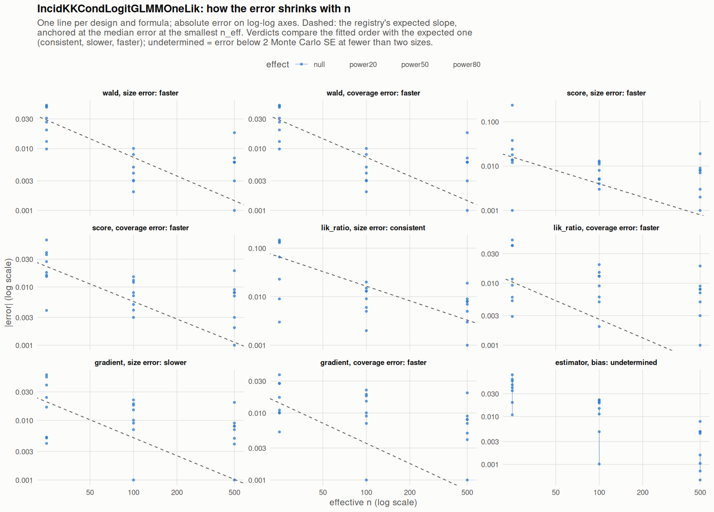

[← Campaign 2026-11-15-e36c7710 summary](README.md)

# Class IncidKKCondLogitGLMMOneLik

Part of the [Classes index](classes.md). Response type: incidence. Status: null effect complete, power effects in progress. Verdict: **fail** (4 flagged test(s): 4 failing, 0 pending, 0 cleared).

<picture><source media="(prefers-color-scheme: dark)" srcset="figures/class-IncidKKCondLogitGLMMOneLik-dark.png"></picture>

Convergence verdicts (worst over designs, formulas and effects; provisional until the class is complete):

| procedure | metric | verdict |
|---|---|---|
| estimator (bias) | bias | undetermined |
| gradient | coverage | faster |
| lik_ratio | coverage | faster |
| score | coverage | faster |
| wald | coverage | faster |
| gradient | size | slower |
| lik_ratio | size | consistent |
| score | size | faster |
| wald | size | faster |

Null effect: 96 cells (4 failing). Size, coverage and bias / SD against the level each is held to.

| design | n | formula | procedure | size | coverage | bias / SD | size level | coverage level | verdict |
|---|---|---|---|---|---|---|---|---|---|
| Fixed:BinaryMatch | 50 | `~.` | gradient | 0.0667 | 0.978 | 0.002 | 0.1 | 0.9 | ok |
| Fixed:BinaryMatch | 200 | `~.` | gradient | 0.069 | 0.931 | -0.057 | 0.075 | 0.925 | ok |
| Fixed:BinaryMatch | 1000 | `~.` | gradient | 0.07 | 0.93 | 0.007 | 0.05 | 0.945 | ok |
| Fixed:BinaryMatch | 50 | `~.` | lik_ratio | 0.188 | 1 | 0.002 | 0.1 | 0.9 | **FAIL** |
| Fixed:BinaryMatch | 200 | `~.` | lik_ratio | 0.065 | 0.935 | -0.057 | 0.075 | 0.925 | ok |
| Fixed:BinaryMatch | 1000 | `~.` | lik_ratio | 0.069 | 0.931 | 0.007 | 0.055 | 0.945 | ok |
| Fixed:BinaryMatch | 50 | `~.` | score | 0.286 | 0.886 | 0.002 | 0.1 | 0.9 | **FAIL** |
| Fixed:BinaryMatch | 200 | `~.` | score | 0.063 | 0.937 | -0.057 | 0.075 | 0.925 | ok |
| Fixed:BinaryMatch | 1000 | `~.` | score | 0.069 | 0.931 | 0.007 | 0.055 | 0.945 | ok |
| Fixed:BinaryMatch | 50 | `~.` | wald | 0 | 1 | 0.002 | 0.1 | 0.9 | ok |
| Fixed:BinaryMatch | 200 | `~.` | wald | 0.054 | 0.946 | -0.057 | 0.075 | 0.925 | ok |
| Fixed:BinaryMatch | 1000 | `~.` | wald | 0.068 | 0.932 | 0.007 | 0.055 | 0.945 | ok |
| Fixed:BinaryMatch | 50 | `~1` | gradient | 0.0552 | 0.945 | 0.033 | 0.1 | 0.9 | ok |
| Fixed:BinaryMatch | 200 | `~1` | gradient | 0.065 | 0.935 | -0.063 | 0.075 | 0.925 | ok |
| Fixed:BinaryMatch | 1000 | `~1` | gradient | 0.058 | 0.942 | 0.0032 | 0.055 | 0.945 | ok |
| Fixed:BinaryMatch | 50 | `~1` | lik_ratio | 0.059 | 0.945 | 0.033 | 0.1 | 0.9 | ok |
| Fixed:BinaryMatch | 200 | `~1` | lik_ratio | 0.063 | 0.937 | -0.063 | 0.075 | 0.925 | ok |
| Fixed:BinaryMatch | 1000 | `~1` | lik_ratio | 0.058 | 0.942 | 0.0032 | 0.055 | 0.945 | ok |
| Fixed:BinaryMatch | 50 | `~1` | score | 0.038 | 0.966 | 0.033 | 0.1 | 0.9 | ok |
| Fixed:BinaryMatch | 200 | `~1` | score | 0.058 | 0.942 | -0.063 | 0.075 | 0.925 | ok |
| Fixed:BinaryMatch | 1000 | `~1` | score | 0.058 | 0.942 | 0.0032 | 0.055 | 0.945 | ok |
| Fixed:BinaryMatch | 50 | `~1` | wald | 0.0191 | 0.981 | 0.033 | 0.1 | 0.9 | ok |
| Fixed:BinaryMatch | 200 | `~1` | wald | 0.053 | 0.947 | -0.063 | 0.075 | 0.925 | ok |
| Fixed:BinaryMatch | 1000 | `~1` | wald | 0.057 | 0.943 | 0.0032 | 0.055 | 0.945 | ok |
| SeqOneByOne:KK14 | 50 | `~.` | gradient | 0.103 | 0.922 | -0.047 | 0.1 | 0.9 | ok |
| SeqOneByOne:KK14 | 200 | `~.` | gradient | 0.068 | 0.932 | 0.041 | 0.075 | 0.925 | ok |
| SeqOneByOne:KK14 | 1000 | `~.` | gradient | 0.051 | 0.949 | -0.033 | 0.055 | 0.945 | ok |
| SeqOneByOne:KK14 | 50 | `~.` | lik_ratio | 0.116 | 0.962 | -0.047 | 0.1 | 0.9 | ok |
| SeqOneByOne:KK14 | 200 | `~.` | lik_ratio | 0.063 | 0.937 | 0.041 | 0.075 | 0.925 | ok |
| SeqOneByOne:KK14 | 1000 | `~.` | lik_ratio | 0.051 | 0.949 | -0.033 | 0.055 | 0.945 | ok |
| SeqOneByOne:KK14 | 50 | `~.` | score | 0.0122 | 0.968 | -0.047 | 0.1 | 0.9 | ok |
| SeqOneByOne:KK14 | 200 | `~.` | score | 0.0611 | 0.938 | 0.041 | 0.075 | 0.925 | ok |
| SeqOneByOne:KK14 | 1000 | `~.` | score | 0.051 | 0.949 | -0.033 | 0.055 | 0.945 | ok |
| SeqOneByOne:KK14 | 50 | `~.` | wald | 0.0234 | 0.977 | -0.047 | 0.1 | 0.9 | ok |
| SeqOneByOne:KK14 | 200 | `~.` | wald | 0.06 | 0.94 | 0.041 | 0.075 | 0.925 | ok |
| SeqOneByOne:KK14 | 1000 | `~.` | wald | 0.05 | 0.95 | -0.033 | 0.055 | 0.945 | ok |
| SeqOneByOne:KK14 | 50 | `~1` | gradient | 0.0551 | 0.939 | -0.038 | 0.1 | 0.9 | ok |
| SeqOneByOne:KK14 | 200 | `~1` | gradient | 0.059 | 0.941 | 0.037 | 0.075 | 0.925 | ok |
| SeqOneByOne:KK14 | 1000 | `~1` | gradient | 0.054 | 0.946 | -0.032 | 0.055 | 0.945 | ok |
| SeqOneByOne:KK14 | 50 | `~1` | lik_ratio | 0.047 | 0.956 | -0.038 | 0.1 | 0.9 | ok |
| SeqOneByOne:KK14 | 200 | `~1` | lik_ratio | 0.056 | 0.944 | 0.037 | 0.075 | 0.925 | ok |
| SeqOneByOne:KK14 | 1000 | `~1` | lik_ratio | 0.053 | 0.947 | -0.032 | 0.055 | 0.945 | ok |
| SeqOneByOne:KK14 | 50 | `~1` | score | 0.049 | 0.954 | -0.038 | 0.1 | 0.9 | ok |
| SeqOneByOne:KK14 | 200 | `~1` | score | 0.054 | 0.946 | 0.037 | 0.075 | 0.925 | ok |
| SeqOneByOne:KK14 | 1000 | `~1` | score | 0.052 | 0.948 | -0.032 | 0.055 | 0.945 | ok |
| SeqOneByOne:KK14 | 50 | `~1` | wald | 0.037 | 0.963 | -0.038 | 0.1 | 0.9 | ok |
| SeqOneByOne:KK14 | 200 | `~1` | wald | 0.05 | 0.95 | 0.037 | 0.075 | 0.925 | ok |
| SeqOneByOne:KK14 | 1000 | `~1` | wald | 0.051 | 0.949 | -0.032 | 0.055 | 0.945 | ok |
| SeqOneByOne:KK21 | 50 | `~.` | gradient | 0.108 | 0.96 | 0.018 | 0.1 | 0.9 | ok |
| SeqOneByOne:KK21 | 200 | `~.` | gradient | 0.0601 | 0.94 | -0.0027 | 0.075 | 0.925 | ok |
| SeqOneByOne:KK21 | 1000 | `~.` | gradient | 0.055 | 0.945 | -0.011 | 0.055 | 0.945 | ok |
| SeqOneByOne:KK21 | 50 | `~.` | lik_ratio | 0.198 | 0.991 | 0.018 | 0.1 | 0.9 | **FAIL** |
| SeqOneByOne:KK21 | 200 | `~.` | lik_ratio | 0.0591 | 0.941 | -0.0027 | 0.075 | 0.925 | ok |
| SeqOneByOne:KK21 | 1000 | `~.` | lik_ratio | 0.055 | 0.945 | -0.011 | 0.055 | 0.945 | ok |
| SeqOneByOne:KK21 | 50 | `~.` | score | 0.0364 | 0.989 | 0.018 | 0.1 | 0.9 | ok |
| SeqOneByOne:KK21 | 200 | `~.` | score | 0.0552 | 0.943 | -0.0027 | 0.075 | 0.925 | ok |
| SeqOneByOne:KK21 | 1000 | `~.` | score | 0.053 | 0.947 | -0.011 | 0.055 | 0.945 | ok |
| SeqOneByOne:KK21 | 50 | `~.` | wald | 0.0019 | 0.998 | 0.018 | 0.1 | 0.9 | ok |
| SeqOneByOne:KK21 | 200 | `~.` | wald | 0.0531 | 0.947 | -0.0027 | 0.075 | 0.925 | ok |
| SeqOneByOne:KK21 | 1000 | `~.` | wald | 0.053 | 0.947 | -0.011 | 0.055 | 0.945 | ok |
| SeqOneByOne:KK21 | 50 | `~1` | gradient | 0.0541 | 0.933 | 0.035 | 0.1 | 0.9 | ok |
| SeqOneByOne:KK21 | 200 | `~1` | gradient | 0.049 | 0.951 | 0.016 | 0.075 | 0.925 | ok |
| SeqOneByOne:KK21 | 1000 | `~1` | gradient | 0.058 | 0.942 | 0.0052 | 0.055 | 0.945 | ok |
| SeqOneByOne:KK21 | 50 | `~1` | lik_ratio | 0.05 | 0.953 | 0.035 | 0.1 | 0.9 | ok |
| SeqOneByOne:KK21 | 200 | `~1` | lik_ratio | 0.048 | 0.952 | 0.016 | 0.075 | 0.925 | ok |
| SeqOneByOne:KK21 | 1000 | `~1` | lik_ratio | 0.058 | 0.942 | 0.0052 | 0.055 | 0.945 | ok |
| SeqOneByOne:KK21 | 50 | `~1` | score | 0.068 | 0.935 | 0.035 | 0.1 | 0.9 | ok |
| SeqOneByOne:KK21 | 200 | `~1` | score | 0.045 | 0.955 | 0.016 | 0.075 | 0.925 | ok |
| SeqOneByOne:KK21 | 1000 | `~1` | score | 0.058 | 0.942 | 0.0052 | 0.055 | 0.945 | ok |
| SeqOneByOne:KK21 | 50 | `~1` | wald | 0.0301 | 0.97 | 0.035 | 0.1 | 0.9 | ok |
| SeqOneByOne:KK21 | 200 | `~1` | wald | 0.045 | 0.955 | 0.016 | 0.075 | 0.925 | ok |
| SeqOneByOne:KK21 | 1000 | `~1` | wald | 0.056 | 0.944 | 0.0052 | 0.055 | 0.945 | ok |
| SeqOneByOne:KK21stepwise | 50 | `~.` | gradient | 0.0892 | 0.96 | 0.011 | 0.1 | 0.9 | ok |
| SeqOneByOne:KK21stepwise | 200 | `~.` | gradient | 0.072 | 0.928 | 0.056 | 0.075 | 0.925 | ok |
| SeqOneByOne:KK21stepwise | 1000 | `~.` | gradient | 0.059 | 0.941 | -0.053 | 0.055 | 0.945 | ok |
| SeqOneByOne:KK21stepwise | 50 | `~.` | lik_ratio | 0.18 | 0.991 | 0.011 | 0.1 | 0.9 | **FAIL** |
| SeqOneByOne:KK21stepwise | 200 | `~.` | lik_ratio | 0.07 | 0.93 | 0.056 | 0.075 | 0.925 | ok |
| SeqOneByOne:KK21stepwise | 1000 | `~.` | lik_ratio | 0.059 | 0.941 | -0.053 | 0.055 | 0.945 | ok |
| SeqOneByOne:KK21stepwise | 50 | `~.` | score | 0.0361 | 0.986 | 0.011 | 0.1 | 0.9 | ok |
| SeqOneByOne:KK21stepwise | 200 | `~.` | score | 0.0622 | 0.935 | 0.056 | 0.075 | 0.925 | ok |
| SeqOneByOne:KK21stepwise | 1000 | `~.` | score | 0.059 | 0.941 | -0.053 | 0.055 | 0.945 | ok |
| SeqOneByOne:KK21stepwise | 50 | `~.` | wald | 0.00369 | 0.996 | 0.011 | 0.1 | 0.9 | ok |
| SeqOneByOne:KK21stepwise | 200 | `~.` | wald | 0.058 | 0.942 | 0.056 | 0.075 | 0.925 | ok |
| SeqOneByOne:KK21stepwise | 1000 | `~.` | wald | 0.056 | 0.944 | -0.053 | 0.055 | 0.945 | ok |
| SeqOneByOne:KK21stepwise | 50 | `~1` | gradient | 0.0742 | 0.913 | -0.015 | 0.1 | 0.9 | ok |
| SeqOneByOne:KK21stepwise | 200 | `~1` | gradient | 0.057 | 0.943 | 0.059 | 0.075 | 0.925 | ok |
| SeqOneByOne:KK21stepwise | 1000 | `~1` | gradient | 0.057 | 0.943 | -0.035 | 0.055 | 0.945 | ok |
| SeqOneByOne:KK21stepwise | 50 | `~1` | lik_ratio | 0.073 | 0.941 | -0.015 | 0.1 | 0.9 | ok |
| SeqOneByOne:KK21stepwise | 200 | `~1` | lik_ratio | 0.055 | 0.945 | 0.059 | 0.075 | 0.925 | ok |
| SeqOneByOne:KK21stepwise | 1000 | `~1` | lik_ratio | 0.057 | 0.943 | -0.035 | 0.055 | 0.945 | ok |
| SeqOneByOne:KK21stepwise | 50 | `~1` | score | 0.074 | 0.923 | -0.015 | 0.1 | 0.9 | ok |
| SeqOneByOne:KK21stepwise | 200 | `~1` | score | 0.053 | 0.947 | 0.059 | 0.075 | 0.925 | ok |
| SeqOneByOne:KK21stepwise | 1000 | `~1` | score | 0.057 | 0.943 | -0.035 | 0.055 | 0.945 | ok |
| SeqOneByOne:KK21stepwise | 50 | `~1` | wald | 0.0402 | 0.96 | -0.015 | 0.1 | 0.9 | ok |
| SeqOneByOne:KK21stepwise | 200 | `~1` | wald | 0.048 | 0.952 | 0.059 | 0.075 | 0.925 | ok |
| SeqOneByOne:KK21stepwise | 1000 | `~1` | wald | 0.056 | 0.944 | -0.035 | 0.055 | 0.945 | ok |

Power effects: 128 cells (0 failing coverage).

| design | n | effect | formula | procedure | power | coverage of the true estimand | coverage level | verdict |
|---|---|---|---|---|---|---|---|---|
| Fixed:BinaryMatch | 50 | power20 | `~.` | gradient | 0.142 |  | 0.9 | ok |
| Fixed:BinaryMatch | 200 | power20 | `~.` | gradient | 0.176 |  | 0.925 | ok |
| Fixed:BinaryMatch | 50 | power50 | `~.` | gradient | 0.264 |  | 0.9 | ok |
| Fixed:BinaryMatch | 200 | power50 | `~.` | gradient | 0.435 |  | 0.925 | ok |
| Fixed:BinaryMatch | 50 | power20 | `~.` | lik_ratio | 0.25 |  | 0.9 | ok |
| Fixed:BinaryMatch | 200 | power20 | `~.` | lik_ratio | 0.174 |  | 0.925 | ok |
| Fixed:BinaryMatch | 50 | power50 | `~.` | lik_ratio | 0.431 |  | 0.9 | ok |
| Fixed:BinaryMatch | 200 | power50 | `~.` | lik_ratio | 0.424 |  | 0.925 | ok |
| Fixed:BinaryMatch | 50 | power20 | `~.` | score | 0.302 |  | 0.9 | ok |
| Fixed:BinaryMatch | 200 | power20 | `~.` | score | 0.166 |  | 0.925 | ok |
| Fixed:BinaryMatch | 50 | power50 | `~.` | score | 0.469 |  | 0.9 | ok |
| Fixed:BinaryMatch | 200 | power50 | `~.` | score | 0.413 |  | 0.925 | ok |
| Fixed:BinaryMatch | 50 | power20 | `~.` | wald | 0.00521 |  | 0.9 | ok |
| Fixed:BinaryMatch | 200 | power20 | `~.` | wald | 0.156 |  | 0.925 | ok |
| Fixed:BinaryMatch | 50 | power50 | `~.` | wald | 0.0231 |  | 0.9 | ok |
| Fixed:BinaryMatch | 200 | power50 | `~.` | wald | 0.397 |  | 0.925 | ok |
| Fixed:BinaryMatch | 50 | power20 | `~1` | gradient | 0.206 |  | 0.9 | ok |
| Fixed:BinaryMatch | 200 | power20 | `~1` | gradient | 0.182 |  | 0.925 | ok |
| Fixed:BinaryMatch | 50 | power50 | `~1` | gradient | 0.427 |  | 0.9 | ok |
| Fixed:BinaryMatch | 200 | power50 | `~1` | gradient | 0.446 |  | 0.925 | ok |
| Fixed:BinaryMatch | 50 | power20 | `~1` | lik_ratio | 0.228 |  | 0.9 | ok |
| Fixed:BinaryMatch | 200 | power20 | `~1` | lik_ratio | 0.178 |  | 0.925 | ok |
| Fixed:BinaryMatch | 50 | power50 | `~1` | lik_ratio | 0.466 |  | 0.9 | ok |
| Fixed:BinaryMatch | 200 | power50 | `~1` | lik_ratio | 0.44 |  | 0.925 | ok |
| Fixed:BinaryMatch | 50 | power20 | `~1` | score | 0.148 |  | 0.9 | ok |
| Fixed:BinaryMatch | 200 | power20 | `~1` | score | 0.172 |  | 0.925 | ok |
| Fixed:BinaryMatch | 50 | power50 | `~1` | score | 0.392 |  | 0.9 | ok |
| Fixed:BinaryMatch | 200 | power50 | `~1` | score | 0.436 |  | 0.925 | ok |
| Fixed:BinaryMatch | 50 | power20 | `~1` | wald | 0.0823 |  | 0.9 | ok |
| Fixed:BinaryMatch | 200 | power20 | `~1` | wald | 0.162 |  | 0.925 | ok |
| Fixed:BinaryMatch | 50 | power50 | `~1` | wald | 0.275 |  | 0.9 | ok |
| Fixed:BinaryMatch | 200 | power50 | `~1` | wald | 0.426 |  | 0.925 | ok |
| SeqOneByOne:KK14 | 50 | power20 | `~.` | gradient | 0.242 |  | 0.9 | ok |
| SeqOneByOne:KK14 | 200 | power20 | `~.` | gradient | 0.234 |  | 0.925 | ok |
| SeqOneByOne:KK14 | 50 | power50 | `~.` | gradient | 0.489 |  | 0.9 | ok |
| SeqOneByOne:KK14 | 200 | power50 | `~.` | gradient | 0.504 |  | 0.925 | ok |
| SeqOneByOne:KK14 | 50 | power20 | `~.` | lik_ratio | 0.237 |  | 0.9 | ok |
| SeqOneByOne:KK14 | 200 | power20 | `~.` | lik_ratio | 0.226 |  | 0.925 | ok |
| SeqOneByOne:KK14 | 50 | power50 | `~.` | lik_ratio | 0.498 |  | 0.9 | ok |
| SeqOneByOne:KK14 | 200 | power50 | `~.` | lik_ratio | 0.5 |  | 0.925 | ok |
| SeqOneByOne:KK14 | 50 | power20 | `~.` | score | 0.127 |  | 0.9 | ok |
| SeqOneByOne:KK14 | 200 | power20 | `~.` | score | 0.222 |  | 0.925 | ok |
| SeqOneByOne:KK14 | 50 | power50 | `~.` | score | 0.341 |  | 0.9 | ok |
| SeqOneByOne:KK14 | 200 | power50 | `~.` | score | 0.497 |  | 0.925 | ok |
| SeqOneByOne:KK14 | 50 | power20 | `~.` | wald | 0.106 |  | 0.9 | ok |
| SeqOneByOne:KK14 | 200 | power20 | `~.` | wald | 0.216 |  | 0.925 | ok |
| SeqOneByOne:KK14 | 50 | power50 | `~.` | wald | 0.24 |  | 0.9 | ok |
| SeqOneByOne:KK14 | 200 | power50 | `~.` | wald | 0.48 |  | 0.925 | ok |
| SeqOneByOne:KK14 | 50 | power20 | `~1` | gradient | 0.186 |  | 0.9 | ok |
| SeqOneByOne:KK14 | 200 | power20 | `~1` | gradient | 0.218 |  | 0.925 | ok |
| SeqOneByOne:KK14 | 50 | power50 | `~1` | gradient | 0.435 |  | 0.9 | ok |
| SeqOneByOne:KK14 | 200 | power50 | `~1` | gradient | 0.468 |  | 0.925 | ok |
| SeqOneByOne:KK14 | 50 | power20 | `~1` | lik_ratio | 0.182 |  | 0.9 | ok |
| SeqOneByOne:KK14 | 200 | power20 | `~1` | lik_ratio | 0.216 |  | 0.925 | ok |
| SeqOneByOne:KK14 | 50 | power50 | `~1` | lik_ratio | 0.432 |  | 0.9 | ok |
| SeqOneByOne:KK14 | 200 | power50 | `~1` | lik_ratio | 0.464 |  | 0.925 | ok |
| SeqOneByOne:KK14 | 50 | power20 | `~1` | score | 0.176 |  | 0.9 | ok |
| SeqOneByOne:KK14 | 200 | power20 | `~1` | score | 0.212 |  | 0.925 | ok |
| SeqOneByOne:KK14 | 50 | power50 | `~1` | score | 0.406 |  | 0.9 | ok |
| SeqOneByOne:KK14 | 200 | power50 | `~1` | score | 0.462 |  | 0.925 | ok |
| SeqOneByOne:KK14 | 50 | power20 | `~1` | wald | 0.138 |  | 0.9 | ok |
| SeqOneByOne:KK14 | 200 | power20 | `~1` | wald | 0.206 |  | 0.925 | ok |
| SeqOneByOne:KK14 | 50 | power50 | `~1` | wald | 0.384 |  | 0.9 | ok |
| SeqOneByOne:KK14 | 200 | power50 | `~1` | wald | 0.45 |  | 0.925 | ok |
| SeqOneByOne:KK21 | 50 | power20 | `~.` | gradient | 0.196 |  | 0.9 | ok |
| SeqOneByOne:KK21 | 200 | power20 | `~.` | gradient | 0.232 |  | 0.925 | ok |
| SeqOneByOne:KK21 | 50 | power50 | `~.` | gradient | 0.344 |  | 0.9 | ok |
| SeqOneByOne:KK21 | 200 | power50 | `~.` | gradient | 0.495 |  | 0.925 | ok |
| SeqOneByOne:KK21 | 50 | power20 | `~.` | lik_ratio | 0.243 |  | 0.9 | ok |
| SeqOneByOne:KK21 | 200 | power20 | `~.` | lik_ratio | 0.232 |  | 0.925 | ok |
| SeqOneByOne:KK21 | 50 | power50 | `~.` | lik_ratio | 0.43 |  | 0.9 | ok |
| SeqOneByOne:KK21 | 200 | power50 | `~.` | lik_ratio | 0.488 |  | 0.925 | ok |
| SeqOneByOne:KK21 | 50 | power20 | `~.` | score | 0.0847 |  | 0.9 | ok |
| SeqOneByOne:KK21 | 200 | power20 | `~.` | score | 0.223 |  | 0.925 | ok |
| SeqOneByOne:KK21 | 50 | power50 | `~.` | score | 0.233 |  | 0.9 | ok |
| SeqOneByOne:KK21 | 200 | power50 | `~.` | score | 0.473 |  | 0.925 | ok |
| SeqOneByOne:KK21 | 50 | power20 | `~.` | wald | 0.034 |  | 0.9 | ok |
| SeqOneByOne:KK21 | 200 | power20 | `~.` | wald | 0.21 |  | 0.925 | ok |
| SeqOneByOne:KK21 | 50 | power50 | `~.` | wald | 0.0877 |  | 0.9 | ok |
| SeqOneByOne:KK21 | 200 | power50 | `~.` | wald | 0.459 |  | 0.925 | ok |
| SeqOneByOne:KK21 | 50 | power20 | `~1` | gradient | 0.186 |  | 0.9 | ok |
| SeqOneByOne:KK21 | 200 | power20 | `~1` | gradient | 0.218 |  | 0.925 | ok |
| SeqOneByOne:KK21 | 50 | power50 | `~1` | gradient | 0.454 |  | 0.9 | ok |
| SeqOneByOne:KK21 | 200 | power50 | `~1` | gradient | 0.478 |  | 0.925 | ok |
| SeqOneByOne:KK21 | 50 | power20 | `~1` | lik_ratio | 0.178 |  | 0.9 | ok |
| SeqOneByOne:KK21 | 200 | power20 | `~1` | lik_ratio | 0.216 |  | 0.925 | ok |
| SeqOneByOne:KK21 | 50 | power50 | `~1` | lik_ratio | 0.444 |  | 0.9 | ok |
| SeqOneByOne:KK21 | 200 | power50 | `~1` | lik_ratio | 0.472 |  | 0.925 | ok |
| SeqOneByOne:KK21 | 50 | power20 | `~1` | score | 0.176 |  | 0.9 | ok |
| SeqOneByOne:KK21 | 200 | power20 | `~1` | score | 0.212 |  | 0.925 | ok |
| SeqOneByOne:KK21 | 50 | power50 | `~1` | score | 0.408 |  | 0.9 | ok |
| SeqOneByOne:KK21 | 200 | power50 | `~1` | score | 0.464 |  | 0.925 | ok |
| SeqOneByOne:KK21 | 50 | power20 | `~1` | wald | 0.0974 |  | 0.9 | ok |
| SeqOneByOne:KK21 | 200 | power20 | `~1` | wald | 0.204 |  | 0.925 | ok |
| SeqOneByOne:KK21 | 50 | power50 | `~1` | wald | 0.305 |  | 0.9 | ok |
| SeqOneByOne:KK21 | 200 | power50 | `~1` | wald | 0.448 |  | 0.925 | ok |
| SeqOneByOne:KK21stepwise | 50 | power20 | `~.` | gradient | 0.206 |  | 0.9 | ok |
| SeqOneByOne:KK21stepwise | 200 | power20 | `~.` | gradient | 0.212 |  | 0.925 | ok |
| SeqOneByOne:KK21stepwise | 50 | power50 | `~.` | gradient | 0.442 |  | 0.9 | ok |
| SeqOneByOne:KK21stepwise | 200 | power50 | `~.` | gradient | 0.506 |  | 0.925 | ok |
| SeqOneByOne:KK21stepwise | 50 | power20 | `~.` | lik_ratio | 0.257 |  | 0.9 | ok |
| SeqOneByOne:KK21stepwise | 200 | power20 | `~.` | lik_ratio | 0.212 |  | 0.925 | ok |
| SeqOneByOne:KK21stepwise | 50 | power50 | `~.` | lik_ratio | 0.498 |  | 0.9 | ok |
| SeqOneByOne:KK21stepwise | 200 | power50 | `~.` | lik_ratio | 0.496 |  | 0.925 | ok |
| SeqOneByOne:KK21stepwise | 50 | power20 | `~.` | score | 0.125 |  | 0.9 | ok |
| SeqOneByOne:KK21stepwise | 200 | power20 | `~.` | score | 0.19 |  | 0.925 | ok |
| SeqOneByOne:KK21stepwise | 50 | power50 | `~.` | score | 0.355 |  | 0.9 | ok |
| SeqOneByOne:KK21stepwise | 200 | power50 | `~.` | score | 0.475 |  | 0.925 | ok |
| SeqOneByOne:KK21stepwise | 50 | power20 | `~.` | wald | 0.03 |  | 0.9 | ok |
| SeqOneByOne:KK21stepwise | 200 | power20 | `~.` | wald | 0.19 |  | 0.925 | ok |
| SeqOneByOne:KK21stepwise | 50 | power50 | `~.` | wald | 0.11 |  | 0.9 | ok |
| SeqOneByOne:KK21stepwise | 200 | power50 | `~.` | wald | 0.462 |  | 0.925 | ok |
| SeqOneByOne:KK21stepwise | 50 | power20 | `~1` | gradient | 0.187 |  | 0.9 | ok |
| SeqOneByOne:KK21stepwise | 200 | power20 | `~1` | gradient | 0.214 |  | 0.925 | ok |
| SeqOneByOne:KK21stepwise | 50 | power50 | `~1` | gradient | 0.466 |  | 0.9 | ok |
| SeqOneByOne:KK21stepwise | 200 | power50 | `~1` | gradient | 0.488 |  | 0.925 | ok |
| SeqOneByOne:KK21stepwise | 50 | power20 | `~1` | lik_ratio | 0.174 |  | 0.9 | ok |
| SeqOneByOne:KK21stepwise | 200 | power20 | `~1` | lik_ratio | 0.208 |  | 0.925 | ok |
| SeqOneByOne:KK21stepwise | 50 | power50 | `~1` | lik_ratio | 0.466 |  | 0.9 | ok |
| SeqOneByOne:KK21stepwise | 200 | power50 | `~1` | lik_ratio | 0.482 |  | 0.925 | ok |
| SeqOneByOne:KK21stepwise | 50 | power20 | `~1` | score | 0.16 |  | 0.9 | ok |
| SeqOneByOne:KK21stepwise | 200 | power20 | `~1` | score | 0.206 |  | 0.925 | ok |
| SeqOneByOne:KK21stepwise | 50 | power50 | `~1` | score | 0.424 |  | 0.9 | ok |
| SeqOneByOne:KK21stepwise | 200 | power50 | `~1` | score | 0.478 |  | 0.925 | ok |
| SeqOneByOne:KK21stepwise | 50 | power20 | `~1` | wald | 0.116 |  | 0.9 | ok |
| SeqOneByOne:KK21stepwise | 200 | power20 | `~1` | wald | 0.198 |  | 0.925 | ok |
| SeqOneByOne:KK21stepwise | 50 | power50 | `~1` | wald | 0.324 |  | 0.9 | ok |
| SeqOneByOne:KK21stepwise | 200 | power50 | `~1` | wald | 0.464 |  | 0.925 | ok |

[← Campaign 2026-11-15-e36c7710 summary](README.md)
