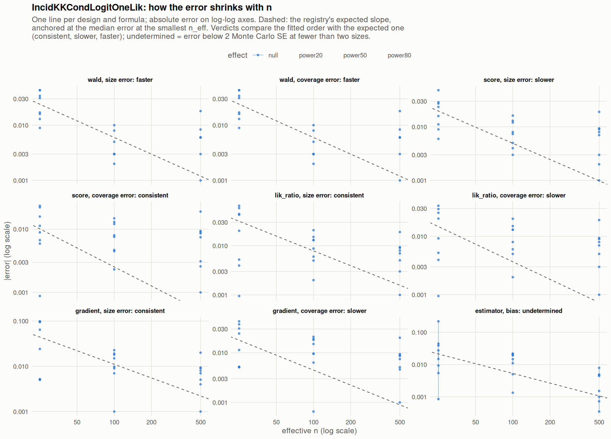

[← Campaign 2026-11-15-e36c7710 summary](README.md)

# Class IncidKKCondLogitOneLik

Part of the [Classes index](classes.md). Response type: incidence. Status: null effect complete, power effects in progress. Verdict: **fail** (3 flagged test(s): 3 failing, 0 pending, 0 cleared).

<picture><source media="(prefers-color-scheme: dark)" srcset="figures/class-IncidKKCondLogitOneLik-dark.png"></picture>

Convergence verdicts (worst over designs, formulas and effects; provisional until the class is complete):

| procedure | metric | verdict |
|---|---|---|
| estimator (bias) | bias | undetermined |
| gradient | coverage | slower |
| lik_ratio | coverage | slower |
| score | coverage | consistent |
| wald | coverage | faster |
| gradient | size | consistent |
| lik_ratio | size | consistent |
| score | size | slower |
| wald | size | faster |

Null effect: 96 cells (3 failing). Size, coverage and bias / SD against the level each is held to.

| design | n | formula | procedure | size | coverage | bias / SD | size level | coverage level | verdict |
|---|---|---|---|---|---|---|---|---|---|
| Fixed:BinaryMatch | 50 | `~.` | gradient | 0.145 | 0.939 | -0.0038 | 0.1 | 0.9 | **FAIL** |
| Fixed:BinaryMatch | 200 | `~.` | gradient | 0.0691 | 0.931 | -0.056 | 0.075 | 0.925 | ok |
| Fixed:BinaryMatch | 1000 | `~.` | gradient | 0.07 | 0.93 | 0.0067 | 0.055 | 0.95 | ok |
| Fixed:BinaryMatch | 50 | `~.` | lik_ratio | 0.0928 | 0.941 | -0.0038 | 0.1 | 0.9 | ok |
| Fixed:BinaryMatch | 200 | `~.` | lik_ratio | 0.0651 | 0.935 | -0.056 | 0.075 | 0.925 | ok |
| Fixed:BinaryMatch | 1000 | `~.` | lik_ratio | 0.069 | 0.931 | 0.0067 | 0.055 | 0.95 | ok |
| Fixed:BinaryMatch | 50 | `~.` | score | 0.0735 | 0.951 | -0.0038 | 0.1 | 0.9 | ok |
| Fixed:BinaryMatch | 200 | `~.` | score | 0.063 | 0.937 | -0.056 | 0.075 | 0.925 | ok |
| Fixed:BinaryMatch | 1000 | `~.` | score | 0.069 | 0.931 | 0.0067 | 0.05 | 0.945 | ok |
| Fixed:BinaryMatch | 50 | `~.` | wald | 0.00703 | 0.993 | -0.0038 | 0.1 | 0.9 | ok |
| Fixed:BinaryMatch | 200 | `~.` | wald | 0.053 | 0.947 | -0.056 | 0.075 | 0.925 | ok |
| Fixed:BinaryMatch | 1000 | `~.` | wald | 0.068 | 0.932 | 0.0067 | 0.055 | 0.945 | ok |
| Fixed:BinaryMatch | 50 | `~1` | gradient | 0.0552 | 0.945 | 0.0081 | 0.1 | 0.9 | ok |
| Fixed:BinaryMatch | 200 | `~1` | gradient | 0.065 | 0.935 | -0.063 | 0.075 | 0.925 | ok |
| Fixed:BinaryMatch | 1000 | `~1` | gradient | 0.0594 | 0.941 | 0.0024 | 0.055 | 0.945 | ok |
| Fixed:BinaryMatch | 50 | `~1` | lik_ratio | 0.0552 | 0.945 | 0.0081 | 0.1 | 0.9 | ok |
| Fixed:BinaryMatch | 200 | `~1` | lik_ratio | 0.063 | 0.937 | -0.063 | 0.075 | 0.925 | ok |
| Fixed:BinaryMatch | 1000 | `~1` | lik_ratio | 0.0594 | 0.941 | 0.0024 | 0.055 | 0.945 | ok |
| Fixed:BinaryMatch | 50 | `~1` | score | 0.0341 | 0.966 | 0.0081 | 0.1 | 0.9 | ok |
| Fixed:BinaryMatch | 200 | `~1` | score | 0.058 | 0.942 | -0.063 | 0.075 | 0.925 | ok |
| Fixed:BinaryMatch | 1000 | `~1` | score | 0.0594 | 0.941 | 0.0024 | 0.055 | 0.945 | ok |
| Fixed:BinaryMatch | 50 | `~1` | wald | 0.0191 | 0.981 | 0.0081 | 0.1 | 0.9 | ok |
| Fixed:BinaryMatch | 200 | `~1` | wald | 0.053 | 0.947 | -0.063 | 0.075 | 0.925 | ok |
| Fixed:BinaryMatch | 1000 | `~1` | wald | 0.0583 | 0.942 | 0.0024 | 0.055 | 0.945 | ok |
| SeqOneByOne:KK14 | 50 | `~.` | gradient | 0.114 | 0.907 | -0.034 | 0.1 | 0.9 | ok |
| SeqOneByOne:KK14 | 200 | `~.` | gradient | 0.0681 | 0.932 | 0.041 | 0.075 | 0.925 | ok |
| SeqOneByOne:KK14 | 1000 | `~.` | gradient | 0.051 | 0.949 | -0.033 | 0.055 | 0.945 | ok |
| SeqOneByOne:KK14 | 50 | `~.` | lik_ratio | 0.0943 | 0.921 | -0.034 | 0.1 | 0.9 | ok |
| SeqOneByOne:KK14 | 200 | `~.` | lik_ratio | 0.0631 | 0.937 | 0.041 | 0.075 | 0.925 | ok |
| SeqOneByOne:KK14 | 1000 | `~.` | lik_ratio | 0.051 | 0.949 | -0.033 | 0.055 | 0.945 | ok |
| SeqOneByOne:KK14 | 50 | `~.` | score | 0.0772 | 0.928 | -0.034 | 0.1 | 0.9 | ok |
| SeqOneByOne:KK14 | 200 | `~.` | score | 0.0621 | 0.938 | 0.041 | 0.075 | 0.925 | ok |
| SeqOneByOne:KK14 | 1000 | `~.` | score | 0.051 | 0.949 | -0.033 | 0.055 | 0.945 | ok |
| SeqOneByOne:KK14 | 50 | `~.` | wald | 0.034 | 0.966 | -0.034 | 0.1 | 0.9 | ok |
| SeqOneByOne:KK14 | 200 | `~.` | wald | 0.06 | 0.94 | 0.041 | 0.075 | 0.925 | ok |
| SeqOneByOne:KK14 | 1000 | `~.` | wald | 0.05 | 0.95 | -0.033 | 0.055 | 0.945 | ok |
| SeqOneByOne:KK14 | 50 | `~1` | gradient | 0.0551 | 0.945 | -0.023 | 0.1 | 0.9 | ok |
| SeqOneByOne:KK14 | 200 | `~1` | gradient | 0.059 | 0.94 | 0.036 | 0.075 | 0.925 | ok |
| SeqOneByOne:KK14 | 1000 | `~1` | gradient | 0.054 | 0.945 | -0.032 | 0.055 | 0.945 | ok |
| SeqOneByOne:KK14 | 50 | `~1` | lik_ratio | 0.046 | 0.954 | -0.023 | 0.1 | 0.9 | ok |
| SeqOneByOne:KK14 | 200 | `~1` | lik_ratio | 0.056 | 0.944 | 0.036 | 0.075 | 0.925 | ok |
| SeqOneByOne:KK14 | 1000 | `~1` | lik_ratio | 0.053 | 0.947 | -0.032 | 0.055 | 0.945 | ok |
| SeqOneByOne:KK14 | 50 | `~1` | score | 0.041 | 0.959 | -0.023 | 0.1 | 0.9 | ok |
| SeqOneByOne:KK14 | 200 | `~1` | score | 0.054 | 0.946 | 0.036 | 0.075 | 0.925 | ok |
| SeqOneByOne:KK14 | 1000 | `~1` | score | 0.052 | 0.947 | -0.032 | 0.055 | 0.945 | ok |
| SeqOneByOne:KK14 | 50 | `~1` | wald | 0.037 | 0.963 | -0.023 | 0.1 | 0.9 | ok |
| SeqOneByOne:KK14 | 200 | `~1` | wald | 0.05 | 0.95 | 0.036 | 0.075 | 0.925 | ok |
| SeqOneByOne:KK14 | 1000 | `~1` | wald | 0.051 | 0.949 | -0.032 | 0.055 | 0.945 | ok |
| SeqOneByOne:KK21 | 50 | `~.` | gradient | 0.149 | 0.913 | 0.013 | 0.1 | 0.9 | **FAIL** |
| SeqOneByOne:KK21 | 200 | `~.` | gradient | 0.0598 | 0.94 | -0.0036 | 0.075 | 0.925 | ok |
| SeqOneByOne:KK21 | 1000 | `~.` | gradient | 0.0551 | 0.945 | -0.01 | 0.055 | 0.945 | ok |
| SeqOneByOne:KK21 | 50 | `~.` | lik_ratio | 0.108 | 0.925 | 0.013 | 0.1 | 0.9 | ok |
| SeqOneByOne:KK21 | 200 | `~.` | lik_ratio | 0.0588 | 0.942 | -0.0036 | 0.075 | 0.925 | ok |
| SeqOneByOne:KK21 | 1000 | `~.` | lik_ratio | 0.0551 | 0.945 | -0.01 | 0.055 | 0.945 | ok |
| SeqOneByOne:KK21 | 50 | `~.` | score | 0.0788 | 0.943 | 0.013 | 0.1 | 0.9 | ok |
| SeqOneByOne:KK21 | 200 | `~.` | score | 0.0573 | 0.942 | -0.0036 | 0.075 | 0.925 | ok |
| SeqOneByOne:KK21 | 1000 | `~.` | score | 0.053 | 0.947 | -0.01 | 0.055 | 0.945 | ok |
| SeqOneByOne:KK21 | 50 | `~.` | wald | 0.00701 | 0.993 | 0.013 | 0.1 | 0.9 | ok |
| SeqOneByOne:KK21 | 200 | `~.` | wald | 0.053 | 0.947 | -0.0036 | 0.075 | 0.925 | ok |
| SeqOneByOne:KK21 | 1000 | `~.` | wald | 0.053 | 0.947 | -0.01 | 0.055 | 0.945 | ok |
| SeqOneByOne:KK21 | 50 | `~1` | gradient | 0.0551 | 0.945 | 0.0012 | 0.1 | 0.9 | ok |
| SeqOneByOne:KK21 | 200 | `~1` | gradient | 0.049 | 0.951 | 0.016 | 0.075 | 0.925 | ok |
| SeqOneByOne:KK21 | 1000 | `~1` | gradient | 0.058 | 0.941 | 0.0052 | 0.055 | 0.945 | ok |
| SeqOneByOne:KK21 | 50 | `~1` | lik_ratio | 0.049 | 0.951 | 0.0012 | 0.1 | 0.9 | ok |
| SeqOneByOne:KK21 | 200 | `~1` | lik_ratio | 0.048 | 0.952 | 0.016 | 0.075 | 0.925 | ok |
| SeqOneByOne:KK21 | 1000 | `~1` | lik_ratio | 0.058 | 0.942 | 0.0052 | 0.055 | 0.945 | ok |
| SeqOneByOne:KK21 | 50 | `~1` | score | 0.044 | 0.956 | 0.0012 | 0.1 | 0.9 | ok |
| SeqOneByOne:KK21 | 200 | `~1` | score | 0.045 | 0.955 | 0.016 | 0.075 | 0.925 | ok |
| SeqOneByOne:KK21 | 1000 | `~1` | score | 0.058 | 0.941 | 0.0052 | 0.055 | 0.945 | ok |
| SeqOneByOne:KK21 | 50 | `~1` | wald | 0.033 | 0.967 | 0.0012 | 0.1 | 0.9 | ok |
| SeqOneByOne:KK21 | 200 | `~1` | wald | 0.045 | 0.955 | 0.016 | 0.075 | 0.925 | ok |
| SeqOneByOne:KK21 | 1000 | `~1` | wald | 0.056 | 0.944 | 0.0052 | 0.055 | 0.945 | ok |
| SeqOneByOne:KK21stepwise | 50 | `~.` | gradient | 0.147 | 0.919 | -0.1 | 0.1 | 0.9 | **FAIL** |
| SeqOneByOne:KK21stepwise | 200 | `~.` | gradient | 0.0727 | 0.929 | 0.055 | 0.075 | 0.925 | ok |
| SeqOneByOne:KK21stepwise | 1000 | `~.` | gradient | 0.0591 | 0.941 | -0.053 | 0.055 | 0.945 | ok |
| SeqOneByOne:KK21stepwise | 50 | `~.` | lik_ratio | 0.115 | 0.917 | -0.1 | 0.1 | 0.9 | ok |
| SeqOneByOne:KK21stepwise | 200 | `~.` | lik_ratio | 0.0707 | 0.93 | 0.055 | 0.075 | 0.925 | ok |
| SeqOneByOne:KK21stepwise | 1000 | `~.` | lik_ratio | 0.0591 | 0.941 | -0.053 | 0.055 | 0.945 | ok |
| SeqOneByOne:KK21stepwise | 50 | `~.` | score | 0.0982 | 0.927 | -0.1 | 0.1 | 0.9 | ok |
| SeqOneByOne:KK21stepwise | 200 | `~.` | score | 0.0662 | 0.935 | 0.055 | 0.075 | 0.925 | ok |
| SeqOneByOne:KK21stepwise | 1000 | `~.` | score | 0.059 | 0.941 | -0.053 | 0.055 | 0.945 | ok |
| SeqOneByOne:KK21stepwise | 50 | `~.` | wald | 0.016 | 0.984 | -0.1 | 0.1 | 0.9 | ok |
| SeqOneByOne:KK21stepwise | 200 | `~.` | wald | 0.058 | 0.942 | 0.055 | 0.075 | 0.925 | ok |
| SeqOneByOne:KK21stepwise | 1000 | `~.` | wald | 0.056 | 0.944 | -0.053 | 0.055 | 0.945 | ok |
| SeqOneByOne:KK21stepwise | 50 | `~1` | gradient | 0.0741 | 0.926 | -0.054 | 0.1 | 0.9 | ok |
| SeqOneByOne:KK21stepwise | 200 | `~1` | gradient | 0.057 | 0.944 | 0.059 | 0.075 | 0.925 | ok |
| SeqOneByOne:KK21stepwise | 1000 | `~1` | gradient | 0.057 | 0.943 | -0.035 | 0.055 | 0.945 | ok |
| SeqOneByOne:KK21stepwise | 50 | `~1` | lik_ratio | 0.0701 | 0.93 | -0.054 | 0.1 | 0.9 | ok |
| SeqOneByOne:KK21stepwise | 200 | `~1` | lik_ratio | 0.055 | 0.945 | 0.059 | 0.075 | 0.925 | ok |
| SeqOneByOne:KK21stepwise | 1000 | `~1` | lik_ratio | 0.057 | 0.943 | -0.035 | 0.055 | 0.945 | ok |
| SeqOneByOne:KK21stepwise | 50 | `~1` | score | 0.0611 | 0.939 | -0.054 | 0.1 | 0.9 | ok |
| SeqOneByOne:KK21stepwise | 200 | `~1` | score | 0.053 | 0.948 | 0.059 | 0.075 | 0.925 | ok |
| SeqOneByOne:KK21stepwise | 1000 | `~1` | score | 0.057 | 0.943 | -0.035 | 0.055 | 0.945 | ok |
| SeqOneByOne:KK21stepwise | 50 | `~1` | wald | 0.0411 | 0.959 | -0.054 | 0.1 | 0.9 | ok |
| SeqOneByOne:KK21stepwise | 200 | `~1` | wald | 0.048 | 0.952 | 0.059 | 0.075 | 0.925 | ok |
| SeqOneByOne:KK21stepwise | 1000 | `~1` | wald | 0.056 | 0.944 | -0.035 | 0.055 | 0.945 | ok |

Power effects: 128 cells (0 failing coverage).

| design | n | effect | formula | procedure | power | coverage of the true estimand | coverage level | verdict |
|---|---|---|---|---|---|---|---|---|
| Fixed:BinaryMatch | 50 | power20 | `~.` | gradient | 0.269 |  | 0.9 | ok |
| Fixed:BinaryMatch | 200 | power20 | `~.` | gradient | 0.178 |  | 0.925 | ok |
| Fixed:BinaryMatch | 50 | power50 | `~.` | gradient | 0.46 |  | 0.9 | ok |
| Fixed:BinaryMatch | 200 | power50 | `~.` | gradient | 0.438 |  | 0.925 | ok |
| Fixed:BinaryMatch | 50 | power20 | `~.` | lik_ratio | 0.2 |  | 0.9 | ok |
| Fixed:BinaryMatch | 200 | power20 | `~.` | lik_ratio | 0.174 |  | 0.925 | ok |
| Fixed:BinaryMatch | 50 | power50 | `~.` | lik_ratio | 0.399 |  | 0.9 | ok |
| Fixed:BinaryMatch | 200 | power50 | `~.` | lik_ratio | 0.426 |  | 0.925 | ok |
| Fixed:BinaryMatch | 50 | power20 | `~.` | score | 0.173 |  | 0.9 | ok |
| Fixed:BinaryMatch | 200 | power20 | `~.` | score | 0.166 |  | 0.925 | ok |
| Fixed:BinaryMatch | 50 | power50 | `~.` | score | 0.349 |  | 0.9 | ok |
| Fixed:BinaryMatch | 200 | power50 | `~.` | score | 0.422 |  | 0.925 | ok |
| Fixed:BinaryMatch | 50 | power20 | `~.` | wald | 0.0226 |  | 0.9 | ok |
| Fixed:BinaryMatch | 200 | power20 | `~.` | wald | 0.156 |  | 0.925 | ok |
| Fixed:BinaryMatch | 50 | power50 | `~.` | wald | 0.0773 |  | 0.9 | ok |
| Fixed:BinaryMatch | 200 | power50 | `~.` | wald | 0.4 |  | 0.925 | ok |
| Fixed:BinaryMatch | 50 | power20 | `~1` | gradient | 0.206 |  | 0.9 | ok |
| Fixed:BinaryMatch | 200 | power20 | `~1` | gradient | 0.182 |  | 0.925 | ok |
| Fixed:BinaryMatch | 50 | power50 | `~1` | gradient | 0.427 |  | 0.9 | ok |
| Fixed:BinaryMatch | 200 | power50 | `~1` | gradient | 0.446 |  | 0.925 | ok |
| Fixed:BinaryMatch | 50 | power20 | `~1` | lik_ratio | 0.206 |  | 0.9 | ok |
| Fixed:BinaryMatch | 200 | power20 | `~1` | lik_ratio | 0.178 |  | 0.925 | ok |
| Fixed:BinaryMatch | 50 | power50 | `~1` | lik_ratio | 0.427 |  | 0.9 | ok |
| Fixed:BinaryMatch | 200 | power50 | `~1` | lik_ratio | 0.44 |  | 0.925 | ok |
| Fixed:BinaryMatch | 50 | power20 | `~1` | score | 0.126 |  | 0.9 | ok |
| Fixed:BinaryMatch | 200 | power20 | `~1` | score | 0.172 |  | 0.925 | ok |
| Fixed:BinaryMatch | 50 | power50 | `~1` | score | 0.348 |  | 0.9 | ok |
| Fixed:BinaryMatch | 200 | power50 | `~1` | score | 0.436 |  | 0.925 | ok |
| Fixed:BinaryMatch | 50 | power20 | `~1` | wald | 0.0823 |  | 0.9 | ok |
| Fixed:BinaryMatch | 200 | power20 | `~1` | wald | 0.162 |  | 0.925 | ok |
| Fixed:BinaryMatch | 50 | power50 | `~1` | wald | 0.275 |  | 0.9 | ok |
| Fixed:BinaryMatch | 200 | power50 | `~1` | wald | 0.426 |  | 0.925 | ok |
| SeqOneByOne:KK14 | 50 | power20 | `~.` | gradient | 0.259 |  | 0.9 | ok |
| SeqOneByOne:KK14 | 200 | power20 | `~.` | gradient | 0.234 |  | 0.925 | ok |
| SeqOneByOne:KK14 | 50 | power50 | `~.` | gradient | 0.527 |  | 0.9 | ok |
| SeqOneByOne:KK14 | 200 | power50 | `~.` | gradient | 0.505 |  | 0.925 | ok |
| SeqOneByOne:KK14 | 50 | power20 | `~.` | lik_ratio | 0.231 |  | 0.9 | ok |
| SeqOneByOne:KK14 | 200 | power20 | `~.` | lik_ratio | 0.226 |  | 0.925 | ok |
| SeqOneByOne:KK14 | 50 | power50 | `~.` | lik_ratio | 0.499 |  | 0.9 | ok |
| SeqOneByOne:KK14 | 200 | power50 | `~.` | lik_ratio | 0.501 |  | 0.925 | ok |
| SeqOneByOne:KK14 | 50 | power20 | `~.` | score | 0.214 |  | 0.9 | ok |
| SeqOneByOne:KK14 | 200 | power20 | `~.` | score | 0.224 |  | 0.925 | ok |
| SeqOneByOne:KK14 | 50 | power50 | `~.` | score | 0.467 |  | 0.9 | ok |
| SeqOneByOne:KK14 | 200 | power50 | `~.` | score | 0.501 |  | 0.925 | ok |
| SeqOneByOne:KK14 | 50 | power20 | `~.` | wald | 0.124 |  | 0.9 | ok |
| SeqOneByOne:KK14 | 200 | power20 | `~.` | wald | 0.216 |  | 0.925 | ok |
| SeqOneByOne:KK14 | 50 | power50 | `~.` | wald | 0.288 |  | 0.9 | ok |
| SeqOneByOne:KK14 | 200 | power50 | `~.` | wald | 0.48 |  | 0.925 | ok |
| SeqOneByOne:KK14 | 50 | power20 | `~1` | gradient | 0.186 |  | 0.9 | ok |
| SeqOneByOne:KK14 | 200 | power20 | `~1` | gradient | 0.218 |  | 0.925 | ok |
| SeqOneByOne:KK14 | 50 | power50 | `~1` | gradient | 0.435 |  | 0.9 | ok |
| SeqOneByOne:KK14 | 200 | power50 | `~1` | gradient | 0.468 |  | 0.925 | ok |
| SeqOneByOne:KK14 | 50 | power20 | `~1` | lik_ratio | 0.18 |  | 0.9 | ok |
| SeqOneByOne:KK14 | 200 | power20 | `~1` | lik_ratio | 0.216 |  | 0.925 | ok |
| SeqOneByOne:KK14 | 50 | power50 | `~1` | lik_ratio | 0.429 |  | 0.9 | ok |
| SeqOneByOne:KK14 | 200 | power50 | `~1` | lik_ratio | 0.464 |  | 0.925 | ok |
| SeqOneByOne:KK14 | 50 | power20 | `~1` | score | 0.176 |  | 0.9 | ok |
| SeqOneByOne:KK14 | 200 | power20 | `~1` | score | 0.212 |  | 0.925 | ok |
| SeqOneByOne:KK14 | 50 | power50 | `~1` | score | 0.416 |  | 0.9 | ok |
| SeqOneByOne:KK14 | 200 | power50 | `~1` | score | 0.462 |  | 0.925 | ok |
| SeqOneByOne:KK14 | 50 | power20 | `~1` | wald | 0.138 |  | 0.9 | ok |
| SeqOneByOne:KK14 | 200 | power20 | `~1` | wald | 0.206 |  | 0.925 | ok |
| SeqOneByOne:KK14 | 50 | power50 | `~1` | wald | 0.384 |  | 0.9 | ok |
| SeqOneByOne:KK14 | 200 | power50 | `~1` | wald | 0.45 |  | 0.925 | ok |
| SeqOneByOne:KK21 | 50 | power20 | `~.` | gradient | 0.284 |  | 0.9 | ok |
| SeqOneByOne:KK21 | 200 | power20 | `~.` | gradient | 0.228 |  | 0.925 | ok |
| SeqOneByOne:KK21 | 50 | power50 | `~.` | gradient | 0.487 |  | 0.9 | ok |
| SeqOneByOne:KK21 | 200 | power50 | `~.` | gradient | 0.499 |  | 0.925 | ok |
| SeqOneByOne:KK21 | 50 | power20 | `~.` | lik_ratio | 0.231 |  | 0.9 | ok |
| SeqOneByOne:KK21 | 200 | power20 | `~.` | lik_ratio | 0.228 |  | 0.925 | ok |
| SeqOneByOne:KK21 | 50 | power50 | `~.` | lik_ratio | 0.453 |  | 0.9 | ok |
| SeqOneByOne:KK21 | 200 | power50 | `~.` | lik_ratio | 0.491 |  | 0.925 | ok |
| SeqOneByOne:KK21 | 50 | power20 | `~.` | score | 0.194 |  | 0.9 | ok |
| SeqOneByOne:KK21 | 200 | power20 | `~.` | score | 0.227 |  | 0.925 | ok |
| SeqOneByOne:KK21 | 50 | power50 | `~.` | score | 0.415 |  | 0.9 | ok |
| SeqOneByOne:KK21 | 200 | power50 | `~.` | score | 0.483 |  | 0.925 | ok |
| SeqOneByOne:KK21 | 50 | power20 | `~.` | wald | 0.0524 |  | 0.9 | ok |
| SeqOneByOne:KK21 | 200 | power20 | `~.` | wald | 0.212 |  | 0.925 | ok |
| SeqOneByOne:KK21 | 50 | power50 | `~.` | wald | 0.115 |  | 0.9 | ok |
| SeqOneByOne:KK21 | 200 | power50 | `~.` | wald | 0.462 |  | 0.925 | ok |
| SeqOneByOne:KK21 | 50 | power20 | `~1` | gradient | 0.188 |  | 0.9 | ok |
| SeqOneByOne:KK21 | 200 | power20 | `~1` | gradient | 0.218 |  | 0.925 | ok |
| SeqOneByOne:KK21 | 50 | power50 | `~1` | gradient | 0.457 |  | 0.9 | ok |
| SeqOneByOne:KK21 | 200 | power50 | `~1` | gradient | 0.478 |  | 0.925 | ok |
| SeqOneByOne:KK21 | 50 | power20 | `~1` | lik_ratio | 0.171 |  | 0.9 | ok |
| SeqOneByOne:KK21 | 200 | power20 | `~1` | lik_ratio | 0.216 |  | 0.925 | ok |
| SeqOneByOne:KK21 | 50 | power50 | `~1` | lik_ratio | 0.426 |  | 0.9 | ok |
| SeqOneByOne:KK21 | 200 | power50 | `~1` | lik_ratio | 0.472 |  | 0.925 | ok |
| SeqOneByOne:KK21 | 50 | power20 | `~1` | score | 0.157 |  | 0.9 | ok |
| SeqOneByOne:KK21 | 200 | power20 | `~1` | score | 0.212 |  | 0.925 | ok |
| SeqOneByOne:KK21 | 50 | power50 | `~1` | score | 0.41 |  | 0.9 | ok |
| SeqOneByOne:KK21 | 200 | power50 | `~1` | score | 0.464 |  | 0.925 | ok |
| SeqOneByOne:KK21 | 50 | power20 | `~1` | wald | 0.101 |  | 0.9 | ok |
| SeqOneByOne:KK21 | 200 | power20 | `~1` | wald | 0.204 |  | 0.925 | ok |
| SeqOneByOne:KK21 | 50 | power50 | `~1` | wald | 0.311 |  | 0.9 | ok |
| SeqOneByOne:KK21 | 200 | power50 | `~1` | wald | 0.448 |  | 0.925 | ok |
| SeqOneByOne:KK21stepwise | 50 | power20 | `~.` | gradient | 0.297 |  | 0.9 | ok |
| SeqOneByOne:KK21stepwise | 200 | power20 | `~.` | gradient | 0.216 |  | 0.925 | ok |
| SeqOneByOne:KK21stepwise | 50 | power50 | `~.` | gradient | 0.514 |  | 0.9 | ok |
| SeqOneByOne:KK21stepwise | 200 | power50 | `~.` | gradient | 0.509 |  | 0.925 | ok |
| SeqOneByOne:KK21stepwise | 50 | power20 | `~.` | lik_ratio | 0.246 |  | 0.9 | ok |
| SeqOneByOne:KK21stepwise | 200 | power20 | `~.` | lik_ratio | 0.216 |  | 0.925 | ok |
| SeqOneByOne:KK21stepwise | 50 | power50 | `~.` | lik_ratio | 0.475 |  | 0.9 | ok |
| SeqOneByOne:KK21stepwise | 200 | power50 | `~.` | lik_ratio | 0.499 |  | 0.925 | ok |
| SeqOneByOne:KK21stepwise | 50 | power20 | `~.` | score | 0.184 |  | 0.9 | ok |
| SeqOneByOne:KK21stepwise | 200 | power20 | `~.` | score | 0.208 |  | 0.925 | ok |
| SeqOneByOne:KK21stepwise | 50 | power50 | `~.` | score | 0.441 |  | 0.9 | ok |
| SeqOneByOne:KK21stepwise | 200 | power50 | `~.` | score | 0.486 |  | 0.925 | ok |
| SeqOneByOne:KK21stepwise | 50 | power20 | `~.` | wald | 0.0541 |  | 0.9 | ok |
| SeqOneByOne:KK21stepwise | 200 | power20 | `~.` | wald | 0.192 |  | 0.925 | ok |
| SeqOneByOne:KK21stepwise | 50 | power50 | `~.` | wald | 0.155 |  | 0.9 | ok |
| SeqOneByOne:KK21stepwise | 200 | power50 | `~.` | wald | 0.462 |  | 0.925 | ok |
| SeqOneByOne:KK21stepwise | 50 | power20 | `~1` | gradient | 0.19 |  | 0.9 | ok |
| SeqOneByOne:KK21stepwise | 200 | power20 | `~1` | gradient | 0.214 |  | 0.925 | ok |
| SeqOneByOne:KK21stepwise | 50 | power50 | `~1` | gradient | 0.471 |  | 0.9 | ok |
| SeqOneByOne:KK21stepwise | 200 | power50 | `~1` | gradient | 0.488 |  | 0.925 | ok |
| SeqOneByOne:KK21stepwise | 50 | power20 | `~1` | lik_ratio | 0.174 |  | 0.9 | ok |
| SeqOneByOne:KK21stepwise | 200 | power20 | `~1` | lik_ratio | 0.208 |  | 0.925 | ok |
| SeqOneByOne:KK21stepwise | 50 | power50 | `~1` | lik_ratio | 0.448 |  | 0.9 | ok |
| SeqOneByOne:KK21stepwise | 200 | power50 | `~1` | lik_ratio | 0.482 |  | 0.925 | ok |
| SeqOneByOne:KK21stepwise | 50 | power20 | `~1` | score | 0.164 |  | 0.9 | ok |
| SeqOneByOne:KK21stepwise | 200 | power20 | `~1` | score | 0.206 |  | 0.925 | ok |
| SeqOneByOne:KK21stepwise | 50 | power50 | `~1` | score | 0.432 |  | 0.9 | ok |
| SeqOneByOne:KK21stepwise | 200 | power50 | `~1` | score | 0.478 |  | 0.925 | ok |
| SeqOneByOne:KK21stepwise | 50 | power20 | `~1` | wald | 0.116 |  | 0.9 | ok |
| SeqOneByOne:KK21stepwise | 200 | power20 | `~1` | wald | 0.198 |  | 0.925 | ok |
| SeqOneByOne:KK21stepwise | 50 | power50 | `~1` | wald | 0.337 |  | 0.9 | ok |
| SeqOneByOne:KK21stepwise | 200 | power50 | `~1` | wald | 0.464 |  | 0.925 | ok |

[← Campaign 2026-11-15-e36c7710 summary](README.md)
