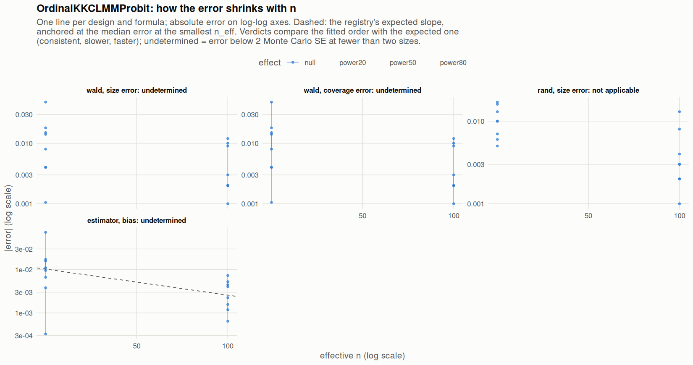

[← Campaign 2026-11-15-e36c7710 summary](README.md)

# Class OrdinalKKCLMMProbit

Part of the [Classes index](classes.md). Response type: ordinal. Status: null effect in progress, power effects in progress. Verdict: **pass so far**.

<picture><source media="(prefers-color-scheme: dark)" srcset="figures/class-OrdinalKKCLMMProbit-dark.png"></picture>

Convergence verdicts (worst over designs, formulas and effects; provisional until the class is complete):

| procedure | metric | verdict |
|---|---|---|
| estimator (bias) | bias | undetermined |
| wald | coverage | undetermined |
| rand | size | not applicable |
| wald | size | undetermined |

Null effect: 32 cells (0 failing). Size, coverage and bias / SD against the level each is held to.

| design | n | formula | procedure | size | coverage | bias / SD | size level | coverage level | verdict |
|---|---|---|---|---|---|---|---|---|---|
| Fixed:BinaryMatch | 50 | `~.` | rand | 0.066 |  | -0.0078 | 0.05 | 0.95 | ok |
| Fixed:BinaryMatch | 200 | `~.` | rand | 0.053 |  | 0.031 | 0.05 | 0.95 | ok |
| Fixed:BinaryMatch | 50 | `~.` | wald | 0.098 | 0.902 | -0.0078 | 0.1 | 0.9 | ok |
| Fixed:BinaryMatch | 200 | `~.` | wald | 0.06 | 0.94 | 0.031 | 0.1 | 0.9 | ok |
| Fixed:BinaryMatch | 50 | `~1` | rand | 0.067 |  | -0.00087 | 0.05 | 0.95 | ok |
| Fixed:BinaryMatch | 200 | `~1` | rand | 0.052 |  | 0.027 | 0.05 | 0.95 | ok |
| Fixed:BinaryMatch | 50 | `~1` | wald | 0.068 | 0.932 | -0.00087 | 0.1 | 0.9 | ok |
| Fixed:BinaryMatch | 200 | `~1` | wald | 0.052 | 0.948 | 0.027 | 0.1 | 0.9 | ok |
| SeqOneByOne:KK14 | 50 | `~.` | rand | 0.056 |  | -0.033 | 0.05 | 0.95 | ok |
| SeqOneByOne:KK14 | 200 | `~.` | rand | 0.046 |  | -0.0092 | 0.05 | 0.95 | ok |
| SeqOneByOne:KK14 | 50 | `~.` | wald | 0.0641 | 0.936 | -0.033 | 0.1 | 0.9 | ok |
| SeqOneByOne:KK14 | 200 | `~.` | wald | 0.052 | 0.948 | -0.0092 | 0.1 | 0.9 | ok |
| SeqOneByOne:KK14 | 50 | `~1` | rand | 0.045 |  | -0.024 | 0.05 | 0.95 | ok |
| SeqOneByOne:KK14 | 200 | `~1` | rand | 0.051 |  | -0.0038 | 0.05 | 0.95 | ok |
| SeqOneByOne:KK14 | 50 | `~1` | wald | 0.042 | 0.958 | -0.024 | 0.1 | 0.9 | ok |
| SeqOneByOne:KK14 | 200 | `~1` | wald | 0.048 | 0.952 | -0.0038 | 0.1 | 0.9 | ok |
| SeqOneByOne:KK21 | 50 | `~.` | rand | 0.037 |  | 0.026 | 0.05 | 0.95 | ok |
| SeqOneByOne:KK21 | 200 | `~.` | rand | 0.047 |  | 0.013 | 0.05 | 0.95 | ok |
| SeqOneByOne:KK21 | 50 | `~.` | wald | 0.054 | 0.946 | 0.026 | 0.1 | 0.9 | ok |
| SeqOneByOne:KK21 | 200 | `~.` | wald | 0.053 | 0.947 | 0.013 | 0.1 | 0.9 | ok |
| SeqOneByOne:KK21 | 50 | `~1` | rand | 0.04 |  | -0.019 | 0.05 | 0.95 | ok |
| SeqOneByOne:KK21 | 200 | `~1` | rand | 0.052 |  | 0.0072 | 0.05 | 0.95 | ok |
| SeqOneByOne:KK21 | 50 | `~1` | wald | 0.035 | 0.965 | -0.019 | 0.1 | 0.9 | ok |
| SeqOneByOne:KK21 | 200 | `~1` | wald | 0.049 | 0.951 | 0.0072 | 0.1 | 0.9 | ok |
| SeqOneByOne:KK21stepwise | 50 | `~.` | rand | 0.04 |  | -0.026 | 0.05 | 0.95 | ok |
| SeqOneByOne:KK21stepwise | 200 | `~.` | rand | 0.037 |  | 0.044 | 0.05 | 0.95 | ok |
| SeqOneByOne:KK21stepwise | 50 | `~.` | wald | 0.0511 | 0.949 | -0.026 | 0.1 | 0.9 | ok |
| SeqOneByOne:KK21stepwise | 200 | `~.` | wald | 0.041 | 0.959 | 0.044 | 0.1 | 0.9 | ok |
| SeqOneByOne:KK21stepwise | 50 | `~1` | rand | 0.057 |  | -0.042 | 0.05 | 0.95 | ok |
| SeqOneByOne:KK21stepwise | 200 | `~1` | rand | 0.042 |  | 0.025 | 0.05 | 0.95 | ok |
| SeqOneByOne:KK21stepwise | 50 | `~1` | wald | 0.046 | 0.954 | -0.042 | 0.1 | 0.9 | ok |
| SeqOneByOne:KK21stepwise | 200 | `~1` | wald | 0.038 | 0.962 | 0.025 | 0.1 | 0.9 | ok |

Power effects: 16 cells (0 failing coverage).

| design | n | effect | formula | procedure | power | coverage of the true estimand | coverage level | verdict |
|---|---|---|---|---|---|---|---|---|
| Fixed:BinaryMatch | 50 | power20 | `~.` | rand | 0.204 |  | 0.95 | ok |
| Fixed:BinaryMatch | 50 | power20 | `~.` | wald | 0.256 |  | 0.9 | ok |
| Fixed:BinaryMatch | 50 | power20 | `~1` | rand | 0.19 |  | 0.95 | ok |
| Fixed:BinaryMatch | 50 | power20 | `~1` | wald | 0.21 |  | 0.9 | ok |
| SeqOneByOne:KK14 | 50 | power20 | `~.` | rand | 0.134 |  | 0.95 | ok |
| SeqOneByOne:KK14 | 50 | power20 | `~.` | wald | 0.182 |  | 0.9 | ok |
| SeqOneByOne:KK14 | 50 | power20 | `~1` | rand | 0.138 |  | 0.95 | ok |
| SeqOneByOne:KK14 | 50 | power20 | `~1` | wald | 0.128 |  | 0.9 | ok |
| SeqOneByOne:KK21 | 50 | power20 | `~.` | rand | 0.146 |  | 0.95 | ok |
| SeqOneByOne:KK21 | 50 | power20 | `~.` | wald | 0.178 |  | 0.9 | ok |
| SeqOneByOne:KK21 | 50 | power20 | `~1` | rand | 0.138 |  | 0.95 | ok |
| SeqOneByOne:KK21 | 50 | power20 | `~1` | wald | 0.148 |  | 0.9 | ok |
| SeqOneByOne:KK21stepwise | 50 | power20 | `~.` | rand | 0.142 |  | 0.95 | ok |
| SeqOneByOne:KK21stepwise | 50 | power20 | `~.` | wald | 0.168 |  | 0.9 | ok |
| SeqOneByOne:KK21stepwise | 50 | power20 | `~1` | rand | 0.126 |  | 0.95 | ok |
| SeqOneByOne:KK21stepwise | 50 | power20 | `~1` | wald | 0.122 |  | 0.9 | ok |

[← Campaign 2026-11-15-e36c7710 summary](README.md)
