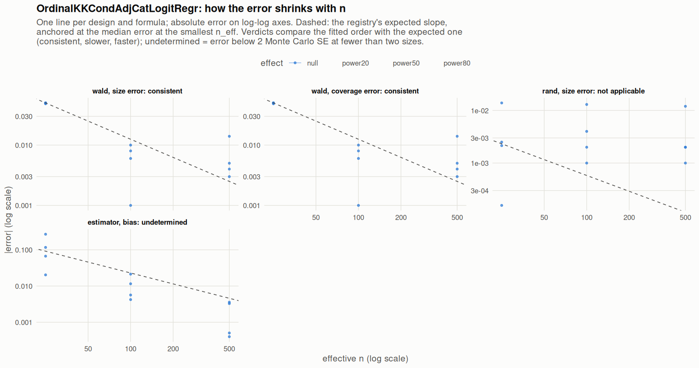

[← Campaign 2026-11-15-e36c7710 summary](README.md)

# Class OrdinalKKCondAdjCatLogitRegr

Part of the [Classes index](classes.md). Response type: ordinal. Status: null effect complete, power effects in progress. Verdict: **pass so far**.

<picture><source media="(prefers-color-scheme: dark)" srcset="figures/class-OrdinalKKCondAdjCatLogitRegr-dark.png"></picture>

Convergence verdicts (worst over designs, formulas and effects; provisional until the class is complete):

| procedure | metric | verdict |
|---|---|---|
| estimator (bias) | bias | undetermined |
| wald | coverage | consistent |
| rand | size | not applicable |
| wald | size | consistent |

Null effect: 48 cells (0 failing). Size, coverage and bias / SD against the level each is held to.

| design | n | formula | procedure | size | coverage | bias / SD | size level | coverage level | verdict |
|---|---|---|---|---|---|---|---|---|---|
| Fixed:BinaryMatch | 50 | `~.` | rand | 0.0525 |  | -0.0082 | 0.05 | 0.95 | ok |
| Fixed:BinaryMatch | 200 | `~.` | rand | 0.063 |  | 0.01 | 0.05 | 0.95 | ok |
| Fixed:BinaryMatch | 1000 | `~.` | rand | 0.048 |  | -0.0024 | 0.05 | 0.95 | ok |
| Fixed:BinaryMatch | 50 | `~.` | wald | 0 | 1 | -0.0082 | 0.1 | 0.9 | ok |
| Fixed:BinaryMatch | 200 | `~.` | wald | 0.06 | 0.94 | 0.01 | 0.075 | 0.925 | ok |
| Fixed:BinaryMatch | 1000 | `~.` | wald | 0.053 | 0.947 | -0.0024 | 0.055 | 0.945 | ok |
| Fixed:BinaryMatch | 50 | `~1` | rand |  |  |  | 0.05 | 0.95 | ok |
| Fixed:BinaryMatch | 200 | `~1` | rand |  |  |  | 0.05 | 0.95 | ok |
| Fixed:BinaryMatch | 1000 | `~1` | rand |  |  |  | 0.05 | 0.95 | ok |
| Fixed:BinaryMatch | 50 | `~1` | wald |  |  |  | 0.1 | 0.9 | ok |
| Fixed:BinaryMatch | 200 | `~1` | wald |  |  |  | 0.075 | 0.925 | ok |
| Fixed:BinaryMatch | 1000 | `~1` | wald |  |  |  | 0.055 | 0.945 | ok |
| SeqOneByOne:KK14 | 50 | `~.` | rand | 0.0361 |  | 0.13 | 0.05 | 0.95 | ok |
| SeqOneByOne:KK14 | 200 | `~.` | rand | 0.048 |  | 0.039 | 0.05 | 0.95 | ok |
| SeqOneByOne:KK14 | 1000 | `~.` | rand | 0.038 |  | -0.022 | 0.05 | 0.95 | ok |
| SeqOneByOne:KK14 | 50 | `~.` | wald | 0 | 1 | 0.13 | 0.1 | 0.9 | ok |
| SeqOneByOne:KK14 | 200 | `~.` | wald | 0.042 | 0.958 | 0.039 | 0.075 | 0.925 | ok |
| SeqOneByOne:KK14 | 1000 | `~.` | wald | 0.036 | 0.964 | -0.022 | 0.055 | 0.945 | ok |
| SeqOneByOne:KK14 | 50 | `~1` | rand |  |  |  | 0.05 | 0.95 | ok |
| SeqOneByOne:KK14 | 200 | `~1` | rand |  |  |  | 0.05 | 0.95 | ok |
| SeqOneByOne:KK14 | 1000 | `~1` | rand |  |  |  | 0.05 | 0.95 | ok |
| SeqOneByOne:KK14 | 50 | `~1` | wald |  |  |  | 0.1 | 0.9 | ok |
| SeqOneByOne:KK14 | 200 | `~1` | wald |  |  |  | 0.075 | 0.925 | ok |
| SeqOneByOne:KK14 | 1000 | `~1` | wald |  |  |  | 0.055 | 0.945 | ok |
| SeqOneByOne:KK21 | 50 | `~.` | rand | 0.0479 |  | 0.05 | 0.05 | 0.95 | ok |
| SeqOneByOne:KK21 | 200 | `~.` | rand | 0.049 |  | 0.0078 | 0.05 | 0.95 | ok |
| SeqOneByOne:KK21 | 1000 | `~.` | rand | 0.049 |  | 0.02 | 0.05 | 0.95 | ok |
| SeqOneByOne:KK21 | 50 | `~.` | wald | 0 | 1 | 0.05 | 0.1 | 0.9 | ok |
| SeqOneByOne:KK21 | 200 | `~.` | wald | 0.049 | 0.951 | 0.0078 | 0.075 | 0.925 | ok |
| SeqOneByOne:KK21 | 1000 | `~.` | wald | 0.045 | 0.955 | 0.02 | 0.055 | 0.945 | ok |
| SeqOneByOne:KK21 | 50 | `~1` | rand |  |  |  | 0.05 | 0.95 | ok |
| SeqOneByOne:KK21 | 200 | `~1` | rand |  |  |  | 0.05 | 0.95 | ok |
| SeqOneByOne:KK21 | 1000 | `~1` | rand |  |  |  | 0.05 | 0.95 | ok |
| SeqOneByOne:KK21 | 50 | `~1` | wald |  |  |  | 0.1 | 0.9 | ok |
| SeqOneByOne:KK21 | 200 | `~1` | wald |  |  |  | 0.075 | 0.925 | ok |
| SeqOneByOne:KK21 | 1000 | `~1` | wald |  |  |  | 0.055 | 0.945 | ok |
| SeqOneByOne:KK21stepwise | 50 | `~.` | rand | 0.0502 |  | 0.026 | 0.05 | 0.95 | ok |
| SeqOneByOne:KK21stepwise | 200 | `~.` | rand | 0.046 |  | 0.022 | 0.05 | 0.95 | ok |
| SeqOneByOne:KK21stepwise | 1000 | `~.` | rand | 0.048 |  | 0.003 | 0.05 | 0.95 | ok |
| SeqOneByOne:KK21stepwise | 50 | `~.` | wald | 0.00157 | 0.998 | 0.026 | 0.1 | 0.9 | ok |
| SeqOneByOne:KK21stepwise | 200 | `~.` | wald | 0.044 | 0.956 | 0.022 | 0.075 | 0.925 | ok |
| SeqOneByOne:KK21stepwise | 1000 | `~.` | wald | 0.054 | 0.946 | 0.003 | 0.055 | 0.945 | ok |
| SeqOneByOne:KK21stepwise | 50 | `~1` | rand |  |  |  | 0.05 | 0.95 | ok |
| SeqOneByOne:KK21stepwise | 200 | `~1` | rand |  |  |  | 0.05 | 0.95 | ok |
| SeqOneByOne:KK21stepwise | 1000 | `~1` | rand |  |  |  | 0.05 | 0.95 | ok |
| SeqOneByOne:KK21stepwise | 50 | `~1` | wald |  |  |  | 0.1 | 0.9 | ok |
| SeqOneByOne:KK21stepwise | 200 | `~1` | wald |  |  |  | 0.075 | 0.925 | ok |
| SeqOneByOne:KK21stepwise | 1000 | `~1` | wald |  |  |  | 0.055 | 0.945 | ok |

Power effects: 32 cells (0 failing coverage).

| design | n | effect | formula | procedure | power | coverage of the true estimand | coverage level | verdict |
|---|---|---|---|---|---|---|---|---|
| Fixed:BinaryMatch | 50 | power20 | `~.` | rand | 0.0494 |  | 0.95 | ok |
| Fixed:BinaryMatch | 200 | power20 | `~.` | rand | 0.094 |  | 0.95 | ok |
| Fixed:BinaryMatch | 50 | power20 | `~.` | wald | 0 |  | 0.9 | ok |
| Fixed:BinaryMatch | 200 | power20 | `~.` | wald | 0.092 |  | 0.925 | ok |
| Fixed:BinaryMatch | 50 | power20 | `~1` | rand |  |  | 0.95 | ok |
| Fixed:BinaryMatch | 200 | power20 | `~1` | rand |  |  | 0.95 | ok |
| Fixed:BinaryMatch | 50 | power20 | `~1` | wald |  |  | 0.9 | ok |
| Fixed:BinaryMatch | 200 | power20 | `~1` | wald |  |  | 0.925 | ok |
| SeqOneByOne:KK14 | 50 | power20 | `~.` | rand | 0.072 |  | 0.95 | ok |
| SeqOneByOne:KK14 | 200 | power20 | `~.` | rand | 0.066 |  | 0.95 | ok |
| SeqOneByOne:KK14 | 50 | power20 | `~.` | wald | 0 |  | 0.9 | ok |
| SeqOneByOne:KK14 | 200 | power20 | `~.` | wald | 0.052 |  | 0.925 | ok |
| SeqOneByOne:KK14 | 50 | power20 | `~1` | rand |  |  | 0.95 | ok |
| SeqOneByOne:KK14 | 200 | power20 | `~1` | rand |  |  | 0.95 | ok |
| SeqOneByOne:KK14 | 50 | power20 | `~1` | wald |  |  | 0.9 | ok |
| SeqOneByOne:KK14 | 200 | power20 | `~1` | wald |  |  | 0.925 | ok |
| SeqOneByOne:KK21 | 50 | power20 | `~.` | rand | 0.0641 |  | 0.95 | ok |
| SeqOneByOne:KK21 | 200 | power20 | `~.` | rand | 0.074 |  | 0.95 | ok |
| SeqOneByOne:KK21 | 50 | power20 | `~.` | wald | 0 |  | 0.9 | ok |
| SeqOneByOne:KK21 | 200 | power20 | `~.` | wald | 0.078 |  | 0.925 | ok |
| SeqOneByOne:KK21 | 50 | power20 | `~1` | rand |  |  | 0.95 | ok |
| SeqOneByOne:KK21 | 200 | power20 | `~1` | rand |  |  | 0.95 | ok |
| SeqOneByOne:KK21 | 50 | power20 | `~1` | wald |  |  | 0.9 | ok |
| SeqOneByOne:KK21 | 200 | power20 | `~1` | wald |  |  | 0.925 | ok |
| SeqOneByOne:KK21stepwise | 50 | power20 | `~.` | rand | 0.0147 |  | 0.95 | ok |
| SeqOneByOne:KK21stepwise | 200 | power20 | `~.` | rand | 0.07 |  | 0.95 | ok |
| SeqOneByOne:KK21stepwise | 50 | power20 | `~.` | wald | 0 |  | 0.9 | ok |
| SeqOneByOne:KK21stepwise | 200 | power20 | `~.` | wald | 0.078 |  | 0.925 | ok |
| SeqOneByOne:KK21stepwise | 50 | power20 | `~1` | rand |  |  | 0.95 | ok |
| SeqOneByOne:KK21stepwise | 200 | power20 | `~1` | rand |  |  | 0.95 | ok |
| SeqOneByOne:KK21stepwise | 50 | power20 | `~1` | wald |  |  | 0.9 | ok |
| SeqOneByOne:KK21stepwise | 200 | power20 | `~1` | wald |  |  | 0.925 | ok |

[← Campaign 2026-11-15-e36c7710 summary](README.md)
