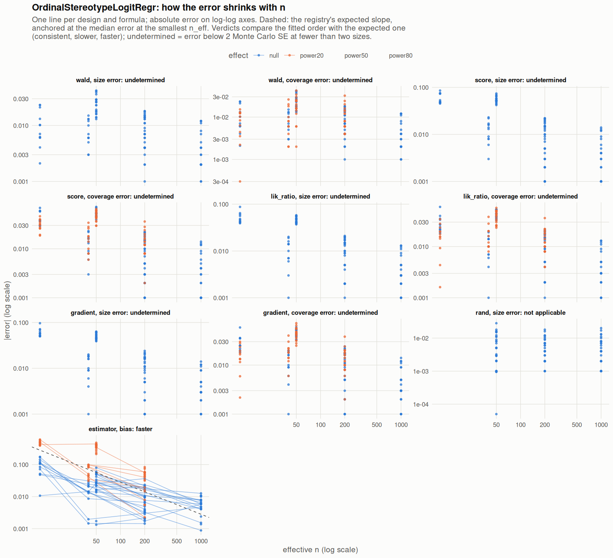

[← Campaign 2026-11-15-e36c7710 summary](README.md)

# Class OrdinalStereotypeLogitRegr

Part of the [Classes index](classes.md). Response type: ordinal. Status: null effect complete, power effects in progress. Verdict: **pass so far** (4 flagged test(s): 0 failing, 0 pending, 4 cleared).

<picture><source media="(prefers-color-scheme: dark)" srcset="figures/class-OrdinalStereotypeLogitRegr-dark.png"></picture>

Convergence verdicts (worst over designs, formulas and effects; provisional until the class is complete):

| procedure | metric | verdict |
|---|---|---|
| estimator (bias) | bias | faster |
| gradient | coverage | undetermined |
| lik_ratio | coverage | undetermined |
| score | coverage | undetermined |
| wald | coverage | undetermined |
| gradient | size | undetermined |
| lik_ratio | size | undetermined |
| rand | size | not applicable |
| score | size | undetermined |
| wald | size | undetermined |

Null effect: 978 cells (0 failing). Size, coverage and bias / SD against the level each is held to.

| design | n | formula | procedure | size | coverage | bias / SD | size level | coverage level | verdict |
|---|---|---|---|---|---|---|---|---|---|
| Fixed:Bernoulli | 50 | `~.` | gradient | 0.102 | 0.911 | 0.0096 | 0.1 | 0.9 | ok |
| Fixed:Bernoulli | 200 | `~.` | gradient | 0.074 | 0.926 | 0.022 | 0.1 | 0.9 | ok |
| Fixed:Bernoulli | 1000 | `~.` | gradient | 0.052 | 0.948 | -0.054 | 0.0525 | 0.948 | ok |
| Fixed:Bernoulli | 50 | `~.` | lik_ratio | 0.0992 | 0.91 | 0.0096 | 0.1 | 0.9 | ok |
| Fixed:Bernoulli | 200 | `~.` | lik_ratio | 0.071 | 0.929 | 0.022 | 0.1 | 0.9 | ok |
| Fixed:Bernoulli | 1000 | `~.` | lik_ratio | 0.052 | 0.948 | -0.054 | 0.0525 | 0.948 | ok |
| Fixed:Bernoulli | 50 | `~.` | rand | 0.0551 |  | 0.0096 | 0.05 | 0.95 | ok |
| Fixed:Bernoulli | 200 | `~.` | rand | 0.062 |  | 0.022 | 0.05 | 0.95 | ok |
| Fixed:Bernoulli | 1000 | `~.` | rand | 0.046 |  | -0.054 | 0.05 | 0.95 | ok |
| Fixed:Bernoulli | 50 | `~.` | score | 0.102 | 0.902 | 0.0096 | 0.1 | 0.9 | ok |
| Fixed:Bernoulli | 200 | `~.` | score | 0.072 | 0.928 | 0.022 | 0.1 | 0.9 | ok |
| Fixed:Bernoulli | 1000 | `~.` | score | 0.051 | 0.949 | -0.054 | 0.0525 | 0.948 | ok |
| Fixed:Bernoulli | 50 | `~.` | wald | 0.0691 | 0.931 | 0.0096 | 0.1 | 0.9 | ok |
| Fixed:Bernoulli | 200 | `~.` | wald | 0.068 | 0.932 | 0.022 | 0.1 | 0.9 | ok |
| Fixed:Bernoulli | 1000 | `~.` | wald | 0.051 | 0.949 | -0.054 | 0.0525 | 0.948 | ok |
| Fixed:Bernoulli | 50 | `~1` | gradient |  |  |  | 0.1 | 0.9 | ok |
| Fixed:Bernoulli | 200 | `~1` | gradient |  |  |  | 0.1 | 0.9 | ok |
| Fixed:Bernoulli | 1000 | `~1` | gradient |  |  |  | 0.0525 | 0.948 | ok |
| Fixed:Bernoulli | 50 | `~1` | lik_ratio |  |  |  | 0.1 | 0.9 | ok |
| Fixed:Bernoulli | 200 | `~1` | lik_ratio |  |  |  | 0.1 | 0.9 | ok |
| Fixed:Bernoulli | 1000 | `~1` | lik_ratio |  |  |  | 0.0525 | 0.948 | ok |
| Fixed:Bernoulli | 50 | `~1` | rand |  |  |  | 0.05 | 0.95 | ok |
| Fixed:Bernoulli | 200 | `~1` | rand |  |  |  | 0.05 | 0.95 | ok |
| Fixed:Bernoulli | 1000 | `~1` | rand |  |  |  | 0.05 | 0.95 | ok |
| Fixed:Bernoulli | 50 | `~1` | score |  |  |  | 0.1 | 0.9 | ok |
| Fixed:Bernoulli | 200 | `~1` | score |  |  |  | 0.1 | 0.9 | ok |
| Fixed:Bernoulli | 1000 | `~1` | score |  |  |  | 0.0525 | 0.948 | ok |
| Fixed:Bernoulli | 50 | `~1` | wald |  |  |  | 0.1 | 0.9 | ok |
| Fixed:Bernoulli | 200 | `~1` | wald |  |  |  | 0.1 | 0.9 | ok |
| Fixed:Bernoulli | 1000 | `~1` | wald |  |  |  | 0.0525 | 0.948 | ok |
| Fixed:Bernoulli@0.2 | 50 | `~.` | gradient | 0.113 | 0.932 | 0.043 | 0.1 | 0.9 | ok |
| Fixed:Bernoulli@0.2 | 200 | `~.` | gradient | 0.066 | 0.934 | 0.038 | 0.1 | 0.9 | ok |
| Fixed:Bernoulli@0.2 | 1000 | `~.` | gradient | 0.055 | 0.945 | 0.018 | 0.0625 | 0.938 | ok |
| Fixed:Bernoulli@0.2 | 50 | `~.` | lik_ratio | 0.0942 | 0.932 | 0.043 | 0.1 | 0.9 | ok |
| Fixed:Bernoulli@0.2 | 200 | `~.` | lik_ratio | 0.064 | 0.936 | 0.038 | 0.1 | 0.9 | ok |
| Fixed:Bernoulli@0.2 | 1000 | `~.` | lik_ratio | 0.055 | 0.945 | 0.018 | 0.0625 | 0.938 | ok |
| Fixed:Bernoulli@0.2 | 50 | `~.` | rand | 0.0471 |  | 0.043 | 0.05 | 0.95 | ok |
| Fixed:Bernoulli@0.2 | 200 | `~.` | rand | 0.048 |  | 0.038 | 0.05 | 0.95 | ok |
| Fixed:Bernoulli@0.2 | 1000 | `~.` | rand | 0.054 |  | 0.018 | 0.05 | 0.95 | ok |
| Fixed:Bernoulli@0.2 | 50 | `~.` | score | 0.1 | 0.921 | 0.043 | 0.1 | 0.9 | ok |
| Fixed:Bernoulli@0.2 | 200 | `~.` | score | 0.067 | 0.933 | 0.038 | 0.1 | 0.9 | ok |
| Fixed:Bernoulli@0.2 | 1000 | `~.` | score | 0.055 | 0.945 | 0.018 | 0.0625 | 0.938 | ok |
| Fixed:Bernoulli@0.2 | 50 | `~.` | wald | 0.0521 | 0.948 | 0.043 | 0.1 | 0.9 | ok |
| Fixed:Bernoulli@0.2 | 200 | `~.` | wald | 0.063 | 0.937 | 0.038 | 0.1 | 0.9 | ok |
| Fixed:Bernoulli@0.2 | 1000 | `~.` | wald | 0.054 | 0.946 | 0.018 | 0.0625 | 0.938 | ok |
| Fixed:Bernoulli@0.2 | 50 | `~1` | gradient |  |  |  | 0.1 | 0.9 | ok |
| Fixed:Bernoulli@0.2 | 200 | `~1` | gradient |  |  |  | 0.1 | 0.9 | ok |
| Fixed:Bernoulli@0.2 | 1000 | `~1` | gradient |  |  |  | 0.0625 | 0.938 | ok |
| Fixed:Bernoulli@0.2 | 50 | `~1` | lik_ratio |  |  |  | 0.1 | 0.9 | ok |
| Fixed:Bernoulli@0.2 | 200 | `~1` | lik_ratio |  |  |  | 0.1 | 0.9 | ok |
| Fixed:Bernoulli@0.2 | 1000 | `~1` | lik_ratio |  |  |  | 0.0625 | 0.938 | ok |
| Fixed:Bernoulli@0.2 | 50 | `~1` | rand |  |  |  | 0.05 | 0.95 | ok |
| Fixed:Bernoulli@0.2 | 200 | `~1` | rand |  |  |  | 0.05 | 0.95 | ok |
| Fixed:Bernoulli@0.2 | 1000 | `~1` | rand |  |  |  | 0.05 | 0.95 | ok |
| Fixed:Bernoulli@0.2 | 50 | `~1` | score |  |  |  | 0.1 | 0.9 | ok |
| Fixed:Bernoulli@0.2 | 200 | `~1` | score |  |  |  | 0.1 | 0.9 | ok |
| Fixed:Bernoulli@0.2 | 1000 | `~1` | score |  |  |  | 0.0625 | 0.938 | ok |
| Fixed:Bernoulli@0.2 | 50 | `~1` | wald |  |  |  | 0.1 | 0.9 | ok |
| Fixed:Bernoulli@0.2 | 200 | `~1` | wald |  |  |  | 0.1 | 0.9 | ok |
| Fixed:Bernoulli@0.2 | 1000 | `~1` | wald |  |  |  | 0.0625 | 0.938 | ok |
| Fixed:BinaryMatch | 50 | `~.` | gradient | 0.11 | 0.895 | 0.011 | 0.1 | 0.9 | ok |
| Fixed:BinaryMatch | 200 | `~.` | gradient | 0.061 | 0.939 | 0.036 | 0.1 | 0.9 | ok |
| Fixed:BinaryMatch | 1000 | `~.` | gradient | 0.064 | 0.936 | 0.0074 | 0.0525 | 0.948 | ok |
| Fixed:BinaryMatch | 50 | `~.` | lik_ratio | 0.105 | 0.898 | 0.011 | 0.1 | 0.9 | ok |
| Fixed:BinaryMatch | 200 | `~.` | lik_ratio | 0.06 | 0.94 | 0.036 | 0.1 | 0.9 | ok |
| Fixed:BinaryMatch | 1000 | `~.` | lik_ratio | 0.063 | 0.937 | 0.0074 | 0.0525 | 0.948 | ok |
| Fixed:BinaryMatch | 50 | `~.` | rand | 0.068 |  | 0.011 | 0.05 | 0.95 | ok |
| Fixed:BinaryMatch | 200 | `~.` | rand | 0.059 |  | 0.036 | 0.05 | 0.95 | ok |
| Fixed:BinaryMatch | 1000 | `~.` | rand | 0.063 |  | 0.0074 | 0.05 | 0.95 | ok |
| Fixed:BinaryMatch | 50 | `~.` | score | 0.116 | 0.889 | 0.011 | 0.1 | 0.9 | ok |
| Fixed:BinaryMatch | 200 | `~.` | score | 0.06 | 0.94 | 0.036 | 0.1 | 0.9 | ok |
| Fixed:BinaryMatch | 1000 | `~.` | score | 0.062 | 0.938 | 0.0074 | 0.0525 | 0.948 | ok |
| Fixed:BinaryMatch | 50 | `~.` | wald | 0.089 | 0.911 | 0.011 | 0.1 | 0.9 | ok |
| Fixed:BinaryMatch | 200 | `~.` | wald | 0.058 | 0.942 | 0.036 | 0.1 | 0.9 | ok |
| Fixed:BinaryMatch | 1000 | `~.` | wald | 0.062 | 0.938 | 0.0074 | 0.0525 | 0.948 | ok |
| Fixed:BinaryMatch | 50 | `~1` | gradient |  |  |  | 0.1 | 0.9 | ok |
| Fixed:BinaryMatch | 200 | `~1` | gradient |  |  |  | 0.1 | 0.9 | ok |
| Fixed:BinaryMatch | 1000 | `~1` | gradient |  |  |  | 0.0525 | 0.948 | ok |
| Fixed:BinaryMatch | 50 | `~1` | lik_ratio |  |  |  | 0.1 | 0.9 | ok |
| Fixed:BinaryMatch | 200 | `~1` | lik_ratio |  |  |  | 0.1 | 0.9 | ok |
| Fixed:BinaryMatch | 1000 | `~1` | lik_ratio |  |  |  | 0.0525 | 0.948 | ok |
| Fixed:BinaryMatch | 50 | `~1` | rand |  |  |  | 0.05 | 0.95 | ok |
| Fixed:BinaryMatch | 200 | `~1` | rand |  |  |  | 0.05 | 0.95 | ok |
| Fixed:BinaryMatch | 1000 | `~1` | rand |  |  |  | 0.05 | 0.95 | ok |
| Fixed:BinaryMatch | 50 | `~1` | score |  |  |  | 0.1 | 0.9 | ok |
| Fixed:BinaryMatch | 200 | `~1` | score |  |  |  | 0.1 | 0.9 | ok |
| Fixed:BinaryMatch | 1000 | `~1` | score |  |  |  | 0.0525 | 0.948 | ok |
| Fixed:BinaryMatch | 50 | `~1` | wald |  |  |  | 0.1 | 0.9 | ok |
| Fixed:BinaryMatch | 200 | `~1` | wald |  |  |  | 0.1 | 0.9 | ok |
| Fixed:BinaryMatch | 1000 | `~1` | wald |  |  |  | 0.0525 | 0.948 | ok |
| Fixed:Blocking | 50 | `~.` | gradient | 0.092 | 0.911 | -0.001 | 0.1 | 0.9 | ok |
| Fixed:Blocking | 200 | `~.` | gradient | 0.051 | 0.949 | 0.0039 | 0.1 | 0.9 | ok |
| Fixed:Blocking | 1000 | `~.` | gradient | 0.045 | 0.955 | -0.033 | 0.0525 | 0.948 | ok |
| Fixed:Blocking | 50 | `~.` | lik_ratio | 0.091 | 0.912 | -0.001 | 0.1 | 0.9 | ok |
| Fixed:Blocking | 200 | `~.` | lik_ratio | 0.05 | 0.95 | 0.0039 | 0.1 | 0.9 | ok |
| Fixed:Blocking | 1000 | `~.` | lik_ratio | 0.045 | 0.955 | -0.033 | 0.0525 | 0.948 | ok |
| Fixed:Blocking | 50 | `~.` | rand | 0.042 |  | -0.001 | 0.05 | 0.95 | ok |
| Fixed:Blocking | 200 | `~.` | rand | 0.043 |  | 0.0039 | 0.05 | 0.95 | ok |
| Fixed:Blocking | 1000 | `~.` | rand | 0.047 |  | -0.033 | 0.05 | 0.95 | ok |
| Fixed:Blocking | 50 | `~.` | score | 0.101 | 0.904 | -0.001 | 0.1 | 0.9 | ok |
| Fixed:Blocking | 200 | `~.` | score | 0.052 | 0.948 | 0.0039 | 0.1 | 0.9 | ok |
| Fixed:Blocking | 1000 | `~.` | score | 0.046 | 0.954 | -0.033 | 0.0525 | 0.948 | ok |
| Fixed:Blocking | 50 | `~.` | wald | 0.066 | 0.934 | -0.001 | 0.1 | 0.9 | ok |
| Fixed:Blocking | 200 | `~.` | wald | 0.049 | 0.951 | 0.0039 | 0.1 | 0.9 | ok |
| Fixed:Blocking | 1000 | `~.` | wald | 0.046 | 0.954 | -0.033 | 0.0525 | 0.948 | ok |
| Fixed:Blocking | 50 | `~1` | gradient |  |  |  | 0.1 | 0.9 | ok |
| Fixed:Blocking | 200 | `~1` | gradient |  |  |  | 0.1 | 0.9 | ok |
| Fixed:Blocking | 1000 | `~1` | gradient |  |  |  | 0.0525 | 0.948 | ok |
| Fixed:Blocking | 50 | `~1` | lik_ratio |  |  |  | 0.1 | 0.9 | ok |
| Fixed:Blocking | 200 | `~1` | lik_ratio |  |  |  | 0.1 | 0.9 | ok |
| Fixed:Blocking | 1000 | `~1` | lik_ratio |  |  |  | 0.0525 | 0.948 | ok |
| Fixed:Blocking | 50 | `~1` | rand |  |  |  | 0.05 | 0.95 | ok |
| Fixed:Blocking | 200 | `~1` | rand |  |  |  | 0.05 | 0.95 | ok |
| Fixed:Blocking | 1000 | `~1` | rand |  |  |  | 0.05 | 0.95 | ok |
| Fixed:Blocking | 50 | `~1` | score |  |  |  | 0.1 | 0.9 | ok |
| Fixed:Blocking | 200 | `~1` | score |  |  |  | 0.1 | 0.9 | ok |
| Fixed:Blocking | 1000 | `~1` | score |  |  |  | 0.0525 | 0.948 | ok |
| Fixed:Blocking | 50 | `~1` | wald |  |  |  | 0.1 | 0.9 | ok |
| Fixed:Blocking | 200 | `~1` | wald |  |  |  | 0.1 | 0.9 | ok |
| Fixed:Blocking | 1000 | `~1` | wald |  |  |  | 0.0525 | 0.948 | ok |
| Fixed:Blocking@0.2 | 50 | `~.` | gradient | 0.1 | 0.925 | 0.029 | 0.1 | 0.9 | ok |
| Fixed:Blocking@0.2 | 200 | `~.` | gradient | 0.056 | 0.944 | -0.055 | 0.1 | 0.9 | ok |
| Fixed:Blocking@0.2 | 1000 | `~.` | gradient | 0.064 | 0.936 | 0.0091 | 0.0625 | 0.938 | ok |
| Fixed:Blocking@0.2 | 50 | `~.` | lik_ratio | 0.0891 | 0.928 | 0.029 | 0.1 | 0.9 | ok |
| Fixed:Blocking@0.2 | 200 | `~.` | lik_ratio | 0.056 | 0.944 | -0.055 | 0.1 | 0.9 | ok |
| Fixed:Blocking@0.2 | 1000 | `~.` | lik_ratio | 0.064 | 0.936 | 0.0091 | 0.0625 | 0.938 | ok |
| Fixed:Blocking@0.2 | 50 | `~.` | rand | 0.0521 |  | 0.029 | 0.05 | 0.95 | ok |
| Fixed:Blocking@0.2 | 200 | `~.` | rand | 0.046 |  | -0.055 | 0.05 | 0.95 | ok |
| Fixed:Blocking@0.2 | 1000 | `~.` | rand | 0.067 |  | 0.0091 | 0.05 | 0.95 | ok |
| Fixed:Blocking@0.2 | 50 | `~.` | score | 0.0981 | 0.913 | 0.029 | 0.1 | 0.9 | ok |
| Fixed:Blocking@0.2 | 200 | `~.` | score | 0.059 | 0.941 | -0.055 | 0.1 | 0.9 | ok |
| Fixed:Blocking@0.2 | 1000 | `~.` | score | 0.064 | 0.936 | 0.0091 | 0.0625 | 0.938 | ok |
| Fixed:Blocking@0.2 | 50 | `~.` | wald | 0.0571 | 0.943 | 0.029 | 0.1 | 0.9 | ok |
| Fixed:Blocking@0.2 | 200 | `~.` | wald | 0.053 | 0.947 | -0.055 | 0.1 | 0.9 | ok |
| Fixed:Blocking@0.2 | 1000 | `~.` | wald | 0.063 | 0.937 | 0.0091 | 0.0625 | 0.938 | ok |
| Fixed:Blocking@0.2 | 50 | `~1` | gradient |  |  |  | 0.1 | 0.9 | ok |
| Fixed:Blocking@0.2 | 200 | `~1` | gradient |  |  |  | 0.1 | 0.9 | ok |
| Fixed:Blocking@0.2 | 1000 | `~1` | gradient |  |  |  | 0.0625 | 0.938 | ok |
| Fixed:Blocking@0.2 | 50 | `~1` | lik_ratio |  |  |  | 0.1 | 0.9 | ok |
| Fixed:Blocking@0.2 | 200 | `~1` | lik_ratio |  |  |  | 0.1 | 0.9 | ok |
| Fixed:Blocking@0.2 | 1000 | `~1` | lik_ratio |  |  |  | 0.0625 | 0.938 | ok |
| Fixed:Blocking@0.2 | 50 | `~1` | rand |  |  |  | 0.05 | 0.95 | ok |
| Fixed:Blocking@0.2 | 200 | `~1` | rand |  |  |  | 0.05 | 0.95 | ok |
| Fixed:Blocking@0.2 | 1000 | `~1` | rand |  |  |  | 0.05 | 0.95 | ok |
| Fixed:Blocking@0.2 | 50 | `~1` | score |  |  |  | 0.1 | 0.9 | ok |
| Fixed:Blocking@0.2 | 200 | `~1` | score |  |  |  | 0.1 | 0.9 | ok |
| Fixed:Blocking@0.2 | 1000 | `~1` | score |  |  |  | 0.0625 | 0.938 | ok |
| Fixed:Blocking@0.2 | 50 | `~1` | wald |  |  |  | 0.1 | 0.9 | ok |
| Fixed:Blocking@0.2 | 200 | `~1` | wald |  |  |  | 0.1 | 0.9 | ok |
| Fixed:Blocking@0.2 | 1000 | `~1` | wald |  |  |  | 0.0625 | 0.938 | ok |
| Fixed:Greedy | 50 | `~.` | gradient | 0.104 | 0.903 | 0.021 | 0.1 | 0.9 | ok |
| Fixed:Greedy | 200 | `~.` | gradient | 0.067 | 0.933 | -0.043 | 0.1 | 0.9 | ok |
| Fixed:Greedy | 1000 | `~.` | gradient | 0.053 | 0.947 | -0.022 | 0.0525 | 0.948 | ok |
| Fixed:Greedy | 50 | `~.` | lik_ratio | 0.098 | 0.906 | 0.021 | 0.1 | 0.9 | ok |
| Fixed:Greedy | 200 | `~.` | lik_ratio | 0.065 | 0.935 | -0.043 | 0.1 | 0.9 | ok |
| Fixed:Greedy | 1000 | `~.` | lik_ratio | 0.053 | 0.947 | -0.022 | 0.0525 | 0.948 | ok |
| Fixed:Greedy | 50 | `~.` | rand | 0.049 |  | 0.021 | 0.05 | 0.95 | ok |
| Fixed:Greedy | 200 | `~.` | rand | 0.054 |  | -0.043 | 0.05 | 0.95 | ok |
| Fixed:Greedy | 1000 | `~.` | rand | 0.051 |  | -0.022 | 0.05 | 0.95 | ok |
| Fixed:Greedy | 50 | `~.` | score | 0.102 | 0.897 | 0.021 | 0.1 | 0.9 | ok |
| Fixed:Greedy | 200 | `~.` | score | 0.065 | 0.935 | -0.043 | 0.1 | 0.9 | ok |
| Fixed:Greedy | 1000 | `~.` | score | 0.052 | 0.948 | -0.022 | 0.0525 | 0.948 | ok |
| Fixed:Greedy | 50 | `~.` | wald | 0.079 | 0.921 | 0.021 | 0.1 | 0.9 | ok |
| Fixed:Greedy | 200 | `~.` | wald | 0.064 | 0.936 | -0.043 | 0.1 | 0.9 | ok |
| Fixed:Greedy | 1000 | `~.` | wald | 0.052 | 0.948 | -0.022 | 0.0525 | 0.948 | ok |
| Fixed:Greedy | 50 | `~1` | gradient |  |  |  | 0.1 | 0.9 | ok |
| Fixed:Greedy | 200 | `~1` | gradient |  |  |  | 0.1 | 0.9 | ok |
| Fixed:Greedy | 1000 | `~1` | gradient |  |  |  | 0.0525 | 0.948 | ok |
| Fixed:Greedy | 50 | `~1` | lik_ratio |  |  |  | 0.1 | 0.9 | ok |
| Fixed:Greedy | 200 | `~1` | lik_ratio |  |  |  | 0.1 | 0.9 | ok |
| Fixed:Greedy | 1000 | `~1` | lik_ratio |  |  |  | 0.0525 | 0.948 | ok |
| Fixed:Greedy | 50 | `~1` | rand |  |  |  | 0.05 | 0.95 | ok |
| Fixed:Greedy | 200 | `~1` | rand |  |  |  | 0.05 | 0.95 | ok |
| Fixed:Greedy | 1000 | `~1` | rand |  |  |  | 0.05 | 0.95 | ok |
| Fixed:Greedy | 50 | `~1` | score |  |  |  | 0.1 | 0.9 | ok |
| Fixed:Greedy | 200 | `~1` | score |  |  |  | 0.1 | 0.9 | ok |
| Fixed:Greedy | 1000 | `~1` | score |  |  |  | 0.0525 | 0.948 | ok |
| Fixed:Greedy | 50 | `~1` | wald |  |  |  | 0.1 | 0.9 | ok |
| Fixed:Greedy | 200 | `~1` | wald |  |  |  | 0.1 | 0.9 | ok |
| Fixed:Greedy | 1000 | `~1` | wald |  |  |  | 0.0525 | 0.948 | ok |
| Fixed:Greedy@0.2 | 50 | `~.` | gradient | 0.1 | 0.925 | 0.061 | 0.1 | 0.9 | ok |
| Fixed:Greedy@0.2 | 200 | `~.` | gradient | 0.059 | 0.941 | 0.025 | 0.1 | 0.9 | ok |
| Fixed:Greedy@0.2 | 1000 | `~.` | gradient | 0.05 | 0.95 | -0.0091 | 0.0625 | 0.938 | ok |
| Fixed:Greedy@0.2 | 50 | `~.` | lik_ratio | 0.0921 | 0.923 | 0.061 | 0.1 | 0.9 | ok |
| Fixed:Greedy@0.2 | 200 | `~.` | lik_ratio | 0.057 | 0.943 | 0.025 | 0.1 | 0.9 | ok |
| Fixed:Greedy@0.2 | 1000 | `~.` | lik_ratio | 0.05 | 0.95 | -0.0091 | 0.0625 | 0.938 | ok |
| Fixed:Greedy@0.2 | 50 | `~.` | rand | 0.049 |  | 0.061 | 0.05 | 0.95 | ok |
| Fixed:Greedy@0.2 | 200 | `~.` | rand | 0.048 |  | 0.025 | 0.05 | 0.95 | ok |
| Fixed:Greedy@0.2 | 1000 | `~.` | rand | 0.048 |  | -0.0091 | 0.05 | 0.95 | ok |
| Fixed:Greedy@0.2 | 50 | `~.` | score | 0.0971 | 0.912 | 0.061 | 0.1 | 0.9 | ok |
| Fixed:Greedy@0.2 | 200 | `~.` | score | 0.058 | 0.942 | 0.025 | 0.1 | 0.9 | ok |
| Fixed:Greedy@0.2 | 1000 | `~.` | score | 0.051 | 0.949 | -0.0091 | 0.0625 | 0.938 | ok |
| Fixed:Greedy@0.2 | 50 | `~.` | wald | 0.0561 | 0.944 | 0.061 | 0.1 | 0.9 | ok |
| Fixed:Greedy@0.2 | 200 | `~.` | wald | 0.056 | 0.944 | 0.025 | 0.1 | 0.9 | ok |
| Fixed:Greedy@0.2 | 1000 | `~.` | wald | 0.05 | 0.95 | -0.0091 | 0.0625 | 0.938 | ok |
| Fixed:Greedy@0.2 | 50 | `~1` | gradient |  |  |  | 0.1 | 0.9 | ok |
| Fixed:Greedy@0.2 | 200 | `~1` | gradient |  |  |  | 0.1 | 0.9 | ok |
| Fixed:Greedy@0.2 | 1000 | `~1` | gradient |  |  |  | 0.0625 | 0.938 | ok |
| Fixed:Greedy@0.2 | 50 | `~1` | lik_ratio |  |  |  | 0.1 | 0.9 | ok |
| Fixed:Greedy@0.2 | 200 | `~1` | lik_ratio |  |  |  | 0.1 | 0.9 | ok |
| Fixed:Greedy@0.2 | 1000 | `~1` | lik_ratio |  |  |  | 0.0625 | 0.938 | ok |
| Fixed:Greedy@0.2 | 50 | `~1` | rand |  |  |  | 0.05 | 0.95 | ok |
| Fixed:Greedy@0.2 | 200 | `~1` | rand |  |  |  | 0.05 | 0.95 | ok |
| Fixed:Greedy@0.2 | 1000 | `~1` | rand |  |  |  | 0.05 | 0.95 | ok |
| Fixed:Greedy@0.2 | 50 | `~1` | score |  |  |  | 0.1 | 0.9 | ok |
| Fixed:Greedy@0.2 | 200 | `~1` | score |  |  |  | 0.1 | 0.9 | ok |
| Fixed:Greedy@0.2 | 1000 | `~1` | score |  |  |  | 0.0625 | 0.938 | ok |
| Fixed:Greedy@0.2 | 50 | `~1` | wald |  |  |  | 0.1 | 0.9 | ok |
| Fixed:Greedy@0.2 | 200 | `~1` | wald |  |  |  | 0.1 | 0.9 | ok |
| Fixed:Greedy@0.2 | 1000 | `~1` | wald |  |  |  | 0.0625 | 0.938 | ok |
| Fixed:GreedyDOptimal | 50 | `~.` | gradient | 0.104 | 0.903 | 0.021 | 0.1 | 0.9 | ok |
| Fixed:GreedyDOptimal | 200 | `~.` | gradient | 0.067 | 0.933 | -0.043 | 0.1 | 0.9 | ok |
| Fixed:GreedyDOptimal | 1000 | `~.` | gradient | 0.053 | 0.947 | -0.022 | 0.0525 | 0.948 | ok |
| Fixed:GreedyDOptimal | 50 | `~.` | lik_ratio | 0.098 | 0.906 | 0.021 | 0.1 | 0.9 | ok |
| Fixed:GreedyDOptimal | 200 | `~.` | lik_ratio | 0.065 | 0.935 | -0.043 | 0.1 | 0.9 | ok |
| Fixed:GreedyDOptimal | 1000 | `~.` | lik_ratio | 0.053 | 0.947 | -0.022 | 0.0525 | 0.948 | ok |
| Fixed:GreedyDOptimal | 50 | `~.` | rand | 0.049 |  | 0.021 | 0.05 | 0.95 | ok |
| Fixed:GreedyDOptimal | 200 | `~.` | rand | 0.054 |  | -0.043 | 0.05 | 0.95 | ok |
| Fixed:GreedyDOptimal | 1000 | `~.` | rand | 0.051 |  | -0.022 | 0.05 | 0.95 | ok |
| Fixed:GreedyDOptimal | 50 | `~.` | score | 0.102 | 0.897 | 0.021 | 0.1 | 0.9 | ok |
| Fixed:GreedyDOptimal | 200 | `~.` | score | 0.065 | 0.935 | -0.043 | 0.1 | 0.9 | ok |
| Fixed:GreedyDOptimal | 1000 | `~.` | score | 0.052 | 0.948 | -0.022 | 0.0525 | 0.948 | ok |
| Fixed:GreedyDOptimal | 50 | `~.` | wald | 0.079 | 0.921 | 0.021 | 0.1 | 0.9 | ok |
| Fixed:GreedyDOptimal | 200 | `~.` | wald | 0.064 | 0.936 | -0.043 | 0.1 | 0.9 | ok |
| Fixed:GreedyDOptimal | 1000 | `~.` | wald | 0.052 | 0.948 | -0.022 | 0.0525 | 0.948 | ok |
| Fixed:GreedyDOptimal | 50 | `~1` | gradient |  |  |  | 0.1 | 0.9 | ok |
| Fixed:GreedyDOptimal | 200 | `~1` | gradient |  |  |  | 0.1 | 0.9 | ok |
| Fixed:GreedyDOptimal | 1000 | `~1` | gradient |  |  |  | 0.0525 | 0.948 | ok |
| Fixed:GreedyDOptimal | 50 | `~1` | lik_ratio |  |  |  | 0.1 | 0.9 | ok |
| Fixed:GreedyDOptimal | 200 | `~1` | lik_ratio |  |  |  | 0.1 | 0.9 | ok |
| Fixed:GreedyDOptimal | 1000 | `~1` | lik_ratio |  |  |  | 0.0525 | 0.948 | ok |
| Fixed:GreedyDOptimal | 50 | `~1` | rand |  |  |  | 0.05 | 0.95 | ok |
| Fixed:GreedyDOptimal | 200 | `~1` | rand |  |  |  | 0.05 | 0.95 | ok |
| Fixed:GreedyDOptimal | 1000 | `~1` | rand |  |  |  | 0.05 | 0.95 | ok |
| Fixed:GreedyDOptimal | 50 | `~1` | score |  |  |  | 0.1 | 0.9 | ok |
| Fixed:GreedyDOptimal | 200 | `~1` | score |  |  |  | 0.1 | 0.9 | ok |
| Fixed:GreedyDOptimal | 1000 | `~1` | score |  |  |  | 0.0525 | 0.948 | ok |
| Fixed:GreedyDOptimal | 50 | `~1` | wald |  |  |  | 0.1 | 0.9 | ok |
| Fixed:GreedyDOptimal | 200 | `~1` | wald |  |  |  | 0.1 | 0.9 | ok |
| Fixed:GreedyDOptimal | 1000 | `~1` | wald |  |  |  | 0.0525 | 0.948 | ok |
| Fixed:GreedyDOptimal@0.2 | 50 | `~.` | gradient | 0.1 | 0.925 | 0.061 | 0.1 | 0.9 | ok |
| Fixed:GreedyDOptimal@0.2 | 200 | `~.` | gradient | 0.059 | 0.941 | 0.025 | 0.1 | 0.9 | ok |
| Fixed:GreedyDOptimal@0.2 | 1000 | `~.` | gradient | 0.05 | 0.95 | -0.0091 | 0.0625 | 0.938 | ok |
| Fixed:GreedyDOptimal@0.2 | 50 | `~.` | lik_ratio | 0.0921 | 0.923 | 0.061 | 0.1 | 0.9 | ok |
| Fixed:GreedyDOptimal@0.2 | 200 | `~.` | lik_ratio | 0.057 | 0.943 | 0.025 | 0.1 | 0.9 | ok |
| Fixed:GreedyDOptimal@0.2 | 1000 | `~.` | lik_ratio | 0.05 | 0.95 | -0.0091 | 0.0625 | 0.938 | ok |
| Fixed:GreedyDOptimal@0.2 | 50 | `~.` | rand | 0.049 |  | 0.061 | 0.05 | 0.95 | ok |
| Fixed:GreedyDOptimal@0.2 | 200 | `~.` | rand | 0.048 |  | 0.025 | 0.05 | 0.95 | ok |
| Fixed:GreedyDOptimal@0.2 | 1000 | `~.` | rand | 0.048 |  | -0.0091 | 0.05 | 0.95 | ok |
| Fixed:GreedyDOptimal@0.2 | 50 | `~.` | score | 0.0971 | 0.912 | 0.061 | 0.1 | 0.9 | ok |
| Fixed:GreedyDOptimal@0.2 | 200 | `~.` | score | 0.058 | 0.942 | 0.025 | 0.1 | 0.9 | ok |
| Fixed:GreedyDOptimal@0.2 | 1000 | `~.` | score | 0.051 | 0.949 | -0.0091 | 0.0625 | 0.938 | ok |
| Fixed:GreedyDOptimal@0.2 | 50 | `~.` | wald | 0.0561 | 0.944 | 0.061 | 0.1 | 0.9 | ok |
| Fixed:GreedyDOptimal@0.2 | 200 | `~.` | wald | 0.056 | 0.944 | 0.025 | 0.1 | 0.9 | ok |
| Fixed:GreedyDOptimal@0.2 | 1000 | `~.` | wald | 0.05 | 0.95 | -0.0091 | 0.0625 | 0.938 | ok |
| Fixed:GreedyDOptimal@0.2 | 50 | `~1` | gradient |  |  |  | 0.1 | 0.9 | ok |
| Fixed:GreedyDOptimal@0.2 | 200 | `~1` | gradient |  |  |  | 0.1 | 0.9 | ok |
| Fixed:GreedyDOptimal@0.2 | 1000 | `~1` | gradient |  |  |  | 0.0625 | 0.938 | ok |
| Fixed:GreedyDOptimal@0.2 | 50 | `~1` | lik_ratio |  |  |  | 0.1 | 0.9 | ok |
| Fixed:GreedyDOptimal@0.2 | 200 | `~1` | lik_ratio |  |  |  | 0.1 | 0.9 | ok |
| Fixed:GreedyDOptimal@0.2 | 1000 | `~1` | lik_ratio |  |  |  | 0.0625 | 0.938 | ok |
| Fixed:GreedyDOptimal@0.2 | 50 | `~1` | rand |  |  |  | 0.05 | 0.95 | ok |
| Fixed:GreedyDOptimal@0.2 | 200 | `~1` | rand |  |  |  | 0.05 | 0.95 | ok |
| Fixed:GreedyDOptimal@0.2 | 1000 | `~1` | rand |  |  |  | 0.05 | 0.95 | ok |
| Fixed:GreedyDOptimal@0.2 | 50 | `~1` | score |  |  |  | 0.1 | 0.9 | ok |
| Fixed:GreedyDOptimal@0.2 | 200 | `~1` | score |  |  |  | 0.1 | 0.9 | ok |
| Fixed:GreedyDOptimal@0.2 | 1000 | `~1` | score |  |  |  | 0.0625 | 0.938 | ok |
| Fixed:GreedyDOptimal@0.2 | 50 | `~1` | wald |  |  |  | 0.1 | 0.9 | ok |
| Fixed:GreedyDOptimal@0.2 | 200 | `~1` | wald |  |  |  | 0.1 | 0.9 | ok |
| Fixed:GreedyDOptimal@0.2 | 1000 | `~1` | wald |  |  |  | 0.0625 | 0.938 | ok |
| Fixed:iBCRD | 50 | `~.` | gradient | 0.096 | 0.907 | 0.021 | 0.1 | 0.9 | ok |
| Fixed:iBCRD | 200 | `~.` | gradient | 0.049 | 0.951 | 0.0042 | 0.1 | 0.9 | ok |
| Fixed:iBCRD | 1000 | `~.` | gradient | 0.062 | 0.938 | 0.023 | 0.0525 | 0.948 | ok |
| Fixed:iBCRD | 50 | `~.` | lik_ratio | 0.09 | 0.911 | 0.021 | 0.1 | 0.9 | ok |
| Fixed:iBCRD | 200 | `~.` | lik_ratio | 0.048 | 0.952 | 0.0042 | 0.1 | 0.9 | ok |
| Fixed:iBCRD | 1000 | `~.` | lik_ratio | 0.062 | 0.938 | 0.023 | 0.0525 | 0.948 | ok |
| Fixed:iBCRD | 50 | `~.` | rand | 0.045 |  | 0.021 | 0.05 | 0.95 | ok |
| Fixed:iBCRD | 200 | `~.` | rand | 0.04 |  | 0.0042 | 0.05 | 0.95 | ok |
| Fixed:iBCRD | 1000 | `~.` | rand | 0.058 |  | 0.023 | 0.05 | 0.95 | ok |
| Fixed:iBCRD | 50 | `~.` | score | 0.101 | 0.894 | 0.021 | 0.1 | 0.9 | ok |
| Fixed:iBCRD | 200 | `~.` | score | 0.051 | 0.949 | 0.0042 | 0.1 | 0.9 | ok |
| Fixed:iBCRD | 1000 | `~.` | score | 0.062 | 0.938 | 0.023 | 0.0525 | 0.948 | ok |
| Fixed:iBCRD | 50 | `~.` | wald | 0.077 | 0.923 | 0.021 | 0.1 | 0.9 | ok |
| Fixed:iBCRD | 200 | `~.` | wald | 0.046 | 0.954 | 0.0042 | 0.1 | 0.9 | ok |
| Fixed:iBCRD | 1000 | `~.` | wald | 0.062 | 0.938 | 0.023 | 0.0525 | 0.948 | ok |
| Fixed:iBCRD | 50 | `~1` | gradient |  |  |  | 0.1 | 0.9 | ok |
| Fixed:iBCRD | 200 | `~1` | gradient |  |  |  | 0.1 | 0.9 | ok |
| Fixed:iBCRD | 1000 | `~1` | gradient |  |  |  | 0.0525 | 0.948 | ok |
| Fixed:iBCRD | 50 | `~1` | lik_ratio |  |  |  | 0.1 | 0.9 | ok |
| Fixed:iBCRD | 200 | `~1` | lik_ratio |  |  |  | 0.1 | 0.9 | ok |
| Fixed:iBCRD | 1000 | `~1` | lik_ratio |  |  |  | 0.0525 | 0.948 | ok |
| Fixed:iBCRD | 50 | `~1` | rand |  |  |  | 0.05 | 0.95 | ok |
| Fixed:iBCRD | 200 | `~1` | rand |  |  |  | 0.05 | 0.95 | ok |
| Fixed:iBCRD | 1000 | `~1` | rand |  |  |  | 0.05 | 0.95 | ok |
| Fixed:iBCRD | 50 | `~1` | score |  |  |  | 0.1 | 0.9 | ok |
| Fixed:iBCRD | 200 | `~1` | score |  |  |  | 0.1 | 0.9 | ok |
| Fixed:iBCRD | 1000 | `~1` | score |  |  |  | 0.0525 | 0.948 | ok |
| Fixed:iBCRD | 50 | `~1` | wald |  |  |  | 0.1 | 0.9 | ok |
| Fixed:iBCRD | 200 | `~1` | wald |  |  |  | 0.1 | 0.9 | ok |
| Fixed:iBCRD | 1000 | `~1` | wald |  |  |  | 0.0525 | 0.948 | ok |
| Fixed:iBCRD@0.2 | 50 | `~.` | gradient | 0.102 | 0.931 | 0.095 | 0.1 | 0.9 | ok |
| Fixed:iBCRD@0.2 | 200 | `~.` | gradient | 0.068 | 0.932 | -0.015 | 0.1 | 0.9 | ok |
| Fixed:iBCRD@0.2 | 1000 | `~.` | gradient | 0.055 | 0.945 | -0.028 | 0.0625 | 0.938 | ok |
| Fixed:iBCRD@0.2 | 50 | `~.` | lik_ratio | 0.0914 | 0.931 | 0.095 | 0.1 | 0.9 | ok |
| Fixed:iBCRD@0.2 | 200 | `~.` | lik_ratio | 0.069 | 0.931 | -0.015 | 0.1 | 0.9 | ok |
| Fixed:iBCRD@0.2 | 1000 | `~.` | lik_ratio | 0.055 | 0.945 | -0.028 | 0.0625 | 0.938 | ok |
| Fixed:iBCRD@0.2 | 50 | `~.` | rand | 0.0532 |  | 0.095 | 0.05 | 0.95 | ok |
| Fixed:iBCRD@0.2 | 200 | `~.` | rand | 0.049 |  | -0.015 | 0.05 | 0.95 | ok |
| Fixed:iBCRD@0.2 | 1000 | `~.` | rand | 0.049 |  | -0.028 | 0.05 | 0.95 | ok |
| Fixed:iBCRD@0.2 | 50 | `~.` | score | 0.0994 | 0.914 | 0.095 | 0.1 | 0.9 | ok |
| Fixed:iBCRD@0.2 | 200 | `~.` | score | 0.072 | 0.928 | -0.015 | 0.1 | 0.9 | ok |
| Fixed:iBCRD@0.2 | 1000 | `~.` | score | 0.055 | 0.945 | -0.028 | 0.0625 | 0.938 | ok |
| Fixed:iBCRD@0.2 | 50 | `~.` | wald | 0.0562 | 0.944 | 0.095 | 0.1 | 0.9 | ok |
| Fixed:iBCRD@0.2 | 200 | `~.` | wald | 0.062 | 0.938 | -0.015 | 0.1 | 0.9 | ok |
| Fixed:iBCRD@0.2 | 1000 | `~.` | wald | 0.054 | 0.946 | -0.028 | 0.0625 | 0.938 | ok |
| Fixed:iBCRD@0.2 | 50 | `~1` | gradient |  |  |  | 0.1 | 0.9 | ok |
| Fixed:iBCRD@0.2 | 200 | `~1` | gradient |  |  |  | 0.1 | 0.9 | ok |
| Fixed:iBCRD@0.2 | 1000 | `~1` | gradient |  |  |  | 0.0625 | 0.938 | ok |
| Fixed:iBCRD@0.2 | 50 | `~1` | lik_ratio |  |  |  | 0.1 | 0.9 | ok |
| Fixed:iBCRD@0.2 | 200 | `~1` | lik_ratio |  |  |  | 0.1 | 0.9 | ok |
| Fixed:iBCRD@0.2 | 1000 | `~1` | lik_ratio |  |  |  | 0.0625 | 0.938 | ok |
| Fixed:iBCRD@0.2 | 50 | `~1` | rand |  |  |  | 0.05 | 0.95 | ok |
| Fixed:iBCRD@0.2 | 200 | `~1` | rand |  |  |  | 0.05 | 0.95 | ok |
| Fixed:iBCRD@0.2 | 1000 | `~1` | rand |  |  |  | 0.05 | 0.95 | ok |
| Fixed:iBCRD@0.2 | 50 | `~1` | score |  |  |  | 0.1 | 0.9 | ok |
| Fixed:iBCRD@0.2 | 200 | `~1` | score |  |  |  | 0.1 | 0.9 | ok |
| Fixed:iBCRD@0.2 | 1000 | `~1` | score |  |  |  | 0.0625 | 0.938 | ok |
| Fixed:iBCRD@0.2 | 50 | `~1` | wald |  |  |  | 0.1 | 0.9 | ok |
| Fixed:iBCRD@0.2 | 200 | `~1` | wald |  |  |  | 0.1 | 0.9 | ok |
| Fixed:iBCRD@0.2 | 1000 | `~1` | wald |  |  |  | 0.0625 | 0.938 | ok |
| Fixed:MatchingGreedyPairSwitching | 50 | `~.` | gradient | 0.113 | 0.891 | 0.042 | 0.1 | 0.9 | ok |
| Fixed:MatchingGreedyPairSwitching | 200 | `~.` | gradient | 0.067 | 0.933 | 0.038 | 0.1 | 0.9 | ok |
| Fixed:MatchingGreedyPairSwitching | 1000 | `~.` | gradient | 0.053 | 0.947 | -0.035 | 0.0525 | 0.948 | ok |
| Fixed:MatchingGreedyPairSwitching | 50 | `~.` | lik_ratio | 0.106 | 0.897 | 0.042 | 0.1 | 0.9 | ok |
| Fixed:MatchingGreedyPairSwitching | 200 | `~.` | lik_ratio | 0.067 | 0.933 | 0.038 | 0.1 | 0.9 | ok |
| Fixed:MatchingGreedyPairSwitching | 1000 | `~.` | lik_ratio | 0.053 | 0.947 | -0.035 | 0.0525 | 0.948 | ok |
| Fixed:MatchingGreedyPairSwitching | 50 | `~.` | rand | 0.066 |  | 0.042 | 0.05 | 0.95 | ok |
| Fixed:MatchingGreedyPairSwitching | 200 | `~.` | rand | 0.055 |  | 0.038 | 0.05 | 0.95 | ok |
| Fixed:MatchingGreedyPairSwitching | 1000 | `~.` | rand | 0.061 |  | -0.035 | 0.05 | 0.95 | ok |
| Fixed:MatchingGreedyPairSwitching | 50 | `~.` | score | 0.124 | 0.881 | 0.042 | 0.1 | 0.9 | ok |
| Fixed:MatchingGreedyPairSwitching | 200 | `~.` | score | 0.068 | 0.932 | 0.038 | 0.1 | 0.9 | ok |
| Fixed:MatchingGreedyPairSwitching | 1000 | `~.` | score | 0.054 | 0.946 | -0.035 | 0.0525 | 0.948 | ok |
| Fixed:MatchingGreedyPairSwitching | 50 | `~.` | wald | 0.092 | 0.908 | 0.042 | 0.1 | 0.9 | ok |
| Fixed:MatchingGreedyPairSwitching | 200 | `~.` | wald | 0.064 | 0.936 | 0.038 | 0.1 | 0.9 | ok |
| Fixed:MatchingGreedyPairSwitching | 1000 | `~.` | wald | 0.053 | 0.947 | -0.035 | 0.0525 | 0.948 | ok |
| Fixed:MatchingGreedyPairSwitching | 50 | `~1` | gradient |  |  |  | 0.1 | 0.9 | ok |
| Fixed:MatchingGreedyPairSwitching | 200 | `~1` | gradient |  |  |  | 0.1 | 0.9 | ok |
| Fixed:MatchingGreedyPairSwitching | 1000 | `~1` | gradient |  |  |  | 0.0525 | 0.948 | ok |
| Fixed:MatchingGreedyPairSwitching | 50 | `~1` | lik_ratio |  |  |  | 0.1 | 0.9 | ok |
| Fixed:MatchingGreedyPairSwitching | 200 | `~1` | lik_ratio |  |  |  | 0.1 | 0.9 | ok |
| Fixed:MatchingGreedyPairSwitching | 1000 | `~1` | lik_ratio |  |  |  | 0.0525 | 0.948 | ok |
| Fixed:MatchingGreedyPairSwitching | 50 | `~1` | rand |  |  |  | 0.05 | 0.95 | ok |
| Fixed:MatchingGreedyPairSwitching | 200 | `~1` | rand |  |  |  | 0.05 | 0.95 | ok |
| Fixed:MatchingGreedyPairSwitching | 1000 | `~1` | rand |  |  |  | 0.05 | 0.95 | ok |
| Fixed:MatchingGreedyPairSwitching | 50 | `~1` | score |  |  |  | 0.1 | 0.9 | ok |
| Fixed:MatchingGreedyPairSwitching | 200 | `~1` | score |  |  |  | 0.1 | 0.9 | ok |
| Fixed:MatchingGreedyPairSwitching | 1000 | `~1` | score |  |  |  | 0.0525 | 0.948 | ok |
| Fixed:MatchingGreedyPairSwitching | 50 | `~1` | wald |  |  |  | 0.1 | 0.9 | ok |
| Fixed:MatchingGreedyPairSwitching | 200 | `~1` | wald |  |  |  | 0.1 | 0.9 | ok |
| Fixed:MatchingGreedyPairSwitching | 1000 | `~1` | wald |  |  |  | 0.0525 | 0.948 | ok |
| Fixed:Optimal | 50 | `~.` | gradient | 0.09 | 0.917 | -0.043 | 0.1 | 0.9 | ok |
| Fixed:Optimal | 200 | `~.` | gradient | 0.071 | 0.929 | -0.015 | 0.1 | 0.9 | ok |
| Fixed:Optimal | 1000 | `~.` | gradient | 0.047 | 0.953 | 0.0081 | 0.0525 | 0.948 | ok |
| Fixed:Optimal | 50 | `~.` | lik_ratio | 0.09 | 0.914 | -0.043 | 0.1 | 0.9 | ok |
| Fixed:Optimal | 200 | `~.` | lik_ratio | 0.07 | 0.93 | -0.015 | 0.1 | 0.9 | ok |
| Fixed:Optimal | 1000 | `~.` | lik_ratio | 0.047 | 0.953 | 0.0081 | 0.0525 | 0.948 | ok |
| Fixed:Optimal | 50 | `~.` | score | 0.094 | 0.906 | -0.043 | 0.1 | 0.9 | ok |
| Fixed:Optimal | 200 | `~.` | score | 0.069 | 0.931 | -0.015 | 0.1 | 0.9 | ok |
| Fixed:Optimal | 1000 | `~.` | score | 0.047 | 0.953 | 0.0081 | 0.0525 | 0.948 | ok |
| Fixed:Optimal | 50 | `~.` | wald | 0.063 | 0.937 | -0.043 | 0.1 | 0.9 | ok |
| Fixed:Optimal | 200 | `~.` | wald | 0.065 | 0.935 | -0.015 | 0.1 | 0.9 | ok |
| Fixed:Optimal | 1000 | `~.` | wald | 0.046 | 0.954 | 0.0081 | 0.0525 | 0.948 | ok |
| Fixed:Optimal | 50 | `~1` | gradient |  |  |  | 0.1 | 0.9 | ok |
| Fixed:Optimal | 200 | `~1` | gradient |  |  |  | 0.1 | 0.9 | ok |
| Fixed:Optimal | 1000 | `~1` | gradient |  |  |  | 0.0525 | 0.948 | ok |
| Fixed:Optimal | 50 | `~1` | lik_ratio |  |  |  | 0.1 | 0.9 | ok |
| Fixed:Optimal | 200 | `~1` | lik_ratio |  |  |  | 0.1 | 0.9 | ok |
| Fixed:Optimal | 1000 | `~1` | lik_ratio |  |  |  | 0.0525 | 0.948 | ok |
| Fixed:Optimal | 50 | `~1` | score |  |  |  | 0.1 | 0.9 | ok |
| Fixed:Optimal | 200 | `~1` | score |  |  |  | 0.1 | 0.9 | ok |
| Fixed:Optimal | 1000 | `~1` | score |  |  |  | 0.0525 | 0.948 | ok |
| Fixed:Optimal | 50 | `~1` | wald |  |  |  | 0.1 | 0.9 | ok |
| Fixed:Optimal | 200 | `~1` | wald |  |  |  | 0.1 | 0.9 | ok |
| Fixed:Optimal | 1000 | `~1` | wald |  |  |  | 0.0525 | 0.948 | ok |
| Fixed:Optimal@0.2 | 50 | `~.` | gradient | 0.102 | 0.93 | 0.094 | 0.1 | 0.9 | ok |
| Fixed:Optimal@0.2 | 200 | `~.` | gradient | 0.066 | 0.934 | 0.048 | 0.1 | 0.9 | ok |
| Fixed:Optimal@0.2 | 1000 | `~.` | gradient | 0.041 | 0.959 | 0.024 | 0.0625 | 0.938 | ok |
| Fixed:Optimal@0.2 | 50 | `~.` | lik_ratio | 0.0901 | 0.928 | 0.094 | 0.1 | 0.9 | ok |
| Fixed:Optimal@0.2 | 200 | `~.` | lik_ratio | 0.064 | 0.936 | 0.048 | 0.1 | 0.9 | ok |
| Fixed:Optimal@0.2 | 1000 | `~.` | lik_ratio | 0.041 | 0.959 | 0.024 | 0.0625 | 0.938 | ok |
| Fixed:Optimal@0.2 | 50 | `~.` | score | 0.0971 | 0.92 | 0.094 | 0.1 | 0.9 | ok |
| Fixed:Optimal@0.2 | 200 | `~.` | score | 0.064 | 0.936 | 0.048 | 0.1 | 0.9 | ok |
| Fixed:Optimal@0.2 | 1000 | `~.` | score | 0.041 | 0.959 | 0.024 | 0.0625 | 0.938 | ok |
| Fixed:Optimal@0.2 | 50 | `~.` | wald | 0.0541 | 0.946 | 0.094 | 0.1 | 0.9 | ok |
| Fixed:Optimal@0.2 | 200 | `~.` | wald | 0.063 | 0.937 | 0.048 | 0.1 | 0.9 | ok |
| Fixed:Optimal@0.2 | 1000 | `~.` | wald | 0.041 | 0.959 | 0.024 | 0.0625 | 0.938 | ok |
| Fixed:Optimal@0.2 | 50 | `~1` | gradient |  |  |  | 0.1 | 0.9 | ok |
| Fixed:Optimal@0.2 | 200 | `~1` | gradient |  |  |  | 0.1 | 0.9 | ok |
| Fixed:Optimal@0.2 | 1000 | `~1` | gradient |  |  |  | 0.0625 | 0.938 | ok |
| Fixed:Optimal@0.2 | 50 | `~1` | lik_ratio |  |  |  | 0.1 | 0.9 | ok |
| Fixed:Optimal@0.2 | 200 | `~1` | lik_ratio |  |  |  | 0.1 | 0.9 | ok |
| Fixed:Optimal@0.2 | 1000 | `~1` | lik_ratio |  |  |  | 0.0625 | 0.938 | ok |
| Fixed:Optimal@0.2 | 50 | `~1` | score |  |  |  | 0.1 | 0.9 | ok |
| Fixed:Optimal@0.2 | 200 | `~1` | score |  |  |  | 0.1 | 0.9 | ok |
| Fixed:Optimal@0.2 | 1000 | `~1` | score |  |  |  | 0.0625 | 0.938 | ok |
| Fixed:Optimal@0.2 | 50 | `~1` | wald |  |  |  | 0.1 | 0.9 | ok |
| Fixed:Optimal@0.2 | 200 | `~1` | wald |  |  |  | 0.1 | 0.9 | ok |
| Fixed:Optimal@0.2 | 1000 | `~1` | wald |  |  |  | 0.0625 | 0.938 | ok |
| Fixed:OptimalBlocks | 50 | `~.` | gradient | 0.096 | 0.909 | 0.025 | 0.1 | 0.9 | ok |
| Fixed:OptimalBlocks | 200 | `~.` | gradient | 0.07 | 0.93 | 0.051 | 0.1 | 0.9 | ok |
| Fixed:OptimalBlocks | 1000 | `~.` | gradient | 0.059 | 0.941 | 0.04 | 0.0525 | 0.948 | ok |
| Fixed:OptimalBlocks | 50 | `~.` | lik_ratio | 0.094 | 0.911 | 0.025 | 0.1 | 0.9 | ok |
| Fixed:OptimalBlocks | 200 | `~.` | lik_ratio | 0.07 | 0.93 | 0.051 | 0.1 | 0.9 | ok |
| Fixed:OptimalBlocks | 1000 | `~.` | lik_ratio | 0.058 | 0.942 | 0.04 | 0.0525 | 0.948 | ok |
| Fixed:OptimalBlocks | 50 | `~.` | rand | 0.051 |  | 0.025 | 0.05 | 0.95 | ok |
| Fixed:OptimalBlocks | 200 | `~.` | rand | 0.059 |  | 0.051 | 0.05 | 0.95 | ok |
| Fixed:OptimalBlocks | 1000 | `~.` | rand | 0.057 |  | 0.04 | 0.05 | 0.95 | ok |
| Fixed:OptimalBlocks | 50 | `~.` | score | 0.108 | 0.897 | 0.025 | 0.1 | 0.9 | ok |
| Fixed:OptimalBlocks | 200 | `~.` | score | 0.072 | 0.928 | 0.051 | 0.1 | 0.9 | ok |
| Fixed:OptimalBlocks | 1000 | `~.` | score | 0.058 | 0.942 | 0.04 | 0.0525 | 0.948 | ok |
| Fixed:OptimalBlocks | 50 | `~.` | wald | 0.079 | 0.921 | 0.025 | 0.1 | 0.9 | ok |
| Fixed:OptimalBlocks | 200 | `~.` | wald | 0.066 | 0.934 | 0.051 | 0.1 | 0.9 | ok |
| Fixed:OptimalBlocks | 1000 | `~.` | wald | 0.058 | 0.942 | 0.04 | 0.0525 | 0.948 | ok |
| Fixed:OptimalBlocks | 50 | `~1` | gradient |  |  |  | 0.1 | 0.9 | ok |
| Fixed:OptimalBlocks | 200 | `~1` | gradient |  |  |  | 0.1 | 0.9 | ok |
| Fixed:OptimalBlocks | 1000 | `~1` | gradient |  |  |  | 0.0525 | 0.948 | ok |
| Fixed:OptimalBlocks | 50 | `~1` | lik_ratio |  |  |  | 0.1 | 0.9 | ok |
| Fixed:OptimalBlocks | 200 | `~1` | lik_ratio |  |  |  | 0.1 | 0.9 | ok |
| Fixed:OptimalBlocks | 1000 | `~1` | lik_ratio |  |  |  | 0.0525 | 0.948 | ok |
| Fixed:OptimalBlocks | 50 | `~1` | rand |  |  |  | 0.05 | 0.95 | ok |
| Fixed:OptimalBlocks | 200 | `~1` | rand |  |  |  | 0.05 | 0.95 | ok |
| Fixed:OptimalBlocks | 1000 | `~1` | rand |  |  |  | 0.05 | 0.95 | ok |
| Fixed:OptimalBlocks | 50 | `~1` | score |  |  |  | 0.1 | 0.9 | ok |
| Fixed:OptimalBlocks | 200 | `~1` | score |  |  |  | 0.1 | 0.9 | ok |
| Fixed:OptimalBlocks | 1000 | `~1` | score |  |  |  | 0.0525 | 0.948 | ok |
| Fixed:OptimalBlocks | 50 | `~1` | wald |  |  |  | 0.1 | 0.9 | ok |
| Fixed:OptimalBlocks | 200 | `~1` | wald |  |  |  | 0.1 | 0.9 | ok |
| Fixed:OptimalBlocks | 1000 | `~1` | wald |  |  |  | 0.0525 | 0.948 | ok |
| Fixed:OptimalBlocks@0.2 | 50 | `~.` | gradient | 0.146 | 0.892 | 0.074 | 0.1 | 0.9 | ok |
| Fixed:OptimalBlocks@0.2 | 200 | `~.` | gradient | 0.051 | 0.949 | 0.023 | 0.1 | 0.9 | ok |
| Fixed:OptimalBlocks@0.2 | 1000 | `~.` | gradient | 0.032 | 0.968 | 0.023 | 0.0625 | 0.938 | ok |
| Fixed:OptimalBlocks@0.2 | 50 | `~.` | lik_ratio | 0.137 | 0.89 | 0.074 | 0.1 | 0.9 | ok |
| Fixed:OptimalBlocks@0.2 | 200 | `~.` | lik_ratio | 0.049 | 0.951 | 0.023 | 0.1 | 0.9 | ok |
| Fixed:OptimalBlocks@0.2 | 1000 | `~.` | lik_ratio | 0.032 | 0.968 | 0.023 | 0.0625 | 0.938 | ok |
| Fixed:OptimalBlocks@0.2 | 50 | `~.` | rand | 0.0662 |  | 0.074 | 0.05 | 0.95 | ok |
| Fixed:OptimalBlocks@0.2 | 200 | `~.` | rand | 0.046 |  | 0.023 | 0.05 | 0.95 | ok |
| Fixed:OptimalBlocks@0.2 | 1000 | `~.` | rand | 0.03 |  | 0.023 | 0.05 | 0.95 | ok |
| Fixed:OptimalBlocks@0.2 | 50 | `~.` | score | 0.135 | 0.882 | 0.074 | 0.1 | 0.9 | ok |
| Fixed:OptimalBlocks@0.2 | 200 | `~.` | score | 0.053 | 0.947 | 0.023 | 0.1 | 0.9 | ok |
| Fixed:OptimalBlocks@0.2 | 1000 | `~.` | score | 0.033 | 0.967 | 0.023 | 0.0625 | 0.938 | ok |
| Fixed:OptimalBlocks@0.2 | 50 | `~.` | wald | 0.0732 | 0.927 | 0.074 | 0.1 | 0.9 | ok |
| Fixed:OptimalBlocks@0.2 | 200 | `~.` | wald | 0.045 | 0.955 | 0.023 | 0.1 | 0.9 | ok |
| Fixed:OptimalBlocks@0.2 | 1000 | `~.` | wald | 0.033 | 0.967 | 0.023 | 0.0625 | 0.938 | ok |
| Fixed:OptimalBlocks@0.2 | 50 | `~1` | gradient |  |  |  | 0.1 | 0.9 | ok |
| Fixed:OptimalBlocks@0.2 | 200 | `~1` | gradient |  |  |  | 0.1 | 0.9 | ok |
| Fixed:OptimalBlocks@0.2 | 1000 | `~1` | gradient |  |  |  | 0.0625 | 0.938 | ok |
| Fixed:OptimalBlocks@0.2 | 50 | `~1` | lik_ratio |  |  |  | 0.1 | 0.9 | ok |
| Fixed:OptimalBlocks@0.2 | 200 | `~1` | lik_ratio |  |  |  | 0.1 | 0.9 | ok |
| Fixed:OptimalBlocks@0.2 | 1000 | `~1` | lik_ratio |  |  |  | 0.0625 | 0.938 | ok |
| Fixed:OptimalBlocks@0.2 | 50 | `~1` | rand |  |  |  | 0.05 | 0.95 | ok |
| Fixed:OptimalBlocks@0.2 | 200 | `~1` | rand |  |  |  | 0.05 | 0.95 | ok |
| Fixed:OptimalBlocks@0.2 | 1000 | `~1` | rand |  |  |  | 0.05 | 0.95 | ok |
| Fixed:OptimalBlocks@0.2 | 50 | `~1` | score |  |  |  | 0.1 | 0.9 | ok |
| Fixed:OptimalBlocks@0.2 | 200 | `~1` | score |  |  |  | 0.1 | 0.9 | ok |
| Fixed:OptimalBlocks@0.2 | 1000 | `~1` | score |  |  |  | 0.0625 | 0.938 | ok |
| Fixed:OptimalBlocks@0.2 | 50 | `~1` | wald |  |  |  | 0.1 | 0.9 | ok |
| Fixed:OptimalBlocks@0.2 | 200 | `~1` | wald |  |  |  | 0.1 | 0.9 | ok |
| Fixed:OptimalBlocks@0.2 | 1000 | `~1` | wald |  |  |  | 0.0625 | 0.938 | ok |
| Fixed:Rerandomization | 50 | `~.` | gradient | 0.096 | 0.91 | 0.012 | 0.1 | 0.9 | ok |
| Fixed:Rerandomization | 200 | `~.` | gradient | 0.058 | 0.942 | -0.046 | 0.1 | 0.9 | ok |
| Fixed:Rerandomization | 1000 | `~.` | gradient | 0.062 | 0.938 | -0.026 | 0.0525 | 0.948 | ok |
| Fixed:Rerandomization | 50 | `~.` | lik_ratio | 0.092 | 0.912 | 0.012 | 0.1 | 0.9 | ok |
| Fixed:Rerandomization | 200 | `~.` | lik_ratio | 0.058 | 0.942 | -0.046 | 0.1 | 0.9 | ok |
| Fixed:Rerandomization | 1000 | `~.` | lik_ratio | 0.063 | 0.937 | -0.026 | 0.0525 | 0.948 | ok |
| Fixed:Rerandomization | 50 | `~.` | rand | 0.041 |  | 0.012 | 0.05 | 0.95 | ok |
| Fixed:Rerandomization | 200 | `~.` | rand | 0.048 |  | -0.046 | 0.05 | 0.95 | ok |
| Fixed:Rerandomization | 1000 | `~.` | rand | 0.063 |  | -0.026 | 0.05 | 0.95 | ok |
| Fixed:Rerandomization | 50 | `~.` | score | 0.103 | 0.899 | 0.012 | 0.1 | 0.9 | ok |
| Fixed:Rerandomization | 200 | `~.` | score | 0.06 | 0.94 | -0.046 | 0.1 | 0.9 | ok |
| Fixed:Rerandomization | 1000 | `~.` | score | 0.064 | 0.936 | -0.026 | 0.0525 | 0.948 | ok |
| Fixed:Rerandomization | 50 | `~.` | wald | 0.066 | 0.934 | 0.012 | 0.1 | 0.9 | ok |
| Fixed:Rerandomization | 200 | `~.` | wald | 0.057 | 0.943 | -0.046 | 0.1 | 0.9 | ok |
| Fixed:Rerandomization | 1000 | `~.` | wald | 0.062 | 0.938 | -0.026 | 0.0525 | 0.948 | ok |
| Fixed:Rerandomization | 50 | `~1` | gradient |  |  |  | 0.1 | 0.9 | ok |
| Fixed:Rerandomization | 200 | `~1` | gradient |  |  |  | 0.1 | 0.9 | ok |
| Fixed:Rerandomization | 1000 | `~1` | gradient |  |  |  | 0.0525 | 0.948 | ok |
| Fixed:Rerandomization | 50 | `~1` | lik_ratio |  |  |  | 0.1 | 0.9 | ok |
| Fixed:Rerandomization | 200 | `~1` | lik_ratio |  |  |  | 0.1 | 0.9 | ok |
| Fixed:Rerandomization | 1000 | `~1` | lik_ratio |  |  |  | 0.0525 | 0.948 | ok |
| Fixed:Rerandomization | 50 | `~1` | rand |  |  |  | 0.05 | 0.95 | ok |
| Fixed:Rerandomization | 200 | `~1` | rand |  |  |  | 0.05 | 0.95 | ok |
| Fixed:Rerandomization | 1000 | `~1` | rand |  |  |  | 0.05 | 0.95 | ok |
| Fixed:Rerandomization | 50 | `~1` | score |  |  |  | 0.1 | 0.9 | ok |
| Fixed:Rerandomization | 200 | `~1` | score |  |  |  | 0.1 | 0.9 | ok |
| Fixed:Rerandomization | 1000 | `~1` | score |  |  |  | 0.0525 | 0.948 | ok |
| Fixed:Rerandomization | 50 | `~1` | wald |  |  |  | 0.1 | 0.9 | ok |
| Fixed:Rerandomization | 200 | `~1` | wald |  |  |  | 0.1 | 0.9 | ok |
| Fixed:Rerandomization | 1000 | `~1` | wald |  |  |  | 0.0525 | 0.948 | ok |
| Fixed:Rerandomization@0.2 | 50 | `~.` | gradient | 0.106 | 0.925 | 0.039 | 0.1 | 0.9 | ok |
| Fixed:Rerandomization@0.2 | 200 | `~.` | gradient | 0.054 | 0.946 | 0.0026 | 0.1 | 0.9 | ok |
| Fixed:Rerandomization@0.2 | 1000 | `~.` | gradient | 0.055 | 0.945 | -0.0063 | 0.0625 | 0.938 | ok |
| Fixed:Rerandomization@0.2 | 50 | `~.` | lik_ratio | 0.0962 | 0.926 | 0.039 | 0.1 | 0.9 | ok |
| Fixed:Rerandomization@0.2 | 200 | `~.` | lik_ratio | 0.053 | 0.946 | 0.0026 | 0.1 | 0.9 | ok |
| Fixed:Rerandomization@0.2 | 1000 | `~.` | lik_ratio | 0.055 | 0.945 | -0.0063 | 0.0625 | 0.938 | ok |
| Fixed:Rerandomization@0.2 | 50 | `~.` | rand | 0.0471 |  | 0.039 | 0.05 | 0.95 | ok |
| Fixed:Rerandomization@0.2 | 200 | `~.` | rand | 0.043 |  | 0.0026 | 0.05 | 0.95 | ok |
| Fixed:Rerandomization@0.2 | 1000 | `~.` | rand | 0.049 |  | -0.0063 | 0.05 | 0.95 | ok |
| Fixed:Rerandomization@0.2 | 50 | `~.` | score | 0.0952 | 0.92 | 0.039 | 0.1 | 0.9 | ok |
| Fixed:Rerandomization@0.2 | 200 | `~.` | score | 0.056 | 0.944 | 0.0026 | 0.1 | 0.9 | ok |
| Fixed:Rerandomization@0.2 | 1000 | `~.` | score | 0.054 | 0.946 | -0.0063 | 0.0625 | 0.938 | ok |
| Fixed:Rerandomization@0.2 | 50 | `~.` | wald | 0.0631 | 0.937 | 0.039 | 0.1 | 0.9 | ok |
| Fixed:Rerandomization@0.2 | 200 | `~.` | wald | 0.047 | 0.953 | 0.0026 | 0.1 | 0.9 | ok |
| Fixed:Rerandomization@0.2 | 1000 | `~.` | wald | 0.054 | 0.946 | -0.0063 | 0.0625 | 0.938 | ok |
| Fixed:Rerandomization@0.2 | 50 | `~1` | gradient |  |  |  | 0.1 | 0.9 | ok |
| Fixed:Rerandomization@0.2 | 200 | `~1` | gradient |  |  |  | 0.1 | 0.9 | ok |
| Fixed:Rerandomization@0.2 | 1000 | `~1` | gradient |  |  |  | 0.0625 | 0.938 | ok |
| Fixed:Rerandomization@0.2 | 50 | `~1` | lik_ratio |  |  |  | 0.1 | 0.9 | ok |
| Fixed:Rerandomization@0.2 | 200 | `~1` | lik_ratio |  |  |  | 0.1 | 0.9 | ok |
| Fixed:Rerandomization@0.2 | 1000 | `~1` | lik_ratio |  |  |  | 0.0625 | 0.938 | ok |
| Fixed:Rerandomization@0.2 | 50 | `~1` | rand |  |  |  | 0.05 | 0.95 | ok |
| Fixed:Rerandomization@0.2 | 200 | `~1` | rand |  |  |  | 0.05 | 0.95 | ok |
| Fixed:Rerandomization@0.2 | 1000 | `~1` | rand |  |  |  | 0.05 | 0.95 | ok |
| Fixed:Rerandomization@0.2 | 50 | `~1` | score |  |  |  | 0.1 | 0.9 | ok |
| Fixed:Rerandomization@0.2 | 200 | `~1` | score |  |  |  | 0.1 | 0.9 | ok |
| Fixed:Rerandomization@0.2 | 1000 | `~1` | score |  |  |  | 0.0625 | 0.938 | ok |
| Fixed:Rerandomization@0.2 | 50 | `~1` | wald |  |  |  | 0.1 | 0.9 | ok |
| Fixed:Rerandomization@0.2 | 200 | `~1` | wald |  |  |  | 0.1 | 0.9 | ok |
| Fixed:Rerandomization@0.2 | 1000 | `~1` | wald |  |  |  | 0.0625 | 0.938 | ok |
| SeqOneByOne:Atkinson | 50 | `~.` | gradient | 0.0941 | 0.91 | -0.02 | 0.1 | 0.9 | ok |
| SeqOneByOne:Atkinson | 200 | `~.` | gradient | 0.053 | 0.947 | -0.082 | 0.1 | 0.9 | ok |
| SeqOneByOne:Atkinson | 1000 | `~.` | gradient | 0.049 | 0.951 | -0.013 | 0.0525 | 0.948 | ok |
| SeqOneByOne:Atkinson | 50 | `~.` | lik_ratio | 0.0891 | 0.914 | -0.02 | 0.1 | 0.9 | ok |
| SeqOneByOne:Atkinson | 200 | `~.` | lik_ratio | 0.049 | 0.951 | -0.082 | 0.1 | 0.9 | ok |
| SeqOneByOne:Atkinson | 1000 | `~.` | lik_ratio | 0.049 | 0.951 | -0.013 | 0.0525 | 0.948 | ok |
| SeqOneByOne:Atkinson | 50 | `~.` | rand | 0.043 |  | -0.02 | 0.05 | 0.95 | ok |
| SeqOneByOne:Atkinson | 200 | `~.` | rand | 0.043 |  | -0.082 | 0.05 | 0.95 | ok |
| SeqOneByOne:Atkinson | 1000 | `~.` | rand | 0.046 |  | -0.013 | 0.05 | 0.95 | ok |
| SeqOneByOne:Atkinson | 50 | `~.` | score | 0.107 | 0.895 | -0.02 | 0.1 | 0.9 | ok |
| SeqOneByOne:Atkinson | 200 | `~.` | score | 0.049 | 0.951 | -0.082 | 0.1 | 0.9 | ok |
| SeqOneByOne:Atkinson | 1000 | `~.` | score | 0.049 | 0.951 | -0.013 | 0.0525 | 0.948 | ok |
| SeqOneByOne:Atkinson | 50 | `~.` | wald | 0.0681 | 0.932 | -0.02 | 0.1 | 0.9 | ok |
| SeqOneByOne:Atkinson | 200 | `~.` | wald | 0.045 | 0.955 | -0.082 | 0.1 | 0.9 | ok |
| SeqOneByOne:Atkinson | 1000 | `~.` | wald | 0.048 | 0.952 | -0.013 | 0.0525 | 0.948 | ok |
| SeqOneByOne:Atkinson | 50 | `~1` | gradient |  |  |  | 0.1 | 0.9 | ok |
| SeqOneByOne:Atkinson | 200 | `~1` | gradient |  |  |  | 0.1 | 0.9 | ok |
| SeqOneByOne:Atkinson | 1000 | `~1` | gradient |  |  |  | 0.0525 | 0.948 | ok |
| SeqOneByOne:Atkinson | 50 | `~1` | lik_ratio |  |  |  | 0.1 | 0.9 | ok |
| SeqOneByOne:Atkinson | 200 | `~1` | lik_ratio |  |  |  | 0.1 | 0.9 | ok |
| SeqOneByOne:Atkinson | 1000 | `~1` | lik_ratio |  |  |  | 0.0525 | 0.948 | ok |
| SeqOneByOne:Atkinson | 50 | `~1` | rand |  |  |  | 0.05 | 0.95 | ok |
| SeqOneByOne:Atkinson | 200 | `~1` | rand |  |  |  | 0.05 | 0.95 | ok |
| SeqOneByOne:Atkinson | 1000 | `~1` | rand |  |  |  | 0.05 | 0.95 | ok |
| SeqOneByOne:Atkinson | 50 | `~1` | score |  |  |  | 0.1 | 0.9 | ok |
| SeqOneByOne:Atkinson | 200 | `~1` | score |  |  |  | 0.1 | 0.9 | ok |
| SeqOneByOne:Atkinson | 1000 | `~1` | score |  |  |  | 0.0525 | 0.948 | ok |
| SeqOneByOne:Atkinson | 50 | `~1` | wald |  |  |  | 0.1 | 0.9 | ok |
| SeqOneByOne:Atkinson | 200 | `~1` | wald |  |  |  | 0.1 | 0.9 | ok |
| SeqOneByOne:Atkinson | 1000 | `~1` | wald |  |  |  | 0.0525 | 0.948 | ok |
| SeqOneByOne:Bernoulli | 50 | `~.` | gradient | 0.095 | 0.912 | 0.03 | 0.1 | 0.9 | ok |
| SeqOneByOne:Bernoulli | 200 | `~.` | gradient | 0.061 | 0.939 | 0.023 | 0.1 | 0.9 | ok |
| SeqOneByOne:Bernoulli | 1000 | `~.` | gradient | 0.055 | 0.945 | 0.031 | 0.0525 | 0.948 | ok |
| SeqOneByOne:Bernoulli | 50 | `~.` | lik_ratio | 0.092 | 0.915 | 0.03 | 0.1 | 0.9 | ok |
| SeqOneByOne:Bernoulli | 200 | `~.` | lik_ratio | 0.06 | 0.94 | 0.023 | 0.1 | 0.9 | ok |
| SeqOneByOne:Bernoulli | 1000 | `~.` | lik_ratio | 0.055 | 0.945 | 0.031 | 0.0525 | 0.948 | ok |
| SeqOneByOne:Bernoulli | 50 | `~.` | rand | 0.047 |  | 0.03 | 0.05 | 0.95 | ok |
| SeqOneByOne:Bernoulli | 200 | `~.` | rand | 0.05 |  | 0.023 | 0.05 | 0.95 | ok |
| SeqOneByOne:Bernoulli | 1000 | `~.` | rand | 0.058 |  | 0.031 | 0.05 | 0.95 | ok |
| SeqOneByOne:Bernoulli | 50 | `~.` | score | 0.092 | 0.91 | 0.03 | 0.1 | 0.9 | ok |
| SeqOneByOne:Bernoulli | 200 | `~.` | score | 0.062 | 0.938 | 0.023 | 0.1 | 0.9 | ok |
| SeqOneByOne:Bernoulli | 1000 | `~.` | score | 0.055 | 0.945 | 0.031 | 0.0525 | 0.948 | ok |
| SeqOneByOne:Bernoulli | 50 | `~.` | wald | 0.073 | 0.927 | 0.03 | 0.1 | 0.9 | ok |
| SeqOneByOne:Bernoulli | 200 | `~.` | wald | 0.057 | 0.943 | 0.023 | 0.1 | 0.9 | ok |
| SeqOneByOne:Bernoulli | 1000 | `~.` | wald | 0.054 | 0.946 | 0.031 | 0.0525 | 0.948 | ok |
| SeqOneByOne:Bernoulli | 50 | `~1` | gradient |  |  |  | 0.1 | 0.9 | ok |
| SeqOneByOne:Bernoulli | 200 | `~1` | gradient |  |  |  | 0.1 | 0.9 | ok |
| SeqOneByOne:Bernoulli | 1000 | `~1` | gradient |  |  |  | 0.0525 | 0.948 | ok |
| SeqOneByOne:Bernoulli | 50 | `~1` | lik_ratio |  |  |  | 0.1 | 0.9 | ok |
| SeqOneByOne:Bernoulli | 200 | `~1` | lik_ratio |  |  |  | 0.1 | 0.9 | ok |
| SeqOneByOne:Bernoulli | 1000 | `~1` | lik_ratio |  |  |  | 0.0525 | 0.948 | ok |
| SeqOneByOne:Bernoulli | 50 | `~1` | rand |  |  |  | 0.05 | 0.95 | ok |
| SeqOneByOne:Bernoulli | 200 | `~1` | rand |  |  |  | 0.05 | 0.95 | ok |
| SeqOneByOne:Bernoulli | 1000 | `~1` | rand |  |  |  | 0.05 | 0.95 | ok |
| SeqOneByOne:Bernoulli | 50 | `~1` | score |  |  |  | 0.1 | 0.9 | ok |
| SeqOneByOne:Bernoulli | 200 | `~1` | score |  |  |  | 0.1 | 0.9 | ok |
| SeqOneByOne:Bernoulli | 1000 | `~1` | score |  |  |  | 0.0525 | 0.948 | ok |
| SeqOneByOne:Bernoulli | 50 | `~1` | wald |  |  |  | 0.1 | 0.9 | ok |
| SeqOneByOne:Bernoulli | 200 | `~1` | wald |  |  |  | 0.1 | 0.9 | ok |
| SeqOneByOne:Bernoulli | 1000 | `~1` | wald |  |  |  | 0.0525 | 0.948 | ok |
| SeqOneByOne:Bernoulli@0.2 | 50 | `~.` | gradient | 0.121 | 0.915 | 0.057 | 0.1 | 0.9 | ok |
| SeqOneByOne:Bernoulli@0.2 | 200 | `~.` | gradient | 0.069 | 0.931 | 0.037 | 0.1 | 0.9 | ok |
| SeqOneByOne:Bernoulli@0.2 | 1000 | `~.` | gradient | 0.049 | 0.951 | 0.016 | 0.0625 | 0.938 | ok |
| SeqOneByOne:Bernoulli@0.2 | 50 | `~.` | lik_ratio | 0.11 | 0.915 | 0.057 | 0.1 | 0.9 | ok |
| SeqOneByOne:Bernoulli@0.2 | 200 | `~.` | lik_ratio | 0.064 | 0.936 | 0.037 | 0.1 | 0.9 | ok |
| SeqOneByOne:Bernoulli@0.2 | 1000 | `~.` | lik_ratio | 0.048 | 0.952 | 0.016 | 0.0625 | 0.938 | ok |
| SeqOneByOne:Bernoulli@0.2 | 50 | `~.` | rand | 0.0622 |  | 0.057 | 0.05 | 0.95 | ok |
| SeqOneByOne:Bernoulli@0.2 | 200 | `~.` | rand | 0.052 |  | 0.037 | 0.05 | 0.95 | ok |
| SeqOneByOne:Bernoulli@0.2 | 1000 | `~.` | rand | 0.05 |  | 0.016 | 0.05 | 0.95 | ok |
| SeqOneByOne:Bernoulli@0.2 | 50 | `~.` | score | 0.124 | 0.89 | 0.057 | 0.1 | 0.9 | ok |
| SeqOneByOne:Bernoulli@0.2 | 200 | `~.` | score | 0.066 | 0.934 | 0.037 | 0.1 | 0.9 | ok |
| SeqOneByOne:Bernoulli@0.2 | 1000 | `~.` | score | 0.047 | 0.953 | 0.016 | 0.0625 | 0.938 | ok |
| SeqOneByOne:Bernoulli@0.2 | 50 | `~.` | wald | 0.0602 | 0.94 | 0.057 | 0.1 | 0.9 | ok |
| SeqOneByOne:Bernoulli@0.2 | 200 | `~.` | wald | 0.06 | 0.94 | 0.037 | 0.1 | 0.9 | ok |
| SeqOneByOne:Bernoulli@0.2 | 1000 | `~.` | wald | 0.047 | 0.953 | 0.016 | 0.0625 | 0.938 | ok |
| SeqOneByOne:Bernoulli@0.2 | 50 | `~1` | gradient |  |  |  | 0.1 | 0.9 | ok |
| SeqOneByOne:Bernoulli@0.2 | 200 | `~1` | gradient |  |  |  | 0.1 | 0.9 | ok |
| SeqOneByOne:Bernoulli@0.2 | 1000 | `~1` | gradient |  |  |  | 0.0625 | 0.938 | ok |
| SeqOneByOne:Bernoulli@0.2 | 50 | `~1` | lik_ratio |  |  |  | 0.1 | 0.9 | ok |
| SeqOneByOne:Bernoulli@0.2 | 200 | `~1` | lik_ratio |  |  |  | 0.1 | 0.9 | ok |
| SeqOneByOne:Bernoulli@0.2 | 1000 | `~1` | lik_ratio |  |  |  | 0.0625 | 0.938 | ok |
| SeqOneByOne:Bernoulli@0.2 | 50 | `~1` | rand |  |  |  | 0.05 | 0.95 | ok |
| SeqOneByOne:Bernoulli@0.2 | 200 | `~1` | rand |  |  |  | 0.05 | 0.95 | ok |
| SeqOneByOne:Bernoulli@0.2 | 1000 | `~1` | rand |  |  |  | 0.05 | 0.95 | ok |
| SeqOneByOne:Bernoulli@0.2 | 50 | `~1` | score |  |  |  | 0.1 | 0.9 | ok |
| SeqOneByOne:Bernoulli@0.2 | 200 | `~1` | score |  |  |  | 0.1 | 0.9 | ok |
| SeqOneByOne:Bernoulli@0.2 | 1000 | `~1` | score |  |  |  | 0.0625 | 0.938 | ok |
| SeqOneByOne:Bernoulli@0.2 | 50 | `~1` | wald |  |  |  | 0.1 | 0.9 | ok |
| SeqOneByOne:Bernoulli@0.2 | 200 | `~1` | wald |  |  |  | 0.1 | 0.9 | ok |
| SeqOneByOne:Bernoulli@0.2 | 1000 | `~1` | wald |  |  |  | 0.0625 | 0.938 | ok |
| SeqOneByOne:Efron | 50 | `~.` | gradient | 0.113 | 0.895 | 0.021 | 0.1 | 0.9 | ok |
| SeqOneByOne:Efron | 200 | `~.` | gradient | 0.056 | 0.944 | -0.017 | 0.1 | 0.9 | ok |
| SeqOneByOne:Efron | 1000 | `~.` | gradient | 0.054 | 0.946 | -0.043 | 0.0525 | 0.948 | ok |
| SeqOneByOne:Efron | 50 | `~.` | lik_ratio | 0.108 | 0.897 | 0.021 | 0.1 | 0.9 | ok |
| SeqOneByOne:Efron | 200 | `~.` | lik_ratio | 0.054 | 0.946 | -0.017 | 0.1 | 0.9 | ok |
| SeqOneByOne:Efron | 1000 | `~.` | lik_ratio | 0.054 | 0.946 | -0.043 | 0.0525 | 0.948 | ok |
| SeqOneByOne:Efron | 50 | `~.` | rand | 0.065 |  | 0.021 | 0.05 | 0.95 | ok |
| SeqOneByOne:Efron | 200 | `~.` | rand | 0.048 |  | -0.017 | 0.05 | 0.95 | ok |
| SeqOneByOne:Efron | 1000 | `~.` | rand | 0.054 |  | -0.043 | 0.05 | 0.95 | ok |
| SeqOneByOne:Efron | 50 | `~.` | score | 0.12 | 0.878 | 0.021 | 0.1 | 0.9 | ok |
| SeqOneByOne:Efron | 200 | `~.` | score | 0.057 | 0.943 | -0.017 | 0.1 | 0.9 | ok |
| SeqOneByOne:Efron | 1000 | `~.` | score | 0.054 | 0.946 | -0.043 | 0.0525 | 0.948 | ok |
| SeqOneByOne:Efron | 50 | `~.` | wald | 0.091 | 0.909 | 0.021 | 0.1 | 0.9 | ok |
| SeqOneByOne:Efron | 200 | `~.` | wald | 0.054 | 0.946 | -0.017 | 0.1 | 0.9 | ok |
| SeqOneByOne:Efron | 1000 | `~.` | wald | 0.053 | 0.947 | -0.043 | 0.0525 | 0.948 | ok |
| SeqOneByOne:Efron | 50 | `~1` | gradient |  |  |  | 0.1 | 0.9 | ok |
| SeqOneByOne:Efron | 200 | `~1` | gradient |  |  |  | 0.1 | 0.9 | ok |
| SeqOneByOne:Efron | 1000 | `~1` | gradient |  |  |  | 0.0525 | 0.948 | ok |
| SeqOneByOne:Efron | 50 | `~1` | lik_ratio |  |  |  | 0.1 | 0.9 | ok |
| SeqOneByOne:Efron | 200 | `~1` | lik_ratio |  |  |  | 0.1 | 0.9 | ok |
| SeqOneByOne:Efron | 1000 | `~1` | lik_ratio |  |  |  | 0.0525 | 0.948 | ok |
| SeqOneByOne:Efron | 50 | `~1` | rand |  |  |  | 0.05 | 0.95 | ok |
| SeqOneByOne:Efron | 200 | `~1` | rand |  |  |  | 0.05 | 0.95 | ok |
| SeqOneByOne:Efron | 1000 | `~1` | rand |  |  |  | 0.05 | 0.95 | ok |
| SeqOneByOne:Efron | 50 | `~1` | score |  |  |  | 0.1 | 0.9 | ok |
| SeqOneByOne:Efron | 200 | `~1` | score |  |  |  | 0.1 | 0.9 | ok |
| SeqOneByOne:Efron | 1000 | `~1` | score |  |  |  | 0.0525 | 0.948 | ok |
| SeqOneByOne:Efron | 50 | `~1` | wald |  |  |  | 0.1 | 0.9 | ok |
| SeqOneByOne:Efron | 200 | `~1` | wald |  |  |  | 0.1 | 0.9 | ok |
| SeqOneByOne:Efron | 1000 | `~1` | wald |  |  |  | 0.0525 | 0.948 | ok |
| SeqOneByOne:iBCRD | 50 | `~.` | gradient | 0.093 | 0.911 | 0.017 | 0.1 | 0.9 | ok |
| SeqOneByOne:iBCRD | 200 | `~.` | gradient | 0.067 | 0.933 | -0.0062 | 0.1 | 0.9 | ok |
| SeqOneByOne:iBCRD | 1000 | `~.` | gradient | 0.055 | 0.945 | -0.033 | 0.0525 | 0.948 | ok |
| SeqOneByOne:iBCRD | 50 | `~.` | lik_ratio | 0.087 | 0.917 | 0.017 | 0.1 | 0.9 | ok |
| SeqOneByOne:iBCRD | 200 | `~.` | lik_ratio | 0.067 | 0.933 | -0.0062 | 0.1 | 0.9 | ok |
| SeqOneByOne:iBCRD | 1000 | `~.` | lik_ratio | 0.055 | 0.945 | -0.033 | 0.0525 | 0.948 | ok |
| SeqOneByOne:iBCRD | 50 | `~.` | rand | 0.039 |  | 0.017 | 0.05 | 0.95 | ok |
| SeqOneByOne:iBCRD | 200 | `~.` | rand | 0.068 |  | -0.0062 | 0.05 | 0.95 | ok |
| SeqOneByOne:iBCRD | 1000 | `~.` | rand | 0.052 |  | -0.033 | 0.05 | 0.95 | ok |
| SeqOneByOne:iBCRD | 50 | `~.` | score | 0.104 | 0.901 | 0.017 | 0.1 | 0.9 | ok |
| SeqOneByOne:iBCRD | 200 | `~.` | score | 0.07 | 0.93 | -0.0062 | 0.1 | 0.9 | ok |
| SeqOneByOne:iBCRD | 1000 | `~.` | score | 0.056 | 0.944 | -0.033 | 0.0525 | 0.948 | ok |
| SeqOneByOne:iBCRD | 50 | `~.` | wald | 0.064 | 0.936 | 0.017 | 0.1 | 0.9 | ok |
| SeqOneByOne:iBCRD | 200 | `~.` | wald | 0.068 | 0.932 | -0.0062 | 0.1 | 0.9 | ok |
| SeqOneByOne:iBCRD | 1000 | `~.` | wald | 0.055 | 0.945 | -0.033 | 0.0525 | 0.948 | ok |
| SeqOneByOne:iBCRD | 50 | `~1` | gradient |  |  |  | 0.1 | 0.9 | ok |
| SeqOneByOne:iBCRD | 200 | `~1` | gradient |  |  |  | 0.1 | 0.9 | ok |
| SeqOneByOne:iBCRD | 1000 | `~1` | gradient |  |  |  | 0.0525 | 0.948 | ok |
| SeqOneByOne:iBCRD | 50 | `~1` | lik_ratio |  |  |  | 0.1 | 0.9 | ok |
| SeqOneByOne:iBCRD | 200 | `~1` | lik_ratio |  |  |  | 0.1 | 0.9 | ok |
| SeqOneByOne:iBCRD | 1000 | `~1` | lik_ratio |  |  |  | 0.0525 | 0.948 | ok |
| SeqOneByOne:iBCRD | 50 | `~1` | rand |  |  |  | 0.05 | 0.95 | ok |
| SeqOneByOne:iBCRD | 200 | `~1` | rand |  |  |  | 0.05 | 0.95 | ok |
| SeqOneByOne:iBCRD | 1000 | `~1` | rand |  |  |  | 0.05 | 0.95 | ok |
| SeqOneByOne:iBCRD | 50 | `~1` | score |  |  |  | 0.1 | 0.9 | ok |
| SeqOneByOne:iBCRD | 200 | `~1` | score |  |  |  | 0.1 | 0.9 | ok |
| SeqOneByOne:iBCRD | 1000 | `~1` | score |  |  |  | 0.0525 | 0.948 | ok |
| SeqOneByOne:iBCRD | 50 | `~1` | wald |  |  |  | 0.1 | 0.9 | ok |
| SeqOneByOne:iBCRD | 200 | `~1` | wald |  |  |  | 0.1 | 0.9 | ok |
| SeqOneByOne:iBCRD | 1000 | `~1` | wald |  |  |  | 0.0525 | 0.948 | ok |
| SeqOneByOne:iBCRD@0.2 | 50 | `~.` | gradient | 0.119 | 0.915 | 0.0055 | 0.1 | 0.9 | ok |
| SeqOneByOne:iBCRD@0.2 | 200 | `~.` | gradient | 0.06 | 0.94 | 0.026 | 0.1 | 0.9 | ok |
| SeqOneByOne:iBCRD@0.2 | 1000 | `~.` | gradient | 0.048 | 0.952 | 0.015 | 0.0625 | 0.938 | ok |
| SeqOneByOne:iBCRD@0.2 | 50 | `~.` | lik_ratio | 0.114 | 0.917 | 0.0055 | 0.1 | 0.9 | ok |
| SeqOneByOne:iBCRD@0.2 | 200 | `~.` | lik_ratio | 0.06 | 0.94 | 0.026 | 0.1 | 0.9 | ok |
| SeqOneByOne:iBCRD@0.2 | 1000 | `~.` | lik_ratio | 0.048 | 0.952 | 0.015 | 0.0625 | 0.938 | ok |
| SeqOneByOne:iBCRD@0.2 | 50 | `~.` | rand | 0.0782 |  | 0.0055 | 0.05 | 0.95 | ok |
| SeqOneByOne:iBCRD@0.2 | 200 | `~.` | rand | 0.049 |  | 0.026 | 0.05 | 0.95 | ok |
| SeqOneByOne:iBCRD@0.2 | 1000 | `~.` | rand | 0.044 |  | 0.015 | 0.05 | 0.95 | ok |
| SeqOneByOne:iBCRD@0.2 | 50 | `~.` | score | 0.125 | 0.892 | 0.0055 | 0.1 | 0.9 | ok |
| SeqOneByOne:iBCRD@0.2 | 200 | `~.` | score | 0.063 | 0.937 | 0.026 | 0.1 | 0.9 | ok |
| SeqOneByOne:iBCRD@0.2 | 1000 | `~.` | score | 0.045 | 0.955 | 0.015 | 0.0625 | 0.938 | ok |
| SeqOneByOne:iBCRD@0.2 | 50 | `~.` | wald | 0.0731 | 0.927 | 0.0055 | 0.1 | 0.9 | ok |
| SeqOneByOne:iBCRD@0.2 | 200 | `~.` | wald | 0.056 | 0.944 | 0.026 | 0.1 | 0.9 | ok |
| SeqOneByOne:iBCRD@0.2 | 1000 | `~.` | wald | 0.044 | 0.956 | 0.015 | 0.0625 | 0.938 | ok |
| SeqOneByOne:iBCRD@0.2 | 50 | `~1` | gradient |  |  |  | 0.1 | 0.9 | ok |
| SeqOneByOne:iBCRD@0.2 | 200 | `~1` | gradient |  |  |  | 0.1 | 0.9 | ok |
| SeqOneByOne:iBCRD@0.2 | 1000 | `~1` | gradient |  |  |  | 0.0625 | 0.938 | ok |
| SeqOneByOne:iBCRD@0.2 | 50 | `~1` | lik_ratio |  |  |  | 0.1 | 0.9 | ok |
| SeqOneByOne:iBCRD@0.2 | 200 | `~1` | lik_ratio |  |  |  | 0.1 | 0.9 | ok |
| SeqOneByOne:iBCRD@0.2 | 1000 | `~1` | lik_ratio |  |  |  | 0.0625 | 0.938 | ok |
| SeqOneByOne:iBCRD@0.2 | 50 | `~1` | rand |  |  |  | 0.05 | 0.95 | ok |
| SeqOneByOne:iBCRD@0.2 | 200 | `~1` | rand |  |  |  | 0.05 | 0.95 | ok |
| SeqOneByOne:iBCRD@0.2 | 1000 | `~1` | rand |  |  |  | 0.05 | 0.95 | ok |
| SeqOneByOne:iBCRD@0.2 | 50 | `~1` | score |  |  |  | 0.1 | 0.9 | ok |
| SeqOneByOne:iBCRD@0.2 | 200 | `~1` | score |  |  |  | 0.1 | 0.9 | ok |
| SeqOneByOne:iBCRD@0.2 | 1000 | `~1` | score |  |  |  | 0.0625 | 0.938 | ok |
| SeqOneByOne:iBCRD@0.2 | 50 | `~1` | wald |  |  |  | 0.1 | 0.9 | ok |
| SeqOneByOne:iBCRD@0.2 | 200 | `~1` | wald |  |  |  | 0.1 | 0.9 | ok |
| SeqOneByOne:iBCRD@0.2 | 1000 | `~1` | wald |  |  |  | 0.0625 | 0.938 | ok |
| SeqOneByOne:KK14 | 50 | `~.` | gradient | 0.097 | 0.906 | -0.016 | 0.1 | 0.9 | ok |
| SeqOneByOne:KK14 | 200 | `~.` | gradient | 0.05 | 0.95 | -0.0074 | 0.1 | 0.9 | ok |
| SeqOneByOne:KK14 | 1000 | `~.` | gradient | 0.051 | 0.949 | 0.058 | 0.0525 | 0.948 | ok |
| SeqOneByOne:KK14 | 50 | `~.` | lik_ratio | 0.091 | 0.914 | -0.016 | 0.1 | 0.9 | ok |
| SeqOneByOne:KK14 | 200 | `~.` | lik_ratio | 0.05 | 0.95 | -0.0074 | 0.1 | 0.9 | ok |
| SeqOneByOne:KK14 | 1000 | `~.` | lik_ratio | 0.051 | 0.949 | 0.058 | 0.0525 | 0.948 | ok |
| SeqOneByOne:KK14 | 50 | `~.` | rand | 0.049 |  | -0.016 | 0.05 | 0.95 | ok |
| SeqOneByOne:KK14 | 200 | `~.` | rand | 0.044 |  | -0.0074 | 0.05 | 0.95 | ok |
| SeqOneByOne:KK14 | 1000 | `~.` | rand | 0.051 |  | 0.058 | 0.05 | 0.95 | ok |
| SeqOneByOne:KK14 | 50 | `~.` | score | 0.099 | 0.904 | -0.016 | 0.1 | 0.9 | ok |
| SeqOneByOne:KK14 | 200 | `~.` | score | 0.053 | 0.947 | -0.0074 | 0.1 | 0.9 | ok |
| SeqOneByOne:KK14 | 1000 | `~.` | score | 0.051 | 0.949 | 0.058 | 0.0525 | 0.948 | ok |
| SeqOneByOne:KK14 | 50 | `~.` | wald | 0.068 | 0.932 | -0.016 | 0.1 | 0.9 | ok |
| SeqOneByOne:KK14 | 200 | `~.` | wald | 0.048 | 0.952 | -0.0074 | 0.1 | 0.9 | ok |
| SeqOneByOne:KK14 | 1000 | `~.` | wald | 0.05 | 0.95 | 0.058 | 0.0525 | 0.948 | ok |
| SeqOneByOne:KK14 | 50 | `~1` | gradient |  |  |  | 0.1 | 0.9 | ok |
| SeqOneByOne:KK14 | 200 | `~1` | gradient |  |  |  | 0.1 | 0.9 | ok |
| SeqOneByOne:KK14 | 1000 | `~1` | gradient |  |  |  | 0.0525 | 0.948 | ok |
| SeqOneByOne:KK14 | 50 | `~1` | lik_ratio |  |  |  | 0.1 | 0.9 | ok |
| SeqOneByOne:KK14 | 200 | `~1` | lik_ratio |  |  |  | 0.1 | 0.9 | ok |
| SeqOneByOne:KK14 | 1000 | `~1` | lik_ratio |  |  |  | 0.0525 | 0.948 | ok |
| SeqOneByOne:KK14 | 50 | `~1` | rand |  |  |  | 0.05 | 0.95 | ok |
| SeqOneByOne:KK14 | 200 | `~1` | rand |  |  |  | 0.05 | 0.95 | ok |
| SeqOneByOne:KK14 | 1000 | `~1` | rand |  |  |  | 0.05 | 0.95 | ok |
| SeqOneByOne:KK14 | 50 | `~1` | score |  |  |  | 0.1 | 0.9 | ok |
| SeqOneByOne:KK14 | 200 | `~1` | score |  |  |  | 0.1 | 0.9 | ok |
| SeqOneByOne:KK14 | 1000 | `~1` | score |  |  |  | 0.0525 | 0.948 | ok |
| SeqOneByOne:KK14 | 50 | `~1` | wald |  |  |  | 0.1 | 0.9 | ok |
| SeqOneByOne:KK14 | 200 | `~1` | wald |  |  |  | 0.1 | 0.9 | ok |
| SeqOneByOne:KK14 | 1000 | `~1` | wald |  |  |  | 0.0525 | 0.948 | ok |
| SeqOneByOne:KK21 | 50 | `~.` | gradient | 0.089 | 0.918 | 0.0013 | 0.1 | 0.9 | ok |
| SeqOneByOne:KK21 | 200 | `~.` | gradient | 0.05 | 0.95 | 0.013 | 0.1 | 0.9 | ok |
| SeqOneByOne:KK21 | 1000 | `~.` | gradient | 0.053 | 0.947 | 0.034 | 0.0525 | 0.948 | ok |
| SeqOneByOne:KK21 | 50 | `~.` | lik_ratio | 0.088 | 0.918 | 0.0013 | 0.1 | 0.9 | ok |
| SeqOneByOne:KK21 | 200 | `~.` | lik_ratio | 0.05 | 0.95 | 0.013 | 0.1 | 0.9 | ok |
| SeqOneByOne:KK21 | 1000 | `~.` | lik_ratio | 0.053 | 0.947 | 0.034 | 0.0525 | 0.948 | ok |
| SeqOneByOne:KK21 | 50 | `~.` | rand | 0.045 |  | 0.0013 | 0.05 | 0.95 | ok |
| SeqOneByOne:KK21 | 200 | `~.` | rand | 0.043 |  | 0.013 | 0.05 | 0.95 | ok |
| SeqOneByOne:KK21 | 1000 | `~.` | rand | 0.045 |  | 0.034 | 0.05 | 0.95 | ok |
| SeqOneByOne:KK21 | 50 | `~.` | score | 0.108 | 0.897 | 0.0013 | 0.1 | 0.9 | ok |
| SeqOneByOne:KK21 | 200 | `~.` | score | 0.052 | 0.948 | 0.013 | 0.1 | 0.9 | ok |
| SeqOneByOne:KK21 | 1000 | `~.` | score | 0.053 | 0.947 | 0.034 | 0.0525 | 0.948 | ok |
| SeqOneByOne:KK21 | 50 | `~.` | wald | 0.064 | 0.936 | 0.0013 | 0.1 | 0.9 | ok |
| SeqOneByOne:KK21 | 200 | `~.` | wald | 0.046 | 0.954 | 0.013 | 0.1 | 0.9 | ok |
| SeqOneByOne:KK21 | 1000 | `~.` | wald | 0.052 | 0.948 | 0.034 | 0.0525 | 0.948 | ok |
| SeqOneByOne:KK21 | 50 | `~1` | gradient |  |  |  | 0.1 | 0.9 | ok |
| SeqOneByOne:KK21 | 200 | `~1` | gradient |  |  |  | 0.1 | 0.9 | ok |
| SeqOneByOne:KK21 | 1000 | `~1` | gradient |  |  |  | 0.0525 | 0.948 | ok |
| SeqOneByOne:KK21 | 50 | `~1` | lik_ratio |  |  |  | 0.1 | 0.9 | ok |
| SeqOneByOne:KK21 | 200 | `~1` | lik_ratio |  |  |  | 0.1 | 0.9 | ok |
| SeqOneByOne:KK21 | 1000 | `~1` | lik_ratio |  |  |  | 0.0525 | 0.948 | ok |
| SeqOneByOne:KK21 | 50 | `~1` | rand |  |  |  | 0.05 | 0.95 | ok |
| SeqOneByOne:KK21 | 200 | `~1` | rand |  |  |  | 0.05 | 0.95 | ok |
| SeqOneByOne:KK21 | 1000 | `~1` | rand |  |  |  | 0.05 | 0.95 | ok |
| SeqOneByOne:KK21 | 50 | `~1` | score |  |  |  | 0.1 | 0.9 | ok |
| SeqOneByOne:KK21 | 200 | `~1` | score |  |  |  | 0.1 | 0.9 | ok |
| SeqOneByOne:KK21 | 1000 | `~1` | score |  |  |  | 0.0525 | 0.948 | ok |
| SeqOneByOne:KK21 | 50 | `~1` | wald |  |  |  | 0.1 | 0.9 | ok |
| SeqOneByOne:KK21 | 200 | `~1` | wald |  |  |  | 0.1 | 0.9 | ok |
| SeqOneByOne:KK21 | 1000 | `~1` | wald |  |  |  | 0.0525 | 0.948 | ok |
| SeqOneByOne:KK21stepwise | 50 | `~.` | gradient | 0.1 | 0.908 | -0.046 | 0.1 | 0.9 | ok |
| SeqOneByOne:KK21stepwise | 200 | `~.` | gradient | 0.048 | 0.952 | 0.036 | 0.1 | 0.9 | ok |
| SeqOneByOne:KK21stepwise | 1000 | `~.` | gradient | 0.052 | 0.948 | 0.058 | 0.0525 | 0.948 | ok |
| SeqOneByOne:KK21stepwise | 50 | `~.` | lik_ratio | 0.0961 | 0.907 | -0.046 | 0.1 | 0.9 | ok |
| SeqOneByOne:KK21stepwise | 200 | `~.` | lik_ratio | 0.048 | 0.952 | 0.036 | 0.1 | 0.9 | ok |
| SeqOneByOne:KK21stepwise | 1000 | `~.` | lik_ratio | 0.052 | 0.948 | 0.058 | 0.0525 | 0.948 | ok |
| SeqOneByOne:KK21stepwise | 50 | `~.` | rand | 0.0521 |  | -0.046 | 0.05 | 0.95 | ok |
| SeqOneByOne:KK21stepwise | 200 | `~.` | rand | 0.034 |  | 0.036 | 0.05 | 0.95 | ok |
| SeqOneByOne:KK21stepwise | 1000 | `~.` | rand | 0.048 |  | 0.058 | 0.05 | 0.95 | ok |
| SeqOneByOne:KK21stepwise | 50 | `~.` | score | 0.104 | 0.897 | -0.046 | 0.1 | 0.9 | ok |
| SeqOneByOne:KK21stepwise | 200 | `~.` | score | 0.047 | 0.953 | 0.036 | 0.1 | 0.9 | ok |
| SeqOneByOne:KK21stepwise | 1000 | `~.` | score | 0.051 | 0.949 | 0.058 | 0.0525 | 0.948 | ok |
| SeqOneByOne:KK21stepwise | 50 | `~.` | wald | 0.0671 | 0.933 | -0.046 | 0.1 | 0.9 | ok |
| SeqOneByOne:KK21stepwise | 200 | `~.` | wald | 0.043 | 0.957 | 0.036 | 0.1 | 0.9 | ok |
| SeqOneByOne:KK21stepwise | 1000 | `~.` | wald | 0.048 | 0.952 | 0.058 | 0.0525 | 0.948 | ok |
| SeqOneByOne:KK21stepwise | 50 | `~1` | gradient |  |  |  | 0.1 | 0.9 | ok |
| SeqOneByOne:KK21stepwise | 200 | `~1` | gradient |  |  |  | 0.1 | 0.9 | ok |
| SeqOneByOne:KK21stepwise | 1000 | `~1` | gradient |  |  |  | 0.0525 | 0.948 | ok |
| SeqOneByOne:KK21stepwise | 50 | `~1` | lik_ratio |  |  |  | 0.1 | 0.9 | ok |
| SeqOneByOne:KK21stepwise | 200 | `~1` | lik_ratio |  |  |  | 0.1 | 0.9 | ok |
| SeqOneByOne:KK21stepwise | 1000 | `~1` | lik_ratio |  |  |  | 0.0525 | 0.948 | ok |
| SeqOneByOne:KK21stepwise | 50 | `~1` | rand |  |  |  | 0.05 | 0.95 | ok |
| SeqOneByOne:KK21stepwise | 200 | `~1` | rand |  |  |  | 0.05 | 0.95 | ok |
| SeqOneByOne:KK21stepwise | 1000 | `~1` | rand |  |  |  | 0.05 | 0.95 | ok |
| SeqOneByOne:KK21stepwise | 50 | `~1` | score |  |  |  | 0.1 | 0.9 | ok |
| SeqOneByOne:KK21stepwise | 200 | `~1` | score |  |  |  | 0.1 | 0.9 | ok |
| SeqOneByOne:KK21stepwise | 1000 | `~1` | score |  |  |  | 0.0525 | 0.948 | ok |
| SeqOneByOne:KK21stepwise | 50 | `~1` | wald |  |  |  | 0.1 | 0.9 | ok |
| SeqOneByOne:KK21stepwise | 200 | `~1` | wald |  |  |  | 0.1 | 0.9 | ok |
| SeqOneByOne:KK21stepwise | 1000 | `~1` | wald |  |  |  | 0.0525 | 0.948 | ok |
| SeqOneByOne:PocockSimon | 50 | `~.` | gradient | 0.111 | 0.898 | -0.012 | 0.1 | 0.9 | ok |
| SeqOneByOne:PocockSimon | 200 | `~.` | gradient | 0.063 | 0.937 | -0.0071 | 0.1 | 0.9 | ok |
| SeqOneByOne:PocockSimon | 1000 | `~.` | gradient | 0.061 | 0.939 | 0.042 | 0.0525 | 0.948 | ok |
| SeqOneByOne:PocockSimon | 50 | `~.` | lik_ratio | 0.106 | 0.899 | -0.012 | 0.1 | 0.9 | ok |
| SeqOneByOne:PocockSimon | 200 | `~.` | lik_ratio | 0.063 | 0.937 | -0.0071 | 0.1 | 0.9 | ok |
| SeqOneByOne:PocockSimon | 1000 | `~.` | lik_ratio | 0.061 | 0.939 | 0.042 | 0.0525 | 0.948 | ok |
| SeqOneByOne:PocockSimon | 50 | `~.` | rand | 0.061 |  | -0.012 | 0.05 | 0.95 | ok |
| SeqOneByOne:PocockSimon | 200 | `~.` | rand | 0.056 |  | -0.0071 | 0.05 | 0.95 | ok |
| SeqOneByOne:PocockSimon | 1000 | `~.` | rand | 0.057 |  | 0.042 | 0.05 | 0.95 | ok |
| SeqOneByOne:PocockSimon | 50 | `~.` | score | 0.113 | 0.89 | -0.012 | 0.1 | 0.9 | ok |
| SeqOneByOne:PocockSimon | 200 | `~.` | score | 0.063 | 0.937 | -0.0071 | 0.1 | 0.9 | ok |
| SeqOneByOne:PocockSimon | 1000 | `~.` | score | 0.063 | 0.937 | 0.042 | 0.0525 | 0.948 | ok |
| SeqOneByOne:PocockSimon | 50 | `~.` | wald | 0.076 | 0.924 | -0.012 | 0.1 | 0.9 | ok |
| SeqOneByOne:PocockSimon | 200 | `~.` | wald | 0.061 | 0.939 | -0.0071 | 0.1 | 0.9 | ok |
| SeqOneByOne:PocockSimon | 1000 | `~.` | wald | 0.061 | 0.939 | 0.042 | 0.0525 | 0.948 | ok |
| SeqOneByOne:PocockSimon | 50 | `~1` | gradient |  |  |  | 0.1 | 0.9 | ok |
| SeqOneByOne:PocockSimon | 200 | `~1` | gradient |  |  |  | 0.1 | 0.9 | ok |
| SeqOneByOne:PocockSimon | 1000 | `~1` | gradient |  |  |  | 0.0525 | 0.948 | ok |
| SeqOneByOne:PocockSimon | 50 | `~1` | lik_ratio |  |  |  | 0.1 | 0.9 | ok |
| SeqOneByOne:PocockSimon | 200 | `~1` | lik_ratio |  |  |  | 0.1 | 0.9 | ok |
| SeqOneByOne:PocockSimon | 1000 | `~1` | lik_ratio |  |  |  | 0.0525 | 0.948 | ok |
| SeqOneByOne:PocockSimon | 50 | `~1` | rand |  |  |  | 0.05 | 0.95 | ok |
| SeqOneByOne:PocockSimon | 200 | `~1` | rand |  |  |  | 0.05 | 0.95 | ok |
| SeqOneByOne:PocockSimon | 1000 | `~1` | rand |  |  |  | 0.05 | 0.95 | ok |
| SeqOneByOne:PocockSimon | 50 | `~1` | score |  |  |  | 0.1 | 0.9 | ok |
| SeqOneByOne:PocockSimon | 200 | `~1` | score |  |  |  | 0.1 | 0.9 | ok |
| SeqOneByOne:PocockSimon | 1000 | `~1` | score |  |  |  | 0.0525 | 0.948 | ok |
| SeqOneByOne:PocockSimon | 50 | `~1` | wald |  |  |  | 0.1 | 0.9 | ok |
| SeqOneByOne:PocockSimon | 200 | `~1` | wald |  |  |  | 0.1 | 0.9 | ok |
| SeqOneByOne:PocockSimon | 1000 | `~1` | wald |  |  |  | 0.0525 | 0.948 | ok |
| SeqOneByOne:RandomBlockSize | 50 | `~.` | gradient | 0.107 | 0.899 | 0.037 | 0.1 | 0.9 | ok |
| SeqOneByOne:RandomBlockSize | 200 | `~.` | gradient | 0.072 | 0.928 | 0.04 | 0.1 | 0.9 | ok |
| SeqOneByOne:RandomBlockSize | 1000 | `~.` | gradient | 0.059 | 0.941 | 0.0046 | 0.0525 | 0.948 | ok |
| SeqOneByOne:RandomBlockSize | 50 | `~.` | lik_ratio | 0.106 | 0.898 | 0.037 | 0.1 | 0.9 | ok |
| SeqOneByOne:RandomBlockSize | 200 | `~.` | lik_ratio | 0.069 | 0.931 | 0.04 | 0.1 | 0.9 | ok |
| SeqOneByOne:RandomBlockSize | 1000 | `~.` | lik_ratio | 0.059 | 0.941 | 0.0046 | 0.0525 | 0.948 | ok |
| SeqOneByOne:RandomBlockSize | 50 | `~.` | rand | 0.051 |  | 0.037 | 0.05 | 0.95 | ok |
| SeqOneByOne:RandomBlockSize | 200 | `~.` | rand | 0.061 |  | 0.04 | 0.05 | 0.95 | ok |
| SeqOneByOne:RandomBlockSize | 1000 | `~.` | rand | 0.058 |  | 0.0046 | 0.05 | 0.95 | ok |
| SeqOneByOne:RandomBlockSize | 50 | `~.` | score | 0.116 | 0.885 | 0.037 | 0.1 | 0.9 | ok |
| SeqOneByOne:RandomBlockSize | 200 | `~.` | score | 0.071 | 0.929 | 0.04 | 0.1 | 0.9 | ok |
| SeqOneByOne:RandomBlockSize | 1000 | `~.` | score | 0.059 | 0.941 | 0.0046 | 0.0525 | 0.948 | ok |
| SeqOneByOne:RandomBlockSize | 50 | `~.` | wald | 0.086 | 0.914 | 0.037 | 0.1 | 0.9 | ok |
| SeqOneByOne:RandomBlockSize | 200 | `~.` | wald | 0.065 | 0.935 | 0.04 | 0.1 | 0.9 | ok |
| SeqOneByOne:RandomBlockSize | 1000 | `~.` | wald | 0.057 | 0.943 | 0.0046 | 0.0525 | 0.948 | ok |
| SeqOneByOne:RandomBlockSize | 50 | `~1` | gradient |  |  |  | 0.1 | 0.9 | ok |
| SeqOneByOne:RandomBlockSize | 200 | `~1` | gradient |  |  |  | 0.1 | 0.9 | ok |
| SeqOneByOne:RandomBlockSize | 1000 | `~1` | gradient |  |  |  | 0.0525 | 0.948 | ok |
| SeqOneByOne:RandomBlockSize | 50 | `~1` | lik_ratio |  |  |  | 0.1 | 0.9 | ok |
| SeqOneByOne:RandomBlockSize | 200 | `~1` | lik_ratio |  |  |  | 0.1 | 0.9 | ok |
| SeqOneByOne:RandomBlockSize | 1000 | `~1` | lik_ratio |  |  |  | 0.0525 | 0.948 | ok |
| SeqOneByOne:RandomBlockSize | 50 | `~1` | rand |  |  |  | 0.05 | 0.95 | ok |
| SeqOneByOne:RandomBlockSize | 200 | `~1` | rand |  |  |  | 0.05 | 0.95 | ok |
| SeqOneByOne:RandomBlockSize | 1000 | `~1` | rand |  |  |  | 0.05 | 0.95 | ok |
| SeqOneByOne:RandomBlockSize | 50 | `~1` | score |  |  |  | 0.1 | 0.9 | ok |
| SeqOneByOne:RandomBlockSize | 200 | `~1` | score |  |  |  | 0.1 | 0.9 | ok |
| SeqOneByOne:RandomBlockSize | 1000 | `~1` | score |  |  |  | 0.0525 | 0.948 | ok |
| SeqOneByOne:RandomBlockSize | 50 | `~1` | wald |  |  |  | 0.1 | 0.9 | ok |
| SeqOneByOne:RandomBlockSize | 200 | `~1` | wald |  |  |  | 0.1 | 0.9 | ok |
| SeqOneByOne:RandomBlockSize | 1000 | `~1` | wald |  |  |  | 0.0525 | 0.948 | ok |
| SeqOneByOne:RandomBlockSize@0.2 | 50 | `~.` | gradient | 0.108 | 0.928 | 0.064 | 0.1 | 0.9 | ok |
| SeqOneByOne:RandomBlockSize@0.2 | 200 | `~.` | gradient | 0.07 | 0.93 | 0.0034 | 0.1 | 0.9 | ok |
| SeqOneByOne:RandomBlockSize@0.2 | 1000 | `~.` | gradient | 0.066 | 0.934 | -0.016 | 0.0625 | 0.938 | ok |
| SeqOneByOne:RandomBlockSize@0.2 | 50 | `~.` | lik_ratio | 0.0983 | 0.929 | 0.064 | 0.1 | 0.9 | ok |
| SeqOneByOne:RandomBlockSize@0.2 | 200 | `~.` | lik_ratio | 0.07 | 0.93 | 0.0034 | 0.1 | 0.9 | ok |
| SeqOneByOne:RandomBlockSize@0.2 | 1000 | `~.` | lik_ratio | 0.065 | 0.935 | -0.016 | 0.0625 | 0.938 | ok |
| SeqOneByOne:RandomBlockSize@0.2 | 50 | `~.` | rand | 0.0652 |  | 0.064 | 0.05 | 0.95 | ok |
| SeqOneByOne:RandomBlockSize@0.2 | 200 | `~.` | rand | 0.053 |  | 0.0034 | 0.05 | 0.95 | ok |
| SeqOneByOne:RandomBlockSize@0.2 | 1000 | `~.` | rand | 0.06 |  | -0.016 | 0.05 | 0.95 | ok |
| SeqOneByOne:RandomBlockSize@0.2 | 50 | `~.` | score | 0.103 | 0.912 | 0.064 | 0.1 | 0.9 | ok |
| SeqOneByOne:RandomBlockSize@0.2 | 200 | `~.` | score | 0.073 | 0.927 | 0.0034 | 0.1 | 0.9 | ok |
| SeqOneByOne:RandomBlockSize@0.2 | 1000 | `~.` | score | 0.065 | 0.935 | -0.016 | 0.0625 | 0.938 | ok |
| SeqOneByOne:RandomBlockSize@0.2 | 50 | `~.` | wald | 0.0602 | 0.94 | 0.064 | 0.1 | 0.9 | ok |
| SeqOneByOne:RandomBlockSize@0.2 | 200 | `~.` | wald | 0.065 | 0.935 | 0.0034 | 0.1 | 0.9 | ok |
| SeqOneByOne:RandomBlockSize@0.2 | 1000 | `~.` | wald | 0.063 | 0.937 | -0.016 | 0.0625 | 0.938 | ok |
| SeqOneByOne:RandomBlockSize@0.2 | 50 | `~1` | gradient |  |  |  | 0.1 | 0.9 | ok |
| SeqOneByOne:RandomBlockSize@0.2 | 200 | `~1` | gradient |  |  |  | 0.1 | 0.9 | ok |
| SeqOneByOne:RandomBlockSize@0.2 | 1000 | `~1` | gradient |  |  |  | 0.0625 | 0.938 | ok |
| SeqOneByOne:RandomBlockSize@0.2 | 50 | `~1` | lik_ratio |  |  |  | 0.1 | 0.9 | ok |
| SeqOneByOne:RandomBlockSize@0.2 | 200 | `~1` | lik_ratio |  |  |  | 0.1 | 0.9 | ok |
| SeqOneByOne:RandomBlockSize@0.2 | 1000 | `~1` | lik_ratio |  |  |  | 0.0625 | 0.938 | ok |
| SeqOneByOne:RandomBlockSize@0.2 | 50 | `~1` | rand |  |  |  | 0.05 | 0.95 | ok |
| SeqOneByOne:RandomBlockSize@0.2 | 200 | `~1` | rand |  |  |  | 0.05 | 0.95 | ok |
| SeqOneByOne:RandomBlockSize@0.2 | 1000 | `~1` | rand |  |  |  | 0.05 | 0.95 | ok |
| SeqOneByOne:RandomBlockSize@0.2 | 50 | `~1` | score |  |  |  | 0.1 | 0.9 | ok |
| SeqOneByOne:RandomBlockSize@0.2 | 200 | `~1` | score |  |  |  | 0.1 | 0.9 | ok |
| SeqOneByOne:RandomBlockSize@0.2 | 1000 | `~1` | score |  |  |  | 0.0625 | 0.938 | ok |
| SeqOneByOne:RandomBlockSize@0.2 | 50 | `~1` | wald |  |  |  | 0.1 | 0.9 | ok |
| SeqOneByOne:RandomBlockSize@0.2 | 200 | `~1` | wald |  |  |  | 0.1 | 0.9 | ok |
| SeqOneByOne:RandomBlockSize@0.2 | 1000 | `~1` | wald |  |  |  | 0.0625 | 0.938 | ok |
| SeqOneByOne:SPBR | 50 | `~.` | gradient | 0.099 | 0.908 | -0.038 | 0.1 | 0.9 | ok |
| SeqOneByOne:SPBR | 200 | `~.` | gradient | 0.06 | 0.94 | 0.022 | 0.1 | 0.9 | ok |
| SeqOneByOne:SPBR | 1000 | `~.` | gradient | 0.053 | 0.947 | 0.026 | 0.0525 | 0.948 | ok |
| SeqOneByOne:SPBR | 50 | `~.` | lik_ratio | 0.099 | 0.906 | -0.038 | 0.1 | 0.9 | ok |
| SeqOneByOne:SPBR | 200 | `~.` | lik_ratio | 0.059 | 0.941 | 0.022 | 0.1 | 0.9 | ok |
| SeqOneByOne:SPBR | 1000 | `~.` | lik_ratio | 0.052 | 0.948 | 0.026 | 0.0525 | 0.948 | ok |
| SeqOneByOne:SPBR | 50 | `~.` | rand | 0.048 |  | -0.038 | 0.05 | 0.95 | ok |
| SeqOneByOne:SPBR | 200 | `~.` | rand | 0.051 |  | 0.022 | 0.05 | 0.95 | ok |
| SeqOneByOne:SPBR | 1000 | `~.` | rand | 0.049 |  | 0.026 | 0.05 | 0.95 | ok |
| SeqOneByOne:SPBR | 50 | `~.` | score | 0.095 | 0.905 | -0.038 | 0.1 | 0.9 | ok |
| SeqOneByOne:SPBR | 200 | `~.` | score | 0.058 | 0.942 | 0.022 | 0.1 | 0.9 | ok |
| SeqOneByOne:SPBR | 1000 | `~.` | score | 0.051 | 0.949 | 0.026 | 0.0525 | 0.948 | ok |
| SeqOneByOne:SPBR | 50 | `~.` | wald | 0.073 | 0.927 | -0.038 | 0.1 | 0.9 | ok |
| SeqOneByOne:SPBR | 200 | `~.` | wald | 0.056 | 0.944 | 0.022 | 0.1 | 0.9 | ok |
| SeqOneByOne:SPBR | 1000 | `~.` | wald | 0.051 | 0.949 | 0.026 | 0.0525 | 0.948 | ok |
| SeqOneByOne:SPBR | 50 | `~1` | gradient |  |  |  | 0.1 | 0.9 | ok |
| SeqOneByOne:SPBR | 200 | `~1` | gradient |  |  |  | 0.1 | 0.9 | ok |
| SeqOneByOne:SPBR | 1000 | `~1` | gradient |  |  |  | 0.0525 | 0.948 | ok |
| SeqOneByOne:SPBR | 50 | `~1` | lik_ratio |  |  |  | 0.1 | 0.9 | ok |
| SeqOneByOne:SPBR | 200 | `~1` | lik_ratio |  |  |  | 0.1 | 0.9 | ok |
| SeqOneByOne:SPBR | 1000 | `~1` | lik_ratio |  |  |  | 0.0525 | 0.948 | ok |
| SeqOneByOne:SPBR | 50 | `~1` | rand |  |  |  | 0.05 | 0.95 | ok |
| SeqOneByOne:SPBR | 200 | `~1` | rand |  |  |  | 0.05 | 0.95 | ok |
| SeqOneByOne:SPBR | 1000 | `~1` | rand |  |  |  | 0.05 | 0.95 | ok |
| SeqOneByOne:SPBR | 50 | `~1` | score |  |  |  | 0.1 | 0.9 | ok |
| SeqOneByOne:SPBR | 200 | `~1` | score |  |  |  | 0.1 | 0.9 | ok |
| SeqOneByOne:SPBR | 1000 | `~1` | score |  |  |  | 0.0525 | 0.948 | ok |
| SeqOneByOne:SPBR | 50 | `~1` | wald |  |  |  | 0.1 | 0.9 | ok |
| SeqOneByOne:SPBR | 200 | `~1` | wald |  |  |  | 0.1 | 0.9 | ok |
| SeqOneByOne:SPBR | 1000 | `~1` | wald |  |  |  | 0.0525 | 0.948 | ok |
| SeqOneByOne:SPBR@0.2 | 50 | `~.` | gradient | 0.108 | 0.914 | 0.027 | 0.1 | 0.9 | ok |
| SeqOneByOne:SPBR@0.2 | 200 | `~.` | gradient | 0.068 | 0.932 | 0.042 | 0.1 | 0.9 | ok |
| SeqOneByOne:SPBR@0.2 | 1000 | `~.` | gradient | 0.05 | 0.95 | 0.04 | 0.0625 | 0.938 | ok |
| SeqOneByOne:SPBR@0.2 | 50 | `~.` | lik_ratio | 0.106 | 0.91 | 0.027 | 0.1 | 0.9 | ok |
| SeqOneByOne:SPBR@0.2 | 200 | `~.` | lik_ratio | 0.066 | 0.934 | 0.042 | 0.1 | 0.9 | ok |
| SeqOneByOne:SPBR@0.2 | 1000 | `~.` | lik_ratio | 0.05 | 0.95 | 0.04 | 0.0625 | 0.938 | ok |
| SeqOneByOne:SPBR@0.2 | 50 | `~.` | rand | 0.0581 |  | 0.027 | 0.05 | 0.95 | ok |
| SeqOneByOne:SPBR@0.2 | 200 | `~.` | rand | 0.053 |  | 0.042 | 0.05 | 0.95 | ok |
| SeqOneByOne:SPBR@0.2 | 1000 | `~.` | rand | 0.05 |  | 0.04 | 0.05 | 0.95 | ok |
| SeqOneByOne:SPBR@0.2 | 50 | `~.` | score | 0.123 | 0.891 | 0.027 | 0.1 | 0.9 | ok |
| SeqOneByOne:SPBR@0.2 | 200 | `~.` | score | 0.066 | 0.934 | 0.042 | 0.1 | 0.9 | ok |
| SeqOneByOne:SPBR@0.2 | 1000 | `~.` | score | 0.048 | 0.952 | 0.04 | 0.0625 | 0.938 | ok |
| SeqOneByOne:SPBR@0.2 | 50 | `~.` | wald | 0.0711 | 0.929 | 0.027 | 0.1 | 0.9 | ok |
| SeqOneByOne:SPBR@0.2 | 200 | `~.` | wald | 0.057 | 0.943 | 0.042 | 0.1 | 0.9 | ok |
| SeqOneByOne:SPBR@0.2 | 1000 | `~.` | wald | 0.048 | 0.952 | 0.04 | 0.0625 | 0.938 | ok |
| SeqOneByOne:SPBR@0.2 | 50 | `~1` | gradient |  |  |  | 0.1 | 0.9 | ok |
| SeqOneByOne:SPBR@0.2 | 200 | `~1` | gradient |  |  |  | 0.1 | 0.9 | ok |
| SeqOneByOne:SPBR@0.2 | 1000 | `~1` | gradient |  |  |  | 0.0625 | 0.938 | ok |
| SeqOneByOne:SPBR@0.2 | 50 | `~1` | lik_ratio |  |  |  | 0.1 | 0.9 | ok |
| SeqOneByOne:SPBR@0.2 | 200 | `~1` | lik_ratio |  |  |  | 0.1 | 0.9 | ok |
| SeqOneByOne:SPBR@0.2 | 1000 | `~1` | lik_ratio |  |  |  | 0.0625 | 0.938 | ok |
| SeqOneByOne:SPBR@0.2 | 50 | `~1` | rand |  |  |  | 0.05 | 0.95 | ok |
| SeqOneByOne:SPBR@0.2 | 200 | `~1` | rand |  |  |  | 0.05 | 0.95 | ok |
| SeqOneByOne:SPBR@0.2 | 1000 | `~1` | rand |  |  |  | 0.05 | 0.95 | ok |
| SeqOneByOne:SPBR@0.2 | 50 | `~1` | score |  |  |  | 0.1 | 0.9 | ok |
| SeqOneByOne:SPBR@0.2 | 200 | `~1` | score |  |  |  | 0.1 | 0.9 | ok |
| SeqOneByOne:SPBR@0.2 | 1000 | `~1` | score |  |  |  | 0.0625 | 0.938 | ok |
| SeqOneByOne:SPBR@0.2 | 50 | `~1` | wald |  |  |  | 0.1 | 0.9 | ok |
| SeqOneByOne:SPBR@0.2 | 200 | `~1` | wald |  |  |  | 0.1 | 0.9 | ok |
| SeqOneByOne:SPBR@0.2 | 1000 | `~1` | wald |  |  |  | 0.0625 | 0.938 | ok |
| SeqOneByOne:Urn | 50 | `~.` | gradient | 0.11 | 0.899 | 0.056 | 0.1 | 0.9 | ok |
| SeqOneByOne:Urn | 200 | `~.` | gradient | 0.066 | 0.934 | -0.047 | 0.1 | 0.9 | ok |
| SeqOneByOne:Urn | 1000 | `~.` | gradient | 0.049 | 0.951 | -0.07 | 0.0525 | 0.948 | ok |
| SeqOneByOne:Urn | 50 | `~.` | lik_ratio | 0.102 | 0.906 | 0.056 | 0.1 | 0.9 | ok |
| SeqOneByOne:Urn | 200 | `~.` | lik_ratio | 0.064 | 0.936 | -0.047 | 0.1 | 0.9 | ok |
| SeqOneByOne:Urn | 1000 | `~.` | lik_ratio | 0.049 | 0.951 | -0.07 | 0.0525 | 0.948 | ok |
| SeqOneByOne:Urn | 50 | `~.` | rand | 0.0501 |  | 0.056 | 0.05 | 0.95 | ok |
| SeqOneByOne:Urn | 200 | `~.` | rand | 0.062 |  | -0.047 | 0.05 | 0.95 | ok |
| SeqOneByOne:Urn | 1000 | `~.` | rand | 0.046 |  | -0.07 | 0.05 | 0.95 | ok |
| SeqOneByOne:Urn | 50 | `~.` | score | 0.0981 | 0.902 | 0.056 | 0.1 | 0.9 | ok |
| SeqOneByOne:Urn | 200 | `~.` | score | 0.065 | 0.935 | -0.047 | 0.1 | 0.9 | ok |
| SeqOneByOne:Urn | 1000 | `~.` | score | 0.049 | 0.951 | -0.07 | 0.0525 | 0.948 | ok |
| SeqOneByOne:Urn | 50 | `~.` | wald | 0.0761 | 0.924 | 0.056 | 0.1 | 0.9 | ok |
| SeqOneByOne:Urn | 200 | `~.` | wald | 0.061 | 0.939 | -0.047 | 0.1 | 0.9 | ok |
| SeqOneByOne:Urn | 1000 | `~.` | wald | 0.048 | 0.952 | -0.07 | 0.0525 | 0.948 | ok |
| SeqOneByOne:Urn | 50 | `~1` | gradient |  |  |  | 0.1 | 0.9 | ok |
| SeqOneByOne:Urn | 200 | `~1` | gradient |  |  |  | 0.1 | 0.9 | ok |
| SeqOneByOne:Urn | 1000 | `~1` | gradient |  |  |  | 0.0525 | 0.948 | ok |
| SeqOneByOne:Urn | 50 | `~1` | lik_ratio |  |  |  | 0.1 | 0.9 | ok |
| SeqOneByOne:Urn | 200 | `~1` | lik_ratio |  |  |  | 0.1 | 0.9 | ok |
| SeqOneByOne:Urn | 1000 | `~1` | lik_ratio |  |  |  | 0.0525 | 0.948 | ok |
| SeqOneByOne:Urn | 50 | `~1` | rand |  |  |  | 0.05 | 0.95 | ok |
| SeqOneByOne:Urn | 200 | `~1` | rand |  |  |  | 0.05 | 0.95 | ok |
| SeqOneByOne:Urn | 1000 | `~1` | rand |  |  |  | 0.05 | 0.95 | ok |
| SeqOneByOne:Urn | 50 | `~1` | score |  |  |  | 0.1 | 0.9 | ok |
| SeqOneByOne:Urn | 200 | `~1` | score |  |  |  | 0.1 | 0.9 | ok |
| SeqOneByOne:Urn | 1000 | `~1` | score |  |  |  | 0.0525 | 0.948 | ok |
| SeqOneByOne:Urn | 50 | `~1` | wald |  |  |  | 0.1 | 0.9 | ok |
| SeqOneByOne:Urn | 200 | `~1` | wald |  |  |  | 0.1 | 0.9 | ok |
| SeqOneByOne:Urn | 1000 | `~1` | wald |  |  |  | 0.0525 | 0.948 | ok |

Power effects: 652 cells (0 failing coverage).

| design | n | effect | formula | procedure | power | coverage of the true estimand | coverage level | verdict |
|---|---|---|---|---|---|---|---|---|
| Fixed:Bernoulli | 50 | power20 | `~.` | gradient | 0.238 | 0.922 | 0.9 | ok |
| Fixed:Bernoulli | 200 | power20 | `~.` | gradient | 0.22 | 0.94 | 0.938 | ok |
| Fixed:Bernoulli | 50 | power20 | `~.` | lik_ratio | 0.228 | 0.92 | 0.9 | ok |
| Fixed:Bernoulli | 200 | power20 | `~.` | lik_ratio | 0.212 | 0.94 | 0.938 | ok |
| Fixed:Bernoulli | 50 | power20 | `~.` | rand | 0.136 |  | 0.95 | ok |
| Fixed:Bernoulli | 200 | power20 | `~.` | rand | 0.19 |  | 0.95 | ok |
| Fixed:Bernoulli | 50 | power20 | `~.` | score | 0.238 | 0.914 | 0.9 | ok |
| Fixed:Bernoulli | 200 | power20 | `~.` | score | 0.214 | 0.942 | 0.938 | ok |
| Fixed:Bernoulli | 50 | power20 | `~.` | wald | 0.18 | 0.932 | 0.9 | ok |
| Fixed:Bernoulli | 200 | power20 | `~.` | wald | 0.2 | 0.946 | 0.938 | ok |
| Fixed:Bernoulli | 50 | power20 | `~1` | gradient |  |  | 0.9 | ok |
| Fixed:Bernoulli | 200 | power20 | `~1` | gradient |  |  | 0.938 | ok |
| Fixed:Bernoulli | 50 | power20 | `~1` | lik_ratio |  |  | 0.9 | ok |
| Fixed:Bernoulli | 200 | power20 | `~1` | lik_ratio |  |  | 0.938 | ok |
| Fixed:Bernoulli | 50 | power20 | `~1` | rand |  |  | 0.95 | ok |
| Fixed:Bernoulli | 200 | power20 | `~1` | rand |  |  | 0.95 | ok |
| Fixed:Bernoulli | 50 | power20 | `~1` | score |  |  | 0.9 | ok |
| Fixed:Bernoulli | 200 | power20 | `~1` | score |  |  | 0.938 | ok |
| Fixed:Bernoulli | 50 | power20 | `~1` | wald |  |  | 0.9 | ok |
| Fixed:Bernoulli | 200 | power20 | `~1` | wald |  |  | 0.938 | ok |
| Fixed:Bernoulli@0.2 | 50 | power20 | `~.` | gradient | 0.194 | 0.933 | 0.9 | ok |
| Fixed:Bernoulli@0.2 | 200 | power20 | `~.` | gradient | 0.142 | 0.944 | 0.9 | ok |
| Fixed:Bernoulli@0.2 | 50 | power20 | `~.` | lik_ratio | 0.18 | 0.936 | 0.9 | ok |
| Fixed:Bernoulli@0.2 | 200 | power20 | `~.` | lik_ratio | 0.134 | 0.942 | 0.9 | ok |
| Fixed:Bernoulli@0.2 | 50 | power20 | `~.` | rand | 0.101 |  | 0.95 | ok |
| Fixed:Bernoulli@0.2 | 200 | power20 | `~.` | rand | 0.126 |  | 0.95 | ok |
| Fixed:Bernoulli@0.2 | 50 | power20 | `~.` | score | 0.188 | 0.919 | 0.9 | ok |
| Fixed:Bernoulli@0.2 | 200 | power20 | `~.` | score | 0.14 | 0.942 | 0.9 | ok |
| Fixed:Bernoulli@0.2 | 50 | power20 | `~.` | wald | 0.099 | 0.954 | 0.9 | ok |
| Fixed:Bernoulli@0.2 | 200 | power20 | `~.` | wald | 0.128 | 0.948 | 0.9 | ok |
| Fixed:Bernoulli@0.2 | 50 | power20 | `~1` | gradient |  |  | 0.9 | ok |
| Fixed:Bernoulli@0.2 | 200 | power20 | `~1` | gradient |  |  | 0.9 | ok |
| Fixed:Bernoulli@0.2 | 50 | power20 | `~1` | lik_ratio |  |  | 0.9 | ok |
| Fixed:Bernoulli@0.2 | 200 | power20 | `~1` | lik_ratio |  |  | 0.9 | ok |
| Fixed:Bernoulli@0.2 | 50 | power20 | `~1` | rand |  |  | 0.95 | ok |
| Fixed:Bernoulli@0.2 | 200 | power20 | `~1` | rand |  |  | 0.95 | ok |
| Fixed:Bernoulli@0.2 | 50 | power20 | `~1` | score |  |  | 0.9 | ok |
| Fixed:Bernoulli@0.2 | 200 | power20 | `~1` | score |  |  | 0.9 | ok |
| Fixed:Bernoulli@0.2 | 50 | power20 | `~1` | wald |  |  | 0.9 | ok |
| Fixed:Bernoulli@0.2 | 200 | power20 | `~1` | wald |  |  | 0.9 | ok |
| Fixed:BinaryMatch | 50 | power20 | `~.` | gradient | 0.274 | 0.903 | 0.9 | ok |
| Fixed:BinaryMatch | 200 | power20 | `~.` | gradient | 0.212 | 0.912 | 0.938 | ok |
| Fixed:BinaryMatch | 50 | power20 | `~.` | lik_ratio | 0.278 | 0.913 | 0.9 | ok |
| Fixed:BinaryMatch | 200 | power20 | `~.` | lik_ratio | 0.212 | 0.914 | 0.938 | ok |
| Fixed:BinaryMatch | 50 | power20 | `~.` | rand | 0.144 |  | 0.95 | ok |
| Fixed:BinaryMatch | 200 | power20 | `~.` | rand | 0.198 |  | 0.95 | ok |
| Fixed:BinaryMatch | 50 | power20 | `~.` | score | 0.278 | 0.913 | 0.9 | ok |
| Fixed:BinaryMatch | 200 | power20 | `~.` | score | 0.218 | 0.914 | 0.938 | ok |
| Fixed:BinaryMatch | 50 | power20 | `~.` | wald | 0.228 | 0.934 | 0.9 | ok |
| Fixed:BinaryMatch | 200 | power20 | `~.` | wald | 0.21 | 0.918 | 0.938 | ok |
| Fixed:BinaryMatch | 50 | power20 | `~1` | gradient |  |  | 0.9 | ok |
| Fixed:BinaryMatch | 200 | power20 | `~1` | gradient |  |  | 0.938 | ok |
| Fixed:BinaryMatch | 50 | power20 | `~1` | lik_ratio |  |  | 0.9 | ok |
| Fixed:BinaryMatch | 200 | power20 | `~1` | lik_ratio |  |  | 0.938 | ok |
| Fixed:BinaryMatch | 50 | power20 | `~1` | rand |  |  | 0.95 | ok |
| Fixed:BinaryMatch | 200 | power20 | `~1` | rand |  |  | 0.95 | ok |
| Fixed:BinaryMatch | 50 | power20 | `~1` | score |  |  | 0.9 | ok |
| Fixed:BinaryMatch | 200 | power20 | `~1` | score |  |  | 0.938 | ok |
| Fixed:BinaryMatch | 50 | power20 | `~1` | wald |  |  | 0.9 | ok |
| Fixed:BinaryMatch | 200 | power20 | `~1` | wald |  |  | 0.938 | ok |
| Fixed:Blocking | 50 | power20 | `~.` | gradient | 0.252 | 0.918 | 0.9 | ok |
| Fixed:Blocking | 200 | power20 | `~.` | gradient | 0.208 | 0.94 | 0.938 | ok |
| Fixed:Blocking | 50 | power20 | `~.` | lik_ratio | 0.24 | 0.916 | 0.9 | ok |
| Fixed:Blocking | 200 | power20 | `~.` | lik_ratio | 0.202 | 0.94 | 0.938 | ok |
| Fixed:Blocking | 50 | power20 | `~.` | rand | 0.146 |  | 0.95 | ok |
| Fixed:Blocking | 200 | power20 | `~.` | rand | 0.172 |  | 0.95 | ok |
| Fixed:Blocking | 50 | power20 | `~.` | score | 0.24 | 0.906 | 0.9 | ok |
| Fixed:Blocking | 200 | power20 | `~.` | score | 0.204 | 0.942 | 0.938 | ok |
| Fixed:Blocking | 50 | power20 | `~.` | wald | 0.192 | 0.938 | 0.9 | ok |
| Fixed:Blocking | 200 | power20 | `~.` | wald | 0.192 | 0.946 | 0.938 | ok |
| Fixed:Blocking | 50 | power20 | `~1` | gradient |  |  | 0.9 | ok |
| Fixed:Blocking | 200 | power20 | `~1` | gradient |  |  | 0.938 | ok |
| Fixed:Blocking | 50 | power20 | `~1` | lik_ratio |  |  | 0.9 | ok |
| Fixed:Blocking | 200 | power20 | `~1` | lik_ratio |  |  | 0.938 | ok |
| Fixed:Blocking | 50 | power20 | `~1` | rand |  |  | 0.95 | ok |
| Fixed:Blocking | 200 | power20 | `~1` | rand |  |  | 0.95 | ok |
| Fixed:Blocking | 50 | power20 | `~1` | score |  |  | 0.9 | ok |
| Fixed:Blocking | 200 | power20 | `~1` | score |  |  | 0.938 | ok |
| Fixed:Blocking | 50 | power20 | `~1` | wald |  |  | 0.9 | ok |
| Fixed:Blocking | 200 | power20 | `~1` | wald |  |  | 0.938 | ok |
| Fixed:Blocking@0.2 | 50 | power20 | `~.` | gradient | 0.229 | 0.927 | 0.9 | ok |
| Fixed:Blocking@0.2 | 200 | power20 | `~.` | gradient | 0.14 | 0.95 | 0.9 | ok |
| Fixed:Blocking@0.2 | 50 | power20 | `~.` | lik_ratio | 0.209 | 0.927 | 0.9 | ok |
| Fixed:Blocking@0.2 | 200 | power20 | `~.` | lik_ratio | 0.134 | 0.95 | 0.9 | ok |
| Fixed:Blocking@0.2 | 50 | power20 | `~.` | rand | 0.11 |  | 0.95 | ok |
| Fixed:Blocking@0.2 | 200 | power20 | `~.` | rand | 0.114 |  | 0.95 | ok |
| Fixed:Blocking@0.2 | 50 | power20 | `~.` | score | 0.197 | 0.923 | 0.9 | ok |
| Fixed:Blocking@0.2 | 200 | power20 | `~.` | score | 0.14 | 0.95 | 0.9 | ok |
| Fixed:Blocking@0.2 | 50 | power20 | `~.` | wald | 0.102 | 0.94 | 0.9 | ok |
| Fixed:Blocking@0.2 | 200 | power20 | `~.` | wald | 0.12 | 0.956 | 0.9 | ok |
| Fixed:Blocking@0.2 | 50 | power20 | `~1` | gradient |  |  | 0.9 | ok |
| Fixed:Blocking@0.2 | 200 | power20 | `~1` | gradient |  |  | 0.9 | ok |
| Fixed:Blocking@0.2 | 50 | power20 | `~1` | lik_ratio |  |  | 0.9 | ok |
| Fixed:Blocking@0.2 | 200 | power20 | `~1` | lik_ratio |  |  | 0.9 | ok |
| Fixed:Blocking@0.2 | 50 | power20 | `~1` | rand |  |  | 0.95 | ok |
| Fixed:Blocking@0.2 | 200 | power20 | `~1` | rand |  |  | 0.95 | ok |
| Fixed:Blocking@0.2 | 50 | power20 | `~1` | score |  |  | 0.9 | ok |
| Fixed:Blocking@0.2 | 200 | power20 | `~1` | score |  |  | 0.9 | ok |
| Fixed:Blocking@0.2 | 50 | power20 | `~1` | wald |  |  | 0.9 | ok |
| Fixed:Blocking@0.2 | 200 | power20 | `~1` | wald |  |  | 0.9 | ok |
| Fixed:Greedy | 50 | power20 | `~.` | gradient | 0.265 | 0.906 | 0.9 | ok |
| Fixed:Greedy | 200 | power20 | `~.` | gradient | 0.194 | 0.942 | 0.938 | ok |
| Fixed:Greedy | 50 | power20 | `~.` | lik_ratio | 0.257 | 0.901 | 0.9 | ok |
| Fixed:Greedy | 200 | power20 | `~.` | lik_ratio | 0.186 | 0.942 | 0.938 | ok |
| Fixed:Greedy | 50 | power20 | `~.` | rand | 0.146 |  | 0.95 | ok |
| Fixed:Greedy | 200 | power20 | `~.` | rand | 0.162 |  | 0.95 | ok |
| Fixed:Greedy | 50 | power20 | `~.` | score | 0.285 | 0.893 | 0.9 | ok |
| Fixed:Greedy | 200 | power20 | `~.` | score | 0.19 | 0.942 | 0.938 | ok |
| Fixed:Greedy | 50 | power20 | `~.` | wald | 0.194 | 0.926 | 0.9 | ok |
| Fixed:Greedy | 200 | power20 | `~.` | wald | 0.176 | 0.944 | 0.938 | ok |
| Fixed:Greedy | 50 | power20 | `~1` | gradient |  |  | 0.9 | ok |
| Fixed:Greedy | 200 | power20 | `~1` | gradient |  |  | 0.938 | ok |
| Fixed:Greedy | 50 | power20 | `~1` | lik_ratio |  |  | 0.9 | ok |
| Fixed:Greedy | 200 | power20 | `~1` | lik_ratio |  |  | 0.938 | ok |
| Fixed:Greedy | 50 | power20 | `~1` | rand |  |  | 0.95 | ok |
| Fixed:Greedy | 200 | power20 | `~1` | rand |  |  | 0.95 | ok |
| Fixed:Greedy | 50 | power20 | `~1` | score |  |  | 0.9 | ok |
| Fixed:Greedy | 200 | power20 | `~1` | score |  |  | 0.938 | ok |
| Fixed:Greedy | 50 | power20 | `~1` | wald |  |  | 0.9 | ok |
| Fixed:Greedy | 200 | power20 | `~1` | wald |  |  | 0.938 | ok |
| Fixed:Greedy@0.2 | 50 | power20 | `~.` | gradient | 0.215 | 0.937 | 0.9 | ok |
| Fixed:Greedy@0.2 | 200 | power20 | `~.` | gradient | 0.18 | 0.932 | 0.9 | ok |
| Fixed:Greedy@0.2 | 50 | power20 | `~.` | lik_ratio | 0.211 | 0.93 | 0.9 | ok |
| Fixed:Greedy@0.2 | 200 | power20 | `~.` | lik_ratio | 0.17 | 0.94 | 0.9 | ok |
| Fixed:Greedy@0.2 | 50 | power20 | `~.` | rand | 0.0984 |  | 0.95 | ok |
| Fixed:Greedy@0.2 | 200 | power20 | `~.` | rand | 0.152 |  | 0.95 | ok |
| Fixed:Greedy@0.2 | 50 | power20 | `~.` | score | 0.181 | 0.91 | 0.9 | ok |
| Fixed:Greedy@0.2 | 200 | power20 | `~.` | score | 0.166 | 0.932 | 0.9 | ok |
| Fixed:Greedy@0.2 | 50 | power20 | `~.` | wald | 0.112 | 0.938 | 0.9 | ok |
| Fixed:Greedy@0.2 | 200 | power20 | `~.` | wald | 0.156 | 0.942 | 0.9 | ok |
| Fixed:Greedy@0.2 | 50 | power20 | `~1` | gradient |  |  | 0.9 | ok |
| Fixed:Greedy@0.2 | 200 | power20 | `~1` | gradient |  |  | 0.9 | ok |
| Fixed:Greedy@0.2 | 50 | power20 | `~1` | lik_ratio |  |  | 0.9 | ok |
| Fixed:Greedy@0.2 | 200 | power20 | `~1` | lik_ratio |  |  | 0.9 | ok |
| Fixed:Greedy@0.2 | 50 | power20 | `~1` | rand |  |  | 0.95 | ok |
| Fixed:Greedy@0.2 | 200 | power20 | `~1` | rand |  |  | 0.95 | ok |
| Fixed:Greedy@0.2 | 50 | power20 | `~1` | score |  |  | 0.9 | ok |
| Fixed:Greedy@0.2 | 200 | power20 | `~1` | score |  |  | 0.9 | ok |
| Fixed:Greedy@0.2 | 50 | power20 | `~1` | wald |  |  | 0.9 | ok |
| Fixed:Greedy@0.2 | 200 | power20 | `~1` | wald |  |  | 0.9 | ok |
| Fixed:GreedyDOptimal | 50 | power20 | `~.` | gradient | 0.265 | 0.906 | 0.9 | ok |
| Fixed:GreedyDOptimal | 200 | power20 | `~.` | gradient | 0.194 | 0.942 | 0.938 | ok |
| Fixed:GreedyDOptimal | 50 | power20 | `~.` | lik_ratio | 0.257 | 0.901 | 0.9 | ok |
| Fixed:GreedyDOptimal | 200 | power20 | `~.` | lik_ratio | 0.186 | 0.942 | 0.938 | ok |
| Fixed:GreedyDOptimal | 50 | power20 | `~.` | rand | 0.146 |  | 0.95 | ok |
| Fixed:GreedyDOptimal | 200 | power20 | `~.` | rand | 0.162 |  | 0.95 | ok |
| Fixed:GreedyDOptimal | 50 | power20 | `~.` | score | 0.285 | 0.893 | 0.9 | ok |
| Fixed:GreedyDOptimal | 200 | power20 | `~.` | score | 0.19 | 0.942 | 0.938 | ok |
| Fixed:GreedyDOptimal | 50 | power20 | `~.` | wald | 0.194 | 0.926 | 0.9 | ok |
| Fixed:GreedyDOptimal | 200 | power20 | `~.` | wald | 0.176 | 0.944 | 0.938 | ok |
| Fixed:GreedyDOptimal | 50 | power20 | `~1` | gradient |  |  | 0.9 | ok |
| Fixed:GreedyDOptimal | 200 | power20 | `~1` | gradient |  |  | 0.938 | ok |
| Fixed:GreedyDOptimal | 50 | power20 | `~1` | lik_ratio |  |  | 0.9 | ok |
| Fixed:GreedyDOptimal | 200 | power20 | `~1` | lik_ratio |  |  | 0.938 | ok |
| Fixed:GreedyDOptimal | 50 | power20 | `~1` | rand |  |  | 0.95 | ok |
| Fixed:GreedyDOptimal | 200 | power20 | `~1` | rand |  |  | 0.95 | ok |
| Fixed:GreedyDOptimal | 50 | power20 | `~1` | score |  |  | 0.9 | ok |
| Fixed:GreedyDOptimal | 200 | power20 | `~1` | score |  |  | 0.938 | ok |
| Fixed:GreedyDOptimal | 50 | power20 | `~1` | wald |  |  | 0.9 | ok |
| Fixed:GreedyDOptimal | 200 | power20 | `~1` | wald |  |  | 0.938 | ok |
| Fixed:GreedyDOptimal@0.2 | 50 | power20 | `~.` | gradient | 0.215 | 0.937 | 0.9 | ok |
| Fixed:GreedyDOptimal@0.2 | 200 | power20 | `~.` | gradient | 0.18 | 0.932 | 0.9 | ok |
| Fixed:GreedyDOptimal@0.2 | 50 | power20 | `~.` | lik_ratio | 0.211 | 0.93 | 0.9 | ok |
| Fixed:GreedyDOptimal@0.2 | 200 | power20 | `~.` | lik_ratio | 0.17 | 0.94 | 0.9 | ok |
| Fixed:GreedyDOptimal@0.2 | 50 | power20 | `~.` | rand | 0.0984 |  | 0.95 | ok |
| Fixed:GreedyDOptimal@0.2 | 200 | power20 | `~.` | rand | 0.152 |  | 0.95 | ok |
| Fixed:GreedyDOptimal@0.2 | 50 | power20 | `~.` | score | 0.181 | 0.91 | 0.9 | ok |
| Fixed:GreedyDOptimal@0.2 | 200 | power20 | `~.` | score | 0.166 | 0.932 | 0.9 | ok |
| Fixed:GreedyDOptimal@0.2 | 50 | power20 | `~.` | wald | 0.112 | 0.938 | 0.9 | ok |
| Fixed:GreedyDOptimal@0.2 | 200 | power20 | `~.` | wald | 0.156 | 0.942 | 0.9 | ok |
| Fixed:GreedyDOptimal@0.2 | 50 | power20 | `~1` | gradient |  |  | 0.9 | ok |
| Fixed:GreedyDOptimal@0.2 | 200 | power20 | `~1` | gradient |  |  | 0.9 | ok |
| Fixed:GreedyDOptimal@0.2 | 50 | power20 | `~1` | lik_ratio |  |  | 0.9 | ok |
| Fixed:GreedyDOptimal@0.2 | 200 | power20 | `~1` | lik_ratio |  |  | 0.9 | ok |
| Fixed:GreedyDOptimal@0.2 | 50 | power20 | `~1` | rand |  |  | 0.95 | ok |
| Fixed:GreedyDOptimal@0.2 | 200 | power20 | `~1` | rand |  |  | 0.95 | ok |
| Fixed:GreedyDOptimal@0.2 | 50 | power20 | `~1` | score |  |  | 0.9 | ok |
| Fixed:GreedyDOptimal@0.2 | 200 | power20 | `~1` | score |  |  | 0.9 | ok |
| Fixed:GreedyDOptimal@0.2 | 50 | power20 | `~1` | wald |  |  | 0.9 | ok |
| Fixed:GreedyDOptimal@0.2 | 200 | power20 | `~1` | wald |  |  | 0.9 | ok |
| Fixed:iBCRD | 50 | power20 | `~.` | gradient | 0.242 | 0.902 | 0.9 | ok |
| Fixed:iBCRD | 200 | power20 | `~.` | gradient | 0.218 | 0.956 | 0.938 | ok |
| Fixed:iBCRD | 50 | power20 | `~.` | lik_ratio | 0.236 | 0.908 | 0.9 | ok |
| Fixed:iBCRD | 200 | power20 | `~.` | lik_ratio | 0.212 | 0.958 | 0.938 | ok |
| Fixed:iBCRD | 50 | power20 | `~.` | rand | 0.138 |  | 0.95 | ok |
| Fixed:iBCRD | 200 | power20 | `~.` | rand | 0.188 |  | 0.95 | ok |
| Fixed:iBCRD | 50 | power20 | `~.` | score | 0.256 | 0.907 | 0.9 | ok |
| Fixed:iBCRD | 200 | power20 | `~.` | score | 0.222 | 0.962 | 0.938 | ok |
| Fixed:iBCRD | 50 | power20 | `~.` | wald | 0.18 | 0.934 | 0.9 | ok |
| Fixed:iBCRD | 200 | power20 | `~.` | wald | 0.204 | 0.962 | 0.938 | ok |
| Fixed:iBCRD | 50 | power20 | `~1` | gradient |  |  | 0.9 | ok |
| Fixed:iBCRD | 200 | power20 | `~1` | gradient |  |  | 0.938 | ok |
| Fixed:iBCRD | 50 | power20 | `~1` | lik_ratio |  |  | 0.9 | ok |
| Fixed:iBCRD | 200 | power20 | `~1` | lik_ratio |  |  | 0.938 | ok |
| Fixed:iBCRD | 50 | power20 | `~1` | rand |  |  | 0.95 | ok |
| Fixed:iBCRD | 200 | power20 | `~1` | rand |  |  | 0.95 | ok |
| Fixed:iBCRD | 50 | power20 | `~1` | score |  |  | 0.9 | ok |
| Fixed:iBCRD | 200 | power20 | `~1` | score |  |  | 0.938 | ok |
| Fixed:iBCRD | 50 | power20 | `~1` | wald |  |  | 0.9 | ok |
| Fixed:iBCRD | 200 | power20 | `~1` | wald |  |  | 0.938 | ok |
| Fixed:iBCRD@0.2 | 50 | power20 | `~.` | gradient | 0.205 | 0.944 | 0.9 | ok |
| Fixed:iBCRD@0.2 | 200 | power20 | `~.` | gradient | 0.158 | 0.928 | 0.9 | ok |
| Fixed:iBCRD@0.2 | 50 | power20 | `~.` | lik_ratio | 0.171 | 0.948 | 0.9 | ok |
| Fixed:iBCRD@0.2 | 200 | power20 | `~.` | lik_ratio | 0.154 | 0.93 | 0.9 | ok |
| Fixed:iBCRD@0.2 | 50 | power20 | `~.` | rand | 0.1 |  | 0.95 | ok |
| Fixed:iBCRD@0.2 | 200 | power20 | `~.` | rand | 0.138 |  | 0.95 | ok |
| Fixed:iBCRD@0.2 | 50 | power20 | `~.` | score | 0.183 | 0.931 | 0.9 | ok |
| Fixed:iBCRD@0.2 | 200 | power20 | `~.` | score | 0.154 | 0.924 | 0.9 | ok |
| Fixed:iBCRD@0.2 | 50 | power20 | `~.` | wald | 0.0984 | 0.948 | 0.9 | ok |
| Fixed:iBCRD@0.2 | 200 | power20 | `~.` | wald | 0.136 | 0.93 | 0.9 | ok |
| Fixed:iBCRD@0.2 | 50 | power20 | `~1` | gradient |  |  | 0.9 | ok |
| Fixed:iBCRD@0.2 | 200 | power20 | `~1` | gradient |  |  | 0.9 | ok |
| Fixed:iBCRD@0.2 | 50 | power20 | `~1` | lik_ratio |  |  | 0.9 | ok |
| Fixed:iBCRD@0.2 | 200 | power20 | `~1` | lik_ratio |  |  | 0.9 | ok |
| Fixed:iBCRD@0.2 | 50 | power20 | `~1` | rand |  |  | 0.95 | ok |
| Fixed:iBCRD@0.2 | 200 | power20 | `~1` | rand |  |  | 0.95 | ok |
| Fixed:iBCRD@0.2 | 50 | power20 | `~1` | score |  |  | 0.9 | ok |
| Fixed:iBCRD@0.2 | 200 | power20 | `~1` | score |  |  | 0.9 | ok |
| Fixed:iBCRD@0.2 | 50 | power20 | `~1` | wald |  |  | 0.9 | ok |
| Fixed:iBCRD@0.2 | 200 | power20 | `~1` | wald |  |  | 0.9 | ok |
| Fixed:MatchingGreedyPairSwitching | 50 | power20 | `~.` | gradient | 0.276 | 0.907 | 0.9 | ok |
| Fixed:MatchingGreedyPairSwitching | 200 | power20 | `~.` | gradient | 0.2 | 0.932 | 0.938 | ok |
| Fixed:MatchingGreedyPairSwitching | 50 | power20 | `~.` | lik_ratio | 0.274 | 0.907 | 0.9 | ok |
| Fixed:MatchingGreedyPairSwitching | 200 | power20 | `~.` | lik_ratio | 0.204 | 0.934 | 0.938 | ok |
| Fixed:MatchingGreedyPairSwitching | 50 | power20 | `~.` | rand | 0.176 |  | 0.95 | ok |
| Fixed:MatchingGreedyPairSwitching | 200 | power20 | `~.` | rand | 0.194 |  | 0.95 | ok |
| Fixed:MatchingGreedyPairSwitching | 50 | power20 | `~.` | score | 0.278 | 0.901 | 0.9 | ok |
| Fixed:MatchingGreedyPairSwitching | 200 | power20 | `~.` | score | 0.214 | 0.934 | 0.938 | ok |
| Fixed:MatchingGreedyPairSwitching | 50 | power20 | `~.` | wald | 0.232 | 0.926 | 0.9 | ok |
| Fixed:MatchingGreedyPairSwitching | 200 | power20 | `~.` | wald | 0.2 | 0.936 | 0.938 | ok |
| Fixed:MatchingGreedyPairSwitching | 50 | power20 | `~1` | gradient |  |  | 0.9 | ok |
| Fixed:MatchingGreedyPairSwitching | 200 | power20 | `~1` | gradient |  |  | 0.938 | ok |
| Fixed:MatchingGreedyPairSwitching | 50 | power20 | `~1` | lik_ratio |  |  | 0.9 | ok |
| Fixed:MatchingGreedyPairSwitching | 200 | power20 | `~1` | lik_ratio |  |  | 0.938 | ok |
| Fixed:MatchingGreedyPairSwitching | 50 | power20 | `~1` | rand |  |  | 0.95 | ok |
| Fixed:MatchingGreedyPairSwitching | 200 | power20 | `~1` | rand |  |  | 0.95 | ok |
| Fixed:MatchingGreedyPairSwitching | 50 | power20 | `~1` | score |  |  | 0.9 | ok |
| Fixed:MatchingGreedyPairSwitching | 200 | power20 | `~1` | score |  |  | 0.938 | ok |
| Fixed:MatchingGreedyPairSwitching | 50 | power20 | `~1` | wald |  |  | 0.9 | ok |
| Fixed:MatchingGreedyPairSwitching | 200 | power20 | `~1` | wald |  |  | 0.938 | ok |
| Fixed:Optimal | 50 | power20 | `~.` | gradient | 0.25 | 0.914 | 0.9 | ok |
| Fixed:Optimal | 200 | power20 | `~.` | gradient | 0.208 | 0.93 | 0.938 | ok |
| Fixed:Optimal | 50 | power20 | `~.` | lik_ratio | 0.244 | 0.924 | 0.9 | ok |
| Fixed:Optimal | 200 | power20 | `~.` | lik_ratio | 0.204 | 0.928 | 0.938 | ok |
| Fixed:Optimal | 50 | power20 | `~.` | score | 0.268 | 0.92 | 0.9 | ok |
| Fixed:Optimal | 200 | power20 | `~.` | score | 0.206 | 0.922 | 0.938 | ok |
| Fixed:Optimal | 50 | power20 | `~.` | wald | 0.188 | 0.952 | 0.9 | ok |
| Fixed:Optimal | 200 | power20 | `~.` | wald | 0.2 | 0.926 | 0.938 | ok |
| Fixed:Optimal | 50 | power20 | `~1` | gradient |  |  | 0.9 | ok |
| Fixed:Optimal | 200 | power20 | `~1` | gradient |  |  | 0.938 | ok |
| Fixed:Optimal | 50 | power20 | `~1` | lik_ratio |  |  | 0.9 | ok |
| Fixed:Optimal | 200 | power20 | `~1` | lik_ratio |  |  | 0.938 | ok |
| Fixed:Optimal | 50 | power20 | `~1` | score |  |  | 0.9 | ok |
| Fixed:Optimal | 200 | power20 | `~1` | score |  |  | 0.938 | ok |
| Fixed:Optimal | 50 | power20 | `~1` | wald |  |  | 0.9 | ok |
| Fixed:Optimal | 200 | power20 | `~1` | wald |  |  | 0.938 | ok |
| Fixed:Optimal@0.2 | 50 | power20 | `~.` | gradient | 0.225 | 0.938 | 0.9 | ok |
| Fixed:Optimal@0.2 | 200 | power20 | `~.` | gradient | 0.19 | 0.91 | 0.9 | ok |
| Fixed:Optimal@0.2 | 50 | power20 | `~.` | lik_ratio | 0.195 | 0.941 | 0.9 | ok |
| Fixed:Optimal@0.2 | 200 | power20 | `~.` | lik_ratio | 0.184 | 0.912 | 0.9 | ok |
| Fixed:Optimal@0.2 | 50 | power20 | `~.` | score | 0.187 | 0.919 | 0.9 | ok |
| Fixed:Optimal@0.2 | 200 | power20 | `~.` | score | 0.182 | 0.916 | 0.9 | ok |
| Fixed:Optimal@0.2 | 50 | power20 | `~.` | wald | 0.0744 | 0.95 | 0.9 | ok |
| Fixed:Optimal@0.2 | 200 | power20 | `~.` | wald | 0.174 | 0.924 | 0.9 | ok |
| Fixed:Optimal@0.2 | 50 | power20 | `~1` | gradient |  |  | 0.9 | ok |
| Fixed:Optimal@0.2 | 200 | power20 | `~1` | gradient |  |  | 0.9 | ok |
| Fixed:Optimal@0.2 | 50 | power20 | `~1` | lik_ratio |  |  | 0.9 | ok |
| Fixed:Optimal@0.2 | 200 | power20 | `~1` | lik_ratio |  |  | 0.9 | ok |
| Fixed:Optimal@0.2 | 50 | power20 | `~1` | score |  |  | 0.9 | ok |
| Fixed:Optimal@0.2 | 200 | power20 | `~1` | score |  |  | 0.9 | ok |
| Fixed:Optimal@0.2 | 50 | power20 | `~1` | wald |  |  | 0.9 | ok |
| Fixed:Optimal@0.2 | 200 | power20 | `~1` | wald |  |  | 0.9 | ok |
| Fixed:OptimalBlocks | 50 | power20 | `~.` | gradient | 0.287 | 0.879 | 0.9 | ok |
| Fixed:OptimalBlocks | 200 | power20 | `~.` | gradient | 0.25 | 0.932 | 0.938 | ok |
| Fixed:OptimalBlocks | 50 | power20 | `~.` | lik_ratio | 0.267 | 0.893 | 0.9 | ok |
| Fixed:OptimalBlocks | 200 | power20 | `~.` | lik_ratio | 0.246 | 0.932 | 0.938 | ok |
| Fixed:OptimalBlocks | 50 | power20 | `~.` | rand | 0.18 |  | 0.95 | ok |
| Fixed:OptimalBlocks | 200 | power20 | `~.` | rand | 0.218 |  | 0.95 | ok |
| Fixed:OptimalBlocks | 50 | power20 | `~.` | score | 0.279 | 0.889 | 0.9 | ok |
| Fixed:OptimalBlocks | 200 | power20 | `~.` | score | 0.242 | 0.93 | 0.938 | ok |
| Fixed:OptimalBlocks | 50 | power20 | `~.` | wald | 0.212 | 0.908 | 0.9 | ok |
| Fixed:OptimalBlocks | 200 | power20 | `~.` | wald | 0.234 | 0.934 | 0.938 | ok |
| Fixed:OptimalBlocks | 50 | power20 | `~1` | gradient |  |  | 0.9 | ok |
| Fixed:OptimalBlocks | 200 | power20 | `~1` | gradient |  |  | 0.938 | ok |
| Fixed:OptimalBlocks | 50 | power20 | `~1` | lik_ratio |  |  | 0.9 | ok |
| Fixed:OptimalBlocks | 200 | power20 | `~1` | lik_ratio |  |  | 0.938 | ok |
| Fixed:OptimalBlocks | 50 | power20 | `~1` | rand |  |  | 0.95 | ok |
| Fixed:OptimalBlocks | 200 | power20 | `~1` | rand |  |  | 0.95 | ok |
| Fixed:OptimalBlocks | 50 | power20 | `~1` | score |  |  | 0.9 | ok |
| Fixed:OptimalBlocks | 200 | power20 | `~1` | score |  |  | 0.938 | ok |
| Fixed:OptimalBlocks | 50 | power20 | `~1` | wald |  |  | 0.9 | ok |
| Fixed:OptimalBlocks | 200 | power20 | `~1` | wald |  |  | 0.938 | ok |
| Fixed:OptimalBlocks@0.2 | 50 | power20 | `~.` | gradient | 0.247 | 0.922 | 0.9 | ok |
| Fixed:OptimalBlocks@0.2 | 200 | power20 | `~.` | gradient | 0.17 | 0.928 | 0.9 | ok |
| Fixed:OptimalBlocks@0.2 | 50 | power20 | `~.` | lik_ratio | 0.227 | 0.922 | 0.9 | ok |
| Fixed:OptimalBlocks@0.2 | 200 | power20 | `~.` | lik_ratio | 0.166 | 0.93 | 0.9 | ok |
| Fixed:OptimalBlocks@0.2 | 50 | power20 | `~.` | rand | 0.141 |  | 0.95 | ok |
| Fixed:OptimalBlocks@0.2 | 200 | power20 | `~.` | rand | 0.148 |  | 0.95 | ok |
| Fixed:OptimalBlocks@0.2 | 50 | power20 | `~.` | score | 0.215 | 0.916 | 0.9 | ok |
| Fixed:OptimalBlocks@0.2 | 200 | power20 | `~.` | score | 0.166 | 0.934 | 0.9 | ok |
| Fixed:OptimalBlocks@0.2 | 50 | power20 | `~.` | wald | 0.115 | 0.942 | 0.9 | ok |
| Fixed:OptimalBlocks@0.2 | 200 | power20 | `~.` | wald | 0.144 | 0.94 | 0.9 | ok |
| Fixed:OptimalBlocks@0.2 | 50 | power20 | `~1` | gradient |  |  | 0.9 | ok |
| Fixed:OptimalBlocks@0.2 | 200 | power20 | `~1` | gradient |  |  | 0.9 | ok |
| Fixed:OptimalBlocks@0.2 | 50 | power20 | `~1` | lik_ratio |  |  | 0.9 | ok |
| Fixed:OptimalBlocks@0.2 | 200 | power20 | `~1` | lik_ratio |  |  | 0.9 | ok |
| Fixed:OptimalBlocks@0.2 | 50 | power20 | `~1` | rand |  |  | 0.95 | ok |
| Fixed:OptimalBlocks@0.2 | 200 | power20 | `~1` | rand |  |  | 0.95 | ok |
| Fixed:OptimalBlocks@0.2 | 50 | power20 | `~1` | score |  |  | 0.9 | ok |
| Fixed:OptimalBlocks@0.2 | 200 | power20 | `~1` | score |  |  | 0.9 | ok |
| Fixed:OptimalBlocks@0.2 | 50 | power20 | `~1` | wald |  |  | 0.9 | ok |
| Fixed:OptimalBlocks@0.2 | 200 | power20 | `~1` | wald |  |  | 0.9 | ok |
| Fixed:Rerandomization | 50 | power20 | `~.` | gradient | 0.25 | 0.914 | 0.9 | ok |
| Fixed:Rerandomization | 200 | power20 | `~.` | gradient | 0.198 | 0.95 | 0.938 | ok |
| Fixed:Rerandomization | 50 | power20 | `~.` | lik_ratio | 0.246 | 0.91 | 0.9 | ok |
| Fixed:Rerandomization | 200 | power20 | `~.` | lik_ratio | 0.198 | 0.954 | 0.938 | ok |
| Fixed:Rerandomization | 50 | power20 | `~.` | rand | 0.128 |  | 0.95 | ok |
| Fixed:Rerandomization | 200 | power20 | `~.` | rand | 0.168 |  | 0.95 | ok |
| Fixed:Rerandomization | 50 | power20 | `~.` | score | 0.25 | 0.894 | 0.9 | ok |
| Fixed:Rerandomization | 200 | power20 | `~.` | score | 0.198 | 0.952 | 0.938 | ok |
| Fixed:Rerandomization | 50 | power20 | `~.` | wald | 0.198 | 0.944 | 0.9 | ok |
| Fixed:Rerandomization | 200 | power20 | `~.` | wald | 0.194 | 0.956 | 0.938 | ok |
| Fixed:Rerandomization | 50 | power20 | `~1` | gradient |  |  | 0.9 | ok |
| Fixed:Rerandomization | 200 | power20 | `~1` | gradient |  |  | 0.938 | ok |
| Fixed:Rerandomization | 50 | power20 | `~1` | lik_ratio |  |  | 0.9 | ok |
| Fixed:Rerandomization | 200 | power20 | `~1` | lik_ratio |  |  | 0.938 | ok |
| Fixed:Rerandomization | 50 | power20 | `~1` | rand |  |  | 0.95 | ok |
| Fixed:Rerandomization | 200 | power20 | `~1` | rand |  |  | 0.95 | ok |
| Fixed:Rerandomization | 50 | power20 | `~1` | score |  |  | 0.9 | ok |
| Fixed:Rerandomization | 200 | power20 | `~1` | score |  |  | 0.938 | ok |
| Fixed:Rerandomization | 50 | power20 | `~1` | wald |  |  | 0.9 | ok |
| Fixed:Rerandomization | 200 | power20 | `~1` | wald |  |  | 0.938 | ok |
| Fixed:Rerandomization@0.2 | 50 | power20 | `~.` | gradient | 0.204 | 0.93 | 0.9 | ok |
| Fixed:Rerandomization@0.2 | 200 | power20 | `~.` | gradient | 0.174 | 0.938 | 0.9 | ok |
| Fixed:Rerandomization@0.2 | 50 | power20 | `~.` | lik_ratio | 0.181 | 0.933 | 0.9 | ok |
| Fixed:Rerandomization@0.2 | 200 | power20 | `~.` | lik_ratio | 0.174 | 0.94 | 0.9 | ok |
| Fixed:Rerandomization@0.2 | 50 | power20 | `~.` | rand | 0.123 |  | 0.95 | ok |
| Fixed:Rerandomization@0.2 | 200 | power20 | `~.` | rand | 0.15 |  | 0.95 | ok |
| Fixed:Rerandomization@0.2 | 50 | power20 | `~.` | score | 0.171 | 0.914 | 0.9 | ok |
| Fixed:Rerandomization@0.2 | 200 | power20 | `~.` | score | 0.172 | 0.942 | 0.9 | ok |
| Fixed:Rerandomization@0.2 | 50 | power20 | `~.` | wald | 0.117 | 0.946 | 0.9 | ok |
| Fixed:Rerandomization@0.2 | 200 | power20 | `~.` | wald | 0.156 | 0.948 | 0.9 | ok |
| Fixed:Rerandomization@0.2 | 50 | power20 | `~1` | gradient |  |  | 0.9 | ok |
| Fixed:Rerandomization@0.2 | 200 | power20 | `~1` | gradient |  |  | 0.9 | ok |
| Fixed:Rerandomization@0.2 | 50 | power20 | `~1` | lik_ratio |  |  | 0.9 | ok |
| Fixed:Rerandomization@0.2 | 200 | power20 | `~1` | lik_ratio |  |  | 0.9 | ok |
| Fixed:Rerandomization@0.2 | 50 | power20 | `~1` | rand |  |  | 0.95 | ok |
| Fixed:Rerandomization@0.2 | 200 | power20 | `~1` | rand |  |  | 0.95 | ok |
| Fixed:Rerandomization@0.2 | 50 | power20 | `~1` | score |  |  | 0.9 | ok |
| Fixed:Rerandomization@0.2 | 200 | power20 | `~1` | score |  |  | 0.9 | ok |
| Fixed:Rerandomization@0.2 | 50 | power20 | `~1` | wald |  |  | 0.9 | ok |
| Fixed:Rerandomization@0.2 | 200 | power20 | `~1` | wald |  |  | 0.9 | ok |
| SeqOneByOne:Atkinson | 50 | power20 | `~.` | gradient | 0.274 | 0.907 | 0.9 | ok |
| SeqOneByOne:Atkinson | 200 | power20 | `~.` | gradient | 0.198 | 0.934 | 0.938 | ok |
| SeqOneByOne:Atkinson | 50 | power20 | `~.` | lik_ratio | 0.264 | 0.909 | 0.9 | ok |
| SeqOneByOne:Atkinson | 200 | power20 | `~.` | lik_ratio | 0.198 | 0.932 | 0.938 | ok |
| SeqOneByOne:Atkinson | 50 | power20 | `~.` | rand | 0.16 |  | 0.95 | ok |
| SeqOneByOne:Atkinson | 200 | power20 | `~.` | rand | 0.194 |  | 0.95 | ok |
| SeqOneByOne:Atkinson | 50 | power20 | `~.` | score | 0.262 | 0.889 | 0.9 | ok |
| SeqOneByOne:Atkinson | 200 | power20 | `~.` | score | 0.2 | 0.936 | 0.938 | ok |
| SeqOneByOne:Atkinson | 50 | power20 | `~.` | wald | 0.206 | 0.924 | 0.9 | ok |
| SeqOneByOne:Atkinson | 200 | power20 | `~.` | wald | 0.192 | 0.942 | 0.938 | ok |
| SeqOneByOne:Atkinson | 50 | power20 | `~1` | gradient |  |  | 0.9 | ok |
| SeqOneByOne:Atkinson | 200 | power20 | `~1` | gradient |  |  | 0.938 | ok |
| SeqOneByOne:Atkinson | 50 | power20 | `~1` | lik_ratio |  |  | 0.9 | ok |
| SeqOneByOne:Atkinson | 200 | power20 | `~1` | lik_ratio |  |  | 0.938 | ok |
| SeqOneByOne:Atkinson | 50 | power20 | `~1` | rand |  |  | 0.95 | ok |
| SeqOneByOne:Atkinson | 200 | power20 | `~1` | rand |  |  | 0.95 | ok |
| SeqOneByOne:Atkinson | 50 | power20 | `~1` | score |  |  | 0.9 | ok |
| SeqOneByOne:Atkinson | 200 | power20 | `~1` | score |  |  | 0.938 | ok |
| SeqOneByOne:Atkinson | 50 | power20 | `~1` | wald |  |  | 0.9 | ok |
| SeqOneByOne:Atkinson | 200 | power20 | `~1` | wald |  |  | 0.938 | ok |
| SeqOneByOne:Bernoulli | 50 | power20 | `~.` | gradient | 0.277 | 0.904 | 0.9 | ok |
| SeqOneByOne:Bernoulli | 200 | power20 | `~.` | gradient | 0.224 | 0.934 | 0.938 | ok |
| SeqOneByOne:Bernoulli | 50 | power20 | `~.` | lik_ratio | 0.265 | 0.9 | 0.9 | ok |
| SeqOneByOne:Bernoulli | 200 | power20 | `~.` | lik_ratio | 0.222 | 0.936 | 0.938 | ok |
| SeqOneByOne:Bernoulli | 50 | power20 | `~.` | rand | 0.136 |  | 0.95 | ok |
| SeqOneByOne:Bernoulli | 200 | power20 | `~.` | rand | 0.202 |  | 0.95 | ok |
| SeqOneByOne:Bernoulli | 50 | power20 | `~.` | score | 0.261 | 0.907 | 0.9 | ok |
| SeqOneByOne:Bernoulli | 200 | power20 | `~.` | score | 0.222 | 0.938 | 0.938 | ok |
| SeqOneByOne:Bernoulli | 50 | power20 | `~.` | wald | 0.21 | 0.926 | 0.9 | ok |
| SeqOneByOne:Bernoulli | 200 | power20 | `~.` | wald | 0.214 | 0.942 | 0.938 | ok |
| SeqOneByOne:Bernoulli | 50 | power20 | `~1` | gradient |  |  | 0.9 | ok |
| SeqOneByOne:Bernoulli | 200 | power20 | `~1` | gradient |  |  | 0.938 | ok |
| SeqOneByOne:Bernoulli | 50 | power20 | `~1` | lik_ratio |  |  | 0.9 | ok |
| SeqOneByOne:Bernoulli | 200 | power20 | `~1` | lik_ratio |  |  | 0.938 | ok |
| SeqOneByOne:Bernoulli | 50 | power20 | `~1` | rand |  |  | 0.95 | ok |
| SeqOneByOne:Bernoulli | 200 | power20 | `~1` | rand |  |  | 0.95 | ok |
| SeqOneByOne:Bernoulli | 50 | power20 | `~1` | score |  |  | 0.9 | ok |
| SeqOneByOne:Bernoulli | 200 | power20 | `~1` | score |  |  | 0.938 | ok |
| SeqOneByOne:Bernoulli | 50 | power20 | `~1` | wald |  |  | 0.9 | ok |
| SeqOneByOne:Bernoulli | 200 | power20 | `~1` | wald |  |  | 0.938 | ok |
| SeqOneByOne:Bernoulli@0.2 | 50 | power20 | `~.` | gradient | 0.218 | 0.932 | 0.9 | ok |
| SeqOneByOne:Bernoulli@0.2 | 200 | power20 | `~.` | gradient | 0.168 | 0.936 | 0.9 | ok |
| SeqOneByOne:Bernoulli@0.2 | 50 | power20 | `~.` | lik_ratio | 0.2 | 0.934 | 0.9 | ok |
| SeqOneByOne:Bernoulli@0.2 | 200 | power20 | `~.` | lik_ratio | 0.166 | 0.94 | 0.9 | ok |
| SeqOneByOne:Bernoulli@0.2 | 50 | power20 | `~.` | rand | 0.102 |  | 0.95 | ok |
| SeqOneByOne:Bernoulli@0.2 | 200 | power20 | `~.` | rand | 0.166 |  | 0.95 | ok |
| SeqOneByOne:Bernoulli@0.2 | 50 | power20 | `~.` | score | 0.206 | 0.924 | 0.9 | ok |
| SeqOneByOne:Bernoulli@0.2 | 200 | power20 | `~.` | score | 0.168 | 0.944 | 0.9 | ok |
| SeqOneByOne:Bernoulli@0.2 | 50 | power20 | `~.` | wald | 0.112 | 0.935 | 0.9 | ok |
| SeqOneByOne:Bernoulli@0.2 | 200 | power20 | `~.` | wald | 0.156 | 0.95 | 0.9 | ok |
| SeqOneByOne:Bernoulli@0.2 | 50 | power20 | `~1` | gradient |  |  | 0.9 | ok |
| SeqOneByOne:Bernoulli@0.2 | 200 | power20 | `~1` | gradient |  |  | 0.9 | ok |
| SeqOneByOne:Bernoulli@0.2 | 50 | power20 | `~1` | lik_ratio |  |  | 0.9 | ok |
| SeqOneByOne:Bernoulli@0.2 | 200 | power20 | `~1` | lik_ratio |  |  | 0.9 | ok |
| SeqOneByOne:Bernoulli@0.2 | 50 | power20 | `~1` | rand |  |  | 0.95 | ok |
| SeqOneByOne:Bernoulli@0.2 | 200 | power20 | `~1` | rand |  |  | 0.95 | ok |
| SeqOneByOne:Bernoulli@0.2 | 50 | power20 | `~1` | score |  |  | 0.9 | ok |
| SeqOneByOne:Bernoulli@0.2 | 200 | power20 | `~1` | score |  |  | 0.9 | ok |
| SeqOneByOne:Bernoulli@0.2 | 50 | power20 | `~1` | wald |  |  | 0.9 | ok |
| SeqOneByOne:Bernoulli@0.2 | 200 | power20 | `~1` | wald |  |  | 0.9 | ok |
| SeqOneByOne:Efron | 50 | power20 | `~.` | gradient | 0.248 | 0.886 | 0.9 | ok |
| SeqOneByOne:Efron | 200 | power20 | `~.` | gradient | 0.194 | 0.938 | 0.938 | ok |
| SeqOneByOne:Efron | 50 | power20 | `~.` | lik_ratio | 0.242 | 0.9 | 0.9 | ok |
| SeqOneByOne:Efron | 200 | power20 | `~.` | lik_ratio | 0.192 | 0.94 | 0.938 | ok |
| SeqOneByOne:Efron | 50 | power20 | `~.` | rand | 0.134 |  | 0.95 | ok |
| SeqOneByOne:Efron | 200 | power20 | `~.` | rand | 0.164 |  | 0.95 | ok |
| SeqOneByOne:Efron | 50 | power20 | `~.` | score | 0.256 | 0.906 | 0.9 | ok |
| SeqOneByOne:Efron | 200 | power20 | `~.` | score | 0.196 | 0.938 | 0.938 | ok |
| SeqOneByOne:Efron | 50 | power20 | `~.` | wald | 0.19 | 0.926 | 0.9 | ok |
| SeqOneByOne:Efron | 200 | power20 | `~.` | wald | 0.184 | 0.944 | 0.938 | ok |
| SeqOneByOne:Efron | 50 | power20 | `~1` | gradient |  |  | 0.9 | ok |
| SeqOneByOne:Efron | 200 | power20 | `~1` | gradient |  |  | 0.938 | ok |
| SeqOneByOne:Efron | 50 | power20 | `~1` | lik_ratio |  |  | 0.9 | ok |
| SeqOneByOne:Efron | 200 | power20 | `~1` | lik_ratio |  |  | 0.938 | ok |
| SeqOneByOne:Efron | 50 | power20 | `~1` | rand |  |  | 0.95 | ok |
| SeqOneByOne:Efron | 200 | power20 | `~1` | rand |  |  | 0.95 | ok |
| SeqOneByOne:Efron | 50 | power20 | `~1` | score |  |  | 0.9 | ok |
| SeqOneByOne:Efron | 200 | power20 | `~1` | score |  |  | 0.938 | ok |
| SeqOneByOne:Efron | 50 | power20 | `~1` | wald |  |  | 0.9 | ok |
| SeqOneByOne:Efron | 200 | power20 | `~1` | wald |  |  | 0.938 | ok |
| SeqOneByOne:iBCRD | 50 | power20 | `~.` | gradient | 0.282 | 0.893 | 0.9 | ok |
| SeqOneByOne:iBCRD | 200 | power20 | `~.` | gradient | 0.192 | 0.93 | 0.938 | ok |
| SeqOneByOne:iBCRD | 50 | power20 | `~.` | lik_ratio | 0.272 | 0.899 | 0.9 | ok |
| SeqOneByOne:iBCRD | 200 | power20 | `~.` | lik_ratio | 0.19 | 0.93 | 0.938 | ok |
| SeqOneByOne:iBCRD | 50 | power20 | `~.` | rand | 0.154 |  | 0.95 | ok |
| SeqOneByOne:iBCRD | 200 | power20 | `~.` | rand | 0.17 |  | 0.95 | ok |
| SeqOneByOne:iBCRD | 50 | power20 | `~.` | score | 0.264 | 0.885 | 0.9 | ok |
| SeqOneByOne:iBCRD | 200 | power20 | `~.` | score | 0.188 | 0.932 | 0.938 | ok |
| SeqOneByOne:iBCRD | 50 | power20 | `~.` | wald | 0.2 | 0.926 | 0.9 | ok |
| SeqOneByOne:iBCRD | 200 | power20 | `~.` | wald | 0.184 | 0.938 | 0.938 | ok |
| SeqOneByOne:iBCRD | 50 | power20 | `~1` | gradient |  |  | 0.9 | ok |
| SeqOneByOne:iBCRD | 200 | power20 | `~1` | gradient |  |  | 0.938 | ok |
| SeqOneByOne:iBCRD | 50 | power20 | `~1` | lik_ratio |  |  | 0.9 | ok |
| SeqOneByOne:iBCRD | 200 | power20 | `~1` | lik_ratio |  |  | 0.938 | ok |
| SeqOneByOne:iBCRD | 50 | power20 | `~1` | rand |  |  | 0.95 | ok |
| SeqOneByOne:iBCRD | 200 | power20 | `~1` | rand |  |  | 0.95 | ok |
| SeqOneByOne:iBCRD | 50 | power20 | `~1` | score |  |  | 0.9 | ok |
| SeqOneByOne:iBCRD | 200 | power20 | `~1` | score |  |  | 0.938 | ok |
| SeqOneByOne:iBCRD | 50 | power20 | `~1` | wald |  |  | 0.9 | ok |
| SeqOneByOne:iBCRD | 200 | power20 | `~1` | wald |  |  | 0.938 | ok |
| SeqOneByOne:iBCRD@0.2 | 50 | power20 | `~.` | gradient | 0.201 | 0.937 | 0.9 | ok |
| SeqOneByOne:iBCRD@0.2 | 200 | power20 | `~.` | gradient | 0.184 | 0.93 | 0.9 | ok |
| SeqOneByOne:iBCRD@0.2 | 50 | power20 | `~.` | lik_ratio | 0.185 | 0.934 | 0.9 | ok |
| SeqOneByOne:iBCRD@0.2 | 200 | power20 | `~.` | lik_ratio | 0.182 | 0.934 | 0.9 | ok |
| SeqOneByOne:iBCRD@0.2 | 50 | power20 | `~.` | rand | 0.112 |  | 0.95 | ok |
| SeqOneByOne:iBCRD@0.2 | 200 | power20 | `~.` | rand | 0.156 |  | 0.95 | ok |
| SeqOneByOne:iBCRD@0.2 | 50 | power20 | `~.` | score | 0.185 | 0.924 | 0.9 | ok |
| SeqOneByOne:iBCRD@0.2 | 200 | power20 | `~.` | score | 0.184 | 0.936 | 0.9 | ok |
| SeqOneByOne:iBCRD@0.2 | 50 | power20 | `~.` | wald | 0.103 | 0.937 | 0.9 | ok |
| SeqOneByOne:iBCRD@0.2 | 200 | power20 | `~.` | wald | 0.174 | 0.944 | 0.9 | ok |
| SeqOneByOne:iBCRD@0.2 | 50 | power20 | `~1` | gradient |  |  | 0.9 | ok |
| SeqOneByOne:iBCRD@0.2 | 200 | power20 | `~1` | gradient |  |  | 0.9 | ok |
| SeqOneByOne:iBCRD@0.2 | 50 | power20 | `~1` | lik_ratio |  |  | 0.9 | ok |
| SeqOneByOne:iBCRD@0.2 | 200 | power20 | `~1` | lik_ratio |  |  | 0.9 | ok |
| SeqOneByOne:iBCRD@0.2 | 50 | power20 | `~1` | rand |  |  | 0.95 | ok |
| SeqOneByOne:iBCRD@0.2 | 200 | power20 | `~1` | rand |  |  | 0.95 | ok |
| SeqOneByOne:iBCRD@0.2 | 50 | power20 | `~1` | score |  |  | 0.9 | ok |
| SeqOneByOne:iBCRD@0.2 | 200 | power20 | `~1` | score |  |  | 0.9 | ok |
| SeqOneByOne:iBCRD@0.2 | 50 | power20 | `~1` | wald |  |  | 0.9 | ok |
| SeqOneByOne:iBCRD@0.2 | 200 | power20 | `~1` | wald |  |  | 0.9 | ok |
| SeqOneByOne:KK14 | 50 | power20 | `~.` | gradient | 0.23 | 0.906 | 0.9 | ok |
| SeqOneByOne:KK14 | 200 | power20 | `~.` | gradient | 0.224 | 0.942 | 0.938 | ok |
| SeqOneByOne:KK14 | 50 | power20 | `~.` | lik_ratio | 0.214 | 0.902 | 0.9 | ok |
| SeqOneByOne:KK14 | 200 | power20 | `~.` | lik_ratio | 0.222 | 0.946 | 0.938 | ok |
| SeqOneByOne:KK14 | 50 | power20 | `~.` | rand | 0.118 |  | 0.95 | ok |
| SeqOneByOne:KK14 | 200 | power20 | `~.` | rand | 0.2 |  | 0.95 | ok |
| SeqOneByOne:KK14 | 50 | power20 | `~.` | score | 0.218 | 0.889 | 0.9 | ok |
| SeqOneByOne:KK14 | 200 | power20 | `~.` | score | 0.224 | 0.942 | 0.938 | ok |
| SeqOneByOne:KK14 | 50 | power20 | `~.` | wald | 0.17 | 0.92 | 0.9 | ok |
| SeqOneByOne:KK14 | 200 | power20 | `~.` | wald | 0.214 | 0.946 | 0.938 | ok |
| SeqOneByOne:KK14 | 50 | power20 | `~1` | gradient |  |  | 0.9 | ok |
| SeqOneByOne:KK14 | 200 | power20 | `~1` | gradient |  |  | 0.938 | ok |
| SeqOneByOne:KK14 | 50 | power20 | `~1` | lik_ratio |  |  | 0.9 | ok |
| SeqOneByOne:KK14 | 200 | power20 | `~1` | lik_ratio |  |  | 0.938 | ok |
| SeqOneByOne:KK14 | 50 | power20 | `~1` | rand |  |  | 0.95 | ok |
| SeqOneByOne:KK14 | 200 | power20 | `~1` | rand |  |  | 0.95 | ok |
| SeqOneByOne:KK14 | 50 | power20 | `~1` | score |  |  | 0.9 | ok |
| SeqOneByOne:KK14 | 200 | power20 | `~1` | score |  |  | 0.938 | ok |
| SeqOneByOne:KK14 | 50 | power20 | `~1` | wald |  |  | 0.9 | ok |
| SeqOneByOne:KK14 | 200 | power20 | `~1` | wald |  |  | 0.938 | ok |
| SeqOneByOne:KK21 | 50 | power20 | `~.` | gradient | 0.228 | 0.919 | 0.9 | ok |
| SeqOneByOne:KK21 | 200 | power20 | `~.` | gradient | 0.236 | 0.93 | 0.938 | ok |
| SeqOneByOne:KK21 | 50 | power20 | `~.` | lik_ratio | 0.21 | 0.927 | 0.9 | ok |
| SeqOneByOne:KK21 | 200 | power20 | `~.` | lik_ratio | 0.232 | 0.93 | 0.938 | ok |
| SeqOneByOne:KK21 | 50 | power20 | `~.` | rand | 0.118 |  | 0.95 | ok |
| SeqOneByOne:KK21 | 200 | power20 | `~.` | rand | 0.218 |  | 0.95 | ok |
| SeqOneByOne:KK21 | 50 | power20 | `~.` | score | 0.198 | 0.909 | 0.9 | ok |
| SeqOneByOne:KK21 | 200 | power20 | `~.` | score | 0.232 | 0.936 | 0.938 | ok |
| SeqOneByOne:KK21 | 50 | power20 | `~.` | wald | 0.156 | 0.93 | 0.9 | ok |
| SeqOneByOne:KK21 | 200 | power20 | `~.` | wald | 0.22 | 0.946 | 0.938 | ok |
| SeqOneByOne:KK21 | 50 | power20 | `~1` | gradient |  |  | 0.9 | ok |
| SeqOneByOne:KK21 | 200 | power20 | `~1` | gradient |  |  | 0.938 | ok |
| SeqOneByOne:KK21 | 50 | power20 | `~1` | lik_ratio |  |  | 0.9 | ok |
| SeqOneByOne:KK21 | 200 | power20 | `~1` | lik_ratio |  |  | 0.938 | ok |
| SeqOneByOne:KK21 | 50 | power20 | `~1` | rand |  |  | 0.95 | ok |
| SeqOneByOne:KK21 | 200 | power20 | `~1` | rand |  |  | 0.95 | ok |
| SeqOneByOne:KK21 | 50 | power20 | `~1` | score |  |  | 0.9 | ok |
| SeqOneByOne:KK21 | 200 | power20 | `~1` | score |  |  | 0.938 | ok |
| SeqOneByOne:KK21 | 50 | power20 | `~1` | wald |  |  | 0.9 | ok |
| SeqOneByOne:KK21 | 200 | power20 | `~1` | wald |  |  | 0.938 | ok |
| SeqOneByOne:KK21stepwise | 50 | power20 | `~.` | gradient | 0.21 | 0.925 | 0.9 | ok |
| SeqOneByOne:KK21stepwise | 200 | power20 | `~.` | gradient | 0.21 | 0.94 | 0.938 | ok |
| SeqOneByOne:KK21stepwise | 50 | power20 | `~.` | lik_ratio | 0.208 | 0.925 | 0.9 | ok |
| SeqOneByOne:KK21stepwise | 200 | power20 | `~.` | lik_ratio | 0.206 | 0.942 | 0.938 | ok |
| SeqOneByOne:KK21stepwise | 50 | power20 | `~.` | rand | 0.102 |  | 0.95 | ok |
| SeqOneByOne:KK21stepwise | 200 | power20 | `~.` | rand | 0.188 |  | 0.95 | ok |
| SeqOneByOne:KK21stepwise | 50 | power20 | `~.` | score | 0.226 | 0.905 | 0.9 | ok |
| SeqOneByOne:KK21stepwise | 200 | power20 | `~.` | score | 0.208 | 0.938 | 0.938 | ok |
| SeqOneByOne:KK21stepwise | 50 | power20 | `~.` | wald | 0.176 | 0.944 | 0.9 | ok |
| SeqOneByOne:KK21stepwise | 200 | power20 | `~.` | wald | 0.198 | 0.944 | 0.938 | ok |
| SeqOneByOne:KK21stepwise | 50 | power20 | `~1` | gradient |  |  | 0.9 | ok |
| SeqOneByOne:KK21stepwise | 200 | power20 | `~1` | gradient |  |  | 0.938 | ok |
| SeqOneByOne:KK21stepwise | 50 | power20 | `~1` | lik_ratio |  |  | 0.9 | ok |
| SeqOneByOne:KK21stepwise | 200 | power20 | `~1` | lik_ratio |  |  | 0.938 | ok |
| SeqOneByOne:KK21stepwise | 50 | power20 | `~1` | rand |  |  | 0.95 | ok |
| SeqOneByOne:KK21stepwise | 200 | power20 | `~1` | rand |  |  | 0.95 | ok |
| SeqOneByOne:KK21stepwise | 50 | power20 | `~1` | score |  |  | 0.9 | ok |
| SeqOneByOne:KK21stepwise | 200 | power20 | `~1` | score |  |  | 0.938 | ok |
| SeqOneByOne:KK21stepwise | 50 | power20 | `~1` | wald |  |  | 0.9 | ok |
| SeqOneByOne:KK21stepwise | 200 | power20 | `~1` | wald |  |  | 0.938 | ok |
| SeqOneByOne:PocockSimon | 50 | power20 | `~.` | gradient | 0.274 | 0.909 | 0.9 | ok |
| SeqOneByOne:PocockSimon | 200 | power20 | `~.` | gradient | 0.236 | 0.926 | 0.938 | ok |
| SeqOneByOne:PocockSimon | 50 | power20 | `~.` | lik_ratio | 0.268 | 0.924 | 0.9 | ok |
| SeqOneByOne:PocockSimon | 200 | power20 | `~.` | lik_ratio | 0.234 | 0.928 | 0.938 | ok |
| SeqOneByOne:PocockSimon | 50 | power20 | `~.` | rand | 0.146 |  | 0.95 | ok |
| SeqOneByOne:PocockSimon | 200 | power20 | `~.` | rand | 0.204 |  | 0.95 | ok |
| SeqOneByOne:PocockSimon | 50 | power20 | `~.` | score | 0.248 | 0.92 | 0.9 | ok |
| SeqOneByOne:PocockSimon | 200 | power20 | `~.` | score | 0.232 | 0.926 | 0.938 | ok |
| SeqOneByOne:PocockSimon | 50 | power20 | `~.` | wald | 0.206 | 0.934 | 0.9 | ok |
| SeqOneByOne:PocockSimon | 200 | power20 | `~.` | wald | 0.222 | 0.93 | 0.938 | ok |
| SeqOneByOne:PocockSimon | 50 | power20 | `~1` | gradient |  |  | 0.9 | ok |
| SeqOneByOne:PocockSimon | 200 | power20 | `~1` | gradient |  |  | 0.938 | ok |
| SeqOneByOne:PocockSimon | 50 | power20 | `~1` | lik_ratio |  |  | 0.9 | ok |
| SeqOneByOne:PocockSimon | 200 | power20 | `~1` | lik_ratio |  |  | 0.938 | ok |
| SeqOneByOne:PocockSimon | 50 | power20 | `~1` | rand |  |  | 0.95 | ok |
| SeqOneByOne:PocockSimon | 200 | power20 | `~1` | rand |  |  | 0.95 | ok |
| SeqOneByOne:PocockSimon | 50 | power20 | `~1` | score |  |  | 0.9 | ok |
| SeqOneByOne:PocockSimon | 200 | power20 | `~1` | score |  |  | 0.938 | ok |
| SeqOneByOne:PocockSimon | 50 | power20 | `~1` | wald |  |  | 0.9 | ok |
| SeqOneByOne:PocockSimon | 200 | power20 | `~1` | wald |  |  | 0.938 | ok |
| SeqOneByOne:RandomBlockSize | 50 | power20 | `~.` | gradient | 0.287 | 0.894 | 0.9 | ok |
| SeqOneByOne:RandomBlockSize | 200 | power20 | `~.` | gradient | 0.25 | 0.938 | 0.938 | ok |
| SeqOneByOne:RandomBlockSize | 50 | power20 | `~.` | lik_ratio | 0.291 | 0.904 | 0.9 | ok |
| SeqOneByOne:RandomBlockSize | 200 | power20 | `~.` | lik_ratio | 0.248 | 0.938 | 0.938 | ok |
| SeqOneByOne:RandomBlockSize | 50 | power20 | `~.` | rand | 0.16 |  | 0.95 | ok |
| SeqOneByOne:RandomBlockSize | 200 | power20 | `~.` | rand | 0.21 |  | 0.95 | ok |
| SeqOneByOne:RandomBlockSize | 50 | power20 | `~.` | score | 0.275 | 0.898 | 0.9 | ok |
| SeqOneByOne:RandomBlockSize | 200 | power20 | `~.` | score | 0.248 | 0.934 | 0.938 | ok |
| SeqOneByOne:RandomBlockSize | 50 | power20 | `~.` | wald | 0.22 | 0.926 | 0.9 | ok |
| SeqOneByOne:RandomBlockSize | 200 | power20 | `~.` | wald | 0.232 | 0.936 | 0.938 | ok |
| SeqOneByOne:RandomBlockSize | 50 | power20 | `~1` | gradient |  |  | 0.9 | ok |
| SeqOneByOne:RandomBlockSize | 200 | power20 | `~1` | gradient |  |  | 0.938 | ok |
| SeqOneByOne:RandomBlockSize | 50 | power20 | `~1` | lik_ratio |  |  | 0.9 | ok |
| SeqOneByOne:RandomBlockSize | 200 | power20 | `~1` | lik_ratio |  |  | 0.938 | ok |
| SeqOneByOne:RandomBlockSize | 50 | power20 | `~1` | rand |  |  | 0.95 | ok |
| SeqOneByOne:RandomBlockSize | 200 | power20 | `~1` | rand |  |  | 0.95 | ok |
| SeqOneByOne:RandomBlockSize | 50 | power20 | `~1` | score |  |  | 0.9 | ok |
| SeqOneByOne:RandomBlockSize | 200 | power20 | `~1` | score |  |  | 0.938 | ok |
| SeqOneByOne:RandomBlockSize | 50 | power20 | `~1` | wald |  |  | 0.9 | ok |
| SeqOneByOne:RandomBlockSize | 200 | power20 | `~1` | wald |  |  | 0.938 | ok |
| SeqOneByOne:RandomBlockSize@0.2 | 50 | power20 | `~.` | gradient | 0.194 | 0.92 | 0.9 | ok |
| SeqOneByOne:RandomBlockSize@0.2 | 200 | power20 | `~.` | gradient | 0.156 | 0.936 | 0.9 | ok |
| SeqOneByOne:RandomBlockSize@0.2 | 50 | power20 | `~.` | lik_ratio | 0.18 | 0.916 | 0.9 | ok |
| SeqOneByOne:RandomBlockSize@0.2 | 200 | power20 | `~.` | lik_ratio | 0.154 | 0.938 | 0.9 | ok |
| SeqOneByOne:RandomBlockSize@0.2 | 50 | power20 | `~.` | rand | 0.0931 |  | 0.95 | ok |
| SeqOneByOne:RandomBlockSize@0.2 | 200 | power20 | `~.` | rand | 0.144 |  | 0.95 | ok |
| SeqOneByOne:RandomBlockSize@0.2 | 50 | power20 | `~.` | score | 0.172 | 0.904 | 0.9 | ok |
| SeqOneByOne:RandomBlockSize@0.2 | 200 | power20 | `~.` | score | 0.156 | 0.94 | 0.9 | ok |
| SeqOneByOne:RandomBlockSize@0.2 | 50 | power20 | `~.` | wald | 0.101 | 0.937 | 0.9 | ok |
| SeqOneByOne:RandomBlockSize@0.2 | 200 | power20 | `~.` | wald | 0.148 | 0.946 | 0.9 | ok |
| SeqOneByOne:RandomBlockSize@0.2 | 50 | power20 | `~1` | gradient |  |  | 0.9 | ok |
| SeqOneByOne:RandomBlockSize@0.2 | 200 | power20 | `~1` | gradient |  |  | 0.9 | ok |
| SeqOneByOne:RandomBlockSize@0.2 | 50 | power20 | `~1` | lik_ratio |  |  | 0.9 | ok |
| SeqOneByOne:RandomBlockSize@0.2 | 200 | power20 | `~1` | lik_ratio |  |  | 0.9 | ok |
| SeqOneByOne:RandomBlockSize@0.2 | 50 | power20 | `~1` | rand |  |  | 0.95 | ok |
| SeqOneByOne:RandomBlockSize@0.2 | 200 | power20 | `~1` | rand |  |  | 0.95 | ok |
| SeqOneByOne:RandomBlockSize@0.2 | 50 | power20 | `~1` | score |  |  | 0.9 | ok |
| SeqOneByOne:RandomBlockSize@0.2 | 200 | power20 | `~1` | score |  |  | 0.9 | ok |
| SeqOneByOne:RandomBlockSize@0.2 | 50 | power20 | `~1` | wald |  |  | 0.9 | ok |
| SeqOneByOne:RandomBlockSize@0.2 | 200 | power20 | `~1` | wald |  |  | 0.9 | ok |
| SeqOneByOne:SPBR | 50 | power20 | `~.` | gradient | 0.251 | 0.91 | 0.9 | ok |
| SeqOneByOne:SPBR | 200 | power20 | `~.` | gradient | 0.22 | 0.948 | 0.938 | ok |
| SeqOneByOne:SPBR | 50 | power20 | `~.` | lik_ratio | 0.247 | 0.918 | 0.9 | ok |
| SeqOneByOne:SPBR | 200 | power20 | `~.` | lik_ratio | 0.218 | 0.95 | 0.938 | ok |
| SeqOneByOne:SPBR | 50 | power20 | `~.` | rand | 0.145 |  | 0.95 | ok |
| SeqOneByOne:SPBR | 200 | power20 | `~.` | rand | 0.198 |  | 0.95 | ok |
| SeqOneByOne:SPBR | 50 | power20 | `~.` | score | 0.237 | 0.904 | 0.9 | ok |
| SeqOneByOne:SPBR | 200 | power20 | `~.` | score | 0.224 | 0.95 | 0.938 | ok |
| SeqOneByOne:SPBR | 50 | power20 | `~.` | wald | 0.191 | 0.936 | 0.9 | ok |
| SeqOneByOne:SPBR | 200 | power20 | `~.` | wald | 0.214 | 0.95 | 0.938 | ok |
| SeqOneByOne:SPBR | 50 | power20 | `~1` | gradient |  |  | 0.9 | ok |
| SeqOneByOne:SPBR | 200 | power20 | `~1` | gradient |  |  | 0.938 | ok |
| SeqOneByOne:SPBR | 50 | power20 | `~1` | lik_ratio |  |  | 0.9 | ok |
| SeqOneByOne:SPBR | 200 | power20 | `~1` | lik_ratio |  |  | 0.938 | ok |
| SeqOneByOne:SPBR | 50 | power20 | `~1` | rand |  |  | 0.95 | ok |
| SeqOneByOne:SPBR | 200 | power20 | `~1` | rand |  |  | 0.95 | ok |
| SeqOneByOne:SPBR | 50 | power20 | `~1` | score |  |  | 0.9 | ok |
| SeqOneByOne:SPBR | 200 | power20 | `~1` | score |  |  | 0.938 | ok |
| SeqOneByOne:SPBR | 50 | power20 | `~1` | wald |  |  | 0.9 | ok |
| SeqOneByOne:SPBR | 200 | power20 | `~1` | wald |  |  | 0.938 | ok |
| SeqOneByOne:SPBR@0.2 | 50 | power20 | `~.` | gradient | 0.203 | 0.948 | 0.9 | ok |
| SeqOneByOne:SPBR@0.2 | 200 | power20 | `~.` | gradient | 0.188 | 0.92 | 0.9 | ok |
| SeqOneByOne:SPBR@0.2 | 50 | power20 | `~.` | lik_ratio | 0.185 | 0.946 | 0.9 | ok |
| SeqOneByOne:SPBR@0.2 | 200 | power20 | `~.` | lik_ratio | 0.188 | 0.922 | 0.9 | ok |
| SeqOneByOne:SPBR@0.2 | 50 | power20 | `~.` | rand | 0.0966 |  | 0.95 | ok |
| SeqOneByOne:SPBR@0.2 | 200 | power20 | `~.` | rand | 0.15 |  | 0.95 | ok |
| SeqOneByOne:SPBR@0.2 | 50 | power20 | `~.` | score | 0.185 | 0.931 | 0.9 | ok |
| SeqOneByOne:SPBR@0.2 | 200 | power20 | `~.` | score | 0.18 | 0.922 | 0.9 | ok |
| SeqOneByOne:SPBR@0.2 | 50 | power20 | `~.` | wald | 0.0926 | 0.944 | 0.9 | ok |
| SeqOneByOne:SPBR@0.2 | 200 | power20 | `~.` | wald | 0.166 | 0.932 | 0.9 | ok |
| SeqOneByOne:SPBR@0.2 | 50 | power20 | `~1` | gradient |  |  | 0.9 | ok |
| SeqOneByOne:SPBR@0.2 | 200 | power20 | `~1` | gradient |  |  | 0.9 | ok |
| SeqOneByOne:SPBR@0.2 | 50 | power20 | `~1` | lik_ratio |  |  | 0.9 | ok |
| SeqOneByOne:SPBR@0.2 | 200 | power20 | `~1` | lik_ratio |  |  | 0.9 | ok |
| SeqOneByOne:SPBR@0.2 | 50 | power20 | `~1` | rand |  |  | 0.95 | ok |
| SeqOneByOne:SPBR@0.2 | 200 | power20 | `~1` | rand |  |  | 0.95 | ok |
| SeqOneByOne:SPBR@0.2 | 50 | power20 | `~1` | score |  |  | 0.9 | ok |
| SeqOneByOne:SPBR@0.2 | 200 | power20 | `~1` | score |  |  | 0.9 | ok |
| SeqOneByOne:SPBR@0.2 | 50 | power20 | `~1` | wald |  |  | 0.9 | ok |
| SeqOneByOne:SPBR@0.2 | 200 | power20 | `~1` | wald |  |  | 0.9 | ok |
| SeqOneByOne:Urn | 50 | power20 | `~.` | gradient | 0.28 | 0.895 | 0.9 | ok |
| SeqOneByOne:Urn | 200 | power20 | `~.` | gradient | 0.182 | 0.936 | 0.938 | ok |
| SeqOneByOne:Urn | 50 | power20 | `~.` | lik_ratio | 0.268 | 0.901 | 0.9 | ok |
| SeqOneByOne:Urn | 200 | power20 | `~.` | lik_ratio | 0.178 | 0.938 | 0.938 | ok |
| SeqOneByOne:Urn | 50 | power20 | `~.` | rand | 0.158 |  | 0.95 | ok |
| SeqOneByOne:Urn | 200 | power20 | `~.` | rand | 0.166 |  | 0.95 | ok |
| SeqOneByOne:Urn | 50 | power20 | `~.` | score | 0.272 | 0.898 | 0.9 | ok |
| SeqOneByOne:Urn | 200 | power20 | `~.` | score | 0.182 | 0.938 | 0.938 | ok |
| SeqOneByOne:Urn | 50 | power20 | `~.` | wald | 0.2 | 0.916 | 0.9 | ok |
| SeqOneByOne:Urn | 200 | power20 | `~.` | wald | 0.172 | 0.942 | 0.938 | ok |
| SeqOneByOne:Urn | 50 | power20 | `~1` | gradient |  |  | 0.9 | ok |
| SeqOneByOne:Urn | 200 | power20 | `~1` | gradient |  |  | 0.938 | ok |
| SeqOneByOne:Urn | 50 | power20 | `~1` | lik_ratio |  |  | 0.9 | ok |
| SeqOneByOne:Urn | 200 | power20 | `~1` | lik_ratio |  |  | 0.938 | ok |
| SeqOneByOne:Urn | 50 | power20 | `~1` | rand |  |  | 0.95 | ok |
| SeqOneByOne:Urn | 200 | power20 | `~1` | rand |  |  | 0.95 | ok |
| SeqOneByOne:Urn | 50 | power20 | `~1` | score |  |  | 0.9 | ok |
| SeqOneByOne:Urn | 200 | power20 | `~1` | score |  |  | 0.938 | ok |
| SeqOneByOne:Urn | 50 | power20 | `~1` | wald |  |  | 0.9 | ok |
| SeqOneByOne:Urn | 200 | power20 | `~1` | wald |  |  | 0.938 | ok |

[← Campaign 2026-11-15-e36c7710 summary](README.md)
