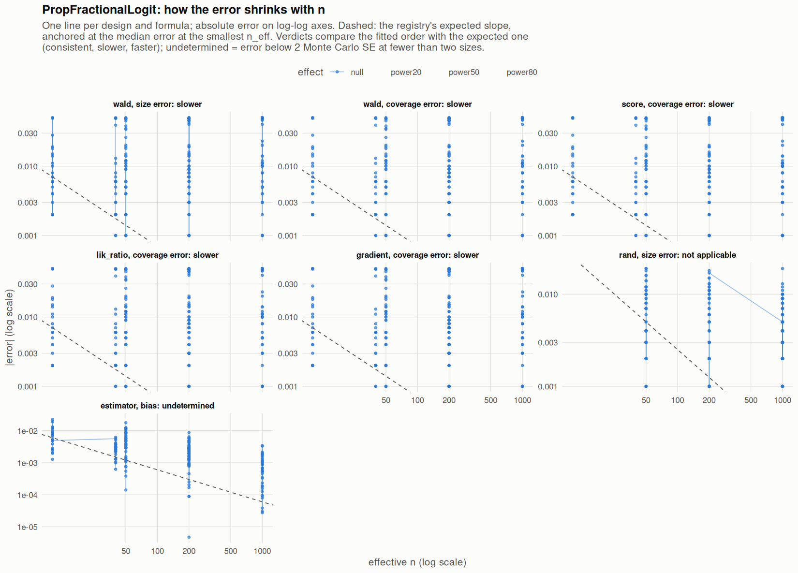

[← Campaign 2026-11-15-e36c7710 summary](README.md)

# Class PropFractionalLogit

Part of the [Classes index](classes.md). Response type: proportion. Status: null effect complete, power effects not started. Verdict: **pass so far**.

<picture><source media="(prefers-color-scheme: dark)" srcset="figures/class-PropFractionalLogit-dark.png"></picture>

Convergence verdicts (worst over designs, formulas and effects; provisional until the class is complete):

| procedure | metric | verdict |
|---|---|---|
| estimator (bias) | bias | undetermined |
| gradient | coverage | slower |
| lik_ratio | coverage | slower |
| score | coverage | slower |
| wald | coverage | slower |
| rand | size | not applicable |
| wald | size | slower |

Null effect: 978 cells (0 failing). Size, coverage and bias / SD against the level each is held to.

| design | n | formula | procedure | size | coverage | bias / SD | size level | coverage level | verdict |
|---|---|---|---|---|---|---|---|---|---|
| Fixed:Bernoulli | 50 | `~.` | gradient |  | 0.939 | 0.0036 | 0.1 | 0.9 | ok |
| Fixed:Bernoulli | 200 | `~.` | gradient |  | 0.944 | 0.009 | 0.0625 | 0.938 | ok |
| Fixed:Bernoulli | 1000 | `~.` | gradient |  | 0.954 | -0.0019 | 0.0525 | 0.948 | ok |
| Fixed:Bernoulli | 50 | `~.` | lik_ratio |  | 0.939 | 0.0036 | 0.1 | 0.9 | ok |
| Fixed:Bernoulli | 200 | `~.` | lik_ratio |  | 0.944 | 0.009 | 0.0625 | 0.938 | ok |
| Fixed:Bernoulli | 1000 | `~.` | lik_ratio |  | 0.954 | -0.0019 | 0.0525 | 0.948 | ok |
| Fixed:Bernoulli | 50 | `~.` | rand | 0.053 |  | 0.0036 | 0.05 | 0.95 | ok |
| Fixed:Bernoulli | 200 | `~.` | rand | 0.058 |  | 0.009 | 0.05 | 0.95 | ok |
| Fixed:Bernoulli | 1000 | `~.` | rand | 0.052 |  | -0.0019 | 0.05 | 0.95 | ok |
| Fixed:Bernoulli | 50 | `~.` | score |  | 0.939 | 0.0036 | 0.1 | 0.9 | ok |
| Fixed:Bernoulli | 200 | `~.` | score |  | 0.944 | 0.009 | 0.0625 | 0.938 | ok |
| Fixed:Bernoulli | 1000 | `~.` | score |  | 0.954 | -0.0019 | 0.0525 | 0.948 | ok |
| Fixed:Bernoulli | 50 | `~.` | wald | 0.061 | 0.939 | 0.0036 | 0.1 | 0.9 | ok |
| Fixed:Bernoulli | 200 | `~.` | wald | 0.056 | 0.944 | 0.009 | 0.0625 | 0.938 | ok |
| Fixed:Bernoulli | 1000 | `~.` | wald | 0.046 | 0.954 | -0.0019 | 0.0525 | 0.948 | ok |
| Fixed:Bernoulli | 50 | `~1` | gradient |  | 0.948 | -0.031 | 0.1 | 0.9 | ok |
| Fixed:Bernoulli | 200 | `~1` | gradient |  | 0.936 | -0.016 | 0.0625 | 0.938 | ok |
| Fixed:Bernoulli | 1000 | `~1` | gradient |  | 0.949 | -0.014 | 0.0525 | 0.948 | ok |
| Fixed:Bernoulli | 50 | `~1` | lik_ratio |  | 0.948 | -0.031 | 0.1 | 0.9 | ok |
| Fixed:Bernoulli | 200 | `~1` | lik_ratio |  | 0.936 | -0.016 | 0.0625 | 0.938 | ok |
| Fixed:Bernoulli | 1000 | `~1` | lik_ratio |  | 0.949 | -0.014 | 0.0525 | 0.948 | ok |
| Fixed:Bernoulli | 50 | `~1` | rand | 0.05 |  | -0.031 | 0.05 | 0.95 | ok |
| Fixed:Bernoulli | 200 | `~1` | rand | 0.067 |  | -0.016 | 0.05 | 0.95 | ok |
| Fixed:Bernoulli | 1000 | `~1` | rand | 0.055 |  | -0.014 | 0.05 | 0.95 | ok |
| Fixed:Bernoulli | 50 | `~1` | score |  | 0.948 | -0.031 | 0.1 | 0.9 | ok |
| Fixed:Bernoulli | 200 | `~1` | score |  | 0.936 | -0.016 | 0.0625 | 0.938 | ok |
| Fixed:Bernoulli | 1000 | `~1` | score |  | 0.949 | -0.014 | 0.0525 | 0.948 | ok |
| Fixed:Bernoulli | 50 | `~1` | wald | 0.052 | 0.948 | -0.031 | 0.1 | 0.9 | ok |
| Fixed:Bernoulli | 200 | `~1` | wald | 0.064 | 0.936 | -0.016 | 0.0625 | 0.938 | ok |
| Fixed:Bernoulli | 1000 | `~1` | wald | 0.051 | 0.949 | -0.014 | 0.0525 | 0.948 | ok |
| Fixed:Bernoulli@0.2 | 50 | `~.` | gradient |  | 0.947 | 0.0047 | 0.1 | 0.9 | ok |
| Fixed:Bernoulli@0.2 | 200 | `~.` | gradient |  | 0.95 | 0.023 | 0.1 | 0.9 | ok |
| Fixed:Bernoulli@0.2 | 1000 | `~.` | gradient |  | 0.952 | -0.067 | 0.0625 | 0.938 | ok |
| Fixed:Bernoulli@0.2 | 50 | `~.` | lik_ratio |  | 0.947 | 0.0047 | 0.1 | 0.9 | ok |
| Fixed:Bernoulli@0.2 | 200 | `~.` | lik_ratio |  | 0.95 | 0.023 | 0.1 | 0.9 | ok |
| Fixed:Bernoulli@0.2 | 1000 | `~.` | lik_ratio |  | 0.952 | -0.067 | 0.0625 | 0.938 | ok |
| Fixed:Bernoulli@0.2 | 50 | `~.` | rand | 0.049 |  | 0.0047 | 0.05 | 0.95 | ok |
| Fixed:Bernoulli@0.2 | 200 | `~.` | rand | 0.048 |  | 0.023 | 0.05 | 0.95 | ok |
| Fixed:Bernoulli@0.2 | 1000 | `~.` | rand | 0.055 |  | -0.067 | 0.05 | 0.95 | ok |
| Fixed:Bernoulli@0.2 | 50 | `~.` | score |  | 0.947 | 0.0047 | 0.1 | 0.9 | ok |
| Fixed:Bernoulli@0.2 | 200 | `~.` | score |  | 0.95 | 0.023 | 0.1 | 0.9 | ok |
| Fixed:Bernoulli@0.2 | 1000 | `~.` | score |  | 0.952 | -0.067 | 0.0625 | 0.938 | ok |
| Fixed:Bernoulli@0.2 | 50 | `~.` | wald | 0.053 | 0.947 | 0.0047 | 0.1 | 0.9 | ok |
| Fixed:Bernoulli@0.2 | 200 | `~.` | wald | 0.05 | 0.95 | 0.023 | 0.1 | 0.9 | ok |
| Fixed:Bernoulli@0.2 | 1000 | `~.` | wald | 0.048 | 0.952 | -0.067 | 0.0625 | 0.938 | ok |
| Fixed:Bernoulli@0.2 | 50 | `~1` | gradient |  | 0.948 | 0.0064 | 0.1 | 0.9 | ok |
| Fixed:Bernoulli@0.2 | 200 | `~1` | gradient |  | 0.947 | 0.017 | 0.1 | 0.9 | ok |
| Fixed:Bernoulli@0.2 | 1000 | `~1` | gradient |  | 0.951 | -0.074 | 0.0625 | 0.938 | ok |
| Fixed:Bernoulli@0.2 | 50 | `~1` | lik_ratio |  | 0.948 | 0.0064 | 0.1 | 0.9 | ok |
| Fixed:Bernoulli@0.2 | 200 | `~1` | lik_ratio |  | 0.947 | 0.017 | 0.1 | 0.9 | ok |
| Fixed:Bernoulli@0.2 | 1000 | `~1` | lik_ratio |  | 0.951 | -0.074 | 0.0625 | 0.938 | ok |
| Fixed:Bernoulli@0.2 | 50 | `~1` | rand | 0.05 |  | 0.0064 | 0.05 | 0.95 | ok |
| Fixed:Bernoulli@0.2 | 200 | `~1` | rand | 0.051 |  | 0.017 | 0.05 | 0.95 | ok |
| Fixed:Bernoulli@0.2 | 1000 | `~1` | rand | 0.049 |  | -0.074 | 0.05 | 0.95 | ok |
| Fixed:Bernoulli@0.2 | 50 | `~1` | score |  | 0.948 | 0.0064 | 0.1 | 0.9 | ok |
| Fixed:Bernoulli@0.2 | 200 | `~1` | score |  | 0.947 | 0.017 | 0.1 | 0.9 | ok |
| Fixed:Bernoulli@0.2 | 1000 | `~1` | score |  | 0.951 | -0.074 | 0.0625 | 0.938 | ok |
| Fixed:Bernoulli@0.2 | 50 | `~1` | wald | 0.052 | 0.948 | 0.0064 | 0.1 | 0.9 | ok |
| Fixed:Bernoulli@0.2 | 200 | `~1` | wald | 0.053 | 0.947 | 0.017 | 0.1 | 0.9 | ok |
| Fixed:Bernoulli@0.2 | 1000 | `~1` | wald | 0.049 | 0.951 | -0.074 | 0.0625 | 0.938 | ok |
| Fixed:BinaryMatch | 50 | `~.` | gradient |  | 0.941 | -0.033 | 0.1 | 0.9 | ok |
| Fixed:BinaryMatch | 200 | `~.` | gradient |  | 0.958 | 0.03 | 0.0625 | 0.938 | ok |
| Fixed:BinaryMatch | 1000 | `~.` | gradient |  | 0.951 | -0.043 | 0.0525 | 0.948 | ok |
| Fixed:BinaryMatch | 50 | `~.` | lik_ratio |  | 0.941 | -0.033 | 0.1 | 0.9 | ok |
| Fixed:BinaryMatch | 200 | `~.` | lik_ratio |  | 0.958 | 0.03 | 0.0625 | 0.938 | ok |
| Fixed:BinaryMatch | 1000 | `~.` | lik_ratio |  | 0.951 | -0.043 | 0.0525 | 0.948 | ok |
| Fixed:BinaryMatch | 50 | `~.` | rand | 0.054 |  | -0.033 | 0.05 | 0.95 | ok |
| Fixed:BinaryMatch | 200 | `~.` | rand | 0.048 |  | 0.03 | 0.05 | 0.95 | ok |
| Fixed:BinaryMatch | 1000 | `~.` | rand | 0.053 |  | -0.043 | 0.05 | 0.95 | ok |
| Fixed:BinaryMatch | 50 | `~.` | score |  | 0.941 | -0.033 | 0.1 | 0.9 | ok |
| Fixed:BinaryMatch | 200 | `~.` | score |  | 0.958 | 0.03 | 0.0625 | 0.938 | ok |
| Fixed:BinaryMatch | 1000 | `~.` | score |  | 0.951 | -0.043 | 0.0525 | 0.948 | ok |
| Fixed:BinaryMatch | 50 | `~.` | wald | 0.059 | 0.941 | -0.033 | 0.1 | 0.9 | ok |
| Fixed:BinaryMatch | 200 | `~.` | wald | 0.042 | 0.958 | 0.03 | 0.0625 | 0.938 | ok |
| Fixed:BinaryMatch | 1000 | `~.` | wald | 0.049 | 0.951 | -0.043 | 0.0525 | 0.948 | ok |
| Fixed:BinaryMatch | 50 | `~1` | gradient |  | 0.995 | -0.016 | 0.1 | 0.9 | ok |
| Fixed:BinaryMatch | 200 | `~1` | gradient |  | 0.999 | 0.032 | 0.0625 | 0.938 | ok |
| Fixed:BinaryMatch | 1000 | `~1` | gradient |  | 1 | -0.031 | 0.0525 | 0.948 | ok |
| Fixed:BinaryMatch | 50 | `~1` | lik_ratio |  | 0.995 | -0.016 | 0.1 | 0.9 | ok |
| Fixed:BinaryMatch | 200 | `~1` | lik_ratio |  | 0.999 | 0.032 | 0.0625 | 0.938 | ok |
| Fixed:BinaryMatch | 1000 | `~1` | lik_ratio |  | 1 | -0.031 | 0.0525 | 0.948 | ok |
| Fixed:BinaryMatch | 50 | `~1` | rand | 0.052 |  | -0.016 | 0.05 | 0.95 | ok |
| Fixed:BinaryMatch | 200 | `~1` | rand | 0.049 |  | 0.032 | 0.05 | 0.95 | ok |
| Fixed:BinaryMatch | 1000 | `~1` | rand | 0.058 |  | -0.031 | 0.05 | 0.95 | ok |
| Fixed:BinaryMatch | 50 | `~1` | score |  | 0.995 | -0.016 | 0.1 | 0.9 | ok |
| Fixed:BinaryMatch | 200 | `~1` | score |  | 0.999 | 0.032 | 0.0625 | 0.938 | ok |
| Fixed:BinaryMatch | 1000 | `~1` | score |  | 1 | -0.031 | 0.0525 | 0.948 | ok |
| Fixed:BinaryMatch | 50 | `~1` | wald | 0.005 | 0.995 | -0.016 | 0.1 | 0.9 | ok |
| Fixed:BinaryMatch | 200 | `~1` | wald | 0.001 | 0.999 | 0.032 | 0.0625 | 0.938 | ok |
| Fixed:BinaryMatch | 1000 | `~1` | wald | 0 | 1 | -0.031 | 0.0525 | 0.948 | ok |
| Fixed:Blocking | 50 | `~.` | gradient |  | 0.951 | 0.034 | 0.1 | 0.9 | ok |
| Fixed:Blocking | 200 | `~.` | gradient |  | 0.941 | 0.02 | 0.0625 | 0.938 | ok |
| Fixed:Blocking | 1000 | `~.` | gradient |  | 0.961 | -0.031 | 0.0525 | 0.948 | ok |
| Fixed:Blocking | 50 | `~.` | lik_ratio |  | 0.951 | 0.034 | 0.1 | 0.9 | ok |
| Fixed:Blocking | 200 | `~.` | lik_ratio |  | 0.941 | 0.02 | 0.0625 | 0.938 | ok |
| Fixed:Blocking | 1000 | `~.` | lik_ratio |  | 0.961 | -0.031 | 0.0525 | 0.948 | ok |
| Fixed:Blocking | 50 | `~.` | rand | 0.048 |  | 0.034 | 0.05 | 0.95 | ok |
| Fixed:Blocking | 200 | `~.` | rand | 0.06 |  | 0.02 | 0.05 | 0.95 | ok |
| Fixed:Blocking | 1000 | `~.` | rand | 0.044 |  | -0.031 | 0.05 | 0.95 | ok |
| Fixed:Blocking | 50 | `~.` | score |  | 0.951 | 0.034 | 0.1 | 0.9 | ok |
| Fixed:Blocking | 200 | `~.` | score |  | 0.941 | 0.02 | 0.0625 | 0.938 | ok |
| Fixed:Blocking | 1000 | `~.` | score |  | 0.961 | -0.031 | 0.0525 | 0.948 | ok |
| Fixed:Blocking | 50 | `~.` | wald | 0.049 | 0.951 | 0.034 | 0.1 | 0.9 | ok |
| Fixed:Blocking | 200 | `~.` | wald | 0.059 | 0.941 | 0.02 | 0.0625 | 0.938 | ok |
| Fixed:Blocking | 1000 | `~.` | wald | 0.039 | 0.961 | -0.031 | 0.0525 | 0.948 | ok |
| Fixed:Blocking | 50 | `~1` | gradient |  | 0.96 | 0.013 | 0.1 | 0.9 | ok |
| Fixed:Blocking | 200 | `~1` | gradient |  | 0.97 | 0.049 | 0.0625 | 0.938 | ok |
| Fixed:Blocking | 1000 | `~1` | gradient |  | 0.97 | -0.0031 | 0.0525 | 0.948 | ok |
| Fixed:Blocking | 50 | `~1` | lik_ratio |  | 0.96 | 0.013 | 0.1 | 0.9 | ok |
| Fixed:Blocking | 200 | `~1` | lik_ratio |  | 0.97 | 0.049 | 0.0625 | 0.938 | ok |
| Fixed:Blocking | 1000 | `~1` | lik_ratio |  | 0.97 | -0.0031 | 0.0525 | 0.948 | ok |
| Fixed:Blocking | 50 | `~1` | rand | 0.04 |  | 0.013 | 0.05 | 0.95 | ok |
| Fixed:Blocking | 200 | `~1` | rand | 0.046 |  | 0.049 | 0.05 | 0.95 | ok |
| Fixed:Blocking | 1000 | `~1` | rand | 0.05 |  | -0.0031 | 0.05 | 0.95 | ok |
| Fixed:Blocking | 50 | `~1` | score |  | 0.96 | 0.013 | 0.1 | 0.9 | ok |
| Fixed:Blocking | 200 | `~1` | score |  | 0.97 | 0.049 | 0.0625 | 0.938 | ok |
| Fixed:Blocking | 1000 | `~1` | score |  | 0.97 | -0.0031 | 0.0525 | 0.948 | ok |
| Fixed:Blocking | 50 | `~1` | wald | 0.04 | 0.96 | 0.013 | 0.1 | 0.9 | ok |
| Fixed:Blocking | 200 | `~1` | wald | 0.03 | 0.97 | 0.049 | 0.0625 | 0.938 | ok |
| Fixed:Blocking | 1000 | `~1` | wald | 0.03 | 0.97 | -0.0031 | 0.0525 | 0.948 | ok |
| Fixed:Blocking@0.2 | 50 | `~.` | gradient |  | 0.956 | 0.052 | 0.1 | 0.9 | ok |
| Fixed:Blocking@0.2 | 200 | `~.` | gradient |  | 0.946 | 0.0051 | 0.1 | 0.9 | ok |
| Fixed:Blocking@0.2 | 1000 | `~.` | gradient |  | 0.948 | -0.053 | 0.0625 | 0.938 | ok |
| Fixed:Blocking@0.2 | 50 | `~.` | lik_ratio |  | 0.956 | 0.052 | 0.1 | 0.9 | ok |
| Fixed:Blocking@0.2 | 200 | `~.` | lik_ratio |  | 0.946 | 0.0051 | 0.1 | 0.9 | ok |
| Fixed:Blocking@0.2 | 1000 | `~.` | lik_ratio |  | 0.948 | -0.053 | 0.0625 | 0.938 | ok |
| Fixed:Blocking@0.2 | 50 | `~.` | rand | 0.034 |  | 0.052 | 0.05 | 0.95 | ok |
| Fixed:Blocking@0.2 | 200 | `~.` | rand | 0.059 |  | 0.0051 | 0.05 | 0.95 | ok |
| Fixed:Blocking@0.2 | 1000 | `~.` | rand | 0.047 |  | -0.053 | 0.05 | 0.95 | ok |
| Fixed:Blocking@0.2 | 50 | `~.` | score |  | 0.956 | 0.052 | 0.1 | 0.9 | ok |
| Fixed:Blocking@0.2 | 200 | `~.` | score |  | 0.946 | 0.0051 | 0.1 | 0.9 | ok |
| Fixed:Blocking@0.2 | 1000 | `~.` | score |  | 0.948 | -0.053 | 0.0625 | 0.938 | ok |
| Fixed:Blocking@0.2 | 50 | `~.` | wald | 0.044 | 0.956 | 0.052 | 0.1 | 0.9 | ok |
| Fixed:Blocking@0.2 | 200 | `~.` | wald | 0.054 | 0.946 | 0.0051 | 0.1 | 0.9 | ok |
| Fixed:Blocking@0.2 | 1000 | `~.` | wald | 0.052 | 0.948 | -0.053 | 0.0625 | 0.938 | ok |
| Fixed:Blocking@0.2 | 50 | `~1` | gradient |  | 0.954 | -0.0057 | 0.1 | 0.9 | ok |
| Fixed:Blocking@0.2 | 200 | `~1` | gradient |  | 0.963 | 0.037 | 0.1 | 0.9 | ok |
| Fixed:Blocking@0.2 | 1000 | `~1` | gradient |  | 0.96 | -0.000062 | 0.0625 | 0.938 | ok |
| Fixed:Blocking@0.2 | 50 | `~1` | lik_ratio |  | 0.954 | -0.0057 | 0.1 | 0.9 | ok |
| Fixed:Blocking@0.2 | 200 | `~1` | lik_ratio |  | 0.963 | 0.037 | 0.1 | 0.9 | ok |
| Fixed:Blocking@0.2 | 1000 | `~1` | lik_ratio |  | 0.96 | -0.000062 | 0.0625 | 0.938 | ok |
| Fixed:Blocking@0.2 | 50 | `~1` | rand | 0.059 |  | -0.0057 | 0.05 | 0.95 | ok |
| Fixed:Blocking@0.2 | 200 | `~1` | rand | 0.045 |  | 0.037 | 0.05 | 0.95 | ok |
| Fixed:Blocking@0.2 | 1000 | `~1` | rand | 0.054 |  | -0.000062 | 0.05 | 0.95 | ok |
| Fixed:Blocking@0.2 | 50 | `~1` | score |  | 0.954 | -0.0057 | 0.1 | 0.9 | ok |
| Fixed:Blocking@0.2 | 200 | `~1` | score |  | 0.963 | 0.037 | 0.1 | 0.9 | ok |
| Fixed:Blocking@0.2 | 1000 | `~1` | score |  | 0.96 | -0.000062 | 0.0625 | 0.938 | ok |
| Fixed:Blocking@0.2 | 50 | `~1` | wald | 0.046 | 0.954 | -0.0057 | 0.1 | 0.9 | ok |
| Fixed:Blocking@0.2 | 200 | `~1` | wald | 0.037 | 0.963 | 0.037 | 0.1 | 0.9 | ok |
| Fixed:Blocking@0.2 | 1000 | `~1` | wald | 0.04 | 0.96 | -0.000062 | 0.0625 | 0.938 | ok |
| Fixed:Greedy | 50 | `~.` | gradient |  | 0.944 | 0.025 | 0.1 | 0.9 | ok |
| Fixed:Greedy | 200 | `~.` | gradient |  | 0.935 | -0.019 | 0.0625 | 0.938 | ok |
| Fixed:Greedy | 1000 | `~.` | gradient |  | 0.96 | 0.012 | 0.0525 | 0.948 | ok |
| Fixed:Greedy | 50 | `~.` | lik_ratio |  | 0.944 | 0.025 | 0.1 | 0.9 | ok |
| Fixed:Greedy | 200 | `~.` | lik_ratio |  | 0.935 | -0.019 | 0.0625 | 0.938 | ok |
| Fixed:Greedy | 1000 | `~.` | lik_ratio |  | 0.96 | 0.012 | 0.0525 | 0.948 | ok |
| Fixed:Greedy | 50 | `~.` | rand | 0.05 |  | 0.025 | 0.05 | 0.95 | ok |
| Fixed:Greedy | 200 | `~.` | rand | 0.065 |  | -0.019 | 0.05 | 0.95 | ok |
| Fixed:Greedy | 1000 | `~.` | rand | 0.041 |  | 0.012 | 0.05 | 0.95 | ok |
| Fixed:Greedy | 50 | `~.` | score |  | 0.944 | 0.025 | 0.1 | 0.9 | ok |
| Fixed:Greedy | 200 | `~.` | score |  | 0.935 | -0.019 | 0.0625 | 0.938 | ok |
| Fixed:Greedy | 1000 | `~.` | score |  | 0.96 | 0.012 | 0.0525 | 0.948 | ok |
| Fixed:Greedy | 50 | `~.` | wald | 0.056 | 0.944 | 0.025 | 0.1 | 0.9 | ok |
| Fixed:Greedy | 200 | `~.` | wald | 0.065 | 0.935 | -0.019 | 0.0625 | 0.938 | ok |
| Fixed:Greedy | 1000 | `~.` | wald | 0.04 | 0.96 | 0.012 | 0.0525 | 0.948 | ok |
| Fixed:Greedy | 50 | `~1` | gradient |  | 0.999 | 0.034 | 0.1 | 0.9 | ok |
| Fixed:Greedy | 200 | `~1` | gradient |  | 1 | -0.019 | 0.0625 | 0.938 | ok |
| Fixed:Greedy | 1000 | `~1` | gradient |  | 1 | 0.018 | 0.0525 | 0.948 | ok |
| Fixed:Greedy | 50 | `~1` | lik_ratio |  | 0.999 | 0.034 | 0.1 | 0.9 | ok |
| Fixed:Greedy | 200 | `~1` | lik_ratio |  | 1 | -0.019 | 0.0625 | 0.938 | ok |
| Fixed:Greedy | 1000 | `~1` | lik_ratio |  | 1 | 0.018 | 0.0525 | 0.948 | ok |
| Fixed:Greedy | 50 | `~1` | rand | 0.052 |  | 0.034 | 0.05 | 0.95 | ok |
| Fixed:Greedy | 200 | `~1` | rand | 0.059 |  | -0.019 | 0.05 | 0.95 | ok |
| Fixed:Greedy | 1000 | `~1` | rand | 0.04 |  | 0.018 | 0.05 | 0.95 | ok |
| Fixed:Greedy | 50 | `~1` | score |  | 0.999 | 0.034 | 0.1 | 0.9 | ok |
| Fixed:Greedy | 200 | `~1` | score |  | 1 | -0.019 | 0.0625 | 0.938 | ok |
| Fixed:Greedy | 1000 | `~1` | score |  | 1 | 0.018 | 0.0525 | 0.948 | ok |
| Fixed:Greedy | 50 | `~1` | wald | 0.001 | 0.999 | 0.034 | 0.1 | 0.9 | ok |
| Fixed:Greedy | 200 | `~1` | wald | 0 | 1 | -0.019 | 0.0625 | 0.938 | ok |
| Fixed:Greedy | 1000 | `~1` | wald | 0 | 1 | 0.018 | 0.0525 | 0.948 | ok |
| Fixed:Greedy@0.2 | 50 | `~.` | gradient |  | 0.944 | -0.054 | 0.1 | 0.9 | ok |
| Fixed:Greedy@0.2 | 200 | `~.` | gradient |  | 0.952 | -0.011 | 0.1 | 0.9 | ok |
| Fixed:Greedy@0.2 | 1000 | `~.` | gradient |  | 0.943 | -0.0016 | 0.0625 | 0.938 | ok |
| Fixed:Greedy@0.2 | 50 | `~.` | lik_ratio |  | 0.944 | -0.054 | 0.1 | 0.9 | ok |
| Fixed:Greedy@0.2 | 200 | `~.` | lik_ratio |  | 0.952 | -0.011 | 0.1 | 0.9 | ok |
| Fixed:Greedy@0.2 | 1000 | `~.` | lik_ratio |  | 0.943 | -0.0016 | 0.0625 | 0.938 | ok |
| Fixed:Greedy@0.2 | 50 | `~.` | rand | 0.055 |  | -0.054 | 0.05 | 0.95 | ok |
| Fixed:Greedy@0.2 | 200 | `~.` | rand | 0.048 |  | -0.011 | 0.05 | 0.95 | ok |
| Fixed:Greedy@0.2 | 1000 | `~.` | rand | 0.055 |  | -0.0016 | 0.05 | 0.95 | ok |
| Fixed:Greedy@0.2 | 50 | `~.` | score |  | 0.944 | -0.054 | 0.1 | 0.9 | ok |
| Fixed:Greedy@0.2 | 200 | `~.` | score |  | 0.952 | -0.011 | 0.1 | 0.9 | ok |
| Fixed:Greedy@0.2 | 1000 | `~.` | score |  | 0.943 | -0.0016 | 0.0625 | 0.938 | ok |
| Fixed:Greedy@0.2 | 50 | `~.` | wald | 0.056 | 0.944 | -0.054 | 0.1 | 0.9 | ok |
| Fixed:Greedy@0.2 | 200 | `~.` | wald | 0.048 | 0.952 | -0.011 | 0.1 | 0.9 | ok |
| Fixed:Greedy@0.2 | 1000 | `~.` | wald | 0.057 | 0.943 | -0.0016 | 0.0625 | 0.938 | ok |
| Fixed:Greedy@0.2 | 50 | `~1` | gradient |  | 1 | -0.044 | 0.1 | 0.9 | ok |
| Fixed:Greedy@0.2 | 200 | `~1` | gradient |  | 0.999 | -0.03 | 0.1 | 0.9 | ok |
| Fixed:Greedy@0.2 | 1000 | `~1` | gradient |  | 0.999 | -0.017 | 0.0625 | 0.938 | ok |
| Fixed:Greedy@0.2 | 50 | `~1` | lik_ratio |  | 1 | -0.044 | 0.1 | 0.9 | ok |
| Fixed:Greedy@0.2 | 200 | `~1` | lik_ratio |  | 0.999 | -0.03 | 0.1 | 0.9 | ok |
| Fixed:Greedy@0.2 | 1000 | `~1` | lik_ratio |  | 0.999 | -0.017 | 0.0625 | 0.938 | ok |
| Fixed:Greedy@0.2 | 50 | `~1` | rand | 0.054 |  | -0.044 | 0.05 | 0.95 | ok |
| Fixed:Greedy@0.2 | 200 | `~1` | rand | 0.048 |  | -0.03 | 0.05 | 0.95 | ok |
| Fixed:Greedy@0.2 | 1000 | `~1` | rand | 0.046 |  | -0.017 | 0.05 | 0.95 | ok |
| Fixed:Greedy@0.2 | 50 | `~1` | score |  | 1 | -0.044 | 0.1 | 0.9 | ok |
| Fixed:Greedy@0.2 | 200 | `~1` | score |  | 0.999 | -0.03 | 0.1 | 0.9 | ok |
| Fixed:Greedy@0.2 | 1000 | `~1` | score |  | 0.999 | -0.017 | 0.0625 | 0.938 | ok |
| Fixed:Greedy@0.2 | 50 | `~1` | wald | 0 | 1 | -0.044 | 0.1 | 0.9 | ok |
| Fixed:Greedy@0.2 | 200 | `~1` | wald | 0.001 | 0.999 | -0.03 | 0.1 | 0.9 | ok |
| Fixed:Greedy@0.2 | 1000 | `~1` | wald | 0.001 | 0.999 | -0.017 | 0.0625 | 0.938 | ok |
| Fixed:GreedyDOptimal | 50 | `~.` | gradient |  | 0.944 | 0.025 | 0.1 | 0.9 | ok |
| Fixed:GreedyDOptimal | 200 | `~.` | gradient |  | 0.935 | -0.019 | 0.0625 | 0.938 | ok |
| Fixed:GreedyDOptimal | 1000 | `~.` | gradient |  | 0.96 | 0.012 | 0.0525 | 0.948 | ok |
| Fixed:GreedyDOptimal | 50 | `~.` | lik_ratio |  | 0.944 | 0.025 | 0.1 | 0.9 | ok |
| Fixed:GreedyDOptimal | 200 | `~.` | lik_ratio |  | 0.935 | -0.019 | 0.0625 | 0.938 | ok |
| Fixed:GreedyDOptimal | 1000 | `~.` | lik_ratio |  | 0.96 | 0.012 | 0.0525 | 0.948 | ok |
| Fixed:GreedyDOptimal | 50 | `~.` | rand | 0.05 |  | 0.025 | 0.05 | 0.95 | ok |
| Fixed:GreedyDOptimal | 200 | `~.` | rand | 0.065 |  | -0.019 | 0.05 | 0.95 | ok |
| Fixed:GreedyDOptimal | 1000 | `~.` | rand | 0.041 |  | 0.012 | 0.05 | 0.95 | ok |
| Fixed:GreedyDOptimal | 50 | `~.` | score |  | 0.944 | 0.025 | 0.1 | 0.9 | ok |
| Fixed:GreedyDOptimal | 200 | `~.` | score |  | 0.935 | -0.019 | 0.0625 | 0.938 | ok |
| Fixed:GreedyDOptimal | 1000 | `~.` | score |  | 0.96 | 0.012 | 0.0525 | 0.948 | ok |
| Fixed:GreedyDOptimal | 50 | `~.` | wald | 0.056 | 0.944 | 0.025 | 0.1 | 0.9 | ok |
| Fixed:GreedyDOptimal | 200 | `~.` | wald | 0.065 | 0.935 | -0.019 | 0.0625 | 0.938 | ok |
| Fixed:GreedyDOptimal | 1000 | `~.` | wald | 0.04 | 0.96 | 0.012 | 0.0525 | 0.948 | ok |
| Fixed:GreedyDOptimal | 50 | `~1` | gradient |  | 0.999 | 0.034 | 0.1 | 0.9 | ok |
| Fixed:GreedyDOptimal | 200 | `~1` | gradient |  | 1 | -0.019 | 0.0625 | 0.938 | ok |
| Fixed:GreedyDOptimal | 1000 | `~1` | gradient |  | 1 | 0.018 | 0.0525 | 0.948 | ok |
| Fixed:GreedyDOptimal | 50 | `~1` | lik_ratio |  | 0.999 | 0.034 | 0.1 | 0.9 | ok |
| Fixed:GreedyDOptimal | 200 | `~1` | lik_ratio |  | 1 | -0.019 | 0.0625 | 0.938 | ok |
| Fixed:GreedyDOptimal | 1000 | `~1` | lik_ratio |  | 1 | 0.018 | 0.0525 | 0.948 | ok |
| Fixed:GreedyDOptimal | 50 | `~1` | rand | 0.052 |  | 0.034 | 0.05 | 0.95 | ok |
| Fixed:GreedyDOptimal | 200 | `~1` | rand | 0.059 |  | -0.019 | 0.05 | 0.95 | ok |
| Fixed:GreedyDOptimal | 1000 | `~1` | rand | 0.04 |  | 0.018 | 0.05 | 0.95 | ok |
| Fixed:GreedyDOptimal | 50 | `~1` | score |  | 0.999 | 0.034 | 0.1 | 0.9 | ok |
| Fixed:GreedyDOptimal | 200 | `~1` | score |  | 1 | -0.019 | 0.0625 | 0.938 | ok |
| Fixed:GreedyDOptimal | 1000 | `~1` | score |  | 1 | 0.018 | 0.0525 | 0.948 | ok |
| Fixed:GreedyDOptimal | 50 | `~1` | wald | 0.001 | 0.999 | 0.034 | 0.1 | 0.9 | ok |
| Fixed:GreedyDOptimal | 200 | `~1` | wald | 0 | 1 | -0.019 | 0.0625 | 0.938 | ok |
| Fixed:GreedyDOptimal | 1000 | `~1` | wald | 0 | 1 | 0.018 | 0.0525 | 0.948 | ok |
| Fixed:GreedyDOptimal@0.2 | 50 | `~.` | gradient |  | 0.944 | -0.054 | 0.1 | 0.9 | ok |
| Fixed:GreedyDOptimal@0.2 | 200 | `~.` | gradient |  | 0.952 | -0.011 | 0.1 | 0.9 | ok |
| Fixed:GreedyDOptimal@0.2 | 1000 | `~.` | gradient |  | 0.943 | -0.0016 | 0.0625 | 0.938 | ok |
| Fixed:GreedyDOptimal@0.2 | 50 | `~.` | lik_ratio |  | 0.944 | -0.054 | 0.1 | 0.9 | ok |
| Fixed:GreedyDOptimal@0.2 | 200 | `~.` | lik_ratio |  | 0.952 | -0.011 | 0.1 | 0.9 | ok |
| Fixed:GreedyDOptimal@0.2 | 1000 | `~.` | lik_ratio |  | 0.943 | -0.0016 | 0.0625 | 0.938 | ok |
| Fixed:GreedyDOptimal@0.2 | 50 | `~.` | rand | 0.055 |  | -0.054 | 0.05 | 0.95 | ok |
| Fixed:GreedyDOptimal@0.2 | 200 | `~.` | rand | 0.048 |  | -0.011 | 0.05 | 0.95 | ok |
| Fixed:GreedyDOptimal@0.2 | 1000 | `~.` | rand | 0.055 |  | -0.0016 | 0.05 | 0.95 | ok |
| Fixed:GreedyDOptimal@0.2 | 50 | `~.` | score |  | 0.944 | -0.054 | 0.1 | 0.9 | ok |
| Fixed:GreedyDOptimal@0.2 | 200 | `~.` | score |  | 0.952 | -0.011 | 0.1 | 0.9 | ok |
| Fixed:GreedyDOptimal@0.2 | 1000 | `~.` | score |  | 0.943 | -0.0016 | 0.0625 | 0.938 | ok |
| Fixed:GreedyDOptimal@0.2 | 50 | `~.` | wald | 0.056 | 0.944 | -0.054 | 0.1 | 0.9 | ok |
| Fixed:GreedyDOptimal@0.2 | 200 | `~.` | wald | 0.048 | 0.952 | -0.011 | 0.1 | 0.9 | ok |
| Fixed:GreedyDOptimal@0.2 | 1000 | `~.` | wald | 0.057 | 0.943 | -0.0016 | 0.0625 | 0.938 | ok |
| Fixed:GreedyDOptimal@0.2 | 50 | `~1` | gradient |  | 1 | -0.044 | 0.1 | 0.9 | ok |
| Fixed:GreedyDOptimal@0.2 | 200 | `~1` | gradient |  | 0.999 | -0.03 | 0.1 | 0.9 | ok |
| Fixed:GreedyDOptimal@0.2 | 1000 | `~1` | gradient |  | 0.999 | -0.017 | 0.0625 | 0.938 | ok |
| Fixed:GreedyDOptimal@0.2 | 50 | `~1` | lik_ratio |  | 1 | -0.044 | 0.1 | 0.9 | ok |
| Fixed:GreedyDOptimal@0.2 | 200 | `~1` | lik_ratio |  | 0.999 | -0.03 | 0.1 | 0.9 | ok |
| Fixed:GreedyDOptimal@0.2 | 1000 | `~1` | lik_ratio |  | 0.999 | -0.017 | 0.0625 | 0.938 | ok |
| Fixed:GreedyDOptimal@0.2 | 50 | `~1` | rand | 0.054 |  | -0.044 | 0.05 | 0.95 | ok |
| Fixed:GreedyDOptimal@0.2 | 200 | `~1` | rand | 0.048 |  | -0.03 | 0.05 | 0.95 | ok |
| Fixed:GreedyDOptimal@0.2 | 1000 | `~1` | rand | 0.046 |  | -0.017 | 0.05 | 0.95 | ok |
| Fixed:GreedyDOptimal@0.2 | 50 | `~1` | score |  | 1 | -0.044 | 0.1 | 0.9 | ok |
| Fixed:GreedyDOptimal@0.2 | 200 | `~1` | score |  | 0.999 | -0.03 | 0.1 | 0.9 | ok |
| Fixed:GreedyDOptimal@0.2 | 1000 | `~1` | score |  | 0.999 | -0.017 | 0.0625 | 0.938 | ok |
| Fixed:GreedyDOptimal@0.2 | 50 | `~1` | wald | 0 | 1 | -0.044 | 0.1 | 0.9 | ok |
| Fixed:GreedyDOptimal@0.2 | 200 | `~1` | wald | 0.001 | 0.999 | -0.03 | 0.1 | 0.9 | ok |
| Fixed:GreedyDOptimal@0.2 | 1000 | `~1` | wald | 0.001 | 0.999 | -0.017 | 0.0625 | 0.938 | ok |
| Fixed:iBCRD | 50 | `~.` | gradient |  | 0.932 | 0.017 | 0.1 | 0.9 | ok |
| Fixed:iBCRD | 200 | `~.` | gradient |  | 0.948 | 0.031 | 0.0625 | 0.938 | ok |
| Fixed:iBCRD | 1000 | `~.` | gradient |  | 0.948 | -0.02 | 0.0525 | 0.948 | ok |
| Fixed:iBCRD | 50 | `~.` | lik_ratio |  | 0.932 | 0.017 | 0.1 | 0.9 | ok |
| Fixed:iBCRD | 200 | `~.` | lik_ratio |  | 0.948 | 0.031 | 0.0625 | 0.938 | ok |
| Fixed:iBCRD | 1000 | `~.` | lik_ratio |  | 0.948 | -0.02 | 0.0525 | 0.948 | ok |
| Fixed:iBCRD | 50 | `~.` | rand | 0.059 |  | 0.017 | 0.05 | 0.95 | ok |
| Fixed:iBCRD | 200 | `~.` | rand | 0.049 |  | 0.031 | 0.05 | 0.95 | ok |
| Fixed:iBCRD | 1000 | `~.` | rand | 0.053 |  | -0.02 | 0.05 | 0.95 | ok |
| Fixed:iBCRD | 50 | `~.` | score |  | 0.932 | 0.017 | 0.1 | 0.9 | ok |
| Fixed:iBCRD | 200 | `~.` | score |  | 0.948 | 0.031 | 0.0625 | 0.938 | ok |
| Fixed:iBCRD | 1000 | `~.` | score |  | 0.948 | -0.02 | 0.0525 | 0.948 | ok |
| Fixed:iBCRD | 50 | `~.` | wald | 0.068 | 0.932 | 0.017 | 0.1 | 0.9 | ok |
| Fixed:iBCRD | 200 | `~.` | wald | 0.052 | 0.948 | 0.031 | 0.0625 | 0.938 | ok |
| Fixed:iBCRD | 1000 | `~.` | wald | 0.052 | 0.948 | -0.02 | 0.0525 | 0.948 | ok |
| Fixed:iBCRD | 50 | `~1` | gradient |  | 0.938 | -0.014 | 0.1 | 0.9 | ok |
| Fixed:iBCRD | 200 | `~1` | gradient |  | 0.954 | 0.041 | 0.0625 | 0.938 | ok |
| Fixed:iBCRD | 1000 | `~1` | gradient |  | 0.942 | -0.021 | 0.0525 | 0.948 | ok |
| Fixed:iBCRD | 50 | `~1` | lik_ratio |  | 0.938 | -0.014 | 0.1 | 0.9 | ok |
| Fixed:iBCRD | 200 | `~1` | lik_ratio |  | 0.954 | 0.041 | 0.0625 | 0.938 | ok |
| Fixed:iBCRD | 1000 | `~1` | lik_ratio |  | 0.942 | -0.021 | 0.0525 | 0.948 | ok |
| Fixed:iBCRD | 50 | `~1` | rand | 0.06 |  | -0.014 | 0.05 | 0.95 | ok |
| Fixed:iBCRD | 200 | `~1` | rand | 0.047 |  | 0.041 | 0.05 | 0.95 | ok |
| Fixed:iBCRD | 1000 | `~1` | rand | 0.058 |  | -0.021 | 0.05 | 0.95 | ok |
| Fixed:iBCRD | 50 | `~1` | score |  | 0.938 | -0.014 | 0.1 | 0.9 | ok |
| Fixed:iBCRD | 200 | `~1` | score |  | 0.954 | 0.041 | 0.0625 | 0.938 | ok |
| Fixed:iBCRD | 1000 | `~1` | score |  | 0.942 | -0.021 | 0.0525 | 0.948 | ok |
| Fixed:iBCRD | 50 | `~1` | wald | 0.062 | 0.938 | -0.014 | 0.1 | 0.9 | ok |
| Fixed:iBCRD | 200 | `~1` | wald | 0.046 | 0.954 | 0.041 | 0.0625 | 0.938 | ok |
| Fixed:iBCRD | 1000 | `~1` | wald | 0.058 | 0.942 | -0.021 | 0.0525 | 0.948 | ok |
| Fixed:iBCRD@0.2 | 50 | `~.` | gradient |  | 0.935 | 0.029 | 0.1 | 0.9 | ok |
| Fixed:iBCRD@0.2 | 200 | `~.` | gradient |  | 0.951 | -0.024 | 0.1 | 0.9 | ok |
| Fixed:iBCRD@0.2 | 1000 | `~.` | gradient |  | 0.954 | 0.017 | 0.0625 | 0.938 | ok |
| Fixed:iBCRD@0.2 | 50 | `~.` | lik_ratio |  | 0.935 | 0.029 | 0.1 | 0.9 | ok |
| Fixed:iBCRD@0.2 | 200 | `~.` | lik_ratio |  | 0.951 | -0.024 | 0.1 | 0.9 | ok |
| Fixed:iBCRD@0.2 | 1000 | `~.` | lik_ratio |  | 0.954 | 0.017 | 0.0625 | 0.938 | ok |
| Fixed:iBCRD@0.2 | 50 | `~.` | rand | 0.056 |  | 0.029 | 0.05 | 0.95 | ok |
| Fixed:iBCRD@0.2 | 200 | `~.` | rand | 0.053 |  | -0.024 | 0.05 | 0.95 | ok |
| Fixed:iBCRD@0.2 | 1000 | `~.` | rand | 0.046 |  | 0.017 | 0.05 | 0.95 | ok |
| Fixed:iBCRD@0.2 | 50 | `~.` | score |  | 0.935 | 0.029 | 0.1 | 0.9 | ok |
| Fixed:iBCRD@0.2 | 200 | `~.` | score |  | 0.951 | -0.024 | 0.1 | 0.9 | ok |
| Fixed:iBCRD@0.2 | 1000 | `~.` | score |  | 0.954 | 0.017 | 0.0625 | 0.938 | ok |
| Fixed:iBCRD@0.2 | 50 | `~.` | wald | 0.065 | 0.935 | 0.029 | 0.1 | 0.9 | ok |
| Fixed:iBCRD@0.2 | 200 | `~.` | wald | 0.049 | 0.951 | -0.024 | 0.1 | 0.9 | ok |
| Fixed:iBCRD@0.2 | 1000 | `~.` | wald | 0.046 | 0.954 | 0.017 | 0.0625 | 0.938 | ok |
| Fixed:iBCRD@0.2 | 50 | `~1` | gradient |  | 0.945 | 0.014 | 0.1 | 0.9 | ok |
| Fixed:iBCRD@0.2 | 200 | `~1` | gradient |  | 0.943 | 0.013 | 0.1 | 0.9 | ok |
| Fixed:iBCRD@0.2 | 1000 | `~1` | gradient |  | 0.949 | 0.0021 | 0.0625 | 0.938 | ok |
| Fixed:iBCRD@0.2 | 50 | `~1` | lik_ratio |  | 0.945 | 0.014 | 0.1 | 0.9 | ok |
| Fixed:iBCRD@0.2 | 200 | `~1` | lik_ratio |  | 0.943 | 0.013 | 0.1 | 0.9 | ok |
| Fixed:iBCRD@0.2 | 1000 | `~1` | lik_ratio |  | 0.949 | 0.0021 | 0.0625 | 0.938 | ok |
| Fixed:iBCRD@0.2 | 50 | `~1` | rand | 0.057 |  | 0.014 | 0.05 | 0.95 | ok |
| Fixed:iBCRD@0.2 | 200 | `~1` | rand | 0.055 |  | 0.013 | 0.05 | 0.95 | ok |
| Fixed:iBCRD@0.2 | 1000 | `~1` | rand | 0.049 |  | 0.0021 | 0.05 | 0.95 | ok |
| Fixed:iBCRD@0.2 | 50 | `~1` | score |  | 0.945 | 0.014 | 0.1 | 0.9 | ok |
| Fixed:iBCRD@0.2 | 200 | `~1` | score |  | 0.943 | 0.013 | 0.1 | 0.9 | ok |
| Fixed:iBCRD@0.2 | 1000 | `~1` | score |  | 0.949 | 0.0021 | 0.0625 | 0.938 | ok |
| Fixed:iBCRD@0.2 | 50 | `~1` | wald | 0.055 | 0.945 | 0.014 | 0.1 | 0.9 | ok |
| Fixed:iBCRD@0.2 | 200 | `~1` | wald | 0.057 | 0.943 | 0.013 | 0.1 | 0.9 | ok |
| Fixed:iBCRD@0.2 | 1000 | `~1` | wald | 0.051 | 0.949 | 0.0021 | 0.0625 | 0.938 | ok |
| Fixed:MatchingGreedyPairSwitching | 50 | `~.` | gradient |  | 0.946 | 0.007 | 0.1 | 0.9 | ok |
| Fixed:MatchingGreedyPairSwitching | 200 | `~.` | gradient |  | 0.936 | -0.03 | 0.0625 | 0.938 | ok |
| Fixed:MatchingGreedyPairSwitching | 1000 | `~.` | gradient |  | 0.95 | -0.0022 | 0.0525 | 0.948 | ok |
| Fixed:MatchingGreedyPairSwitching | 50 | `~.` | lik_ratio |  | 0.946 | 0.007 | 0.1 | 0.9 | ok |
| Fixed:MatchingGreedyPairSwitching | 200 | `~.` | lik_ratio |  | 0.936 | -0.03 | 0.0625 | 0.938 | ok |
| Fixed:MatchingGreedyPairSwitching | 1000 | `~.` | lik_ratio |  | 0.95 | -0.0022 | 0.0525 | 0.948 | ok |
| Fixed:MatchingGreedyPairSwitching | 50 | `~.` | rand | 0.05 |  | 0.007 | 0.05 | 0.95 | ok |
| Fixed:MatchingGreedyPairSwitching | 200 | `~.` | rand | 0.061 |  | -0.03 | 0.05 | 0.95 | ok |
| Fixed:MatchingGreedyPairSwitching | 1000 | `~.` | rand | 0.049 |  | -0.0022 | 0.05 | 0.95 | ok |
| Fixed:MatchingGreedyPairSwitching | 50 | `~.` | score |  | 0.946 | 0.007 | 0.1 | 0.9 | ok |
| Fixed:MatchingGreedyPairSwitching | 200 | `~.` | score |  | 0.936 | -0.03 | 0.0625 | 0.938 | ok |
| Fixed:MatchingGreedyPairSwitching | 1000 | `~.` | score |  | 0.95 | -0.0022 | 0.0525 | 0.948 | ok |
| Fixed:MatchingGreedyPairSwitching | 50 | `~.` | wald | 0.054 | 0.946 | 0.007 | 0.1 | 0.9 | ok |
| Fixed:MatchingGreedyPairSwitching | 200 | `~.` | wald | 0.064 | 0.936 | -0.03 | 0.0625 | 0.938 | ok |
| Fixed:MatchingGreedyPairSwitching | 1000 | `~.` | wald | 0.05 | 0.95 | -0.0022 | 0.0525 | 0.948 | ok |
| Fixed:MatchingGreedyPairSwitching | 50 | `~1` | gradient |  | 1 | -0.0035 | 0.1 | 0.9 | ok |
| Fixed:MatchingGreedyPairSwitching | 200 | `~1` | gradient |  | 0.999 | -0.031 | 0.0625 | 0.938 | ok |
| Fixed:MatchingGreedyPairSwitching | 1000 | `~1` | gradient |  | 1 | -0.00084 | 0.0525 | 0.948 | ok |
| Fixed:MatchingGreedyPairSwitching | 50 | `~1` | lik_ratio |  | 1 | -0.0035 | 0.1 | 0.9 | ok |
| Fixed:MatchingGreedyPairSwitching | 200 | `~1` | lik_ratio |  | 0.999 | -0.031 | 0.0625 | 0.938 | ok |
| Fixed:MatchingGreedyPairSwitching | 1000 | `~1` | lik_ratio |  | 1 | -0.00084 | 0.0525 | 0.948 | ok |
| Fixed:MatchingGreedyPairSwitching | 50 | `~1` | rand | 0.05 |  | -0.0035 | 0.05 | 0.95 | ok |
| Fixed:MatchingGreedyPairSwitching | 200 | `~1` | rand | 0.061 |  | -0.031 | 0.05 | 0.95 | ok |
| Fixed:MatchingGreedyPairSwitching | 1000 | `~1` | rand | 0.051 |  | -0.00084 | 0.05 | 0.95 | ok |
| Fixed:MatchingGreedyPairSwitching | 50 | `~1` | score |  | 1 | -0.0035 | 0.1 | 0.9 | ok |
| Fixed:MatchingGreedyPairSwitching | 200 | `~1` | score |  | 0.999 | -0.031 | 0.0625 | 0.938 | ok |
| Fixed:MatchingGreedyPairSwitching | 1000 | `~1` | score |  | 1 | -0.00084 | 0.0525 | 0.948 | ok |
| Fixed:MatchingGreedyPairSwitching | 50 | `~1` | wald | 0 | 1 | -0.0035 | 0.1 | 0.9 | ok |
| Fixed:MatchingGreedyPairSwitching | 200 | `~1` | wald | 0.001 | 0.999 | -0.031 | 0.0625 | 0.938 | ok |
| Fixed:MatchingGreedyPairSwitching | 1000 | `~1` | wald | 0 | 1 | -0.00084 | 0.0525 | 0.948 | ok |
| Fixed:Optimal | 50 | `~.` | gradient |  | 0.944 | -0.043 | 0.1 | 0.9 | ok |
| Fixed:Optimal | 200 | `~.` | gradient |  | 0.953 | -0.0027 | 0.0625 | 0.938 | ok |
| Fixed:Optimal | 1000 | `~.` | gradient |  | 0.953 | -0.00092 | 0.0525 | 0.948 | ok |
| Fixed:Optimal | 50 | `~.` | lik_ratio |  | 0.944 | -0.043 | 0.1 | 0.9 | ok |
| Fixed:Optimal | 200 | `~.` | lik_ratio |  | 0.953 | -0.0027 | 0.0625 | 0.938 | ok |
| Fixed:Optimal | 1000 | `~.` | lik_ratio |  | 0.953 | -0.00092 | 0.0525 | 0.948 | ok |
| Fixed:Optimal | 50 | `~.` | score |  | 0.944 | -0.043 | 0.1 | 0.9 | ok |
| Fixed:Optimal | 200 | `~.` | score |  | 0.953 | -0.0027 | 0.0625 | 0.938 | ok |
| Fixed:Optimal | 1000 | `~.` | score |  | 0.953 | -0.00092 | 0.0525 | 0.948 | ok |
| Fixed:Optimal | 50 | `~.` | wald | 0.056 | 0.944 | -0.043 | 0.1 | 0.9 | ok |
| Fixed:Optimal | 200 | `~.` | wald | 0.047 | 0.953 | -0.0027 | 0.0625 | 0.938 | ok |
| Fixed:Optimal | 1000 | `~.` | wald | 0.047 | 0.953 | -0.00092 | 0.0525 | 0.948 | ok |
| Fixed:Optimal | 50 | `~1` | gradient |  | 0.998 | -0.052 | 0.1 | 0.9 | ok |
| Fixed:Optimal | 200 | `~1` | gradient |  | 0.998 | -0.011 | 0.0625 | 0.938 | ok |
| Fixed:Optimal | 1000 | `~1` | gradient |  | 0.998 | 0.0035 | 0.0525 | 0.948 | ok |
| Fixed:Optimal | 50 | `~1` | lik_ratio |  | 0.998 | -0.052 | 0.1 | 0.9 | ok |
| Fixed:Optimal | 200 | `~1` | lik_ratio |  | 0.998 | -0.011 | 0.0625 | 0.938 | ok |
| Fixed:Optimal | 1000 | `~1` | lik_ratio |  | 0.998 | 0.0035 | 0.0525 | 0.948 | ok |
| Fixed:Optimal | 50 | `~1` | score |  | 0.998 | -0.052 | 0.1 | 0.9 | ok |
| Fixed:Optimal | 200 | `~1` | score |  | 0.998 | -0.011 | 0.0625 | 0.938 | ok |
| Fixed:Optimal | 1000 | `~1` | score |  | 0.998 | 0.0035 | 0.0525 | 0.948 | ok |
| Fixed:Optimal | 50 | `~1` | wald | 0.002 | 0.998 | -0.052 | 0.1 | 0.9 | ok |
| Fixed:Optimal | 200 | `~1` | wald | 0.002 | 0.998 | -0.011 | 0.0625 | 0.938 | ok |
| Fixed:Optimal | 1000 | `~1` | wald | 0.002 | 0.998 | 0.0035 | 0.0525 | 0.948 | ok |
| Fixed:Optimal@0.2 | 50 | `~.` | gradient |  | 0.932 | -0.02 | 0.1 | 0.9 | ok |
| Fixed:Optimal@0.2 | 200 | `~.` | gradient |  | 0.948 | -0.047 | 0.1 | 0.9 | ok |
| Fixed:Optimal@0.2 | 1000 | `~.` | gradient |  | 0.954 | 0.035 | 0.0625 | 0.938 | ok |
| Fixed:Optimal@0.2 | 50 | `~.` | lik_ratio |  | 0.932 | -0.02 | 0.1 | 0.9 | ok |
| Fixed:Optimal@0.2 | 200 | `~.` | lik_ratio |  | 0.948 | -0.047 | 0.1 | 0.9 | ok |
| Fixed:Optimal@0.2 | 1000 | `~.` | lik_ratio |  | 0.954 | 0.035 | 0.0625 | 0.938 | ok |
| Fixed:Optimal@0.2 | 50 | `~.` | score |  | 0.932 | -0.02 | 0.1 | 0.9 | ok |
| Fixed:Optimal@0.2 | 200 | `~.` | score |  | 0.948 | -0.047 | 0.1 | 0.9 | ok |
| Fixed:Optimal@0.2 | 1000 | `~.` | score |  | 0.954 | 0.035 | 0.0625 | 0.938 | ok |
| Fixed:Optimal@0.2 | 50 | `~.` | wald | 0.068 | 0.932 | -0.02 | 0.1 | 0.9 | ok |
| Fixed:Optimal@0.2 | 200 | `~.` | wald | 0.052 | 0.948 | -0.047 | 0.1 | 0.9 | ok |
| Fixed:Optimal@0.2 | 1000 | `~.` | wald | 0.046 | 0.954 | 0.035 | 0.0625 | 0.938 | ok |
| Fixed:Optimal@0.2 | 50 | `~1` | gradient |  | 0.999 | 0.023 | 0.1 | 0.9 | ok |
| Fixed:Optimal@0.2 | 200 | `~1` | gradient |  | 1 | -0.025 | 0.1 | 0.9 | ok |
| Fixed:Optimal@0.2 | 1000 | `~1` | gradient |  | 0.998 | 0.037 | 0.0625 | 0.938 | ok |
| Fixed:Optimal@0.2 | 50 | `~1` | lik_ratio |  | 0.999 | 0.023 | 0.1 | 0.9 | ok |
| Fixed:Optimal@0.2 | 200 | `~1` | lik_ratio |  | 1 | -0.025 | 0.1 | 0.9 | ok |
| Fixed:Optimal@0.2 | 1000 | `~1` | lik_ratio |  | 0.998 | 0.037 | 0.0625 | 0.938 | ok |
| Fixed:Optimal@0.2 | 50 | `~1` | score |  | 0.999 | 0.023 | 0.1 | 0.9 | ok |
| Fixed:Optimal@0.2 | 200 | `~1` | score |  | 1 | -0.025 | 0.1 | 0.9 | ok |
| Fixed:Optimal@0.2 | 1000 | `~1` | score |  | 0.998 | 0.037 | 0.0625 | 0.938 | ok |
| Fixed:Optimal@0.2 | 50 | `~1` | wald | 0.001 | 0.999 | 0.023 | 0.1 | 0.9 | ok |
| Fixed:Optimal@0.2 | 200 | `~1` | wald | 0 | 1 | -0.025 | 0.1 | 0.9 | ok |
| Fixed:Optimal@0.2 | 1000 | `~1` | wald | 0.002 | 0.998 | 0.037 | 0.0625 | 0.938 | ok |
| Fixed:OptimalBlocks | 50 | `~.` | gradient |  | 0.948 | 0.0071 | 0.1 | 0.9 | ok |
| Fixed:OptimalBlocks | 200 | `~.` | gradient |  | 0.946 | -0.0091 | 0.0625 | 0.938 | ok |
| Fixed:OptimalBlocks | 1000 | `~.` | gradient |  | 0.949 | 0.024 | 0.0525 | 0.948 | ok |
| Fixed:OptimalBlocks | 50 | `~.` | lik_ratio |  | 0.948 | 0.0071 | 0.1 | 0.9 | ok |
| Fixed:OptimalBlocks | 200 | `~.` | lik_ratio |  | 0.946 | -0.0091 | 0.0625 | 0.938 | ok |
| Fixed:OptimalBlocks | 1000 | `~.` | lik_ratio |  | 0.949 | 0.024 | 0.0525 | 0.948 | ok |
| Fixed:OptimalBlocks | 50 | `~.` | rand | 0.04 |  | 0.0071 | 0.05 | 0.95 | ok |
| Fixed:OptimalBlocks | 200 | `~.` | rand | 0.052 |  | -0.0091 | 0.05 | 0.95 | ok |
| Fixed:OptimalBlocks | 1000 | `~.` | rand | 0.051 |  | 0.024 | 0.05 | 0.95 | ok |
| Fixed:OptimalBlocks | 50 | `~.` | score |  | 0.948 | 0.0071 | 0.1 | 0.9 | ok |
| Fixed:OptimalBlocks | 200 | `~.` | score |  | 0.946 | -0.0091 | 0.0625 | 0.938 | ok |
| Fixed:OptimalBlocks | 1000 | `~.` | score |  | 0.949 | 0.024 | 0.0525 | 0.948 | ok |
| Fixed:OptimalBlocks | 50 | `~.` | wald | 0.052 | 0.948 | 0.0071 | 0.1 | 0.9 | ok |
| Fixed:OptimalBlocks | 200 | `~.` | wald | 0.054 | 0.946 | -0.0091 | 0.0625 | 0.938 | ok |
| Fixed:OptimalBlocks | 1000 | `~.` | wald | 0.051 | 0.949 | 0.024 | 0.0525 | 0.948 | ok |
| Fixed:OptimalBlocks | 50 | `~1` | gradient |  | 0.988 | 0.021 | 0.1 | 0.9 | ok |
| Fixed:OptimalBlocks | 200 | `~1` | gradient |  | 0.99 | 0.025 | 0.0625 | 0.938 | ok |
| Fixed:OptimalBlocks | 1000 | `~1` | gradient |  | 0.99 | 0.039 | 0.0525 | 0.948 | ok |
| Fixed:OptimalBlocks | 50 | `~1` | lik_ratio |  | 0.988 | 0.021 | 0.1 | 0.9 | ok |
| Fixed:OptimalBlocks | 200 | `~1` | lik_ratio |  | 0.99 | 0.025 | 0.0625 | 0.938 | ok |
| Fixed:OptimalBlocks | 1000 | `~1` | lik_ratio |  | 0.99 | 0.039 | 0.0525 | 0.948 | ok |
| Fixed:OptimalBlocks | 50 | `~1` | rand | 0.038 |  | 0.021 | 0.05 | 0.95 | ok |
| Fixed:OptimalBlocks | 200 | `~1` | rand | 0.056 |  | 0.025 | 0.05 | 0.95 | ok |
| Fixed:OptimalBlocks | 1000 | `~1` | rand | 0.048 |  | 0.039 | 0.05 | 0.95 | ok |
| Fixed:OptimalBlocks | 50 | `~1` | score |  | 0.988 | 0.021 | 0.1 | 0.9 | ok |
| Fixed:OptimalBlocks | 200 | `~1` | score |  | 0.99 | 0.025 | 0.0625 | 0.938 | ok |
| Fixed:OptimalBlocks | 1000 | `~1` | score |  | 0.99 | 0.039 | 0.0525 | 0.948 | ok |
| Fixed:OptimalBlocks | 50 | `~1` | wald | 0.012 | 0.988 | 0.021 | 0.1 | 0.9 | ok |
| Fixed:OptimalBlocks | 200 | `~1` | wald | 0.01 | 0.99 | 0.025 | 0.0625 | 0.938 | ok |
| Fixed:OptimalBlocks | 1000 | `~1` | wald | 0.01 | 0.99 | 0.039 | 0.0525 | 0.948 | ok |
| Fixed:OptimalBlocks@0.2 | 50 | `~.` | gradient |  | 0.952 | -0.008 | 0.1 | 0.9 | ok |
| Fixed:OptimalBlocks@0.2 | 200 | `~.` | gradient |  | 0.956 | 0.019 | 0.1 | 0.9 | ok |
| Fixed:OptimalBlocks@0.2 | 1000 | `~.` | gradient |  | 0.969 | -0.03 | 0.0625 | 0.938 | ok |
| Fixed:OptimalBlocks@0.2 | 50 | `~.` | lik_ratio |  | 0.952 | -0.008 | 0.1 | 0.9 | ok |
| Fixed:OptimalBlocks@0.2 | 200 | `~.` | lik_ratio |  | 0.956 | 0.019 | 0.1 | 0.9 | ok |
| Fixed:OptimalBlocks@0.2 | 1000 | `~.` | lik_ratio |  | 0.969 | -0.03 | 0.0625 | 0.938 | ok |
| Fixed:OptimalBlocks@0.2 | 50 | `~.` | rand | 0.042 |  | -0.008 | 0.05 | 0.95 | ok |
| Fixed:OptimalBlocks@0.2 | 200 | `~.` | rand | 0.043 |  | 0.019 | 0.05 | 0.95 | ok |
| Fixed:OptimalBlocks@0.2 | 1000 | `~.` | rand | 0.037 |  | -0.03 | 0.05 | 0.95 | ok |
| Fixed:OptimalBlocks@0.2 | 50 | `~.` | score |  | 0.952 | -0.008 | 0.1 | 0.9 | ok |
| Fixed:OptimalBlocks@0.2 | 200 | `~.` | score |  | 0.956 | 0.019 | 0.1 | 0.9 | ok |
| Fixed:OptimalBlocks@0.2 | 1000 | `~.` | score |  | 0.969 | -0.03 | 0.0625 | 0.938 | ok |
| Fixed:OptimalBlocks@0.2 | 50 | `~.` | wald | 0.048 | 0.952 | -0.008 | 0.1 | 0.9 | ok |
| Fixed:OptimalBlocks@0.2 | 200 | `~.` | wald | 0.044 | 0.956 | 0.019 | 0.1 | 0.9 | ok |
| Fixed:OptimalBlocks@0.2 | 1000 | `~.` | wald | 0.031 | 0.969 | -0.03 | 0.0625 | 0.938 | ok |
| Fixed:OptimalBlocks@0.2 | 50 | `~1` | gradient |  | 0.978 | -0.0089 | 0.1 | 0.9 | ok |
| Fixed:OptimalBlocks@0.2 | 200 | `~1` | gradient |  | 0.989 | 0.018 | 0.1 | 0.9 | ok |
| Fixed:OptimalBlocks@0.2 | 1000 | `~1` | gradient |  | 0.992 | 0.0079 | 0.0625 | 0.938 | ok |
| Fixed:OptimalBlocks@0.2 | 50 | `~1` | lik_ratio |  | 0.978 | -0.0089 | 0.1 | 0.9 | ok |
| Fixed:OptimalBlocks@0.2 | 200 | `~1` | lik_ratio |  | 0.989 | 0.018 | 0.1 | 0.9 | ok |
| Fixed:OptimalBlocks@0.2 | 1000 | `~1` | lik_ratio |  | 0.992 | 0.0079 | 0.0625 | 0.938 | ok |
| Fixed:OptimalBlocks@0.2 | 50 | `~1` | rand | 0.046 |  | -0.0089 | 0.05 | 0.95 | ok |
| Fixed:OptimalBlocks@0.2 | 200 | `~1` | rand | 0.055 |  | 0.018 | 0.05 | 0.95 | ok |
| Fixed:OptimalBlocks@0.2 | 1000 | `~1` | rand | 0.046 |  | 0.0079 | 0.05 | 0.95 | ok |
| Fixed:OptimalBlocks@0.2 | 50 | `~1` | score |  | 0.978 | -0.0089 | 0.1 | 0.9 | ok |
| Fixed:OptimalBlocks@0.2 | 200 | `~1` | score |  | 0.989 | 0.018 | 0.1 | 0.9 | ok |
| Fixed:OptimalBlocks@0.2 | 1000 | `~1` | score |  | 0.992 | 0.0079 | 0.0625 | 0.938 | ok |
| Fixed:OptimalBlocks@0.2 | 50 | `~1` | wald | 0.022 | 0.978 | -0.0089 | 0.1 | 0.9 | ok |
| Fixed:OptimalBlocks@0.2 | 200 | `~1` | wald | 0.011 | 0.989 | 0.018 | 0.1 | 0.9 | ok |
| Fixed:OptimalBlocks@0.2 | 1000 | `~1` | wald | 0.008 | 0.992 | 0.0079 | 0.0625 | 0.938 | ok |
| Fixed:Rerandomization | 50 | `~.` | gradient |  | 0.951 | 0.014 | 0.1 | 0.9 | ok |
| Fixed:Rerandomization | 200 | `~.` | gradient |  | 0.931 | -0.022 | 0.0625 | 0.938 | ok |
| Fixed:Rerandomization | 1000 | `~.` | gradient |  | 0.962 | 0.0056 | 0.0525 | 0.948 | ok |
| Fixed:Rerandomization | 50 | `~.` | lik_ratio |  | 0.951 | 0.014 | 0.1 | 0.9 | ok |
| Fixed:Rerandomization | 200 | `~.` | lik_ratio |  | 0.931 | -0.022 | 0.0625 | 0.938 | ok |
| Fixed:Rerandomization | 1000 | `~.` | lik_ratio |  | 0.962 | 0.0056 | 0.0525 | 0.948 | ok |
| Fixed:Rerandomization | 50 | `~.` | rand | 0.049 |  | 0.014 | 0.05 | 0.95 | ok |
| Fixed:Rerandomization | 200 | `~.` | rand | 0.068 |  | -0.022 | 0.05 | 0.95 | ok |
| Fixed:Rerandomization | 1000 | `~.` | rand | 0.041 |  | 0.0056 | 0.05 | 0.95 | ok |
| Fixed:Rerandomization | 50 | `~.` | score |  | 0.951 | 0.014 | 0.1 | 0.9 | ok |
| Fixed:Rerandomization | 200 | `~.` | score |  | 0.931 | -0.022 | 0.0625 | 0.938 | ok |
| Fixed:Rerandomization | 1000 | `~.` | score |  | 0.962 | 0.0056 | 0.0525 | 0.948 | ok |
| Fixed:Rerandomization | 50 | `~.` | wald | 0.049 | 0.951 | 0.014 | 0.1 | 0.9 | ok |
| Fixed:Rerandomization | 200 | `~.` | wald | 0.069 | 0.931 | -0.022 | 0.0625 | 0.938 | ok |
| Fixed:Rerandomization | 1000 | `~.` | wald | 0.038 | 0.962 | 0.0056 | 0.0525 | 0.948 | ok |
| Fixed:Rerandomization | 50 | `~1` | gradient |  | 0.959 | 0.026 | 0.1 | 0.9 | ok |
| Fixed:Rerandomization | 200 | `~1` | gradient |  | 0.94 | -0.04 | 0.0625 | 0.938 | ok |
| Fixed:Rerandomization | 1000 | `~1` | gradient |  | 0.939 | 0.0028 | 0.0525 | 0.948 | ok |
| Fixed:Rerandomization | 50 | `~1` | lik_ratio |  | 0.959 | 0.026 | 0.1 | 0.9 | ok |
| Fixed:Rerandomization | 200 | `~1` | lik_ratio |  | 0.94 | -0.04 | 0.0625 | 0.938 | ok |
| Fixed:Rerandomization | 1000 | `~1` | lik_ratio |  | 0.939 | 0.0028 | 0.0525 | 0.948 | ok |
| Fixed:Rerandomization | 50 | `~1` | rand | 0.039 |  | 0.026 | 0.05 | 0.95 | ok |
| Fixed:Rerandomization | 200 | `~1` | rand | 0.061 |  | -0.04 | 0.05 | 0.95 | ok |
| Fixed:Rerandomization | 1000 | `~1` | rand | 0.061 |  | 0.0028 | 0.05 | 0.95 | ok |
| Fixed:Rerandomization | 50 | `~1` | score |  | 0.959 | 0.026 | 0.1 | 0.9 | ok |
| Fixed:Rerandomization | 200 | `~1` | score |  | 0.94 | -0.04 | 0.0625 | 0.938 | ok |
| Fixed:Rerandomization | 1000 | `~1` | score |  | 0.939 | 0.0028 | 0.0525 | 0.948 | ok |
| Fixed:Rerandomization | 50 | `~1` | wald | 0.041 | 0.959 | 0.026 | 0.1 | 0.9 | ok |
| Fixed:Rerandomization | 200 | `~1` | wald | 0.06 | 0.94 | -0.04 | 0.0625 | 0.938 | ok |
| Fixed:Rerandomization | 1000 | `~1` | wald | 0.061 | 0.939 | 0.0028 | 0.0525 | 0.948 | ok |
| Fixed:Rerandomization@0.2 | 50 | `~.` | gradient |  | 0.931 | -0.011 | 0.1 | 0.9 | ok |
| Fixed:Rerandomization@0.2 | 200 | `~.` | gradient |  | 0.952 | -0.0083 | 0.1 | 0.9 | ok |
| Fixed:Rerandomization@0.2 | 1000 | `~.` | gradient |  | 0.945 | 0.055 | 0.0625 | 0.938 | ok |
| Fixed:Rerandomization@0.2 | 50 | `~.` | lik_ratio |  | 0.931 | -0.011 | 0.1 | 0.9 | ok |
| Fixed:Rerandomization@0.2 | 200 | `~.` | lik_ratio |  | 0.952 | -0.0083 | 0.1 | 0.9 | ok |
| Fixed:Rerandomization@0.2 | 1000 | `~.` | lik_ratio |  | 0.945 | 0.055 | 0.0625 | 0.938 | ok |
| Fixed:Rerandomization@0.2 | 50 | `~.` | rand | 0.064 |  | -0.011 | 0.05 | 0.95 | ok |
| Fixed:Rerandomization@0.2 | 200 | `~.` | rand | 0.051 |  | -0.0083 | 0.05 | 0.95 | ok |
| Fixed:Rerandomization@0.2 | 1000 | `~.` | rand | 0.059 |  | 0.055 | 0.05 | 0.95 | ok |
| Fixed:Rerandomization@0.2 | 50 | `~.` | score |  | 0.931 | -0.011 | 0.1 | 0.9 | ok |
| Fixed:Rerandomization@0.2 | 200 | `~.` | score |  | 0.952 | -0.0083 | 0.1 | 0.9 | ok |
| Fixed:Rerandomization@0.2 | 1000 | `~.` | score |  | 0.945 | 0.055 | 0.0625 | 0.938 | ok |
| Fixed:Rerandomization@0.2 | 50 | `~.` | wald | 0.069 | 0.931 | -0.011 | 0.1 | 0.9 | ok |
| Fixed:Rerandomization@0.2 | 200 | `~.` | wald | 0.048 | 0.952 | -0.0083 | 0.1 | 0.9 | ok |
| Fixed:Rerandomization@0.2 | 1000 | `~.` | wald | 0.055 | 0.945 | 0.055 | 0.0625 | 0.938 | ok |
| Fixed:Rerandomization@0.2 | 50 | `~1` | gradient |  | 0.95 | 0.01 | 0.1 | 0.9 | ok |
| Fixed:Rerandomization@0.2 | 200 | `~1` | gradient |  | 0.944 | 0.022 | 0.1 | 0.9 | ok |
| Fixed:Rerandomization@0.2 | 1000 | `~1` | gradient |  | 0.956 | 0.069 | 0.0625 | 0.938 | ok |
| Fixed:Rerandomization@0.2 | 50 | `~1` | lik_ratio |  | 0.95 | 0.01 | 0.1 | 0.9 | ok |
| Fixed:Rerandomization@0.2 | 200 | `~1` | lik_ratio |  | 0.944 | 0.022 | 0.1 | 0.9 | ok |
| Fixed:Rerandomization@0.2 | 1000 | `~1` | lik_ratio |  | 0.956 | 0.069 | 0.0625 | 0.938 | ok |
| Fixed:Rerandomization@0.2 | 50 | `~1` | rand | 0.053 |  | 0.01 | 0.05 | 0.95 | ok |
| Fixed:Rerandomization@0.2 | 200 | `~1` | rand | 0.055 |  | 0.022 | 0.05 | 0.95 | ok |
| Fixed:Rerandomization@0.2 | 1000 | `~1` | rand | 0.049 |  | 0.069 | 0.05 | 0.95 | ok |
| Fixed:Rerandomization@0.2 | 50 | `~1` | score |  | 0.95 | 0.01 | 0.1 | 0.9 | ok |
| Fixed:Rerandomization@0.2 | 200 | `~1` | score |  | 0.944 | 0.022 | 0.1 | 0.9 | ok |
| Fixed:Rerandomization@0.2 | 1000 | `~1` | score |  | 0.956 | 0.069 | 0.0625 | 0.938 | ok |
| Fixed:Rerandomization@0.2 | 50 | `~1` | wald | 0.05 | 0.95 | 0.01 | 0.1 | 0.9 | ok |
| Fixed:Rerandomization@0.2 | 200 | `~1` | wald | 0.056 | 0.944 | 0.022 | 0.1 | 0.9 | ok |
| Fixed:Rerandomization@0.2 | 1000 | `~1` | wald | 0.044 | 0.956 | 0.069 | 0.0625 | 0.938 | ok |
| SeqOneByOne:Atkinson | 50 | `~.` | gradient |  | 0.931 | -0.062 | 0.1 | 0.9 | ok |
| SeqOneByOne:Atkinson | 200 | `~.` | gradient |  | 0.942 | 0.029 | 0.0625 | 0.938 | ok |
| SeqOneByOne:Atkinson | 1000 | `~.` | gradient |  | 0.945 | 0.041 | 0.0525 | 0.948 | ok |
| SeqOneByOne:Atkinson | 50 | `~.` | lik_ratio |  | 0.931 | -0.062 | 0.1 | 0.9 | ok |
| SeqOneByOne:Atkinson | 200 | `~.` | lik_ratio |  | 0.942 | 0.029 | 0.0625 | 0.938 | ok |
| SeqOneByOne:Atkinson | 1000 | `~.` | lik_ratio |  | 0.945 | 0.041 | 0.0525 | 0.948 | ok |
| SeqOneByOne:Atkinson | 50 | `~.` | rand | 0.062 |  | -0.062 | 0.05 | 0.95 | ok |
| SeqOneByOne:Atkinson | 200 | `~.` | rand | 0.05 |  | 0.029 | 0.05 | 0.95 | ok |
| SeqOneByOne:Atkinson | 1000 | `~.` | rand | 0.053 |  | 0.041 | 0.05 | 0.95 | ok |
| SeqOneByOne:Atkinson | 50 | `~.` | score |  | 0.931 | -0.062 | 0.1 | 0.9 | ok |
| SeqOneByOne:Atkinson | 200 | `~.` | score |  | 0.942 | 0.029 | 0.0625 | 0.938 | ok |
| SeqOneByOne:Atkinson | 1000 | `~.` | score |  | 0.945 | 0.041 | 0.0525 | 0.948 | ok |
| SeqOneByOne:Atkinson | 50 | `~.` | wald | 0.069 | 0.931 | -0.062 | 0.1 | 0.9 | ok |
| SeqOneByOne:Atkinson | 200 | `~.` | wald | 0.058 | 0.942 | 0.029 | 0.0625 | 0.938 | ok |
| SeqOneByOne:Atkinson | 1000 | `~.` | wald | 0.055 | 0.945 | 0.041 | 0.0525 | 0.948 | ok |
| SeqOneByOne:Atkinson | 50 | `~1` | gradient |  | 0.998 | -0.055 | 0.1 | 0.9 | ok |
| SeqOneByOne:Atkinson | 200 | `~1` | gradient |  | 0.995 | 0.025 | 0.0625 | 0.938 | ok |
| SeqOneByOne:Atkinson | 1000 | `~1` | gradient |  | 0.996 | 0.047 | 0.0525 | 0.948 | ok |
| SeqOneByOne:Atkinson | 50 | `~1` | lik_ratio |  | 0.998 | -0.055 | 0.1 | 0.9 | ok |
| SeqOneByOne:Atkinson | 200 | `~1` | lik_ratio |  | 0.995 | 0.025 | 0.0625 | 0.938 | ok |
| SeqOneByOne:Atkinson | 1000 | `~1` | lik_ratio |  | 0.996 | 0.047 | 0.0525 | 0.948 | ok |
| SeqOneByOne:Atkinson | 50 | `~1` | rand | 0.047 |  | -0.055 | 0.05 | 0.95 | ok |
| SeqOneByOne:Atkinson | 200 | `~1` | rand | 0.063 |  | 0.025 | 0.05 | 0.95 | ok |
| SeqOneByOne:Atkinson | 1000 | `~1` | rand | 0.042 |  | 0.047 | 0.05 | 0.95 | ok |
| SeqOneByOne:Atkinson | 50 | `~1` | score |  | 0.998 | -0.055 | 0.1 | 0.9 | ok |
| SeqOneByOne:Atkinson | 200 | `~1` | score |  | 0.995 | 0.025 | 0.0625 | 0.938 | ok |
| SeqOneByOne:Atkinson | 1000 | `~1` | score |  | 0.996 | 0.047 | 0.0525 | 0.948 | ok |
| SeqOneByOne:Atkinson | 50 | `~1` | wald | 0.002 | 0.998 | -0.055 | 0.1 | 0.9 | ok |
| SeqOneByOne:Atkinson | 200 | `~1` | wald | 0.005 | 0.995 | 0.025 | 0.0625 | 0.938 | ok |
| SeqOneByOne:Atkinson | 1000 | `~1` | wald | 0.004 | 0.996 | 0.047 | 0.0525 | 0.948 | ok |
| SeqOneByOne:Bernoulli | 50 | `~.` | gradient |  | 0.938 | -0.018 | 0.1 | 0.9 | ok |
| SeqOneByOne:Bernoulli | 200 | `~.` | gradient |  | 0.957 | 0.033 | 0.0625 | 0.938 | ok |
| SeqOneByOne:Bernoulli | 1000 | `~.` | gradient |  | 0.956 | -0.022 | 0.0525 | 0.948 | ok |
| SeqOneByOne:Bernoulli | 50 | `~.` | lik_ratio |  | 0.938 | -0.018 | 0.1 | 0.9 | ok |
| SeqOneByOne:Bernoulli | 200 | `~.` | lik_ratio |  | 0.957 | 0.033 | 0.0625 | 0.938 | ok |
| SeqOneByOne:Bernoulli | 1000 | `~.` | lik_ratio |  | 0.956 | -0.022 | 0.0525 | 0.948 | ok |
| SeqOneByOne:Bernoulli | 50 | `~.` | rand | 0.057 |  | -0.018 | 0.05 | 0.95 | ok |
| SeqOneByOne:Bernoulli | 200 | `~.` | rand | 0.038 |  | 0.033 | 0.05 | 0.95 | ok |
| SeqOneByOne:Bernoulli | 1000 | `~.` | rand | 0.046 |  | -0.022 | 0.05 | 0.95 | ok |
| SeqOneByOne:Bernoulli | 50 | `~.` | score |  | 0.938 | -0.018 | 0.1 | 0.9 | ok |
| SeqOneByOne:Bernoulli | 200 | `~.` | score |  | 0.957 | 0.033 | 0.0625 | 0.938 | ok |
| SeqOneByOne:Bernoulli | 1000 | `~.` | score |  | 0.956 | -0.022 | 0.0525 | 0.948 | ok |
| SeqOneByOne:Bernoulli | 50 | `~.` | wald | 0.062 | 0.938 | -0.018 | 0.1 | 0.9 | ok |
| SeqOneByOne:Bernoulli | 200 | `~.` | wald | 0.043 | 0.957 | 0.033 | 0.0625 | 0.938 | ok |
| SeqOneByOne:Bernoulli | 1000 | `~.` | wald | 0.044 | 0.956 | -0.022 | 0.0525 | 0.948 | ok |
| SeqOneByOne:Bernoulli | 50 | `~1` | gradient |  | 0.938 | -0.0013 | 0.1 | 0.9 | ok |
| SeqOneByOne:Bernoulli | 200 | `~1` | gradient |  | 0.953 | 0.034 | 0.0625 | 0.938 | ok |
| SeqOneByOne:Bernoulli | 1000 | `~1` | gradient |  | 0.961 | -0.0092 | 0.0525 | 0.948 | ok |
| SeqOneByOne:Bernoulli | 50 | `~1` | lik_ratio |  | 0.938 | -0.0013 | 0.1 | 0.9 | ok |
| SeqOneByOne:Bernoulli | 200 | `~1` | lik_ratio |  | 0.953 | 0.034 | 0.0625 | 0.938 | ok |
| SeqOneByOne:Bernoulli | 1000 | `~1` | lik_ratio |  | 0.961 | -0.0092 | 0.0525 | 0.948 | ok |
| SeqOneByOne:Bernoulli | 50 | `~1` | rand | 0.064 |  | -0.0013 | 0.05 | 0.95 | ok |
| SeqOneByOne:Bernoulli | 200 | `~1` | rand | 0.049 |  | 0.034 | 0.05 | 0.95 | ok |
| SeqOneByOne:Bernoulli | 1000 | `~1` | rand | 0.045 |  | -0.0092 | 0.05 | 0.95 | ok |
| SeqOneByOne:Bernoulli | 50 | `~1` | score |  | 0.938 | -0.0013 | 0.1 | 0.9 | ok |
| SeqOneByOne:Bernoulli | 200 | `~1` | score |  | 0.953 | 0.034 | 0.0625 | 0.938 | ok |
| SeqOneByOne:Bernoulli | 1000 | `~1` | score |  | 0.961 | -0.0092 | 0.0525 | 0.948 | ok |
| SeqOneByOne:Bernoulli | 50 | `~1` | wald | 0.062 | 0.938 | -0.0013 | 0.1 | 0.9 | ok |
| SeqOneByOne:Bernoulli | 200 | `~1` | wald | 0.047 | 0.953 | 0.034 | 0.0625 | 0.938 | ok |
| SeqOneByOne:Bernoulli | 1000 | `~1` | wald | 0.039 | 0.961 | -0.0092 | 0.0525 | 0.948 | ok |
| SeqOneByOne:Bernoulli@0.2 | 50 | `~.` | gradient |  | 0.943 | 0.025 | 0.1 | 0.9 | ok |
| SeqOneByOne:Bernoulli@0.2 | 200 | `~.` | gradient |  | 0.952 | 0.031 | 0.1 | 0.9 | ok |
| SeqOneByOne:Bernoulli@0.2 | 1000 | `~.` | gradient |  | 0.949 | -0.016 | 0.0625 | 0.938 | ok |
| SeqOneByOne:Bernoulli@0.2 | 50 | `~.` | lik_ratio |  | 0.943 | 0.025 | 0.1 | 0.9 | ok |
| SeqOneByOne:Bernoulli@0.2 | 200 | `~.` | lik_ratio |  | 0.952 | 0.031 | 0.1 | 0.9 | ok |
| SeqOneByOne:Bernoulli@0.2 | 1000 | `~.` | lik_ratio |  | 0.949 | -0.016 | 0.0625 | 0.938 | ok |
| SeqOneByOne:Bernoulli@0.2 | 50 | `~.` | rand | 0.05 |  | 0.025 | 0.05 | 0.95 | ok |
| SeqOneByOne:Bernoulli@0.2 | 200 | `~.` | rand | 0.041 |  | 0.031 | 0.05 | 0.95 | ok |
| SeqOneByOne:Bernoulli@0.2 | 1000 | `~.` | rand | 0.053 |  | -0.016 | 0.05 | 0.95 | ok |
| SeqOneByOne:Bernoulli@0.2 | 50 | `~.` | score |  | 0.943 | 0.025 | 0.1 | 0.9 | ok |
| SeqOneByOne:Bernoulli@0.2 | 200 | `~.` | score |  | 0.952 | 0.031 | 0.1 | 0.9 | ok |
| SeqOneByOne:Bernoulli@0.2 | 1000 | `~.` | score |  | 0.949 | -0.016 | 0.0625 | 0.938 | ok |
| SeqOneByOne:Bernoulli@0.2 | 50 | `~.` | wald | 0.057 | 0.943 | 0.025 | 0.1 | 0.9 | ok |
| SeqOneByOne:Bernoulli@0.2 | 200 | `~.` | wald | 0.048 | 0.952 | 0.031 | 0.1 | 0.9 | ok |
| SeqOneByOne:Bernoulli@0.2 | 1000 | `~.` | wald | 0.051 | 0.949 | -0.016 | 0.0625 | 0.938 | ok |
| SeqOneByOne:Bernoulli@0.2 | 50 | `~1` | gradient |  | 0.942 | 0.013 | 0.1 | 0.9 | ok |
| SeqOneByOne:Bernoulli@0.2 | 200 | `~1` | gradient |  | 0.958 | 0.03 | 0.1 | 0.9 | ok |
| SeqOneByOne:Bernoulli@0.2 | 1000 | `~1` | gradient |  | 0.959 | 0.013 | 0.0625 | 0.938 | ok |
| SeqOneByOne:Bernoulli@0.2 | 50 | `~1` | lik_ratio |  | 0.942 | 0.013 | 0.1 | 0.9 | ok |
| SeqOneByOne:Bernoulli@0.2 | 200 | `~1` | lik_ratio |  | 0.958 | 0.03 | 0.1 | 0.9 | ok |
| SeqOneByOne:Bernoulli@0.2 | 1000 | `~1` | lik_ratio |  | 0.959 | 0.013 | 0.0625 | 0.938 | ok |
| SeqOneByOne:Bernoulli@0.2 | 50 | `~1` | rand | 0.069 |  | 0.013 | 0.05 | 0.95 | ok |
| SeqOneByOne:Bernoulli@0.2 | 200 | `~1` | rand | 0.037 |  | 0.03 | 0.05 | 0.95 | ok |
| SeqOneByOne:Bernoulli@0.2 | 1000 | `~1` | rand | 0.045 |  | 0.013 | 0.05 | 0.95 | ok |
| SeqOneByOne:Bernoulli@0.2 | 50 | `~1` | score |  | 0.942 | 0.013 | 0.1 | 0.9 | ok |
| SeqOneByOne:Bernoulli@0.2 | 200 | `~1` | score |  | 0.958 | 0.03 | 0.1 | 0.9 | ok |
| SeqOneByOne:Bernoulli@0.2 | 1000 | `~1` | score |  | 0.959 | 0.013 | 0.0625 | 0.938 | ok |
| SeqOneByOne:Bernoulli@0.2 | 50 | `~1` | wald | 0.058 | 0.942 | 0.013 | 0.1 | 0.9 | ok |
| SeqOneByOne:Bernoulli@0.2 | 200 | `~1` | wald | 0.042 | 0.958 | 0.03 | 0.1 | 0.9 | ok |
| SeqOneByOne:Bernoulli@0.2 | 1000 | `~1` | wald | 0.041 | 0.959 | 0.013 | 0.0625 | 0.938 | ok |
| SeqOneByOne:Efron | 50 | `~.` | gradient |  | 0.93 | 0.049 | 0.1 | 0.9 | ok |
| SeqOneByOne:Efron | 200 | `~.` | gradient |  | 0.943 | 0.049 | 0.0625 | 0.938 | ok |
| SeqOneByOne:Efron | 1000 | `~.` | gradient |  | 0.953 | 0.0023 | 0.0525 | 0.948 | ok |
| SeqOneByOne:Efron | 50 | `~.` | lik_ratio |  | 0.93 | 0.049 | 0.1 | 0.9 | ok |
| SeqOneByOne:Efron | 200 | `~.` | lik_ratio |  | 0.943 | 0.049 | 0.0625 | 0.938 | ok |
| SeqOneByOne:Efron | 1000 | `~.` | lik_ratio |  | 0.953 | 0.0023 | 0.0525 | 0.948 | ok |
| SeqOneByOne:Efron | 50 | `~.` | rand | 0.069 |  | 0.049 | 0.05 | 0.95 | ok |
| SeqOneByOne:Efron | 200 | `~.` | rand | 0.055 |  | 0.049 | 0.05 | 0.95 | ok |
| SeqOneByOne:Efron | 1000 | `~.` | rand | 0.049 |  | 0.0023 | 0.05 | 0.95 | ok |
| SeqOneByOne:Efron | 50 | `~.` | score |  | 0.93 | 0.049 | 0.1 | 0.9 | ok |
| SeqOneByOne:Efron | 200 | `~.` | score |  | 0.943 | 0.049 | 0.0625 | 0.938 | ok |
| SeqOneByOne:Efron | 1000 | `~.` | score |  | 0.953 | 0.0023 | 0.0525 | 0.948 | ok |
| SeqOneByOne:Efron | 50 | `~.` | wald | 0.07 | 0.93 | 0.049 | 0.1 | 0.9 | ok |
| SeqOneByOne:Efron | 200 | `~.` | wald | 0.057 | 0.943 | 0.049 | 0.0625 | 0.938 | ok |
| SeqOneByOne:Efron | 1000 | `~.` | wald | 0.047 | 0.953 | 0.0023 | 0.0525 | 0.948 | ok |
| SeqOneByOne:Efron | 50 | `~1` | gradient |  | 0.936 | 0.041 | 0.1 | 0.9 | ok |
| SeqOneByOne:Efron | 200 | `~1` | gradient |  | 0.951 | 0.03 | 0.0625 | 0.938 | ok |
| SeqOneByOne:Efron | 1000 | `~1` | gradient |  | 0.955 | -0.0087 | 0.0525 | 0.948 | ok |
| SeqOneByOne:Efron | 50 | `~1` | lik_ratio |  | 0.936 | 0.041 | 0.1 | 0.9 | ok |
| SeqOneByOne:Efron | 200 | `~1` | lik_ratio |  | 0.951 | 0.03 | 0.0625 | 0.938 | ok |
| SeqOneByOne:Efron | 1000 | `~1` | lik_ratio |  | 0.955 | -0.0087 | 0.0525 | 0.948 | ok |
| SeqOneByOne:Efron | 50 | `~1` | rand | 0.057 |  | 0.041 | 0.05 | 0.95 | ok |
| SeqOneByOne:Efron | 200 | `~1` | rand | 0.056 |  | 0.03 | 0.05 | 0.95 | ok |
| SeqOneByOne:Efron | 1000 | `~1` | rand | 0.046 |  | -0.0087 | 0.05 | 0.95 | ok |
| SeqOneByOne:Efron | 50 | `~1` | score |  | 0.936 | 0.041 | 0.1 | 0.9 | ok |
| SeqOneByOne:Efron | 200 | `~1` | score |  | 0.951 | 0.03 | 0.0625 | 0.938 | ok |
| SeqOneByOne:Efron | 1000 | `~1` | score |  | 0.955 | -0.0087 | 0.0525 | 0.948 | ok |
| SeqOneByOne:Efron | 50 | `~1` | wald | 0.064 | 0.936 | 0.041 | 0.1 | 0.9 | ok |
| SeqOneByOne:Efron | 200 | `~1` | wald | 0.049 | 0.951 | 0.03 | 0.0625 | 0.938 | ok |
| SeqOneByOne:Efron | 1000 | `~1` | wald | 0.045 | 0.955 | -0.0087 | 0.0525 | 0.948 | ok |
| SeqOneByOne:iBCRD | 50 | `~.` | gradient |  | 0.936 | 0.017 | 0.1 | 0.9 | ok |
| SeqOneByOne:iBCRD | 200 | `~.` | gradient |  | 0.95 | 0.013 | 0.0625 | 0.938 | ok |
| SeqOneByOne:iBCRD | 1000 | `~.` | gradient |  | 0.949 | -0.02 | 0.0525 | 0.948 | ok |
| SeqOneByOne:iBCRD | 50 | `~.` | lik_ratio |  | 0.936 | 0.017 | 0.1 | 0.9 | ok |
| SeqOneByOne:iBCRD | 200 | `~.` | lik_ratio |  | 0.95 | 0.013 | 0.0625 | 0.938 | ok |
| SeqOneByOne:iBCRD | 1000 | `~.` | lik_ratio |  | 0.949 | -0.02 | 0.0525 | 0.948 | ok |
| SeqOneByOne:iBCRD | 50 | `~.` | rand | 0.066 |  | 0.017 | 0.05 | 0.95 | ok |
| SeqOneByOne:iBCRD | 200 | `~.` | rand | 0.051 |  | 0.013 | 0.05 | 0.95 | ok |
| SeqOneByOne:iBCRD | 1000 | `~.` | rand | 0.052 |  | -0.02 | 0.05 | 0.95 | ok |
| SeqOneByOne:iBCRD | 50 | `~.` | score |  | 0.936 | 0.017 | 0.1 | 0.9 | ok |
| SeqOneByOne:iBCRD | 200 | `~.` | score |  | 0.95 | 0.013 | 0.0625 | 0.938 | ok |
| SeqOneByOne:iBCRD | 1000 | `~.` | score |  | 0.949 | -0.02 | 0.0525 | 0.948 | ok |
| SeqOneByOne:iBCRD | 50 | `~.` | wald | 0.064 | 0.936 | 0.017 | 0.1 | 0.9 | ok |
| SeqOneByOne:iBCRD | 200 | `~.` | wald | 0.05 | 0.95 | 0.013 | 0.0625 | 0.938 | ok |
| SeqOneByOne:iBCRD | 1000 | `~.` | wald | 0.051 | 0.949 | -0.02 | 0.0525 | 0.948 | ok |
| SeqOneByOne:iBCRD | 50 | `~1` | gradient |  | 0.939 | 0.0053 | 0.1 | 0.9 | ok |
| SeqOneByOne:iBCRD | 200 | `~1` | gradient |  | 0.949 | 0.0098 | 0.0625 | 0.938 | ok |
| SeqOneByOne:iBCRD | 1000 | `~1` | gradient |  | 0.945 | 0.052 | 0.0525 | 0.948 | ok |
| SeqOneByOne:iBCRD | 50 | `~1` | lik_ratio |  | 0.939 | 0.0053 | 0.1 | 0.9 | ok |
| SeqOneByOne:iBCRD | 200 | `~1` | lik_ratio |  | 0.949 | 0.0098 | 0.0625 | 0.938 | ok |
| SeqOneByOne:iBCRD | 1000 | `~1` | lik_ratio |  | 0.945 | 0.052 | 0.0525 | 0.948 | ok |
| SeqOneByOne:iBCRD | 50 | `~1` | rand | 0.058 |  | 0.0053 | 0.05 | 0.95 | ok |
| SeqOneByOne:iBCRD | 200 | `~1` | rand | 0.053 |  | 0.0098 | 0.05 | 0.95 | ok |
| SeqOneByOne:iBCRD | 1000 | `~1` | rand | 0.056 |  | 0.052 | 0.05 | 0.95 | ok |
| SeqOneByOne:iBCRD | 50 | `~1` | score |  | 0.939 | 0.0053 | 0.1 | 0.9 | ok |
| SeqOneByOne:iBCRD | 200 | `~1` | score |  | 0.949 | 0.0098 | 0.0625 | 0.938 | ok |
| SeqOneByOne:iBCRD | 1000 | `~1` | score |  | 0.945 | 0.052 | 0.0525 | 0.948 | ok |
| SeqOneByOne:iBCRD | 50 | `~1` | wald | 0.061 | 0.939 | 0.0053 | 0.1 | 0.9 | ok |
| SeqOneByOne:iBCRD | 200 | `~1` | wald | 0.051 | 0.949 | 0.0098 | 0.0625 | 0.938 | ok |
| SeqOneByOne:iBCRD | 1000 | `~1` | wald | 0.055 | 0.945 | 0.052 | 0.0525 | 0.948 | ok |
| SeqOneByOne:iBCRD@0.2 | 50 | `~.` | gradient |  | 0.948 | 0.031 | 0.1 | 0.9 | ok |
| SeqOneByOne:iBCRD@0.2 | 200 | `~.` | gradient |  | 0.951 | 0.026 | 0.1 | 0.9 | ok |
| SeqOneByOne:iBCRD@0.2 | 1000 | `~.` | gradient |  | 0.953 | -0.015 | 0.0625 | 0.938 | ok |
| SeqOneByOne:iBCRD@0.2 | 50 | `~.` | lik_ratio |  | 0.948 | 0.031 | 0.1 | 0.9 | ok |
| SeqOneByOne:iBCRD@0.2 | 200 | `~.` | lik_ratio |  | 0.951 | 0.026 | 0.1 | 0.9 | ok |
| SeqOneByOne:iBCRD@0.2 | 1000 | `~.` | lik_ratio |  | 0.953 | -0.015 | 0.0625 | 0.938 | ok |
| SeqOneByOne:iBCRD@0.2 | 50 | `~.` | rand | 0.047 |  | 0.031 | 0.05 | 0.95 | ok |
| SeqOneByOne:iBCRD@0.2 | 200 | `~.` | rand | 0.047 |  | 0.026 | 0.05 | 0.95 | ok |
| SeqOneByOne:iBCRD@0.2 | 1000 | `~.` | rand | 0.048 |  | -0.015 | 0.05 | 0.95 | ok |
| SeqOneByOne:iBCRD@0.2 | 50 | `~.` | score |  | 0.948 | 0.031 | 0.1 | 0.9 | ok |
| SeqOneByOne:iBCRD@0.2 | 200 | `~.` | score |  | 0.951 | 0.026 | 0.1 | 0.9 | ok |
| SeqOneByOne:iBCRD@0.2 | 1000 | `~.` | score |  | 0.953 | -0.015 | 0.0625 | 0.938 | ok |
| SeqOneByOne:iBCRD@0.2 | 50 | `~.` | wald | 0.052 | 0.948 | 0.031 | 0.1 | 0.9 | ok |
| SeqOneByOne:iBCRD@0.2 | 200 | `~.` | wald | 0.049 | 0.951 | 0.026 | 0.1 | 0.9 | ok |
| SeqOneByOne:iBCRD@0.2 | 1000 | `~.` | wald | 0.047 | 0.953 | -0.015 | 0.0625 | 0.938 | ok |
| SeqOneByOne:iBCRD@0.2 | 50 | `~1` | gradient |  | 0.936 | 0.013 | 0.1 | 0.9 | ok |
| SeqOneByOne:iBCRD@0.2 | 200 | `~1` | gradient |  | 0.953 | 0.02 | 0.1 | 0.9 | ok |
| SeqOneByOne:iBCRD@0.2 | 1000 | `~1` | gradient |  | 0.959 | 0.017 | 0.0625 | 0.938 | ok |
| SeqOneByOne:iBCRD@0.2 | 50 | `~1` | lik_ratio |  | 0.936 | 0.013 | 0.1 | 0.9 | ok |
| SeqOneByOne:iBCRD@0.2 | 200 | `~1` | lik_ratio |  | 0.953 | 0.02 | 0.1 | 0.9 | ok |
| SeqOneByOne:iBCRD@0.2 | 1000 | `~1` | lik_ratio |  | 0.959 | 0.017 | 0.0625 | 0.938 | ok |
| SeqOneByOne:iBCRD@0.2 | 50 | `~1` | rand | 0.068 |  | 0.013 | 0.05 | 0.95 | ok |
| SeqOneByOne:iBCRD@0.2 | 200 | `~1` | rand | 0.048 |  | 0.02 | 0.05 | 0.95 | ok |
| SeqOneByOne:iBCRD@0.2 | 1000 | `~1` | rand | 0.047 |  | 0.017 | 0.05 | 0.95 | ok |
| SeqOneByOne:iBCRD@0.2 | 50 | `~1` | score |  | 0.936 | 0.013 | 0.1 | 0.9 | ok |
| SeqOneByOne:iBCRD@0.2 | 200 | `~1` | score |  | 0.953 | 0.02 | 0.1 | 0.9 | ok |
| SeqOneByOne:iBCRD@0.2 | 1000 | `~1` | score |  | 0.959 | 0.017 | 0.0625 | 0.938 | ok |
| SeqOneByOne:iBCRD@0.2 | 50 | `~1` | wald | 0.064 | 0.936 | 0.013 | 0.1 | 0.9 | ok |
| SeqOneByOne:iBCRD@0.2 | 200 | `~1` | wald | 0.047 | 0.953 | 0.02 | 0.1 | 0.9 | ok |
| SeqOneByOne:iBCRD@0.2 | 1000 | `~1` | wald | 0.041 | 0.959 | 0.017 | 0.0625 | 0.938 | ok |
| SeqOneByOne:KK14 | 50 | `~.` | gradient |  | 0.949 | -0.029 | 0.1 | 0.9 | ok |
| SeqOneByOne:KK14 | 200 | `~.` | gradient |  | 0.958 | 0.014 | 0.0625 | 0.938 | ok |
| SeqOneByOne:KK14 | 1000 | `~.` | gradient |  | 0.947 | 0.016 | 0.0525 | 0.948 | ok |
| SeqOneByOne:KK14 | 50 | `~.` | lik_ratio |  | 0.949 | -0.029 | 0.1 | 0.9 | ok |
| SeqOneByOne:KK14 | 200 | `~.` | lik_ratio |  | 0.958 | 0.014 | 0.0625 | 0.938 | ok |
| SeqOneByOne:KK14 | 1000 | `~.` | lik_ratio |  | 0.947 | 0.016 | 0.0525 | 0.948 | ok |
| SeqOneByOne:KK14 | 50 | `~.` | rand | 0.046 |  | -0.029 | 0.05 | 0.95 | ok |
| SeqOneByOne:KK14 | 200 | `~.` | rand | 0.044 |  | 0.014 | 0.05 | 0.95 | ok |
| SeqOneByOne:KK14 | 1000 | `~.` | rand | 0.057 |  | 0.016 | 0.05 | 0.95 | ok |
| SeqOneByOne:KK14 | 50 | `~.` | score |  | 0.949 | -0.029 | 0.1 | 0.9 | ok |
| SeqOneByOne:KK14 | 200 | `~.` | score |  | 0.958 | 0.014 | 0.0625 | 0.938 | ok |
| SeqOneByOne:KK14 | 1000 | `~.` | score |  | 0.947 | 0.016 | 0.0525 | 0.948 | ok |
| SeqOneByOne:KK14 | 50 | `~.` | wald | 0.051 | 0.949 | -0.029 | 0.1 | 0.9 | ok |
| SeqOneByOne:KK14 | 200 | `~.` | wald | 0.042 | 0.958 | 0.014 | 0.0625 | 0.938 | ok |
| SeqOneByOne:KK14 | 1000 | `~.` | wald | 0.053 | 0.947 | 0.016 | 0.0525 | 0.948 | ok |
| SeqOneByOne:KK14 | 50 | `~1` | gradient |  | 0.985 | -0.021 | 0.1 | 0.9 | ok |
| SeqOneByOne:KK14 | 200 | `~1` | gradient |  | 0.996 | 0.033 | 0.0625 | 0.938 | ok |
| SeqOneByOne:KK14 | 1000 | `~1` | gradient |  | 0.999 | 0.0081 | 0.0525 | 0.948 | ok |
| SeqOneByOne:KK14 | 50 | `~1` | lik_ratio |  | 0.985 | -0.021 | 0.1 | 0.9 | ok |
| SeqOneByOne:KK14 | 200 | `~1` | lik_ratio |  | 0.996 | 0.033 | 0.0625 | 0.938 | ok |
| SeqOneByOne:KK14 | 1000 | `~1` | lik_ratio |  | 0.999 | 0.0081 | 0.0525 | 0.948 | ok |
| SeqOneByOne:KK14 | 50 | `~1` | rand | 0.052 |  | -0.021 | 0.05 | 0.95 | ok |
| SeqOneByOne:KK14 | 200 | `~1` | rand | 0.039 |  | 0.033 | 0.05 | 0.95 | ok |
| SeqOneByOne:KK14 | 1000 | `~1` | rand | 0.069 |  | 0.0081 | 0.05 | 0.95 | ok |
| SeqOneByOne:KK14 | 50 | `~1` | score |  | 0.985 | -0.021 | 0.1 | 0.9 | ok |
| SeqOneByOne:KK14 | 200 | `~1` | score |  | 0.996 | 0.033 | 0.0625 | 0.938 | ok |
| SeqOneByOne:KK14 | 1000 | `~1` | score |  | 0.999 | 0.0081 | 0.0525 | 0.948 | ok |
| SeqOneByOne:KK14 | 50 | `~1` | wald | 0.015 | 0.985 | -0.021 | 0.1 | 0.9 | ok |
| SeqOneByOne:KK14 | 200 | `~1` | wald | 0.004 | 0.996 | 0.033 | 0.0625 | 0.938 | ok |
| SeqOneByOne:KK14 | 1000 | `~1` | wald | 0.001 | 0.999 | 0.0081 | 0.0525 | 0.948 | ok |
| SeqOneByOne:KK21 | 50 | `~.` | gradient |  | 0.946 | -0.0052 | 0.1 | 0.9 | ok |
| SeqOneByOne:KK21 | 200 | `~.` | gradient |  | 0.953 | 0.05 | 0.0625 | 0.938 | ok |
| SeqOneByOne:KK21 | 1000 | `~.` | gradient |  | 0.945 | -0.0036 | 0.0525 | 0.948 | ok |
| SeqOneByOne:KK21 | 50 | `~.` | lik_ratio |  | 0.946 | -0.0052 | 0.1 | 0.9 | ok |
| SeqOneByOne:KK21 | 200 | `~.` | lik_ratio |  | 0.953 | 0.05 | 0.0625 | 0.938 | ok |
| SeqOneByOne:KK21 | 1000 | `~.` | lik_ratio |  | 0.945 | -0.0036 | 0.0525 | 0.948 | ok |
| SeqOneByOne:KK21 | 50 | `~.` | rand | 0.058 |  | -0.0052 | 0.05 | 0.95 | ok |
| SeqOneByOne:KK21 | 200 | `~.` | rand | 0.053 |  | 0.05 | 0.05 | 0.95 | ok |
| SeqOneByOne:KK21 | 1000 | `~.` | rand | 0.052 |  | -0.0036 | 0.05 | 0.95 | ok |
| SeqOneByOne:KK21 | 50 | `~.` | score |  | 0.946 | -0.0052 | 0.1 | 0.9 | ok |
| SeqOneByOne:KK21 | 200 | `~.` | score |  | 0.953 | 0.05 | 0.0625 | 0.938 | ok |
| SeqOneByOne:KK21 | 1000 | `~.` | score |  | 0.945 | -0.0036 | 0.0525 | 0.948 | ok |
| SeqOneByOne:KK21 | 50 | `~.` | wald | 0.054 | 0.946 | -0.0052 | 0.1 | 0.9 | ok |
| SeqOneByOne:KK21 | 200 | `~.` | wald | 0.047 | 0.953 | 0.05 | 0.0625 | 0.938 | ok |
| SeqOneByOne:KK21 | 1000 | `~.` | wald | 0.055 | 0.945 | -0.0036 | 0.0525 | 0.948 | ok |
| SeqOneByOne:KK21 | 50 | `~1` | gradient |  | 0.976 | -0.005 | 0.1 | 0.9 | ok |
| SeqOneByOne:KK21 | 200 | `~1` | gradient |  | 0.996 | 0.034 | 0.0625 | 0.938 | ok |
| SeqOneByOne:KK21 | 1000 | `~1` | gradient |  | 0.997 | 0.00065 | 0.0525 | 0.948 | ok |
| SeqOneByOne:KK21 | 50 | `~1` | lik_ratio |  | 0.976 | -0.005 | 0.1 | 0.9 | ok |
| SeqOneByOne:KK21 | 200 | `~1` | lik_ratio |  | 0.996 | 0.034 | 0.0625 | 0.938 | ok |
| SeqOneByOne:KK21 | 1000 | `~1` | lik_ratio |  | 0.997 | 0.00065 | 0.0525 | 0.948 | ok |
| SeqOneByOne:KK21 | 50 | `~1` | rand | 0.06 |  | -0.005 | 0.05 | 0.95 | ok |
| SeqOneByOne:KK21 | 200 | `~1` | rand | 0.047 |  | 0.034 | 0.05 | 0.95 | ok |
| SeqOneByOne:KK21 | 1000 | `~1` | rand | 0.048 |  | 0.00065 | 0.05 | 0.95 | ok |
| SeqOneByOne:KK21 | 50 | `~1` | score |  | 0.976 | -0.005 | 0.1 | 0.9 | ok |
| SeqOneByOne:KK21 | 200 | `~1` | score |  | 0.996 | 0.034 | 0.0625 | 0.938 | ok |
| SeqOneByOne:KK21 | 1000 | `~1` | score |  | 0.997 | 0.00065 | 0.0525 | 0.948 | ok |
| SeqOneByOne:KK21 | 50 | `~1` | wald | 0.024 | 0.976 | -0.005 | 0.1 | 0.9 | ok |
| SeqOneByOne:KK21 | 200 | `~1` | wald | 0.004 | 0.996 | 0.034 | 0.0625 | 0.938 | ok |
| SeqOneByOne:KK21 | 1000 | `~1` | wald | 0.003 | 0.997 | 0.00065 | 0.0525 | 0.948 | ok |
| SeqOneByOne:KK21stepwise | 50 | `~.` | gradient |  | 0.95 | 0.015 | 0.1 | 0.9 | ok |
| SeqOneByOne:KK21stepwise | 200 | `~.` | gradient |  | 0.954 | 0.013 | 0.0625 | 0.938 | ok |
| SeqOneByOne:KK21stepwise | 1000 | `~.` | gradient |  | 0.949 | 0.0077 | 0.0525 | 0.948 | ok |
| SeqOneByOne:KK21stepwise | 50 | `~.` | lik_ratio |  | 0.95 | 0.015 | 0.1 | 0.9 | ok |
| SeqOneByOne:KK21stepwise | 200 | `~.` | lik_ratio |  | 0.954 | 0.013 | 0.0625 | 0.938 | ok |
| SeqOneByOne:KK21stepwise | 1000 | `~.` | lik_ratio |  | 0.949 | 0.0077 | 0.0525 | 0.948 | ok |
| SeqOneByOne:KK21stepwise | 50 | `~.` | rand | 0.047 |  | 0.015 | 0.05 | 0.95 | ok |
| SeqOneByOne:KK21stepwise | 200 | `~.` | rand | 0.051 |  | 0.013 | 0.05 | 0.95 | ok |
| SeqOneByOne:KK21stepwise | 1000 | `~.` | rand | 0.053 |  | 0.0077 | 0.05 | 0.95 | ok |
| SeqOneByOne:KK21stepwise | 50 | `~.` | score |  | 0.95 | 0.015 | 0.1 | 0.9 | ok |
| SeqOneByOne:KK21stepwise | 200 | `~.` | score |  | 0.954 | 0.013 | 0.0625 | 0.938 | ok |
| SeqOneByOne:KK21stepwise | 1000 | `~.` | score |  | 0.949 | 0.0077 | 0.0525 | 0.948 | ok |
| SeqOneByOne:KK21stepwise | 50 | `~.` | wald | 0.05 | 0.95 | 0.015 | 0.1 | 0.9 | ok |
| SeqOneByOne:KK21stepwise | 200 | `~.` | wald | 0.046 | 0.954 | 0.013 | 0.0625 | 0.938 | ok |
| SeqOneByOne:KK21stepwise | 1000 | `~.` | wald | 0.051 | 0.949 | 0.0077 | 0.0525 | 0.948 | ok |
| SeqOneByOne:KK21stepwise | 50 | `~1` | gradient |  | 0.984 | 0.038 | 0.1 | 0.9 | ok |
| SeqOneByOne:KK21stepwise | 200 | `~1` | gradient |  | 0.995 | 0.047 | 0.0625 | 0.938 | ok |
| SeqOneByOne:KK21stepwise | 1000 | `~1` | gradient |  | 0.999 | 0.025 | 0.0525 | 0.948 | ok |
| SeqOneByOne:KK21stepwise | 50 | `~1` | lik_ratio |  | 0.984 | 0.038 | 0.1 | 0.9 | ok |
| SeqOneByOne:KK21stepwise | 200 | `~1` | lik_ratio |  | 0.995 | 0.047 | 0.0625 | 0.938 | ok |
| SeqOneByOne:KK21stepwise | 1000 | `~1` | lik_ratio |  | 0.999 | 0.025 | 0.0525 | 0.948 | ok |
| SeqOneByOne:KK21stepwise | 50 | `~1` | rand | 0.047 |  | 0.038 | 0.05 | 0.95 | ok |
| SeqOneByOne:KK21stepwise | 200 | `~1` | rand | 0.044 |  | 0.047 | 0.05 | 0.95 | ok |
| SeqOneByOne:KK21stepwise | 1000 | `~1` | rand | 0.059 |  | 0.025 | 0.05 | 0.95 | ok |
| SeqOneByOne:KK21stepwise | 50 | `~1` | score |  | 0.984 | 0.038 | 0.1 | 0.9 | ok |
| SeqOneByOne:KK21stepwise | 200 | `~1` | score |  | 0.995 | 0.047 | 0.0625 | 0.938 | ok |
| SeqOneByOne:KK21stepwise | 1000 | `~1` | score |  | 0.999 | 0.025 | 0.0525 | 0.948 | ok |
| SeqOneByOne:KK21stepwise | 50 | `~1` | wald | 0.016 | 0.984 | 0.038 | 0.1 | 0.9 | ok |
| SeqOneByOne:KK21stepwise | 200 | `~1` | wald | 0.005 | 0.995 | 0.047 | 0.0625 | 0.938 | ok |
| SeqOneByOne:KK21stepwise | 1000 | `~1` | wald | 0.001 | 0.999 | 0.025 | 0.0525 | 0.948 | ok |
| SeqOneByOne:PocockSimon | 50 | `~.` | gradient |  | 0.94 | -0.058 | 0.1 | 0.9 | ok |
| SeqOneByOne:PocockSimon | 200 | `~.` | gradient |  | 0.957 | 0.013 | 0.0625 | 0.938 | ok |
| SeqOneByOne:PocockSimon | 1000 | `~.` | gradient |  | 0.955 | -0.028 | 0.0525 | 0.948 | ok |
| SeqOneByOne:PocockSimon | 50 | `~.` | lik_ratio |  | 0.94 | -0.058 | 0.1 | 0.9 | ok |
| SeqOneByOne:PocockSimon | 200 | `~.` | lik_ratio |  | 0.957 | 0.013 | 0.0625 | 0.938 | ok |
| SeqOneByOne:PocockSimon | 1000 | `~.` | lik_ratio |  | 0.955 | -0.028 | 0.0525 | 0.948 | ok |
| SeqOneByOne:PocockSimon | 50 | `~.` | rand | 0.053 |  | -0.058 | 0.05 | 0.95 | ok |
| SeqOneByOne:PocockSimon | 200 | `~.` | rand | 0.048 |  | 0.013 | 0.05 | 0.95 | ok |
| SeqOneByOne:PocockSimon | 1000 | `~.` | rand | 0.045 |  | -0.028 | 0.05 | 0.95 | ok |
| SeqOneByOne:PocockSimon | 50 | `~.` | score |  | 0.94 | -0.058 | 0.1 | 0.9 | ok |
| SeqOneByOne:PocockSimon | 200 | `~.` | score |  | 0.957 | 0.013 | 0.0625 | 0.938 | ok |
| SeqOneByOne:PocockSimon | 1000 | `~.` | score |  | 0.955 | -0.028 | 0.0525 | 0.948 | ok |
| SeqOneByOne:PocockSimon | 50 | `~.` | wald | 0.06 | 0.94 | -0.058 | 0.1 | 0.9 | ok |
| SeqOneByOne:PocockSimon | 200 | `~.` | wald | 0.043 | 0.957 | 0.013 | 0.0625 | 0.938 | ok |
| SeqOneByOne:PocockSimon | 1000 | `~.` | wald | 0.045 | 0.955 | -0.028 | 0.0525 | 0.948 | ok |
| SeqOneByOne:PocockSimon | 50 | `~1` | gradient |  | 0.955 | -0.065 | 0.1 | 0.9 | ok |
| SeqOneByOne:PocockSimon | 200 | `~1` | gradient |  | 0.962 | 0.0096 | 0.0625 | 0.938 | ok |
| SeqOneByOne:PocockSimon | 1000 | `~1` | gradient |  | 0.964 | -0.056 | 0.0525 | 0.948 | ok |
| SeqOneByOne:PocockSimon | 50 | `~1` | lik_ratio |  | 0.955 | -0.065 | 0.1 | 0.9 | ok |
| SeqOneByOne:PocockSimon | 200 | `~1` | lik_ratio |  | 0.962 | 0.0096 | 0.0625 | 0.938 | ok |
| SeqOneByOne:PocockSimon | 1000 | `~1` | lik_ratio |  | 0.964 | -0.056 | 0.0525 | 0.948 | ok |
| SeqOneByOne:PocockSimon | 50 | `~1` | rand | 0.052 |  | -0.065 | 0.05 | 0.95 | ok |
| SeqOneByOne:PocockSimon | 200 | `~1` | rand | 0.056 |  | 0.0096 | 0.05 | 0.95 | ok |
| SeqOneByOne:PocockSimon | 1000 | `~1` | rand | 0.048 |  | -0.056 | 0.05 | 0.95 | ok |
| SeqOneByOne:PocockSimon | 50 | `~1` | score |  | 0.955 | -0.065 | 0.1 | 0.9 | ok |
| SeqOneByOne:PocockSimon | 200 | `~1` | score |  | 0.962 | 0.0096 | 0.0625 | 0.938 | ok |
| SeqOneByOne:PocockSimon | 1000 | `~1` | score |  | 0.964 | -0.056 | 0.0525 | 0.948 | ok |
| SeqOneByOne:PocockSimon | 50 | `~1` | wald | 0.045 | 0.955 | -0.065 | 0.1 | 0.9 | ok |
| SeqOneByOne:PocockSimon | 200 | `~1` | wald | 0.038 | 0.962 | 0.0096 | 0.0625 | 0.938 | ok |
| SeqOneByOne:PocockSimon | 1000 | `~1` | wald | 0.036 | 0.964 | -0.056 | 0.0525 | 0.948 | ok |
| SeqOneByOne:RandomBlockSize | 50 | `~.` | gradient |  | 0.946 | 0.011 | 0.1 | 0.9 | ok |
| SeqOneByOne:RandomBlockSize | 200 | `~.` | gradient |  | 0.943 | 0.026 | 0.0625 | 0.938 | ok |
| SeqOneByOne:RandomBlockSize | 1000 | `~.` | gradient |  | 0.961 | -0.011 | 0.0525 | 0.948 | ok |
| SeqOneByOne:RandomBlockSize | 50 | `~.` | lik_ratio |  | 0.946 | 0.011 | 0.1 | 0.9 | ok |
| SeqOneByOne:RandomBlockSize | 200 | `~.` | lik_ratio |  | 0.943 | 0.026 | 0.0625 | 0.938 | ok |
| SeqOneByOne:RandomBlockSize | 1000 | `~.` | lik_ratio |  | 0.961 | -0.011 | 0.0525 | 0.948 | ok |
| SeqOneByOne:RandomBlockSize | 50 | `~.` | rand | 0.053 |  | 0.011 | 0.05 | 0.95 | ok |
| SeqOneByOne:RandomBlockSize | 200 | `~.` | rand | 0.052 |  | 0.026 | 0.05 | 0.95 | ok |
| SeqOneByOne:RandomBlockSize | 1000 | `~.` | rand | 0.043 |  | -0.011 | 0.05 | 0.95 | ok |
| SeqOneByOne:RandomBlockSize | 50 | `~.` | score |  | 0.946 | 0.011 | 0.1 | 0.9 | ok |
| SeqOneByOne:RandomBlockSize | 200 | `~.` | score |  | 0.943 | 0.026 | 0.0625 | 0.938 | ok |
| SeqOneByOne:RandomBlockSize | 1000 | `~.` | score |  | 0.961 | -0.011 | 0.0525 | 0.948 | ok |
| SeqOneByOne:RandomBlockSize | 50 | `~.` | wald | 0.054 | 0.946 | 0.011 | 0.1 | 0.9 | ok |
| SeqOneByOne:RandomBlockSize | 200 | `~.` | wald | 0.057 | 0.943 | 0.026 | 0.0625 | 0.938 | ok |
| SeqOneByOne:RandomBlockSize | 1000 | `~.` | wald | 0.039 | 0.961 | -0.011 | 0.0525 | 0.948 | ok |
| SeqOneByOne:RandomBlockSize | 50 | `~1` | gradient |  | 0.955 | 0.011 | 0.1 | 0.9 | ok |
| SeqOneByOne:RandomBlockSize | 200 | `~1` | gradient |  | 0.966 | 0.031 | 0.0625 | 0.938 | ok |
| SeqOneByOne:RandomBlockSize | 1000 | `~1` | gradient |  | 0.964 | -0.036 | 0.0525 | 0.948 | ok |
| SeqOneByOne:RandomBlockSize | 50 | `~1` | lik_ratio |  | 0.955 | 0.011 | 0.1 | 0.9 | ok |
| SeqOneByOne:RandomBlockSize | 200 | `~1` | lik_ratio |  | 0.966 | 0.031 | 0.0625 | 0.938 | ok |
| SeqOneByOne:RandomBlockSize | 1000 | `~1` | lik_ratio |  | 0.964 | -0.036 | 0.0525 | 0.948 | ok |
| SeqOneByOne:RandomBlockSize | 50 | `~1` | rand | 0.054 |  | 0.011 | 0.05 | 0.95 | ok |
| SeqOneByOne:RandomBlockSize | 200 | `~1` | rand | 0.039 |  | 0.031 | 0.05 | 0.95 | ok |
| SeqOneByOne:RandomBlockSize | 1000 | `~1` | rand | 0.047 |  | -0.036 | 0.05 | 0.95 | ok |
| SeqOneByOne:RandomBlockSize | 50 | `~1` | score |  | 0.955 | 0.011 | 0.1 | 0.9 | ok |
| SeqOneByOne:RandomBlockSize | 200 | `~1` | score |  | 0.966 | 0.031 | 0.0625 | 0.938 | ok |
| SeqOneByOne:RandomBlockSize | 1000 | `~1` | score |  | 0.964 | -0.036 | 0.0525 | 0.948 | ok |
| SeqOneByOne:RandomBlockSize | 50 | `~1` | wald | 0.045 | 0.955 | 0.011 | 0.1 | 0.9 | ok |
| SeqOneByOne:RandomBlockSize | 200 | `~1` | wald | 0.034 | 0.966 | 0.031 | 0.0625 | 0.938 | ok |
| SeqOneByOne:RandomBlockSize | 1000 | `~1` | wald | 0.036 | 0.964 | -0.036 | 0.0525 | 0.948 | ok |
| SeqOneByOne:RandomBlockSize@0.2 | 50 | `~.` | gradient |  | 0.939 | 0.03 | 0.1 | 0.9 | ok |
| SeqOneByOne:RandomBlockSize@0.2 | 200 | `~.` | gradient |  | 0.944 | -0.015 | 0.1 | 0.9 | ok |
| SeqOneByOne:RandomBlockSize@0.2 | 1000 | `~.` | gradient |  | 0.945 | 0.057 | 0.0625 | 0.938 | ok |
| SeqOneByOne:RandomBlockSize@0.2 | 50 | `~.` | lik_ratio |  | 0.939 | 0.03 | 0.1 | 0.9 | ok |
| SeqOneByOne:RandomBlockSize@0.2 | 200 | `~.` | lik_ratio |  | 0.944 | -0.015 | 0.1 | 0.9 | ok |
| SeqOneByOne:RandomBlockSize@0.2 | 1000 | `~.` | lik_ratio |  | 0.945 | 0.057 | 0.0625 | 0.938 | ok |
| SeqOneByOne:RandomBlockSize@0.2 | 50 | `~.` | rand | 0.054 |  | 0.03 | 0.05 | 0.95 | ok |
| SeqOneByOne:RandomBlockSize@0.2 | 200 | `~.` | rand | 0.054 |  | -0.015 | 0.05 | 0.95 | ok |
| SeqOneByOne:RandomBlockSize@0.2 | 1000 | `~.` | rand | 0.06 |  | 0.057 | 0.05 | 0.95 | ok |
| SeqOneByOne:RandomBlockSize@0.2 | 50 | `~.` | score |  | 0.939 | 0.03 | 0.1 | 0.9 | ok |
| SeqOneByOne:RandomBlockSize@0.2 | 200 | `~.` | score |  | 0.944 | -0.015 | 0.1 | 0.9 | ok |
| SeqOneByOne:RandomBlockSize@0.2 | 1000 | `~.` | score |  | 0.945 | 0.057 | 0.0625 | 0.938 | ok |
| SeqOneByOne:RandomBlockSize@0.2 | 50 | `~.` | wald | 0.061 | 0.939 | 0.03 | 0.1 | 0.9 | ok |
| SeqOneByOne:RandomBlockSize@0.2 | 200 | `~.` | wald | 0.056 | 0.944 | -0.015 | 0.1 | 0.9 | ok |
| SeqOneByOne:RandomBlockSize@0.2 | 1000 | `~.` | wald | 0.055 | 0.945 | 0.057 | 0.0625 | 0.938 | ok |
| SeqOneByOne:RandomBlockSize@0.2 | 50 | `~1` | gradient |  | 0.96 | 0.064 | 0.1 | 0.9 | ok |
| SeqOneByOne:RandomBlockSize@0.2 | 200 | `~1` | gradient |  | 0.955 | 0.023 | 0.1 | 0.9 | ok |
| SeqOneByOne:RandomBlockSize@0.2 | 1000 | `~1` | gradient |  | 0.96 | 0.028 | 0.0625 | 0.938 | ok |
| SeqOneByOne:RandomBlockSize@0.2 | 50 | `~1` | lik_ratio |  | 0.96 | 0.064 | 0.1 | 0.9 | ok |
| SeqOneByOne:RandomBlockSize@0.2 | 200 | `~1` | lik_ratio |  | 0.955 | 0.023 | 0.1 | 0.9 | ok |
| SeqOneByOne:RandomBlockSize@0.2 | 1000 | `~1` | lik_ratio |  | 0.96 | 0.028 | 0.0625 | 0.938 | ok |
| SeqOneByOne:RandomBlockSize@0.2 | 50 | `~1` | rand | 0.051 |  | 0.064 | 0.05 | 0.95 | ok |
| SeqOneByOne:RandomBlockSize@0.2 | 200 | `~1` | rand | 0.056 |  | 0.023 | 0.05 | 0.95 | ok |
| SeqOneByOne:RandomBlockSize@0.2 | 1000 | `~1` | rand | 0.056 |  | 0.028 | 0.05 | 0.95 | ok |
| SeqOneByOne:RandomBlockSize@0.2 | 50 | `~1` | score |  | 0.96 | 0.064 | 0.1 | 0.9 | ok |
| SeqOneByOne:RandomBlockSize@0.2 | 200 | `~1` | score |  | 0.955 | 0.023 | 0.1 | 0.9 | ok |
| SeqOneByOne:RandomBlockSize@0.2 | 1000 | `~1` | score |  | 0.96 | 0.028 | 0.0625 | 0.938 | ok |
| SeqOneByOne:RandomBlockSize@0.2 | 50 | `~1` | wald | 0.04 | 0.96 | 0.064 | 0.1 | 0.9 | ok |
| SeqOneByOne:RandomBlockSize@0.2 | 200 | `~1` | wald | 0.045 | 0.955 | 0.023 | 0.1 | 0.9 | ok |
| SeqOneByOne:RandomBlockSize@0.2 | 1000 | `~1` | wald | 0.04 | 0.96 | 0.028 | 0.0625 | 0.938 | ok |
| SeqOneByOne:SPBR | 50 | `~.` | gradient |  | 0.945 | 0.00074 | 0.1 | 0.9 | ok |
| SeqOneByOne:SPBR | 200 | `~.` | gradient |  | 0.944 | -0.012 | 0.0625 | 0.938 | ok |
| SeqOneByOne:SPBR | 1000 | `~.` | gradient |  | 0.958 | -0.013 | 0.0525 | 0.948 | ok |
| SeqOneByOne:SPBR | 50 | `~.` | lik_ratio |  | 0.945 | 0.00074 | 0.1 | 0.9 | ok |
| SeqOneByOne:SPBR | 200 | `~.` | lik_ratio |  | 0.944 | -0.012 | 0.0625 | 0.938 | ok |
| SeqOneByOne:SPBR | 1000 | `~.` | lik_ratio |  | 0.958 | -0.013 | 0.0525 | 0.948 | ok |
| SeqOneByOne:SPBR | 50 | `~.` | rand | 0.048 |  | 0.00074 | 0.05 | 0.95 | ok |
| SeqOneByOne:SPBR | 200 | `~.` | rand | 0.054 |  | -0.012 | 0.05 | 0.95 | ok |
| SeqOneByOne:SPBR | 1000 | `~.` | rand | 0.043 |  | -0.013 | 0.05 | 0.95 | ok |
| SeqOneByOne:SPBR | 50 | `~.` | score |  | 0.945 | 0.00074 | 0.1 | 0.9 | ok |
| SeqOneByOne:SPBR | 200 | `~.` | score |  | 0.944 | -0.012 | 0.0625 | 0.938 | ok |
| SeqOneByOne:SPBR | 1000 | `~.` | score |  | 0.958 | -0.013 | 0.0525 | 0.948 | ok |
| SeqOneByOne:SPBR | 50 | `~.` | wald | 0.055 | 0.945 | 0.00074 | 0.1 | 0.9 | ok |
| SeqOneByOne:SPBR | 200 | `~.` | wald | 0.056 | 0.944 | -0.012 | 0.0625 | 0.938 | ok |
| SeqOneByOne:SPBR | 1000 | `~.` | wald | 0.042 | 0.958 | -0.013 | 0.0525 | 0.948 | ok |
| SeqOneByOne:SPBR | 50 | `~1` | gradient |  | 0.952 | 0.03 | 0.1 | 0.9 | ok |
| SeqOneByOne:SPBR | 200 | `~1` | gradient |  | 0.962 | 0.0067 | 0.0625 | 0.938 | ok |
| SeqOneByOne:SPBR | 1000 | `~1` | gradient |  | 0.973 | 0.018 | 0.0525 | 0.948 | ok |
| SeqOneByOne:SPBR | 50 | `~1` | lik_ratio |  | 0.952 | 0.03 | 0.1 | 0.9 | ok |
| SeqOneByOne:SPBR | 200 | `~1` | lik_ratio |  | 0.962 | 0.0067 | 0.0625 | 0.938 | ok |
| SeqOneByOne:SPBR | 1000 | `~1` | lik_ratio |  | 0.973 | 0.018 | 0.0525 | 0.948 | ok |
| SeqOneByOne:SPBR | 50 | `~1` | rand | 0.057 |  | 0.03 | 0.05 | 0.95 | ok |
| SeqOneByOne:SPBR | 200 | `~1` | rand | 0.052 |  | 0.0067 | 0.05 | 0.95 | ok |
| SeqOneByOne:SPBR | 1000 | `~1` | rand | 0.041 |  | 0.018 | 0.05 | 0.95 | ok |
| SeqOneByOne:SPBR | 50 | `~1` | score |  | 0.952 | 0.03 | 0.1 | 0.9 | ok |
| SeqOneByOne:SPBR | 200 | `~1` | score |  | 0.962 | 0.0067 | 0.0625 | 0.938 | ok |
| SeqOneByOne:SPBR | 1000 | `~1` | score |  | 0.973 | 0.018 | 0.0525 | 0.948 | ok |
| SeqOneByOne:SPBR | 50 | `~1` | wald | 0.048 | 0.952 | 0.03 | 0.1 | 0.9 | ok |
| SeqOneByOne:SPBR | 200 | `~1` | wald | 0.038 | 0.962 | 0.0067 | 0.0625 | 0.938 | ok |
| SeqOneByOne:SPBR | 1000 | `~1` | wald | 0.027 | 0.973 | 0.018 | 0.0525 | 0.948 | ok |
| SeqOneByOne:SPBR@0.2 | 50 | `~.` | gradient |  | 0.946 | -0.043 | 0.1 | 0.9 | ok |
| SeqOneByOne:SPBR@0.2 | 200 | `~.` | gradient |  | 0.939 | 0.0083 | 0.1 | 0.9 | ok |
| SeqOneByOne:SPBR@0.2 | 1000 | `~.` | gradient |  | 0.947 | 0.026 | 0.0625 | 0.938 | ok |
| SeqOneByOne:SPBR@0.2 | 50 | `~.` | lik_ratio |  | 0.946 | -0.043 | 0.1 | 0.9 | ok |
| SeqOneByOne:SPBR@0.2 | 200 | `~.` | lik_ratio |  | 0.939 | 0.0083 | 0.1 | 0.9 | ok |
| SeqOneByOne:SPBR@0.2 | 1000 | `~.` | lik_ratio |  | 0.947 | 0.026 | 0.0625 | 0.938 | ok |
| SeqOneByOne:SPBR@0.2 | 50 | `~.` | rand | 0.05 |  | -0.043 | 0.05 | 0.95 | ok |
| SeqOneByOne:SPBR@0.2 | 200 | `~.` | rand | 0.062 |  | 0.0083 | 0.05 | 0.95 | ok |
| SeqOneByOne:SPBR@0.2 | 1000 | `~.` | rand | 0.048 |  | 0.026 | 0.05 | 0.95 | ok |
| SeqOneByOne:SPBR@0.2 | 50 | `~.` | score |  | 0.946 | -0.043 | 0.1 | 0.9 | ok |
| SeqOneByOne:SPBR@0.2 | 200 | `~.` | score |  | 0.939 | 0.0083 | 0.1 | 0.9 | ok |
| SeqOneByOne:SPBR@0.2 | 1000 | `~.` | score |  | 0.947 | 0.026 | 0.0625 | 0.938 | ok |
| SeqOneByOne:SPBR@0.2 | 50 | `~.` | wald | 0.054 | 0.946 | -0.043 | 0.1 | 0.9 | ok |
| SeqOneByOne:SPBR@0.2 | 200 | `~.` | wald | 0.061 | 0.939 | 0.0083 | 0.1 | 0.9 | ok |
| SeqOneByOne:SPBR@0.2 | 1000 | `~.` | wald | 0.053 | 0.947 | 0.026 | 0.0625 | 0.938 | ok |
| SeqOneByOne:SPBR@0.2 | 50 | `~1` | gradient |  | 0.952 | -0.055 | 0.1 | 0.9 | ok |
| SeqOneByOne:SPBR@0.2 | 200 | `~1` | gradient |  | 0.956 | 0.012 | 0.1 | 0.9 | ok |
| SeqOneByOne:SPBR@0.2 | 1000 | `~1` | gradient |  | 0.958 | 0.12 | 0.0625 | 0.938 | ok |
| SeqOneByOne:SPBR@0.2 | 50 | `~1` | lik_ratio |  | 0.952 | -0.055 | 0.1 | 0.9 | ok |
| SeqOneByOne:SPBR@0.2 | 200 | `~1` | lik_ratio |  | 0.956 | 0.012 | 0.1 | 0.9 | ok |
| SeqOneByOne:SPBR@0.2 | 1000 | `~1` | lik_ratio |  | 0.958 | 0.12 | 0.0625 | 0.938 | ok |
| SeqOneByOne:SPBR@0.2 | 50 | `~1` | rand | 0.061 |  | -0.055 | 0.05 | 0.95 | ok |
| SeqOneByOne:SPBR@0.2 | 200 | `~1` | rand | 0.057 |  | 0.012 | 0.05 | 0.95 | ok |
| SeqOneByOne:SPBR@0.2 | 1000 | `~1` | rand | 0.053 |  | 0.12 | 0.05 | 0.95 | ok |
| SeqOneByOne:SPBR@0.2 | 50 | `~1` | score |  | 0.952 | -0.055 | 0.1 | 0.9 | ok |
| SeqOneByOne:SPBR@0.2 | 200 | `~1` | score |  | 0.956 | 0.012 | 0.1 | 0.9 | ok |
| SeqOneByOne:SPBR@0.2 | 1000 | `~1` | score |  | 0.958 | 0.12 | 0.0625 | 0.938 | ok |
| SeqOneByOne:SPBR@0.2 | 50 | `~1` | wald | 0.048 | 0.952 | -0.055 | 0.1 | 0.9 | ok |
| SeqOneByOne:SPBR@0.2 | 200 | `~1` | wald | 0.044 | 0.956 | 0.012 | 0.1 | 0.9 | ok |
| SeqOneByOne:SPBR@0.2 | 1000 | `~1` | wald | 0.042 | 0.958 | 0.12 | 0.0625 | 0.938 | ok |
| SeqOneByOne:Urn | 50 | `~.` | gradient |  | 0.935 | 0.014 | 0.1 | 0.9 | ok |
| SeqOneByOne:Urn | 200 | `~.` | gradient |  | 0.941 | 0.022 | 0.0625 | 0.938 | ok |
| SeqOneByOne:Urn | 1000 | `~.` | gradient |  | 0.94 | -0.036 | 0.0525 | 0.948 | ok |
| SeqOneByOne:Urn | 50 | `~.` | lik_ratio |  | 0.935 | 0.014 | 0.1 | 0.9 | ok |
| SeqOneByOne:Urn | 200 | `~.` | lik_ratio |  | 0.941 | 0.022 | 0.0625 | 0.938 | ok |
| SeqOneByOne:Urn | 1000 | `~.` | lik_ratio |  | 0.94 | -0.036 | 0.0525 | 0.948 | ok |
| SeqOneByOne:Urn | 50 | `~.` | rand | 0.062 |  | 0.014 | 0.05 | 0.95 | ok |
| SeqOneByOne:Urn | 200 | `~.` | rand | 0.06 |  | 0.022 | 0.05 | 0.95 | ok |
| SeqOneByOne:Urn | 1000 | `~.` | rand | 0.062 |  | -0.036 | 0.05 | 0.95 | ok |
| SeqOneByOne:Urn | 50 | `~.` | score |  | 0.935 | 0.014 | 0.1 | 0.9 | ok |
| SeqOneByOne:Urn | 200 | `~.` | score |  | 0.941 | 0.022 | 0.0625 | 0.938 | ok |
| SeqOneByOne:Urn | 1000 | `~.` | score |  | 0.94 | -0.036 | 0.0525 | 0.948 | ok |
| SeqOneByOne:Urn | 50 | `~.` | wald | 0.065 | 0.935 | 0.014 | 0.1 | 0.9 | ok |
| SeqOneByOne:Urn | 200 | `~.` | wald | 0.059 | 0.941 | 0.022 | 0.0625 | 0.938 | ok |
| SeqOneByOne:Urn | 1000 | `~.` | wald | 0.06 | 0.94 | -0.036 | 0.0525 | 0.948 | ok |
| SeqOneByOne:Urn | 50 | `~1` | gradient |  | 0.948 | -0.0027 | 0.1 | 0.9 | ok |
| SeqOneByOne:Urn | 200 | `~1` | gradient |  | 0.947 | 0.0014 | 0.0625 | 0.938 | ok |
| SeqOneByOne:Urn | 1000 | `~1` | gradient |  | 0.946 | 0.031 | 0.0525 | 0.948 | ok |
| SeqOneByOne:Urn | 50 | `~1` | lik_ratio |  | 0.948 | -0.0027 | 0.1 | 0.9 | ok |
| SeqOneByOne:Urn | 200 | `~1` | lik_ratio |  | 0.947 | 0.0014 | 0.0625 | 0.938 | ok |
| SeqOneByOne:Urn | 1000 | `~1` | lik_ratio |  | 0.946 | 0.031 | 0.0525 | 0.948 | ok |
| SeqOneByOne:Urn | 50 | `~1` | rand | 0.052 |  | -0.0027 | 0.05 | 0.95 | ok |
| SeqOneByOne:Urn | 200 | `~1` | rand | 0.059 |  | 0.0014 | 0.05 | 0.95 | ok |
| SeqOneByOne:Urn | 1000 | `~1` | rand | 0.052 |  | 0.031 | 0.05 | 0.95 | ok |
| SeqOneByOne:Urn | 50 | `~1` | score |  | 0.948 | -0.0027 | 0.1 | 0.9 | ok |
| SeqOneByOne:Urn | 200 | `~1` | score |  | 0.947 | 0.0014 | 0.0625 | 0.938 | ok |
| SeqOneByOne:Urn | 1000 | `~1` | score |  | 0.946 | 0.031 | 0.0525 | 0.948 | ok |
| SeqOneByOne:Urn | 50 | `~1` | wald | 0.052 | 0.948 | -0.0027 | 0.1 | 0.9 | ok |
| SeqOneByOne:Urn | 200 | `~1` | wald | 0.053 | 0.947 | 0.0014 | 0.0625 | 0.938 | ok |
| SeqOneByOne:Urn | 1000 | `~1` | wald | 0.054 | 0.946 | 0.031 | 0.0525 | 0.948 | ok |

[← Campaign 2026-11-15-e36c7710 summary](README.md)
