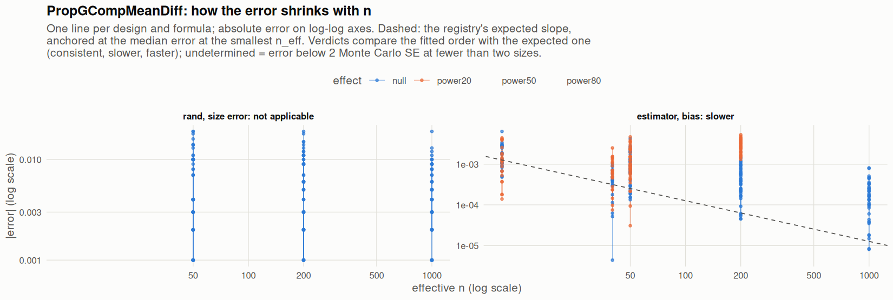

[← Campaign 2026-11-15-e36c7710 summary](README.md)

# Class PropGCompMeanDiff

Part of the [Classes index](classes.md). Response type: proportion. Status: null effect complete, power effects in progress. Verdict: **pass so far**.

<picture><source media="(prefers-color-scheme: dark)" srcset="figures/class-PropGCompMeanDiff-dark.png"></picture>

Convergence verdicts (worst over designs, formulas and effects; provisional until the class is complete):

| procedure | metric | verdict |
|---|---|---|
| estimator (bias) | bias | slower |
| rand | size | not applicable |

Null effect: 186 cells (0 failing). Size, coverage and bias / SD against the level each is held to.

| design | n | formula | procedure | size | coverage | bias / SD | size level | coverage level | verdict |
|---|---|---|---|---|---|---|---|---|---|
| Fixed:Bernoulli | 50 | `~.` | rand | 0.052 |  | 0.0038 | 0.05 | 0.95 | ok |
| Fixed:Bernoulli | 200 | `~.` | rand | 0.059 |  | 0.0085 | 0.05 | 0.95 | ok |
| Fixed:Bernoulli | 1000 | `~.` | rand | 0.052 |  | -0.0018 | 0.05 | 0.95 | ok |
| Fixed:Bernoulli | 50 | `~1` | rand | 0.051 |  | -0.031 | 0.05 | 0.95 | ok |
| Fixed:Bernoulli | 200 | `~1` | rand | 0.068 |  | -0.016 | 0.05 | 0.95 | ok |
| Fixed:Bernoulli | 1000 | `~1` | rand | 0.055 |  | -0.014 | 0.05 | 0.95 | ok |
| Fixed:Bernoulli@0.2 | 50 | `~.` | rand | 0.048 |  | -0.0092 | 0.05 | 0.95 | ok |
| Fixed:Bernoulli@0.2 | 200 | `~.` | rand | 0.048 |  | 0.018 | 0.05 | 0.95 | ok |
| Fixed:Bernoulli@0.2 | 1000 | `~.` | rand | 0.055 |  | -0.069 | 0.05 | 0.95 | ok |
| Fixed:Bernoulli@0.2 | 50 | `~1` | rand | 0.05 |  | -0.02 | 0.05 | 0.95 | ok |
| Fixed:Bernoulli@0.2 | 200 | `~1` | rand | 0.051 |  | 0.0041 | 0.05 | 0.95 | ok |
| Fixed:Bernoulli@0.2 | 1000 | `~1` | rand | 0.049 |  | -0.079 | 0.05 | 0.95 | ok |
| Fixed:BinaryMatch | 50 | `~.` | rand | 0.053 |  | -0.032 | 0.05 | 0.95 | ok |
| Fixed:BinaryMatch | 200 | `~.` | rand | 0.048 |  | 0.031 | 0.05 | 0.95 | ok |
| Fixed:BinaryMatch | 1000 | `~.` | rand | 0.053 |  | -0.043 | 0.05 | 0.95 | ok |
| Fixed:BinaryMatch | 50 | `~1` | rand | 0.052 |  | -0.016 | 0.05 | 0.95 | ok |
| Fixed:BinaryMatch | 200 | `~1` | rand | 0.049 |  | 0.032 | 0.05 | 0.95 | ok |
| Fixed:BinaryMatch | 1000 | `~1` | rand | 0.058 |  | -0.032 | 0.05 | 0.95 | ok |
| Fixed:Blocking | 50 | `~.` | rand | 0.049 |  | 0.035 | 0.05 | 0.95 | ok |
| Fixed:Blocking | 200 | `~.` | rand | 0.06 |  | 0.02 | 0.05 | 0.95 | ok |
| Fixed:Blocking | 1000 | `~.` | rand | 0.044 |  | -0.03 | 0.05 | 0.95 | ok |
| Fixed:Blocking | 50 | `~1` | rand | 0.04 |  | 0.012 | 0.05 | 0.95 | ok |
| Fixed:Blocking | 200 | `~1` | rand | 0.046 |  | 0.048 | 0.05 | 0.95 | ok |
| Fixed:Blocking | 1000 | `~1` | rand | 0.05 |  | -0.0027 | 0.05 | 0.95 | ok |
| Fixed:Blocking@0.2 | 50 | `~.` | rand | 0.036 |  | 0.04 | 0.05 | 0.95 | ok |
| Fixed:Blocking@0.2 | 200 | `~.` | rand | 0.059 |  | -0.00018 | 0.05 | 0.95 | ok |
| Fixed:Blocking@0.2 | 1000 | `~.` | rand | 0.047 |  | -0.056 | 0.05 | 0.95 | ok |
| Fixed:Blocking@0.2 | 50 | `~1` | rand | 0.06 |  | -0.03 | 0.05 | 0.95 | ok |
| Fixed:Blocking@0.2 | 200 | `~1` | rand | 0.045 |  | 0.026 | 0.05 | 0.95 | ok |
| Fixed:Blocking@0.2 | 1000 | `~1` | rand | 0.054 |  | -0.0051 | 0.05 | 0.95 | ok |
| Fixed:Greedy | 50 | `~.` | rand | 0.051 |  | 0.025 | 0.05 | 0.95 | ok |
| Fixed:Greedy | 200 | `~.` | rand | 0.065 |  | -0.02 | 0.05 | 0.95 | ok |
| Fixed:Greedy | 1000 | `~.` | rand | 0.041 |  | 0.012 | 0.05 | 0.95 | ok |
| Fixed:Greedy | 50 | `~1` | rand | 0.052 |  | 0.034 | 0.05 | 0.95 | ok |
| Fixed:Greedy | 200 | `~1` | rand | 0.059 |  | -0.019 | 0.05 | 0.95 | ok |
| Fixed:Greedy | 1000 | `~1` | rand | 0.04 |  | 0.018 | 0.05 | 0.95 | ok |
| Fixed:Greedy@0.2 | 50 | `~.` | rand | 0.054 |  | -0.066 | 0.05 | 0.95 | ok |
| Fixed:Greedy@0.2 | 200 | `~.` | rand | 0.048 |  | -0.017 | 0.05 | 0.95 | ok |
| Fixed:Greedy@0.2 | 1000 | `~.` | rand | 0.055 |  | -0.0042 | 0.05 | 0.95 | ok |
| Fixed:Greedy@0.2 | 50 | `~1` | rand | 0.054 |  | -0.057 | 0.05 | 0.95 | ok |
| Fixed:Greedy@0.2 | 200 | `~1` | rand | 0.048 |  | -0.037 | 0.05 | 0.95 | ok |
| Fixed:Greedy@0.2 | 1000 | `~1` | rand | 0.046 |  | -0.02 | 0.05 | 0.95 | ok |
| Fixed:GreedyDOptimal | 50 | `~.` | rand | 0.051 |  | 0.025 | 0.05 | 0.95 | ok |
| Fixed:GreedyDOptimal | 200 | `~.` | rand | 0.065 |  | -0.02 | 0.05 | 0.95 | ok |
| Fixed:GreedyDOptimal | 1000 | `~.` | rand | 0.041 |  | 0.012 | 0.05 | 0.95 | ok |
| Fixed:GreedyDOptimal | 50 | `~1` | rand | 0.052 |  | 0.034 | 0.05 | 0.95 | ok |
| Fixed:GreedyDOptimal | 200 | `~1` | rand | 0.059 |  | -0.019 | 0.05 | 0.95 | ok |
| Fixed:GreedyDOptimal | 1000 | `~1` | rand | 0.04 |  | 0.018 | 0.05 | 0.95 | ok |
| Fixed:GreedyDOptimal@0.2 | 50 | `~.` | rand | 0.054 |  | -0.066 | 0.05 | 0.95 | ok |
| Fixed:GreedyDOptimal@0.2 | 200 | `~.` | rand | 0.048 |  | -0.017 | 0.05 | 0.95 | ok |
| Fixed:GreedyDOptimal@0.2 | 1000 | `~.` | rand | 0.055 |  | -0.0042 | 0.05 | 0.95 | ok |
| Fixed:GreedyDOptimal@0.2 | 50 | `~1` | rand | 0.054 |  | -0.057 | 0.05 | 0.95 | ok |
| Fixed:GreedyDOptimal@0.2 | 200 | `~1` | rand | 0.048 |  | -0.037 | 0.05 | 0.95 | ok |
| Fixed:GreedyDOptimal@0.2 | 1000 | `~1` | rand | 0.046 |  | -0.02 | 0.05 | 0.95 | ok |
| Fixed:iBCRD | 50 | `~.` | rand | 0.06 |  | 0.015 | 0.05 | 0.95 | ok |
| Fixed:iBCRD | 200 | `~.` | rand | 0.049 |  | 0.031 | 0.05 | 0.95 | ok |
| Fixed:iBCRD | 1000 | `~.` | rand | 0.052 |  | -0.02 | 0.05 | 0.95 | ok |
| Fixed:iBCRD | 50 | `~1` | rand | 0.06 |  | -0.014 | 0.05 | 0.95 | ok |
| Fixed:iBCRD | 200 | `~1` | rand | 0.047 |  | 0.042 | 0.05 | 0.95 | ok |
| Fixed:iBCRD | 1000 | `~1` | rand | 0.058 |  | -0.021 | 0.05 | 0.95 | ok |
| Fixed:iBCRD@0.2 | 50 | `~.` | rand | 0.054 |  | 0.013 | 0.05 | 0.95 | ok |
| Fixed:iBCRD@0.2 | 200 | `~.` | rand | 0.053 |  | -0.029 | 0.05 | 0.95 | ok |
| Fixed:iBCRD@0.2 | 1000 | `~.` | rand | 0.046 |  | 0.015 | 0.05 | 0.95 | ok |
| Fixed:iBCRD@0.2 | 50 | `~1` | rand | 0.057 |  | -0.012 | 0.05 | 0.95 | ok |
| Fixed:iBCRD@0.2 | 200 | `~1` | rand | 0.055 |  | 0.0026 | 0.05 | 0.95 | ok |
| Fixed:iBCRD@0.2 | 1000 | `~1` | rand | 0.049 |  | -0.003 | 0.05 | 0.95 | ok |
| Fixed:MatchingGreedyPairSwitching | 50 | `~.` | rand | 0.051 |  | 0.0051 | 0.05 | 0.95 | ok |
| Fixed:MatchingGreedyPairSwitching | 200 | `~.` | rand | 0.061 |  | -0.029 | 0.05 | 0.95 | ok |
| Fixed:MatchingGreedyPairSwitching | 1000 | `~.` | rand | 0.049 |  | -0.0021 | 0.05 | 0.95 | ok |
| Fixed:MatchingGreedyPairSwitching | 50 | `~1` | rand | 0.05 |  | -0.0052 | 0.05 | 0.95 | ok |
| Fixed:MatchingGreedyPairSwitching | 200 | `~1` | rand | 0.061 |  | -0.029 | 0.05 | 0.95 | ok |
| Fixed:MatchingGreedyPairSwitching | 1000 | `~1` | rand | 0.051 |  | -0.00099 | 0.05 | 0.95 | ok |
| Fixed:OptimalBlocks | 50 | `~.` | rand | 0.04 |  | 0.0075 | 0.05 | 0.95 | ok |
| Fixed:OptimalBlocks | 200 | `~.` | rand | 0.053 |  | -0.0088 | 0.05 | 0.95 | ok |
| Fixed:OptimalBlocks | 1000 | `~.` | rand | 0.051 |  | 0.025 | 0.05 | 0.95 | ok |
| Fixed:OptimalBlocks | 50 | `~1` | rand | 0.04 |  | 0.021 | 0.05 | 0.95 | ok |
| Fixed:OptimalBlocks | 200 | `~1` | rand | 0.056 |  | 0.025 | 0.05 | 0.95 | ok |
| Fixed:OptimalBlocks | 1000 | `~1` | rand | 0.048 |  | 0.039 | 0.05 | 0.95 | ok |
| Fixed:OptimalBlocks@0.2 | 50 | `~.` | rand | 0.041 |  | -0.019 | 0.05 | 0.95 | ok |
| Fixed:OptimalBlocks@0.2 | 200 | `~.` | rand | 0.043 |  | 0.015 | 0.05 | 0.95 | ok |
| Fixed:OptimalBlocks@0.2 | 1000 | `~.` | rand | 0.037 |  | -0.032 | 0.05 | 0.95 | ok |
| Fixed:OptimalBlocks@0.2 | 50 | `~1` | rand | 0.046 |  | -0.027 | 0.05 | 0.95 | ok |
| Fixed:OptimalBlocks@0.2 | 200 | `~1` | rand | 0.055 |  | 0.0088 | 0.05 | 0.95 | ok |
| Fixed:OptimalBlocks@0.2 | 1000 | `~1` | rand | 0.046 |  | 0.0045 | 0.05 | 0.95 | ok |
| Fixed:Rerandomization | 50 | `~.` | rand | 0.049 |  | 0.016 | 0.05 | 0.95 | ok |
| Fixed:Rerandomization | 200 | `~.` | rand | 0.069 |  | -0.022 | 0.05 | 0.95 | ok |
| Fixed:Rerandomization | 1000 | `~.` | rand | 0.041 |  | 0.0052 | 0.05 | 0.95 | ok |
| Fixed:Rerandomization | 50 | `~1` | rand | 0.039 |  | 0.027 | 0.05 | 0.95 | ok |
| Fixed:Rerandomization | 200 | `~1` | rand | 0.061 |  | -0.041 | 0.05 | 0.95 | ok |
| Fixed:Rerandomization | 1000 | `~1` | rand | 0.061 |  | 0.0025 | 0.05 | 0.95 | ok |
| Fixed:Rerandomization@0.2 | 50 | `~.` | rand | 0.064 |  | -0.02 | 0.05 | 0.95 | ok |
| Fixed:Rerandomization@0.2 | 200 | `~.` | rand | 0.05 |  | -0.013 | 0.05 | 0.95 | ok |
| Fixed:Rerandomization@0.2 | 1000 | `~.` | rand | 0.059 |  | 0.052 | 0.05 | 0.95 | ok |
| Fixed:Rerandomization@0.2 | 50 | `~1` | rand | 0.053 |  | -0.015 | 0.05 | 0.95 | ok |
| Fixed:Rerandomization@0.2 | 200 | `~1` | rand | 0.055 |  | 0.011 | 0.05 | 0.95 | ok |
| Fixed:Rerandomization@0.2 | 1000 | `~1` | rand | 0.049 |  | 0.063 | 0.05 | 0.95 | ok |
| SeqOneByOne:Atkinson | 50 | `~.` | rand | 0.061 |  | -0.063 | 0.05 | 0.95 | ok |
| SeqOneByOne:Atkinson | 200 | `~.` | rand | 0.051 |  | 0.029 | 0.05 | 0.95 | ok |
| SeqOneByOne:Atkinson | 1000 | `~.` | rand | 0.053 |  | 0.04 | 0.05 | 0.95 | ok |
| SeqOneByOne:Atkinson | 50 | `~1` | rand | 0.047 |  | -0.054 | 0.05 | 0.95 | ok |
| SeqOneByOne:Atkinson | 200 | `~1` | rand | 0.063 |  | 0.024 | 0.05 | 0.95 | ok |
| SeqOneByOne:Atkinson | 1000 | `~1` | rand | 0.042 |  | 0.046 | 0.05 | 0.95 | ok |
| SeqOneByOne:Bernoulli | 50 | `~.` | rand | 0.058 |  | -0.02 | 0.05 | 0.95 | ok |
| SeqOneByOne:Bernoulli | 200 | `~.` | rand | 0.038 |  | 0.033 | 0.05 | 0.95 | ok |
| SeqOneByOne:Bernoulli | 1000 | `~.` | rand | 0.046 |  | -0.022 | 0.05 | 0.95 | ok |
| SeqOneByOne:Bernoulli | 50 | `~1` | rand | 0.063 |  | -0.0019 | 0.05 | 0.95 | ok |
| SeqOneByOne:Bernoulli | 200 | `~1` | rand | 0.05 |  | 0.034 | 0.05 | 0.95 | ok |
| SeqOneByOne:Bernoulli | 1000 | `~1` | rand | 0.045 |  | -0.0092 | 0.05 | 0.95 | ok |
| SeqOneByOne:Bernoulli@0.2 | 50 | `~.` | rand | 0.049 |  | 0.0097 | 0.05 | 0.95 | ok |
| SeqOneByOne:Bernoulli@0.2 | 200 | `~.` | rand | 0.041 |  | 0.025 | 0.05 | 0.95 | ok |
| SeqOneByOne:Bernoulli@0.2 | 1000 | `~.` | rand | 0.053 |  | -0.02 | 0.05 | 0.95 | ok |
| SeqOneByOne:Bernoulli@0.2 | 50 | `~1` | rand | 0.069 |  | -0.014 | 0.05 | 0.95 | ok |
| SeqOneByOne:Bernoulli@0.2 | 200 | `~1` | rand | 0.036 |  | 0.018 | 0.05 | 0.95 | ok |
| SeqOneByOne:Bernoulli@0.2 | 1000 | `~1` | rand | 0.045 |  | 0.0077 | 0.05 | 0.95 | ok |
| SeqOneByOne:Efron | 50 | `~.` | rand | 0.069 |  | 0.049 | 0.05 | 0.95 | ok |
| SeqOneByOne:Efron | 200 | `~.` | rand | 0.056 |  | 0.049 | 0.05 | 0.95 | ok |
| SeqOneByOne:Efron | 1000 | `~.` | rand | 0.049 |  | 0.0022 | 0.05 | 0.95 | ok |
| SeqOneByOne:Efron | 50 | `~1` | rand | 0.057 |  | 0.04 | 0.05 | 0.95 | ok |
| SeqOneByOne:Efron | 200 | `~1` | rand | 0.056 |  | 0.029 | 0.05 | 0.95 | ok |
| SeqOneByOne:Efron | 1000 | `~1` | rand | 0.046 |  | -0.0088 | 0.05 | 0.95 | ok |
| SeqOneByOne:iBCRD | 50 | `~.` | rand | 0.066 |  | 0.017 | 0.05 | 0.95 | ok |
| SeqOneByOne:iBCRD | 200 | `~.` | rand | 0.051 |  | 0.012 | 0.05 | 0.95 | ok |
| SeqOneByOne:iBCRD | 1000 | `~.` | rand | 0.052 |  | -0.02 | 0.05 | 0.95 | ok |
| SeqOneByOne:iBCRD | 50 | `~1` | rand | 0.058 |  | 0.0044 | 0.05 | 0.95 | ok |
| SeqOneByOne:iBCRD | 200 | `~1` | rand | 0.053 |  | 0.0097 | 0.05 | 0.95 | ok |
| SeqOneByOne:iBCRD | 1000 | `~1` | rand | 0.056 |  | 0.052 | 0.05 | 0.95 | ok |
| SeqOneByOne:iBCRD@0.2 | 50 | `~.` | rand | 0.047 |  | 0.016 | 0.05 | 0.95 | ok |
| SeqOneByOne:iBCRD@0.2 | 200 | `~.` | rand | 0.047 |  | 0.02 | 0.05 | 0.95 | ok |
| SeqOneByOne:iBCRD@0.2 | 1000 | `~.` | rand | 0.048 |  | -0.018 | 0.05 | 0.95 | ok |
| SeqOneByOne:iBCRD@0.2 | 50 | `~1` | rand | 0.068 |  | -0.012 | 0.05 | 0.95 | ok |
| SeqOneByOne:iBCRD@0.2 | 200 | `~1` | rand | 0.048 |  | 0.009 | 0.05 | 0.95 | ok |
| SeqOneByOne:iBCRD@0.2 | 1000 | `~1` | rand | 0.047 |  | 0.011 | 0.05 | 0.95 | ok |
| SeqOneByOne:KK14 | 50 | `~.` | rand | 0.046 |  | -0.029 | 0.05 | 0.95 | ok |
| SeqOneByOne:KK14 | 200 | `~.` | rand | 0.044 |  | 0.013 | 0.05 | 0.95 | ok |
| SeqOneByOne:KK14 | 1000 | `~.` | rand | 0.056 |  | 0.016 | 0.05 | 0.95 | ok |
| SeqOneByOne:KK14 | 50 | `~1` | rand | 0.049 |  | -0.021 | 0.05 | 0.95 | ok |
| SeqOneByOne:KK14 | 200 | `~1` | rand | 0.039 |  | 0.033 | 0.05 | 0.95 | ok |
| SeqOneByOne:KK14 | 1000 | `~1` | rand | 0.069 |  | 0.0082 | 0.05 | 0.95 | ok |
| SeqOneByOne:KK21 | 50 | `~.` | rand | 0.06 |  | -0.0053 | 0.05 | 0.95 | ok |
| SeqOneByOne:KK21 | 200 | `~.` | rand | 0.053 |  | 0.05 | 0.05 | 0.95 | ok |
| SeqOneByOne:KK21 | 1000 | `~.` | rand | 0.052 |  | -0.0041 | 0.05 | 0.95 | ok |
| SeqOneByOne:KK21 | 50 | `~1` | rand | 0.06 |  | -0.0052 | 0.05 | 0.95 | ok |
| SeqOneByOne:KK21 | 200 | `~1` | rand | 0.047 |  | 0.033 | 0.05 | 0.95 | ok |
| SeqOneByOne:KK21 | 1000 | `~1` | rand | 0.048 |  | 0.00081 | 0.05 | 0.95 | ok |
| SeqOneByOne:KK21stepwise | 50 | `~.` | rand | 0.048 |  | 0.015 | 0.05 | 0.95 | ok |
| SeqOneByOne:KK21stepwise | 200 | `~.` | rand | 0.051 |  | 0.013 | 0.05 | 0.95 | ok |
| SeqOneByOne:KK21stepwise | 1000 | `~.` | rand | 0.053 |  | 0.0071 | 0.05 | 0.95 | ok |
| SeqOneByOne:KK21stepwise | 50 | `~1` | rand | 0.047 |  | 0.036 | 0.05 | 0.95 | ok |
| SeqOneByOne:KK21stepwise | 200 | `~1` | rand | 0.044 |  | 0.046 | 0.05 | 0.95 | ok |
| SeqOneByOne:KK21stepwise | 1000 | `~1` | rand | 0.059 |  | 0.026 | 0.05 | 0.95 | ok |
| SeqOneByOne:PocockSimon | 50 | `~.` | rand | 0.053 |  | -0.058 | 0.05 | 0.95 | ok |
| SeqOneByOne:PocockSimon | 200 | `~.` | rand | 0.048 |  | 0.014 | 0.05 | 0.95 | ok |
| SeqOneByOne:PocockSimon | 1000 | `~.` | rand | 0.045 |  | -0.027 | 0.05 | 0.95 | ok |
| SeqOneByOne:PocockSimon | 50 | `~1` | rand | 0.052 |  | -0.066 | 0.05 | 0.95 | ok |
| SeqOneByOne:PocockSimon | 200 | `~1` | rand | 0.056 |  | 0.0095 | 0.05 | 0.95 | ok |
| SeqOneByOne:PocockSimon | 1000 | `~1` | rand | 0.048 |  | -0.056 | 0.05 | 0.95 | ok |
| SeqOneByOne:RandomBlockSize | 50 | `~.` | rand | 0.053 |  | 0.01 | 0.05 | 0.95 | ok |
| SeqOneByOne:RandomBlockSize | 200 | `~.` | rand | 0.052 |  | 0.026 | 0.05 | 0.95 | ok |
| SeqOneByOne:RandomBlockSize | 1000 | `~.` | rand | 0.043 |  | -0.011 | 0.05 | 0.95 | ok |
| SeqOneByOne:RandomBlockSize | 50 | `~1` | rand | 0.053 |  | 0.012 | 0.05 | 0.95 | ok |
| SeqOneByOne:RandomBlockSize | 200 | `~1` | rand | 0.039 |  | 0.03 | 0.05 | 0.95 | ok |
| SeqOneByOne:RandomBlockSize | 1000 | `~1` | rand | 0.047 |  | -0.036 | 0.05 | 0.95 | ok |
| SeqOneByOne:RandomBlockSize@0.2 | 50 | `~.` | rand | 0.054 |  | 0.019 | 0.05 | 0.95 | ok |
| SeqOneByOne:RandomBlockSize@0.2 | 200 | `~.` | rand | 0.054 |  | -0.02 | 0.05 | 0.95 | ok |
| SeqOneByOne:RandomBlockSize@0.2 | 1000 | `~.` | rand | 0.06 |  | 0.055 | 0.05 | 0.95 | ok |
| SeqOneByOne:RandomBlockSize@0.2 | 50 | `~1` | rand | 0.051 |  | 0.042 | 0.05 | 0.95 | ok |
| SeqOneByOne:RandomBlockSize@0.2 | 200 | `~1` | rand | 0.056 |  | 0.011 | 0.05 | 0.95 | ok |
| SeqOneByOne:RandomBlockSize@0.2 | 1000 | `~1` | rand | 0.056 |  | 0.023 | 0.05 | 0.95 | ok |
| SeqOneByOne:SPBR | 50 | `~.` | rand | 0.046 |  | 0.004 | 0.05 | 0.95 | ok |
| SeqOneByOne:SPBR | 200 | `~.` | rand | 0.054 |  | -0.012 | 0.05 | 0.95 | ok |
| SeqOneByOne:SPBR | 1000 | `~.` | rand | 0.043 |  | -0.013 | 0.05 | 0.95 | ok |
| SeqOneByOne:SPBR | 50 | `~1` | rand | 0.057 |  | 0.031 | 0.05 | 0.95 | ok |
| SeqOneByOne:SPBR | 200 | `~1` | rand | 0.051 |  | 0.0067 | 0.05 | 0.95 | ok |
| SeqOneByOne:SPBR | 1000 | `~1` | rand | 0.041 |  | 0.018 | 0.05 | 0.95 | ok |
| SeqOneByOne:SPBR@0.2 | 50 | `~.` | rand | 0.05 |  | -0.058 | 0.05 | 0.95 | ok |
| SeqOneByOne:SPBR@0.2 | 200 | `~.` | rand | 0.062 |  | 0.0025 | 0.05 | 0.95 | ok |
| SeqOneByOne:SPBR@0.2 | 1000 | `~.` | rand | 0.048 |  | 0.024 | 0.05 | 0.95 | ok |
| SeqOneByOne:SPBR@0.2 | 50 | `~1` | rand | 0.06 |  | -0.079 | 0.05 | 0.95 | ok |
| SeqOneByOne:SPBR@0.2 | 200 | `~1` | rand | 0.057 |  | 0.0012 | 0.05 | 0.95 | ok |
| SeqOneByOne:SPBR@0.2 | 1000 | `~1` | rand | 0.053 |  | 0.11 | 0.05 | 0.95 | ok |
| SeqOneByOne:Urn | 50 | `~.` | rand | 0.064 |  | 0.015 | 0.05 | 0.95 | ok |
| SeqOneByOne:Urn | 200 | `~.` | rand | 0.06 |  | 0.022 | 0.05 | 0.95 | ok |
| SeqOneByOne:Urn | 1000 | `~.` | rand | 0.062 |  | -0.036 | 0.05 | 0.95 | ok |
| SeqOneByOne:Urn | 50 | `~1` | rand | 0.052 |  | -0.0035 | 0.05 | 0.95 | ok |
| SeqOneByOne:Urn | 200 | `~1` | rand | 0.059 |  | 0.0016 | 0.05 | 0.95 | ok |
| SeqOneByOne:Urn | 1000 | `~1` | rand | 0.052 |  | 0.03 | 0.05 | 0.95 | ok |

Power effects: 124 cells (0 failing coverage).

| design | n | effect | formula | procedure | power | coverage of the true estimand | coverage level | verdict |
|---|---|---|---|---|---|---|---|---|
| Fixed:Bernoulli | 50 | power20 | `~.` | rand | 0.136 |  | 0.95 | ok |
| Fixed:Bernoulli | 200 | power20 | `~.` | rand | 0.21 |  | 0.95 | ok |
| Fixed:Bernoulli | 50 | power20 | `~1` | rand | 0.084 |  | 0.95 | ok |
| Fixed:Bernoulli | 200 | power20 | `~1` | rand | 0.102 |  | 0.95 | ok |
| Fixed:Bernoulli@0.2 | 50 | power20 | `~.` | rand | 0.104 |  | 0.95 | ok |
| Fixed:Bernoulli@0.2 | 200 | power20 | `~.` | rand | 0.146 |  | 0.95 | ok |
| Fixed:Bernoulli@0.2 | 50 | power20 | `~1` | rand | 0.1 |  | 0.95 | ok |
| Fixed:Bernoulli@0.2 | 200 | power20 | `~1` | rand | 0.074 |  | 0.95 | ok |
| Fixed:BinaryMatch | 50 | power20 | `~.` | rand | 0.184 |  | 0.95 | ok |
| Fixed:BinaryMatch | 200 | power20 | `~.` | rand | 0.226 |  | 0.95 | ok |
| Fixed:BinaryMatch | 50 | power20 | `~1` | rand | 0.124 |  | 0.95 | ok |
| Fixed:BinaryMatch | 200 | power20 | `~1` | rand | 0.182 |  | 0.95 | ok |
| Fixed:Blocking | 50 | power20 | `~.` | rand | 0.144 |  | 0.95 | ok |
| Fixed:Blocking | 200 | power20 | `~.` | rand | 0.178 |  | 0.95 | ok |
| Fixed:Blocking | 50 | power20 | `~1` | rand | 0.082 |  | 0.95 | ok |
| Fixed:Blocking | 200 | power20 | `~1` | rand | 0.082 |  | 0.95 | ok |
| Fixed:Blocking@0.2 | 50 | power20 | `~.` | rand | 0.124 |  | 0.95 | ok |
| Fixed:Blocking@0.2 | 200 | power20 | `~.` | rand | 0.13 |  | 0.95 | ok |
| Fixed:Blocking@0.2 | 50 | power20 | `~1` | rand | 0.08 |  | 0.95 | ok |
| Fixed:Blocking@0.2 | 200 | power20 | `~1` | rand | 0.084 |  | 0.95 | ok |
| Fixed:Greedy | 50 | power20 | `~.` | rand | 0.168 |  | 0.95 | ok |
| Fixed:Greedy | 200 | power20 | `~.` | rand | 0.206 |  | 0.95 | ok |
| Fixed:Greedy | 50 | power20 | `~1` | rand | 0.148 |  | 0.95 | ok |
| Fixed:Greedy | 200 | power20 | `~1` | rand | 0.192 |  | 0.95 | ok |
| Fixed:Greedy@0.2 | 50 | power20 | `~.` | rand | 0.12 |  | 0.95 | ok |
| Fixed:Greedy@0.2 | 200 | power20 | `~.` | rand | 0.142 |  | 0.95 | ok |
| Fixed:Greedy@0.2 | 50 | power20 | `~1` | rand | 0.13 |  | 0.95 | ok |
| Fixed:Greedy@0.2 | 200 | power20 | `~1` | rand | 0.158 |  | 0.95 | ok |
| Fixed:GreedyDOptimal | 50 | power20 | `~.` | rand | 0.168 |  | 0.95 | ok |
| Fixed:GreedyDOptimal | 200 | power20 | `~.` | rand | 0.206 |  | 0.95 | ok |
| Fixed:GreedyDOptimal | 50 | power20 | `~1` | rand | 0.148 |  | 0.95 | ok |
| Fixed:GreedyDOptimal | 200 | power20 | `~1` | rand | 0.192 |  | 0.95 | ok |
| Fixed:GreedyDOptimal@0.2 | 50 | power20 | `~.` | rand | 0.12 |  | 0.95 | ok |
| Fixed:GreedyDOptimal@0.2 | 200 | power20 | `~.` | rand | 0.142 |  | 0.95 | ok |
| Fixed:GreedyDOptimal@0.2 | 50 | power20 | `~1` | rand | 0.13 |  | 0.95 | ok |
| Fixed:GreedyDOptimal@0.2 | 200 | power20 | `~1` | rand | 0.158 |  | 0.95 | ok |
| Fixed:iBCRD | 50 | power20 | `~.` | rand | 0.15 |  | 0.95 | ok |
| Fixed:iBCRD | 200 | power20 | `~.` | rand | 0.186 |  | 0.95 | ok |
| Fixed:iBCRD | 50 | power20 | `~1` | rand | 0.078 |  | 0.95 | ok |
| Fixed:iBCRD | 200 | power20 | `~1` | rand | 0.104 |  | 0.95 | ok |
| Fixed:iBCRD@0.2 | 50 | power20 | `~.` | rand | 0.136 |  | 0.95 | ok |
| Fixed:iBCRD@0.2 | 200 | power20 | `~.` | rand | 0.156 |  | 0.95 | ok |
| Fixed:iBCRD@0.2 | 50 | power20 | `~1` | rand | 0.092 |  | 0.95 | ok |
| Fixed:iBCRD@0.2 | 200 | power20 | `~1` | rand | 0.082 |  | 0.95 | ok |
| Fixed:MatchingGreedyPairSwitching | 50 | power20 | `~.` | rand | 0.156 |  | 0.95 | ok |
| Fixed:MatchingGreedyPairSwitching | 200 | power20 | `~.` | rand | 0.19 |  | 0.95 | ok |
| Fixed:MatchingGreedyPairSwitching | 50 | power20 | `~1` | rand | 0.15 |  | 0.95 | ok |
| Fixed:MatchingGreedyPairSwitching | 200 | power20 | `~1` | rand | 0.198 |  | 0.95 | ok |
| Fixed:OptimalBlocks | 50 | power20 | `~.` | rand | 0.158 |  | 0.95 | ok |
| Fixed:OptimalBlocks | 200 | power20 | `~.` | rand | 0.214 |  | 0.95 | ok |
| Fixed:OptimalBlocks | 50 | power20 | `~1` | rand | 0.11 |  | 0.95 | ok |
| Fixed:OptimalBlocks | 200 | power20 | `~1` | rand | 0.15 |  | 0.95 | ok |
| Fixed:OptimalBlocks@0.2 | 50 | power20 | `~.` | rand | 0.106 |  | 0.95 | ok |
| Fixed:OptimalBlocks@0.2 | 200 | power20 | `~.` | rand | 0.122 |  | 0.95 | ok |
| Fixed:OptimalBlocks@0.2 | 50 | power20 | `~1` | rand | 0.088 |  | 0.95 | ok |
| Fixed:OptimalBlocks@0.2 | 200 | power20 | `~1` | rand | 0.096 |  | 0.95 | ok |
| Fixed:Rerandomization | 50 | power20 | `~.` | rand | 0.192 |  | 0.95 | ok |
| Fixed:Rerandomization | 200 | power20 | `~.` | rand | 0.2 |  | 0.95 | ok |
| Fixed:Rerandomization | 50 | power20 | `~1` | rand | 0.082 |  | 0.95 | ok |
| Fixed:Rerandomization | 200 | power20 | `~1` | rand | 0.092 |  | 0.95 | ok |
| Fixed:Rerandomization@0.2 | 50 | power20 | `~.` | rand | 0.114 |  | 0.95 | ok |
| Fixed:Rerandomization@0.2 | 200 | power20 | `~.` | rand | 0.14 |  | 0.95 | ok |
| Fixed:Rerandomization@0.2 | 50 | power20 | `~1` | rand | 0.07 |  | 0.95 | ok |
| Fixed:Rerandomization@0.2 | 200 | power20 | `~1` | rand | 0.088 |  | 0.95 | ok |
| SeqOneByOne:Atkinson | 50 | power20 | `~.` | rand | 0.182 |  | 0.95 | ok |
| SeqOneByOne:Atkinson | 200 | power20 | `~.` | rand | 0.204 |  | 0.95 | ok |
| SeqOneByOne:Atkinson | 50 | power20 | `~1` | rand | 0.142 |  | 0.95 | ok |
| SeqOneByOne:Atkinson | 200 | power20 | `~1` | rand | 0.15 |  | 0.95 | ok |
| SeqOneByOne:Bernoulli | 50 | power20 | `~.` | rand | 0.152 |  | 0.95 | ok |
| SeqOneByOne:Bernoulli | 200 | power20 | `~.` | rand | 0.184 |  | 0.95 | ok |
| SeqOneByOne:Bernoulli | 50 | power20 | `~1` | rand | 0.098 |  | 0.95 | ok |
| SeqOneByOne:Bernoulli | 200 | power20 | `~1` | rand | 0.112 |  | 0.95 | ok |
| SeqOneByOne:Bernoulli@0.2 | 50 | power20 | `~.` | rand | 0.114 |  | 0.95 | ok |
| SeqOneByOne:Bernoulli@0.2 | 200 | power20 | `~.` | rand | 0.122 |  | 0.95 | ok |
| SeqOneByOne:Bernoulli@0.2 | 50 | power20 | `~1` | rand | 0.08 |  | 0.95 | ok |
| SeqOneByOne:Bernoulli@0.2 | 200 | power20 | `~1` | rand | 0.074 |  | 0.95 | ok |
| SeqOneByOne:Efron | 50 | power20 | `~.` | rand | 0.172 |  | 0.95 | ok |
| SeqOneByOne:Efron | 200 | power20 | `~.` | rand | 0.196 |  | 0.95 | ok |
| SeqOneByOne:Efron | 50 | power20 | `~1` | rand | 0.104 |  | 0.95 | ok |
| SeqOneByOne:Efron | 200 | power20 | `~1` | rand | 0.084 |  | 0.95 | ok |
| SeqOneByOne:iBCRD | 50 | power20 | `~.` | rand | 0.17 |  | 0.95 | ok |
| SeqOneByOne:iBCRD | 200 | power20 | `~.` | rand | 0.216 |  | 0.95 | ok |
| SeqOneByOne:iBCRD | 50 | power20 | `~1` | rand | 0.076 |  | 0.95 | ok |
| SeqOneByOne:iBCRD | 200 | power20 | `~1` | rand | 0.09 |  | 0.95 | ok |
| SeqOneByOne:iBCRD@0.2 | 50 | power20 | `~.` | rand | 0.114 |  | 0.95 | ok |
| SeqOneByOne:iBCRD@0.2 | 200 | power20 | `~.` | rand | 0.142 |  | 0.95 | ok |
| SeqOneByOne:iBCRD@0.2 | 50 | power20 | `~1` | rand | 0.076 |  | 0.95 | ok |
| SeqOneByOne:iBCRD@0.2 | 200 | power20 | `~1` | rand | 0.104 |  | 0.95 | ok |
| SeqOneByOne:KK14 | 50 | power20 | `~.` | rand | 0.144 |  | 0.95 | ok |
| SeqOneByOne:KK14 | 200 | power20 | `~.` | rand | 0.2 |  | 0.95 | ok |
| SeqOneByOne:KK14 | 50 | power20 | `~1` | rand | 0.106 |  | 0.95 | ok |
| SeqOneByOne:KK14 | 200 | power20 | `~1` | rand | 0.144 |  | 0.95 | ok |
| SeqOneByOne:KK21 | 50 | power20 | `~.` | rand | 0.186 |  | 0.95 | ok |
| SeqOneByOne:KK21 | 200 | power20 | `~.` | rand | 0.228 |  | 0.95 | ok |
| SeqOneByOne:KK21 | 50 | power20 | `~1` | rand | 0.088 |  | 0.95 | ok |
| SeqOneByOne:KK21 | 200 | power20 | `~1` | rand | 0.15 |  | 0.95 | ok |
| SeqOneByOne:KK21stepwise | 50 | power20 | `~.` | rand | 0.16 |  | 0.95 | ok |
| SeqOneByOne:KK21stepwise | 200 | power20 | `~.` | rand | 0.2 |  | 0.95 | ok |
| SeqOneByOne:KK21stepwise | 50 | power20 | `~1` | rand | 0.102 |  | 0.95 | ok |
| SeqOneByOne:KK21stepwise | 200 | power20 | `~1` | rand | 0.118 |  | 0.95 | ok |
| SeqOneByOne:PocockSimon | 50 | power20 | `~.` | rand | 0.148 |  | 0.95 | ok |
| SeqOneByOne:PocockSimon | 200 | power20 | `~.` | rand | 0.196 |  | 0.95 | ok |
| SeqOneByOne:PocockSimon | 50 | power20 | `~1` | rand | 0.072 |  | 0.95 | ok |
| SeqOneByOne:PocockSimon | 200 | power20 | `~1` | rand | 0.106 |  | 0.95 | ok |
| SeqOneByOne:RandomBlockSize | 50 | power20 | `~.` | rand | 0.176 |  | 0.95 | ok |
| SeqOneByOne:RandomBlockSize | 200 | power20 | `~.` | rand | 0.182 |  | 0.95 | ok |
| SeqOneByOne:RandomBlockSize | 50 | power20 | `~1` | rand | 0.102 |  | 0.95 | ok |
| SeqOneByOne:RandomBlockSize | 200 | power20 | `~1` | rand | 0.08 |  | 0.95 | ok |
| SeqOneByOne:RandomBlockSize@0.2 | 50 | power20 | `~.` | rand | 0.156 |  | 0.95 | ok |
| SeqOneByOne:RandomBlockSize@0.2 | 200 | power20 | `~.` | rand | 0.158 |  | 0.95 | ok |
| SeqOneByOne:RandomBlockSize@0.2 | 50 | power20 | `~1` | rand | 0.078 |  | 0.95 | ok |
| SeqOneByOne:RandomBlockSize@0.2 | 200 | power20 | `~1` | rand | 0.098 |  | 0.95 | ok |
| SeqOneByOne:SPBR | 50 | power20 | `~.` | rand | 0.148 |  | 0.95 | ok |
| SeqOneByOne:SPBR | 200 | power20 | `~.` | rand | 0.184 |  | 0.95 | ok |
| SeqOneByOne:SPBR | 50 | power20 | `~1` | rand | 0.08 |  | 0.95 | ok |
| SeqOneByOne:SPBR | 200 | power20 | `~1` | rand | 0.098 |  | 0.95 | ok |
| SeqOneByOne:SPBR@0.2 | 50 | power20 | `~.` | rand | 0.114 |  | 0.95 | ok |
| SeqOneByOne:SPBR@0.2 | 200 | power20 | `~.` | rand | 0.13 |  | 0.95 | ok |
| SeqOneByOne:SPBR@0.2 | 50 | power20 | `~1` | rand | 0.08 |  | 0.95 | ok |
| SeqOneByOne:SPBR@0.2 | 200 | power20 | `~1` | rand | 0.062 |  | 0.95 | ok |
| SeqOneByOne:Urn | 50 | power20 | `~.` | rand | 0.184 |  | 0.95 | ok |
| SeqOneByOne:Urn | 200 | power20 | `~.` | rand | 0.204 |  | 0.95 | ok |
| SeqOneByOne:Urn | 50 | power20 | `~1` | rand | 0.07 |  | 0.95 | ok |
| SeqOneByOne:Urn | 200 | power20 | `~1` | rand | 0.11 |  | 0.95 | ok |

[← Campaign 2026-11-15-e36c7710 summary](README.md)
