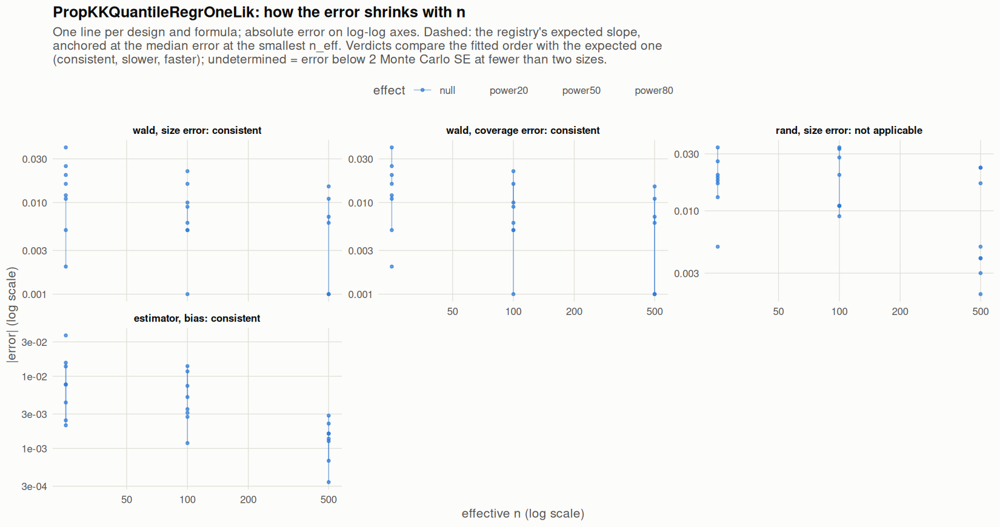

[← Campaign 2026-11-15-e36c7710 summary](README.md)

# Class PropKKQuantileRegrOneLik

Part of the [Classes index](classes.md). Response type: proportion. Status: null effect complete, power effects not started. Verdict: **pass so far**.

<picture><source media="(prefers-color-scheme: dark)" srcset="figures/class-PropKKQuantileRegrOneLik-dark.png"></picture>

Convergence verdicts (worst over designs, formulas and effects; provisional until the class is complete):

| procedure | metric | verdict |
|---|---|---|
| estimator (bias) | bias | consistent |
| wald | coverage | consistent |
| rand | size | not applicable |
| wald | size | consistent |

Null effect: 48 cells (0 failing). Size, coverage and bias / SD against the level each is held to.

| design | n | formula | procedure | size | coverage | bias / SD | size level | coverage level | verdict |
|---|---|---|---|---|---|---|---|---|---|
| Fixed:BinaryMatch | 50 | `~.` | rand | 0.033 |  | 0.025 | 0.05 | 0.95 | ok |
| Fixed:BinaryMatch | 200 | `~.` | rand | 0.039 |  | 0.02 | 0.05 | 0.95 | ok |
| Fixed:BinaryMatch | 1000 | `~.` | rand | 0.052 |  | 0.011 | 0.05 | 0.95 | ok |
| Fixed:BinaryMatch | 50 | `~.` | wald | 0.066 | 0.934 | 0.025 | 0.1 | 0.9 | ok |
| Fixed:BinaryMatch | 200 | `~.` | wald | 0.06 | 0.94 | 0.02 | 0.0815 | 0.919 | ok |
| Fixed:BinaryMatch | 1000 | `~.` | wald | 0.065 | 0.935 | 0.011 | 0.0608 | 0.939 | ok |
| Fixed:BinaryMatch | 50 | `~1` | rand | 0.031 |  | 0.0067 | 0.05 | 0.95 | ok |
| Fixed:BinaryMatch | 200 | `~1` | rand | 0.039 |  | 0.0086 | 0.05 | 0.95 | ok |
| Fixed:BinaryMatch | 1000 | `~1` | rand | 0.055 |  | 0.021 | 0.05 | 0.95 | ok |
| Fixed:BinaryMatch | 50 | `~1` | wald | 0.03 | 0.97 | 0.0067 | 0.1 | 0.9 | ok |
| Fixed:BinaryMatch | 200 | `~1` | wald | 0.034 | 0.966 | 0.0086 | 0.0815 | 0.919 | ok |
| Fixed:BinaryMatch | 1000 | `~1` | wald | 0.049 | 0.951 | 0.021 | 0.0608 | 0.939 | ok |
| SeqOneByOne:KK14 | 50 | `~.` | rand | 0.03 |  | -0.027 | 0.05 | 0.95 | ok |
| SeqOneByOne:KK14 | 200 | `~.` | rand | 0.017 |  | -0.024 | 0.05 | 0.95 | ok |
| SeqOneByOne:KK14 | 1000 | `~.` | rand | 0.033 |  | -0.022 | 0.05 | 0.95 | ok |
| SeqOneByOne:KK14 | 50 | `~.` | wald | 0.09 | 0.91 | -0.027 | 0.1 | 0.9 | ok |
| SeqOneByOne:KK14 | 200 | `~.` | wald | 0.056 | 0.944 | -0.024 | 0.0815 | 0.919 | ok |
| SeqOneByOne:KK14 | 1000 | `~.` | wald | 0.061 | 0.939 | -0.022 | 0.0608 | 0.939 | ok |
| SeqOneByOne:KK14 | 50 | `~1` | rand | 0.032 |  | 0.042 | 0.05 | 0.95 | ok |
| SeqOneByOne:KK14 | 200 | `~1` | rand | 0.03 |  | 0.047 | 0.05 | 0.95 | ok |
| SeqOneByOne:KK14 | 1000 | `~1` | rand | 0.053 |  | 0.033 | 0.05 | 0.95 | ok |
| SeqOneByOne:KK14 | 50 | `~1` | wald | 0.075 | 0.925 | 0.042 | 0.1 | 0.9 | ok |
| SeqOneByOne:KK14 | 200 | `~1` | wald | 0.041 | 0.959 | 0.047 | 0.0815 | 0.919 | ok |
| SeqOneByOne:KK14 | 1000 | `~1` | wald | 0.056 | 0.944 | 0.033 | 0.0608 | 0.939 | ok |
| SeqOneByOne:KK21 | 50 | `~.` | rand | 0.024 |  | -0.0081 | 0.05 | 0.95 | ok |
| SeqOneByOne:KK21 | 200 | `~.` | rand | 0.016 |  | 0.039 | 0.05 | 0.95 | ok |
| SeqOneByOne:KK21 | 1000 | `~.` | rand | 0.027 |  | -0.027 | 0.05 | 0.95 | ok |
| SeqOneByOne:KK21 | 50 | `~.` | wald | 0.061 | 0.939 | -0.0081 | 0.1 | 0.9 | ok |
| SeqOneByOne:KK21 | 200 | `~.` | wald | 0.028 | 0.972 | 0.039 | 0.0815 | 0.919 | ok |
| SeqOneByOne:KK21 | 1000 | `~.` | wald | 0.05 | 0.95 | -0.027 | 0.0608 | 0.939 | ok |
| SeqOneByOne:KK21 | 50 | `~1` | rand | 0.045 |  | 0.046 | 0.05 | 0.95 | ok |
| SeqOneByOne:KK21 | 200 | `~1` | rand | 0.041 |  | 0.088 | 0.05 | 0.95 | ok |
| SeqOneByOne:KK21 | 1000 | `~1` | rand | 0.046 |  | 0.023 | 0.05 | 0.95 | ok |
| SeqOneByOne:KK21 | 50 | `~1` | wald | 0.052 | 0.948 | 0.046 | 0.1 | 0.9 | ok |
| SeqOneByOne:KK21 | 200 | `~1` | wald | 0.045 | 0.955 | 0.088 | 0.0815 | 0.919 | ok |
| SeqOneByOne:KK21 | 1000 | `~1` | wald | 0.05 | 0.95 | 0.023 | 0.0608 | 0.939 | ok |
| SeqOneByOne:KK21stepwise | 50 | `~.` | rand | 0.016 |  | 0.015 | 0.05 | 0.95 | ok |
| SeqOneByOne:KK21stepwise | 200 | `~.` | rand | 0.022 |  | 0.025 | 0.05 | 0.95 | ok |
| SeqOneByOne:KK21stepwise | 1000 | `~.` | rand | 0.027 |  | -0.0057 | 0.05 | 0.95 | ok |
| SeqOneByOne:KK21stepwise | 50 | `~.` | wald | 0.045 | 0.955 | 0.015 | 0.1 | 0.9 | ok |
| SeqOneByOne:KK21stepwise | 200 | `~.` | wald | 0.049 | 0.951 | 0.025 | 0.0815 | 0.919 | ok |
| SeqOneByOne:KK21stepwise | 1000 | `~.` | wald | 0.051 | 0.949 | -0.0057 | 0.0608 | 0.939 | ok |
| SeqOneByOne:KK21stepwise | 50 | `~1` | rand | 0.037 |  | 0.11 | 0.05 | 0.95 | ok |
| SeqOneByOne:KK21stepwise | 200 | `~1` | rand | 0.039 |  | 0.073 | 0.05 | 0.95 | ok |
| SeqOneByOne:KK21stepwise | 1000 | `~1` | rand | 0.054 |  | 0.041 | 0.05 | 0.95 | ok |
| SeqOneByOne:KK21stepwise | 50 | `~1` | wald | 0.038 | 0.962 | 0.11 | 0.1 | 0.9 | ok |
| SeqOneByOne:KK21stepwise | 200 | `~1` | wald | 0.045 | 0.955 | 0.073 | 0.0815 | 0.919 | ok |
| SeqOneByOne:KK21stepwise | 1000 | `~1` | wald | 0.057 | 0.943 | 0.041 | 0.0608 | 0.939 | ok |

[← Campaign 2026-11-15-e36c7710 summary](README.md)
